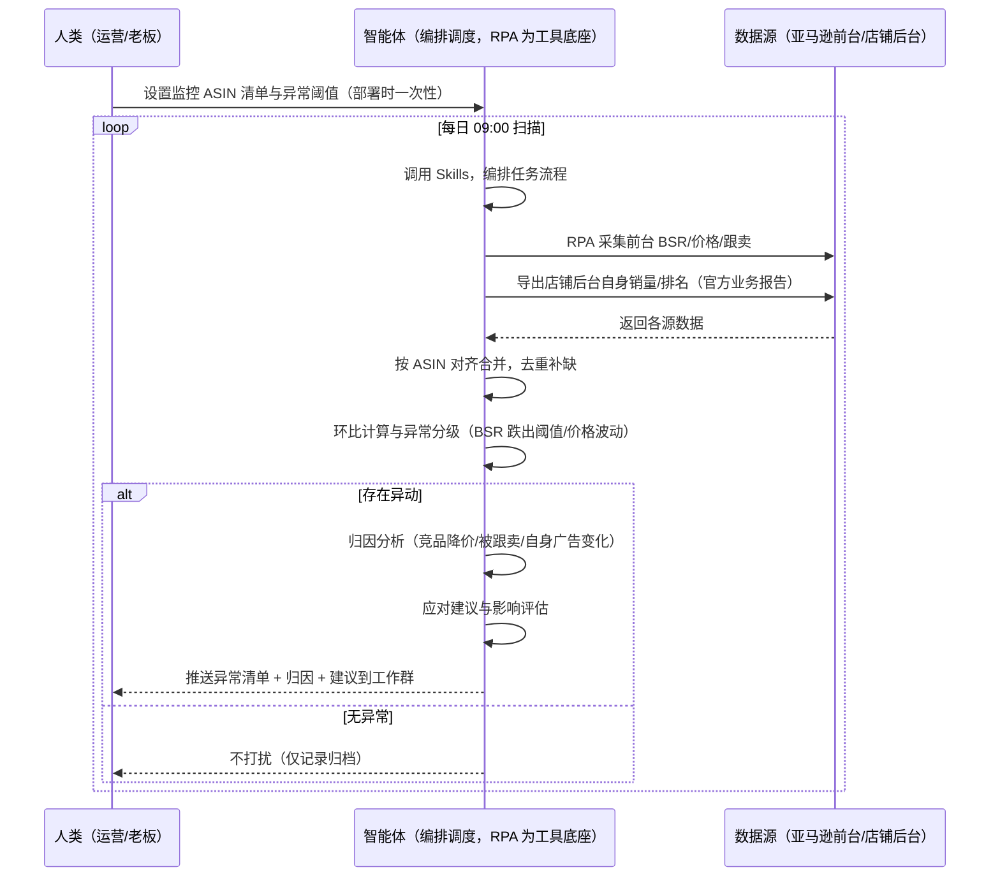
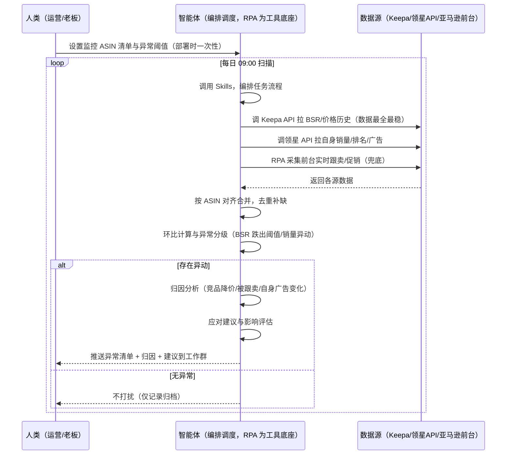

> 为亚马逊卖家团队打造的 BSR/销量趋势跟踪方案。自身与竞品 ASIN 的 BSR、价格、销量趋势数据，本方案由智能体调度八爪鱼 RPA 工具统一取数。未购 SaaS 客户智能体自动化走前台自动化采集，已购 SaaS 客户走「API 取核心 + 前台兜底」。**每日扫描，异常自动归因，有异动才推送，无异常不打扰**。

> Agent 自动化需开通企业功能
> 点击申请1个月免费权限
> [点击申请 →](https://skieer.feishu.cn/share/base/form/shrcnFwMayykP5iaL38fnZKTbrg)

---

## 一、用户与需求

核心矛盾：BSR 排名和销量趋势天天在变，但数据要人工盯——打开前台看排名、切 Keepa 看历史、切后台看自己，手动记录对比。缺一天数据，趋势库就断一截，环比和归因全部失真；等发现排名暴跌，往往已经跌出首页。

两类客户痛点同源，数据来源不同：

- 未购 SaaS 客户（新卖家/小团队）：人工每天打开前台看 BSR、切后台看销量，手抄记录；
- 已购 SaaS 客户（用 Keepa 看历史、领星看自身）：工具各自为政，仍要人打开对照；Keepa 有数据但只给人看，不自动归因。

适用客户：有核心 ASIN（自身+竞品合计 ≥10 个）、关注排名与销量波动的卖家。只盯 1-2 个 ASIN 的小卖家价值有限（人工每天看一眼即可）。

### 1.1 不同模式卖家

| 类型 | 选择 | 建议 |
|-|-|-|
| 品牌 | 首选 | 强烈推荐（核心 ASIN 多、排名波动直接影响销量） |
| 精铺 | 次选 | 推荐，聚焦核心款与对标 ASIN 的趋势监控 |
| 铺货 | 任意 | 不推荐，铺货不看单品趋势 |

### 1.2 不同类目卖家

| 类目 | 最关注维度 | 核心逻辑 |
|-|-|-|
| 3C 数码 | BSR 波动 + 价格趋势 | 迭代快，排名波动常伴价格战 |
| 家居家具 | BSR 季节性 + 评价增速 | 大件受季节影响大，评价增速异常需关注 |
| 美妆个护 | 排名 + 评分变化 | 评分下滑往往先于排名下滑 |
| 户外运动 | 季节性窗口 + BSR | 功能品受季节窗口影响，需提前备货判断 |

### 1.3 不同角色用户

| 用户 | 需求 | 问题 | 投入时间（估算） |
|-|-|-|-|
| 老板 | 看核心款健康度 | 月底才看趋势，异常早发生 | 0.5 小时/周 |
| 运营 | 盯排名/销量异动，及时止损 | 手动翻多个工具，漏看、断档 | 1-2 小时/天 |

---

## 二、现在的方法与问题

### 2.1 流程步骤与问题总结

**人工方式（未购 SaaS 客户）**

| 序号 | 步骤 | 现在的方法 | 问题缺陷 |
|-|-|-|-|
| 1 | 记 ASIN | 手动维护核心 ASIN 清单 | 漏记、错记 |
| 2 | 查排名 | 每天打开前台看 BSR，手抄 | 反复切换、易漏，缺一天断档 |
| 3 | 查销量 | 切自己后台看销量 | 手抄易错 |
| 4 | 判断 | 凭印象"好像跌了" | 无环比、无阈值 |
| 5 | 找原因 | 猜"可能被跟卖/竞品降价" | 无归因逻辑 |

**SaaS 方式（已购 Keepa/领星客户）**

| 序号 | 步骤 | 现在的方法 | 问题缺陷 |
|-|-|-|-|
| 1 | 记 ASIN | 手动维护清单 | 漏记、错记 |
| 2 | 查排名历史 | Keepa 看 BSR 历史（人看） | 有数据但只给人看，不自动判断 |
| 3 | 查自身 | 领星看自己销量/排名 | 自身数据全，但竞品侧要另开 Keepa |
| 4 | 判断 | 凭经验综合 | 无跨源环比与归因 |
| 5 | 找原因 | 猜 | 无归因逻辑 |

### 2.2 问题分析

| 序号 | 根因 | 具体表现 |
|-|-|-|
| 1 | 多平台反复手动执行 | 前台/Keepa/后台多处来回切，每天耗时 |
| 2 | 数据连续性差 | 缺一天趋势库断档，环比失真 |
| 3 | 无跨源环比 | 自身与竞品不联动看，看不清异动原因 |
| 4 | 归因靠猜 | 排名跌了不知道是竞品降价/被跟卖/自身广告断了 |

---

## 三、解决方案

### 3.1 功能概述

为亚马逊卖家团队打造的智能体驱动 BSR/销量趋势跟踪方案，解决排名与销量趋势靠人工盯、数据断档、异常归因靠猜的问题。

定时触发并调度多个工具，调起八爪鱼 RPA（Agent 的工具底座，能耦合多系统、完成自动化任务执行）统一取数，按 ASIN 对齐合并，输出趋势跟踪结论，涵盖「环比计算、异常分级、事件归因、应对建议」。每日扫描、有异动才推送。

### 3.2 系统结合

| 要素 | 说明 |
|-|-|
| 客户现有工具盘点 | **未购 SaaS 客户**：无第三方工具，数据全靠前台翻页 + 后台导出。   **已购 SaaS 客户**（主流组合）：Keepa（BSR/价格历史最全最稳，API €49/月起）、领星 ERP（自身销量/广告/财务，开放 API 需企业申请） |
| 数据/能力来源 | **未购 SaaS**：亚马逊前台（BSR/价格/跟卖，RPA 采集）+ 店铺后台官方业务报告导出（自身销量/排名）。   **已购 SaaS**：Keepa API（BSR/价格历史）+ 领星开放 API（自身销量/广告）+ RPA 前台兜底（实时跟卖/促销） |
| RPA 耦合动作 | 作为 Agent 的工具底座，按计划调度多数据源取数（官方导出/API 优先 + 前台采集兜底），按 ASIN 对齐去重合并，统一流转给智能体分析；   任一数据源失败自动重试、异常告警 |
| 耦合出的新价值 | 单工具给不了的端到端结论：自身与竞品趋势一次取齐 → 跨源环比 → 异常归因 → 应对建议，每日扫描、异动自动推送工作群 |

### 3.3 智能体执行流程

用户向智能体输入会话（入参：监控 ASIN 清单）或智能体定时触发。支持两种数据通道，部署时按客户现有工具选择：

通道一：无 SaaS 方式（RPA 采集亚马逊前台，适合未购 Keepa/领星的客户）

通道二：有 SaaS 方式（Keepa/领星 API 拿核心，RPA 前台兜底，适合已购客户）

> Agent 自动化需开通企业功能
> 点击申请1个月免费权限
> [点击申请 →](https://skieer.feishu.cn/share/base/form/shrcnFwMayykP5iaL38fnZKTbrg)

### 3.4 为何这么设计

要同时回答三个问题：**为什么不能只用 SaaS/API？为什么不能纯靠智能体写代码？** 本场景的核心是"每日定时、跨多个数据源取数、按 ASIN 对齐、异常归因、有异动推送、挂了有人管"。

#### 1）逐项对比

| 对比维度 | SaaS/API 堆叠（Keepa/领星） | 纯智能体（智能体写代码） | 智能体+自动化工具（RPA 工具底座） |
|-|-|-|-|
| 实现方式 | 每个数据源一个工具：Keepa 管竞品趋势、领星管自身，人工对照 | 能调 API 能抓前台，数据可自拼，但全要自己接 | 一个底座跑多个流程（BSR 跟踪/异动监控/竞品分析……），数据一处对齐 |
| 多源耦合 | Keepa 管竞品、领星管自身，无人组装 | 全自建：API 鉴权、前台反爬、登录态、对齐逻辑 | 平台沉淀多源取数与对齐，可视化配置 |
| 异常判断与归因 | Keepa 有历史数据只给人看；领星单点告警（如库存），不做跨源归因 | 判断逻辑自写，灵活但工程量大 | 异常分级与归因交给智能体（竞品降价/被跟卖/自身广告变化），执行交给 RPA |
| 定时与推送 | 各工具定时导出/单点提醒，无跨源结论 | 调度器/进程常驻/告警通道全自建 | 平台调度稳定触发，失败重试 + 异常告警，异动触发推送 |
| 使用成本（总拥有成本） | 一数据源一订阅：Keepa €49 + 领星 500-1500……随数据源增长 | 代理 IP + 服务器 + 开发维护人力，隐性成本高 | 一份平台订阅跑所有流程，单方案边际成本 ≈ 0 |
| 维护人要求 | 低（工具已成熟） | 每次接口变更/规则调整都要开发介入 | 可视化流程，运营自己可调 ASIN 清单/阈值/推送群 |

#### 2）优劣势说明

|  | SaaS/API 堆叠（Keepa/领星） | 纯智能体（智能体写代码） | 智能体+自动化工具（RPA 工具底座） |
|-|-|-|-|
| 优势 | 数据权威（Keepa 历史最全）、功能成熟 | 无订阅费；   可深度定制判断逻辑；   技术上完全可行 | 一个底座跑多流程、数据一处对齐；   跨源归因（竞品+自身联动）；   调度/重试/告警开箱即用 |
| 劣势 | 各数据源各自为政；   有数据不自动归因；   多工具订阅成本随数据源增长 | 多源取数、登录态、对齐、调度、告警全自建；   AI 生成代码是生成性的，长跑不稳 | 本地电脑运行需保持开机（建议部署常开电脑/云机）；   订阅费；灵活性受平台模板边界限制 |

#### 3）结论

| 论点 | 说明 |
|-|-|
| 只用 SaaS/API 缺"跨源归因" | Keepa/领星解决数据获取与单点告警，但"这次 BSR 跌是竞品降价还是被跟卖"的跨源归因它们答不了——这是本方案的增量 |
| 纯智能体缺"工程底座" | 多源耦合 70% 的工作在工程（取数/登录态/对齐/调度/重试），不在"写判断逻辑"；RPA 作为工具底座把这 70% 已经造好 |
| 一个底座跑多流程 | 客户购买 RPA 平台是跑多个流程（BSR 跟踪/异动监控/竞品分析），本方案只是其中一个——平台订阅费被多流程摊薄，单方案边际成本接近 0 |
| 确定性 vs 生成性 | 每日取数是确定性任务——要求"准点、不漏、口径一致"。RPA 流程行为可预期，AI 生成的代码能跑通 ≠ 能稳定跑一年 |

### 3.5 功能清单

| 功能 | 系统 | 功能说明（解决问题） |
|-|-|-|
| 会话/定时 | 智能体 | 1. 理解人类语言，调用已预设好的 Skills。2. 编排多任务、调度多工具。 |
| 多系统数据取数 | RPA、指纹浏览器 | 1. 解决 BSR/销量数据分散多平台、人工盯守断档问题。   2. 作为智能体工具底座被调度执行，登录态自动维持、失败自动重试、异常告警。   3. **【无 SaaS 方式】** RPA 采集前台 BSR/价格/跟卖；自身数据走官方业务报告导出。   **4.【有 SaaS 方式】** 调 Keepa API 拉 BSR/价格历史（€49/月起）、调领星 API 拉自身销量/排名/广告（需企业申请权限）；RPA 前台补实时跟卖/促销。 |
| 数据清洗对齐 | 智能体 | 按 ASIN 对齐多源数据，去重合并、口径统一，保证趋势连续。 |
| 环比与异常分级 | 智能体 | 与昨日及上周同期对比；异常分级：BSR 跌出 Top100 或跌出阈值 → 红色紧急；跌幅 15-30% → 黄色关注；连续 3 天下跌 → 趋势预警。 |
| 事件归因 | 智能体 | 关联同期事件（竞品降价/被跟卖/自身广告变化/评价波动），按贡献度排序。**归因结论为辅助参考，置信度 &lt;70% 转人工复核**。 |
| 应对建议 | 智能体 | 基于预设 Skills 输出建议：跟价/广告调整/申诉跟卖/优化 Listing。**建议需人工确认后执行**。 |
| IM通知 | 飞书、钉钉、企微等 | 解决排名/销量异常发现滞后问题。**有异动才推送**，无异常不打扰。 |
| 数据资产储存 | 本地电脑、云储存 | 1. Skills 资产：异常分级与归因规则。   2. 数据储存：BSR 趋势表.xlsx 持续更新并生成趋势图。   3. 经验知识库：有效诊断规则持续沉淀。 |

### 3.6 智能体执行落地过程

部署时一次性配置入参（监控 ASIN 清单、异常阈值、推送群、数据通道），会话中无需重复输入。

**⚠️** 部署前提（不满足则方案无法跑起来）：①RPA 需部署在常开电脑/云机上（每日定时跑，本地电脑关机即停跑），并配置漏跑补跑机制；②有 SaaS 方式需 Keepa API 付费账号或卖家精灵企业认证开通开放平台，未开通自动降级为无 SaaS 通道；③领星 API 需企业申请权限，未开通则自身数据走官方业务报告导出；④首次配置（API 鉴权、对齐规则、异常阈值）需服务方/技术人员介入一次，属实施成本。

#### 1）配置

| 类别 | 说明 |
|-|-|
| 智能体 | 主流智能体。 |
| 智能体工具 | 1. **数据通道（按客户现有工具二选一）**：【无 SaaS】亚马逊前台（RPA 采集）+ 官方业务报告导出；【有 SaaS】Keepa API（€49/月起）+ 领星开放 API（已购且申请权限客户）+ RPA 前台补跟卖/促销。   2. 数据取数与自动化执行：八爪鱼 RPA，MCP 配置完成。   3. 数据分析：智能体自带。   4. IM：企业办公 IM（飞书/钉钉/企微），MCP 或 webhook 配置。 |
| 工作知识 | 1. 监控 ASIN 清单（自身+竞品）。   2. 异常阈值：BSR 跌出 Top100 / 跌出阈值 / 价格降幅 >5%。   3. 归因维度：竞品降价/被跟卖/自身广告变化/评价波动。   4. 品类利润率基准：默认 25%。 |
| 本地数据库 | 1. 趋势库地址。   2. 报告库地址。   3. 经验库地址。 |

#### 2）执行

| 任务 | 产出 | 产出物接收人 |
|-|-|-|
| 接收监控 ASIN 清单，定时或会话 | 任务启动记录 | —— |
| 调用已预设 Skills，编排任务流程 | 任务编排方案 | —— |
| 经 MCP 向八爪鱼 RPA 下发取数任务 | 自动化任务指令 | —— |
| 多源取数并按 ASIN 对齐（无 SaaS：前台采集+官方导出；有 SaaS：Keepa/领星 API + 前台兜底，智能体监控状态） | 对齐后趋势数据 | —— |
| 环比计算与异常分级 | 异常分级标签 | 运营 |
| 事件归因与影响评估（仅异动时，置信度 &lt;70% 转人工） | 归因结论 | 运营 |
| 生成应对建议（仅异动时，需人工确认） | 应对建议 | 运营 |
| 推送异常清单到工作群（无异动不推送） | 趋势异常通知 | 运营/老板 |

异常处理：

前台采集遇反爬拦截 → 自动降频重试，仍失败转下轮补采；

API 限频 → 自动降频重试；

数据缺失 → 标注缺失并下轮补拉；

对齐失败 → 降级说明本次覆盖率；

置信度 &lt;70% → 转人工复核，不输出硬结论。

#### 3）结果

| 结果 | 说明 |
|-|-|
| 数据资产 | BSR 趋势表.xlsx：BSR/价格/销量/环比/标签，多期可审计，趋势图持续更新。 |
| 分析报告 | 1. 趋势异常通知：谁跌了、跌多少、什么级别（仅异动时）。   2. 归因结论：关联同期事件（竞品降价/被跟卖/自身广告变化）。   3. 周度趋势：按周沉淀可回看。 |
| Skills | 智能体 Skills：异常分级与归因规则库。 |

> Agent 自动化需开通企业功能
> 点击申请1个月免费权限
> [点击申请 →](https://skieer.feishu.cn/share/base/form/shrcnFwMayykP5iaL38fnZKTbrg)

---

## 四、使用前后预估

> 本方案价值 = 跨源趋势一次取齐 + 异常分级归因 + 异动推送。不承诺替代人工决策——异常处理需人工确认（置信度 &lt;70% 转人工复核）。适合核心 ASIN ≥10 个、愿配环境、接受半自动的卖家。
> 
> Keepa 的 BSR/价格历史数据最全最稳（数据通道最优）；自身销量走官方导出/领星 API（准确）；无 SaaS 方式下竞品销量不可见，用 BSR 排名变化替代。

| 指标 | 人工 | SaaS/API（Keepa/领星） | 智能体+自动化工具 |
|-|-|-|-|
| 趋势盯守耗时 | 每天 1-2 小时（估算，多工具切换） | 每天 0.5 小时（估算，仍需跨工具对照） | 取数全自动；人工转为审核异常（每周约 0.5 小时） |
| 数据连续性 | 易断档，缺一天趋势失真 | Keepa 有历史，但需人看 | 每日自动归档，趋势连续 |
| 异常感知 | 事后发现（跌出首页才知道） | 单点告警（如库存） | 异动当天推送归因+建议 |
| 归因能力 | 凭感觉猜 | 无跨源归因 | 关联事件自动归因（竞品/跟卖/广告） |
| 方法论沉淀 | 无 | 工具内规则不可跨源复用 | 可复用的 Skills 与规则库 |

---

## 五、效果证明

> Agent 自动化需开通企业功能
> 点击申请1个月免费权限
> [点击申请 →](https://skieer.feishu.cn/share/base/form/shrcnFwMayykP5iaL38fnZKTbrg)

### 5.1 实操课程教程

[查看原视频](https://player.bilibili.com/player.html?bvid=1kCmdB7Ezf&spm_id_from=333.1387.homepage.video_card.click&vd_source=278d18e4667da675fa27b75e8a966540)

### 5.2 客户案例

**《家居龙头：20+ 海外平台商品数据自动化，日均 2.5 万条》**

> 20+ 海外平台的商品价格、运费、SKU、排名等多维度数据原靠人工抽样采集。RPA 实现全自动全量采集与入库，为跨境运营决策提供数据底座。

| 效果 | 说明 |
|-|-|
| 提效 | 多平台商品数据采集效率提升约 85%。原本 20+ 海外平台的商品数据靠人工抽样采集，现在全自动全量采集入库，日均 2.5 万条，运营上班即可看到最新数据。 |
| 降本 | 告别「导表格、拼数据」的重复劳动，运营团队从人工采集转为直接使用数据做选品与定价决策。 |
| 任务 | 覆盖 20+ 海外平台，价格/运费/SKU/EAN/首图/类目排名等 8+ 核心字段，支持变体信息全采集。 |
| 任务 | 采集稳定率 99%+，跨语言、跨页面结构、跨价格展示方式全部适配。 |

案例详情：[跨境取数：家居龙头的20+海外平台商品数据自动化实践](https://skieer.feishu.cn/wiki/Iko0wtqEfiOdzlkstYBc5DI3nUe)

---

## 六、备注

### 6.1 Agent 支持

> 本方案不绑定具体智能体，主流 Agent 均可运行（需支持技能/Skills 加载与工具调用）：

| Agent/智能体 | 说明 |
|-|-|
| Workbuddy | 本方案运行平台，支持技能/Skills 上传加载、定时任务、MCP 工具调用与表格/报告处理 |
| 豆包（国内·字节） | 国内主流个人智能体，支持技能上传、定时任务与工具调用，上手成本低 |
| 通义千问（国内·阿里） | 支持 Agent 编排与插件生态，集成阿里电商数据能力，适合电商场景 |
| DeepSeek（国内） | 推理能力强、成本低，适合规则打分与归因分析类任务 |
| ChatGPT（国外·OpenAI） | 海外主流通用智能体，支持 GPTs/Agent 模式与工具调用 |
| Claude（国外·Anthropic） | 长文本与结构化分析能力强，原生支持 MCP 连接外部工具 |

### 6.2 名词解释

| 术语 | 说明 |
|-|-|
| BSR | Best Sellers Rank，亚马逊商品排名（类目内），排名越低越靠前 |
| 异常分级 | BSR 跌出 Top100 或跌出阈值 → 红色紧急；跌幅 15-30% → 黄色关注；连续 3 天下跌 → 趋势预警 |
| 事件归因 | 关联同期事件（竞品降价/被跟卖/自身广告变化/评价波动）解释排名波动原因 |
| 混合数据源 | 官方导出/API 优先（更稳更合规）+ 前台采集兜底（免费、覆盖无 SaaS 客户与 API 缺口） |
| 有 SaaS 方式 | 已购 Keepa/领星，开放 API 拿核心字段 + RPA 前台兜底（API 按接口付费、需企业认证开通） |
| 无 SaaS 方式 | 不购买第三方数据工具，由 RPA 采集亚马逊前台公开数据 + 官方业务报告导出 |
| ASIN | Amazon Standard Identification Number，亚马逊商品标识号 |
| MCP | Model Context Protocol，智能体连接外部工具的标准化通道 |

> Agent 自动化需开通企业功能
> 点击申请1个月免费权限
> [点击申请 →](https://skieer.feishu.cn/share/base/form/shrcnFwMayykP5iaL38fnZKTbrg)

---

原文：[查看原文](https://skieer.feishu.cn/wiki/CMPCwdiEuilmhsk3azQcxfkfnYb)
