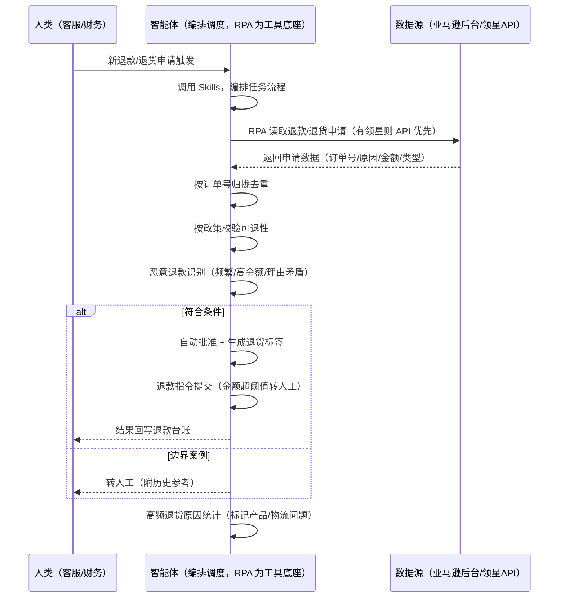

> 为亚马逊卖家团队打造退款退货处理任务方案。退款退货申请量大、政策判断靠人，本方案由智能体调度多个工具统一取数—，申请事件触发，该退的快退、该拦的拦住，边界案例转人工。

> Agent 自动化需开通企业功能
> 点击申请1个月免费权限
> [点击申请 →](https://skieer.feishu.cn/share/base/form/shrcnFwMayykP5iaL38fnZKTbrg)

## 一、用户与需求

核心矛盾：退款申请逐笔检查、符合条件的还要手动操作，量大积压；退货申请政策判断靠人，拿不准的来回问——退快了怕被恶意薅，退慢了差评不断。

两类客户痛点同源，数据来源不同：

- 未购 SaaS 客户（新卖家/小团队）：人工逐笔查看退款退货申请、凭经验判断能不能退、手动批准生成标签执行退款，全靠手；
- 已购 SaaS 客户（领星 ERP 管订单/财务）：领星有订单与退款数据，但政策校验、恶意识别、边界案例判断仍要人做。

适用客户：订单量大、退换频次高的卖家。退换量少的小卖家价值有限（人工处理即可，本方案不推荐）。

### 1.1 不同模式卖家

| 类型 | 选择 | 建议 |
|-|-|-|
| 品牌 | 首选 | 强烈推荐（订单量大、退换频次高） |
| 精铺 | 次选 | 一般推荐，聚焦主力 SKU 退换处理 |
| 铺货 | 任意 | 不推荐，退换量少人工处理即可 |

### 1.2 不同类目卖家

| 类目 | 最关注维度 | 核心逻辑 |
|-|-|-|
| 3C 数码 | 恶意退款 | 货值高，频繁退款/理由矛盾要识别 |
| 家居家具 | 退货政策 | 大件运费高，退货政策要明确 |
| 美妆个护 | 合规退款 | 拆封退货政策敏感，谨慎处理 |
| 服装鞋帽 | 尺码退换 | 尺码退换高频，流程要快 |
| 户外运动 | 政策校验 | 功能件退货原因判断复杂 |
| 母婴用品 | 安全优先 | 安全类目，退货原因从严审核 |

### 1.3 不同角色用户

| 用户 | 需求 | 问题 | 投入时间（估算） |
|-|-|-|-|
| 老板 | 退款不亏、体验不差 | 恶意退款漏拦 | 0.5 小时/周 |
| 客服 | 退款处理快 | 逐笔检查操作费时 | 1-3 小时/天 |
| 财务 | 退款台账清晰 | 退款与凭证对不上 | 0.5 小时/周 |

---

## 二、现在的方法与问题

### 2.1 流程步骤与问题总结

| 序号 | 步骤 | 现在的方法 | 问题缺陷 |
|-|-|-|-|
| 1 | 收申请 | 逐笔查看退款退货申请 | 量大积压，处理慢 |
| 2 | 验政策 | 凭经验判断能不能退 | 政策判断不一致 |
| 3 | 执行退款 | 手动批准、生成标签、退款 | 逐个操作费时易错 |
| 4 | 辨恶意 | 凭感觉看有没有问题 | 频繁退款/理由矛盾发现不了 |
| 5 | 记账 | 手动记录退款凭证 | 台账不全，对账对不上 |

### 2.2 问题分析

| 序号 | 根因 | 具体表现 |
|-|-|-|
| 1 | 逐笔人工 | 退款量大，逐个检查操作费时 |
| 2 | 政策靠人 | 可退性判断不一致，边界案例来回问 |
| 3 | 恶意难辨 | 频繁退款/高金额/理由矛盾无识别 |
| 4 | 台账不全 | 退款与凭证散乱，对账对不上 |
| 5 | 经验不沉淀 | 政策判断在人脑里 |

---

## 三、解决方案

### 3.1 功能概述

为亚马逊卖家团队打造的智能体驱动退款退货处理方案，解决退款量大积压、政策判断靠人、恶意退款难辨的问题。

新退款/退货申请事件触发，调起八爪鱼 RPA（Agent 的工具底座，能耦合多系统、完成自动化任务执行）统一取数，按订单号归拢合并，输出退款退货处理，涵盖「政策自动校验、恶意退款识别、退货标签自动发放、退款指令执行、边界案例转人工、退款台账」。该退的快退、该拦的拦住，边界案例转人工。

### 3.2 系统结合

| 要素 | 说明 |
|-|-|
| 客户现有工具盘点 | 未购 SaaS 客户：无第三方工具，申请全靠后台逐笔看。  
已购 SaaS 客户（主流组合）：领星 ERP（订单/财务/退款数据，开放 API 需企业申请） |
| 数据/能力来源 | 未购 SaaS：亚马逊后台（退款/退货申请，订单号/原因/金额/类型，RPA 采集）。  
已购 SaaS：领星开放 API（订单/退款数据，需企业申请权限）+ RPA 后台兜底（API 未覆盖字段） |
| RPA 耦合动作 | 作为 Agent 的工具底座，按事件调度多数据源取数（API 优先 + 后台采集兜底），按订单号归拢去重合并，统一流转给智能体校验；任一数据源失败自动重试、异常告警 |
| 耦合出的新价值 | 单工具给不了的端到端结论：申请一次取齐 → 政策校验 → 恶意识别 → 自动批准/转人工 → 台账回写，免去客服逐笔检查手工操作 |

### 3.3 智能体执行流程

新退款/退货申请事件触发；智能体编排任务时调用已预设好的 Skills，再经 MCP 调度八爪鱼 RPA 等多个工具。

> Agent 自动化需开通企业功能
> 点击申请1个月免费权限
> [点击申请 →](https://skieer.feishu.cn/share/base/form/shrcnFwMayykP5iaL38fnZKTbrg)

### 3.4 为何这么设计

要同时回答两个问题：为什么不能只用 SaaS/API？为什么不能纯靠智能体写代码？ 本场景的核心是"事件触发、取数、政策校验、动作留痕、风险控制、挂了有人管"。

#### 1）逐项对比

| 对比维度 | SaaS/API 堆叠（领星） | 纯智能体（智能体写代码） | 智能体+自动化工具（RPA 工具底座） |
|-|-|-|-|
| 实现方式 | 领星管订单/退款数据，政策校验靠人 | 能调 API 能抓后台，但全要自己接 | 一个底座跑多个流程（退款/售后/VOC/选品……），数据一处对齐 |
| 多源耦合 | 领星单系统，无自动校验 | 全自建：API 鉴权、后台采集、归拢逻辑 | 平台沉淀多源取数与归拢，可视化配置 |
| 校验与识别 | 领星无政策校验/恶意识别 | 校验逻辑自写，灵活但工程量大 | 判断交给智能体（政策校验+恶意识别），执行交给 RPA（留痕） |
| 事件触发与台账 | 领星无自动处理 | 轮询/调度/台账全自建 | 平台事件触发稳定，失败重试 + 异常告警，台账自动回写 |
| 使用成本（总拥有成本） | 一系统一订阅：领星 500-1500/月……随流程数增长 | 代理 IP + 服务器 + 开发维护人力，隐性成本高 | 一份平台订阅跑所有流程，单方案边际成本 ≈ 0 |
| 维护人要求 | 低 | 政策调整都要开发介入 | 可视化流程，客服/财务自己可调政策、阈值 |

#### 2）优劣势说明

|  | SaaS/API 堆叠（领星） | 纯智能体（智能体写代码） | 智能体+自动化工具（RPA 工具底座） |
|-|-|-|-|
| 优势 | 订单/退款数据权威 | 无订阅费；  
可深度定制政策逻辑；  
技术上完全可行 | 一个底座跑多流程、数据一处对齐；  
申请采集/政策校验/退款留痕即开即用；  
非技术人员可维护 |
| 劣势 | 无政策校验/恶意识别；  
处理靠人 | 采集、校验、退款对接、恶意识别全自建；  
AI 生成代码是生成性的，误退风险不可控 | 本地电脑运行需保持开机；  
订阅费；  
灵活性受平台模板边界限制 |

#### 3）结论

| 论点 | 说明 |
|-|-|
| 只用 SaaS/API 缺"自动校验与识别" | 领星解决订单/退款数据，但"政策校验 + 恶意识别 + 自动处理"它不覆盖——这是本方案的增量 |
| 纯智能体缺"工程底座" | 申请采集与归拢 70% 的工作在工程（取数/对齐/调度/重试），不在"写校验逻辑"；  
RPA 作为工具底座把这 70% 已经造好 |
| 一个底座跑多流程 | 客户购买 RPA 平台是跑多个流程（退款/售后/VOC/选品/后台操作），本方案只是其中一个——平台订阅费被多流程摊薄，单方案边际成本接近 0 |
| 确定性 vs 生成性 | 政策校验与恶意识别是确定性任务——同样的申请，要求"每次判断一致、红线拦截不误放"。RPA 流程行为可预期，AI 生成的代码能跑通 ≠ 长期不误退 |
| 时间 | 客服要的是"该退的快退、该拦的拦住"，不是"逐笔人工审核"；  
判断层交给智能体，执行层交给工具底座 |

### 3.5 功能清单

| 功能 | 系统 | 功能说明（解决问题） |
|-|-|-|
| 会话/定时 | 智能体 | 1. 理解人类语言，调用已预设好的 Skills。  
2. 编排多任务、调度多工具。 |
| 多系统数据取数 | RPA、指纹浏览器 | 1. 解决退款量大积压、政策判断靠人问题。  
2. 作为智能体工具底座被调度执行，退款接口失败自动重试并告警、金额超阈值自动转人工复核。  
3. 【无 SaaS 方式】 RPA 读取后台退款/退货申请（订单号/原因/金额/类型）。【有 SaaS 方式】 调领星 API 拉订单/退款数据（需企业申请）+ RPA 后台兜底。 |
| 数据清洗归拢 | 智能体 | 按订单号归拢退款与退货数据，解决多渠道申请分散问题。 |
| 政策校验 | 智能体 | 按退款原因/退货原因对照政策判断可退性，输出校验结果。 |
| 恶意退款识别 | 智能体 | 频繁退款（30 天 ≥3 次）、高金额退款、退款理由矛盾 → 附行为特征转人工。 |
| 退款执行 | RPA | 符合条件自动批准 + 生成退货标签 + 提交退款指令（金额超阈值转人工复核）。涉及资金动作，超阈值一律人工复核。 |
| 边界案例转人工 | 智能体 | 政策未覆盖的申请转人工，附历史类似案例参考。 |
| IM通知 | 飞书、钉钉、企微等 | 解决高风险退款无人复核问题。高风险单、边界案例、异常告警自动推送。 |
| 数据资产储存 | 本地电脑、云储存 | 1. Skills 资产：退款政策与恶意识别规则。  
2. 数据储存：退款台账统一写入本地，凭证可审计。  
3. 经验知识库：争议处理案例持续沉淀。 |

### 3.6 智能体执行落地过程

部署时配置退款政策与阈值即可自动运行；下表其余配置项（智能体工具、Webhook、政策、阈值）均为部署时一次性预设，会话中无需重复输入。

⚠️ 部署前提（不满足则方案无法跑起来）：①RPA 需部署在常开电脑/云机上（事件触发轮询，关机即停），并配置漏跑补跑机制；②有 SaaS 方式需领星企业客户申请开放 API 权限（未开通自动降级为无 SaaS 通道，走后台采集）；③退款涉及资金动作，金额超阈值一律转人工复核，不自动退；④首次配置（API 鉴权、政策规则、阈值）需服务方/技术人员介入一次，属实施成本。

#### 1）配置

| 类别 | 说明 |
|-|-|
| 智能体 | 主流智能体。 |
| 智能体工具 | 1. 数据通道（按客户现有工具二选一）：【无 SaaS】亚马逊后台（RPA 采集）；【有 SaaS】领星开放 API（需企业申请）+ RPA 后台兜底。  
2. 数据取数与自动化执行：八爪鱼 RPA，MCP 配置完成。  
3. 数据分析：智能体自带。  
4. IM：企业办公 IM（飞书/钉钉/企微），MCP 或 webhook 配置。 |
| 工作知识 | 1. 退款/退货政策：按原因与类型设置可退规则。  
2. 自动退款阈值：默认金额阈值内自动退，超阈值转人工。  
3. 恶意识别特征：频繁退款（如 30 天 ≥3 次）、高金额、理由矛盾。  
4. 退货标签规则：符合条件自动批准并发标签。  
5. 边界案例规则：政策未覆盖转人工附历史参考。 |
| 本地数据库 | 1. 退款台账地址。  
2. 政策库地址。  
3. 经验库地址。 |

#### 2）执行

| 任务 | 产出 | 产出物接收人 |
|-|-|-|
| 接收退款退货申请，事件触发 | 任务启动记录 | —— |
| 调用已预设 Skills，编排任务流程 | 任务编排方案 | —— |
| 经 MCP 向八爪鱼 RPA 下发取数任务 | 自动化任务指令 | —— |
| 多源取数并按订单号归拢（无 SaaS：后台采集；有 SaaS：领星 API+后台兜底，智能体监控状态） | 归拢后申请数据 | —— |
| 按政策校验可退性 | 校验结果 | 客服 |
| 恶意退款识别 | 风险标签 | 客服/财务 |
| 符合条件自动批准+生成退货标签 | 退货标签 | 客服 |
| 退款指令提交财务系统（超阈值转人工） | 退款凭证回写 | 财务 |
| 边界案例转人工（附历史参考） | 转人工清单 | 客服 |
| 高频退货原因统计 | 退货归因报告 | 客服/运营 |

异常处理：

退款接口失败 → 自动重试并告警；金额超阈值 → 自动转人工复核；

政策未覆盖 → 转人工并附历史案例参考；

恶意退款特征 → 转人工并附行为特征；

退货标签发送失败 → 自动重试；

置信度 &lt;70% → 转人工复核，不输出硬结论。

#### 3）结果

| 结果 | 说明 |
|-|-|
| 数据资产 | 全量退款退货结构化数据（订单号/原因/金额/类型/校验结果/风险标签/处理状态），可审计。 |
| 分析报告 | 1. 退款处理建议：该退的快退、该拦的拦住。  
2. 风险案例清单：恶意退款附行为特征。  
3. 高频退货报告：按原因归因，标记产品/物流问题。  
4. 争议应对话术：争议退款的处理建议。 |
| Skills | 智能体 Skills：退款政策与恶意识别规则。 |

> Agent 自动化需开通企业功能
> 点击申请1个月免费权限
> [点击申请 →](https://skieer.feishu.cn/share/base/form/shrcnFwMayykP5iaL38fnZKTbrg)

---

## 四、使用前后预估

> 本方案价值 = 政策自动校验 + 恶意识别 + 自动处理留痕。不承诺替代人工复核——金额超阈值一律转人工。适合订单量大、退换频次高、愿配环境的卖家。

| 指标 | 人工 | SaaS/API（领星） | 智能体+自动化工具 |
|-|-|-|-|
| 处理耗时 | 每天 1-3 小时（估算） | 数据自动但处理靠人 | 全自动；人工转为复核高风险单（每天约 0.5 小时） |
| 处理时效 | 量大积压 | 领星有数据，无自动处理 | 申请即处理，日清日结 |
| 恶意退款 | 漏拦 | 无识别 | 特征自动识别，止损 |
| 政策一致 | 靠人判断 | 无校验 | 规则统一执行，口径一致 |
| 台账追溯 | 凭证散乱 | 领星记录单系统 | 台账可审计（含复核人） |
| 方法论 | 无，换人结论不同 | 领星规则（单系统） | 可复用的 Skills 与规则库 |

说明：申请数据为准确字段（采集时点值）；退款涉及资金动作，金额超阈值一律转人工复核，不自动退；恶意识别为规则判断（辅助参考）。

---

## 五、效果证明

> Agent 自动化需开通企业功能
> 点击申请1个月免费权限
> [点击申请 →](https://skieer.feishu.cn/share/base/form/shrcnFwMayykP5iaL38fnZKTbrg)

### 5.1 客户案例

**《三只松鼠：29 家店铺退款工单 AI+RPA 全流程自动化》**

> 天猫、淘宝等平台近 30 家店铺，日均退款工单量大，客服需逐单阅读聊天记录、判断退款原因、从 50+ 三级标签中选择、核对金额。AI+RPA 实现退款工单全流程自动化。

| 效果 | 说明 |
|-|-|
| 提效 | 退款工单处理效率翻倍。原本客服需逐单核对聊天记录、判断退款原因、人工匹配标签并校验金额，现在由「大模型解析 + RPA 执行」完成 18 步全流程自动化。 |
| 降本 | 客服从重复的标签匹配与金额核对中解放，投入真正需要人工判断的复杂场景与客户沟通等重点工作。 |
| 任务 | 覆盖天猫/淘宝 29 家店铺，50+ 三级退款标签体系智能匹配，日均退款工单全量处理。 |
| 任务 | 退款金额按 1 元阈值精准校验，减少人工误判造成的资损风险。 |

案例详情：[退款：国民休闲零食品牌电商退款工单AI自动化实践](https://skieer.feishu.cn/wiki/S0XuwLL0aiwLfbkEqAqc2BEXnzx)

**《米足电商：得物多账号批量签收与退款自动化》**

> 潮流鞋服退货率高，多店铺运营下每日售后订单量庞大，人工逐个签收退款易漏单错单。RPA 打通得物商家后台与聚水潭 ERP，自动比对筛选后批量签收退款。

| 效果 | 说明 |
|-|-|
| 提效 | 多账号签收退款效率提升 80% 以上。原本人工逐个账号签收再退款需 2-3 小时/天，现在批量自动执行，压缩到几十分钟，账号自动切换。 |
| 降本 | 免除逐单重复操作的人力投入，售后团队投入转向异常订单处理与客户沟通等重点工作。 |
| 任务 | 打通得物商家后台与聚水潭 ERP，自动比对应退与实退数量，操作准确率 100%。 |
| 任务 | 多账号一键切换，5 个或 20 个账号均可稳定跑完，退货退款全流程标准化执行。 |

案例详情：[售后：得物多账号自动签收退款实践](https://skieer.feishu.cn/wiki/F6LewVFMuiAFkRkBP8QcZuHPngc)

### 5.2 DEMO应用

退货管理-必须获得授权-飞跨浏览器：https://rpa.bazhuayu.com/appstore/app/dev_5odp8y/tui-huo-guan-li--bi-xu-huo-de-shou-quan--fei-kua-liu-lan-qi

---

## 六、备注

### 6.1 Agent 支持

本方案不绑定具体智能体，主流 Agent 均可运行（需支持技能/Skills 加载与工具调用）：

| Agent/智能体 | 说明 |
|-|-|
| Workbuddy | 本方案运行平台，支持技能/Skills 上传加载、定时任务、MCP 工具调用与表格/报告处理 |
| 豆包（国内·字节） | 国内主流个人智能体，支持技能上传、定时任务与工具调用，上手成本低 |
| 通义千问（国内·阿里） | 支持 Agent 编排与插件生态，集成阿里电商数据能力，适合电商场景 |
| DeepSeek（国内） | 推理能力强、成本低，适合规则打分与归因分析类任务 |
| ChatGPT（国外·OpenAI） | 海外主流通用智能体，支持 GPTs/Agent 模式与工具调用 |
| Claude（国外·Anthropic） | 长文本与结构化分析能力强，原生支持 MCP 连接外部工具 |

### 6.2 名词解释

| 术语 | 说明 |
|-|-|
| 仅退款 | 不退货直接退款的类型 |
| 退货退款 | 买家退货后执行的退款类型 |
| 退货标签 | 退货物流标签，符合条件自动生成发给买家 |
| 退款政策 | 什么原因、什么条件下可退的规则 |
| 恶意退款 | 频繁退款、高金额、理由矛盾等异常退款行为 |
| 行为特征 | 恶意退款的行为特征，如 30 天 ≥3 次退款 |
| 边界案例 | 政策未覆盖的退款退货申请，转人工判断 |
| 退款台账 | 退款处理与凭证的记录表 |
| 争议退款 | 对退款理由有争议的申请，附应对话术 |
| 混合数据源 | 官方导出/API 优先（更稳更合规）+ 后台采集兜底（免费、覆盖无 SaaS 客户与 API 缺口） |
| 有 SaaS 方式 | 已购领星，开放 API 拿订单/退款数据 + RPA 后台兜底（需企业申请权限） |
| 无 SaaS 方式 | 不购买第三方工具，由 RPA 读取后台退款退货申请 |
| MCP | Model Context Protocol，智能体连接外部工具的标准化通道 |
| 指纹浏览器 | 隔离 Cookie/浏览器指纹的工具，多店铺防关联 |

> Agent 自动化需开通企业功能
> 点击申请1个月免费权限
> [点击申请 →](https://skieer.feishu.cn/share/base/form/shrcnFwMayykP5iaL38fnZKTbrg)

---

原文：[查看原文](https://skieer.feishu.cn/wiki/YYKRwWhDQiNPF3kFRJzcThnLnCf)
