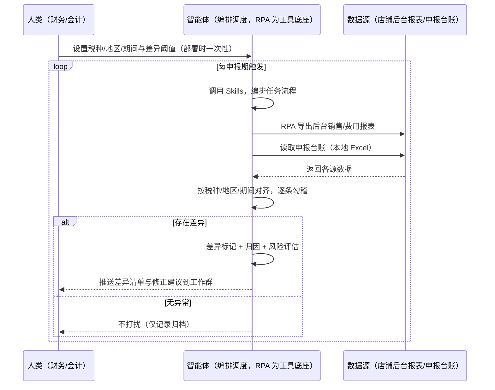
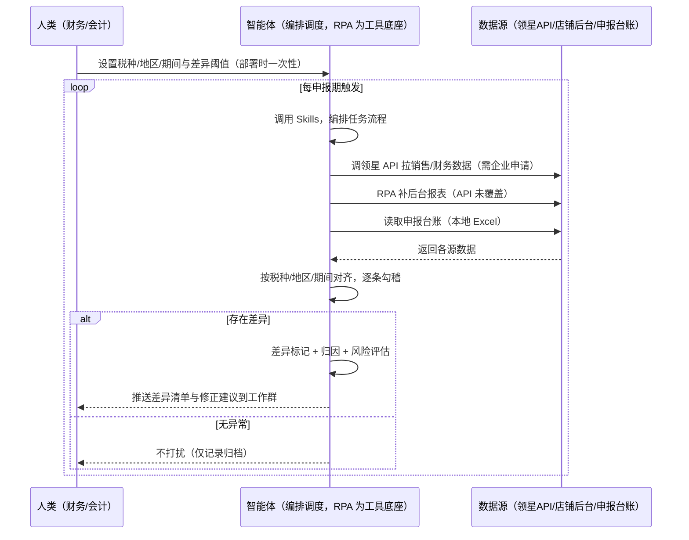

> 为亚马逊卖家团队打造的税务合规检查方案。报税与销售数据要手工比对、对不上的逐条查原因费时，本方案由智能体调度八爪鱼 RPA（Agent 的工具底座，能耦合多系统、完成自动化任务执行）统一取数——未购 SaaS 走后台导出，已购 SaaS 结合领星财务数据。申报期自动勾稽，有差异才推送，漏报多报提前发现。

> Agent 自动化需开通企业功能
> 点击申请1个月免费权限
> [点击申请 →](https://skieer.feishu.cn/share/base/form/shrcnFwMayykP5iaL38fnZKTbrg)

## 一、用户与需求

核心矛盾：报税与销售数据要手工比对，对不上的逐条查原因费时，容易漏掉风险点——漏报多报都可能被税局处罚，合规检查靠人做不全面。

两类客户痛点同源，数据来源不同：

- 未购 SaaS 客户（新卖家/小团队）：人工从后台导销售数据、手工与申报数据比对，对不上的逐条查原因，全靠手；
- 已购 SaaS 客户（领星 ERP 有财务数据）：领星有销售/财务数据，但"申报 vs 实际逐条勾稽、差异归因、合规风险标记"仍要人做。

适用客户：多站点多税种、税务合规检查频次高的卖家。站点少的小卖家价值有限（人工核对即可，本方案不推荐）。

### 1.1 不同模式卖家

| 类型 | 选择 | 建议 |
|-|-|-|
| 品牌 | 首选 | 强烈推荐（多站点多税种，税务合规检查频次高） |
| 精铺 | 次选 | 一般推荐，聚焦主力站点税务 |
| 铺货 | 任意 | 不推荐，站点少人工核对即可 |

### 1.2 不同类目卖家

| 类目 | 最关注维度 | 核心逻辑 |
|-|-|-|
| 3C 数码 | 销售税/VAT | 多站点销售税/VAT 勾稽是重点 |
| 家居家具 | 地区税率 | 大件多地区销售，税率按地区核对 |
| 美妆个护 | 合规从严 | 敏感类目，申报差异零容忍 |
| 服装鞋帽 | 多国申报 | 多国销售，GST 等税种核对 |
| 户外运动 | 期间勾稽 | 功能件销售波动，期间数据要准 |
| 母婴用品 | 申报合规 | 安全类目，税务合规从严 |

### 1.3 不同角色用户

| 用户 | 需求 | 问题 | 投入时间（估算） |
|-|-|-|-|
| 老板 | 税务合规无处罚 | 漏报多报风险看不见 | 0.5 小时/月 |
| 财务 | 差异清单+修正 | 手工比对费时 | 1-2 小时/申报期 |
| 会计 | 勾稽通过 | 差异归因靠查 | 1 小时/申报期 |

---

## 二、现在的方法与问题

### 2.1 流程步骤与问题总结

| 序号 | 步骤 | 现在的方法 | 问题缺陷 |
|-|-|-|-|
| 1 | 导数据 | 手工比对申报与实际数据 | 数据量大，比对费时 |
| 2 | 找差异 | 对不上的逐条查 | 差异无阈值，小差异算了 |
| 3 | 归因 | 凭经验猜差异原因 | 漏报/多报/口径说不清 |
| 4 | 修正 | 手动写说明 | 无模板，修正滞后 |

### 2.2 问题分析

| 序号 | 根因 | 具体表现 |
|-|-|-|
| 1 | 比对靠手 | 申报与实际数据手工比对费时 |
| 2 | 无差异阈值 | 小差异算了，累计合规风险 |
| 3 | 归因靠猜 | 漏报/多报/口径不一致说不清 |
| 4 | 风险后置 | 税局找上门才发现 |

---

## 三、解决方案

### 3.1 功能概述

为亚马逊卖家团队打造的智能体驱动税务合规检查方案，解决申报与实际数据比对靠手、差异归因靠猜、风险后置的问题。

申报期定时触发并调度多个工具，调起八爪鱼 RPA（Agent 的工具底座，能耦合多系统、完成自动化任务执行）统一取数，输出税务合规分析，涵盖「逐条勾稽、差异阈值标记、差异归因、合规风险评估、修正建议」。申报期自动勾稽，有差异才推送。

### 3.2 系统结合

| 要素 | 说明 |
|-|-|
| 客户现有工具盘点 | 未购 SaaS 客户：无第三方工具，数据全靠后台导出。   已购 SaaS 客户（主流组合）：领星 ERP（销售/财务/税务数据，开放 API 需企业申请） |
| 数据/能力来源 | 未购 SaaS：店铺后台官方报表导出（销售/费用数据）+ 申报数据（本地台账）。   已购 SaaS：领星开放 API（销售/财务数据，需企业申请权限）+ RPA 后台导出兜底 + 申报台账 |
| RPA 耦合动作 | 作为 Agent 的工具底座，按计划调度多数据源取数（API 优先 + 后台导出兜底），按税种/地区/期间对齐去重合并，统一流转给智能体勾稽；任一数据源失败自动重试、异常告警 |
| 耦合出的新价值 | 单工具给不了的端到端结论：申报 vs 实际一次取齐 → 逐条勾稽 → 差异标记 → 归因 → 修正建议，有差异自动推送工作群，免去财务手工比对逐条查 |

### 3.3 智能体执行流程

申报期定时触发（每申报期开始核对）。支持两种数据通道，部署时按客户现有工具选择：

通道一：无 SaaS 方式（RPA 导出后台数据，适合未购领星的客户）

通道二：有 SaaS 方式（领星 API 拿财务核心，RPA 后台兜底，适合已购客户）

> Agent 自动化需开通企业功能
> 点击申请1个月免费权限
> [点击申请 →](https://skieer.feishu.cn/share/base/form/shrcnFwMayykP5iaL38fnZKTbrg)

### 3.4 为何这么设计

要同时回答三个问题：为什么不能只用 SaaS/API？为什么不能纯靠智能体写代码？ 本场景的核心是"申报期定时、跨源取数、逐条勾稽、差异归因、有差异推送、挂了有人管"。

#### 1）逐项对比

| 对比维度 | SaaS/API 堆叠（领星） | 纯智能体（智能体写代码） | 智能体+自动化工具（RPA 工具底座） |
|-|-|-|-|
| 实现方式 | 领星有财务数据，勾稽靠人 | 能调 API 能抓后台，但全要自己接 | 一个底座跑多个流程（税务/合规/售后/选品……），数据一处对齐 |
| 多源耦合 | 领星单系统，申报台账不联动 | 全自建：API 鉴权、后台导出、对齐逻辑 | 平台沉淀多源取数与对齐，可视化配置 |
| 勾稽与归因 | 领星无自动勾稽 | 勾稽逻辑自写，灵活但工程量大 | 判断交给智能体（勾稽+归因+风险评估），执行交给 RPA |
| 定时与推送 | 领星无申报期提醒 | 调度器/进程常驻/告警通道全自建 | 平台调度稳定触发，失败重试 + 异常告警，有差异才推送 |
| 使用成本（总拥有成本） | 一系统一订阅：领星 500-1500/月……随流程数增长 | 代理 IP + 服务器 + 开发维护人力，隐性成本高 | 一份平台订阅跑所有流程，单方案边际成本 ≈ 0 |
| 维护人要求 | 低 | 规则调整都要开发介入 | 可视化流程，财务自己可调阈值、税种配置 |

#### 2）优劣势说明

|  | SaaS/API 堆叠（领星） | 纯智能体（智能体写代码） | 智能体+自动化工具（RPA 工具底座） |
|-|-|-|-|
| 优势 | 财务数据权威 | 无订阅费；   可深度定制勾稽规则；   技术上完全可行 | 一个底座跑多流程、数据一处对齐；   勾稽/归因/风险标记即开即用；   非技术人员可维护 |
| 劣势 | 无自动勾稽；差异归因靠人 | 采集、对齐、勾稽全自建；   AI 生成代码是生成性的，漏判风险不可控 | 本地电脑运行需保持开机；   订阅费；   灵活性受平台模板边界限制 |

#### 3）结论

| 论点 | 说明 |
|-|-|
| 只用 SaaS/API 缺"勾稽与归因" | 领星解决财务数据，但"申报 vs 实际逐条勾稽 + 差异归因 + 风险标记"它不覆盖——这是本方案的增量 |
| 纯智能体缺"工程底座" | 数据取数与对齐 70% 的工作在工程（导出/对齐/调度/重试），不在"写勾稽逻辑"；RPA 作为工具底座把这 70% 已经造好 |
| 一个底座跑多流程 | 客户购买 RPA 平台是跑多个流程（税务/合规/售后/选品/后台操作），本方案只是其中一个——平台订阅费被多流程摊薄，单方案边际成本接近 0 |
| 确定性 vs 生成性 | 税务勾稽是确定性任务——同样的数据与口径，要求"每次勾稽一致、差异算得准"。RPA 流程行为可预期，AI 生成的代码能跑通 ≠ 长期不漏判 |
| 时间 | 财务要的是"申报期自动勾稽、差异自动归因"，不是"每次手工比对逐条查"；判断层交给智能体，执行层交给工具底座 |

### 3.5 功能清单

| 功能 | 系统 | 功能说明（解决问题） |
|-|-|-|
| 会话/定时 | 智能体 | 1. 理解人类语言，调用已预设好的 Skills。   2. 编排多任务、调度多工具。 |
| 多系统数据取数 | RPA、指纹浏览器 | 1. 解决申报与实际数据手工比对费时问题。   2. 作为智能体工具底座被调度执行，导出失败自动重试、数据缺失标注待补。   3. 【无 SaaS 方式】 RPA 导出后台销售/费用报表 + 读取申报台账。【有 SaaS 方式】 调领星 API 拉销售/财务数据（需企业申请）+ RPA 后台兜底。 |
| 数据清洗对齐 | 智能体 | 按税种/地区/期间对齐去重，解决多来源数据口径不一致问题。 |
| 逐条勾稽 | 智能体 | 申报数据 vs 实际销售/费用数据逐条勾稽，差异超阈值（默认 ±5%）标记。 |
| 差异归因 | 智能体 | 差异归类：漏报/多报/口径不一致（期间/费用项/汇率），按贡献度排序。 |
| 合规风险评估 | 智能体 | 差异超阈值且为漏报 → 红色高风险；多报 → 黄色关注；口径问题 → 蓝色修正。修正动作由人工/会计执行。 |
| IM通知 | 飞书、钉钉、企微等 | 解决税务风险发现滞后问题。有差异才推送差异清单与修正建议到工作群，无异常不打扰。 |
| 数据资产储存 | 本地电脑、云储存 | 1. Skills 资产：勾稽规则与差异归因模型。   2. 数据储存：勾稽记录统一写入本地，可审计。   3. 经验知识库：历史差异案例持续沉淀。 |

### 3.6 智能体执行落地过程

部署时一次性配置入参（税种/地区/期间、差异阈值、推送群、数据通道），会话中无需重复输入。

⚠️ 部署前提（不满足则方案无法跑起来）：①RPA 需部署在常开电脑/云机上（申报期定时触发，关机即停），并配置漏跑补跑机制；②申报台账需人工维护（申报数据，无台账则仅做实际数据核对）；③有 SaaS 方式需领星企业客户申请开放 API 权限（未开通自动降级为无 SaaS 通道，走后台导出）；④首次配置（API 鉴权、对齐规则、勾稽阈值）需服务方/技术人员介入一次，属实施成本。

#### 1）配置

| 类别 | 说明 |
|-|-|
| 智能体 | 主流智能体。 |
| 智能体工具 | 1. 数据通道（按客户现有工具二选一）：【无 SaaS】店铺后台报表导出 + 申报台账；【有 SaaS】领星开放 API（需企业申请）+ RPA 后台兜底。   2. 数据取数与自动化执行：八爪鱼 RPA，MCP 配置完成。   3. 数据分析：智能体自带。   4. IM：企业办公 IM（飞书/钉钉/企微），MCP 或 webhook 配置。 |
| 工作知识 | 1. 税种/地区/期间配置（VAT/销售税/GST 等）。   2. 差异阈值：默认 ±5%。   3. 申报台账：申报数据（人工维护）。   4. 归因维度：漏报/多报/口径不一致。   5. 风险评估规则：漏报 → 红；多报 → 黄；口径 → 蓝。 |
| 本地数据库 | 1. 勾稽记录地址。   2. 申报台账地址。   3. 经验库地址。 |

#### 2）执行

| 任务 | 产出 | 产出物接收人 |
|-|-|-|
| 接收税种/期间配置，申报期触发 | 任务启动记录 | —— |
| 调用已预设 Skills，编排任务流程 | 任务编排方案 | —— |
| 经 MCP 向八爪鱼 RPA 下发取数任务 | 自动化任务指令 | —— |
| 多源取数并按税种/地区/期间对齐（无 SaaS：后台导出+台账；有 SaaS：领星 API+后台兜底，智能体监控状态） | 对齐后税务数据 | —— |
| 逐条勾稽（差异超阈值标记） | 差异清单 | 财务 |
| 差异归因（漏报/多报/口径） | 归因结论 | 财务/会计 |
| 合规风险评估 + 修正建议 | 风险报告 | 财务/老板 |
| 推送差异清单（有差异才推送） | 群消息 | 财务/老板 |

异常处理：

导出失败 → 自动重试；数据缺失 → 标注待补；

申报台账缺失 → 仅做实际数据核对并标注；

归因置信度低 → 转人工判断；

置信度 &lt;70% → 转人工复核，不输出硬结论。

#### 3）结果

| 结果 | 说明 |
|-|-|
| 数据资产 | 全量勾稽结构化数据（税种/地区/期间/申报值/实际值/差异/归因/风险级别），可审计。 |
| 分析报告 | 1. 差异清单：申报 vs 实际逐条对比，差异超阈值标红。   2. 归因结论：漏报/多报/口径不一致按贡献度排序。   3. 风险评估：漏报红色、多报黄色、口径蓝色。   4. 修正建议：附说明模板。 |
| Skills | 智能体 Skills：勾稽规则与差异归因模型。 |

> Agent 自动化需开通企业功能
> 点击申请1个月免费权限
> [点击申请 →](https://skieer.feishu.cn/share/base/form/shrcnFwMayykP5iaL38fnZKTbrg)

---

## 四、使用前后预估

> 本方案价值 = 申报期自动勾稽 + 差异归因 + 风险分级。不承诺替代人工申报——修正动作由人工/会计执行。适合多站点多税种、愿配环境的卖家。

| 指标 | 人工 | SaaS/API（领星） | 智能体+自动化工具 |
|-|-|-|-|
| 核对耗时 | 每申报期 1-2 小时（估算） | 数据自动但勾稽靠人 | 全自动；人工转为修正（每申报期约 0.5 小时） |
| 差异发现 | 小差异算了 | 无自动勾稽 | 差异超阈值自动标记 |
| 归因能力 | 靠猜 | 无 | 漏报/多报/口径自动归因 |
| 风险前置 | 税局找上门才发现 | 无 | 漏报红色预警，提前处理 |
| 修正质量 | 无模板 | 无 | 修正建议附说明模板 |
| 方法论 | 无，换人结论不同 | 无 | 可复用的 Skills 与规则库 |

说明：销售/费用数据来自后台报表或领星 API（准确字段）；申报数据需人工维护台账；勾稽与归因为规则辅助，最终申报与修正由人工/会计确认执行。

---

## 五、效果证明

> Agent 自动化需开通企业功能
> 点击申请1个月免费权限
> [点击申请 →](https://skieer.feishu.cn/share/base/form/shrcnFwMayykP5iaL38fnZKTbrg)

### 5.1 客户案例

**《高端小家电龙头：多税种、多平台、多主体申报与对账自动化》**

> 国内小家电龙头，天猫旗舰店粉丝 160 万 +，线上渠道贡献绝大部分营收。RPA 自动完成数据导出、规则整理、核对表与差异表生成、差异归因，并支持企业微信通知与中台工单闭环。

| 效果 | 说明 |
|-|-|
| 提效 | 多主体、多税种申报与多平台对账全流程自动化。原本财务需为每个分公司主体分别申报、逐税种重复填表，并从 SAP 手工下载处理数据，现在由机器人自动导出、整理、生成核对表与差异表并完成申报流转。 |
| 降本 | 免除逐主体重复填报与人工核对的人力投入，财务与共享中心投入转向资金分析、税务筹划等重点工作。 |
| 任务 | 覆盖天猫、京东、官网、视频号等渠道及京东/菜鸟仓出入库全场景数据核对 |
| 任务 | 差异自动归因并生成差异表，支持企业微信通知与中台工单创建、提交、审核到验货完结闭环。 |

案例详情：[财务|报税&对账：高端小家电龙头借助八爪鱼，搞定多税种、多平台、多主体对账&申报](https://skieer.feishu.cn/wiki/U4SXwL6Zvix6RrkYud8caE3enze)

---

## 六、备注

### 6.1 Agent 支持

本方案不绑定具体智能体，主流 Agent 均可运行（需支持技能/Skills 加载与工具调用）：

| Agent/智能体 | 说明 |
|-|-|
| Workbuddy | 本方案运行平台，支持技能/Skills 上传加载、定时任务、MCP 工具调用与表格/报告处理 |
| 豆包（国内·字节） | 国内主流个人智能体，支持技能上传、定时任务与工具调用，上手成本低 |
| 通义千问（国内·阿里） | 支持 Agent 编排与插件生态，集成阿里电商数据能力，适合电商场景 |
| DeepSeek（国内） | 推理能力强、成本低，适合规则打分与归因分析类任务 |
| ChatGPT（国外·OpenAI） | 海外主流通用智能体，支持 GPTs/Agent 模式与工具调用 |
| Claude（国外·Anthropic） | 长文本与结构化分析能力强，原生支持 MCP 连接外部工具 |

### 6.2 名词解释

| 术语 | 说明 |
|-|-|
| 勾稽 | 申报数据与实际销售/费用数据的逐条核对 |
| 差异阈值 | 默认 ±5%，超阈值标记差异 |
| 申报台账 | 各税种/地区/期间的申报数据记录（人工维护） |
| 漏报 | 申报金额低于实际，红色高风险 |
| 多报 | 申报金额高于实际，黄色关注 |
| 口径不一致 | 期间/费用项/汇率等计算口径差异，蓝色修正 |
| 合规风险 | 差异导致的税务处罚风险等级 |
| 混合数据源 | 官方导出/API 优先（更稳更合规）+ 后台采集兜底（免费、覆盖无 SaaS 客户与 API 缺口） |
| 有 SaaS 方式 | 已购领星，开放 API 拿财务数据 + RPA 后台兜底（需企业申请权限） |
| 无 SaaS 方式 | 不购买第三方工具，由 RPA 导出后台报表 + 申报台账 |
| MCP | Model Context Protocol，智能体连接外部工具的标准化通道 |
| 指纹浏览器 | 隔离 Cookie/浏览器指纹的工具，多店铺防关联 |

> Agent 自动化需开通企业功能
> 点击申请1个月免费权限
> [点击申请 →](https://skieer.feishu.cn/share/base/form/shrcnFwMayykP5iaL38fnZKTbrg)

---

原文：[查看原文](https://skieer.feishu.cn/wiki/Fxfow7B6bi5uLQkAAtOcMVJenJc)
