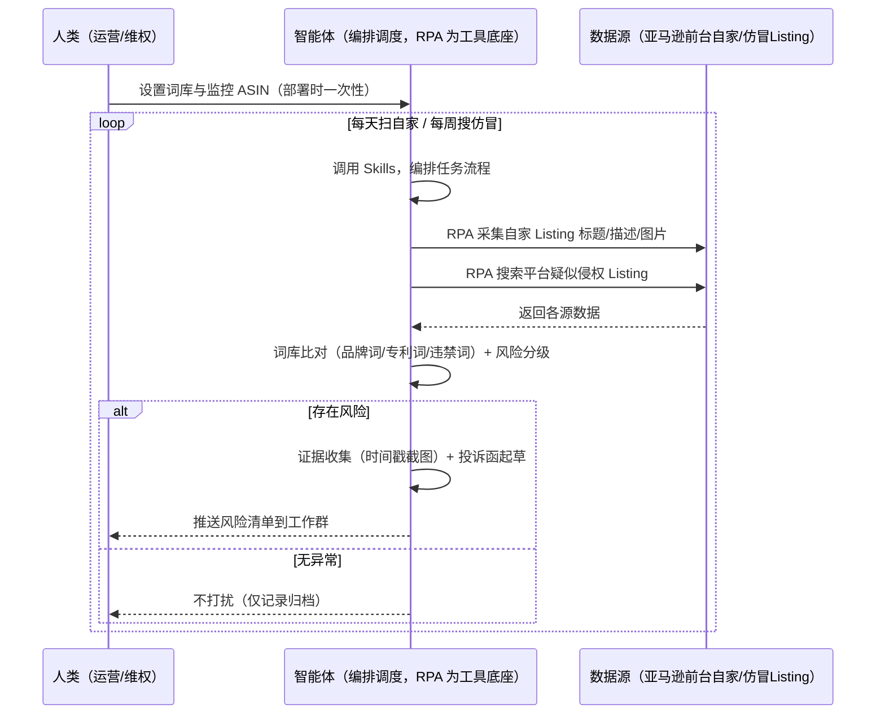
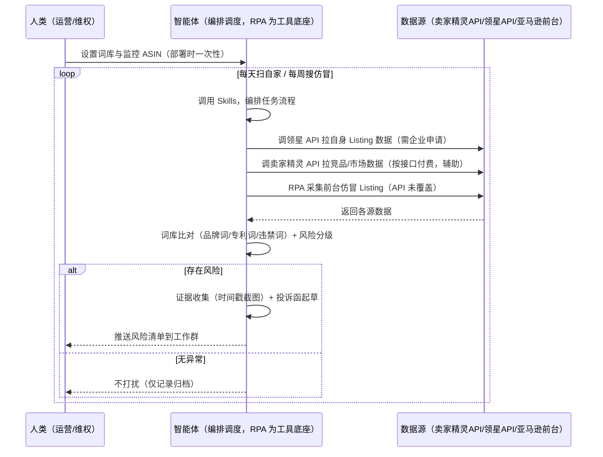

> 为亚马逊卖家团队打造的，由智能体调度多个工具执行侵权与知识产权监控任务的方案。自家商品页文字图片多、平台仿冒品靠定期人工搜索，本方案由智能体调度八爪鱼 RPA（Agent 的工具底座，能耦合多系统、完成自动化任务执行）统一取数。每天扫自家 Listing 防侵权、每周搜平台仿冒，有风险才推送。

> Agent 自动化需开通企业功能
> 点击申请1个月免费权限
> [点击申请 →](https://skieer.feishu.cn/share/base/form/shrcnFwMayykP5iaL38fnZKTbrg)

## 一、用户与需求

核心矛盾：自家商品页文字图片多，靠人工翻凭经验判断侵权风险易漏，量大看不过来；平台上的仿冒品要靠定期人工搜索、手动整理投诉材料——两头都是人肉活，漏一头都吃亏。两类客户痛点同源，数据来源不同：

- 未购 SaaS 客户（新卖家/小团队）：人工翻自家标题描述找违禁词、定期手动搜疑似侵权，全靠手；
- 已购 SaaS 客户（卖家精灵查竞品/市场、领星管运营）：工具有市场数据，但"自家 Listing 侵权扫描 + 平台仿冒搜索 + 投诉材料组装"仍要人做。

适用客户：品牌备案、需双向守侵权线的卖家。无品牌、SKU 少的小卖家价值有限（人工检查即可，本方案不推荐）。

### 1.1 不同模式卖家

| 类型 | 选择 | 建议 |
|-|-|-|
| 品牌 | 首选 | 强烈推荐（品牌备案后维权有据，防侵权监控是底线） |
| 精铺 | 次选 | 一般推荐，聚焦主力 SKU 侵权监控 |
| 铺货 | 任意 | 不推荐，SKU 太多逐条扫描不划算 |

### 1.2 不同类目卖家

| 类目 | 最关注维度 | 核心逻辑 |
|-|-|-|
| 3C 数码 | 专利词 | 电子类专利多，自家 Listing 防侵权 |
| 家居家具 | 仿冒维权 | 大件仿冒多，维权价值大 |
| 美妆个护 | 商标滥用 | 品牌敏感，商标维权重点 |
| 服装鞋帽 | 盗图侵权 | 图片版权，盗图维权高频 |
| 户外运动 | 专利+仿冒 | 功能件专利词多，双向监控 |
| 母婴用品 | 从严合规 | 安全类目，侵权风险零容忍 |

### 1.3 不同角色用户

| 用户 | 需求 | 问题 | 投入时间（估算） |
|-|-|-|-|
| 老板 | 不侵权、被仿冒能打 | 侵权风险看不过来 | 0.5 小时/周 |
| 运营 | 风险清单+修改建议 | 手动翻商品页费时 | 1-2 小时/周 |
| 维权/客服 | 投诉材料就绪 | 仿冒发现晚、材料不全 | 1-2 小时/周 |

---

## 二、现在的方法与问题

### 2.1 流程步骤与问题总结

| 序号 | 步骤 | 现在的方法 | 问题缺陷 |
|-|-|-|-|
| 1 | 查自家 | 人工翻标题描述找违禁词 | 文字图片多，凭经验易漏 |
| 2 | 搜仿冒 | 定期手动搜索疑似侵权 | 搜索覆盖有限，易漏 |
| 3 | 判风险 | 凭经验判断风险等级 | 无分级口径 |
| 4 | 收证据 | 手动截图整理 | 证据不完整，投诉没材料 |
| 5 | 投诉 | 手动起草投诉函 | 无模板，质量不一 |

### 2.2 问题分析

| 序号 | 根因 | 具体表现 |
|-|-|-|
| 1 | 扫描靠人 | 商品页文字图片多，人工翻易漏 |
| 2 | 词库不全 | 品牌词/专利词记不全 |
| 3 | 搜索覆盖有限 | 仿冒搜不全面，漏线索 |
| 4 | 证据分散 | 截图无时间戳，投诉没材料 |
| 5 | 经验不沉淀 | 风险判断规则在人脑里 |

---

## 三、解决方案

### 3.1 功能概述

为亚马逊卖家团队打造的智能体驱动侵权与知识产权监控方案，解决自家 Listing 侵权扫描靠人、仿冒发现晚、投诉材料不全的问题。

定时触发并调度多个工具，调起八爪鱼 RPA（Agent 的工具底座，能耦合多系统、完成自动化任务执行）统一取数，输出侵权分析，涵盖「自家 Listing 违禁词/专利词扫描、平台仿冒搜索、风险分级、证据收集、投诉函起草」。每天扫自家、每周搜仿冒，有风险才推送。

### 3.2 系统结合

| 要素 | 说明 |
|-|-|
| 客户现有工具盘点 | 未购 SaaS 客户：无第三方工具，侵权全靠人工。   已购 SaaS 客户（主流组合）：卖家精灵（市场/竞品数据，开放 API 按接口付费）、领星 ERP（自身 Listing/运营数据，开放 API 需企业申请） |
| 数据/能力来源 | 未购 SaaS：自家 Listing 前台页（标题/描述/图片，RPA 采集）+ 平台搜索结果页（仿冒搜索，RPA 采集）。   已购 SaaS：卖家精灵开放 API（竞品/市场数据辅助，按接口付费）+ 领星开放 API（自身 Listing 数据，需企业申请）+ RPA 前台兜底 |
| RPA 耦合动作 | 作为 Agent 的工具底座，按计划调度多数据源取数（API 优先 + 前台采集兜底），按 ASIN 对齐去重合并，统一流转给智能体分析；任一数据源失败自动重试、异常告警 |
| 耦合出的新价值 | 单工具给不了的端到端结论：自家/仿冒 Listing 一次取齐 → 词库比对 → 风险分级 → 证据收集 → 投诉函，有风险自动推送工作群，免去人工翻页搜仿冒 |

### 3.3 智能体执行流程

智能体定时触发（每天扫自家、每周搜仿冒）。支持两种数据通道，部署时按客户现有工具选择：

通道一：无 SaaS 方式（RPA 采集前台，适合未购卖家精灵/领星的客户）

通道二：有 SaaS 方式（卖家精灵/领星 API 辅助，RPA 前台兜底，适合已购客户）

> Agent 自动化需开通企业功能
> 点击申请1个月免费权限
> [点击申请 →](https://skieer.feishu.cn/share/base/form/shrcnFwMayykP5iaL38fnZKTbrg)

### 3.4 为何这么设计

要同时回答三个问题：为什么不能只用 SaaS/API？为什么不能纯靠智能体写代码？ 本场景的核心是"每天/每周定时、取数、词库比对、证据收集、有风险推送、挂了有人管"。

#### 1）逐项对比

| 对比维度 | SaaS/API 堆叠（卖家精灵/领星） | 纯智能体（智能体写代码） | 智能体+自动化工具（RPA 工具底座） |
|-|-|-|-|
| 实现方式 | 卖家精灵管市场、领星管运营，侵权扫描靠人 | 能调 API 能抓前台，数据可自拼，但全要自己接 | 一个底座跑多个流程（侵权/合规/售后/选品……），数据一处对齐 |
| 多源耦合 | 两工具各自为政，无人组装 | 全自建：API 鉴权、前台反爬、对齐逻辑 | 平台沉淀多源取数与对齐，可视化配置 |
| 比对与证据 | 工具无词库比对 | 比对逻辑自写，灵活但工程量大 | 判断交给智能体（词库比对+风险分级+投诉函），执行交给 RPA |
| 定时与推送 | 各工具单点提醒，无侵权推送 | 调度器/进程常驻/告警通道全自建 | 平台调度稳定触发，失败重试 + 异常告警，有风险才推送 |
| 使用成本（总拥有成本） | 一系统一订阅：卖家精灵 88 + 领星 500-1500/月……随流程数增长 | 代理 IP + 服务器 + 开发维护人力，隐性成本高 | 一份平台订阅跑所有流程，单方案边际成本 ≈ 0 |
| 维护人要求 | 低（工具已成熟） | 词库/规则调整都要开发介入 | 可视化流程，运营自己可调词库、监控范围 |

#### 2）优劣势说明

|  | SaaS/API 堆叠（卖家精灵/领星） | 纯智能体（智能体写代码） | 智能体+自动化工具（RPA 工具底座） |
|-|-|-|-|
| 优势 | 市场/运营数据权威 | 无订阅费；   可深度定制词库规则；   技术上完全可行 | 一个底座跑多流程、数据一处对齐；   词库比对/证据收集/投诉函即开即用；   非技术人员可维护 |
| 劣势 | 侵权扫描空白；证据收集靠人 | 采集、比对、证据、投诉全自建；   AI 生成代码是生成性的，漏判风险不可控 | 本地电脑运行需保持开机；   订阅费；   灵活性受平台模板边界限制 |

#### 3）结论

| 论点 | 说明 |
|-|-|
| 只用 SaaS/API 缺"侵权扫描与投诉链路" | 卖家精灵/领星解决市场与运营数据，但"自家/仿冒 Listing 扫描 + 证据收集 + 投诉函"它们不覆盖——这是本方案的增量 |
| 纯智能体缺"工程底座" | 前台采集与对齐 70% 的工作在工程（反爬/采集/调度/重试），不在"写比对逻辑"；RPA 作为工具底座把这 70% 已经造好 |
| 一个底座跑多流程 | 客户购买 RPA 平台是跑多个流程（侵权/合规/售后/选品/后台操作），本方案只是其中一个——平台订阅费被多流程摊薄，单方案边际成本接近 0 |
| 确定性 vs 生成性 | 词库比对与风险分级是确定性任务——同样的词库与 Listing，要求"每次比对一致、不漏项"。RPA 流程行为可预期，AI 生成的代码能跑通 ≠ 长期不漏判 |
| 时间 | 维权要的是"风险自动进群、投诉材料自动就绪"，不是"每天手动翻页搜仿冒"；判断层交给智能体，执行层交给工具底座 |

### 3.5 功能清单

| 功能 | 系统 | 功能说明（解决问题） |
|-|-|-|
| 会话/定时 | 智能体 | 1. 理解人类语言，调用已预设好的 Skills。   2. 编排多任务、调度多工具。 |
| 多系统数据取数 | RPA、指纹浏览器 | 1. 解决自家 Listing 侵权扫描靠人、仿冒发现晚问题。   2. 作为智能体工具底座被调度执行，页面抓取失败自动重试、图片 OCR 失败标注待补。   3. 【无 SaaS 方式】 RPA 采集自家/仿冒 Listing 标题/描述/图片 + 搜索页结果。【有 SaaS 方式】 调领星 API 拉自身 Listing（需企业申请）+ 调卖家精灵 API 辅助（按接口付费）+ RPA 前台兜底。 |
| 数据清洗对齐 | 智能体 | 按 ASIN 对齐去重，解决多来源数据口径不一致问题。 |
| 词库比对 | 智能体 | 品牌词/专利词/违禁词库比对自家 Listing（文本+图片 OCR），命中标红。 |
| 仿冒搜索 | 智能体 | 按品牌词/关键词搜索平台疑似侵权 Listing，评估风险等级（高/中/低）。 |
| 证据收集与投诉函 | 智能体 | 时间戳截图留证 + 投诉函起草（附侵权对比）。投诉提交由人工确认后执行。 |
| IM通知 | 飞书、钉钉、企微等 | 解决侵权风险发现滞后问题。有风险才推送风险清单到工作群，无异常不打扰。 |
| 数据资产储存 | 本地电脑、云储存 | 1. Skills 资产：侵权词库与投诉函模板。   2. 数据储存：侵权监控记录统一写入本地，可审计。   3. 经验知识库：历史投诉案例持续沉淀。 |

### 3.6 智能体执行落地过程

部署时一次性配置入参（词库、监控 ASIN、推送群、数据通道），会话中无需重复输入。

⚠️ 部署前提（不满足则方案无法跑起来）：①RPA 需部署在常开电脑/云机上（每天扫自家、每周搜仿冒，关机即停），并配置漏跑补跑机制；②有 SaaS 方式需卖家精灵企业认证开通开放平台或领星企业客户申请 API 权限（未开通自动降级为无 SaaS 通道）；③投诉提交涉及平台流程，由人工确认后执行；④首次配置（API 鉴权、词库、比对规则）需服务方/技术人员介入一次，属实施成本。

#### 1）配置

| 类别 | 说明 |
|-|-|
| 智能体 | 主流智能体。 |
| 智能体工具 | 1. 数据通道（按客户现有工具二选一）：【无 SaaS】亚马逊前台（RPA 采集）；【有 SaaS】领星开放 API（需企业申请）+ 卖家精灵开放 API（按接口付费）+ RPA 前台兜底。   2. 数据取数与自动化执行：八爪鱼 RPA，MCP 配置完成。   3. 数据分析：智能体自带。   4. IM：企业办公 IM（飞书/钉钉/企微），MCP 或 webhook 配置。 |
| 工作知识 | 1. 品牌词/专利词/违禁词库（按类目配置）。   2. 监控 ASIN 清单（自家）与关键词（仿冒搜索）。   3. 风险分级：命中品牌词/专利词 → 高；命中违禁词 → 中；疑似 → 低。   4. 投诉函模板：按侵权类型预设。   5. 证据要求：时间戳截图。 |
| 本地数据库 | 1. 侵权监控记录地址。   2. 证据库地址。   3. 经验库地址。 |

#### 2）执行

| 任务 | 产出 | 产出物接收人 |
|-|-|-|
| 接收监控配置，定时触发 | 任务启动记录 | —— |
| 调用已预设 Skills，编排任务流程 | 任务编排方案 | —— |
| 经 MCP 向八爪鱼 RPA 下发取数任务 | 自动化任务指令 | —— |
| 多源取数并按 ASIN 对齐（无 SaaS：前台采集；有 SaaS：领星/卖家精灵 API+前台兜底，智能体监控状态） | 对齐后 Listing 数据 | —— |
| 词库比对（文本+图片 OCR）+ 风险分级 | 风险清单 | 运营 |
| 仿冒搜索与证据收集（时间戳截图） | 证据包 | 维权/客服 |
| 投诉函起草（人工确认后提交） | 投诉函 | 维权 |
| 推送风险清单（有风险才推送） | 群消息 | 运营/老板 |

异常处理：

页面抓取失败 → 自动重试；图片 OCR 失败 → 标注待补；

仿冒搜索无结果 → 记录并下轮重试；词库命中存疑 → 转人工判断；

数据缺失 → 标注并沿用上次快照；

置信度 &lt;70% → 转人工复核，不输出硬结论。

#### 3）结果

| 结果 | 说明 |
|-|-|
| 数据资产 | 全量侵权监控结构化数据（ASIN/命中词/风险等级/证据/投诉状态），可审计。 |
| 分析报告 | 1. 自家风险清单：命中词标红 + 修改建议。   2. 仿冒清单：疑似侵权 Listing 附证据包。   3. 投诉函：侵权对比 + 证据，人工确认即可提交。 |
| Skills | 智能体 Skills：侵权词库与投诉函模板。 |

> Agent 自动化需开通企业功能
> 点击申请1个月免费权限
> [点击申请 →](https://skieer.feishu.cn/share/base/form/shrcnFwMayykP5iaL38fnZKTbrg)

---

## 四、使用前后预估

> 本方案价值 = 自家/仿冒双向扫描 + 词库比对 + 证据收集 + 投诉函。不承诺替代人工投诉——投诉由人工确认。适合品牌备案、需双向守侵权线的卖家。

| 指标 | 人工 | SaaS/API（卖家精灵/领星） | 智能体+自动化工具 |
|-|-|-|-|
| 扫描耗时 | 每周 1-2 小时（估算） | 数据自动但扫描靠人 | 全自动；人工转为审核投诉（每周约 0.5 小时） |
| 自家风险 | 凭经验易漏 | 无侵权扫描 | 词库比对 + 图片 OCR，不漏项 |
| 仿冒发现 | 手动搜，覆盖有限 | 无仿冒搜索 | 每周自动搜索，覆盖全 |
| 证据质量 | 截图不全 | 无 | 时间戳截图，证据完整 |
| 投诉效率 | 无模板 | 无 | 投诉函自动起草 |
| 方法论 | 无，换人结论不同 | 工具内数据（不可复用） | 可复用的 Skills 与规则库 |

说明：Listing 与仿冒信息为前台公开数据（准确字段，采集时点值）；词库比对为规则辅助；投诉提交由人工按平台流程确认后执行。

---

## 五、效果证明

> Agent 自动化需开通企业功能
> 点击申请1个月免费权限
> [点击申请 →](https://skieer.feishu.cn/share/base/form/shrcnFwMayykP5iaL38fnZKTbrg)

### 5.1 客户案例

**《社媒违禁词监控：日均处理 300+ 违规帖》**

> 面向多账号多平台的价格体系与舆情治理，自动巡检违规帖与违禁词内容，锁定低价倾销与负面信息并留证。

| 效果 | 说明 |
|-|-|
| 提效 | 违规内容处理由人工逐页排查变为日均 300+ 条自动处理。原本需监控上百个电商链接与全网社媒内容、逐条人工审阅，现在 7×24 自动采集与识别。 |
| 降本 | 免除市场与法务人工逐条筛查的重复投入，投入转向维权处置与渠道治理等重点工作。 |
| 任务 | 覆盖电商链接价格合规、社媒违规内容与新闻舆情三类风险场景，全渠道统一监控。 |
| 任务 | 违规内容自动留证，为维权与渠道沟通提供证据链。 |

案例详情：[维权|违禁词监控：八爪鱼RPA日均处理300+违规帖，守牢价格体系，扼杀负面舆情](https://skieer.feishu.cn/wiki/VBfdwmbNbiSVHhkMt1tc528Tn0d)

---

## 六、备注

### 6.1 Agent 支持

本方案不绑定具体智能体，主流 Agent 均可运行（需支持技能/Skills 加载与工具调用）：

| Agent/智能体 | 说明 |
|-|-|
| Workbuddy | 本方案运行平台，支持技能/Skills 上传加载、定时任务、MCP 工具调用与表格/报告处理 |
| 豆包（国内·字节） | 国内主流个人智能体，支持技能上传、定时任务与工具调用，上手成本低 |
| 通义千问（国内·阿里） | 支持 Agent 编排与插件生态，集成阿里电商数据能力，适合电商场景 |
| DeepSeek（国内） | 推理能力强、成本低，适合规则打分与归因分析类任务 |
| ChatGPT（国外·OpenAI） | 海外主流通用智能体，支持 GPTs/Agent 模式与工具调用 |
| Claude（国外·Anthropic） | 长文本与结构化分析能力强，原生支持 MCP 连接外部工具 |

### 6.2 名词解释

| 术语 | 说明 |
|-|-|
| 品牌词 | 他人注册商标词，自家 Listing 不得滥用 |
| 专利词 | 他人专利描述词，参数件需重点排查 |
| 违禁词 | 平台禁用的宣传词（绝对化/夸大承诺） |
| 仿冒 | 平台上的疑似侵权/假冒商品 Listing |
| 风险分级 | 命中品牌词/专利词 → 高；违禁词 → 中；疑似 → 低 |
| 投诉函 | 向平台提交的侵权投诉材料（含证据） |
| 时间戳截图 | 带时间与水印的证据截图 |
| 混合数据源 | 官方导出/API 优先（更稳更合规）+ 前台采集兜底（免费、覆盖无 SaaS 客户与 API 缺口） |
| 有 SaaS 方式 | 已购卖家精灵/领星，开放 API 辅助 + RPA 前台兜底 |
| 无 SaaS 方式 | 不购买第三方数据工具，由 RPA 采集前台 |
| ASIN | Amazon Standard Identification Number，亚马逊商品标识号 |
| MCP | Model Context Protocol，智能体连接外部工具的标准化通道 |
| 指纹浏览器 | 隔离 Cookie/浏览器指纹的工具，多店铺防关联 |

> Agent 自动化需开通企业功能
> 点击申请1个月免费权限
> [点击申请 →](https://skieer.feishu.cn/share/base/form/shrcnFwMayykP5iaL38fnZKTbrg)

---

原文：[查看原文](https://skieer.feishu.cn/wiki/H32dwaKhVioPknke5v8cLjQUnIg)
