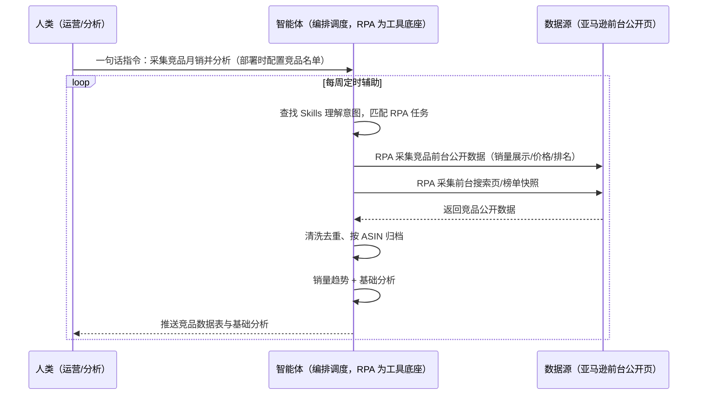
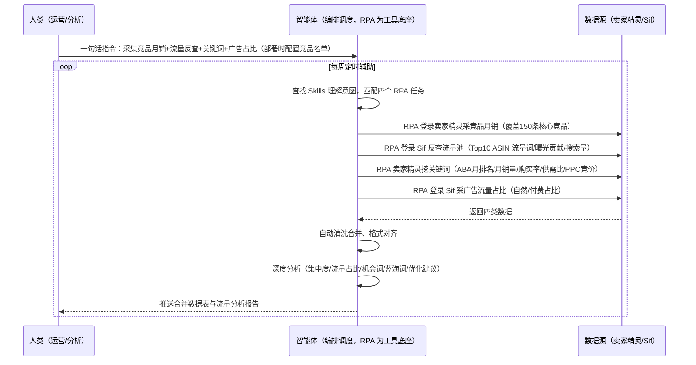

> 为亚马逊卖家团队打造的竞品数据采集与分析方案。手动在卖家精灵/Sif 多个平台来回切换搜索导出费时费力、各平台数据格式不一合并易错漏、广告流量占比靠人工截图统计。本方案由智能体调度多个工具执行卖家精灵/Sif 双平台数据采集（竞品月销/流量反查/关键词挖掘/广告占比）+ 自动清洗合并，输出竞品数据表与流量分析报告。一句话下达指令，全程自动化，无异常不打扰。

> Agent 自动化需开通企业功能
> 点击申请1个月免费权限
> [点击申请 →](https://skieer.feishu.cn/share/base/form/shrcnFwMayykP5iaL38fnZKTbrg)

---

## 一、用户与需求

核心矛盾：一轮竞品数据采集与清洗平均要花 2-4 小时；卖家精灵/Sif 多平台数据割裂、格式不一，手动搬数据错漏率超 10%；运营 60% 以上的时间耗在机械搬数据上，没时间做深度分析——四大场景（竞品月销采集、流量池反查、关键词挖掘、广告流量占比）形成一个完整数据闭环。

两类客户痛点同源，数据来源不同：

- 未购 SaaS 客户（新卖家/小团队）：没有卖家精灵/Sif，竞品分析全靠手动翻亚马逊前台，数据更粗、更慢；
- 已购 SaaS 客户（卖家精灵/Sif 会员等）：工具买了但数据是割裂的——卖家精灵管竞品月销/关键词，Sif 管流量反查/广告占比，手动在多个平台之间来回搬数据，照样费时易错。

适用客户：有竞品分析规模需求的亚马逊卖家（运营/卖家/数据分析师）。卖家精灵、Sif 是主流付费数据工具（会员制），本方案让已购客户把工具数据用起来、未购客户用前台公开数据做基础分析；一句话下达指令即可执行。

### 1.1 不同模式卖家

| 类型 | 选择 | 建议 |
|-|-|-|
| 精铺卖家 | 首选 | 强烈推荐（竞品分析是选品/跟品依据） |
| 品牌卖家 | 首选 | 强烈推荐（核心竞品多，需持续盯守） |
| 铺货型 | 次选 | 一般推荐（只分析重点竞品） |

### 1.2 不同类目卖家

| 类目 | 最关注维度 | 核心逻辑 |
|-|-|-|
| 3C 数码 | 广告流量占比 | 标品广告战，看付费流量依赖 |
| 家居家具 | 流量反查 | 大件决策词池结构 |
| 美妆个护 | 关键词挖掘 | 机会词/蓝海词早发现 |
| 服装鞋帽 | 竞品月销 | 起量信号早发现 |
| 母婴用品 | 销量趋势 | 趋势品节奏把握 |

### 1.3 不同角色用户

| 用户 | 需求 | 问题 | 投入时间（估算） |
|-|-|-|-|
| 跨境电商运营 | 提效 | 天天跟报表较劲 | 2-4 小时/轮 |
| 亚马逊卖家 | 数据同步 | 多平台搬数据 | 随时掌握动态 |
| 数据分析师 | 深度分析 | 时间耗在调数据 | 1 小时/轮 |

---

## 二、现在的方法与问题

### 2.1 流程步骤与问题总结

人工方式（未购 SaaS 客户）

| 序号 | 步骤 | 现在的方法 | 问题缺陷 |
|-|-|-|-|
| 1 | 采竞品数据 | 手动翻亚马逊前台 | 数据粗、覆盖少 |
| 2 | 估销量 | 凭截图估算 | 无趋势 |
| 3 | 看流量 | 无工具反查 | 流量结构看不透 |
| 4 | 整合 | 手动复制粘贴 | 错漏多 |

SaaS 方式（已购卖家精灵/Sif 会员客户）

| 序号 | 步骤 | 现在的方法 | 问题缺陷 |
|-|-|-|-|
| 1 | 采月销 | 卖家精灵手动搜索导出 | 逐条点，费时 |
| 2 | 反查流量 | Sif 手动反查 | 数据割裂 |
| 3 | 挖关键词 | 卖家精灵逐词查 | 流程零碎 |
| 4 | 看广告占比 | 人工截图统计 | 原始易漏 |
| 5 | 整合数据 | 多表复制粘贴 | 误差超 10% |

### 2.2 问题分析

人工方式根因

| 序号 | 根因 | 具体表现 |
|-|-|-|
| 1 | 无工具 | 数据靠翻前台 |
| 2 | 纯手动 | 一遍遍重复 |
| 3 | 无过程记录 | 出错无法追溯 |

**SaaS 方式根因**

| 序号 | 根因 | 具体表现 |
|-|-|-|
| 1 | 多平台割裂 | 卖家精灵/Sif 账号分开、格式不一，无法直接合并 |
| 2 | 人工整合慢 | 10 个 ASIN 全渠道数据要在多张表复制粘贴几百次，一次 2 小时+ |
| 3 | 机械工作挤占精力 | 60% 时间耗在搬数据，没时间做深度分析、研究竞品策略、优化广告 |

---

## 三、解决方案

### 3.1 功能概述

为亚马逊卖家团队打造的竞品数据采集与分析方案，一句话调度卖家精灵/Sif 双平台数据采集 + 自动清洗合并，输出竞品数据表与流量分析报告。

一句话下达指令（如「我要采集亚马逊竞品月销数据，并进行竞品流量池反查和数据分析」），智能体通过查找 Skills 文档库理解意图、匹配四个 RPA 自动化任务（竞品月销采集→流量反查→关键词挖掘→广告占比），经 MCP 调度八爪鱼 RPA 登录卖家精灵/Sif 执行采集，自动清洗去重、格式对齐、合并成表，最后生成竞品流量池深度分析报告（集中度/自然与广告占比/Top15 流量趋势/关键预警/机会词/蓝海词/竞价分析/优化建议）。全程自动化，运行状态实时反馈，跑完推送结果。

### 3.2 系统结合

| 要素 | 说明 |
|-|-|
| 客户现有工具盘点 | **未购 SaaS 客户**：无第三方工具，竞品分析全靠手动翻亚马逊前台。    
**已购 SaaS 客户**（主流组合）：卖家精灵（竞品月销/关键词挖掘，开放 API 46 接口）+ Sif（流量反查/广告占比） |
| 数据/能力来源 | **无 SaaS**：亚马逊前台公开数据（竞品列表/销量展示/关键词搜索页）+ 前台榜单。    
**有 SaaS**：卖家精灵（竞品月销/ABA 关键词指标）+ Sif（流量词反查/自然与广告流量占比），均需会员登录；Keepa（可选，€49/月，价格历史/BuyBox 辅助判断） |
| RPA 耦合动作 | 作为 Agent 的工具底座被调度执行：登录卖家精灵采集竞品月销与关键词、登录 Sif 反查流量池与广告占比，自动清洗去重、格式对齐、合并成表，统一流转给智能体；循环重试保证匹配率 |
| 耦合出的新价值 | 单工具给不了的端到端结论：四大场景一次跑完 → 自动合并 → 深度分析报告（集中度/流量占比/机会词/蓝海词/优化建议），**只推送合并数据表与分析报告** |

### 3.3 智能体执行流程

一句话下达指令，智能体自动调度。支持**两种数据通道**，部署时按客户现有工具选择：

**通道一：无 SaaS 方式（亚马逊前台公开数据，适合未购工具的客户）**

**通道二：有 SaaS 方式（卖家精灵+Sif 双平台，适合已购会员客户）**

> Agent 自动化需开通企业功能
> 点击申请1个月免费权限
> [点击申请 →](https://skieer.feishu.cn/share/base/form/shrcnFwMayykP5iaL38fnZKTbrg)

### 3.4 为何这么设计

要同时回答三个问题：**为什么不能只用 SaaS/API？为什么不能纯靠智能体写代码？为什么 RPA 是执行底座？** 本场景的核心是"一句话调度、双平台采集、自动合并分析、挂了有人管"。

#### 1）逐项对比

| 对比维度 | SaaS/API 堆叠（卖家精灵/Sif） | 纯智能体（智能体写代码） | 智能体+自动化工具（RPA 工具底座） |
|-|-|-|-|
| 实现方式 | 官方工具给数据（卖家精灵/Sif），数据割裂 | 能爬能分析，但全要自己接 | 双平台采集直挂 + 自动合并 |
| 多平台打通 | 卖家精灵/Sif 账号分开、格式不一，无法直接合并 | 需自写双平台对接与登录保活 | RPA 一个底座打通双平台，清洗合并自动化 |
| 一句话执行 | 需人工逐个操作 | 需人工描述技术细节 | 自然语言指令，智能体自动匹配任务 |
| 使用成本（总拥有成本） | 卖家精灵+Sif 双会员费 | 代理 IP + 服务器 + 开发维护人力，隐性成本高 | 一份平台订阅跑多流程，单方案边际成本 ≈ 0 |
| 维护人要求 | 低（工具现成） | 规则调整都要开发介入 | 可视化流程，运营自己可改参数 |

#### 2）优劣势说明

|  | SaaS/API 堆叠（卖家精灵/Sif） | 纯智能体（智能体写代码） | 智能体+自动化工具（RPA 工具底座） |
|-|-|-|-|
| 优势 | 数据口径权威；    
API 接口全（卖家精灵 46 接口） | 无订阅费；    
可深度定制分析模型 | 双平台采集直挂；    
自动合并分析即开即用；    
非技术人员可维护 |
| 劣势 | 数据割裂需人工整合；    
趋势判断依赖人工 | 双平台对接与登录保活全自建；    
AI 生成代码是生成性的 | 本地电脑运行需保持开机；    
双会员订阅费；    
后台采集受登录态影响 |

#### 3）结论

| 论点 | 说明 |
|-|-|
| 数据闭环 | 四大场景（月销采集→流量反查→关键词挖掘→广告占比）形成一个完整数据闭环，单工具给不了 |
| 一句话干活 | 智能体把自然语言指令翻译成具体自动化流程，不用记命令、不用找按钮（实锤：输入一句话自动匹配四个 RPA 任务） |
| 效率提升 | 原来 2-4 小时手动活，几分钟自动跑完，整体效率提升 80%+ |
| 一个底座跑多流程 | 客户购买 RPA 平台是跑多个流程（选品/竞品/口碑），本方案只是其中一个——平台订阅费被多流程摊薄 |
| 时间 | 运营要的是"一句话拿到合并数据表+分析报告"，不是"在多个平台来回搬数据" |

### 3.5 功能清单

| 功能 | 系统 | 功能说明（解决问题） |
|-|-|-|
| 会话/一句话指令 | 智能体 | 1. 理解自然语言意图，查找 Skills 文档库。    
2. 匹配对应 RPA 自动化任务、编排多任务。 |
| 多系统数据取数 | RPA、指纹浏览器 | 1. 解决多平台来回切换、手动搜索导出问题。    
2. 作为智能体工具底座被调度执行，登录卖家精灵/Sif 采集，失败重试、循环保匹配率。    
3. **【无 SaaS 方式】** RPA 采集亚马逊前台公开数据。**【有 SaaS 方式】** RPA 登录卖家精灵采竞品月销/关键词 + 登录 Sif 反查流量池/广告占比。 |
| 数据清洗合并 | 智能体 | 去重、格式对齐、字段统一，解决多平台数据割裂、手动合并错漏问题。 |
| 数据分析与报告 | 智能体 | 竞品流量池深度分析：集中度分析/自然与广告流量占比/Top15 流量变化趋势/关键预警/自然排名分布/机会词/蓝海词/关键词类型分布/竞价分析/优化建议。 |
| IM通知 | 飞书、钉钉、企微等 | 解决结果交付滞后问题。采集结果摘要、分析报告自动推送。 |
| 数据资产储存 | 本地电脑、云储存 | 1. Skills 资产：竞品数据采集与分析技能。    
2. 数据储存：合并数据表统一写入本地。    
3. 经验知识库：分析结论回填迭代。 |

### 3.6 智能体执行落地过程

部署时一次性配置入参（竞品 ASIN 名单、目标站点、数据通道），会话中一句话即可触发，无需重复输入。

**⚠️ 部署前提（不满足则方案无法跑起来）**：①RPA 需部署在**常开电脑/云机**上，并配置漏跑补跑机制；②**有 SaaS 方式需卖家精灵/Sif 会员登录态**（登录失效自动告警）；③首次配置（登录态、竞品名单、模板导入）需服务方/技术人员介入一次，属实施成本。

#### 1）配置（五步）

| 步骤 | 操作 | 说明 |
|-|-|-|
| 第一步 | 下载八爪鱼 RPA，导入跨境电商自动化模板 | 官网免费下载客户端；MCP 工具→添加应用→选择已搭建应用→填应用名称/描述（或 AI 一键生成） |
| 第二步 | 开启八爪鱼 RPA 的 MCP 服务端口 | 客户端→API-K→创建 API（名称自定义） |
| 第三步 | 在智能体中添加 MCP Server 连接 | 八爪鱼 MCP 工具→接入指引→复制连接配置→智能体连接器→自定义连接器→配置 MCP→粘贴保存→刷新重连 |
| 第四步 | 验证工具列表 | 确认六个通用工具全部启用（即八爪鱼客户端内六个工具） |
| 第五步 | 测试运行效果 | 输入一句话指令，验证自动采集与报告生成 |

| 类别 | 说明 |
|-|-|
| 智能体 | 主流智能体（支持 MCP 连接、Skills 加载、定时任务）。 |
| 智能体工具 | 1. **数据通道（按客户现有工具二选一）**：【无 SaaS】亚马逊前台公开数据（RPA 采集）；【有 SaaS】卖家精灵 + Sif（会员登录采集）。    
2. 数据取数与自动化执行：八爪鱼 RPA（MCP 协议接入，六个通用工具），MCP 配置完成。    
3. 数据分析：智能体自带。    
4. IM：企业办公 IM（飞书/钉钉/企微），MCP 或 webhook 配置。 |
| 工作知识 | 1. 竞品 ASIN 名单。    
2. 目标站点/站点。    
3. 分析维度（集中度/流量占比/机会词/蓝海词）。    
4. 采集频率与时段。 |
| 本地数据库 | 1. 合并数据表地址。    
2. 分析报告库地址。    
3. 经验库地址。 |

#### 2）执行

| 任务 | 产出 | 产出物接收人 |
|-|-|-|
| 接收一句话指令，匹配 RPA 任务 | 任务启动记录 | —— |
| 调用已预设 Skills，编排任务流程 | 任务编排方案 | —— |
| 经 MCP 向八爪鱼 RPA 下发采集任务 | 自动化任务指令 | —— |
| 双平台采集（卖家精灵月销/关键词 + Sif 流量反查/广告占比，智能体监控状态） | 四类原始数据 | —— |
| 自动清洗去重、格式对齐、合并成表 | 合并数据表 | 运营/分析 |
| 深度分析（集中度/流量占比/机会词/蓝海词/优化建议） | 流量分析报告 | 运营/老板 |
| 推送结果摘要与分析报告 | 群消息 | 运营/分析/老板 |

异常处理：

登录失效 → 告警人工介入后断点续跑；

采集失败 → 自动重试，循环保证匹配率；

数据采集不全 → 降级说明本次覆盖率；

分析置信度低 → 转人工复核，不输出硬结论。

#### 3）结果

| 结果 | 说明 |
|-|-|
| 数据资产 | 合并数据结构化存储（竞品月销/流量词/关键词/广告占比/来源），可审计可追溯。 |
| 分析报告 | 竞品流量池深度分析报告：集中度分析/自然与广告流量占比/Top15 流量变化趋势/关键预警/机会词/蓝海词/关键词类型分布/竞价分析/优化建议。 |
| Skills | 智能体 Skills：竞品数据采集与分析技能，按周迭代分析规则。 |

> Agent 自动化需开通企业功能
> 点击申请1个月免费权限
> [点击申请 →](https://skieer.feishu.cn/share/base/form/shrcnFwMayykP5iaL38fnZKTbrg)

---

## 四、使用前后预估

> 本方案价值 = **一句话下达指令 → 双平台自动采集 → 自动清洗合并 → 深度分析报告**。把运营从 2-4 小时的机械搬数据中解放出来。

| 指标 | 人工 | SaaS/API（卖家精灵/Sif） | 智能体+自动化工具 |
|-|-|-|-|
| 数据采集 | 手动逐条点，2-4 小时/轮 | 双平台割裂，手动整合 | 一句话调度，几分钟跑完 |
| 多平台整合 | 复制粘贴几百次 | 格式不一无法合并 | 自动清洗合并成表 |
| 数据准确性 | 误差超 10% | 依赖人工 | 自动化合并，可追溯 |
| 分析深度 | 没时间分析 | 单工具数据 | 深度报告（机会词/蓝海词/优化建议） |
| 运营时间 | 60% 耗在机械活 | 部分提效 | 专注选品/广告策略 |
| 方法论 | 无，换人标准不同 | 单工具数据 | 可复用的 Skills 与数据表 |

**说明**：卖家精灵（竞品月销/关键词，开放 API 46 接口）+ Sif（流量反查/广告占比）是主流付费数据工具；一轮完整采集清洗原 2-4 小时（实锤）；人工整合误差超 10%（实锤）；本方案效率提升 80%+，四大场景全覆盖，零代码一句话干活。

---

## 五、效果证明

> Agent 自动化需开通企业功能
> 点击申请1个月免费权限
> [点击申请 →](https://skieer.feishu.cn/share/base/form/shrcnFwMayykP5iaL38fnZKTbrg)

### 5.1 实操课程教程

[查看原视频](https://player.bilibili.com/player.html?bvid=1kgK86zE5p)

### 5.2 客户案例

**《家居龙头：20+ 海外平台商品数据自动化，日均 2.5 万条》**

> 20+ 海外平台的商品价格、运费、SKU、排名等多维度数据原靠人工抽样采集。RPA 实现全自动全量采集与入库，为跨境运营决策提供数据底座。

| 效果 | 说明 |
|-|-|
| 提效 | 多平台商品数据采集效率提升约 85%。原本 20+ 海外平台的商品数据靠人工抽样采集，现在全自动全量采集入库，日均 2.5 万条，运营上班即可看到最新数据。 |
| 降本 | 告别「导表格、拼数据」的重复劳动，运营团队从人工采集转为直接使用数据做选品与定价决策。 |
| 任务 | 覆盖 20+ 海外平台，价格/运费/SKU/EAN/首图/类目排名等 8+ 核心字段，支持变体信息全采集。 |
| 任务 | 采集稳定率 99%+，跨语言、跨页面结构、跨价格展示方式全部适配。 |

案例详情：[跨境取数：家居龙头的20+海外平台商品数据自动化实践](https://skieer.feishu.cn/wiki/Iko0wtqEfiOdzlkstYBc5DI3nUe)

**《万和：idealo 欧洲 5 国竞品比价数据自动化》**

> 一键覆盖 idealo 德法意英西 5 大站点，列表页 + 详情页双层深度采集，从基础信息到价格分布再到产品参数全维度抓取，清洗后结构化入 MySQL。

| 效果 | 说明 |
|-|-|
| 提效 | 海外竞品比价由人工一周缩短至几小时。原本 idealo 德法意英西 5 国站点需逐个采集、规则各异，现在 55 个核心品类关键词 × 每词前 50 页全自动采集。 |
| 降本 | 竞品价格情报从人工零散收集升级为自动化全景洞察，市场人员投入转向定价与产品策略等重点工作。 |
| 任务 | 列表页 + 详情页双层采集，10+ 全维度字段，采集稳定率 99%+（人工误差约 90% → 全自动 99%+）。 |
| 任务 | 多维度筛选条件自动配置，数据自动清洗去重后结构化入 MySQL，可直接分析。 |

案例详情：[竞品洞察：厨卫龙头的欧洲5国比价数据自动化实践](https://skieer.feishu.cn/wiki/MEhqwM1pWi2Lv3kCBqJcJQvAnwe)

---

## 六、备注

### 6.1 Agent 支持

本方案不绑定具体智能体，主流 Agent 均可运行（需支持 MCP 连接、技能/Skills 加载与工具调用）：

| Agent/智能体 | 说明 |
|-|-|
| Workbuddy | 本方案运行平台，支持技能/Skills 上传加载、定时任务、MCP 工具调用与表格/报告处理 |
| 豆包（国内·字节） | 国内主流个人智能体，支持技能上传、定时任务与工具调用，上手成本低 |
| 通义千问（国内·阿里） | 支持 Agent 编排与插件生态，集成阿里电商数据能力，适合电商场景 |
| DeepSeek（国内） | 推理能力强、成本低，适合规则打分与归因分析类任务 |
| ChatGPT（国外·OpenAI） | 海外主流通用智能体，支持 GPTs/Agent 模式与工具调用 |
| Claude（国外·Anthropic） | 长文本与结构化分析能力强，原生支持 MCP 连接外部工具 |

### 6.2 名词解释

| 术语 | 说明 |
|-|-|
| 卖家精灵 | 亚马逊卖家数据工具，竞品月销/关键词挖掘（开放 API 46 接口） |
| Sif | 亚马逊流量分析工具，流量反查/广告流量占比 |
| 流量反查 | 根据竞品 ASIN 反查其流量来源关键词 |
| 流量池 | 竞品 ASIN 的流量关键词集合 |
| ABA | Amazon Brand Analytics，亚马逊品牌分析数据（月排名/购买率等） |
| PPC 竞价 | 关键词竞价参考价 |
| 广告流量占比 | 自然流量与付费流量占比 |
| Keepa | 亚马逊数据工具（€49/月），价格历史/BuyBox 数据，本方案可选辅助数据源 |
| MCP | Model Context Protocol，智能体连接外部工具的标准化通道 |
| 一句话指令 | 用自然语言描述任务，智能体自动翻译为自动化流程 |
| 无 SaaS 方式 | 不购买第三方工具，亚马逊前台公开数据采集 |
| 有 SaaS 方式 | 已购卖家精灵/Sif 会员，双平台数据采集 |
| 指纹浏览器 | 隔离 Cookie/浏览器指纹的工具，多店铺防关联 |

> Agent 自动化需开通企业功能
> 点击申请1个月免费权限
> [点击申请 →](https://skieer.feishu.cn/share/base/form/shrcnFwMayykP5iaL38fnZKTbrg)

---

原文：[查看原文](https://skieer.feishu.cn/wiki/MdpXwupOsiZ5QQkLv91cIv5Vnhh)
