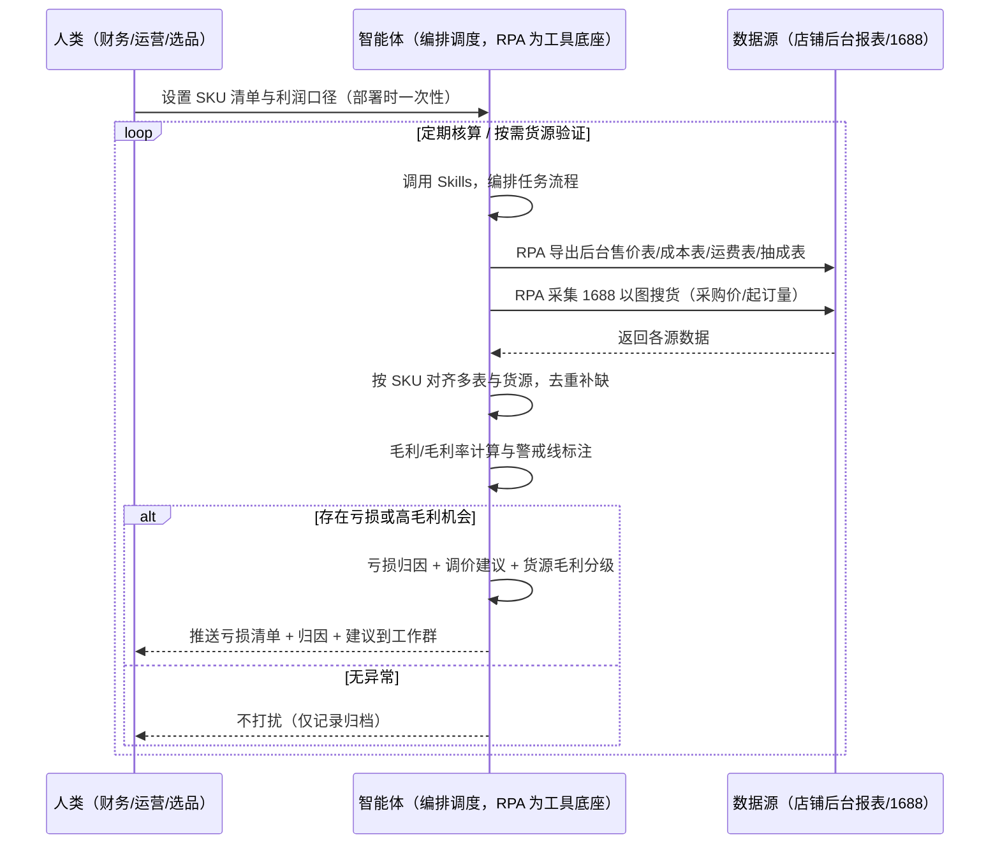
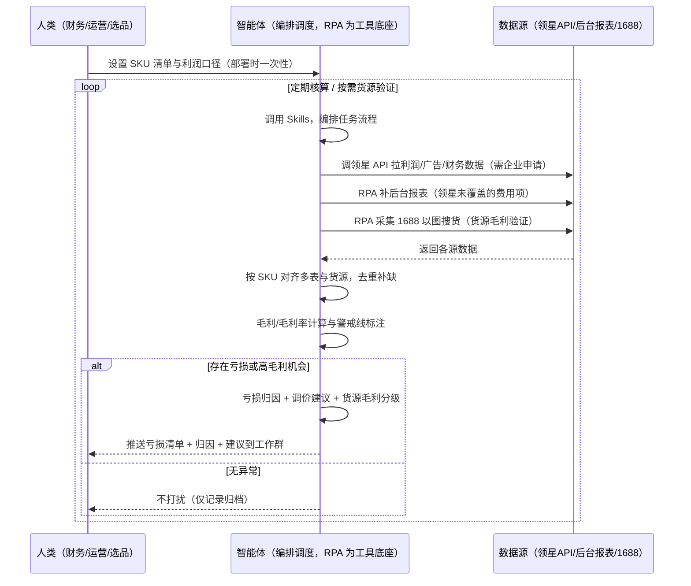

> 为亚马逊卖家团队打造的利润与货源测算方案。成本数据分散在售价表、成本表、运费表、抽成表多张表格，货源要跨亚马逊、1688 两个平台核对，本方案由智能体调度多个工具统一取数、定期自动核算利润、按需验证货源，只推送亏损与高毛利机会，无异常不打扰。

> Agent 自动化需开通企业功能
> 点击申请1个月免费权限
> [点击申请 →](https://skieer.feishu.cn/share/base/form/shrcnFwMayykP5iaL38fnZKTbrg)

## 一、用户与需求

核心矛盾：成本数据分散在售价表、成本表、运费表、抽成表多张表格里，人工逐行算利润既慢又易错；同时选品和找货源要在亚马逊、1688 两个平台来回切，毛利凭感觉估不准——等月底复盘才发现"卖得越多亏得越多"，或上架后才发现货源毛利算错了。

两类客户痛点同源，数据来源不同：

- 未购 SaaS 客户（新卖家/小团队）：人工从后台导多张报表，用个人 Excel 公式逐行算利润，再复制商品图去 1688 手动搜货源，全靠手；
- 已购 SaaS 客户（领星 ERP 看利润、卖家精灵看市场）：领星能出利润报表，但货源毛利（1688 采购价 vs 售价）没有工具覆盖，仍要人跨平台核对；且多 SKU 亏损归因、调价建议靠人工。

> 适用客户：SKU 多、需统一利润口径的卖家，或做选品时需前置验证货源毛利的卖家。只做几个爆款的小卖家价值有限（人工每周算一次即可，本方案不推荐）。

### 1.1 不同模式卖家

| 类型 | 选择 | 建议 |
|-|-|-|
| 品牌 | 首选 | 强烈推荐（SKU 多、利润口径必须统一，且需货源毛利前置验证） |
| 精铺 | 次选 | 一般推荐，聚焦主力款 SKU 的利润与货源核算 |
| 铺货 | 任意 | 不推荐，SKU 太多，只算爆款利润即可 |

### 1.2 不同类目卖家

| 类目 | 最关注维度 | 核心逻辑 |
|-|-|-|
| 3C 数码 | 广告费占比 + 货源相似度 | 广告投放占比高，核查是否超售价 15% 红线；以图搜货相似度低警惕非同款 |
| 家居家具 | 头程运费 | 大件头程占比高，运费偏高直接吃掉利润 |
| 美妆个护 | 退货损耗 + 合规 | 退货率影响利润，默认含 5% 退货损耗；货源需核合规 |
| 服装鞋帽 | 退货率 + 款式匹配 | 尺码色差退货多；以图搜货相似度决定能否复制 |
| 户外运动 | 采购成本 + 毛利空间 | 功能件采购价波动大，盯采购成本与毛利空间 |
| 母婴用品 | 佣金与合规 | 类目佣金高、合规检测成本大，无资质货源直接放弃 |

### 1.3 不同角色用户

| 用户 | 需求 | 问题 | 投入时间（估算） |
|-|-|-|-|
| 老板 | 看整体盈亏、知道哪些品亏本 | 月底才看到利润汇总，亏本发现太晚 | 0.5-1 小时/周 |
| 运营/财务 | 逐 SKU 算利润、出调价建议 | 手动逐行计算易出错，口径不统一 | 2-4 小时/周 |
| 选品/采购 | 货源毛利空间与调价依据 | 两平台来回切，毛利估算粗糙 | 1-2 小时/周 |

---

## 二、现在的方法与问题

### 2.1 流程步骤与问题总结

人工方式（未购 SaaS 客户）

| 序号 | 步骤 | 现在的方法 | 问题缺陷 |
|-|-|-|-|
| 1 | 导数据 | 分别登录后台导出售价表、成本表、运费表、抽成表 | 多张表来回导，字段口径不一 |
| 2 | 算利润 | 用公式逐行算毛利，人工核对 | 公式散落个人表格，算错难发现 |
| 3 | 看盈亏 | 凭印象判断"这个品还行" | 无统一警戒线，亏本商品发现滞后 |
| 4 | 找货源 | 复制商品图去 1688 手动搜 | 两平台来回切，费时 |
| 5 | 算货源毛利 | 凭感觉估算毛利空间 | 运费佣金估算粗，毛利虚高 |
| 6 | 定决策 | 拍板调价/做不做 | 无完整计算过程，判断不可复核 |

SaaS 方式（已购领星 ERP 客户）

| 序号 | 步骤 | 现在的方法 | 问题缺陷 |
|-|-|-|-|
| 1 | 导数据 | 领星出利润报表（自动汇总） | 利润表口径固定，费用项颗粒度不够时仍需补表 |
| 2 | 算利润 | 领星自动计算 | 已覆盖常规利润，但特殊费用（广告细分/退货损耗）需人工调整 |
| 3 | 看盈亏 | 领星看利润趋势 | 亏损归因（为什么亏）领星不解释 |
| 4 | 找货源 | 复制商品图去 1688 手动搜 | 领星不覆盖货源，仍要人跨平台 |
| 5 | 算货源毛利 | 凭感觉估算毛利空间 | 无货源毛利测算工具 |
| 6 | 定决策 | 拍板调价/做不做 | 无完整计算过程，判断不可复核 |

### 2.2 问题分析

人工方式根因

| 序号 | 根因 | 具体表现 |
|-|-|-|
| 1 | 数据跨表分散 | 售价/成本/运费/抽成分散多表，人工对不齐 |
| 2 | 无统一公式 | 利润口径因人而异，计算结果不可比 |
| 3 | 亏本发现滞后 | 无自动警戒线，亏到月底才知道 |
| 4 | 毛利估算粗糙 | 头程/佣金估算不准，毛利空间失真 |
| 5 | 经验不沉淀 | 测算口径在人脑里，换个人结果就不一样 |

SaaS 方式根因

| 序号 | 根因 | 具体表现 |
|-|-|-|
| 1 | 利润表口径固定 | 领星利润报表覆盖常规计算，特殊费用项需人工补 |
| 2 | 亏损不归因 | 领星告诉你"这个 SKU 亏了"，不说"为什么亏、该调价还是换货源" |
| 3 | 货源环节空白 | 1688 采购价 vs 售价的毛利空间无工具覆盖，仍靠人跨平台 |
| 4 | 决策不沉淀 | 调价建议、货源选择依据在个人经验里，换人就不一样 |

---

## 三、解决方案

### 3.1 功能概述

为亚马逊卖家团队打造的智能体驱动利润与货源测算方案，解决成本数据跨表分散、人工反复手动执行、毛利口径不统一的问题。

定时触发并调度多个工具，调起多个工具统一取数，按 SKU 对齐合并，输出利润与货源分析，涵盖「逐 SKU 毛利计算、亏损与低利润标注、亏损归因、调价建议、1688 货源毛利测算与分级」。定期自动核算，只推送亏损与高毛利机会。

### 3.2 系统结合

| 要素 | 说明 |
|-|-|
| 客户现有工具盘点 | **未购 SaaS 客户**：无第三方工具，利润全靠后台导出 + 个人表格，货源靠手动搜 1688。   **已购 SaaS 客户**（主流组合）：领星 ERP（每日实时利润报表、广告/财务数据，开放 API 需企业申请）、卖家精灵（市场/选品数据，不覆盖利润与货源） |
| 数据/能力来源 | **未购 SaaS**：店铺后台官方报表导出（售价/订单/费用）+ 1688 前台以图搜货（采购价/起订量，RPA 采集）。   **已购 SaaS**：领星开放 API（自身利润/广告/财务数据，需企业申请权限）+ 1688 以图搜货（RPA 采集，领星不覆盖）+ 后台报表兜底 |
| RPA 耦合动作 | 作为 Agent 的工具底座，按计划调度多数据源取数（官方导出/API 优先 + 前台采集兜底），按 SKU 对齐去重合并，统一流转给智能体计算；任一数据源失败自动重试、异常告警 |
| 耦合出的新价值 | 单工具给不了的端到端结论：多表数据一次取齐 → 统一利润口径计算 → 亏损归因 → 调价建议 → 1688 货源毛利测算（选品前置验证），**只推送亏损与高毛利机会到工作群**，免去人工在多表多平台间反复切换 |

### 3.3 智能体执行流程

用户向智能体输入会话（入参：SKU 清单 / 目标关键词）或智能体定时触发（日常核算 + 货源验证周期执行）。支持两种数据通道，部署时按客户现有工具选择：

通道一：无 SaaS 方式（RPA 采集后台报表 + 1688，适合未购领星的客户）

通道二：有 SaaS 方式（领星 API 拿利润核心，RPA 补 1688 货源，适合已购客户）

> Agent 自动化需开通企业功能
> 点击申请1个月免费权限
> [点击申请 →](https://skieer.feishu.cn/share/base/form/shrcnFwMayykP5iaL38fnZKTbrg)

### 3.4 为何这么设计

要同时回答三个问题：为什么不能只用 SaaS/API？为什么不能纯靠智能体写代码？ 本场景的核心是"定期自动、跨多表+跨平台取数、按 SKU 对齐、固定公式计算、出归因结论、有异常推送、挂了有人管"。

#### 1）逐项对比

| 对比维度 | SaaS/API 堆叠（领星/卖家精灵） | 纯智能体（智能体写代码） | 智能体+自动化工具（RPA 工具底座） |
|-|-|-|-|
| 实现方式 | 领星出利润报表（口径固定），货源环节无覆盖 | 能调 API 能抓前台，数据可自拼，但全要自己接 | 一个底座跑多个流程（利润/货源/选品/VOC……），数据一处对齐 |
| 多表多平台耦合 | 领星管利润、1688 无工具，无人组装 | 全自建：API 鉴权、1688 以图搜货、多表对齐逻辑 | 平台沉淀多源取数与对齐，可视化配置 |
| 计算与归因 | 领星算利润不归因；货源毛利无工具 | 计算逻辑自写，灵活但工程量大 | 判断交给智能体（归因+调价+货源分级），执行交给 RPA |
| 定时与推送 | 领星每日利润报表（人看）；货源验证无提醒 | 调度器/进程常驻/告警通道全自建 | 平台调度稳定触发，失败重试 + 异常告警，有异常才推送 |
| 使用成本（总拥有成本） | 一流程一订阅：领星 500-1500/月……随流程数增长 | 代理 IP + 服务器 + 开发维护人力，隐性成本高 | 一份平台订阅跑所有流程，单方案边际成本 ≈ 0 |
| 维护人要求 | 低（工具已成熟） | 每次表结构/公式调整都要开发介入 | 可视化流程，运营自己可调警戒线、费用项、推送群 |

#### 2）优劣势说明

|  | SaaS/API 堆叠（领星/卖家精灵） | 纯智能体（智能体写代码） | 智能体+自动化工具（RPA 工具底座） |
|-|-|-|-|
| 优势 | 利润报表自动、口径权威；卖家精灵市场数据成熟 | 无订阅费；   可深度定制计算公式；   技术上完全可行 | 一个底座跑多流程、数据一处对齐；   利润口径统一可审计；   1688 货源毛利前置验证；   调度/重试/告警开箱即用 |
| 劣势 | 领星利润口径固定（特殊费用需人工补）、不归因、不覆盖货源 | 多表对齐与跨平台链路全自建，任何一环挂就断；   AI 生成代码是生成性的，口径变更行为不完全可控 | 本地电脑运行需保持开机（建议部署常开电脑/云机）；   订阅费；   灵活性受平台模板边界限制 |

#### 3）结论

| 论点 | 说明 |
|-|-|
| 只用 SaaS/API 缺"货源毛利与归因" | 领星解决常规利润计算，但"为什么亏、该调价还是换货源、1688 采购价 vs 售价毛利多少"它不覆盖——这是本方案的增量 |
| 纯智能体缺"工程底座" | 多表对齐 + 跨平台以图搜货 70% 的工作在工程（取数/对齐/调度/重试），不在"写计算公式"；   RPA 作为工具底座把这 70% 已经造好 |
| 一个底座跑多流程 | 客户购买 RPA 平台是跑多个流程（利润/货源/选品/竞品/后台操作），本方案只是其中一个——平台订阅费被多流程摊薄，单方案边际成本接近 0 |
| 确定性 vs 生成性 | 利润测算是确定性任务——同样的公式、同样的数据，要求"每次算得一模一样、可审计可复核"。RPA 流程是确定性的；   AI 写的代码是生成性的，能跑通和口径长期一致是两回事 |
| 时间 | 卖家要的是"每天拿到利润明细和亏损清单"，不是"每天修脚本"；   判断层交给智能体，执行层交给工具底座 |

### 3.5 功能清单

| 功能 | 系统 | 功能说明（解决问题） |
|-|-|-|
| 会话/定时 | 智能体 | 1. 理解人类语言，调用已预设好的 Skills。   2. 编排多任务、调度多工具。 |
| 多系统数据取数 | RPA、指纹浏览器 | 1. 解决成本数据分散多表、选品找货源两平台来回切问题。   2. 作为智能体工具底座被调度执行，月末全量重算、1688 搜索失败重试 2 次、无同款标注「无货源」跳过。   3. **【无 SaaS 方式】** RPA 导出后台售价表/成本表/运费表/抽成表 + 采集 1688 以图搜货。   **4.【有 SaaS 方式】** 调领星 API 拉利润/广告/财务（需企业申请）+ RPA 补特殊费用项与 1688 货源。 |
| 数据清洗对齐 | 智能体 | 按 SKU 对齐多表与货源数据，去重合并，解决手动贴 Excel 对不齐、跨平台数据拼不起来问题。 |
| 利润计算 | 智能体 | 毛利 = 售价 − 采购成本 − 头程运费 − 平台佣金 − FBA 仓储费 − 广告费，毛利率 = 毛利 ÷ 售价；   标注毛利率 &lt;0 → 红色亏损，0-10% → 黄色低利润。 |
| 亏损归因与调价建议 | 智能体 | 亏损归因：成本过高/售价过低/广告费超标/运费偏高，按贡献度排序；   调价建议 = 采购成本 ×(1+目标毛利率)+各项费用，附测算过程并校验竞品价格区间。**建议需人工确认后执行**。 |
| 货源毛利测算 | 智能体 | 货源毛利空间 =（售价 − 1688 采购价 − 头程 − 佣金）÷ 售价；>30% → 绿色推荐，15-30% → 黄色观察，&lt;15% 或无货源 → 红色放弃；   以图搜货相似度标注，过低标注"疑似非同款"。 |
| IM通知 | 飞书、钉钉、企微等 | 解决亏本与高毛利货源发现滞后问题。**有异常才推送**利润明细、负毛利 SKU、高毛利项到工作群，无异常不打扰。 |
| 数据资产储存 | 本地电脑、云储存 | 1. Skills 资产：利润测算口径、亏损判定规则、以图搜货方法库，被调度直接调用。   2. 数据储存：利润明细表.xlsx 与选品货源对比表.xlsx 按周期沉淀，可审计可追溯。   3. 经验知识库：审核通过的调价与货源决策持续沉淀。 |

### 3.6 智能体执行落地过程

部署时一次性配置入参（SKU 清单、利润口径、警戒线、费用项、推送群、数据通道），会话中无需重复输入。

⚠️ 部署前提（不满足则方案无法跑起来）：①RPA 需部署在常开电脑/云机上，并配置漏跑补跑机制；②有 SaaS 方式需领星企业客户申请开放 API 权限（未开通则自身利润数据走官方报表导出，自动降级为无 SaaS 通道）；③1688 以图搜货受平台风控影响，需自备账号，采集失败自动重试；④首次配置（API 鉴权、对齐规则、费用口径）需服务方/技术人员介入一次，属实施成本。

#### 1）配置

| 类别 | 说明 |
|-|-|
| 智能体 | 主流智能体。 |
| 智能体工具 | 1. **数据通道（按客户现有工具二选一）**：【无 SaaS】店铺后台报表导出 + 1688 以图搜货（RPA 采集）；【有 SaaS】领星开放 API（需企业申请）+ RPA 补特殊费用项与 1688 货源。   2. 数据取数与自动化执行：八爪鱼 RPA，MCP 配置完成。   3. 数据分析：智能体自带。   4. IM：企业办公 IM（飞书/钉钉/企微），MCP 或 webhook 配置。 |
| 工作知识 | 1. SKU 清单（含品类）与目标关键词。   2. 毛利警戒线：默认 10%。   3. 广告费占比红线：默认 &lt;售价 15%。   4. 退货损耗：默认含 5%。   5. 目标毛利率：默认 25%（货源验证 30%）。   6. 头程运费与佣金率：默认按 10%/15%。   7. 费用缺失处理：默认值计算并标注"默认假设"。   8. 货源相似度门槛：低于门槛标注"疑似非同款"。 |
| 本地数据库 | 1. 利润货源库地址。   2. 报告库地址。   3. 经验库地址。 |

#### 2）执行

| 任务 | 产出 | 产出物接收人 |
|-|-|-|
| 接收 SKU 清单/关键词，定时或会话 | 任务启动记录 | —— |
| 调用已预设 Skills，编排任务流程 | 任务编排方案 | —— |
| 经 MCP 向八爪鱼 RPA 下发取数任务 | 自动化任务指令 | —— |
| 多源取数并按 SKU 对齐（无 SaaS：后台导出+1688；有 SaaS：领星 API+1688，智能体监控状态） | 对齐后利润与货源数据 | —— |
| 毛利/毛利率计算与警戒线标注 | 利润标签（亏损/低利润） | 财务 |
| 亏损归因分析 | 亏损归因 | 运营/财务 |
| 货源毛利空间测算与分级 | 货源分级标签 | 选品 |
| 调价与货源建议生成（附测算过程与竞品校验） | 调价建议 + 选品货源对比表 | 运营/选品/老板 |
| 推送亏损清单与高毛利机会到工作群（有异常才推送） | 利润异常通知 | 运营/选品/老板 |

异常处理：

字段缺失 → 按默认值计算并标注"默认假设"；

引用空表 → 跳过等待数据齐备，下轮补算；

多表 SKU 对不上 → 标注未匹配 SKU，不静默丢弃；

1688 搜索失败 → 重试 2 次，仍失败跳过该商品；

无同款商品 → 标注「无货源」跳过；相似度过低 → 标注"疑似非同款"，不作为毛利依据；

价格为过期值 → 注明采集日期，超期标注待重采；

置信度 &lt;70% → 转人工复核，不输出硬结论。

#### 3）结果

| 结果 | 说明 |
|-|-|
| 数据资产 | 全量 SKU 利润与货源结构化数据（售价/采购价/头程/佣金/仓储费/广告费/毛利/毛利率/标签 + 货源价/起订量/供应商/相似度/日期），多期可审计。 |
| 分析报告 | 1. 利润明细表：逐 SKU 毛利与毛利率，直接告诉团队"每个品赚多少"。   2. 负毛利清单：毛利率 &lt;0 的 SKU 立即标红，附亏损归因。   3. 选品货源对比表：商品与货源价格并排对比，高毛利项附完整计算过程与货源链接。   4. 调价建议：每条附测算过程与竞品价格校验，不推荐低于竞品最低价 90% 的定价。 |
| Skills | 智能体 Skills：利润测算口径、亏损判定与以图搜货方法库。 |

> Agent 自动化需开通企业功能
> 点击申请1个月免费权限
> [点击申请 →](https://skieer.feishu.cn/share/base/form/shrcnFwMayykP5iaL38fnZKTbrg)

---

## 四、使用前后预估

> 本方案价值 = 跨表统一口径 + 货源毛利前置验证 + 亏损归因。不承诺替代人工决策——调价建议、货源选择需人工确认后执行。适合 SKU 多、需统一利润口径、愿配环境的卖家。

| 指标 | 人工 | SaaS/API（领星） | 智能体+自动化工具 |
|-|-|-|-|
| 核算耗时 | 每周 2-4 小时（估算） | 每周 0.5 小时（估算，领星已自动计算，人看报表） | 取数全自动；   人工转为审核异常（每周约 0.5 小时） |
| 核算频率 | 月底才算一次 | 领星每日利润报表 | 定期自动核算 + 按需货源验证 |
| 亏本发现时效 | 事后发现（亏一个月才知道） | 领星报表能看到，但不归因 | 当天标记负毛利 SKU + 归因 |
| 货源毛利 | 凭感觉估不准 | 无覆盖 | 1688 以图搜货完整测算，可复核 |
| 决策依据 | 无相似度/日期标注 | 无货源数据 | 相似度 + 采集日期透明，可信可查 |
| 方法论 | 无，换人结果不同 | 领星口径固定 | 可复用的 Skills 与规则库 |

说明：1688 采购价为采集时点值（附日期），货源毛利为估算（头程/佣金按默认费率，可配置）；已购领星客户利润主体以领星数据为准，本方案增量在货源毛利验证、特殊费用项补充与亏损归因。

---

## 五、效果证明

### 5.1 DEMO应用

自动采集亚马逊数据再以图片在1688查找相同商品：https://rpa.bazhuayu.com/appstore/app/dev_o_z3d8/zi-dong-cai-ji-ya-ma-xun-shu-ju-zai-yi-tu-pian-zai1688-cha-zhao-xiang-tong-shang-pin

自动采集亚马逊数据再以图片在1688查找相同商品：https://rpa.bazhuayu.com/appstore/app/dev_o_z3d8/zi-dong-cai-ji-ya-ma-xun-shu-ju-zai-yi-tu-pian-zai1688-cha-zhao-xiang-tong-shang-pin

---

## 六、备注

### 6.1 Agent 支持

本方案不绑定具体智能体，主流 Agent 均可运行（需支持技能/Skills 加载与工具调用）：

| Agent/智能体 | 说明 |
|-|-|
| Workbuddy | 本方案运行平台，支持技能/Skills 上传加载、定时任务、MCP 工具调用与表格/报告处理 |
| 豆包（国内·字节） | 国内主流个人智能体，支持技能上传、定时任务与工具调用，上手成本低 |
| 通义千问（国内·阿里） | 支持 Agent 编排与插件生态，集成阿里电商数据能力，适合电商场景 |
| DeepSeek（国内） | 推理能力强、成本低，适合规则打分与归因分析类任务 |
| ChatGPT（国外·OpenAI） | 海外主流通用智能体，支持 GPTs/Agent 模式与工具调用 |
| Claude（国外·Anthropic） | 长文本与结构化分析能力强，原生支持 MCP 连接外部工具 |

### 6.2 名词解释

| 术语 | 说明 |
|-|-|
| 毛利 | 售价 − 采购成本 − 头程运费 − 平台佣金 − FBA 仓储费 − 广告费 |
| 毛利率 | 毛利 ÷ 售价，衡量商品盈利能力的核心指标 |
| 负毛利 | 毛利率 &lt;0，卖一单亏一单，红色告警需立即处理 |
| 毛利警戒线 | 默认 10%，毛利率低于此线列为低利润观察 |
| 广告费占比红线 | 默认 &lt;售价 15%，超红线且低毛利时建议降广告或提价 |
| 退货损耗 | 默认含 5%，计入成本的退货损失 |
| 以图搜货 | 用商品图片在 1688 搜索同款货源的方法 |
| 货源相似度 | 以图搜货结果与目标商品的相似程度，过低标注"疑似非同款" |
| 采集时点值 | 价格取采集当刻的值，附日期避免用过期的价格算毛利 |
| 默认假设 | 费用字段缺失时采用的默认值，计算结果标注"默认假设" |
| 混合数据源 | 官方导出/API 优先（更稳更合规）+ 前台采集兜底（免费、覆盖无 SaaS 客户与 API 缺口） |
| 有 SaaS 方式 | 已购领星，开放 API 拿利润核心 + RPA 补特殊费用与 1688 货源（需企业申请权限） |
| 无 SaaS 方式 | 不购买第三方工具，由 RPA 导出后台报表 + 采集 1688 以图搜货 |
| 1688 | 阿里巴巴批发平台，跨境卖家常用货源平台 |
| ASIN | Amazon Standard Identification Number，亚马逊商品标识号 |
| MCP | Model Context Protocol，智能体连接外部工具的标准化通道 |

> Agent 自动化需开通企业功能
> 点击申请1个月免费权限
> [点击申请 →](https://skieer.feishu.cn/share/base/form/shrcnFwMayykP5iaL38fnZKTbrg)

---

原文：[查看原文](https://skieer.feishu.cn/wiki/Vu4UwcupKio9S6kvsPucfhs3nPc)
