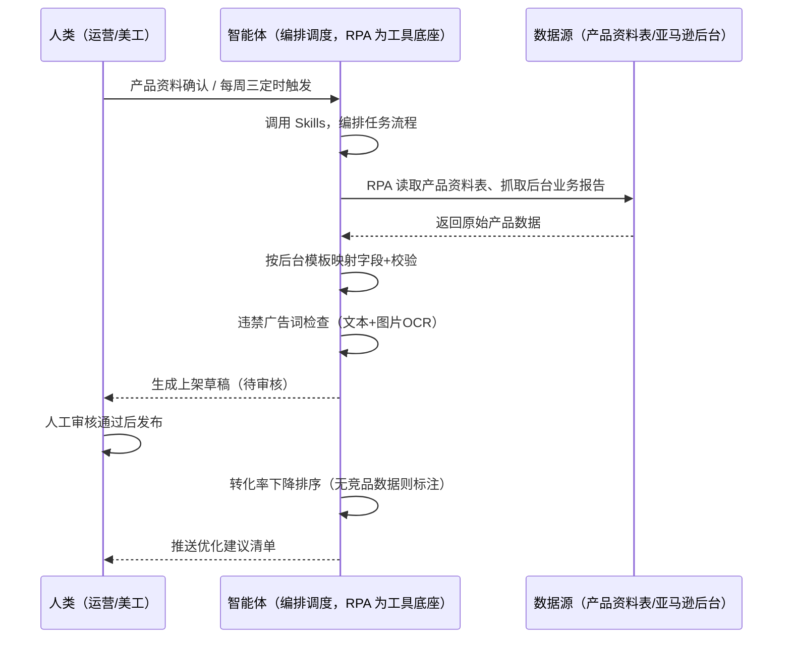
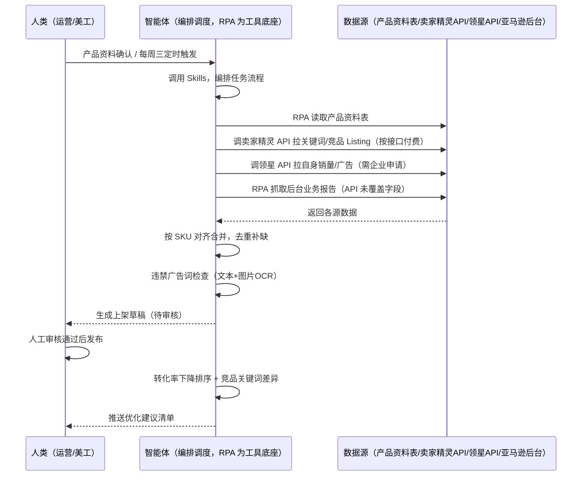

> 为亚马逊卖家团队打造的商品上架与 Listing 优化方案。上架要逐项填表、发布前过违禁词，Listing 上线后流量转化波动靠猜原因，本方案由智能体调度多个工具，统一取数，产品资料确认即自动出上架草稿，每周定时输出优化建议，让"上架-合规-优化"一条链路自动化。

> Agent 自动化需开通企业功能
> 点击申请1个月免费权限
> [点击申请 →](https://skieer.feishu.cn/share/base/form/shrcnFwMayykP5iaL38fnZKTbrg)

## 一、用户与需求

核心矛盾：上架要逐项填表、发布前还要人工过一遍违禁词，Listing 上线后流量转化波动靠经验猜原因——改标题还是换图说不清依据，改错了还伤权重。

两类客户痛点同源，数据来源不同：

- 未购 SaaS 客户（新卖家/小团队）：人工从产品资料表复制 SKU/标题/卖点，逐字段填后台表单，凭经验扫违禁词，全靠手；
- 已购 SaaS 客户（卖家精灵看关键词/流量、领星看运营）：卖家精灵有关键词与流量数据，但上架草稿生成、违禁词检查（含图片 OCR）、Listing 优化建议仍要人做。
- 

适用客户：SKU 多、上架频次高、Listing 质量直接影响生意的卖家。只做几个产品的小卖家价值有限（人工上架即可，本方案不推荐）。

### 1.1 不同模式卖家

| 类型 | 选择 | 建议 |
|-|-|-|
| 品牌 | 首选 | 强烈推荐（SKU 多、上架频次高，Listing 质量直接影响品牌形象） |
| 精铺 | 次选 | 一般推荐，聚焦主力 SKU 的上架与优化 |
| 铺货 | 任意 | 不推荐，SKU 海量且每个都不深做，人工更灵活 |

### 1.2 不同类目卖家

| 类目 | 最关注维度 | 核心逻辑 |
|-|-|-|
| 3C 数码 | 参数+关键词 | 参数件，标题要覆盖参数词，优化靠关键词覆盖 |
| 家居家具 | 图片+卖点 | 大件看主图与场景图，图片规格与视觉是转化关键 |
| 美妆个护 | 合规+卖点 | 功效词敏感，违禁词检查是硬门槛 |
| 服装鞋帽 | 上新+关键词 | 款式迭代快，上架速度与关键词覆盖决定起量 |
| 户外运动 | 卖点+参数 | 功能件，五点卖点要突出差异化 |
| 母婴用品 | 合规+安全 | 安全类目，违禁词与合规检查最严格 |

### 1.3 不同角色用户

| 用户 | 需求 | 问题 | 投入时间（估算） |
|-|-|-|-|
| 老板 | 上架快、Listing 健康 | 上架慢、违规词被下架风险 | 0.5 小时/周 |
| 运营 | 上架草稿+优化建议 | 逐项填表费时、优化凭感觉 | 2-4 小时/周 |
| 美工 | 图片规格明确 | 图片不符规格反复返工 | 1 小时/周 |

---

## 二、现在的方法与问题

### 2.1 流程步骤与问题总结

人工方式（未购 SaaS 客户）

| 序号 | 步骤 | 现在的方法 | 问题缺陷 |
|-|-|-|-|
| 1 | 整理资料 | 从产品资料表复制 SKU/标题/卖点 | 信息来源分散，逐项复制重复劳动 |
| 2 | 填后台 | 逐字段填写后台表单 | 字段多、格式要求细，易填错 |
| 3 | 查违禁词 | 凭经验扫一遍标题描述 | 违禁词记不全，图片里的漏掉 |
| 4 | 发布 | 人工审核后点发布 | 批量发布逐个操作费时 |
| 5 | 看表现 | 每周手动翻流量转化 | 无环比口径，波动原因靠猜 |
| 6 | 做优化 | 凭感觉改标题换图 | 无竞品对比依据，改错伤权重 |

SaaS 方式（已购卖家精灵/领星客户）

| 序号 | 步骤 | 现在的方法 | 问题缺陷 |
|-|-|-|-|
| 1 | 整理资料 | 从产品资料表复制 | 信息来源分散，逐项复制重复劳动 |
| 2 | 填后台 | 逐字段填写后台表单 | 字段多、格式要求细，易填错 |
| 3 | 查违禁词 | 卖家精灵有部分合规检查（网页端） | 图片 OCR 检查与批量拦截缺 |
| 4 | 发布 | 人工审核后点发布 | 批量发布逐个操作费时 |
| 5 | 看表现 | 卖家精灵看关键词排名、领星看运营 | 两工具来回切，无统一优化结论 |
| 6 | 做优化 | 凭感觉改 | 无竞品对比依据，改错伤权重 |

### 2.2 问题分析

人工方式根因

| 序号 | 根因 | 具体表现 |
|-|-|-|
| 1 | 上架填表重复 | 多 SKU 逐个手填，类目属性易错 |
| 2 | 违禁词靠人肉 | 文本记不全、图片 OCR 漏检，踩线被下架 |
| 3 | 优化无依据 | 不改流量转化凭感觉，改错伤权重 |
| 4 | 无竞品对标 | 不知道高转化竞品关键词差在哪 |
| 5 | 经验不沉淀 | 优化规则在人脑里，换人结论就不一样 |

SaaS 方式根因

| 序号 | 根因 | 具体表现 |
|-|-|-|
| 1 | 数据割裂 | 卖家精灵管关键词、领星管运营，无统一优化结论 |
| 2 | 合规检查不全 | 图片 OCR 违禁词检查与批量拦截缺 |
| 3 | 优化不沉淀 | 优化建议在个人经验里，换人就不一样 |

---

## 三、解决方案

### 3.1 功能概述

为亚马逊卖家团队打造的智能体驱动商品上架与 Listing 优化方案，解决上架填表重复、违禁词靠人肉、优化无依据的问题。

产品资料确认触发上架流程，定时触发优化巡检，调起八爪鱼 RPA（Agent 的工具底座，能耦合多系统、完成自动化任务执行）统一取数，输出上架与优化分析，涵盖「上架草稿生成、违禁广告词检查（文本+图片 OCR）、流量转化诊断、竞品关键词对比、优化建议清单」。产品资料确认即出草稿，每周定时输出优化建议。

### 3.2 系统结合

| 要素 | 说明 |
|-|-|
| 客户现有工具盘点 | 未购 SaaS 客户：无第三方工具，上架全靠后台手填。已购 SaaS 客户（主流组合）：卖家精灵（关键词/流量/竞品数据，开放 API 按接口付费）、领星 ERP（自身运营数据，开放 API 需企业申请） |
| 数据/能力来源 | 未购 SaaS：亚马逊后台（上架表单/业务报告浏览量/转化率，RPA 采集）+ 产品资料表（本地 Excel）。   已购 SaaS：卖家精灵开放 API（关键词搜索量/竞品 Listing 数据，按接口付费）+ 领星开放 API（自身销量/广告，需企业申请）+ RPA 后台兜底 |
| RPA 耦合动作 | 作为 Agent 的工具底座，按计划调度多数据源取数（API 优先 + 后台采集兜底），按 SKU 对齐去重合并，统一流转给智能体分析；任一数据源失败自动重试、异常告警 |
| 耦合出的新价值 | 单工具给不了的端到端结论：产品资料一次取齐 → 上架草稿（字段校验）→ 违禁词检查（文本+图片）→ 流量转化诊断 → 竞品关键词对比 → 优化建议，免去人工逐项填表与凭感觉优化 |

### 3.3 智能体执行流程

产品资料确认后触发上架流程，定时触发优化巡检。支持两种数据通道，部署时按客户现有工具选择：

通道一：无 SaaS 方式（RPA 采集后台，适合未购卖家精灵/领星的客户）

通道二：有 SaaS 方式（卖家精灵/领星 API 拿核心，RPA 后台兜底，适合已购客户）

> Agent 自动化需开通企业功能
> 点击申请1个月免费权限
> [点击申请 →](https://skieer.feishu.cn/share/base/form/shrcnFwMayykP5iaL38fnZKTbrg)

### 3.4 为何这么设计

要同时回答三个问题：为什么不能只用 SaaS/API？为什么不能纯靠智能体写代码？ 本场景的核心是"产品资料进来自动出草稿、表单确定性校验、违禁词检查、发布留痕、每周优化巡检、挂了有人管"。

#### 1）逐项对比

| 对比维度 | SaaS/API 堆叠（卖家精灵/领星） | 纯智能体（智能体写代码） | 智能体+自动化工具（RPA 工具底座） |
|-|-|-|-|
| 实现方式 | 卖家精灵管关键词、领星管运营，上架填表靠人 | 能调 API 能抓后台，数据可自拼，但全要自己接 | 一个底座跑多个流程（上架/跟卖/异动/选品……），数据一处对齐 |
| 多系统耦合 | 两工具各自为政，无人组装 | 全自建：API 鉴权、表单映射、对齐逻辑 | 平台沉淀多源取数与对齐，可视化配置 |
| 表单与合规 | 卖家精灵有部分合规检查（网页端人看） | 表单校验、违禁词 OCR 全自建 | 平台按后台模板稳定映射，违禁广告词检查应用已落地（文本+图片 OCR） |
| 定时与推送 | 各工具单点提醒，无优化结论推送 | 调度器/进程常驻/告警通道全自建 | 平台调度稳定触发，失败重试 + 异常告警，每周推送优化建议 |
| 使用成本（总拥有成本） | 一流程一订阅：卖家精灵 88 + 领星 500-1500……随流程数增长 | 代理 IP + 服务器 + OCR 服务 + 开发维护人力，隐性成本高 | 一份平台订阅跑所有流程，单方案边际成本 ≈ 0 |
| 维护人要求 | 低（工具已成熟） | 模板/校验调整都要开发介入 | 可视化流程，运营自己可调必填项、图片规格、词库 |

#### 2）优劣势说明

|  | SaaS/API 堆叠（卖家精灵/领星） | 纯智能体（智能体写代码） | 智能体+自动化工具（RPA 工具底座） |
|-|-|-|-|
| 优势 | 关键词/运营数据权威 | 无订阅费；可深度定制上架逻辑；技术上完全可行 | 一个底座跑多流程、数据一处对齐；表单校验/发布留痕/违禁词检查即开即用；非技术人员可维护 |
| 劣势 | 上架填表靠人；图片 OCR 检查缺；无统一优化结论 | 表单校验、发布回滚、违禁词 OCR 全自建；AI 生成代码是生成性的，一次类目属性填错即触发驳回或处罚 | 本地电脑运行需保持开机；订阅费；灵活性受平台模板边界限制 |

#### 3）结论

| 论点 | 说明 |
|-|-|
| 只用 SaaS/API 缺"上架执行与统一优化" | 卖家精灵/领星解决关键词与运营数据，但上架草稿生成、图片 OCR 违禁词检查、统一优化结论它们给不了——这是本方案的增量 |
| 纯智能体缺"工程底座" | 表单映射 + 发布留痕 70% 的工作在工程（取数/校验/调度/重试），不在"写文案逻辑"；RPA 作为工具底座把这 70% 已经造好 |
| 一个底座跑多流程 | 客户购买 RPA 平台是跑多个流程（上架/跟卖/异动/选品/后台操作），本方案只是其中一个——平台订阅费被多流程摊薄，单方案边际成本接近 0 |
| 确定性 vs 生成性 | 上架是确定性任务——同样的产品资料，要求"字段填得一模一样、校验规则一致"。RPA 流程行为可预期，AI 生成式输出可能产生非法值，能跑通 ≠ 每次填表都合规 |
| 时间 | 运营要的是"产品资料进来自动出草稿、每周三拿到优化建议"，不是"每周手动填表看数据"；判断层交给智能体，执行层交给工具底座 |

### 3.5 功能清单

| 功能 | 系统 | 功能说明（解决问题） |
|-|-|-|
| 会话/定时 | 智能体 | 1. 理解人类语言，调用已预设好的 Skills。   2. 编排多任务、调度多工具。 |
| 多系统数据取数 | RPA、指纹浏览器 | 1. 解决上架逐项填表重复、竞品数据分散问题。   2. 作为智能体工具底座被调度执行，缺图缺字段时拦截通知运营、竞品页面抓取失败时跳过记录。   3. 【无 SaaS 方式】 RPA 读取产品资料表 + 抓取后台业务报告。【有 SaaS 方式】 调卖家精灵 API 拉关键词/竞品（按接口付费）+ 调领星 API 拉自身数据（需企业申请）+ RPA 后台兜底。 |
| 数据清洗对齐 | 智能体 | 按 SKU 对齐多期数据，解决上架字段与优化数据口径不一致问题。 |
| 上架草稿生成 | 智能体 | 上架校验：标题 ≤200 字符、必填项完整、主图 ≥1000×1000px 白底；按后台模板映射字段，生成待审核草稿。 |
| 违禁词检查 | 智能体 | 文本比对违禁词库 + 图片 OCR，命中标红并给替换建议。 |
| 优化诊断 | 智能体 | 按转化率与浏览量下降幅度排序（环比下降 >10% 触发）；提取高转化竞品关键词差异（有 SaaS 时），输出改标题/换图建议。优化动作由人工执行。 |
| IM通知 | 飞书、钉钉、企微等 | 解决上架拦截、优化清单交付滞后问题。上架草稿、违禁词命中、优化建议自动推送。 |
| 数据资产储存 | 本地电脑、云储存 | 1. Skills 资产：上架合规检查清单与文案模板。   2. 数据储存：上架记录与优化建议清单统一写入本地，可审计。   3. 经验知识库：审核通过的高转化文案持续沉淀。 |

### 3.6 智能体执行落地过程

产品资料确认即自动启动上架流程，自动触发；下表其余配置项（智能体工具、Webhook、校验阈值、优化规则）均为部署时一次性预设，会话中无需重复输入。

⚠️ 部署前提（不满足则方案无法跑起来）：①RPA 需部署在常开电脑/云机上（每周巡检关机即停），并配置漏跑补跑机制；②有 SaaS 方式需卖家精灵企业认证开通开放平台（个人版不支持，以官方政策为准）或领星企业客户申请 API 权限，未开通自动降级为无 SaaS 通道；③发布动作始终由人工确认后执行（高风险发布不自动）；④首次配置（API 鉴权、模板映射、校验规则）需服务方/技术人员介入一次，属实施成本。

#### 1）配置

| 类别 | 说明 |
|-|-|
| 智能体 | 主流智能体。 |
| 智能体工具 | 1. 数据通道（按客户现有工具二选一）：【无 SaaS】产品资料表 + 亚马逊后台（RPA 采集）；【有 SaaS】卖家精灵开放 API（按接口付费）+ 领星开放 API（需企业申请）+ RPA 后台兜底。   2. 数据取数与自动化执行：八爪鱼 RPA，MCP 配置完成。   3. 数据分析：智能体自带。   4. IM：企业办公 IM（飞书/钉钉/企微），MCP 或 webhook 配置。 |
| 工作知识 | 1. 产品资料表与后台字段映射。   2. 标题字数上限：默认 200 字符。   3. 必填字段：默认标题、品牌、五点卖点、主图、价格、类目。   4. 图片规格：默认主图 ≥1000×1000px、白底。   5. 违禁词库：平台禁用词 + 绝对化用语 + 夸大承诺。   6. 优化触发：转化率或浏览量环比下降 >10%。 |
| 本地数据库 | 1. 上架记录地址。   2. 优化建议清单地址。   3. 经验库地址。 |

#### 2）执行

| 任务 | 产出 | 产出物接收人 |
|-|-|-|
| 接收产品资料，事件/定时触发 | 任务启动记录 | —— |
| 调用已预设 Skills，编排任务流程 | 任务编排方案 | —— |
| 经 MCP 向八爪鱼 RPA 下发取数任务 | 自动化任务指令 | —— |
| 多源取数并按 SKU 对齐（无 SaaS：资料表+后台；有 SaaS：卖家精灵/领星 API+后台兜底，智能体监控状态） | 对齐后产品数据 | —— |
| 按后台模板映射字段+校验 | 上架草稿 | 运营 |
| 违禁广告词检查（文本+图片OCR） | 合规检查报告 | 运营 |
| 人工审核通过后发布 | 发布结果回写 | 运营 |
| 抓取业务报告与竞品 Listing（有 SaaS 时） | 流量转化+竞品数据 | —— |
| 转化率下降排序+竞品关键词差异分析 | 优化建议清单 | 运营 |
| 推送优化建议 | 优化建议消息 | 运营/美工 |

异常处理：

缺图缺字段 → 拦截不发布，通知运营补全；

标题超长/图片不符规格 → 标黄提醒修改；

违禁词命中 → 标红并给替换建议；

发布失败 → 自动回滚并记录失败原因；

竞品页面抓取失败 → 跳过记录，下轮补采；

数据缺失 → 用上周数据补齐并标注；

置信度 &lt;70% → 转人工复核，不输出硬结论。

#### 3）结果

| 结果 | 说明 |
|-|-|
| 数据资产 | 全量上架与优化结构化数据（SKU/标题/卖点/价格/校验状态/发布状态/浏览量/转化率/关键词差异），可审计。 |
| 分析报告 | 1. 上架草稿：字段映射+校验完成，人工审核即可发布。   2. 合规检查报告：违禁词命中项逐条列出并给替换建议。   3. 优化建议清单：哪个 ASIN 流量转化跌了、与竞品差在哪、建议改什么，附数据对比依据。 |
| Skills | 智能体 Skills：上架合规检查清单与文案模板。 |

> Agent 自动化需开通企业功能
> 点击申请1个月免费权限
> [点击申请 →](https://skieer.feishu.cn/share/base/form/shrcnFwMayykP5iaL38fnZKTbrg)

---

## 四、使用前后预估

> 本方案价值 = 上架草稿自动生成 + 违禁词双通道检查 + 数据驱动优化建议。不承诺替代人工决策——发布与优化动作由人工确认执行。适合 SKU 多、上架频次高、愿配环境的卖家。

| 指标 | 人工 | SaaS/API（卖家精灵/领星） | 智能体+自动化工具 |
|-|-|-|-|
| 上架耗时 | 每周 2-4 小时（估算） | 数据自动但填表靠人 | 草稿自动生成，审核即发（省 80% 时间） |
| 违规风险 | 违禁词靠人肉，易被下架 | 卖家精灵部分合规检查（网页端人看） | 文本+图片 OCR 自动拦截 |
| 优化依据 | 凭感觉，改错伤权重 | 两工具数据人看 | 流量转化+竞品对比数据驱动 |
| 上架批量 | 逐个操作 | 无 | 批量生成草稿 |
| 方法论 | 无，换人结论不同 | 工具内数据（不可复用） | 可复用的 Skills 与规则库 |

说明：浏览量/转化率来自业务报告或领星 API（准确字段）；关键词数据为卖家精灵估算值，用于相对对比；发布与优化动作保留人工确认。

---

## 五、效果证明

> Agent 自动化需开通企业功能
> 点击申请1个月免费权限
> [点击申请 →](https://skieer.feishu.cn/share/base/form/shrcnFwMayykP5iaL38fnZKTbrg)

### 5.1 客户案例

**《RPA＋AI 爆款图批量自动生成》**

> 电商商品图片质量成为影响购买决策的关键因素，传统专业拍摄成本高、耗时长，面对海量 SKU 难以满足营销需求。RPA 自动上传原图、操作 AI 模型并回传平台。

| 效果 | 说明 |
|-|-|
| 提效 | 出图效率提升约 20 倍。原本日处理约 10 张（套模板 + 逐张替换），现在日处理 200+ 张，原图上传、模型调用与成品回传全自动。 |
| 降本 | 减少美工投入 3 人。原本需美工逐张处理与替换，现在由 RPA 自动调度 AI 模型完成；需求沟通成本降低 80%，节约人力用于视觉策划、品牌调性与大促素材规划等重点工作。 |
| 任务 | AI 自动识别商品主体轮廓，商品 100% 不变形（沿用客户实证口径）。 |
| 任务 | 自动生成办公室、户外、休闲等场景图，用于辅图与广告素材，提升转化。 |

案例详情：[生图|RPA＋AI爆款图批量自动生成](https://skieer.feishu.cn/wiki/IxeGwIQHuirgOFkkUNpcqWImnCf)

### 5.2 DEMO应用

亚马逊商品详情页违禁广告词检查：https://rpa.bazhuayu.com/appstore/app/nailong/ya-ma-xun-shang-pin-xiang-qing-ye-wei-jin-guang-gao-ci-jian-cha

---

## 六、备注

### 6.1 Agent 支持

本方案不绑定具体智能体，主流 Agent 均可运行（需支持技能/Skills 加载与工具调用）：

| Agent/智能体 | 说明 |
|-|-|
| Workbuddy | 本方案运行平台，支持技能/Skills 上传加载、定时任务、MCP 工具调用与表格/报告处理 |
| 豆包（国内·字节） | 国内主流个人智能体，支持技能上传、定时任务与工具调用，上手成本低 |
| 通义千问（国内·阿里） | 支持 Agent 编排与插件生态，集成阿里电商数据能力，适合电商场景 |
| DeepSeek（国内） | 推理能力强、成本低，适合规则打分与归因分析类任务 |
| ChatGPT（国外·OpenAI） | 海外主流通用智能体，支持 GPTs/Agent 模式与工具调用 |
| Claude（国外·Anthropic） | 长文本与结构化分析能力强，原生支持 MCP 连接外部工具 |

### 6.2 名词解释

| 术语 | 说明 |
|-|-|
| Listing | 商品详情页，含标题、五点卖点、描述、图片、价格等 |
| 五点卖点 | Listing 中的 5 条核心卖点描述 |
| 违禁广告词 | 绝对化用语、夸大承诺等平台禁用词，图片中的也要检查 |
| 转化率 | 浏览后下单的比例，Listing 优化的核心指标 |
| 类目节点 | 商品所属的亚马逊类目路径，决定属性字段 |
| 主图规格 | 默认 ≥1000×1000px、白底，不达标影响搜索展示 |
| 上架草稿 | 字段映射+校验完成、待人工审核的 Listing |
| 权重 | 搜索排序与推荐权重，改错 Listing 会伤害 |
| OCR | Optical Character Recognition，光学字符识别，用于检查图片中的违禁词 |
| 混合数据源 | 官方导出/API 优先（更稳更合规）+ 后台采集兜底（免费、覆盖无 SaaS 客户与 API 缺口） |
| 有 SaaS 方式 | 已购卖家精灵/领星，开放 API 拿关键词/运营数据 + RPA 后台兜底 |
| 无 SaaS 方式 | 不购买第三方数据工具，由 RPA 读取产品资料表 + 后台采集 |
| MCP | Model Context Protocol，智能体连接外部工具的标准化通道 |
| 指纹浏览器 | 隔离 Cookie/浏览器指纹的工具，多店铺防关联 |

> Agent 自动化需开通企业功能
> 点击申请1个月免费权限
> [点击申请 →](https://skieer.feishu.cn/share/base/form/shrcnFwMayykP5iaL38fnZKTbrg)

---

原文：[查看原文](https://skieer.feishu.cn/wiki/Xk1UwyJ2Di0wAnk63MzcrV9inOb)
