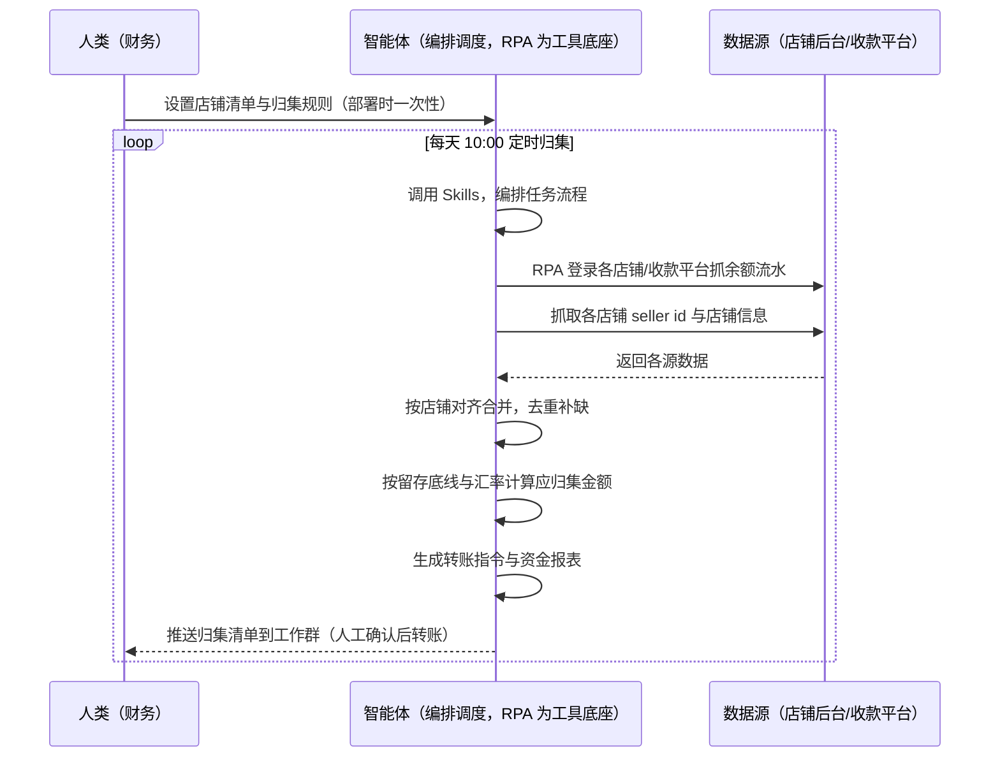
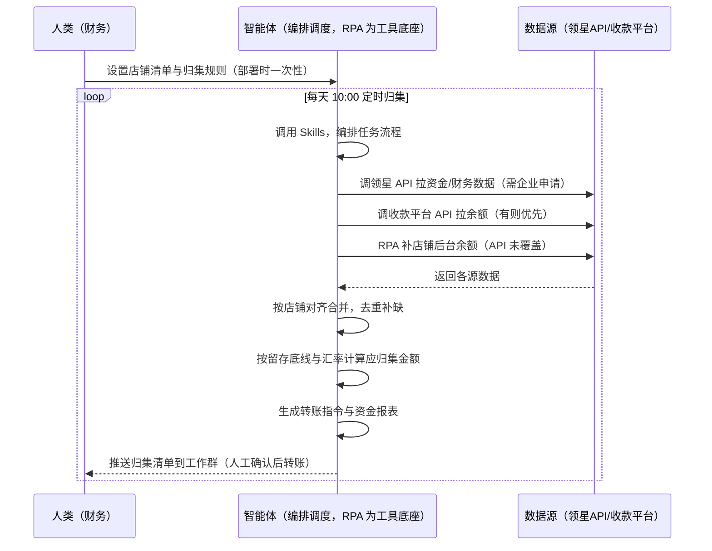

> 为亚马逊卖家团队打造的，智能体调度多工具完成多店铺资金归集任务方案。各店铺余额要逐个登录查、手工汇总再发起转账，本方案由智能体调度八爪鱼 RPA（Agent 的工具底座，能耦合多系统、完成自动化任务执行）统一取数——未购 SaaS 走后台采集，已购 SaaS 结合领星资金/财务数据。每天定时归集，生成转账指令与资金报表，转账动作留痕可复核。

> Agent 自动化需开通企业功能
> 点击申请1个月免费权限
> [点击申请 →](https://skieer.feishu.cn/share/base/form/shrcnFwMayykP5iaL38fnZKTbrg)

## 一、用户与需求

核心矛盾：各店铺余额要逐个登录查、手工汇总再发起转账，做资金报表重复劳动；多店铺的 seller id 也散在各后台，对接工具时找不到——资金散着放，既乱又没利息。

两类客户痛点同源，数据来源不同：

- 未购 SaaS 客户（新卖家/小团队）：人工逐个登录店铺/收款平台查余额，手工按留存和汇率算归集金额，再手动发起转账，全靠手；
- 已购 SaaS 客户（领星 ERP 看财务/资金）：领星有资金数据与提现能力（自动提现），但多店铺余额统一归集、留存底线与汇率计算、转账指令留痕审计仍要人做。

适用客户：多店铺、多收款平台的卖家。店铺少、资金量小的卖家价值有限（人工归集即可，本方案不推荐）。

### 1.1 不同模式卖家

| 类型 | 选择 | 建议 |
|-|-|-|
| 品牌 | 首选 | 强烈推荐（多店铺多收款平台，归集频次高） |
| 精铺 | 次选 | 一般推荐，聚焦主力店铺资金归集 |
| 铺货 | 任意 | 不推荐，店铺少资金量小人工即可 |

### 1.2 不同类目卖家

| 类目 | 最关注维度 | 核心逻辑 |
|-|-|-|
| 3C 数码 | 资金安全 | 资金量大，归集与安全并重 |
| 家居家具 | 留存底线 | 大件回款周期长，留存底线要够 |
| 美妆个护 | 多币种 | 多站点多币种，汇率换算是重点 |
| 服装鞋帽 | 资金流动 | 回款快，每日归集价值大 |
| 户外运动 | 平衡留用 | 功能件资金需求波动，留存要平衡 |
| 母婴用品 | 合规归集 | 合规为先，转账指令留痕 |

### 1.3 不同角色用户

| 用户 | 需求 | 问题 | 投入时间（估算） |
|-|-|-|-|
| 老板 | 资金集中可控 | 各店铺余额看不见 | 0.5 小时/周 |
| 财务 | 归集指令+资金报表 | 逐个登录查余额费时 | 1-2 小时/天 |
| 运营 | 店铺档案清晰 | seller id 找不到 | 0.5 小时/月 |

---

## 二、现在的方法与问题

### 2.1 流程步骤与问题总结

人工方式（未购 SaaS 客户）

| 序号 | 步骤 | 现在的方法 | 问题缺陷 |
|-|-|-|-|
| 1 | 查余额 | 逐个登录店铺/收款平台 | 店铺多，逐个查费时 |
| 2 | 算归集 | 手工按留存和汇率算 | 无规则口径，易错 |
| 3 | 转账 | 手动发起转账 | 逐笔操作费时 |
| 4 | 记账 | 手动更新资金报表 | 报表更新不及时 |
| 5 | 找 ID | 进后台翻 seller id | 多店铺记混易错 |

SaaS 方式（已购领星 ERP 客户）

| 序号 | 步骤 | 现在的方法 | 问题缺陷 |
|-|-|-|-|
| 1 | 查余额 | 领星有资金数据 | 多店铺余额统一归集靠人 |
| 2 | 算归集 | 领星有自动提现 | 留存底线与汇率计算需人工核对 |
| 3 | 转账 | 领星自动提现/人工确认 | 多账户转账指令留痕审计靠人 |
| 4 | 记账 | 领星资金报表 | 归集报表口径需人工整理 |
| 5 | 找 ID | 进后台翻 seller id | 档案散落 |

### 2.2 问题分析

人工方式根因

| 序号 | 根因 | 具体表现 |
|-|-|-|
| 1 | 余额分散 | 各店铺余额分散，逐个登录查费时 |
| 2 | 无归集规则 | 留存底线与汇率计算靠人 |
| 3 | 转账手动 | 逐笔发起，操作重复 |
| 4 | 报表滞后 | 资金报表更新不及时 |
| 5 | 档案缺失 | seller id 散落，对接时找不到 |

SaaS 方式根因

| 序号 | 根因 | 具体表现 |
|-|-|-|
| 1 | 单系统归集 | 领星有资金数据，多店铺统一归集口径靠人 |
| 2 | 规则不沉淀 | 留存底线与汇率计算规则在个人经验里 |
| 3 | 留痕审计靠人 | 自动提现动作的审计与回滚需人工核对 |

---

## 三、解决方案

### 3.1 功能概述

为亚马逊卖家团队打造的智能体驱动多店铺资金归集方案，解决余额分散、人工反复手动执行、归集口径不统一的问题。

定时触发并调度多个工具，调起八爪鱼 RPA（Agent 的工具底座，能耦合多系统、完成自动化任务执行）统一取数，按店铺对齐合并，输出资金归集分析，涵盖「余额流水采集、应归集金额计算、转账指令生成提交、资金报表、多店铺档案表」。每天定时归集，转账动作留痕可复核。

### 3.2 系统结合

| 要素 | 说明 |
|-|-|
| 客户现有工具盘点 | 未购 SaaS 客户：无第三方工具，资金全靠逐个登录查。   已购 SaaS 客户（主流组合）：领星 ERP（资金/财务数据、自动提现，开放 API 需企业申请）、收款平台（连连/PingPong 等） |
| 数据/能力来源 | 未购 SaaS：店铺后台（余额/待结算/流水/币种，RPA 采集）+ 收款平台（账户余额，RPA 采集）。   已购 SaaS：领星开放 API（资金/财务数据，需企业申请权限）+ 收款平台 API（有则优先）+ RPA 后台兜底 |
| RPA 耦合动作 | 作为 Agent 的工具底座，按计划调度多数据源取数（API 优先 + 后台采集兜底），按店铺对齐去重合并，统一流转给智能体计算；任一数据源失败自动重试、异常告警 |
| 耦合出的新价值 | 单工具给不了的端到端结论：多店铺余额一次取齐 → 应归集金额计算 → 转账指令 → 资金报表 → 店铺档案，免去财务逐个登录查余额手工转账 |

### 3.3 智能体执行流程

智能体定时触发。支持两种数据通道，部署时按客户现有工具选择：

通道一：无 SaaS 方式（RPA 采集店铺/收款平台，适合未购领星的客户）

通道二：有 SaaS 方式（领星 API 拿资金核心，RPA 收款平台兜底，适合已购客户）

> Agent 自动化需开通企业功能
> 点击申请1个月免费权限
> [点击申请 →](https://skieer.feishu.cn/share/base/form/shrcnFwMayykP5iaL38fnZKTbrg)

### 3.4 为何这么设计

要同时回答三个问题：为什么不能只用 SaaS/API？为什么不能纯靠智能体写代码？ 本场景的核心是"每天定时、跨多系统取数、按店铺对齐、规则计算、指令留痕、挂了有人管"。

#### 1）逐项对比

| 对比维度 | SaaS/API 堆叠（领星/收款平台） | 纯智能体（智能体写代码） | 智能体+自动化工具（RPA 工具底座） |
|-|-|-|-|
| 实现方式 | 领星管资金、收款平台各管一段，人工对照 | 能调 API 能抓后台，数据可自拼，但全要自己接 | 一个底座跑多个流程（资金/对账/售后/选品……），数据一处对齐 |
| 多系统耦合 | 多店铺+收款平台各自为政，无人组装 | 全自建：API 鉴权、后台采集、对齐逻辑 | 平台沉淀多源取数与对齐，可视化配置 |
| 计算与留痕 | 领星有自动提现，规则靠人核对 | 计算逻辑自写，灵活但工程量大 | 判断交给智能体（应归集计算），执行交给 RPA（指令留痕） |
| 定时与推送 | 领星资金报表自动，归集提醒缺 | 调度器/进程常驻/告警通道全自建 | 平台调度稳定触发，失败重试 + 异常告警，每日推送归集清单 |
| 使用成本（总拥有成本） | 一系统一订阅：领星 500-1500/月……随流程数增长 | 代理 IP + 服务器 + 开发维护人力，隐性成本高 | 一份平台订阅跑所有流程，单方案边际成本 ≈ 0 |
| 维护人要求 | 低 | 规则调整都要开发介入 | 可视化流程，财务自己可调留存底线、汇率、推送群 |

#### 2）优劣势说明

|  | SaaS/API 堆叠（领星/收款平台） | 纯智能体（智能体写代码） | 智能体+自动化工具（RPA 工具底座） |
|-|-|-|-|
| 优势 | 资金数据权威、领星有自动提现 | 无订阅费；   可深度定制归集规则；   技术上完全可行 | 一个底座跑多流程、数据一处对齐；   多店铺余额一次取齐；   指令留痕可复核；非技术人员可维护 |
| 劣势 | 多店铺统一归集口径靠人；   留痕审计靠人 | 多店铺登录态、余额采集、转账对接全自建；   AI 生成代码是生成性的，资金动作误操作风险不可控 | 本地电脑运行需保持开机；   订阅费；   灵活性受平台模板边界限制 |

#### 3）结论

| 论点 | 说明 |
|-|-|
| 只用 SaaS/API 缺"统一归集口径" | 领星解决资金数据与自动提现，但"多店铺统一归集 + 留存底线计算 + 指令留痕审计"它不覆盖——这是本方案的增量 |
| 纯智能体缺"工程底座" | 多店铺取数 70% 的工作在工程（登录态/采集/对齐/调度/重试），不在"写计算逻辑"；   RPA 作为工具底座把这 70% 已经造好 |
| 一个底座跑多流程 | 客户购买 RPA 平台是跑多个流程（资金/对账/售后/选品/后台操作），本方案只是其中一个——平台订阅费被多流程摊薄，单方案边际成本接近 0 |
| 确定性 vs 生成性 | 资金归集是确定性任务——同样的余额与汇率，要求"每次算得一致、指令留痕可复核"。RPA 流程行为可预期，AI 生成的代码能跑通 ≠ 资金动作长期不误操作 |
| 时间 | 财务要的是"每天拿到归集清单和资金报表"，不是"每天逐个登录查余额"；   判断层交给智能体，执行层交给工具底座 |

### 3.5 功能清单

| 功能 | 系统 | 功能说明（解决问题） |
|-|-|-|
| 会话/定时 | 智能体 | 1. 理解人类语言，调用已预设好的 Skills。   2. 编排多任务、调度多工具。 |
| 多系统数据取数 | RPA、指纹浏览器 | 1. 解决余额分散、逐个登录查费时问题。   2. 作为智能体工具底座被调度执行，登录失败自动重试、接口超时转下轮补采。   3. 【无 SaaS 方式】 RPA 登录各店铺/收款平台抓余额/待结算/流水/币种 + 抓取 seller id。【有 SaaS 方式】 调领星 API 拉资金/财务（需企业申请）+ 调收款平台 API（有则优先）+ RPA 后台兜底。 |
| 数据清洗对齐 | 智能体 | 按店铺对齐多源数据，去重合并，解决多店铺资金口径不一致问题。 |
| 应归集计算 | 智能体 | 应归集金额 = 店铺余额 − 留存底线，按当日汇率折算统一币种；留存底线按店铺/类目可配置。 |
| 转账指令 | RPA | 生成转账指令（金额/来源/去向/币种），转账动作由人工确认后执行，指令留痕可复核。 |
| 资金报表与档案 | 智能体 | 每日资金报表（各店铺余额/应归集/已归集）+ 多店铺 seller id 档案表（店铺/账号/seller id，供工具对接）。 |
| IM通知 | 飞书、钉钉、企微等 | 解决资金归集滞后问题。归集清单、资金报表、异常告警自动推送。 |
| 数据资产储存 | 本地电脑、云储存 | 1. Skills 资产：归集规则与留存底线配置。   2. 数据储存：资金报表与转账记录统一写入本地，可审计。   3. 经验知识库：归集策略调整持续沉淀。 |

### 3.6 智能体执行落地过程

部署时一次性配置入参（店铺清单、留存底线、汇率规则、推送群、数据通道），会话中无需重复输入。

⚠️ 部署前提（不满足则方案无法跑起来）：①RPA 需部署在常开电脑/云机上（每天定时归集，关机即停），并配置漏跑补跑机制；②有 SaaS 方式需领星企业客户申请开放 API 权限（未开通自动降级为无 SaaS 通道，走后台采集）；③转账动作涉及资金，由人工确认后执行，指令留痕可复核；④首次配置（API 鉴权、店铺登录态、归集规则）需服务方/技术人员介入一次，属实施成本。

#### 1）配置

| 类别 | 说明 |
|-|-|
| 智能体 | 主流智能体。 |
| 智能体工具 | 1. 数据通道（按客户现有工具二选一）：【无 SaaS】店铺后台 + 收款平台（RPA 采集）；【有 SaaS】领星开放 API（需企业申请）+ 收款平台 API（有则优先）+ RPA 后台兜底。   2. 数据取数与自动化执行：八爪鱼 RPA，MCP 配置完成。   3. 数据分析：智能体自带。4. IM：企业办公 IM（飞书/钉钉/企微），MCP 或 webhook 配置。 |
| 工作知识 | 1. 店铺清单与收款平台账号。   2. 留存底线：默认按店铺设置（如保留 30 天运营资金）。   3. 汇率规则：默认按当日汇率折算。   4. 归集频率：默认每天 10:00。   5. 转账审批人：默认财务负责人。 |
| 本地数据库 | 1. 资金报表地址。   2. 转账记录地址。   3. 店铺档案表地址。 |

#### 2）执行

| 任务 | 产出 | 产出物接收人 |
|-|-|-|
| 接收店铺清单，定时触发 | 任务启动记录 | —— |
| 调用已预设 Skills，编排任务流程 | 任务编排方案 | —— |
| 经 MCP 向八爪鱼 RPA 下发取数任务 | 自动化任务指令 | —— |
| 多源取数并按店铺对齐（无 SaaS：店铺+收款平台；有 SaaS：领星/收款平台 API+后台兜底，智能体监控状态） | 对齐后资金数据 | —— |
| 按留存底线与汇率计算应归集金额 | 应归集清单 | 财务 |
| 生成转账指令（人工确认后执行） | 转账指令 | 财务 |
| 生成资金报表与店铺档案 | 报表/档案 | 财务/老板 |
| 推送归集清单到工作群 | 群消息 | 财务/老板 |

异常处理：

登录失败 → 自动重试；

接口超时 → 转下轮补采；

余额缺失 → 标注并用上日数据；

汇率数据缺失 → 用最近有效汇率并标注；

转账失败 → 自动重试并告警；

置信度 &lt;70% → 转人工复核，不输出硬结论。

#### 3）结果

| 结果 | 说明 |
|-|-|
| 数据资产 | 全量资金结构化数据（店铺/余额/待结算/流水/币种/应归集/已归集/汇率），可审计。 |
| 分析报告 | 1. 每日资金报表：各店铺余额与归集状态一目了然。   2. 转账指令：金额/来源/去向/币种，人工确认后执行，留痕可复核。   3. 多店铺档案表：seller id 统一归档，供工具对接。 |
| Skills | 智能体 Skills：归集规则与留存底线配置。 |

> Agent 自动化需开通企业功能
> 点击申请1个月免费权限
> [点击申请 →](https://skieer.feishu.cn/share/base/form/shrcnFwMayykP5iaL38fnZKTbrg)

---

## 四、使用前后预估

> 本方案价值 = 多店铺余额一次取齐 + 归集规则统一 + 指令留痕。不承诺替代人工决策——转账由人工确认执行。适合多店铺、多收款平台、愿配环境的卖家。

| 指标 | 人工 | SaaS/API（领星） | 智能体+自动化工具 |
|-|-|-|-|
| 归集耗时 | 每天 1-2 小时（估算） | 领星有自动提现，多店铺归集靠人 | 全自动；人工转为确认转账（每天约 0.5 小时） |
| 余额可见性 | 逐个登录查 | 领星资金报表 | 每日自动归集清单推送 |
| 归集口径 | 无规则，易错 | 领星自动提现规则 | 留存底线 + 汇率规则统一，可配置 |
| 转账留痕 | 手动无记录 | 领星记录单系统 | 指令留痕可复核 |
| 店铺档案 | seller id 散落 | 无统一档案 | 多店铺档案表统一归档 |
| 方法论 | 无，换人结论不同 | 领星规则（单系统） | 可复用的 Skills 与规则库 |

说明：余额/流水为准确字段（采集时点值）；汇率为当日汇率（估算，标注来源）；转账动作涉及资金，由人工确认后执行，指令留痕可复核。

---

## 五、效果证明

> Agent 自动化需开通企业功能
> 点击申请1个月免费权限
> [点击申请 →](https://skieer.feishu.cn/share/base/form/shrcnFwMayykP5iaL38fnZKTbrg)

### 5.1 客户案例

**《旺店通慧经营：10+ 平台 50+ 类账单自动采集直传 ERP》**

> 10+ 电商平台普遍缺乏开放 API，账单数据需人工逐个登录导出，财务每天花数小时"搬数据"。RPA 打包为"慧采集 RPA"嵌入产品，账单自动采集并 API 直传 ERP。

| 效果 | 说明 |
|-|-|
| 提效 | 财务取数效率提升 57%。原本 10+ 电商平台账单需人工逐个登录导出，财务每天花数小时「搬数据」，现在 50+ 类账单自动采集并直传 ERP。 |
| 降本 | 年节约人力成本 24 万元（约合 2 人·年，按 12 万元/人年折算）。原本需专人逐平台导表并手动上传 ERP，现在全自动完成，人力转向经营分析与资金管理等高价值工作。 |
| 任务 | 10+ 平台、50+ 类账单自动采集，数据直接 API 传入 ERP，支撑 T+1 经营分析。 |
| 任务 | 指纹浏览器环境、Cookie 登录、集中预登录三重升级，保障采集稳定运行。 |

案例详情：[取数：ERP厂商的多平台账单自动化采集实践](https://skieer.feishu.cn/wiki/CQydwouU9i0yCPkgCpgc13Bxnhg)

---

## 六、备注

### 6.1 Agent 支持

本方案不绑定具体智能体，主流 Agent 均可运行（需支持技能/Skills 加载与工具调用）：

| Agent/智能体 | 说明 |
|-|-|
| Workbuddy | 本方案运行平台，支持技能/Skills 上传加载、定时任务、MCP 工具调用与表格/报告处理 |
| 豆包（国内·字节） | 国内主流个人智能体，支持技能上传、定时任务与工具调用，上手成本低 |
| 通义千问（国内·阿里） | 支持 Agent 编排与插件生态，集成阿里电商数据能力，适合电商场景 |
| DeepSeek（国内） | 推理能力强、成本低，适合规则打分与归因分析类任务 |
| ChatGPT（国外·OpenAI） | 海外主流通用智能体，支持 GPTs/Agent 模式与工具调用 |
| Claude（国外·Anthropic） | 长文本与结构化分析能力强，原生支持 MCP 连接外部工具 |

### 6.2 名词解释

| 术语 | 说明 |
|-|-|
| 留存底线 | 各店铺保留的最低运营资金，超过部分归集 |
| 应归集金额 | 店铺余额 − 留存底线，按汇率折算后的归集额 |
| 归集指令 | 转账动作指令（金额/来源/去向/币种），人工确认后执行 |
| seller id | 店铺卖家标识，供第三方工具对接使用 |
| 多店铺档案表 | 店铺/账号/seller id 的统一归档表 |
| 资金报表 | 各店铺余额与归集状态的每日报表 |
| 混合数据源 | 官方导出/API 优先（更稳更合规）+ 后台采集兜底（免费、覆盖无 SaaS 客户与 API 缺口） |
| 有 SaaS 方式 | 已购领星，开放 API 拿资金核心 + 收款平台 API + RPA 后台兜底（需企业申请权限） |
| 无 SaaS 方式 | 不购买第三方工具，由 RPA 采集店铺后台与收款平台 |
| MCP | Model Context Protocol，智能体连接外部工具的标准化通道 |
| 指纹浏览器 | 隔离 Cookie/浏览器指纹的工具，多店铺防关联 |

> Agent 自动化需开通企业功能
> 点击申请1个月免费权限
> [点击申请 →](https://skieer.feishu.cn/share/base/form/shrcnFwMayykP5iaL38fnZKTbrg)

---

原文：[查看原文](https://skieer.feishu.cn/wiki/DdxNwKDyUi0RYHkWmydcBipjnbe)
