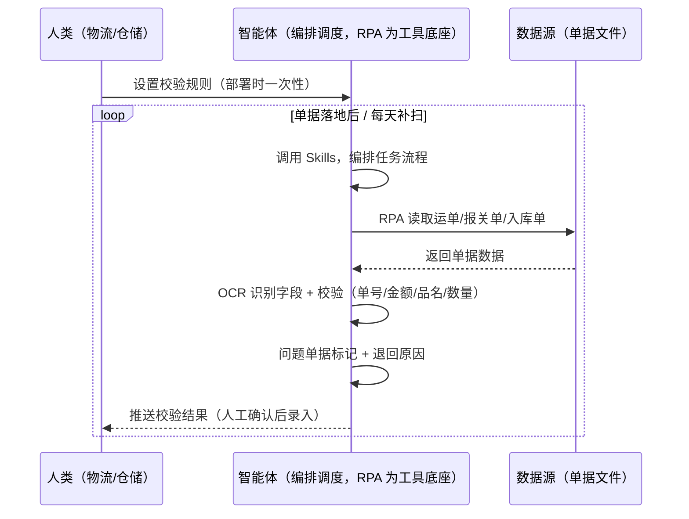
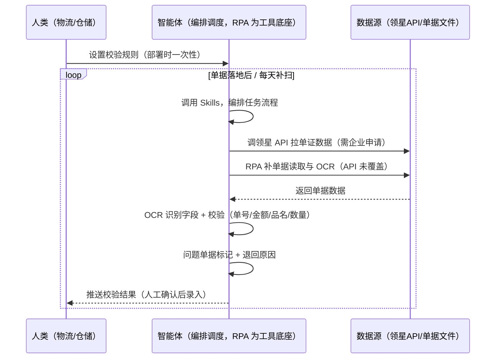

> 为亚马逊卖家团队打造的物流单据处理衔接方案。该场景主体能力由领星/ERP 承担（单据录入、单证管理、物流台账），本方案定位为衔接层——补领星未覆盖的跨系统部分（单据 OCR 识别、字段校验、问题单据退回）。单据录入结果由人工确认，本方案只做识别与校验。

> Agent 自动化需开通企业功能
> 点击申请1个月免费权限
> [点击申请 →](https://skieer.feishu.cn/share/base/form/shrcnFwMayykP5iaL38fnZKTbrg)

## 一、用户与需求

核心矛盾：运单、报关单、入库单类型多样、信息分散，人工逐项录入容易看花眼、录错返工——录错一次，后面对账、报关、入库全跟着错。

两类客户痛点同源，数据来源不同：

- 未购 SaaS 客户（新卖家/小团队）：人工从邮箱/文件夹收集单据、逐项录入系统、凭经验校验，全靠手；
- 已购 SaaS 客户（领星 ERP）：领星有单证管理/物流台账模块（单据录入后管理），但单据 OCR 识别、字段校验、问题单据退回仍要人做。

适用客户：发货批次多、单据量大的卖家。已购领星客户建议用本衔接方案（领星已覆盖主体）；未购领星客户可先评估是否值得购买 ERP 或保留人工流程（本方案单独价值有限）。

### 1.1 不同模式卖家

| 类型 | 选择 | 建议 |
|-|-|-|
| 品牌 | 首选 | 强烈推荐（发货批次多、单据量大，录入频次高） |
| 精铺 | 次选 | 一般推荐，聚焦主力 SKU 的物流单据 |
| 铺货 | 任意 | 不推荐，单据量少，人工录得过来 |

### 1.2 不同类目卖家

| 类目 | 最关注维度 | 核心逻辑 |
|-|-|-|
| 3C 数码 | 数量+金额 | 单品货值高，金额录错损失大 |
| 家居家具 | 品名匹配 | 大件品名/SKU 对照要准，错一个影响入库 |
| 美妆个护 | 合规字段 | 报关品名需合规，字段缺失易卡关 |
| 服装鞋帽 | 数量+款号 | 款号多，品名与 SKU 匹配是关键 |
| 户外运动 | 金额+数量 | 批量发货，数量与金额校验要严 |
| 母婴用品 | 合规+金额 | 报关信息敏感，字段完整性和准确性要求高 |

### 1.3 不同角色用户

| 用户 | 需求 | 问题 | 投入时间（估算） |
|-|-|-|-|
| 老板 | 单据无错漏、不卡关 | 录错返工影响发货节奏 | 0.5 小时/周 |
| 物流/仓储 | 单据自动录入系统 | 手动逐项录入易错易返工 | 1-3 小时/周 |
| 财务 | 单据金额准确 | 金额录错对账对不上 | 0.5 小时/周 |

---

## 二、现在的方法与问题

### 2.1 流程步骤与问题总结

人工方式（未购 SaaS 客户）

| 序号 | 步骤 | 现在的方法 | 问题缺陷 |
|-|-|-|-|
| 1 | 收单据 | 邮箱/文件夹收集运单报关单 | 类型多样、信息分散 |
| 2 | 录字段 | 逐项手工录入系统 | 看花眼、易录错 |
| 3 | 对品名 | 对照 SKU 表找对应关系 | 品名对不上要来回查 |
| 4 | 校验 | 凭经验看有没有错 | 缺字段、金额异常发现不了 |
| 5 | 返工 | 录错了删掉重录 | 返工浪费时间、耽误发货 |

SaaS 方式（已购领星 ERP 客户）

| 序号 | 步骤 | 现在的方法 | 问题缺陷 |
|-|-|-|-|
| 1 | 收单据 | 领星单证管理（上传后管理） | 已覆盖主体 |
| 2 | 录字段 | 人工录入 | OCR 识别缺 |
| 3 | 对品名 | 人工对照 | 匹配靠人 |
| 4 | 校验 | 人工校验 | 字段校验缺 |
| 5 | 返工 | 人工处理 | 问题单据退回靠人 |

### 2.2 问题分析

人工方式根因

| 序号 | 根因 | 具体表现 |
|-|-|-|
| 1 | 单据类型多样 | 运单/报关单/入库单格式各异，无统一录入口径 |
| 2 | 人工录入易错 | 逐项手输，金额/数量/品名易看错 |
| 3 | 无自动校验 | 缺字段、金额异常无人拦截 |
| 4 | 返工损失大 | 录错影响对账/报关/入库 |

SaaS 方式根因

| 序号 | 根因 | 具体表现 |
|-|-|-|
| 1 | 主体已覆盖 | 领星单证管理成熟，无需重复建设 |
| 2 | OCR 识别缺 | 单据字段识别靠人工录入 |
| 3 | 校验靠人 | 字段校验与问题退回无自动化 |

---

## 三、解决方案

### 3.1 功能概述

为亚马逊卖家团队打造的物流单据处理衔接方案，主体能力由领星/ERP 承担，本方案补跨系统衔接缺口。

事件触发并调度多个工具，调起八爪鱼 RPA（Agent 的工具底座，能耦合多系统、完成自动化任务执行）读取单据文件，输出衔接层分析，涵盖「单据 OCR 识别、字段校验、问题单据退回」。单据录入结果由人工确认，本方案只做识别与校验。

### 3.2 系统结合

| 要素 | 说明 |
|-|-|
| 客户现有工具盘点 | 未购 SaaS 客户：无第三方工具，单据全靠人工录入。已购 SaaS 客户（主流组合）：领星 ERP（单证管理/物流台账，开放 API 需企业申请） |
| 数据/能力来源 | 未购 SaaS：单据文件（运单/报关单/入库单，RPA 读取 + OCR）。   已购 SaaS：领星开放 API（单证数据，需企业申请权限）+ RPA 补单据读取与 OCR（API 未覆盖） |
| RPA 耦合动作 | 作为 Agent 的工具底座，按事件调度多数据源取数（API 优先 + 文件读取兜底），按单号对齐去重合并，统一流转给智能体验证；   任一数据源失败自动重试、异常告警 |
| 耦合出的新价值 | 衔接增量：领星管好单证台账，本方案补「单据 OCR → 字段校验 → 问题退回」，免去人工逐项录入看花眼 |

### 3.3 智能体执行流程

单据文件落地后事件触发。支持两种数据通道，部署时按客户现有工具选择：

通道一：无 SaaS 方式（RPA 读取单据，适合未购领星的客户，价值有限）

通道二：有 SaaS 方式（领星 API 拿单证核心，RPA 补 OCR，适合已购客户）

> Agent 自动化需开通企业功能
> 点击申请1个月免费权限
> [点击申请 →](https://skieer.feishu.cn/share/base/form/shrcnFwMayykP5iaL38fnZKTbrg)

### 3.4 为何这么设计

要同时回答三个问题：为什么主体归领星/ERP？为什么不能只用 SaaS/API？为什么不能纯靠智能体写代码？ 本场景的核心是"单证台账主体已由领星解决，本方案只做跨系统衔接增量"。

#### 1）逐项对比

| 对比维度 | SaaS/API 堆叠（领星） | 纯智能体（智能体写代码） | 智能体+自动化工具（RPA 工具底座） |
|-|-|-|-|
| 实现方式 | 领星管单证台账（主体） | 能调 API 能读文件，数据可自拼，但全要自己接 | 衔接领星为主，补 OCR 与校验 |
| 多系统耦合 | 领星单系统，OCR 不覆盖 | 全自建：API 鉴权、文件读取、OCR 服务 | 平台沉淀多源取数与对齐，可视化配置 |
| 主体价值 | 已覆盖（单证管理） | 重复建设领星已有能力，无增量 | 不重复建设，只做衔接增量 |
| 使用成本（总拥有成本） | 领星 500-1500/月（主体） | 代理 IP + OCR 服务 + 开发维护人力，隐性成本高 | 一份平台订阅跑多流程，衔接增量边际成本 ≈ 0 |
| 维护人要求 | 低（工具已成熟） | 规则调整都要开发介入 | 可视化流程，仓储自己可调校验规则 |

#### 2）优劣势说明

|  | SaaS/API 堆叠（领星） | 纯智能体（智能体写代码） | 智能体+自动化工具（RPA 工具底座） |
|-|-|-|-|
| 优势 | 单证管理成熟（主体已解决） | 无订阅费；可深度定制 OCR 逻辑 | 衔接层即开即用；OCR 识别/字段校验补缺口；非技术人员可维护 |
| 劣势 | OCR 识别缺；校验靠人 | 重复建设领星已有能力；OCR 服务自建成本高 | 本地电脑运行需保持开机；订阅费；灵活性受平台模板边界限制 |

#### 3）结论

| 论点 | 说明 |
|-|-|
| 主体归领星 | 单证管理与物流台账是领星成熟能力，不重复建设——本方案明确让位，只做衔接 |
| 衔接增量在哪 | 单据 OCR 识别、字段校验、问题单据退回是领星未覆盖的跨系统部分 |
| 纯智能体缺"工程底座" | 单据读取与 OCR 70% 的工作在工程（读取/识别/对齐/重试）；RPA 作为工具底座把这 70% 已经造好 |
| 一个底座跑多流程 | 客户购买 RPA 平台是跑多个流程，本衔接方案只是其中一个——平台订阅费被多流程摊薄 |
| 时间 | 仓储要的是"单据自动识别、问题自动退回"，不是"重复造领星的轮子" |

### 3.5 功能清单

| 功能 | 系统 | 功能说明（解决问题） |
|-|-|-|
| 会话/定时 | 智能体 | 1. 理解人类语言，调用已预设好的 Skills。   2. 编排多任务、调度多工具。 |
| 多系统数据取数 | RPA、指纹浏览器 | 1. 解决单据录入易错、校验靠人问题。   2. 作为智能体工具底座被调度执行，文件读取失败自动重试并告警。   3. 【无 SaaS 方式】 RPA 读取运单/报关单/入库单文件。【有 SaaS 方式】 调领星 API 拉单证数据（需企业申请）+ RPA 补读取与 OCR。 |
| 数据清洗对齐 | 智能体 | 按单号对齐去重，解决多类型单据口径不一致问题。 |
| 单据 OCR 识别 | 智能体 | OCR 识别单号/金额/品名/数量等字段，输出结构化数据。 |
| 字段校验 | 智能体 | 校验必填字段完整、金额数量合理、品名与 SKU 匹配，问题单据标退回原因。 |
| 录入确认 | 人工 | 校验通过的单据数据推送人工确认后录入系统。录入结果由人工确认。 |
| IM通知 | 飞书、钉钉、企微等 | 解决问题单据退回滞后问题。校验结果、问题单据自动推送。 |
| 数据资产储存 | 本地电脑、云储存 | 1. Skills 资产：校验规则与单据模板。2. 数据储存：单据校验记录统一写入本地，可审计。3. 经验知识库：高频错误类型持续沉淀。 |

### 3.6 智能体执行落地过程

部署时一次性配置入参（校验规则、推送群、数据通道），会话中无需重复输入。

⚠️ 部署前提（不满足则方案无法跑起来）：①RPA 需部署在常开电脑/云机上，并配置漏跑补跑机制；②有 SaaS 方式需领星企业客户申请开放 API 权限（未开通自动降级为无 SaaS 通道，走文件读取）；③单据录入结果由人工确认，本方案只做识别与校验；④首次配置（API 鉴权、OCR 模型、校验规则）需服务方/技术人员介入一次，属实施成本。

#### 1）配置

| 类别 | 说明 |
|-|-|
| 智能体 | 主流智能体。 |
| 智能体工具 | 1. 数据通道（按客户现有工具二选一）：【无 SaaS】单据文件（RPA 读取 + OCR）；【有 SaaS】领星开放 API（需企业申请）+ RPA 补读取。   2. 数据取数与自动化执行：八爪鱼 RPA，MCP 配置完成。   3. 数据分析：智能体自带。   4. IM：企业办公 IM（飞书/钉钉/企微），MCP 或 webhook 配置。 |
| 工作知识 | 1. 单据类型与字段模板（运单/报关单/入库单）。   2. 必填字段与校验规则。   3. 品名-SKU 对照表。   4. 问题退回原因分类。 |
| 本地数据库 | 1. 单据校验记录地址。   2. 对照表地址。   3. 经验库地址。 |

#### 2）执行

| 任务 | 产出 | 产出物接收人 |
|-|-|-|
| 接收单据文件，事件/定时触发 | 任务启动记录 | —— |
| 调用已预设 Skills，编排任务流程 | 任务编排方案 | —— |
| 经 MCP 向八爪鱼 RPA 下发取数任务 | 自动化任务指令 | —— |
| 多源取数并按单号对齐（无 SaaS：文件读取；有 SaaS：领星 API+文件，智能体监控状态） | 对齐后单据数据 | —— |
| OCR 识别字段 | 结构化字段 | 仓储 |
| 字段校验 + 问题单据标记 | 校验结果/退回原因 | 物流/仓储 |
| 推送校验结果（人工确认后录入） | 录入确认清单 | 物流/仓储 |
| 校验记录写入本地 | 记录更新 | 数据库 |

异常处理：文件读取失败 → 自动重试并告警；OCR 识别置信度低 → 转人工核对；必填字段缺失 → 标记问题单据退回；品名匹配失败 → 标注待人工对照；置信度 &lt;70% → 转人工复核，不输出硬结论。

#### 3）结果

| 结果 | 说明 |
|-|-|
| 数据资产 | 单据校验结构化数据（单号/字段/校验状态/退回原因），可审计。 |
| 分析报告 | 1. 校验结果：字段识别 + 校验状态。   2. 问题单据退回：缺字段/金额异常/品名不匹配附原因。   3. 高频错误统计：反推流程改进。 |
| Skills | 智能体 Skills：校验规则与单据模板。 |

> Agent 自动化需开通企业功能
> 点击申请1个月免费权限
> [点击申请 →](https://skieer.feishu.cn/share/base/form/shrcnFwMayykP5iaL38fnZKTbrg)

---

## 四、使用前后预估

> 本方案价值 = 衔接层增量（OCR + 校验 + 退回）。主体（单证台账）由领星/ERP 承担，本方案不替代。未购领星客户单独价值有限，建议先评估是否购买 ERP。

| 指标 | 人工 | SaaS/API（领星） | 智能体+自动化工具（衔接层） |
|-|-|-|-|
| 单据录入 | 逐项手输易错 | 领星单证管理 | 不重复建设 |
| 字段识别 | 看花眼 | 靠人 | OCR 自动识别 |
| 字段校验 | 凭经验 | 靠人 | 自动校验（必填/金额/品名） |
| 问题退回 | 返工才发现 | 靠人 | 自动标记退回原因 |
| 录入确认 | 手动 | 领星录入 | 人工确认后录入 |
| 方法论 | 无 | 领星规则（单系统） | 可复用的 Skills 与规则库 |

说明：本方案为衔接层，主体能力（单证台账）由领星/ERP 承担；已购领星客户价值集中在 OCR 识别与字段校验；未购客户建议先评估 ERP 单证模块，本方案单独价值有限。

---

## 五、效果证明

> Agent 自动化需开通企业功能
> 点击申请1个月免费权限
> [点击申请 →](https://skieer.feishu.cn/share/base/form/shrcnFwMayykP5iaL38fnZKTbrg)

### 5.1 客户案例

**《云仓物流状态同步：微信 – 飞书 – 物流群全链路自动化》**

> 涉及多个客户群与数十个快递群，高峰期每分钟都有新消息弹出，客服需在微信、飞书、快递系统、OMS 间反复切换，单条消息处理耗时 2-3 分钟。

| 效果 | 说明 |
|-|-|
| 提效 | 物流信息处理由人工盯群变为自动流转。原本客服需同时盯数十个客户群与快递群，单条消息处理耗时 2-3 分钟，现在机器人 7×24 自动处理，覆盖拦截、查询、改地址等 7 大场景。 |
| 降本 | 日均节省 2-3 小时/人的无效盯群时间，人力投入转向异常件处理与客户关系维护等重点工作。 |
| 任务 | 打通微信 – 飞书 – 物流群全链路，微信群消息与飞书指令自动流转分发。 |
| 任务 | 降低手工复制单号导致的错漏，减少退款率与赔付损失。 |

案例详情：[云仓物流状态同步](https://skieer.feishu.cn/wiki/OKy0wkYLximV2rkRCqRcl7FcnUh)

---

## 六、备注

### 6.1 Agent 支持

本方案不绑定具体智能体，主流 Agent 均可运行（需支持技能/Skills 加载与工具调用）：

| Agent/智能体 | 说明 |
|-|-|
| Workbuddy | 本方案运行平台，支持技能/Skills 上传加载、定时任务、MCP 工具调用与表格/报告处理 |
| 豆包（国内·字节） | 国内主流个人智能体，支持技能上传、定时任务与工具调用，上手成本低 |
| 通义千问（国内·阿里） | 支持 Agent 编排与插件生态，集成阿里电商数据能力，适合电商场景 |
| DeepSeek（国内） | 推理能力强、成本低，适合规则打分与归因分析类任务 |
| ChatGPT（国外·OpenAI） | 海外主流通用智能体，支持 GPTs/Agent 模式与工具调用 |
| Claude（国外·Anthropic） | 长文本与结构化分析能力强，原生支持 MCP 连接外部工具 |

### 6.2 名词解释

| 术语 | 说明 |
|-|-|
| 衔接层 | 主体能力由领星/ERP 承担，本方案只做跨系统衔接增量（OCR/校验/退回） |
| OCR | Optical Character Recognition，光学字符识别，单据字段识别 |
| 字段校验 | 必填字段完整、金额数量合理、品名与 SKU 匹配 |
| 问题单据退回 | 校验不通过的单据标记退回原因 |
| 单证台账 | 物流单据的登记与管理记录（领星主体） |
| 混合数据源 | 官方导出/API 优先（更稳更合规）+ 文件读取兜底（免费、覆盖无 SaaS 客户与 API 缺口） |
| 有 SaaS 方式 | 已购领星，开放 API 拿单证核心 + RPA 补 OCR（需企业申请权限） |
| 无 SaaS 方式 | 不购买第三方工具，由 RPA 读取单据文件 |
| ERP | Enterprise Resource Planning，企业资源计划系统 |
| MCP | Model Context Protocol，智能体连接外部工具的标准化通道 |

> Agent 自动化需开通企业功能
> 点击申请1个月免费权限
> [点击申请 →](https://skieer.feishu.cn/share/base/form/shrcnFwMayykP5iaL38fnZKTbrg)

---

原文：[查看原文](https://skieer.feishu.cn/wiki/VuqAwjxU7ijCFzk1vDbcFo5AnOb)
