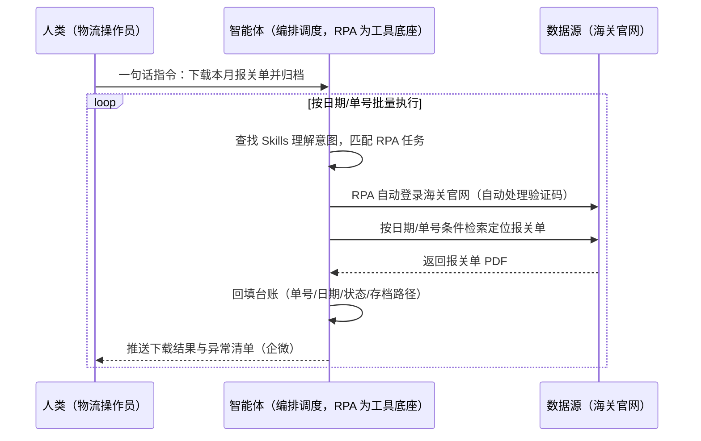
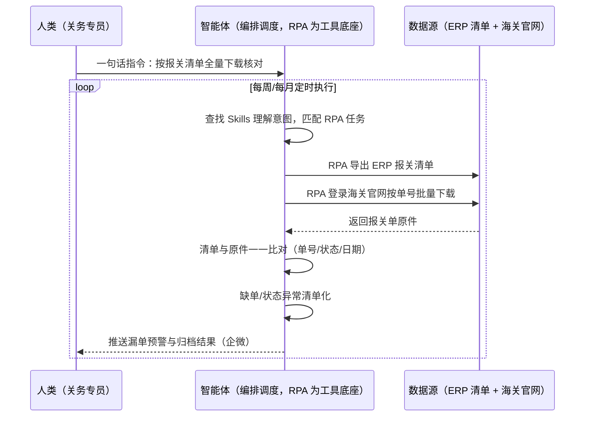

> 为跨境卖家打造的报关单自动下载与校验方案。跨境电商企业需定期从海关官网（单一窗口/电子口岸）下载报关单，保障进出口业务合规与退税需求；报关环节大量人工录单、调单、下载、归类、整理，工作量大、耗时久且错误率高。本方案由智能体调度多个工具执行海关官网自动登录（含验证码处理）+ 按日期/单号条件精准定位下载 + 回填对应表格与归档，输出报关单据台账与下载异常清单。定时自动执行，全程自动化，异常才打扰。

> Agent 自动化需开通企业功能
> 点击申请1个月免费权限
> [点击申请 →](https://skieer.feishu.cn/share/base/form/shrcnFwMayykP5iaL38fnZKTbrg)

## 一、用户与需求

核心矛盾：

- 报关单下载是合规刚需：海关官网的报关单是出口合规与退税的核心凭证，必须定期下载留存（案例口径：跨境电商企业需定期从海关官网下载报关单）
- 人工下载费时易错：报关环节需大量人工录单、调单、下载、上传、归类、整理，工作量大、耗时久且错误率高（案例口径）
- 条件筛选靠人肉：需按日期、单号等条件逐票检索定位，旺季单量大时容易漏单
- 验证码等干扰因素：人工值守下载常被验证码打断，重复劳动强度高

适用客户：有出口报关业务、需要留存报关单的跨境卖家（关务/单证/物流操作岗）。已有货代代理报关但需自留存档的客户同样适用；部署后业务人员不需要写代码，一句话下达指令即可执行。

### 1.1 不同模式卖家

| 类型 | 选择 | 建议 |
|-|-|-|
| 品牌卖家 | 首选 | 强烈推荐（出口量大，报关单票数多且退税依赖单据完整） |
| 精铺卖家 | 首选 | 强烈推荐（多店铺多主体报关，归类归档繁琐） |
| 铺货型 | 次选 | 一般推荐（只留存重点主体报关单） |

### 1.2 不同类目卖家

| 类目 | 最关注维度 | 核心逻辑 |
|-|-|-|
| 家居家具 | 退税凭证完整 | 大件货值高，退税金额大，漏一单损失明显 |
| 3C 数码 | 归类准确性 | HS 归类敏感，单据留存是合规自查依据 |
| 服装鞋帽 | 批量下载时效 | 换季集中出货，单量峰值期人工下载跟不上 |
| 小家电 | 认证与单证一致 | 涉认证类目，报关单与认证信息需可追溯 |
| 母婴用品 | 合规审查 | 监管严格，单据留存要求最完整 |
| 汽配 | 多关别归档 | 出口口岸分散，单据按关别归类整理量大 |

### 1.3 不同角色用户

| 用户 | 需求 | 问题 | 投入时间（估算） |
|-|-|-|-|
| 物流操作员 | 报关单下载回填 | 逐票检索下载、回填归类 | 2-3 小时/天（旺季翻倍） |
| 关务专员 | 单证合规留存 | 漏单错单风险自查难 | 每周 2-3 小时核对 |
| 财务专员 | 退税单据支持 | 退税申报时四处找单 | 申报期集中 1-2 天 |

---

## 二、现在的方法与问题

### 2.1 流程步骤与问题总结

人工方式（无系统辅助）

| 序号 | 步骤 | 现在的方法 | 问题缺陷 |
|-|-|-|-|
| 1 | 登录海关官网 | 人工登录单一窗口/电子口岸 | 账号多人共用，登录态常失效 |
| 2 | 条件检索 | 按日期/单号逐票查询 | 单量大时检索次数爆炸 |
| 3 | 下载报关单 | 人工逐张下载 PDF | 验证码频繁打断，重复劳动 |
| 4 | 回填表格 | 人工把单号/日期/状态填回台账 | 手工录入易错易漏 |
| 5 | 归类归档 | 人工按主体/关别/月份归档 | 归档口径不统一，找单难 |
| 6 | 漏单自查 | 定期人工抽查比对 | 无法全量自查 |

系统方式（有 ERP/关务系统辅助）

| 序号 | 步骤 | 现在的方法 | 问题缺陷 |
|-|-|-|-|
| 1 | 导出报关数据 | ERP/关务系统导出报关清单 | 清单与官网原件是两回事 |
| 2 | 官网下载原件 | 仍需人工登录海关官网下载 | 系统替代不了官网取件 |
| 3 | 比对回填 | 人工比对清单与原件后回填 | 比对量大，错误率高（案例口径） |
| 4 | 归档留存 | 人工归档至共享盘 | 目录结构靠自觉维护 |

### 2.2 问题分析

人工方式根因

| 序号 | 根因 | 具体表现 |
|-|-|-|
| 1 | 官网操作机械 | 登录-检索-下载-回填是纯重复动作 |
| 2 | 验证码干扰 | 人工值守下载被打断，效率低下（案例口径） |
| 3 | 归档无标准 | 找一张历史报关单要翻半天 |

系统方式根因

| 序号 | 根因 | 具体表现 |
|-|-|-|
| 1 | 系统与官网脱节 | ERP 记报关数据，原件仍要人去官网取 |
| 2 | 比对靠人工 | 清单与原件核对量大易错 |
| 3 | 无自动台账 | 回填归档没有结构化沉淀 |

---

## 三、解决方案

### 3.1 功能概述

为跨境卖家打造的报关单自动下载与校验方案，一句话调度海关官网自动登录 + 条件定位批量下载 + 回填归档，输出报关单据台账与下载异常清单。

一句话下达指令（如「把这个月的报关单都下载归档，缺的报给我」），智能体通过查找 Skills 文档库理解意图、匹配 N 个 RPA 自动化任务（条件解析→官网登录→批量检索下载→回填表格→归类归档→异常清单），经 MCP 调度八爪鱼 RPA 自动登录海关官网，依据设定条件精准定位待下载的报关单并回填到对应表格中；自动处理验证码等干扰因素，确保任务顺利进行；可按日期、单号等筛选条件灵活操作，满足不同业务场景需求。全程自动化，运行状态实时反馈，跑完推送结果。

### 3.2 系统结合

| 要素 | 说明 |
|-|-|
| 客户现有工具盘点 | **无系统客户**：海关官网（单一窗口/电子口岸）+ Excel 台账。      
**有 ERP 客户**（主流）：领星等 ERP 的报关数据清单 + 海关官网原件下载 + 企业微信（异常通知通道） |
| 数据/能力来源 | 海关官网报关单检索与下载（按日期/单号/关别条件）；ERP 报关清单（有 ERP 客户的比对基准） |
| RPA 耦合动作 | 作为 Agent 的工具底座被调度执行：自动登录海关官网、自动处理验证码、按条件批量检索下载报关单、按单号回填台账、归类归档至本地库 |
| 耦合出的新价值 | 单系统给不了的端到端结论：官网原件自动取件 + 台账自动回填 + 漏单异常自动清单化，**只推送下载失败与疑似漏单** |

### 3.3 智能体执行流程

一句话下达指令，智能体自动调度。支持**两种数据通道**，部署时按客户现有工具选择：

**通道一：无 ERP 方式（官网下载 + Excel 台账）**

**通道二：有 ERP 方式（清单比对，适合已购 ERP 客户）**

> Agent 自动化需开通企业功能
> 点击申请1个月免费权限
> [点击申请 →](https://skieer.feishu.cn/share/base/form/shrcnFwMayykP5iaL38fnZKTbrg)

### 3.4 为何这么设计

要同时回答三个问题：**为什么不能只用纯代码 Agent？为什么不能只用纯 RPA？为什么两者要结合？** 本场景的核心是"官网登录与验证码处理稳定可靠、条件检索批量执行、台账回填不漏单"。

#### 1）逐项对比

| 对比维度 | SaaS/API 堆叠（ERP+企微） | 纯智能体（智能体写代码） | 智能体+自动化工具（RPA 工具底座） |
|-|-|-|-|
| 实现方式 | ERP 记数据，官网原件仍人工取 | 能写爬虫下载，但验证码/登录态全自建 | 官网取件动作平台级封装 |
| 验证码处理 | 无 | 自建打码方案，维护成本高 | 自动处理验证码（案例口径） |
| 批量下载可靠性 | 无自动批量 | 脚本跑一天 ≠ 跑一年 | 断点续跑、失败重试 |
| 使用成本（总拥有成本） | ERP 订阅 + 人工取件 | 开发维护人力，隐性成本高 | 一份平台订阅跑多流程，单方案边际成本 ≈ 0 |
| 漏单自查 | 人工抽查 | 可代码化但维护靠开发 | 清单比对全量自查 |
| 维护人要求 | 低（但人工量没减） | 规则调整都要开发介入 | 可视化流程，业务自己可改条件 |

#### 2）优劣势说明

|  | SaaS/API 堆叠（ERP+企微） | 纯智能体（智能体写代码） | 智能体+自动化工具（RPA 工具底座） |
|-|-|-|-|
| 优势 | 数据口径权威；      
清单集中 | 无订阅费；      
逻辑可深度定制 | 原件自动取件；      
验证码自动处理；      
台账自动回填归档 |
| 劣势 | 原件下载仍靠人工；      
无漏单自查 | 登录保活/打码全自建；      
AI 生成代码是生成性的 | 本地电脑运行需保持开机；      
依赖海关官网页面结构稳定；      
官网改版需更新流程 |

**特别提醒**：报关单用于退税与合规留存，本方案负责**自动取件、回填与漏单预警**；退税申报与合规结论仍由关务/财务人工确认，方案不替代申报动作。

#### 3）结论

| 论点 | 说明 |
|-|-|
| 确定性 vs 生成性 | 登录-检索-下载-回填是确定性任务，RPA 行为可预期；生成性代码跑一天 ≠ 跑一年 |
| 资产沉淀 | 登录态、取件流程、归档口径沉淀在平台是活的，换人接手成立 |
| 一个底座跑多流程 | 客户购买 RPA 平台是跑多个流程（报关单取件/库存同步/报表），本方案只是其中一个，订阅费被摊薄 |
| token 消耗极低 | 取件回填是规则化流水线，不调用大模型；仅异常清单文案消耗少量 token |
| 漏单可追责 | 异常清单带单号与时间线，漏单可定位到批次 |
| 时间 | 关务要的是"单据自动齐活、缺哪张自动报"，不是"每天人肉翻官网" |

### 3.5 功能清单

| 功能 | 系统 | 功能说明（解决问题） |
|-|-|-|
| 会话/一句话指令 | 智能体 | 1. 理解自然语言意图，查找 Skills 文档库。      
2. 匹配对应 RPA 自动化任务、编排多任务。 |
| 官网自动登录 | RPA | 自动登录海关官网（单一窗口/电子口岸），自动处理验证码等干扰因素（案例口径），解决人工值守被打断问题。 |
| 条件定位下载 | RPA | 按日期、单号等筛选条件精准定位报关单并批量下载，满足不同业务场景需求（案例口径），解决逐票检索效率低问题。 |
| 台账自动回填 | 智能体 | 单号/日期/状态/存档路径自动回填对应表格，解决手工录入易错易漏问题。 |
| 清单比对校验 | 智能体 | **【有 ERP 方式】** ERP 报关清单与官网原件一一比对，缺单/状态异常自动清单化，解决漏单自查难问题。 |
| 归档留存 | 智能体、本地库 | 按主体/关别/月份自动归类归档，结构化可检索，解决找单难问题。 |
| 异常清单推送 | 智能体、企微 | 下载失败/疑似漏单推送企业微信，解决异常发现滞后问题。 |
| 数据资产储存 | 本地电脑、云储存 | 1. Skills 资产：报关单取件技能。      
2. 数据储存：报关单原件库与台账库。      
3. 经验知识库：异常处置记录回填。 |

### 3.6 智能体执行落地过程

部署时一次性配置入参（下载条件口径、台账模板、归档目录、推送群），会话中一句话即可触发，无需重复输入。

**⚠️ 部署前提（不满足则方案无法跑起来）**：①RPA 需部署在**常开电脑/云机**上，并配置漏跑补跑机制；②海关官网**登录态**需维护，登录失效自动告警；③验证码处理策略需实测调通（官网升级可能需更新）；④归档目录与台账模板需与关务确认一次；⑤企微推送群机器人需提前配置；⑥首次配置（账号、条件、目录）需服务方/技术人员介入一次，属实施成本。

#### 1）配置（五步）

| 步骤 | 操作 | 说明 |
|-|-|-|
| 第一步 | 下载八爪鱼 RPA，导入跨境电商自动化模板 | 官网免费下载客户端；MCP 工具→添加应用 |
| 第二步 | 开启八爪鱼 RPA 的 MCP 服务端口 | 客户端→API-K→创建 API（名称自定义） |
| 第三步 | 在智能体中添加 MCP Server 连接 | 复制连接配置→智能体连接器→自定义连接器→配置 MCP→粘贴保存 |
| 第四步 | 验证工具列表 | 确认工具全部启用（即八爪鱼客户端内工具） |
| 第五步 | 测试运行效果 | 输入一句话指令，验证官网下载与台账回填 |

| 类别 | 说明 |
|-|-|
| 智能体 | 主流智能体（支持 MCP 连接、Skills 加载、定时任务）。 |
| 智能体工具 | 1. **数据通道（按客户现有工具二选一）**：【无 ERP】官网下载 + Excel 台账；【有 ERP】ERP 清单比对 + 官网原件下载。      
2. 数据取数与自动化执行：八爪鱼 RPA（MCP 协议接入）。      
3. 数据分析：智能体自带。      
4. IM：企业微信（MCP 或 webhook 配置）。 |
| 工作知识 | 1. 下载条件口径（日期/单号/关别）。      
2. 台账模板字段。      
3. 归档目录结构。      
4. 推送群与接收人。 |
| 本地数据库 | 1. 报关单原件库地址。      
2. 台账库地址。      
3. 异常清单存档地址。 |

#### 2）执行

| 任务 | 产出 | 产出物接收人 |
|-|-|-|
| 接收一句话指令，匹配 RPA 任务 | 任务启动记录 | —— |
| 调用已预设 Skills，编排任务流程 | 任务编排方案 | —— |
| 经 MCP 向八爪鱼 RPA 下发下载任务 | 自动化任务指令 | —— |
| 自动登录海关官网（处理验证码） | 登录会话 | —— |
| 按条件批量检索下载报关单 | 报关单 PDF 批次 | —— |
| 台账回填与归类归档 | 结构化台账 | 关务/物流 |
| 清单比对（有 ERP 方式） | 漏单/异常清单 | 关务 |
| 企微推送结果与异常清单 | 群消息 | 关务/物流/财务 |

异常处理：

登录失效 → 自动重试 2 次，仍失败告警推 IM；

验证码识别失败 → 换策略重试，连续失败暂停并告警，人工介入后断点续跑；

单号查无原件 → 记入疑似漏单清单，不输出硬结论；

官网页面改版 → 流程执行失败告警，需更新 RPA 流程后恢复。

#### 3）结果

| 结果 | 说明 |
|-|-|
| 数据资产 | 报关单原件库 + 结构化台账（单号/日期/状态/路径），可审计可追溯。 |
| 分析报告 | 下载结果日报：完成量/漏单清单/状态异常清单。 |
| Skills | 智能体 Skills：报关单取件技能，按官网升级迭代。 |

> Agent 自动化需开通企业功能
> 点击申请1个月免费权限
> [点击申请 →](https://skieer.feishu.cn/share/base/form/shrcnFwMayykP5iaL38fnZKTbrg)

---

## 四、使用前后预估

> 本方案价值 = **官网自动取件 → 台账自动回填 → 漏单自动清单**。把物流操作员从逐票检索下载的机械活中解放出来，单据齐活、缺哪张自动报。

| 指标 | 人工 | SaaS/API（ERP+企微） | 智能体+自动化工具 |
|-|-|-|-|
| 报关单下载 | 逐票检索下载 | 原件仍人工取 | 条件定位批量自动下载 |
| 验证码处理 | 人工值守输入 | 无 | 自动处理（案例口径） |
| 台账回填 | 手工录入易错 | 人工比对回填 | 自动回填归类归档 |
| 漏单自查 | 人工抽查 | 无全量自查 | 清单比对全量清单化 |
| 人力投入 | 1 名物流操作员专职 | 减不掉取件人力 | 案例口径：节省 1 名物流操作员 |
| 方法论 | 在个人手里 | 系统固定口径 | Skills 取件规则资产沉淀 |

**说明**：案例数字来自八爪鱼客户实践（案例口径：自动登录海关官网按条件精准定位下载报关单并回填表格，自动处理验证码，节省 1 名物流操作员、减轻报关录单人员压力）；本方案为按同口径复刻的实施路径，具体数值随报关票量与官网条件复杂度而异（估算）。

---

## 六、备注

### 6.1 Agent 支持

本方案不绑定具体智能体，主流 Agent 均可运行（需支持 MCP 连接、技能/Skills 加载与工具调用）：

| Agent/智能体 | 说明 |
|-|-|
| Workbuddy | 本方案运行平台，支持技能/Skills 上传加载、定时任务、MCP 工具调用与表格/报告处理 |
| 豆包（国内·字节） | 国内主流个人智能体，支持技能上传、定时任务与工具调用，上手成本低 |
| 通义千问（国内·阿里） | 支持 Agent 编排与插件生态，集成阿里电商数据能力，适合电商场景 |
| DeepSeek（国内） | 推理能力强、成本低，适合规则打分与归因分析类任务 |
| ChatGPT（国外·OpenAI） | 海外主流通用智能体，支持 GPTs/Agent 模式与工具调用 |
| Claude（国外·Anthropic） | 长文本与结构化分析能力强，原生支持 MCP 连接外部工具 |

### 6.2 名词解释

| 术语 | 说明 |
|-|-|
| 报关单 | 进出口货物向海关申报后由海关出具的凭证，退税与合规的核心单据 |
| 单一窗口 | 海关总署国际贸易"单一窗口"，报关申报与单证查询官网入口 |
| 电子口岸 | 海关电子口岸系统，报关单下载与核验的另一官方通道 |
| 报关归类 | 按经营主体/出口关别/月份对报关单据的归档整理 |
| 退税 | 出口退税，凭报关单等单证申报的税款退还 |
| HS 编码 | 商品名称及编码协调制度，报关商品归类编码 |
| 疑似漏单 | 清单中有记录但官网未取到原件的报关单 |
| 验证码处理 | RPA 自动识别/规避官网验证码等干扰因素的机制 |
| 台账回填 | 把单号/日期/状态/存档路径写回结构化表格 |
| 断点续跑 | 批量任务中断后从断点继续，不重复已下载部分 |
| MCP | Model Context Protocol，智能体连接外部工具的标准化通道 |
| 一句话指令 | 用自然语言描述任务，智能体自动翻译为自动化流程 |
| Skills | 智能体可加载的预设技能资产，含流程与知识 |

> Agent 自动化需开通企业功能
> 点击申请1个月免费权限
> [点击申请 →](https://skieer.feishu.cn/share/base/form/shrcnFwMayykP5iaL38fnZKTbrg)

---

原文：[查看原文](https://skieer.feishu.cn/wiki/W0nJwImKPiMX0fkIIpfcm9p0nDf)
