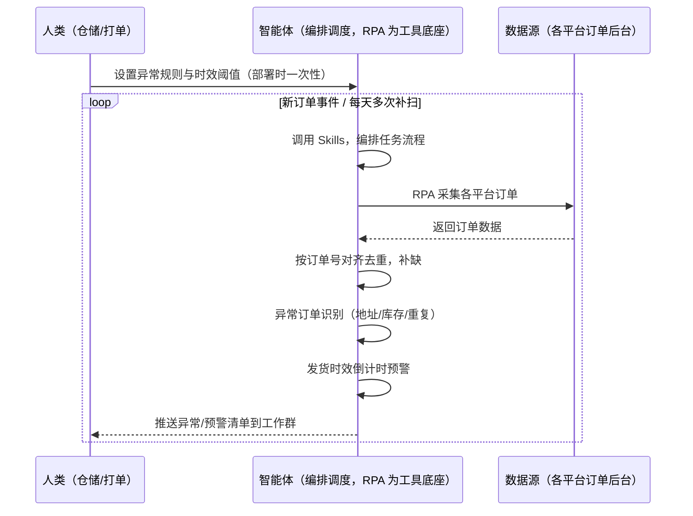
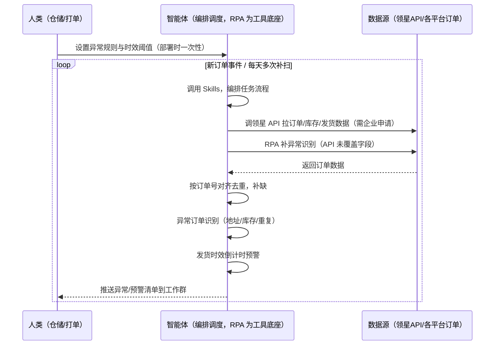

> 为亚马逊卖家团队打造的由智能体调度多个工具执行订单处理与多渠道同步衔接方案，做识别与预警。

> Agent 自动化需开通企业功能
> 点击申请1个月免费权限
> [点击申请 →](https://skieer.feishu.cn/share/base/form/shrcnFwMayykP5iaL38fnZKTbrg)

---

## 一、用户与需求

核心矛盾：新订单要逐个分配、逐单生成快递单打印，多渠道订单还要分别导出、手工去重再录入系统——订单多时手忙脚乱，漏单错发一个，差评和客诉就来了。两类客户痛点同源，数据来源不同：

- 未购 SaaS 客户（新卖家/小团队）：人工各平台分别看订单、凭经验选仓、肉眼扫地址、逐单打单，全靠手；
- 已购 SaaS 客户（领星 ERP）：领星有订单聚合与多渠道同步能力（打单发货、库存扣减），但异常订单识别、多渠道去重校验、发货时效预警仍要人做。

适用客户：订单量大、渠道多的卖家。已购领星客户建议用本衔接方案（领星已覆盖主体）；未购领星客户可先评估是否值得购买 ERP 或保留人工流程（本方案单独价值有限）。

### 1.1 不同模式卖家

| 类型 | 选择 | 建议 |
|-|-|-|
| 品牌 | 首选 | 强烈推荐（订单量大、渠道多，处理频次高） |
| 精铺 | 次选 | 一般推荐，聚焦主力渠道订单 |
| 铺货 | 任意 | 不推荐，订单量少人工处理即可 |

### 1.2 不同类目卖家

| 类目 | 最关注维度 | 核心逻辑 |
|-|-|-|
| 3C 数码 | 地址校验 | 参数件客单价高，地址错发损失大 |
| 家居家具 | 仓库匹配 | 大件分仓发货，仓库匹配错误运费高 |
| 美妆个护 | 合规发货 | 渠道合规与批次追溯要求高 |
| 服装鞋帽 | 发货时效 | 款式迭代快，发货速度影响评价 |
| 户外运动 | 渠道去重 | 多渠道下单，重复单不能重复发货 |
| 母婴用品 | 库存校验 | 安全类目，库存不足不能强行发 |

### 1.3 不同角色用户

| 用户 | 需求 | 问题 | 投入时间（估算） |
|-|-|-|-|
| 老板 | 不漏单、发货快 | 订单积压影响转化与评价 | 0.5 小时/周 |
| 仓储/打单 | 面单自动打、异常自动分 | 逐单分配打单费时易错 | 1-3 小时/天 |
| 运营 | 多渠道订单归集 | 分别导出手工去重费时 | 1-2 小时/天 |

---

## 二、现在的方法与问题

### 2.1 流程步骤与问题总结

人工方式（未购 SaaS 客户）

| 序号 | 步骤 | 现在的方法 | 问题缺陷 |
|-|-|-|-|
| 1 | 收订单 | 各平台分别看订单 | 渠道多，逐个刷新漏单 |
| 2 | 分配仓库 | 凭经验选仓发什么渠道 | 规则不统一，匹配易错 |
| 3 | 校验地址 | 肉眼扫地址完整性 | 邮编/门牌漏填发错 |
| 4 | 打单 | 逐单生成运单号打印 | 单多时手忙脚乱 |
| 5 | 去重 | 手工对比各渠道订单 | 重复单重复发货 |
| 6 | 录系统 | 逐条录入 ERP | 录错返工、对账对不上 |

SaaS 方式（已购领星 ERP 客户）

| 序号 | 步骤 | 现在的方法 | 问题缺陷 |
|-|-|-|-|
| 1 | 收订单 | 领星订单聚合（自动） | 已覆盖主体 |
| 2 | 分配仓库 | 领星分配规则 | 已覆盖 |
| 3 | 校验地址 | 领星部分校验 | 异常订单识别靠人 |
| 4 | 打单 | 领星打单发货 | 已覆盖 |
| 5 | 去重 | 领星多渠道同步 | 去重校验细节靠人 |
| 6 | 录系统 | 领星库存扣减 | 时效预警靠人 |

### 2.2 问题分析

人工方式根因

| 序号 | 根因 | 具体表现 |
|-|-|-|
| 1 | 渠道分散 | 各平台分别看订单，逐个刷新漏单 |
| 2 | 规则不统一 | 仓库/渠道匹配凭经验，易错 |
| 3 | 无自动校验 | 地址/库存异常无人拦截 |
| 4 | 重复发货风险 | 多渠道重复单未去重 |

SaaS 方式根因

| 序号 | 根因 | 具体表现 |
|-|-|-|
| 1 | 主体已覆盖 | 领星订单聚合/同步/打单成熟，无需重复建设 |
| 2 | 异常识别靠人 | 异常订单（地址错/库存不足）识别无自动化 |
| 3 | 时效预警缺 | 发货时效倒计时预警靠人盯 |

---

## 三、解决方案

### 3.1 功能概述

为亚马逊卖家团队打造的订单处理与多渠道同步衔接方案，主体能力由领星/ERP 承担，本方案补跨系统衔接缺口。

事件触发并调度多个工具，调起八爪鱼 RPA（Agent 的工具底座，能耦合多系统、完成自动化任务执行）读取领星/ERP 订单数据，输出衔接层分析，涵盖「异常订单识别、多渠道去重校验、发货时效预警」。订单处理由人工/仓库完成，本方案只做识别与预警。

### 3.2 系统结合

| 要素 | 说明 |
|-|-|
| 客户现有工具盘点 | 未购 SaaS 客户：无第三方工具，订单全靠各平台人工看。  
已购 SaaS 客户（主流组合）：领星 ERP（订单聚合、多渠道同步、打单发货、库存扣减，开放 API 需企业申请） |
| 数据/能力来源 | 未购 SaaS：各平台订单后台（RPA 采集）+ 物流渠道（运单号生成）。  
已购 SaaS：领星开放 API（订单/库存/发货数据，需企业申请权限）+ RPA 补异常识别（API 未覆盖） |
| RPA 耦合动作 | 作为 Agent 的工具底座，按事件调度多数据源取数（API 优先 + 页面采集兜底），按订单号对齐去重合并，统一流转给智能体分析；任一数据源失败自动重试、异常告警 |
| 耦合出的新价值 | 衔接增量：领星管好订单处理主体，本方案补「异常订单识别 → 多渠道去重校验 → 发货时效预警」，免去人工逐单核对 |

### 3.3 智能体执行流程

新订单事件触发，每天多次补扫。支持两种数据通道，部署时按客户现有工具选择：

通道一：无 SaaS 方式（RPA 采集各平台订单，适合未购领星的客户，价值有限）

通道二：有 SaaS 方式（领星 API 拿订单核心，RPA 补异常识别，适合已购客户）

> Agent 自动化需开通企业功能
> 点击申请1个月免费权限
> [点击申请 →](https://skieer.feishu.cn/share/base/form/shrcnFwMayykP5iaL38fnZKTbrg)

### 3.4 为何这么设计

要同时回答三个问题：为什么主体归领星/ERP？为什么不能只用 SaaS/API？为什么不能纯靠智能体写代码？ 本场景的核心是"订单处理主体已由领星解决，本方案只做跨系统衔接增量"。

#### 1）逐项对比

| 对比维度 | SaaS/API 堆叠（领星） | 纯智能体（智能体写代码） | 智能体+自动化工具（RPA 工具底座） |
|-|-|-|-|
| 实现方式 | 领星聚合订单/多渠道同步/打单（主体） | 能调 API 能抓页面，数据可自拼，但全要自己接 | 衔接领星为主，补异常识别与预警 |
| 多系统耦合 | 领星单系统，异常识别不覆盖 | 全自建：API 鉴权、采集、对齐逻辑 | 平台沉淀多源取数与对齐，可视化配置 |
| 主体价值 | 已覆盖（订单聚合+同步+打单） | 重复建设领星已有能力，无增量 | 不重复建设，只做衔接增量 |
| 使用成本（总拥有成本） | 领星 500-1500/月（主体） | 代理 IP + 服务器 + 开发维护人力，隐性成本高 | 一份平台订阅跑多流程，衔接增量边际成本 ≈ 0 |
| 维护人要求 | 低（工具已成熟） | 规则调整都要开发介入 | 可视化流程，仓储自己可调规则、阈值 |

#### 2）优劣势说明

|  | SaaS/API 堆叠（领星） | 纯智能体（智能体写代码） | 智能体+自动化工具（RPA 工具底座） |
|-|-|-|-|
| 优势 | 订单聚合/同步/打单成熟（主体已解决） | 无订阅费；  
可深度定制异常规则 | 衔接层即开即用；  
异常识别/时效预警补缺口；  
非技术人员可维护 |
| 劣势 | 异常识别靠人；  
时效预警缺 | 重复建设领星已有能力；  
AI 生成代码是生成性的 | 本地电脑运行需保持开机；  
订阅费；  
灵活性受平台模板边界限制 |

#### 3）结论

| 论点 | 说明 |
|-|-|
| 主体归领星 | 订单聚合、多渠道同步、打单发货是领星成熟能力，不重复建设——本方案明确让位，只做衔接 |
| 衔接增量在哪 | 异常订单识别、多渠道去重校验、发货时效预警是领星未覆盖的跨系统部分 |
| 纯智能体缺"工程底座" | 订单采集与对齐 70% 的工作在工程（采集/去重/调度/重试）；RPA 作为工具底座把这 70% 已经造好 |
| 一个底座跑多流程 | 客户购买 RPA 平台是跑多个流程，本衔接方案只是其中一个——平台订阅费被多流程摊薄 |
| 时间 | 仓储要的是"异常订单自动识别、时效自动预警"，不是"重复造领星的轮子" |

### 3.5 功能清单

| 功能 | 系统 | 功能说明（解决问题） |
|-|-|-|
| 会话/定时 | 智能体 | 1. 理解人类语言，调用已预设好的 Skills。  
2. 编排多任务、调度多工具。 |
| 多系统数据取数 | RPA、指纹浏览器 | 1. 解决异常订单漏检、时效无预警问题。  
2. 作为智能体工具底座被调度执行，采集失败自动重试并告警。  
3. 【无 SaaS 方式】 RPA 采集各平台订单。【有 SaaS 方式】 调领星 API 拉订单/库存/发货（需企业申请）+ RPA 补异常识别。 |
| 数据清洗对齐 | 智能体 | 按订单号对齐去重，解决多渠道重复单问题。 |
| 异常订单识别 | 智能体 | 地址不完整/库存不足/重复下单 → 标记异常转人工。 |
| 多渠道去重校验 | 智能体 | 跨渠道订单号去重，重复单不重复发货。 |
| 发货时效预警 | 智能体 | 发货倒计时（48h/72h）预警，超时标红。发货动作由人工/仓库完成。 |
| IM通知 | 飞书、钉钉、企微等 | 解决漏单错发问题。异常清单、时效预警自动推送。 |
| 数据资产储存 | 本地电脑、云储存 | 1. Skills 资产：异常识别规则与时效配置。  
2. 数据储存：异常订单记录统一写入本地，可审计。  
3. 经验知识库：高频异常类型持续沉淀。 |

### 3.6 智能体执行落地过程

部署时一次性配置入参（异常规则、时效阈值、推送群、数据通道），会话中无需重复输入。

⚠️ 部署前提（不满足则方案无法跑起来）：①RPA 需部署在常开电脑/云机上，并配置漏跑补跑机制；②有 SaaS 方式需领星企业客户申请开放 API 权限（未开通自动降级为无 SaaS 通道，走页面采集）；③订单处理（打单/发货）由人工/仓库完成，本方案只做识别与预警；④首次配置（API 鉴权、对齐规则、异常规则）需服务方/技术人员介入一次，属实施成本。

#### 1）配置

| 类别 | 说明 |
|-|-|
| 智能体 | 主流智能体。 |
| 智能体工具 | 1. 数据通道（按客户现有工具二选一）：【无 SaaS】各平台订单后台（RPA 采集）；【有 SaaS】领星开放 API（需企业申请）+ RPA 补异常识别。  
2. 数据取数与自动化执行：八爪鱼 RPA，MCP 配置完成。  
3. 数据分析：智能体自带。  
4. IM：企业办公 IM（飞书/钉钉/企微），MCP 或 webhook 配置。 |
| 工作知识 | 1. 渠道清单与订单字段映射。  
2. 异常规则：地址不完整/库存不足/重复下单。  
3. 时效阈值：48h/72h 发货倒计时。  
4. 仓库/渠道匹配规则（辅助）。 |
| 本地数据库 | 1. 异常订单记录地址。  
2. 对照表地址。  
3. 经验库地址。 |

#### 2）执行

| 任务 | 产出 | 产出物接收人 |
|-|-|-|
| 接收订单数据，事件/定时触发 | 任务启动记录 | —— |
| 调用已预设 Skills，编排任务流程 | 任务编排方案 | —— |
| 经 MCP 向八爪鱼 RPA 下发取数任务 | 自动化任务指令 | —— |
| 多源取数并按订单号对齐（无 SaaS：平台采集；有 SaaS：领星 API+平台，智能体监控状态） | 对齐后订单数据 | —— |
| 异常订单识别（地址/库存/重复） | 异常清单 | 仓储 |
| 多渠道去重校验 | 去重结果 | 仓储 |
| 发货时效倒计时预警 | 时效预警 | 打单/仓储 |
| 推送异常与预警清单 | 群消息 | 仓储/老板 |

异常处理：采集失败 → 自动重试并告警；订单号缺失 → 标注待补；重复单存疑 → 转人工确认；时效计算依赖订单时间，缺失时标注；置信度 &lt;70% → 转人工复核，不输出硬结论。

#### 3）结果

| 结果 | 说明 |
|-|-|
| 数据资产 | 异常订单结构化数据（订单号/渠道/异常类型/时效/状态），可审计。 |
| 分析报告 | 1. 异常订单清单：地址/库存/重复问题附原因。  
2. 去重校验结果：多渠道重复单不重复发货。  
3. 时效预警：发货倒计时标红。 |
| Skills | 智能体 Skills：异常识别规则与时效配置。 |

> Agent 自动化需开通企业功能
> 点击申请1个月免费权限
> [点击申请 →](https://skieer.feishu.cn/share/base/form/shrcnFwMayykP5iaL38fnZKTbrg)

---

## 四、使用前后预估

> 本方案价值 = 衔接层增量（异常识别 + 去重校验 + 时效预警）。主体（订单聚合/同步/打单）由领星/ERP 承担，本方案不替代。未购领星客户单独价值有限，建议先评估是否购买 ERP。

| 指标 | 人工 | SaaS/API（领星） | 智能体+自动化工具（衔接层） |
|-|-|-|-|
| 订单聚合 | 各平台分别看 | 领星聚合 | 不重复建设 |
| 多渠道同步 | 手工去重 | 领星同步 | 不重复建设 |
| 异常识别 | 肉眼扫 | 靠人 | 自动识别（地址/库存/重复） |
| 时效预警 | 靠人盯 | 缺 | 发货倒计时自动预警 |
| 打单发货 | 逐单手打 | 领星打单 | 人工/仓库完成 |
| 方法论 | 无 | 领星规则（单系统） | 可复用的 Skills 与规则库 |

说明：本方案为衔接层，主体能力（订单聚合/多渠道同步/打单发货）由领星/ERP 承担；已购领星客户价值集中在异常识别与时效预警；未购客户建议先评估 ERP 订单模块，本方案单独价值有限。

---

## 五、效果证明

> Agent 自动化需开通企业功能
> 点击申请1个月免费权限
> [点击申请 →](https://skieer.feishu.cn/share/base/form/shrcnFwMayykP5iaL38fnZKTbrg)

### 5.1 客户案例

**《智能清洁巨头：20+ 平台订单自动导出清洗并导入 Salesforce》**

> 海外平台拓展快，系统自动发货与各平台对接机制未完善，20+ 平台订单交付依赖客服线下表格导入导出。RPA 实现自动导出、清洗并导入 Salesforce。

| 效果 | 说明 |
|-|-|
| 提效 | 20+ 平台订单交付由人工导表变为自动同步。原本需人工从 Overstock、Sams、Walmart 等平台导出订单表格并清洗后导入 Salesforce，现在自动取数、清洗、导入并回读结果。 |
| 降本 | 客服/运营从逐平台导表与返工重导中解放，投入转向异常订单处理与客户服务等重点工作。 |
| 任务 | 覆盖 20+ 海外电商平台，订单数据字段自动对齐 Salesforce 导入要求。 |
| 任务 | 导入失败订单自动识别并按规则修正重试，减少人工二次处理。 |

案例详情：[订单同步：自动发货：20+平台订单"秒处理"，助智能清洁巨头打赢大促发货攻坚战](https://skieer.feishu.cn/wiki/Pvzmw4JRxikc74kukEbcrNhenjg)

**《无货源跨境多平台分销自动发货》**

> 一人身兼老板、运营、客服、履约，夜晚处理店小秘与万邑链订单，单条订单处理需 3-5 分钟，订单高峰熬夜也赶不上进度。

| 效果 | 说明 |
|-|-|
| 提效 | 跨境分销履约从「熬夜手工操作」变为自动批量执行。原本需在店小秘与万邑链、Excel 间反复切换，完成订单导出、地址解密、SKU 筛选、模板清洗、渠道比价与导入发货，现在全流程自动跑完。 |
| 降本 | 一人即可承担原先老板、运营、客服、履约多岗的重复操作，人力投入转向货源洽谈与店铺运营等重点工作。 |
| 任务 | Temu 待审核订单自动导出、解密与筛选，发货模板自动适配。 |
| 任务 | 自动查询仓库/渠道并对比运费选最优方案，保障合规发货。 |

案例详情：[无货源|跨境多平台分销自动发货，低成本创业新可能](https://skieer.feishu.cn/wiki/W8dUwc8pni0R6jkpH10cRMavnId)

---

## 六、备注

### 6.1 Agent 支持

本方案不绑定具体智能体，主流 Agent 均可运行（需支持技能/Skills 加载与工具调用）：

| Agent/智能体 | 说明 |
|-|-|
| Workbuddy | 本方案运行平台，支持技能/Skills 上传加载、定时任务、MCP 工具调用与表格/报告处理 |
| 豆包（国内·字节） | 国内主流个人智能体，支持技能上传、定时任务与工具调用，上手成本低 |
| 通义千问（国内·阿里） | 支持 Agent 编排与插件生态，集成阿里电商数据能力，适合电商场景 |
| DeepSeek（国内） | 推理能力强、成本低，适合规则打分与归因分析类任务 |
| ChatGPT（国外·OpenAI） | 海外主流通用智能体，支持 GPTs/Agent 模式与工具调用 |
| Claude（国外·Anthropic） | 长文本与结构化分析能力强，原生支持 MCP 连接外部工具 |

### 6.2 名词解释

| 术语 | 说明 |
|-|-|
| 衔接层 | 主体能力由领星/ERP 承担，本方案只做跨系统衔接增量（识别/校验/预警） |
| 多渠道去重 | 跨渠道订单号去重，重复单不重复发货 |
| 异常订单 | 地址不完整/库存不足/重复下单的订单 |
| 发货时效 | 48h/72h 发货倒计时（按平台规则配置） |
| 订单聚合 | 多平台订单统一归集（领星主体） |
| 混合数据源 | 官方导出/API 优先（更稳更合规）+ 页面采集兜底（免费、覆盖无 SaaS 客户与 API 缺口） |
| 有 SaaS 方式 | 已购领星，开放 API 拿订单核心 + RPA 补异常识别（需企业申请权限） |
| 无 SaaS 方式 | 不购买第三方工具，由 RPA 采集各平台订单 |
| ERP | Enterprise Resource Planning，企业资源计划系统 |
| MCP | Model Context Protocol，智能体连接外部工具的标准化通道 |

> Agent 自动化需开通企业功能
> 点击申请1个月免费权限
> [点击申请 →](https://skieer.feishu.cn/share/base/form/shrcnFwMayykP5iaL38fnZKTbrg)

---

原文：[查看原文](https://skieer.feishu.cn/wiki/JkWawcRapiSdTlk0emFcAv8vnLb)
