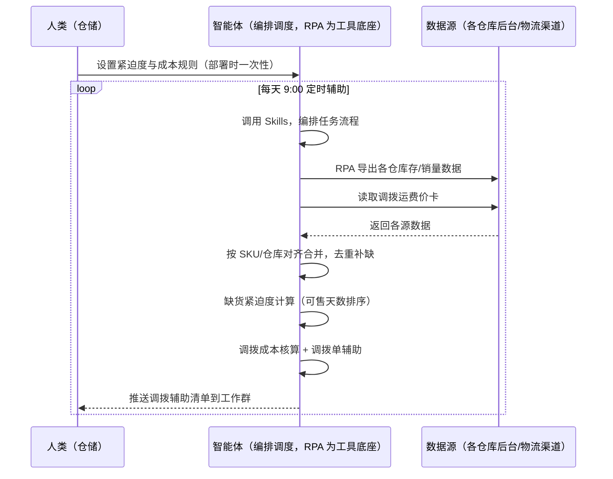
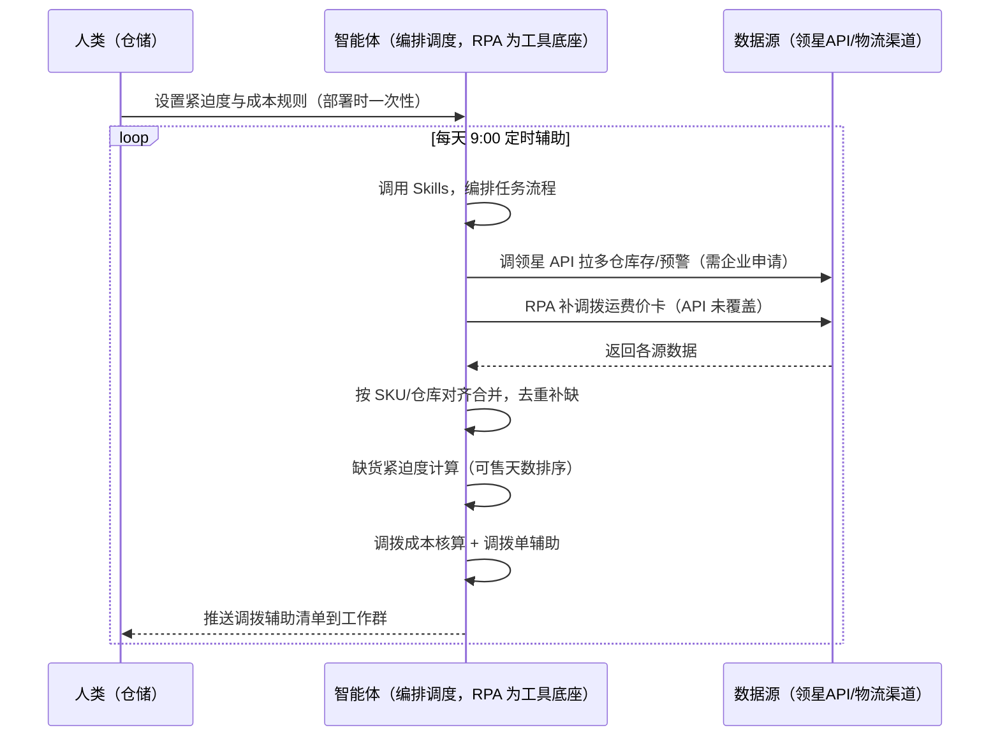

> 为亚马逊卖家团队打造的智能体调度多工具的库存调拨衔接方案。该场景主体能力由领星/ERP 承担（多仓库存汇总、调拨单管理、库存预警），本方案定位为衔接层——补领星未覆盖的跨系统部分（缺货紧迫度计算、调拨成本核算、调拨单生成辅助）。调拨执行由人工/仓库完成。

> Agent 自动化需开通企业功能
> 点击申请1个月免费权限
> [点击申请 →](https://skieer.feishu.cn/share/base/form/shrcnFwMayykP5iaL38fnZKTbrg)

---

## 一、用户与需求

核心矛盾：各仓库库存手动对比、判断缺货多货靠经验，安排调拨还要算运费盯执行——A 仓断货 B 仓积压，客户下单 A 仓没货，白白流失订单。两类客户痛点同源，数据来源不同：

- 未购 SaaS 客户（新卖家/小团队）：人工逐个仓库看库存、凭经验判断哪里缺、想哪个仓有多余，全靠手；
- 已购 SaaS 客户（领星 ERP）：领星有库存汇总与库存预警（多仓库存、库龄预警），但缺货紧迫度计算、调拨成本核算、调拨单生成辅助仍要人做。

适用客户：多仓备货的卖家。已购领星客户建议用本衔接方案（领星已覆盖主体）；未购领星客户可先评估是否值得购买 ERP 或保留人工流程。

### 1.1 不同模式卖家

| 类型 | 选择 | 建议 |
|-|-|-|
| 品牌 | 首选 | 强烈推荐（多仓备货，调拨是常态） |
| 精铺 | 次选 | 一般推荐，聚焦主力 SKU 的多仓平衡 |
| 铺货 | 任意 | 不推荐，单仓为主调拨需求少 |

### 1.2 不同类目卖家

| 类目 | 最关注维度 | 核心逻辑 |
|-|-|-|
| 3C 数码 | 断货优先 | 参数件断货即丢单，紧迫度优先 |
| 家居家具 | 调拨成本 | 大件运费高，调拨前算成本 |
| 美妆个护 | 批次管理 | 调拨要注意批次与效期 |
| 服装鞋帽 | 旺季前调 | 季前把货调到热销仓 |
| 户外运动 | 库存平衡 | 功能件多仓平衡，避免断货 |
| 母婴用品 | 安全优先 | 安全类目，调拨保供优先 |

### 1.3 不同角色用户

| 用户 | 需求 | 问题 | 投入时间（估算） |
|-|-|-|-|
| 老板 | 库存不闲置不短缺 | 断货与积压并存 | 0.5 小时/周 |
| 仓储 | 调拨计划+调拨单 | 手动对比算运费费时 | 1-2 小时/天 |
| 财务 | 调拨成本可控 | 运费无预估，成本失控 | 0.5 小时/周 |

---

## 二、现在的方法与问题

### 2.1 流程步骤与问题总结

人工方式（未购 SaaS 客户）

| 序号 | 步骤 | 现在的方法 | 问题缺陷 |
|-|-|-|-|
| 1 | 看库存 | 逐个仓库看库存 | 仓库多，对比费时 |
| 2 | 判缺货 | 凭经验判断哪里缺 | 无紧迫度口径，判断靠感觉 |
| 3 | 找货源 | 想哪个仓有多余 | 缺货仓与多货仓匹配靠人 |
| 4 | 算成本 | 手工估算运费 | 运费无预估，成本失控 |
| 5 | 建调拨单 | 手动创建调拨单 | 逐个操作费时易错 |

SaaS 方式（已购领星 ERP 客户）

| 序号 | 步骤 | 现在的方法 | 问题缺陷 |
|-|-|-|-|
| 1 | 看库存 | 领星多仓库存汇总 | 已覆盖主体 |
| 2 | 判缺货 | 领星库存预警 | 紧迫度计算靠人 |
| 3 | 找货源 | 人工匹配 | 缺多仓匹配靠人 |
| 4 | 算成本 | 人工估算 | 调拨成本核算靠人 |
| 5 | 建调拨单 | 领星调拨单 | 已覆盖，生成辅助缺 |

### 2.2 问题分析

人工方式根因

| 序号 | 根因 | 具体表现 |
|-|-|-|
| 1 | 库存分散 | 多仓库存人工对比费时 |
| 2 | 紧迫度靠经验 | 缺货多货判断无口径 |
| 3 | 成本无预估 | 调拨运费无估算，成本失控 |
| 4 | 匹配靠人 | 缺货仓与多货仓匹配靠记忆 |

SaaS 方式根因

| 序号 | 根因 | 具体表现 |
|-|-|-|
| 1 | 主体已覆盖 | 领星多仓库存与预警成熟，无需重复建设 |
| 2 | 紧迫度与成本靠人 | 缺货紧迫度、调拨成本核算无自动化 |
| 3 | 调拨单辅助缺 | 调拨单生成辅助与成本对比靠人 |

---

## 三、解决方案

### 3.1 功能概述

为亚马逊卖家团队打造的库存调拨衔接方案，主体能力由领星/ERP 承担，本方案补跨系统衔接缺口。

每天定时触发并调度多个工具，调起八爪鱼 RPA（Agent 的工具底座，能耦合多系统、完成自动化任务执行）读取领星/ERP 库存数据，输出衔接层分析，涵盖「缺货紧迫度计算、调拨成本核算、调拨单生成辅助」。调拨执行由人工/仓库完成，本方案只做辅助。

### 3.2 系统结合

| 要素 | 说明 |
|-|-|
| 客户现有工具盘点 | 未购 SaaS 客户：无第三方工具，库存全靠人工。   已购 SaaS 客户（主流组合）：领星 ERP（多仓库存汇总、库存预警、调拨单管理，开放 API 需企业申请） |
| 数据/能力来源 | 未购 SaaS：各仓库后台（库存/销量，官方导出）+ 物流渠道（调拨运费）。   已购 SaaS：领星开放 API（多仓库存/预警数据，需企业申请权限）+ RPA 补成本核算（API 未覆盖） |
| RPA 耦合动作 | 作为 Agent 的工具底座，按计划调度多数据源取数（API 优先 + 后台导出兜底），按 SKU/仓库对齐去重合并，统一流转给智能体分析；任一数据源失败自动重试、异常告警 |
| 耦合出的新价值 | 衔接增量：领星管好多仓库存主体，本方案补「缺货紧迫度 → 调拨成本核算 → 调拨单辅助」，免去人工逐仓对比算运费 |

### 3.3 智能体执行流程

智能体定时触发。支持两种数据通道，部署时按客户现有工具选择：

通道一：无 SaaS 方式（RPA 导出各仓数据，适合未购领星的客户）

通道二：有 SaaS 方式（领星 API 拿库存核心，RPA 补成本核算，适合已购客户）

> Agent 自动化需开通企业功能
> 点击申请1个月免费权限
> [点击申请 →](https://skieer.feishu.cn/share/base/form/shrcnFwMayykP5iaL38fnZKTbrg)

### 3.4 为何这么设计

要同时回答三个问题：为什么主体归领星/ERP？为什么不能只用 SaaS/API？为什么不能纯靠智能体写代码？ 本场景的核心是"多仓库存主体已由领星解决，本方案只做跨系统衔接增量"。

#### 1）逐项对比

| 对比维度 | SaaS/API 堆叠（领星） | 纯智能体（智能体写代码） | 智能体+自动化工具（RPA 工具底座） |
|-|-|-|-|
| 实现方式 | 领星多仓库存/预警/调拨单（主体） | 能调 API 能抓后台，数据可自拼，但全要自己接 | 衔接领星为主，补紧迫度与成本核算 |
| 多系统耦合 | 领星单系统，成本核算不覆盖 | 全自建：API 鉴权、采集、对齐逻辑 | 平台沉淀多源取数与对齐，可视化配置 |
| 主体价值 | 已覆盖（多仓库存+预警+调拨单） | 重复建设领星已有能力，无增量 | 不重复建设，只做衔接增量 |
| 使用成本（总拥有成本） | 领星 500-1500/月（主体） | 代理 IP + 服务器 + 开发维护人力，隐性成本高 | 一份平台订阅跑多流程，衔接增量边际成本 ≈ 0 |
| 维护人要求 | 低（工具已成熟） | 规则调整都要开发介入 | 可视化流程，仓储自己可调规则、阈值 |

#### 2）优劣势说明

|  | SaaS/API 堆叠（领星） | 纯智能体（智能体写代码） | 智能体+自动化工具（RPA 工具底座） |
|-|-|-|-|
| 优势 | 多仓库存/预警/调拨单成熟（主体已解决） | 无订阅费；   可深度定制调拨模型 | 衔接层即开即用；   紧迫度/成本核算补缺口；   非技术人员可维护 |
| 劣势 | 紧迫度与成本靠人；   调拨单辅助缺 | 重复建设领星已有能力；   AI 生成代码是生成性的 | 本地电脑运行需保持开机；   订阅费；   灵活性受平台模板边界限制 |

#### 3）结论

| 论点 | 说明 |
|-|-|
| 主体归领星 | 多仓库存汇总、库存预警、调拨单是领星成熟能力，不重复建设——本方案明确让位，只做衔接 |
| 衔接增量在哪 | 缺货紧迫度计算、调拨成本核算、调拨单生成辅助是领星未覆盖的跨系统部分 |
| 纯智能体缺"工程底座" | 库存取数与对齐 70% 的工作在工程（采集/对齐/调度/重试）；   RPA 作为工具底座把这 70% 已经造好 |
| 一个底座跑多流程 | 客户购买 RPA 平台是跑多个流程，本衔接方案只是其中一个——平台订阅费被多流程摊薄 |
| 时间 | 仓储要的是"紧迫度自动算、成本自动核"，不是"重复造领星的轮子" |

### 3.5 功能清单

| 功能 | 系统 | 功能说明（解决问题） |
|-|-|-|
| 会话/定时 | 智能体 | 1. 理解人类语言，调用已预设好的 Skills。   2. 编排多任务、调度多工具。 |
| 多系统数据取数 | RPA、指纹浏览器 | 1. 解决紧迫度靠经验、成本无预估问题。   2. 作为智能体工具底座被调度执行，导出失败自动重试并告警。   3. 【无 SaaS 方式】 RPA 导出各仓库存/销量 + 读取运费价卡。【有 SaaS 方式】 调领星 API 拉多仓库存（需企业申请）+ RPA 补运费价卡。 |
| 数据清洗对齐 | 智能体 | 按 SKU/仓库对齐去重，解决多仓口径不一致问题。 |
| 缺货紧迫度 | 智能体 | 按可售天数排序，缺货仓紧迫度分级（高/中/低）。 |
| 调拨成本核算 | 智能体 | 按重量/渠道估算调拨运费，附成本对比（估算，附方法）。 |
| 调拨单辅助 | 智能体 | 生成调拨单草稿（货源仓/目标仓/数量/成本），执行由人工确认。 |
| IM通知 | 飞书、钉钉、企微等 | 解决断货与积压并存问题。紧迫度清单、成本对比自动推送。 |
| 数据资产储存 | 本地电脑、云储存 | 1. Skills 资产：紧迫度与成本规则。   2. 数据储存：调拨辅助记录统一写入本地，可审计。   3. 经验知识库：调拨案例持续沉淀。 |

### 3.6 智能体执行落地过程

部署时一次性配置入参（紧迫度/成本规则、推送群、数据通道），会话中无需重复输入。

⚠️ 部署前提（不满足则方案无法跑起来）：①RPA 需部署在常开电脑/云机上，并配置漏跑补跑机制；②有 SaaS 方式需领星企业客户申请开放 API 权限（未开通自动降级为无 SaaS 通道，走后台导出）；③调拨执行由人工/仓库完成，本方案只做辅助；④首次配置（API 鉴权、对齐规则、成本规则）需服务方/技术人员介入一次，属实施成本。

#### 1）配置

| 类别 | 说明 |
|-|-|
| 智能体 | 主流智能体。 |
| 智能体工具 | 1. 数据通道（按客户现有工具二选一）：【无 SaaS】各仓库后台导出 + 运费价卡；【有 SaaS】领星开放 API（需企业申请）+ RPA 补运费价卡。   2. 数据取数与自动化执行：八爪鱼 RPA，MCP 配置完成。   3. 数据分析：智能体自带。   4. IM：企业办公 IM（飞书/钉钉/企微），MCP 或 webhook 配置。 |
| 工作知识 | 1. 仓库清单与 SKU 分布。   2. 紧迫度分级：可售天数 &lt;7 高、&lt;14 中、其余低。   3. 运费价卡（重量/渠道）。4. 调拨单模板。 |
| 本地数据库 | 1. 调拨辅助记录地址。   2. 运费价卡地址。   3. 经验库地址。 |

#### 2）执行

| 任务 | 产出 | 产出物接收人 |
|-|-|-|
| 接收仓库清单，定时触发 | 任务启动记录 | —— |
| 调用已预设 Skills，编排任务流程 | 任务编排方案 | —— |
| 经 MCP 向八爪鱼 RPA 下发取数任务 | 自动化任务指令 | —— |
| 多源取数并按 SKU/仓库对齐（无 SaaS：后台导出；有 SaaS：领星 API+价卡，智能体监控状态） | 对齐后库存数据 | —— |
| 缺货紧迫度计算（可售天数排序） | 紧迫度清单 | 仓储 |
| 调拨成本核算（附对比） | 成本对比 | 仓储/财务 |
| 调拨单辅助生成（人工确认后执行） | 调拨单草稿 | 仓储 |
| 推送调拨辅助清单 | 群消息 | 仓储/老板 |

异常处理：

导出失败 → 自动重试并告警；

库存数据缺失 → 标注待补；

运费为估算值 → 标注估算方法；

紧迫度置信度低 → 转人工判断；

置信度 &lt;70% → 转人工复核，不输出硬结论。

#### 3）结果

| 结果 | 说明 |
|-|-|
| 数据资产 | 调拨辅助结构化数据（SKU/仓库/紧迫度/成本/状态），可审计。 |
| 分析报告 | 1. 紧迫度清单：缺货仓按可售天数排序。   2. 成本对比：调拨运费估算对比。   3. 调拨单草稿：货源仓/目标仓/数量/成本，人工确认后执行。 |
| Skills | 智能体 Skills：   紧迫度与成本规则。 |

> Agent 自动化需开通企业功能
> 点击申请1个月免费权限
> [点击申请 →](https://skieer.feishu.cn/share/base/form/shrcnFwMayykP5iaL38fnZKTbrg)

---

## 四、使用前后预估

> 本方案价值 = 衔接层增量（紧迫度 + 成本核算 + 调拨单辅助）。主体（多仓库存/预警/调拨单）由领星/ERP 承担，本方案不替代。未购领星客户单独价值有限，建议先评估是否购买 ERP。

| 指标 | 人工 | SaaS/API（领星） | 智能体+自动化工具（衔接层） |
|-|-|-|-|
| 多仓库存 | 逐个看 | 领星汇总 | 不重复建设 |
| 库存预警 | 靠经验 | 领星预警 | 不重复建设 |
| 缺货紧迫度 | 靠感觉 | 靠人 | 可售天数自动排序 |
| 调拨成本 | 无预估 | 靠人 | 自动核算 + 对比 |
| 调拨单 | 手动建 | 领星调拨单 | 草稿辅助，人工确认 |
| 方法论 | 无 | 领星规则（单系统） | 可复用的 Skills 与规则库 |

说明：本方案为衔接层，主体能力（多仓库存/预警/调拨单）由领星/ERP 承担；已购领星客户价值集中在紧迫度计算与成本核算；未购客户建议先评估 ERP，本方案单独价值有限。

---

## 五、效果证明

> Agent 自动化需开通企业功能
> 点击申请1个月免费权限
> [点击申请 →](https://skieer.feishu.cn/share/base/form/shrcnFwMayykP5iaL38fnZKTbrg)

### 5.1 客户案例

**《小天鹅：7 平台 16 账号库存数据自动化，年省成本 50 万》**

> 美的集团旗下小天鹅事业部，7 个电商平台、16 个账号、每日 86 张报表原需专员逐个登录导出 7 小时/天。八爪鱼 RPA 替代全部人工采集，7 大系统、25 类报表自动采集入库。

| 效果 | 说明 |
|-|-|
| 提效 | 多平台报表采集效率提升约 85%。原本 7 个平台 16 个账号、86 张报表需逐个登录导出，每天耗 7 小时，现在全自动采集入库；数据时效由 T+2 提升至 T+1，部分平台已 T+0。 |
| 降本 | 减少数据专员 2 人（原文：2 名全职数据专员的「搬数据」工作被完全替代，年节省人力成本 50 万元）。原本需 2 人全职导表，现在 0 人；2 名专员转岗至数据分析岗，投入库存分析、周转率优化、滞销品预警等高价值工作。 |
| 任务 | 7 个电商平台 16 个账号、25 类报表自动采集入库；错误率降至 0.1%。 |
| 任务 | 天猫指纹浏览器、苏宁每 2 小时定时抓取、京东按事业部隔离账号，多平台差异化策略稳定运行。 |

案例详情：[小天鹅：百亿级洗衣机巨头的多平台库存数据自动化实践](https://skieer.feishu.cn/wiki/Q6Qjw2FtDiNFgWkOVHacEFJ0nlh)

**《唯世美：家具大件补货全流程自动化》**

> 首款内置 RGB 灯光展示柜上架两个月即拿下 Amazon 美加英德四站与 Walmart、Temu 美站 Best Seller。为应对数据源分散、人工操作耗时与 SKU 管理混乱，实现补货判断全流程自动化。

| 效果 | 说明 |
|-|-|
| 提效 | 补货整理重复工作量下降 80%。原本需人工从领星 ERP 与各海外仓平台逐项导出库存、库龄数据再手工清洗匹配 SKU，现在自动抓取、自动清洗，输出补货建议。 |
| 降本 | 免除人工导表与拼表的重复投入，供应链团队投入转向库存结构优化与周转率提升等重点工作。 |
| 任务 | 库存数据抓取与处理准确率达 99% 以上，分散数据源实时同步。 |
| 任务 | 自有 Excel 模板逻辑零改动保留，补货计算口径与原有习惯一致。 |

案例详情：[家具大件补货：补货全流程自动化，整理数据重复工作量下降 80%](https://skieer.feishu.cn/wiki/Gca3w8j1KixDXjkz0oScFwHAngf)

---

## 六、备注

### 6.1 Agent 支持

本方案不绑定具体智能体，主流 Agent 均可运行（需支持技能/Skills 加载与工具调用）：

| Agent/智能体 | 说明 |
|-|-|
| Workbuddy | 本方案运行平台，支持技能/Skills 上传加载、定时任务、MCP 工具调用与表格/报告处理 |
| 豆包（国内·字节） | 国内主流个人智能体，支持技能上传、定时任务与工具调用，上手成本低 |
| 通义千问（国内·阿里） | 支持 Agent 编排与插件生态，集成阿里电商数据能力，适合电商场景 |
| DeepSeek（国内） | 推理能力强、成本低，适合规则打分与归因分析类任务 |
| ChatGPT（国外·OpenAI） | 海外主流通用智能体，支持 GPTs/Agent 模式与工具调用 |
| Claude（国外·Anthropic） | 长文本与结构化分析能力强，原生支持 MCP 连接外部工具 |

### 6.2 名词解释

| 术语 | 说明 |
|-|-|
| 衔接层 | 主体能力由领星/ERP 承担，本方案只做跨系统衔接增量（紧迫度/成本/调拨单辅助） |
| 缺货紧迫度 | 按可售天数排序的缺货紧急程度（高/中/低） |
| 调拨成本 | 按重量/渠道估算的调拨运费（估算，附方法） |
| 调拨单 | 货源仓/目标仓/数量/成本的调拨单据（领星主体 + 本方案草稿辅助） |
| 可售天数 | 现有库存 ÷ 日均销量 |
| 混合数据源 | 官方导出/API 优先（更稳更合规）+ 页面采集兜底（免费、覆盖无 SaaS 客户与 API 缺口） |
| 有 SaaS 方式 | 已购领星，开放 API 拿库存核心 + RPA 补成本核算（需企业申请权限） |
| 无 SaaS 方式 | 不购买第三方工具，由 RPA 导出各仓数据 |
| ERP | Enterprise Resource Planning，企业资源计划系统 |
| MCP | Model Context Protocol，智能体连接外部工具的标准化通道 |

> Agent 自动化需开通企业功能
> 点击申请1个月免费权限
> [点击申请 →](https://skieer.feishu.cn/share/base/form/shrcnFwMayykP5iaL38fnZKTbrg)

---

原文：[查看原文](https://skieer.feishu.cn/wiki/QsdywTVmei5gUmk1mXZcz2i0npc)
