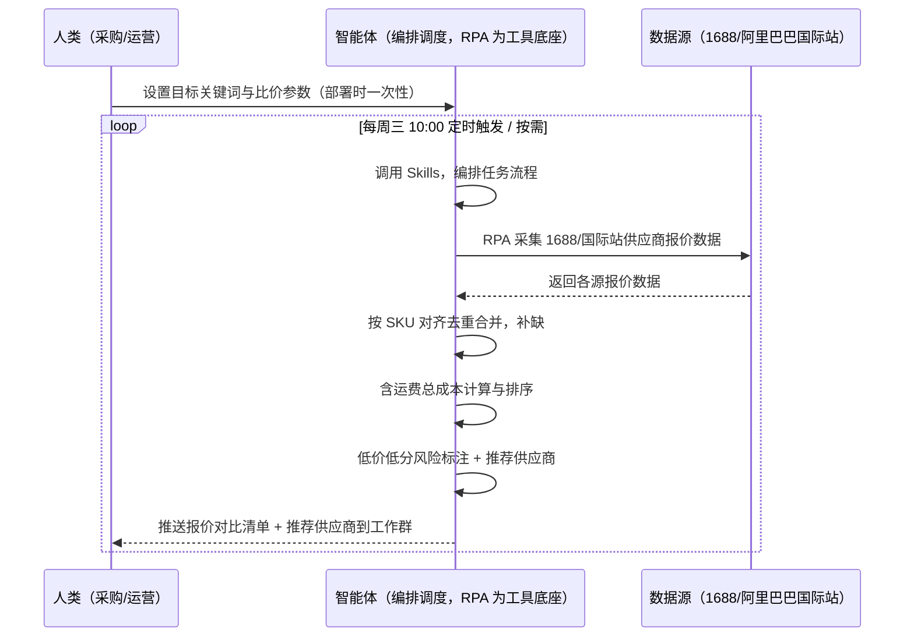
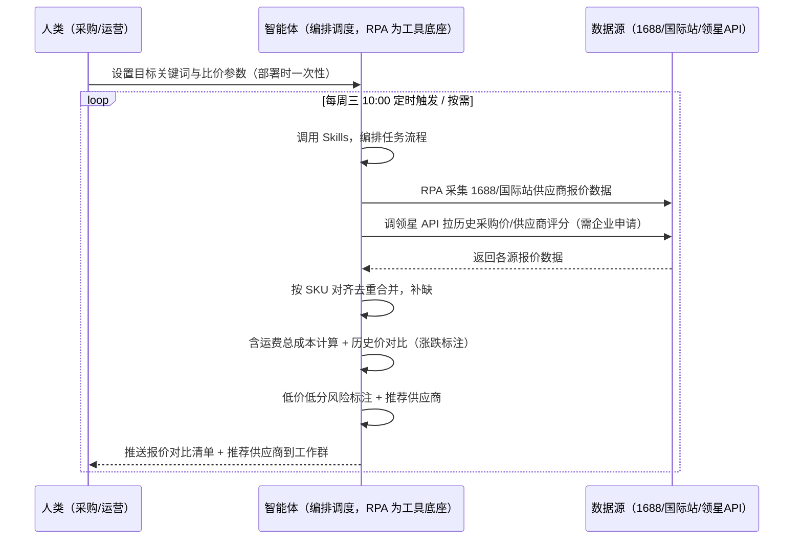

> 为亚马逊卖家团队打造的供应商寻源比价方案。供应商报价分散在 1688、阿里巴巴国际站等平台，本方案由智能体调度多个工具统一取数，按需或每周定时比价，输出报价对比清单与推荐供应商，只推送结果不打扰。

> Agent 自动化需开通企业功能
> 点击申请1个月免费权限
> [点击申请 →](https://skieer.feishu.cn/share/base/form/shrcnFwMayykP5iaL38fnZKTbrg)

## 一、用户与需求

核心矛盾：供应商报价分散在 1688、阿里巴巴国际站等多个平台，采购要在它们之间反复手动执行——搜目标商品、记供应商名和报价、贴 Excel 对比、凭印象判断哪家靠谱。等做完比价，报价可能已变，或低价供应商的资质风险没发现，下单后踩坑。

两类客户痛点同源，数据来源不同：

- 未购 SaaS 客户（新卖家/小团队）：人工在 1688、国际站手动搜目标商品，记价格、起订量、交期，全靠手抄；
- 已购 SaaS 客户（领星 ERP 管供应商）：领星有供应商档案与采购订单，但多平台比价采集不覆盖，仍要人跨平台搜、再回 ERP 对历史价。

适用客户：SKU 多、需持续比价与供应商储备的卖家。偶尔找一两个货源的卖家价值有限（手动搜一次即可，本方案不推荐）。

### 1.1 不同模式卖家

| 类型 | 选择 | 建议 |
|-|-|-|
| 品牌 | 首选 | 强烈推荐（SKU 多、需稳定比价与供应商储备） |
| 精铺 | 次选 | 一般推荐，聚焦主力 SKU 的货源比价 |
| 铺货 | 任意 | 不推荐，SKU 太多，按需比价即可 |

### 1.2 不同类目卖家

| 类目 | 最关注维度 | 核心逻辑 |
|-|-|-|
| 3C 数码 | 报价+资质 | 参数件比价同时要核供应商资质，低价低分慎选 |
| 家居家具 | 含运费总成本 | 大件运费占比高，比价必须算含运费总成本 |
| 美妆个护 | 合规资质 | 报价外重点看供应商合规背书 |
| 服装鞋帽 | 起订量+交期 | 款式迭代快，起订量与交期决定试错成本 |
| 户外运动 | 评分+月销量 | 功能件看供应商口碑与出货能力 |
| 母婴用品 | 资质+评分 | 安全敏感类目，低价但评分低直接剔除 |

### 1.3 不同角色用户

| 用户 | 需求 | 问题 | 投入时间（估算） |
|-|-|-|-|
| 老板 | 知道最优供应商与议价空间 | 报价分散，比价结论不透明 | 0.5 小时/周 |
| 采购 | 报价对比清单+推荐供应商 | 手动记价格易漏，比价费时 | 1-3 小时/周 |
| 运营 | 新品货源摸底 | 无统一比价口径，判断靠经验 | 1 小时/周 |

---

## 二、现在的方法与问题

### 2.1 流程步骤与问题总结

**人工方式（未购 SaaS 客户）**

| 序号 | 步骤 | 现在的方法 | 问题缺陷 |
|-|-|-|-|
| 1 | 找货源 | 1688/国际站手动搜目标商品 | 多平台来回搜，报价分散 |
| 2 | 记报价 | 手动记供应商名、报价、起订量 | 易漏记错记，无统一口径 |
| 3 | 做对比 | 手工做报价对比表 | 没算含运费总成本，对比失真 |
| 4 | 看资质 | 凭印象判断供应商靠谱与否 | 低价低分风险发现不了 |
| 5 | 定供应商 | 拍板选哪家 | 无总成本排序，决策不透明 |
| 6 | 议价 | 凭感觉砍价 | 无均价依据，砍价没底气 |

**SaaS 方式（已购领星 ERP 客户）**

| 序号 | 步骤 | 现在的方法 | 问题缺陷 |
|-|-|-|-|
| 1 | 找货源 | 1688/国际站手动搜目标商品 | 比价采集领星不覆盖，仍要人搜 |
| 2 | 记报价 | 手动记，回 ERP 对历史采购价 | 两处来回切，历史价比对靠人 |
| 3 | 做对比 | 手工做报价对比表 | 不结合 ERP 历史价，涨跌无感知 |
| 4 | 看资质 | 领星供应商档案有评分，但新供应商无 | 新供应商资质凭印象 |
| 5 | 定供应商 | 拍板选哪家 | 无总成本排序，决策不透明 |
| 6 | 议价 | 凭感觉砍价 | 无均价依据 |

### 2.2 问题分析

**人工方式根因**

| 序号 | 根因 | 具体表现 |
|-|-|-|
| 1 | 报价跨平台分散 | 1688/国际站多平台，人工跑不过来 |
| 2 | 无统一比价口径 | 不算含运费总成本，比价失真 |
| 3 | 资质风险难发现 | 低价但评分低/疑似假货无标记 |
| 4 | 决策不透明 | 推荐供应商无计算明细，不可复核 |
| 5 | 经验不沉淀 | 比价规则在人脑里，换人结果就不一样 |

**SaaS 方式根因**

| 序号 | 根因 | 具体表现 |
|-|-|-|
| 1 | 比价采集空白 | 领星管供应商档案/采购订单，不做多平台比价采集 |
| 2 | 历史价不联动 | 新报价 vs ERP 历史采购价靠人对照，涨跌无感知 |
| 3 | 新供应商无背书 | 领星只有已合作供应商档案，新供应商资质靠印象 |
| 4 | 决策不沉淀 | 比价依据在个人经验里，换人就不一样 |

---

## 三、解决方案

### 3.1 功能概述

为亚马逊卖家团队打造的智能体驱动供应商寻源比价方案，解决供应商报价跨平台分散、人工反复手动执行、比价口径不统一的问题。

定时触发并调度多个工具，按 SKU 对齐合并，输出比价分析，涵盖「多平台报价采集、含运费总成本排序、低价低分风险标注、与 ERP 历史价对比、推荐供应商与议价话术」。按需或每周定时比价，只推送结果不打扰。

### 3.2 系统结合

| 要素 | 说明 |
|-|-|
| 客户现有工具盘点 | **未购 SaaS 客户**：无第三方工具，报价全靠前台翻页手抄。   **已购 SaaS 客户**（主流组合）：领星 ERP（供应商档案、采购订单、历史采购价，开放 API 需企业申请）、1688/阿里巴巴国际站（货源平台，前台公开报价） |
| 数据/能力来源 | **未购 SaaS**：1688 + 阿里巴巴国际站前台（供应商名/报价/起订量/交期/月销量/评分，RPA 采集）。   **已购 SaaS**：1688/国际站前台采集（比价）+ 领星开放 API（历史采购价、供应商评分交叉验证，需企业申请权限） |
| RPA 耦合动作 | 作为 Agent 的工具底座，按计划调度多数据源取数（前台采集为主 + 领星 API 交叉验证），按 SKU 对齐去重合并，统一流转给智能体计算；任一数据源失败自动重试、异常告警 |
| 耦合出的新价值 | 单工具给不了的端到端结论：多平台报价一次取齐 → 含运费总成本排序 → 与 ERP 历史价对比 → 风险标注 → 议价话术，免去人工在多平台与 ERP 间反复切换 |

### 3.3 智能体执行流程

用户向智能体输入会话（入参：目标关键词/产品图）或智能体定时触发（每周三 10:00）。支持两种数据通道，部署时按客户现有工具选择：

通道一：无 SaaS 方式（RPA 采集 1688/国际站，适合未购领星的客户）

通道二：有 SaaS 方式（领星 API 交叉验证历史价，适合已购客户）

> Agent 自动化需开通企业功能
> 点击申请1个月免费权限
> [点击申请 →](https://skieer.feishu.cn/share/base/form/shrcnFwMayykP5iaL38fnZKTbrg)

### 3.4 为何这么设计

要同时回答三个问题：为什么不能只用 SaaS/API？为什么不能纯靠智能体写代码？ 本场景的核心是"定时/按需、跨平台取数、按 SKU 对齐、总成本计算、出推荐结论、挂了有人管"。

#### 1）逐项对比

| 对比维度 | SaaS/API 堆叠 | 纯智能体（智能体写代码） | 智能体+自动化工具（RPA 工具底座） |
|-|-|-|-|
| 实现方式 | 领星管供应商档案/历史价，无比价采集 | 能调 API 能抓前台，数据可自拼，但全要自己接 | 一个底座跑多个流程（比价/采购/利润/选品……），数据一处对齐 |
| 多平台耦合 | 1688/国际站无采集，历史价需人工对照 | 全自建：API 鉴权、1688 反爬、对齐逻辑 | 平台沉淀多源取数与对齐，可视化配置 |
| 计算与判断 | 领星无比价计算 | 总成本逻辑自写，灵活但工程量大 | 判断交给智能体（总成本排序+风险标注+议价话术），执行交给 RPA |
| 定时与推送 | 领星无比价提醒 | 调度器/进程常驻/告警通道全自建 | 平台调度稳定触发，失败重试 + 异常告警，只推送结果 |
| 使用成本（总拥有成本） | 领星订阅不含比价场景 | 代理 IP + 服务器 + 开发维护人力，隐性成本高 | 一份平台订阅跑所有流程，单方案边际成本 ≈ 0 |
| 维护人要求 | 低 | 平台改版/失效都要开发介入，团队无开发即卡死 | 可视化流程，采购自己可调关键词、运费参数、重跑任务 |

#### 2）优劣势说明

|  | SaaS/API 堆叠 | 纯智能体（智能体写代码） | 智能体+自动化工具（RPA 工具底座） |
|-|-|-|-|
| 优势 | 供应商档案/历史价权威 | 无订阅费；   可深度定制比价算法；   技术上完全可行 | 1688 货源采集应用已落地；   反爬/登录态/对齐即开即用；   历史价交叉验证；   非技术人员可维护 |
| 劣势 | 无比价采集、无新供应商资质 | 双平台解析与反爬全自建；   AI 生成代码是生成性的，行为不完全可控 | 本地电脑运行需保持开机；   订阅费；   灵活性受平台模板边界限制 |

#### 3）结论

| 论点 | 说明 |
|-|-|
| 只用 SaaS/API 无比价场景 | 领星管供应商档案与历史价，多平台比价采集无覆盖——本方案填补空白，并反向增强领星数据（历史价对比） |
| 纯智能体缺"工程底座" | 跨平台取数 70% 的工作在工程（反爬/登录态/对齐/调度/重试），不在"写比价逻辑"；   RPA 作为工具底座把这 70% 已经造好 |
| 一个底座跑多流程 | 客户购买 RPA 平台是跑多个流程（比价/采购/利润/选品/后台操作），本方案只是其中一个——平台订阅费被多流程摊薄，单方案边际成本接近 0 |
| 确定性 vs 生成性 | 报价采集与总成本计算是确定性任务——同样的关键词，要求"报价逐条一致、成本计算可复核"。AI 生成的代码是生成性的，能跑通 ≠ 稳定比价一年 |
| 时间 | 采购要的是"按需拿到报价对比清单和推荐供应商"，不是"按需修脚本"；   判断层交给智能体，执行层交给工具底座 |

### 3.5 功能清单

| 功能 | 系统 | 功能说明（解决问题） |
|-|-|-|
| 会话/定时 | 智能体 | 1. 理解人类语言，调用已预设好的 Skills。   2. 编排多任务、调度多工具。 |
| 多系统数据取数 | RPA、指纹浏览器 | 1. 解决供应商报价分散多平台、手动记录易漏问题。   2. 作为智能体工具底座被调度执行，搜索结果为空时更换关键词重试、页面改版无法解析时截图转人工。   3. **【无 SaaS 方式】** RPA 采集 1688/国际站供应商名/报价/起订量/交期/月销量/评分。**【有 SaaS 方式】** 同上 + 调领星 API 拉历史采购价/供应商评分（需企业申请）。 |
| 数据清洗对齐 | 智能体 | 按 SKU 去重对齐报价，解决多平台报价重复、无统一口径问题。 |
| 总成本计算与排序 | 智能体 | 含运费总成本 = 报价 + 运费估算（+杂费），按总成本排序；总成本最低且评分 ≥4.5 → A 级推荐；总成本最低但评分 &lt;4.5 → 黄色风险提醒；报价偏离均值 >30% → 异常低价疑似假货标记。 |
| 历史价对比 | 智能体 | 【有 SaaS 方式】新报价 vs 领星历史采购价对比，标注涨跌幅度，识别"供应商悄悄涨价"。 |
| 推荐与议价 | 智能体 | 推荐供应商附总成本计算明细；议价话术引用同品类均价作为砍价依据。**最终供应商由人决策**。 |
| IM通知 | 飞书、钉钉、企微等 | 解决比价结果交付滞后问题。报价对比清单与推荐供应商自动推送。 |
| 数据资产储存 | 本地电脑、云储存 | 1. Skills 资产：供应商比价与资质评估清单，被调度直接调用。   2. 数据储存：报价对比清单.xlsx 统一写入本地，报价含税/不含税状态标注。   3. 经验知识库：审核通过的供应商持续沉淀。 |

### 3.6 智能体执行落地过程

部署时一次性配置入参（目标关键词、运费参数、评分门槛、推送群、数据通道），会话中无需重复输入。

⚠️ 部署前提（不满足则方案无法跑起来）：①RPA 需部署在常开电脑/云机上，并配置漏跑补跑机制；②1688/国际站采集受平台风控影响，需自备账号并遵守平台条款，采集失败自动降速重试；③有 SaaS 方式需领星企业客户申请开放 API 权限（未开通自动降级为无 SaaS 通道）；④首次配置（API 鉴权、对齐规则、运费参数）需服务方/技术人员介入一次，属实施成本。

#### 1）配置

| 类别 | 说明 |
|-|-|
| 智能体 | 主流智能体。 |
| 智能体工具 | 1. **数据通道（按客户现有工具二选一）**：【无 SaaS】1688/国际站前台（RPA 采集）；【有 SaaS】1688/国际站采集 + 领星开放 API（需企业申请）。   2. 数据取数与自动化执行：八爪鱼 RPA，MCP 配置完成。   3. 数据分析：智能体自带。   4. IM：企业办公 IM（飞书/钉钉/企微），MCP 或 webhook 配置。 |
| 工作知识 | 1. 目标关键词/产品图。   2. 运费估算方式：默认按重量×物流单价。   3. 最低店铺评分门槛：默认 4.5 分。   4. 起订量上限：按需。   5. 物流单价：默认海运 \$2/kg。   6. 杂费率：默认报价 3%。 |
| 本地数据库 | 1. 供应商库地址。   2. 报告库地址。   3. 经验库地址。 |

#### 2）执行

| 任务 | 产出 | 产出物接收人 |
|-|-|-|
| 接收目标关键词/产品图，定时或会话 | 任务启动记录 | —— |
| 调用已预设 Skills，编排任务流程 | 任务编排方案 | —— |
| 经 MCP 向八爪鱼 RPA 下发取数任务 | 自动化任务指令 | —— |
| 多平台取数并按 SKU 对齐（无 SaaS：1688/国际站采集；有 SaaS：+领星历史价，智能体监控状态） | 对齐后报价数据 | —— |
| 含运费总成本计算与排序 | 总成本排序 | 采购 |
| 低价低分风险标注 | 供应商风险标签 | 采购 |
| 历史价对比（有 SaaS 时） | 涨跌标注 | 采购 |
| 推荐供应商生成（附计算明细+议价话术） | 推荐供应商 + 议价话术 | 采购 |
| 推送比价结果到工作群 | 报价对比清单 | 采购/老板 |

异常处理：

搜索结果为空 → 更换关键词重试；

页面改版无法解析 → 截图转人工处理；

运费为估算值 → 标注估算方法；供应商数据采集不全 → 降级说明本次覆盖范围；

报价偏离均值 >30% → 标记异常低价疑似假货，不作为推荐依据；

置信度 &lt;70% → 转人工复核，不输出硬结论。

#### 3）结果

| 结果 | 说明 |
|-|-|
| 数据资产 | 全量供应商报价结构化数据（供应商名/报价/起订量/交期/月销量/评分/总成本/风险标签/历史价对比），可审计。 |
| 分析报告 | 1. 报价对比清单：按含运费总成本排序，直接告诉采购"哪家最便宜、哪家有风险"。   2. 推荐供应商：A 级供应商附总成本计算明细。   3. 议价话术：引用同品类均价作为砍价依据。   4. 低价供应商风险说明：附评分、月销量、成立年限。   5. 历史价对比（有 SaaS 时）：涨跌标注，识别涨价。 |
| Skills | 智能体 Skills：供应商比价与资质评估清单。 |

> Agent 自动化需开通企业功能
> 点击申请1个月免费权限
> [点击申请 →](https://skieer.feishu.cn/share/base/form/shrcnFwMayykP5iaL38fnZKTbrg)

---

## 四、使用前后预估

> 本方案价值 = **跨平台报价一次取齐 + 含运费总成本排序 + 风险标注 + 历史价对比**。不承诺替代商务谈判——资质审核与最终供应商选择由人决策。适合 SKU 多、需持续比价的卖家。

| 指标 | 人工 | SaaS/API（领星） | 智能体+自动化工具 |
|-|-|-|-|
| 比价耗时 | 每周 1-3 小时（估算） | 比价仍需人工（领星不覆盖） | 全自动；人工转为审核推荐（每周约 0.5 小时） |
| 报价覆盖 | 手动搜一两个平台 | 领星无覆盖 | 1688/国际站多平台批量采集 |
| 比价口径 | 不算运费，失真 | 无 | 含运费总成本排序，口径统一 |
| 历史价联动 | 靠人对照 | 领星有历史价，不联动新报价 | 新报价 vs 历史价自动对比，涨跌标注 |
| 风险发现 | 下单后踩坑 | 仅已合作供应商 | 低价低分提前标注 |
| 方法论 | 无，换人结果不同 | 无 | 可复用的 Skills 与规则库 |

说明：运费为估算值（按重量×物流单价，可配置）；报价为采集时点值（附日期）；异常低价标记仅作风险提示，最终供应商由采购人工决策

---

## 五、效果证明

### 5.1 DEMO应用

1688-关键词找货源跨境商品采集-[root_admin]：https://rpa.bazhuayu.com/appstore/app/dev\_-7jygx/taobao1688-01-rootadmin

1688-关键词找货源跨境商品采集-[root_admin]：https://rpa.bazhuayu.com/appstore/app/dev\_-7jygx/taobao1688-01-rootadmin

---

## 六、备注

### 6.1 Agent 支持

本方案不绑定具体智能体，主流 Agent 均可运行（需支持技能/Skills 加载与工具调用）：

| Agent/智能体 | 说明 |
|-|-|
| Workbuddy | 本方案运行平台，支持技能/Skills 上传加载、定时任务、MCP 工具调用与表格/报告处理 |
| 豆包（国内·字节） | 国内主流个人智能体，支持技能上传、定时任务与工具调用，上手成本低 |
| 通义千问（国内·阿里） | 支持 Agent 编排与插件生态，集成阿里电商数据能力，适合电商场景 |
| DeepSeek（国内） | 推理能力强、成本低，适合规则打分与归因分析类任务 |
| ChatGPT（国外·OpenAI） | 海外主流通用智能体，支持 GPTs/Agent 模式与工具调用 |
| Claude（国外·Anthropic） | 长文本与结构化分析能力强，原生支持 MCP 连接外部工具 |

### 6.2 名词解释

| 术语 | 说明 |
|-|-|
| 含运费总成本 | 报价 + 运费估算 + 杂费，比价排序的统一口径 |
| A 级推荐 | 总成本最低且店铺评分 ≥4.5 的供应商 |
| 黄色风险提醒 | 总成本最低但店铺评分 &lt;4.5 的供应商 |
| 异常低价 | 报价偏离同品类均值 >30%，疑似假货 |
| 起订量 | 供应商最低订购数量，影响试错成本 |
| 店铺评分 | 供应商店铺信誉评分，默认门槛 4.5 分 |
| 议价话术 | 引用同品类均价的砍价话术 |
| 历史价对比 | 新报价与领星 ERP 历史采购价的涨跌对比 |
| 混合数据源 | 前台采集为主（1688/国际站）+ 领星 API 交叉验证（已购客户） |
| 有 SaaS 方式 | 已购领星，开放 API 拿历史采购价 + RPA 前台比价采集（需企业申请权限） |
| 无 SaaS 方式 | 不购买第三方工具，由 RPA 采集 1688/国际站公开报价 |
| 1688 | 阿里巴巴批发平台，跨境卖家常用货源平台 |
| MCP | Model Context Protocol，智能体连接外部工具的标准化通道 |

> Agent 自动化需开通企业功能
> 点击申请1个月免费权限
> [点击申请 →](https://skieer.feishu.cn/share/base/form/shrcnFwMayykP5iaL38fnZKTbrg)

---

原文：[查看原文](https://skieer.feishu.cn/wiki/Psixw9FoNiEQk3kzYfMcM85Enhb)
