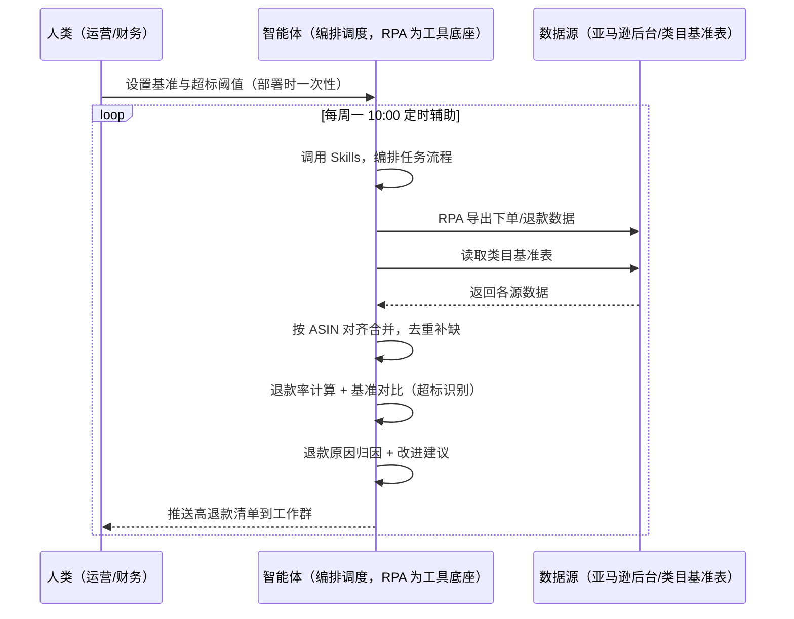
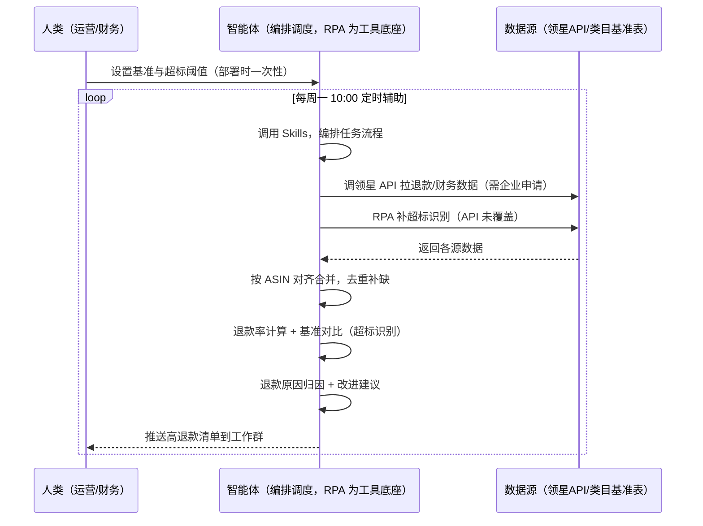

> 为亚马逊卖家团队打造的，由智能体调度多工具执行产品退款率统计任务的方案。该场景主体能力由领星/ERP 承担（退款数据、退款率计算、类目基准），领星未覆盖的跨系统部分（超标识别、退款原因归因、改进建议）。本方案只做统计、分析归因。

> Agent 自动化需开通企业功能
> 点击申请1个月免费权限
> [点击申请 →](https://skieer.feishu.cn/share/base/form/shrcnFwMayykP5iaL38fnZKTbrg)

---

## 一、用户与需求

核心矛盾：退款数据手动统计、高退款品发现不及时、原因分析靠猜——一个 ASIN 退款率悄悄升高，等到发现时退款损失已经不少。两类客户痛点同源，数据来源不同：

- 未购 SaaS 客户（新卖家/小团队）：人工导出下单退款数据、手工计算退款率、凭感觉对比高低，全靠手；
- 已购 SaaS 客户（领星 ERP）：领星有退款/财务数据与报表能力（退款数据、类目基准），但超标识别、退款原因归因、改进建议仍要人做。

适用客户：SKU 多、退款率监控频次高的卖家。已购领星客户建议用本衔接方案（领星已覆盖主体）；未购领星客户可先评估是否值得购买 ERP 或保留人工流程（本方案单独价值有限）。

### 1.1 不同模式卖家

| 类型 | 选择 | 建议 |
|-|-|-|
| 品牌 | 首选 | 强烈推荐（SKU 多，退款率监控频次高） |
| 精铺 | 次选 | 一般推荐，聚焦主力 SKU 退款率 |
| 铺货 | 任意 | 不推荐，SKU 太多逐个统计不划算 |

### 1.2 不同类目卖家

| 类目 | 最关注维度 | 核心逻辑 |
|-|-|-|
| 3C 数码 | 质量退款 | 参数件质量问题退款影响大 |
| 家居家具 | 描述退款 | 大件描述不符退款率高 |
| 美妆个护 | 质量+描述 | 敏感类目，退款原因要细归因 |
| 服装鞋帽 | 尺码退款 | 尺码不符是高频退款原因 |
| 户外运动 | 质量退款 | 功能件质量问题直接影响口碑 |
| 母婴用品 | 安全退款 | 安全类目，退款率从严监控 |

### 1.3 不同角色用户

| 用户 | 需求 | 问题 | 投入时间（估算） |
|-|-|-|-|
| 老板 | 退款损失可控 | 高退款品发现晚 | 0.5 小时/周 |
| 运营 | 高退款清单+归因 | 手动统计费时 | 1-2 小时/周 |
| 财务 | 退款金额可控 | 退款原因说不清 | 0.5 小时/周 |

---

## 二、现在的方法与问题

### 2.1 流程步骤与问题总结

人工方式（未购 SaaS 客户）

| 序号 | 步骤 | 现在的方法 | 问题缺陷 |
|-|-|-|-|
| 1 | 导数据 | 手动导出下单退款数据 | 数据量大，统计费时 |
| 2 | 算退款率 | 手工计算 | 口径不一致 |
| 3 | 对比基准 | 凭感觉判断高低 | 无类目基准对比 |
| 4 | 找原因 | 靠猜 | 退款原因说不清 |
| 5 | 改进 | 凭经验 | 无优先级 |

SaaS 方式（已购领星 ERP 客户）

| 序号 | 步骤 | 现在的方法 | 问题缺陷 |
|-|-|-|-|
| 1 | 导数据 | 领星退款数据 | 已覆盖主体 |
| 2 | 算退款率 | 领星报表 | 已覆盖 |
| 3 | 对比基准 | 领星类目基准 | 超标识别靠人 |
| 4 | 找原因 | 人工归因 | 退款原因归因靠人 |
| 5 | 改进 | 人工判断 | 改进建议靠人 |

### 2.2 问题分析

人工方式根因

| 序号 | 根因 | 具体表现 |
|-|-|-|
| 1 | 手动统计费时 | 数据量大，口径不一致 |
| 2 | 无基准对比 | 高低凭感觉判断 |
| 3 | 归因靠猜 | 退款原因说不清 |
| 4 | 发现滞后 | 高退款品发现晚 |

SaaS 方式根因

| 序号 | 根因 | 具体表现 |
|-|-|-|
| 1 | 主体已覆盖 | 领星退款数据/报表成熟，无需重复建设 |
| 2 | 超标识别靠人 | 高退款 ASIN 识别无自动化 |
| 3 | 归因靠人 | 退款原因归因与改进建议靠人 |

---

## 三、解决方案

### 3.1 功能概述

为亚马逊卖家团队打造的产品退款率统计衔接方案，主体能力由领星/ERP 承担，本方案补跨系统衔接缺口。

每周定时触发并调度多个工具，调起八爪鱼 RPA（Agent 的工具底座，能耦合多系统、完成自动化任务执行）读取领星/ERP 退款数据，输出衔接层分析，涵盖「超标识别、退款原因归因、改进建议」。改进动作由人工执行，本方案只做统计与归因。

### 3.2 系统结合

| 要素 | 说明 |
|-|-|
| 客户现有工具盘点 | 未购 SaaS 客户：无第三方工具，退款全靠人工。  
已购 SaaS 客户（主流组合）：领星 ERP（退款/财务数据、报表，开放 API 需企业申请） |
| 数据/能力来源 | 未购 SaaS：亚马逊后台导出（下单/退款数据）+ 类目基准表（本地维护）。  
已购 SaaS：领星开放 API（退款/财务数据，需企业申请权限）+ RPA 补超标识别（API 未覆盖） |
| RPA 耦合动作 | 作为 Agent 的工具底座，按计划调度多数据源取数（API 优先 + 后台导出兜底），按 ASIN 对齐去重合并，统一流转给智能体分析；任一数据源失败自动重试、异常告警 |
| 耦合出的新价值 | 衔接增量：领星管好退款数据主体，本方案补「超标识别 → 退款原因归因 → 改进建议」，免去人工逐 ASIN 统计 |

### 3.3 智能体执行流程

智能体定时触发。支持两种数据通道，部署时按客户现有工具选择：

通道一：无 SaaS 方式（RPA 导出退款数据，适合未购领星的客户）

通道二：有 SaaS 方式（领星 API 拿退款核心，RPA 补超标识别，适合已购客户）

> Agent 自动化需开通企业功能
> 点击申请1个月免费权限
> [点击申请 →](https://skieer.feishu.cn/share/base/form/shrcnFwMayykP5iaL38fnZKTbrg)

### 3.4 为何这么设计

要同时回答三个问题：为什么主体归领星/ERP？为什么不能只用 SaaS/API？为什么不能纯靠智能体写代码？ 本场景的核心是"退款数据主体已由领星解决，本方案只做跨系统衔接增量"。

#### 1）逐项对比

| 对比维度 | SaaS/API 堆叠（领星） | 纯智能体（智能体写代码） | 智能体+自动化工具（RPA 工具底座） |
|-|-|-|-|
| 实现方式 | 领星退款数据/报表（主体） | 能调 API 能抓后台，数据可自拼，但全要自己接 | 衔接领星为主，补超标识别与归因 |
| 多系统耦合 | 领星单系统，超标识别不覆盖 | 全自建：API 鉴权、采集、对齐逻辑 | 平台沉淀多源取数与对齐，可视化配置 |
| 主体价值 | 已覆盖（退款数据+报表） | 重复建设领星已有能力，无增量 | 不重复建设，只做衔接增量 |
| 使用成本（总拥有成本） | 领星 500-1500/月（主体） | 代理 IP + 服务器 + 开发维护人力，隐性成本高 | 一份平台订阅跑多流程，衔接增量边际成本 ≈ 0 |
| 维护人要求 | 低（工具已成熟） | 规则调整都要开发介入 | 可视化流程，运营自己可调阈值、基准 |

#### 2）优劣势说明

|  | SaaS/API 堆叠（领星） | 纯智能体（智能体写代码） | 智能体+自动化工具（RPA 工具底座） |
|-|-|-|-|
| 优势 | 退款数据/报表成熟（主体已解决） | 无订阅费；  
可深度定制归因模型 | 衔接层即开即用；  
超标识别/归因补缺口；  
非技术人员可维护 |
| 劣势 | 超标识别靠人；归因靠人 | 重复建设领星已有能力；  
AI 生成代码是生成性的 | 本地电脑运行需保持开机；  
订阅费；  
灵活性受平台模板边界限制 |

#### 3）结论

| 论点 | 说明 |
|-|-|
| 主体归领星 | 退款数据与报表是领星成熟能力，不重复建设——本方案明确让位，只做衔接 |
| 衔接增量在哪 | 超标识别、退款原因归因、改进建议是领星未覆盖的跨系统部分 |
| 纯智能体缺"工程底座" | 数据取数与对齐 70% 的工作在工程（导出/对齐/调度/重试）；RPA 作为工具底座把这 70% 已经造好 |
| 一个底座跑多流程 | 客户购买 RPA 平台是跑多个流程，本衔接方案只是其中一个——平台订阅费被多流程摊薄 |
| 时间 | 运营要的是"高退款自动识别、原因自动归因"，不是"重复造领星的轮子" |

### 3.5 功能清单

| 功能 | 系统 | 功能说明（解决问题） |
|-|-|-|
| 会话/定时 | 智能体 | 1. 理解人类语言，调用已预设好的 Skills。  
2. 编排多任务、调度多工具。 |
| 多系统数据取数 | RPA、指纹浏览器 | 1. 解决高退款发现晚、归因靠猜问题。  
2. 作为智能体工具底座被调度执行，导出失败自动重试并告警。  
3. 【无 SaaS 方式】 RPA 导出下单/退款数据 + 读取类目基准表。【有 SaaS 方式】 调领星 API 拉退款/财务（需企业申请）+ RPA 补超标识别。 |
| 数据清洗对齐 | 智能体 | 按 ASIN 对齐去重，解决多来源口径不一致问题。 |
| 退款率计算与超标识别 | 智能体 | 退款率 = 退款量 ÷ 下单量，对比类目基准，超标 ASIN 标记。 |
| 退款原因归因 | 智能体 | 按原因分类（质量/描述/尺码/物流/其他），按贡献度排序。 |
| 改进建议 | 智能体 | 超标 ASIN 生成改进建议（改 Listing/换供应商/优化包装）。改进动作由人工执行。 |
| IM通知 | 飞书、钉钉、企微等 | 解决高退款品发现滞后问题。高退款清单、超标告警自动推送。 |
| 数据资产储存 | 本地电脑、云储存 | 1. Skills 资产：基准与归因规则。  
2. 数据储存：退款率记录统一写入本地，可审计。  
3. 经验知识库：退款改进案例持续沉淀。 |

### 3.6 智能体执行落地过程

部署时一次性配置入参（类目基准、超标阈值、推送群、数据通道），会话中无需重复输入。

⚠️ 部署前提（不满足则方案无法跑起来）：①RPA 需部署在常开电脑/云机上，并配置漏跑补跑机制；②有 SaaS 方式需领星企业客户申请开放 API 权限（未开通自动降级为无 SaaS 通道，走后台导出）；③改进动作由人工执行，本方案只做统计与归因；④首次配置（API 鉴权、对齐规则、基准规则）需服务方/技术人员介入一次，属实施成本。

#### 1）配置

| 类别 | 说明 |
|-|-|
| 智能体 | 主流智能体。 |
| 智能体工具 | 1. 数据通道（按客户现有工具二选一）：【无 SaaS】亚马逊后台导出 + 类目基准表；【有 SaaS】领星开放 API（需企业申请）+ RPA 补超标识别。  
2. 数据取数与自动化执行：八爪鱼 RPA，MCP 配置完成。  
3. 数据分析：智能体自带。  
4. IM：企业办公 IM（飞书/钉钉/企微），MCP 或 webhook 配置。 |
| 工作知识 | 1. 类目基准表（退款率基准）。  
2. 超标阈值：默认超基准 1.5 倍。  
3. 归因维度：质量/描述/尺码/物流。  
4. 改进模板：按原因预设。 |
| 本地数据库 | 1. 退款率记录地址。  
2. 基准表地址。  
3. 经验库地址。 |

#### 2）执行

| 任务 | 产出 | 产出物接收人 |
|-|-|-|
| 接收退款数据，定时触发 | 任务启动记录 | —— |
| 调用已预设 Skills，编排任务流程 | 任务编排方案 | —— |
| 经 MCP 向八爪鱼 RPA 下发取数任务 | 自动化任务指令 | —— |
| 多源取数并按 ASIN 对齐（无 SaaS：后台导出；有 SaaS：领星 API，智能体监控状态） | 对齐后退款数据 | —— |
| 退款率计算 + 基准对比（超标识别） | 高退款清单 | 运营 |
| 退款原因归因（按贡献度排序） | 归因结论 | 运营/财务 |
| 改进建议生成（人工执行） | 改进清单 | 运营 |
| 推送高退款清单 | 群消息 | 运营/老板 |

异常处理：

导出失败 → 自动重试并告警；

退款数据缺失 → 标注待补；

基准缺失 → 用默认基准并标注；

归因置信度低 → 转人工判断；

置信度 &lt;70% → 转人工复核，不输出硬结论。

#### 3）结果

| 结果 | 说明 |
|-|-|
| 数据资产 | 退款率结构化数据（ASIN/退款率/基准/归因/状态），可审计。 |
| 分析报告 | 1. 高退款清单：超标 ASIN 附退款率与基准对比。  
2. 归因结论：质量/描述/尺码/物流按贡献度排序。  
3. 改进清单：按原因生成建议。 |
| Skills | 智能体 Skills：基准与归因规则。 |

> Agent 自动化需开通企业功能
> 点击申请1个月免费权限
> [点击申请 →](https://skieer.feishu.cn/share/base/form/shrcnFwMayykP5iaL38fnZKTbrg)

---

## 四、使用前后预估

> 本方案价值 = 衔接层增量（超标识别 + 归因 + 改进建议）。主体（退款数据/报表）由领星/ERP 承担，本方案不替代。未购领星客户单独价值有限，建议先评估是否购买 ERP。

| 指标 | 人工 | SaaS/API（领星） | 智能体+自动化工具（衔接层） |
|-|-|-|-|
| 退款数据 | 手动导出 | 领星退款数据 | 不重复建设 |
| 退款率计算 | 手工算 | 领星报表 | 不重复建设 |
| 超标识别 | 靠感觉 | 靠人 | 自动对比基准标记 |
| 原因归因 | 靠猜 | 靠人 | 自动归因排序 |
| 改进建议 | 凭经验 | 靠人 | 按原因生成建议 |
| 方法论 | 无 | 领星规则（单系统） | 可复用的 Skills 与规则库 |

说明：本方案为衔接层，主体能力（退款数据/报表）由领星/ERP 承担；已购领星客户价值集中在超标识别与原因归因；未购客户建议先评估 ERP。

---

## 五、效果证明

> Agent 自动化需开通企业功能
> 点击申请1个月免费权限
> [点击申请 →](https://skieer.feishu.cn/share/base/form/shrcnFwMayykP5iaL38fnZKTbrg)

### 5.1 客户案例

**《三只松鼠：29 家店铺退款工单 AI+RPA 全流程自动化》**

> 天猫、淘宝等平台近 30 家店铺，日均退款工单量大，客服需逐单阅读聊天记录、判断退款原因、从 50+ 三级标签中选择、核对金额。AI+RPA 实现退款工单全流程自动化。

| 效果 | 说明 |
|-|-|
| 提效 | 退款工单处理效率翻倍。原本客服需逐单核对聊天记录、判断退款原因、人工匹配标签并校验金额，现在由「大模型解析 + RPA 执行」完成 18 步全流程自动化。 |
| 降本 | 客服从重复的标签匹配与金额核对中解放，投入真正需要人工判断的复杂场景与客户沟通等重点工作。 |
| 任务 | 覆盖天猫/淘宝 29 家店铺，50+ 三级退款标签体系智能匹配，日均退款工单全量处理。 |
| 任务 | 退款金额按 1 元阈值精准校验，减少人工误判造成的资损风险。 |

案例详情：[退款：国民休闲零食品牌电商退款工单AI自动化实践](https://skieer.feishu.cn/wiki/S0XuwLL0aiwLfbkEqAqc2BEXnzx)

---

## 六、备注

### 6.1 Agent 支持

本方案不绑定具体智能体，主流 Agent 均可运行（需支持技能/Skills 加载与工具调用）：

| Agent/智能体 | 说明 |
|-|-|
| Workbuddy | 本方案运行平台，支持技能/Skills 上传加载、定时任务、MCP 工具调用与表格/报告处理 |
| 豆包（国内·字节） | 国内主流个人智能体，支持技能上传、定时任务与工具调用，上手成本低 |
| 通义千问（国内·阿里） | 支持 Agent 编排与插件生态，集成阿里电商数据能力，适合电商场景 |
| DeepSeek（国内） | 推理能力强、成本低，适合规则打分与归因分析类任务 |
| ChatGPT（国外·OpenAI） | 海外主流通用智能体，支持 GPTs/Agent 模式与工具调用 |
| Claude（国外·Anthropic） | 长文本与结构化分析能力强，原生支持 MCP 连接外部工具 |

### 6.2 名词解释

| 术语 | 说明 |
|-|-|
| 衔接层 | 主体能力由领星/ERP 承担，本方案只做跨系统衔接增量（超标识别/归因/建议） |
| 退款率 | 退款量 ÷ 下单量 |
| 超标识别 | 退款率对比类目基准，超标标记 |
| 退款原因归因 | 质量/描述/尺码/物流按贡献度排序 |
| 类目基准 | 各品类退款率基准（本地维护） |
| 混合数据源 | 官方导出/API 优先（更稳更合规）+ 页面采集兜底（免费、覆盖无 SaaS 客户与 API 缺口） |
| 有 SaaS 方式 | 已购领星，开放 API 拿退款核心 + RPA 补超标识别（需企业申请权限） |
| 无 SaaS 方式 | 不购买第三方工具，由 RPA 导出退款数据 |
| ERP | Enterprise Resource Planning，企业资源计划系统 |
| MCP | Model Context Protocol，智能体连接外部工具的标准化通道 |

> Agent 自动化需开通企业功能
> 点击申请1个月免费权限
> [点击申请 →](https://skieer.feishu.cn/share/base/form/shrcnFwMayykP5iaL38fnZKTbrg)

---

原文：[查看原文](https://skieer.feishu.cn/wiki/LGjawL8Q6ijRWVkHKF3cI9E0nTJ)
