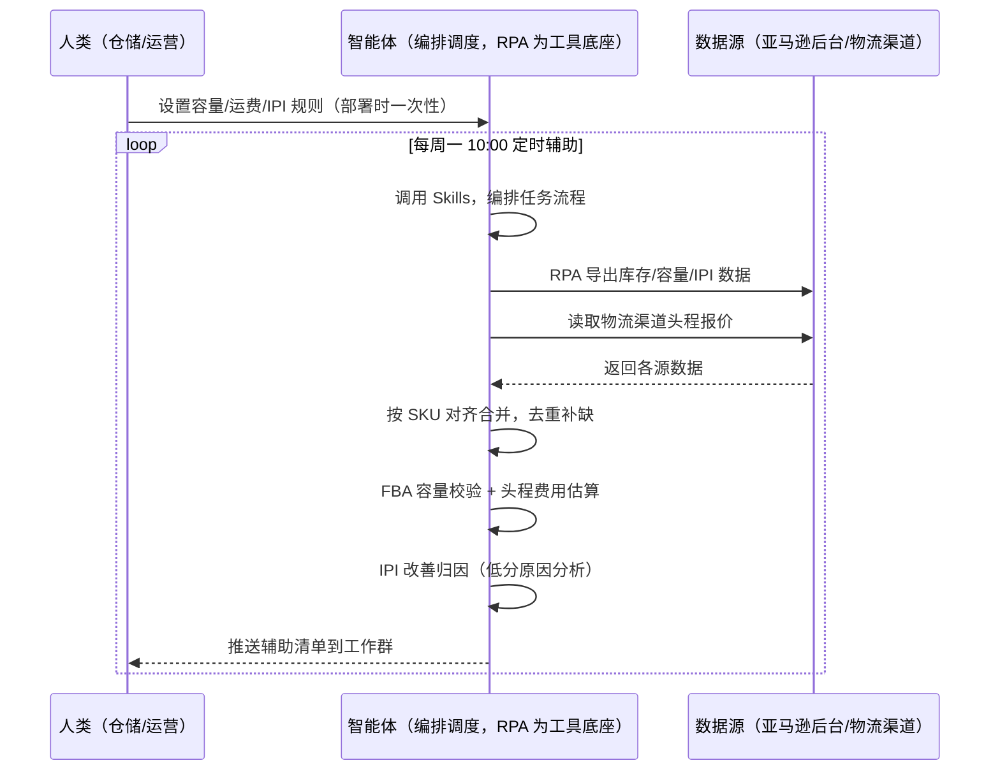
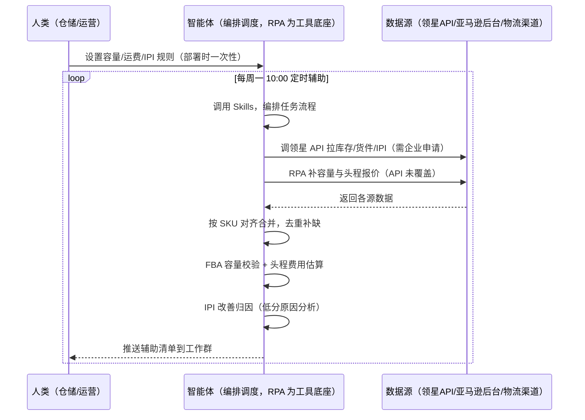

> 为亚马逊卖家团队，由智能体调度多工具的 FBA 入库与库存绩效衔接方案。该场景主体能力由领星/ERP 承担（补货建议、货件创建、库存绩效监控、仓储费核算），本方案定位为衔接层——补领星未覆盖的跨系统部分（FBA 容量校验、头程费用估算、IPI 改善归因）。货件创建与发货由人工/仓库完成。

> Agent 自动化需开通企业功能
> 点击申请1个月免费权限
> [点击申请 →](https://skieer.feishu.cn/share/base/form/shrcnFwMayykP5iaL38fnZKTbrg)

## 一、用户与需求

核心矛盾：发货量靠手工估算，确认仓库容量、算运费、做发货计划费时；IPI 分数低也不知道为什么——补多了压库存被收仓储费，补少了断货丢 Buy Box。两类客户痛点同源，数据来源不同：

- 未购 SaaS 客户（新卖家/小团队）：人工估发货量、逐个仓库看容量、手工比头程报价、定期查 IPI，全靠手；
- 已购 SaaS 客户（领星 ERP）：领星有补货建议、货件管理与库存绩效监控（库存/库龄/预警），但 FBA 容量校验、头程费用估算、IPI 改善归因仍要人做。

适用客户：SKU 多、FBA 仓多的卖家。已购领星客户建议用本衔接方案（领星已覆盖主体）；未购领星客户可先评估是否值得购买 ERP 或保留人工流程（本方案单独价值有限）。

### 1.1 不同模式卖家

| 类型 | 选择 | 建议 |
|-|-|-|
| 品牌 | 首选 | 强烈推荐（SKU 多、FBA 仓多，补货与绩效管理频次高） |
| 精铺 | 次选 | 一般推荐，聚焦主力 SKU 的补货计划 |
| 铺货 | 任意 | 不推荐，SKU 太多逐个算不划算 |

### 1.2 不同类目卖家

| 类目 | 最关注维度 | 核心逻辑 |
|-|-|-|
| 3C 数码 | 周转+断货 | 参数件迭代快，补多了压库存 |
| 家居家具 | 容量+运费 | 大件占仓大、运费高，容量与费用是重点 |
| 美妆个护 | 合规入库 | 批次与合规要求高，货件创建要准 |
| 服装鞋帽 | 上新备货 | 款式迭代快，备货窗口要抢 |
| 户外运动 | 旺季备货 | 功能件季节性明显，旺季前补足 |
| 母婴用品 | 安全库存 | 安全类目断货影响大，安全天数要足 |

### 1.3 不同角色用户

| 用户 | 需求 | 问题 | 投入时间（估算） |
|-|-|-|-|
| 老板 | 不压库存不断货 | 补货凭经验，说不清依据 | 0.5 小时/周 |
| 仓储/运营 | FBA 发货计划 | 手算补货量、比运费费时 | 1-2 小时/周 |
| 财务 | 头程费用可控 | 运费异常无感知 | 0.5 小时/周 |

---

## 二、现在的方法与问题

### 2.1 流程步骤与问题总结

人工方式（未购 SaaS 客户）

| 序号 | 步骤 | 现在的方法 | 问题缺陷 |
|-|-|-|-|
| 1 | 估发货量 | 凭经验估每个 SKU 发多少 | 无公式，多补压库存少补断货 |
| 2 | 查容量 | 逐个仓库看容量 | 容量不够才发现，改分仓费时 |
| 3 | 算运费 | 手工比头程报价 | 费用估算费时，异常波动无感知 |
| 4 | 建货件 | 手动创建货件 | 逐个操作费时易错 |
| 5 | 看 IPI | 定期查绩效分数 | 低分原因靠猜，改善无优先级 |

SaaS 方式（已购领星 ERP 客户）

| 序号 | 步骤 | 现在的方法 | 问题缺陷 |
|-|-|-|-|
| 1 | 估发货量 | 领星补货建议（自动） | 已覆盖主体 |
| 2 | 查容量 | 领星货件管理 | FBA 容量实时校验靠人 |
| 3 | 算运费 | 人工比价 | 头程费用估算靠人 |
| 4 | 建货件 | 领星货件创建 | 已覆盖 |
| 5 | 看 IPI | 领星库存绩效监控 | IPI 改善归因靠人 |

### 2.2 问题分析

人工方式根因

| 序号 | 根因 | 具体表现 |
|-|-|-|
| 1 | 补货凭经验 | 无公式，多补压库存少补断货 |
| 2 | 容量无感知 | 容量不够才发现，改分仓费时 |
| 3 | 运费估算粗 | 头程费用异常波动无感知 |
| 4 | IPI 归因靠猜 | 低分原因说不清 |

SaaS 方式根因

| 序号 | 根因 | 具体表现 |
|-|-|-|
| 1 | 主体已覆盖 | 领星补货建议/货件/库存绩效成熟，无需重复建设 |
| 2 | 容量与运费靠人 | FBA 容量校验、头程费用估算无自动化 |
| 3 | IPI 改善靠人 | 低分归因与改善优先级靠经验 |

---

## 三、解决方案

### 3.1 功能概述

为亚马逊卖家团队打造的 FBA 入库与库存绩效衔接方案，主体能力由领星/ERP 承担，本方案补跨系统衔接缺口。

定时触发并调度多个工具，调起八爪鱼 RPA（Agent 的工具底座，能耦合多系统、完成自动化任务执行）读取领星/ERP 库存数据，输出衔接层分析，涵盖「FBA 容量校验、头程费用估算、IPI 改善归因」。货件创建与发货由人工/仓库完成，本方案只做辅助。

### 3.2 系统结合

| 要素 | 说明 |
|-|-|
| 客户现有工具盘点 | 未购 SaaS 客户：无第三方工具，补货全靠人工。   已购 SaaS 客户（主流组合）：领星 ERP（补货建议、货件管理、库存绩效监控，开放 API 需企业申请） |
| 数据/能力来源 | 未购 SaaS：亚马逊后台（库存/容量/IPI，官方报表导出）+ 物流渠道（头程报价）。   已购 SaaS：领星开放 API（库存/货件/IPI 数据，需企业申请权限）+ RPA 补容量与运费（API 未覆盖） |
| RPA 耦合动作 | 作为 Agent 的工具底座，按计划调度多数据源取数（API 优先 + 后台导出兜底），按 SKU 对齐去重合并，统一流转给智能体分析；   任一数据源失败自动重试、异常告警 |
| 耦合出的新价值 | 衔接增量：领星管好补货与绩效主体，本方案补「FBA 容量校验 → 头程费用估算 → IPI 改善归因」，免去人工逐个查容量比运费 |

### 3.3 智能体执行流程

智能体定时触发。支持两种数据通道，部署时按客户现有工具选择：

通道一：无 SaaS 方式（RPA 导出后台数据，适合未购领星的客户，价值有限）

通道二：有 SaaS 方式（领星 API 拿库存核心，RPA 补容量运费，适合已购客户）

> Agent 自动化需开通企业功能
> 点击申请1个月免费权限
> [点击申请 →](https://skieer.feishu.cn/share/base/form/shrcnFwMayykP5iaL38fnZKTbrg)

### 3.4 为何这么设计

要同时回答三个问题：为什么主体归领星/ERP？为什么不能只用 SaaS/API？为什么不能纯靠智能体写代码？ 本场景的核心是"补货与绩效主体已由领星解决，本方案只做跨系统衔接增量"。

#### 1）逐项对比

| 对比维度 | SaaS/API 堆叠（领星） | 纯智能体（智能体写代码） | 智能体+自动化工具（RPA 工具底座） |
|-|-|-|-|
| 实现方式 | 领星补货/货件/绩效（主体） | 能调 API 能抓后台，数据可自拼，但全要自己接 | 衔接领星为主，补容量/运费/IPI 归因 |
| 多系统耦合 | 领星单系统，容量运费不覆盖 | 全自建：API 鉴权、采集、对齐逻辑 | 平台沉淀多源取数与对齐，可视化配置 |
| 主体价值 | 已覆盖（补货建议+货件+绩效） | 重复建设领星已有能力，无增量 | 不重复建设，只做衔接增量 |
| 使用成本（总拥有成本） | 领星 500-1500/月（主体） | 代理 IP + 服务器 + 开发维护人力，隐性成本高 | 一份平台订阅跑多流程，衔接增量边际成本 ≈ 0 |
| 维护人要求 | 低（工具已成熟） | 规则调整都要开发介入 | 可视化流程，仓储自己可调规则、阈值 |

#### 2）优劣势说明

|  | SaaS/API 堆叠（领星） | 纯智能体（智能体写代码） | 智能体+自动化工具（RPA 工具底座） |
|-|-|-|-|
| 优势 | 补货/货件/绩效成熟（主体已解决） | 无订阅费；可深度定制补货模型 | 衔接层即开即用；容量/运费/IPI 归因补缺口；非技术人员可维护 |
| 劣势 | 容量运费靠人；IPI 归因靠猜 | 重复建设领星已有能力；AI 生成代码是生成性的 | 本地电脑运行需保持开机；订阅费；灵活性受平台模板边界限制 |

#### 3）结论

| 论点 | 说明 |
|-|-|
| 主体归领星 | 补货建议、货件管理、库存绩效是领星成熟能力，不重复建设——本方案明确让位，只做衔接 |
| 衔接增量在哪 | FBA 容量校验、头程费用估算、IPI 改善归因是领星未覆盖的跨系统部分 |
| 纯智能体缺"工程底座" | 数据取数与对齐 70% 的工作在工程（导出/对齐/调度/重试）；RPA 作为工具底座把这 70% 已经造好 |
| 一个底座跑多流程 | 客户购买 RPA 平台是跑多个流程，本衔接方案只是其中一个——平台订阅费被多流程摊薄 |
| 时间 | 仓储要的是"容量运费自动算、IPI 归因自动出"，不是"重复造领星的轮子" |

### 3.5 功能清单

| 功能 | 系统 | 功能说明（解决问题） |
|-|-|-|
| 会话/定时 | 智能体 | 1. 理解人类语言，调用已预设好的 Skills。2. 编排多任务、调度多工具。 |
| 多系统数据取数 | RPA、指纹浏览器 | 1. 解决容量无感知、运费估算粗问题。2. 作为智能体工具底座被调度执行，导出失败自动重试并告警。3. 【无 SaaS 方式】 RPA 导出后台库存/容量/IPI + 读取头程报价。【有 SaaS 方式】 调领星 API 拉库存/货件/IPI（需企业申请）+ RPA 补容量运费。 |
| 数据清洗对齐 | 智能体 | 按 SKU 对齐去重，解决多来源口径不一致问题。 |
| FBA 容量校验 | 智能体 | 校验各仓剩余容量 vs 计划发货量，容量不足预警。 |
| 头程费用估算 | 智能体 | 按重量/渠道估算头程费用，异常波动标注（估算，附方法）。 |
| IPI 改善归因 | 智能体 | IPI 低分原因分析（冗余库存/周转/断货），按贡献度排序。 |
| IM通知 | 飞书、钉钉、企微等 | 解决容量与费用异常无感知问题。容量预警、费用异常自动推送。 |
| 数据资产储存 | 本地电脑、云储存 | 1. Skills 资产：容量/运费/IPI 规则。2. 数据储存：辅助记录统一写入本地，可审计。3. 经验知识库：IPI 改善案例持续沉淀。 |

### 3.6 智能体执行落地过程

部署时一次性配置入参（容量/运费/IPI 规则、推送群、数据通道），会话中无需重复输入。

⚠️ 部署前提（不满足则方案无法跑起来）：①RPA 需部署在常开电脑/云机上，并配置漏跑补跑机制；②有 SaaS 方式需领星企业客户申请开放 API 权限（未开通自动降级为无 SaaS 通道，走后台导出）；③货件创建与发货由人工/仓库完成，本方案只做辅助；④首次配置（API 鉴权、对齐规则、估算规则）需服务方/技术人员介入一次，属实施成本。

#### 1）配置

| 类别 | 说明 |
|-|-|
| 智能体 | 主流智能体。 |
| 智能体工具 | 1. 数据通道（按客户现有工具二选一）：【无 SaaS】亚马逊后台导出 + 物流渠道报价；【有 SaaS】领星开放 API（需企业申请）+ RPA 补容量运费。   2. 数据取数与自动化执行：八爪鱼 RPA，MCP 配置完成。   3. 数据分析：智能体自带。   4. IM：企业办公 IM（飞书/钉钉/企微），MCP 或 webhook 配置。 |
| 工作知识 | 1. FBA 仓库清单与容量基线。   2. 头程报价表（重量/渠道）。   3. IPI 构成：冗余库存/周转/断货。   4. 补货建议：以领星为主（辅助参考）。 |
| 本地数据库 | 1. 容量运费记录地址。   2. IPI 记录地址。   3. 经验库地址。 |

#### 2）执行

| 任务 | 产出 | 产出物接收人 |
|-|-|-|
| 接收仓库清单，定时触发 | 任务启动记录 | —— |
| 调用已预设 Skills，编排任务流程 | 任务编排方案 | —— |
| 经 MCP 向八爪鱼 RPA 下发取数任务 | 自动化任务指令 | —— |
| 多源取数并按 SKU 对齐（无 SaaS：后台导出；有 SaaS：领星 API+后台，智能体监控状态） | 对齐后库存数据 | —— |
| FBA 容量校验 | 容量预警 | 仓储 |
| 头程费用估算（异常标注） | 费用估算 | 财务 |
| IPI 改善归因 | 归因报告 | 运营 |
| 推送辅助清单 | 群消息 | 仓储/财务/老板 |

异常处理：

导出失败 → 自动重试并告警；

容量数据缺失 → 标注待补；

运费为估算值 → 标注估算方法；

IPI 归因置信度低 → 转人工判断；

置信度 &lt;70% → 转人工复核，不输出硬结论。

#### 3）结果

| 结果 | 说明 |
|-|-|
| 数据资产 | 容量/运费/IPI 结构化数据（SKU/容量/费用/归因），可审计。 |
| 分析报告 | 1. 容量预警：剩余容量 vs 计划发货量。   2. 头程费用估算：按 SKU 估算 + 异常标注。   3. IPI 归因报告：低分原因按贡献度排序。 |
| Skills | 智能体 Skills：容量/运费/IPI 规则。 |

> Agent 自动化需开通企业功能
> 点击申请1个月免费权限
> [点击申请 →](https://skieer.feishu.cn/share/base/form/shrcnFwMayykP5iaL38fnZKTbrg)

---

## 四、使用前后预估

> 本方案价值 = 衔接层增量（容量校验 + 运费估算 + IPI 归因）。主体（补货/货件/绩效）由领星/ERP 承担，本方案不替代。未购领星客户单独价值有限，建议先评估是否购买 ERP。

| 指标 | 人工 | SaaS/API（领星） | 智能体+自动化工具（衔接层） |
|-|-|-|-|
| 补货建议 | 凭经验 | 领星智能补货 | 不重复建设 |
| 货件创建 | 手动 | 领星货件管理 | 人工/仓库完成 |
| 容量校验 | 逐个查 | 靠人 | 自动校验预警 |
| 头程费用 | 估算粗 | 靠人 | 自动估算 + 异常标注 |
| IPI 归因 | 靠猜 | 领星有分数，归因靠人 | 自动归因排序 |
| 方法论 | 无 | 领星规则（单系统） | 可复用的 Skills 与规则库 |

说明：本方案为衔接层，主体能力（补货建议/货件管理/库存绩效）由领星/ERP 承担；已购领星客户价值集中在容量校验、运费估算与 IPI 归因；未购客户建议先评估 ERP，本方案单独价值有限。

---

## 五、效果证明

> Agent 自动化需开通企业功能
> 点击申请1个月免费权限
> [点击申请 →](https://skieer.feishu.cn/share/base/form/shrcnFwMayykP5iaL38fnZKTbrg)

### 5.1 客户案例

**《小天鹅：7 平台 16 账号库存数据自动化，年省成本 50 万》**

> 美的集团旗下小天鹅事业部，7 个电商平台、16 个账号、每日 86 张报表原需专员逐个登录导出 7 小时/天。八爪鱼 RPA 替代全部人工采集，7 大系统、25 类报表自动采集入库。

| 效果 | 说明 |
|-|-|
| 提效 | 多平台报表采集效率提升约 85%。原本 7 个平台 16 个账号、86 张报表需逐个登录导出，每天耗 7 小时，现在全自动采集入库；数据时效由 T+2 提升至 T+1，部分平台已 T+0。 |
| 降本 | 减少数据专员 2 人（原文：2 名全职数据专员的「搬数据」工作被完全替代，年节省人力成本 50 万元）。原本需 2 人全职导表，现在 0 人；2 名专员转岗至数据分析岗，投入库存分析、周转率优化、滞销品预警等高价值工作。 |
| 任务 | 7 个电商平台 16 个账号、25 类报表自动采集入库；错误率降至 0.1%。 |
| 任务 | 天猫指纹浏览器、苏宁每 2 小时定时抓取、京东按事业部隔离账号，多平台差异化策略稳定运行。 |

案例详情：[小天鹅：百亿级洗衣机巨头的多平台库存数据自动化实践](https://skieer.feishu.cn/wiki/Q6Qjw2FtDiNFgWkOVHacEFJ0nlh)

**《唯世美：家具大件补货全流程自动化》**

> 首款内置 RGB 灯光展示柜上架两个月即拿下 Amazon 美加英德四站与 Walmart、Temu 美站 Best Seller。为应对数据源分散、人工操作耗时与 SKU 管理混乱，实现补货判断全流程自动化。

| 效果 | 说明 |
|-|-|
| 提效 | 补货整理重复工作量下降 80%。原本需人工从领星 ERP 与各海外仓平台逐项导出库存、库龄数据再手工清洗匹配 SKU，现在自动抓取、自动清洗，输出补货建议。 |
| 降本 | 免除人工导表与拼表的重复投入，供应链团队投入转向库存结构优化与周转率提升等重点工作。 |
| 任务 | 库存数据抓取与处理准确率达 99% 以上，分散数据源实时同步。 |
| 任务 | 自有 Excel 模板逻辑零改动保留，补货计算口径与原有习惯一致。 |

案例详情：[家具大件补货：补货全流程自动化，整理数据重复工作量下降 80%](https://skieer.feishu.cn/wiki/Gca3w8j1KixDXjkz0oScFwHAngf)

---

## 六、备注

### 6.1 Agent 支持

本方案不绑定具体智能体，主流 Agent 均可运行（需支持技能/Skills 加载与工具调用）：

| Agent/智能体 | 说明 |
|-|-|
| Workbuddy | 本方案运行平台，支持技能/Skills 上传加载、定时任务、MCP 工具调用与表格/报告处理 |
| 豆包（国内·字节） | 国内主流个人智能体，支持技能上传、定时任务与工具调用，上手成本低 |
| 通义千问（国内·阿里） | 支持 Agent 编排与插件生态，集成阿里电商数据能力，适合电商场景 |
| DeepSeek（国内） | 推理能力强、成本低，适合规则打分与归因分析类任务 |
| ChatGPT（国外·OpenAI） | 海外主流通用智能体，支持 GPTs/Agent 模式与工具调用 |
| Claude（国外·Anthropic） | 长文本与结构化分析能力强，原生支持 MCP 连接外部工具 |

### 6.2 名词解释

| 术语 | 说明 |
|-|-|
| 衔接层 | 主体能力由领星/ERP 承担，本方案只做跨系统衔接增量（容量/运费/IPI 归因） |
| FBA 容量 | 各 FBA 仓剩余容量，校验 vs 计划发货量 |
| 头程费用 | 按重量/渠道估算的头程物流费用（估算，附方法） |
| IPI | Inventory Performance Index，库存绩效指数（冗余/周转/断货） |
| 货件管理 | FBA 货件创建与跟踪（领星主体） |
| 混合数据源 | 官方导出/API 优先（更稳更合规）+ 页面采集兜底（免费、覆盖无 SaaS 客户与 API 缺口） |
| 有 SaaS 方式 | 已购领星，开放 API 拿库存核心 + RPA 补容量运费（需企业申请权限） |
| 无 SaaS 方式 | 不购买第三方工具，由 RPA 导出后台数据 |
| ERP | Enterprise Resource Planning，企业资源计划系统 |
| MCP | Model Context Protocol，智能体连接外部工具的标准化通道 |

> Agent 自动化需开通企业功能
> 点击申请1个月免费权限
> [点击申请 →](https://skieer.feishu.cn/share/base/form/shrcnFwMayykP5iaL38fnZKTbrg)

---

原文：[查看原文](https://skieer.feishu.cn/wiki/N8K4wTNidiv58tkR0IFcuVglnEf)
