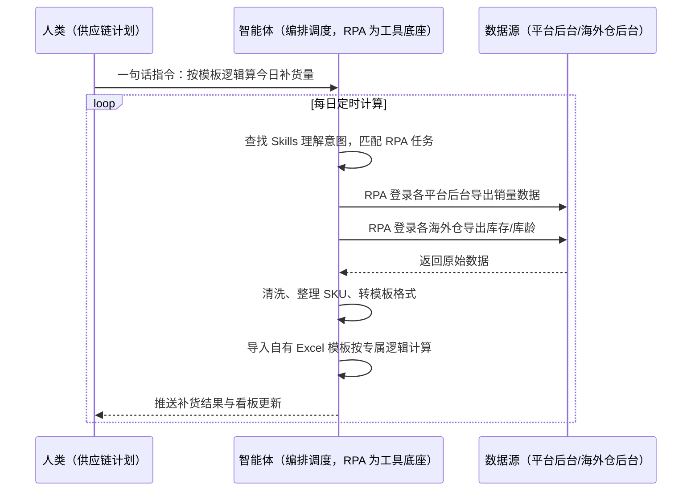
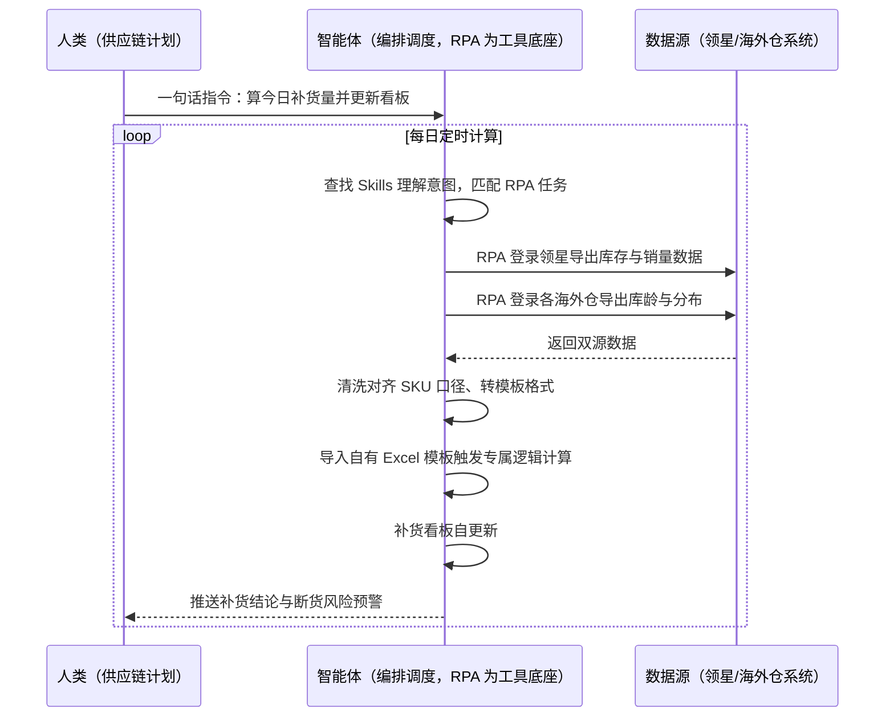

> 为跨境大件/多仓卖家打造的补货量自动计算方案。卖家与多国海外仓合作，库存与库龄数据分散在领星 ERP 和各家海外仓平台，每天要人工从多个系统抓数、清洗、粘贴进自有的 Excel 模板才能算出当日补货量，重复工作量占供应链团队大部分精力。本方案由智能体调度多个工具执行多系统数据自动抓取（领星 ERP+多家海外仓）+ 清洗整理成模板格式 + 自动导入自有 Excel 模板计算，输出每日补货结果与自更新看板。定时自动执行，全程自动化，无异常不打扰。

> Agent 自动化需开通企业功能
> 点击申请1个月免费权限
> [点击申请 →](https://skieer.feishu.cn/share/base/form/shrcnFwMayykP5iaL38fnZKTbrg)

## 一、用户与需求

核心矛盾：

- 数据源分散：库存、库龄数据散在领星 ERP 与多家海外仓平台，人工逐个登录抓取（案例口径：多家海外仓 + 领星双线取数）
- 通用补货建议不合业务逻辑：ERP 的通用建议与卖家自有补货逻辑不同，不能直接用
- 每日计算依赖人工搬数：抓取、清洗、整理成模板格式、导入计算，重复工作量极大（案例口径：重复工作量下降 80%）
- SKU 管理混乱：各系统 SKU 口径不一，对不上就算错补货量，易断货或压货

适用客户：补货逻辑有自定义需求的多仓跨境卖家（供应链/采购/计划岗）。已购领星 ERP 的客户把 ERP 数据与海外仓数据自动拉通；未购 ERP 的客户从平台后台与海外仓后台直接取数；部署后业务人员不需要写代码，一句话下达指令即可执行。

### 1.1 不同模式卖家

| 类型 | 选择 | 建议 |
|-|-|-|
| 品牌卖家 | 首选 | 强烈推荐（补货逻辑复杂，自有模型是核心竞争力） |
| 精铺卖家 | 首选 | 强烈推荐（多仓多 SKU，人工算不过来） |
| 铺货型 | 次选 | 一般推荐（只对重点 SKU 做补货计算） |

### 1.2 不同类目卖家

| 类目 | 最关注维度 | 核心逻辑 |
|-|-|-|
| 家居家具 | 补货周期与单位资金 | 大件补货周期长、单件资金高，算错代价大（案例口径：家具大件） |
| 3C 数码 | 日均销与安全天数 | 周转快，按日均销动态推补货天数 |
| 服装鞋帽 | 季节系数 | 换季前加大系数、季末清零，逻辑要可配置 |
| 小家电 | 多仓分布 | 各国仓分别算，跨仓调拨优先于新补 |
| 户外运动 | 旺季峰值 | 大促前按峰值备货，看板要能切换口径 |
| 汽配 | 长尾分层 | 头部 SKU 精算、长尾按批次粗算 |

### 1.3 不同角色用户

| 用户 | 需求 | 问题 | 投入时间（估算） |
|-|-|-|-|
| 供应链计划 | 每日补货量 | 手工抓数算量 | 1-2 小时/天 |
| 采购负责人 | 采购计划依据 | 数据滞后对不上 | 每日核对 1 小时 |
| 老板 | 库存周转健康 | 月底才看结论 | 每周复盘 1 小时 |

---

## 二、现在的方法与问题

### 2.1 流程步骤与问题总结

**人工方式（未购 ERP 客户）**

| 序号 | 步骤 | 现在的方法 | 问题缺陷 |
|-|-|-|-|
| 1 | 取库存数据 | 逐家海外仓后台人工导出 | 多家系统来回切 |
| 2 | 取销量数据 | 平台后台逐个导出 | 账号多耗时长 |
| 3 | 清洗整理 | 人工调格式对 SKU | 口径不一易错 |
| 4 | 粘贴模板 | 复制进 Excel 模板 | 机械重复 |
| 5 | 计算补货量 | 模板公式算 | 数据错了全错 |

**ERP/SaaS 方式（已购领星 ERP 客户）**

| 序号 | 步骤 | 现在的方法 | 问题缺陷 |
|-|-|-|-|
| 1 | 看领星补货建议 | 用 ERP 通用建议 | 与自有补货逻辑不一致（案例口径） |
| 2 | 取海外仓数据 | 逐家海外仓后台导出 | ERP 覆盖不到海外仓库龄 |
| 3 | 清洗对齐 | 人工整理 SKU 口径 | 费时易错 |
| 4 | 导入自有模板 | 粘贴进 Excel 按专属逻辑算 | 每天重复搬数 |
| 5 | 人工复核 | 凭经验抽查 | 无系统校验 |

### 2.2 问题分析

**人工方式根因**

| 序号 | 根因 | 具体表现 |
|-|-|-|
| 1 | 多系统取数 | 各海外仓平台独立，人工逐个登录 |
| 2 | 格式清洗靠人 | SKU 口径不一，人工对齐易错 |
| 3 | 每天重复 | 抓数—清洗—粘贴循环，无沉淀 |

**ERP/SaaS 方式根因**

| 序号 | 根因 | 具体表现 |
|-|-|-|
| 1 | 通用逻辑不合身 | 领星补货建议是通用口径，大件卖家的补货逻辑不同（案例口径） |
| 2 | 数据覆盖不全 | 海外仓库龄等数据 ERP 覆盖不到，仍要人工补 |
| 3 | 模板依赖人工 | 自有 Excel 模板好用，但每天喂数据是机械活 |

---

## 三、解决方案

### 3.1 功能概述

为跨境多仓卖家打造的补货量自动计算方案，一句话调度多系统数据自动抓取 + 清洗成模板格式 + 导入自有 Excel 模板按专属逻辑计算，输出每日补货结果与自更新看板。

一句话下达指令（如「算一下今天的补货量，按我们的模板逻辑」），智能体通过查找 Skills 文档库理解意图、匹配 N 个 RPA 自动化任务（领星取数→海外仓取数→清洗整理→模板导入），经 MCP 调度八爪鱼 RPA 自动登录领星 ERP 及各家海外仓系统，导出库存、库龄等数据，对原始数据清洗、整理 SKU、转化为符合模板要求的格式，将处理后数据导入自有 Excel 模板，按专属逻辑算出每日需补货数量，并更新补货看板。全程自动化，运行状态实时反馈，跑完推送结果。

### 3.2 系统结合

| 要素 | 说明 |
|-|-|
| 客户现有工具盘点 | **未购 ERP 客户**：无统一系统，数据散在各平台与海外仓后台。       **已购 ERP 客户**（主流）：领星 ERP（库存与自身进销存，开放 API 需企业客户申请权限）+ 各国海外仓平台（无忧达/中运/乐歌等，各家后台独立）+ 自有 Excel 补货模板（专属补货逻辑沉淀处） |
| 数据/能力来源 | **无 ERP**：平台后台与海外仓后台报表导出。       **有 ERP**：领星 API/后台取库存与销量 + 海外仓后台取库龄与分布 + 自有 Excel 模板承载专属计算逻辑 |
| RPA 耦合动作 | 作为 Agent 的工具底座被调度执行：自动登录领星与多家海外仓系统导出数据、清洗整理 SKU、转化为模板格式、导入自有 Excel 模板触发计算、结果回传智能体更新看板 |
| 耦合出的新价值 | 单系统给不了的端到端结论：多系统数据自动进入自有逻辑模板，每日补货量自动算出、看板自更新，**只推送补货结论与断货风险预警** |

### 3.3 智能体执行流程

一句话下达指令，智能体自动调度。支持**两种数据通道**，部署时按客户现有工具选择：

**通道一：无 ERP 方式（平台后台+海外仓后台导出）**

**通道二：有 ERP 方式（领星+海外仓系统，适合已购 ERP 客户）**

> Agent 自动化需开通企业功能
> 点击申请1个月免费权限
> [点击申请 →](https://skieer.feishu.cn/share/base/form/shrcnFwMayykP5iaL38fnZKTbrg)

### 3.4 为何这么设计

要同时回答三个问题：**为什么不能只用纯代码 Agent？为什么不能只用纯 RPA？为什么两者要结合？** 本场景的核心是"多系统取数稳定、自有逻辑模板复用、计算结果可信"。

#### 1）逐项对比

| 对比维度 | SaaS/API 堆叠（领星+海外仓系统） | 纯智能体（智能体写代码） | 智能体+自动化工具（RPA 工具底座） |
|-|-|-|-|
| 实现方式 | 通用补货建议，逻辑不合身 | 能重写计算逻辑，但取数全自建 | 自有模板逻辑保留，取数自动化 |
| 多系统登录与取数 | 领星覆盖自身，海外仓人工导 | 多系统登录保活全自建 | 一个底座拉通领星+多家海外仓 |
| 自有逻辑复用 | 不支持，只能用系统口径 | 逻辑要翻译成代码，易走样 | Excel 模板原生保留，原逻辑原结果 |
| 使用成本（总拥有成本） | ERP 企业版订阅 + 海外仓系统费 | 开发维护人力，隐性成本高 | 一份平台订阅跑多流程，单方案边际成本 ≈ 0 |
| 数据准确性 | 口径统一但覆盖不全 | 依赖代码正确性 | 案例口径：抓取与处理准确率 99%+ |
| 维护人要求 | 低（系统现成） | 规则调整都要开发介入 | 可视化流程+模板可改，计划岗自己维护 |

#### 2）优劣势说明

|  | SaaS/API 堆叠（领星+海外仓系统） | 纯智能体（智能体写代码） | 智能体+自动化工具（RPA 工具底座） |
|-|-|-|-|
| 优势 | 数据口径权威；       系统现成 | 无订阅费；       逻辑可完全定制 | 自有模板逻辑零改动；       多系统取数全自动；       计划岗可自行维护 |
| 劣势 | 通用补货建议不合自有逻辑（案例口径）；       海外仓数据覆盖不到 | 模板逻辑翻译成代码易走样；       AI 生成代码是生成性的 | 本地电脑运行需保持开机；       有 ERP 方式仍需系统订阅；       模板格式变更需同步调整流程 |

**特别提醒**：自有 Excel 模板的表头与格式需保持稳定，模板改版时流程需同步调整一次；海外仓账号登录态需维护，失效自动告警。

#### 3）结论

| 论点 | 说明 |
|-|-|
| 确定性 vs 生成性 | 取数与导入是确定性任务，RPA 行为可预期；把补货逻辑交给生成性代码重写，风险大于收益 |
| 自有逻辑资产 | 卖家多年沉淀的补货模板是最值钱的 know-how，方案让模板原样跑起来而不是替代它 |
| 一个底座跑多流程 | 客户购买 RPA 平台是跑多个流程（补货/库存/报表/对账），本方案只是其中一个，订阅费被摊薄 |
| token 消耗极低 | 补货计算在 Excel 模板内完成，采集清洗不调用大模型；仅结论推送消耗少量 token |
| 数据拉通 | 领星+多家海外仓一次取齐，SKU 口径自动对齐 |
| 时间 | 计划岗要的是"每天打开就是算好的补货量"，不是"先抓两小时数再算" |

### 3.5 功能清单

| 功能 | 系统 | 功能说明（解决问题） |
|-|-|-|
| 会话/一句话指令 | 智能体 | 1. 理解自然语言意图，查找 Skills 文档库。       2. 匹配对应 RPA 自动化任务、编排多任务。 |
| 多系统数据取数 | RPA、指纹浏览器 | 1. 解决多系统人工抓数问题。       2. 作为智能体工具底座被调度执行，失败重试、断点续跑。       3. **【无 ERP 方式】** 登录平台与海外仓后台导出销量/库存/库龄。**【有 ERP 方式】** 登录领星 ERP 及海外仓系统（无忧达/中运/乐歌等）导出库存库龄数据。 |
| 数据清洗整理 | 智能体 | 清洗原始数据、整理 SKU、转化为符合自有 Excel 模板要求的格式，解决口径不一问题。 |
| 模板导入与计算 | RPA、Excel 模板 | 处理后数据导入自有模板，按专属逻辑计算每日补货量，解决人工粘贴机械活问题。 |
| 补货看板 | 数据库、BI | 补货看板自更新，断货风险预警自动推送。 |
| IM通知 | 飞书、钉钉、企微等 | 解决结果交付滞后问题，补货结论与风险即时推送。 |
| 数据资产储存 | 本地电脑、云储存 | 1. Skills 资产：补货计算技能。       2. 数据储存：补货结果库统一写入本地。       3. 经验知识库：补货逻辑迭代记录回填。 |

### 3.6 智能体执行落地过程

部署时一次性配置入参（系统账号清单、海外仓清单、模板路径、计算频率），会话中一句话即可触发，无需重复输入。

**⚠️ 部署前提（不满足则方案无法跑起来）**：①RPA 需部署在**常开电脑/云机**上，并配置漏跑补跑机制；②领星与各海外仓**登录态**需维护，登录失效自动告警；③自有 Excel 补货模板需可被程序读写且表头稳定；④数据库/看板数据源提前就绪；⑤首次配置（账号、SKU 映射、模板对接）需服务方/技术人员介入一次，属实施成本。

#### 1）配置（五步）

| 步骤 | 操作 | 说明 |
|-|-|-|
| 第一步 | 下载八爪鱼 RPA，导入跨境电商自动化模板 | 官网免费下载客户端；MCP 工具→添加应用 |
| 第二步 | 开启八爪鱼 RPA 的 MCP 服务端口 | 客户端→API-K→创建 API（名称自定义） |
| 第三步 | 在智能体中添加 MCP Server 连接 | 复制连接配置→智能体连接器→自定义连接器→配置 MCP→粘贴保存 |
| 第四步 | 验证工具列表 | 确认工具全部启用（即八爪鱼客户端内工具） |
| 第五步 | 测试运行效果 | 输入一句话指令，验证取数—模板计算—看板更新全链路 |

| 类别 | 说明 |
|-|-|
| 智能体 | 主流智能体（支持 MCP 连接、Skills 加载、定时任务）。 |
| 智能体工具 | 1. **数据通道（按客户现有工具二选一）**：【无 ERP】平台+海外仓后台导出；【有 ERP】领星+海外仓系统取数。       2. 数据取数与自动化执行：八爪鱼 RPA（MCP 协议接入）。       3. 数据分析：智能体自带。       4. IM：企业办公 IM（飞书/钉钉/企微），MCP 或 webhook 配置。 |
| 工作知识 | 1. 系统与海外仓账号清单。       2. SKU 口径映射表。       3. 自有模板路径与格式约定。       4. 计算频率与推送规则。 |
| 本地数据库 | 1. 原始数据库地址。       2. 补货结果库地址。       3. 看板数据源地址。 |

#### 2）执行

| 任务 | 产出 | 产出物接收人 |
|-|-|-|
| 接收一句话指令，匹配 RPA 任务 | 任务启动记录 | —— |
| 调用已预设 Skills，编排任务流程 | 任务编排方案 | —— |
| 经 MCP 向八爪鱼 RPA 下发取数任务 | 自动化任务指令 | —— |
| 登录领星与各海外仓导出数据（智能体监控状态） | 原始数据 | —— |
| 清洗、整理 SKU、转模板格式 | 模板格式数据 | —— |
| 导入自有 Excel 模板计算 | 每日补货量结果 | 采购 |
| 补货看板自更新 | 看板更新 | 供应链/老板 |
| 推送补货结论与断货风险 | 群消息 | 供应链/采购 |

异常处理：

登录失效 → 自动重试 2 次，仍失败告警推 IM；

取数失败 → 跳过并记录，下一轮自动补采；

模板格式不匹配 → 停止导入并告警，转人工检查模板；

SKU 映射缺失 → 单列清单转人工补充映射，不影响其余计算。

#### 3）结果

| 结果 | 说明 |
|-|-|
| 数据资产 | 多系统库存/库龄/销量原始数据与补货结果结构化存储，可审计可追溯。 |
| 分析报告 | 每日补货量结果 + 断货风险清单 + 看板自更新。 |
| Skills | 智能体 Skills：补货计算技能，含 SKU 映射与模板对接知识。 |

> Agent 自动化需开通企业功能
> 点击申请1个月免费权限
> [点击申请 →](https://skieer.feishu.cn/share/base/form/shrcnFwMayykP5iaL38fnZKTbrg)

---

## 四、使用前后预估

> 本方案价值 = **多系统自动取数 → 自有模板自动计算 → 看板自更新**。把计划岗从每天抓数粘贴的机械活中解放出来，专注补货策略本身。

| 指标 | 人工 | SaaS/API（领星+海外仓系统） | 智能体+自动化工具 |
|-|-|-|-|
| 取数耗时 | 多系统人工导出，1-2 小时/天 | 部分系统化，海外仓仍人工 | 全自动取数，分钟级 |
| 逻辑贴合度 | 自有模板，完全贴合 | 通用建议不合自有逻辑（案例口径） | 自有模板零改动保留 |
| 数据准确性 | 人工清洗易错 | 口径统一但覆盖不全 | 案例口径：抓取与处理准确率 99%+ |
| 重复工作量 | 全程人工重复 | 每天仍要喂数据 | 案例口径：重复工作量下降 80% |
| 看板时效 | 人工更新，滞后 | 部分自动 | 自更新，每日定时出结果 |
| 方法论 | 在个人手里，换人丢 | 系统固定口径 | 模板+Skills 双资产沉淀 |

**说明**：案例数字来自八爪鱼客户实践（案例口径：唯世美家具大件，多国海外仓+领星双源取数，库存数据抓取与处理准确率 99% 以上、重复工作量下降 80%）；本方案为按同口径复刻的实施路径，具体数值随海外仓数量与 SKU 规模而异（估算）。

---

## 五、效果证明

> Agent 自动化需开通企业功能
> 点击申请1个月免费权限
> [点击申请 →](https://skieer.feishu.cn/share/base/form/shrcnFwMayykP5iaL38fnZKTbrg)

### 5.1 客户案例

**《唯世美：家具大件补货全流程自动化》**

> 首款内置 RGB 灯光展示柜上架两个月即拿下 Amazon 美加英德四站与 Walmart、Temu 美站 Best Seller。为应对数据源分散、人工操作耗时与 SKU 管理混乱，实现补货判断全流程自动化。

| 效果 | 说明 |
|-|-|
| 提效 | 补货整理重复工作量下降 80%。原本需人工从领星 ERP 与各海外仓平台逐项导出库存、库龄数据再手工清洗匹配 SKU，现在自动抓取、自动清洗，输出补货建议。 |
| 降本 | 免除人工导表与拼表的重复投入，供应链团队投入转向库存结构优化与周转率提升等重点工作。 |
| 任务 | 库存数据抓取与处理准确率达 99% 以上，分散数据源实时同步。 |
| 任务 | 自有 Excel 模板逻辑零改动保留，补货计算口径与原有习惯一致。 |

案例详情：[家具大件补货：补货全流程自动化，整理数据重复工作量下降 80%](https://skieer.feishu.cn/wiki/Gca3w8j1KixDXjkz0oScFwHAngf)

---

## 六、备注

### 6.1 Agent 支持

本方案不绑定具体智能体，主流 Agent 均可运行（需支持 MCP 连接、技能/Skills 加载与工具调用）：

| Agent/智能体 | 说明 |
|-|-|
| Workbuddy | 本方案运行平台，支持技能/Skills 上传加载、定时任务、MCP 工具调用与表格/报告处理 |
| 豆包（国内·字节） | 国内主流个人智能体，支持技能上传、定时任务与工具调用，上手成本低 |
| 通义千问（国内·阿里） | 支持 Agent 编排与插件生态，集成阿里电商数据能力，适合电商场景 |
| DeepSeek（国内） | 推理能力强、成本低，适合规则打分与归因分析类任务 |
| ChatGPT（国外·OpenAI） | 海外主流通用智能体，支持 GPTs/Agent 模式与工具调用 |
| Claude（国外·Anthropic） | 长文本与结构化分析能力强，原生支持 MCP 连接外部工具 |

### 6.2 名词解释

| 术语 | 说明 |
|-|-|
| 补货量 | 为维持目标库存需新增采购/调拨的数量，按自有逻辑计算 |
| 库龄 | 库存从入库起计的存放时长，补货计算需结合库龄判断滞销 |
| 自有 Excel 模板 | 卖家沉淀专属补货逻辑的计算模板，本方案不改动模板本身 |
| 领星 | 跨境电商 ERP，管库存与自身进销存，开放 API 需企业客户申请权限 |
| 海外仓系统 | 第三方海外仓服务商的仓储管理系统（如无忧达、中运、乐歌） |
| SKU 口径映射 | 各系统间 SKU 编码对照表，保证数据能对上 |
| 断货风险预警 | 按安全天数与在途库存推算的缺货提前量预警 |
| 补货看板 | 补货量、断货风险、库存分布的可视化面板，自动更新 |
| 指纹浏览器 | 隔离 Cookie/浏览器指纹的工具，多账号防关联 |
| MCP | Model Context Protocol，智能体连接外部工具的标准化通道 |
| 一句话指令 | 用自然语言描述任务，智能体自动翻译为自动化流程 |
| 无 ERP 方式 | 未购统一系统，平台后台与海外仓后台导出兜底 |
| 有 ERP 方式 | 已购领星等 ERP，ERP+海外仓双源取数 |
| Skills | 智能体可加载的预设技能资产，含流程与知识 |

> Agent 自动化需开通企业功能
> 点击申请1个月免费权限
> [点击申请 →](https://skieer.feishu.cn/share/base/form/shrcnFwMayykP5iaL38fnZKTbrg)

---

原文：[查看原文](https://skieer.feishu.cn/wiki/C6mowBcCUiJdsFkev5Yc2gBVnke)
