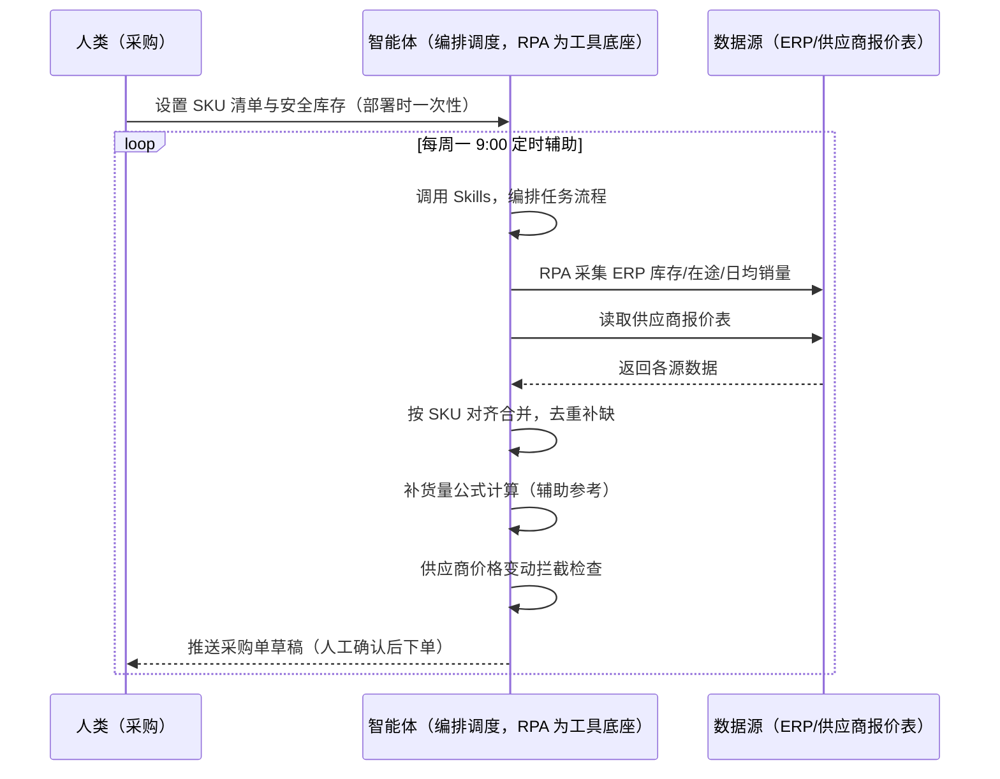
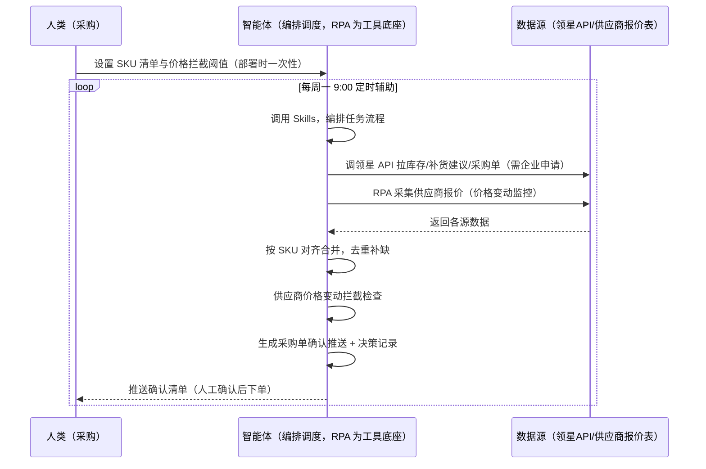

> 为亚马逊卖家团队打造的采购订单生成衔接方案。基于智能体调度多个工具，从领星/ERP 承担（库存汇总、补货建议、采购单生成），补领星未覆盖的跨系统部分（供应商价格变动拦截、采购单确认推送、历史决策沉淀）。每周定时辅助，采购单确认由人工完成。

> Agent 自动化需开通企业功能
> 点击申请1个月免费权限
> [点击申请 →](https://skieer.feishu.cn/share/base/form/shrcnFwMayykP5iaL38fnZKTbrg)

## 一、用户与需求

核心矛盾：补货量凭手工估算易不准，逐条填采购单操作繁琐，确认后手动发邮件下单慢——算少了断货，算多了积压资金，采购环节效率低且易出错。两类客户痛点同源，数据来源不同：

- 未购 SaaS 客户（新卖家/小团队）：人工登录 ERP 查库存与在途、凭经验估补货量、逐条填采购单、手动发邮件确认，全靠手；
- 已购 SaaS 客户（领星 ERP）：领星已有库存管理、补货建议与采购单功能（智能补货建议自动生成补货方案），但供应商价格变动拦截、采购单确认推送、历史决策沉淀仍要人做。

适用客户：SKU 多、补货频次高的卖家。已购领星客户建议用本衔接方案（领星已覆盖主体）；未购领星客户可先评估是否值得购买 ERP 或保留人工流程（本方案单独价值有限）。

### 1.1 不同模式卖家

| 类型 | 选择 | 建议 |
|-|-|-|
| 品牌 | 首选 | 强烈推荐（SKU 多、补货频次高，领星+衔接层组合） |
| 精铺 | 次选 | 一般推荐，聚焦主力 SKU 的采购单 |
| 铺货 | 任意 | 不推荐，SKU 太多，按需采购即可 |

### 1.2 不同类目卖家

| 类目 | 最关注维度 | 核心逻辑 |
|-|-|-|
| 3C 数码 | 补货周期 | 迭代快，补货周期短，需及时下单 |
| 家居家具 | 采购成本 | 大件金额高，补货量精确避免资金积压 |
| 美妆个护 | 效期管理 | 需考虑效期，避免过量采购过期 |
| 服装鞋帽 | 季节性需求 | 按季节销量计算，避免过季积压 |
| 户外运动 | 旺季备货 | 旺季前集中补货，需提前下单 |
| 母婴用品 | 安全库存 | 安全敏感类目，断货影响大，安全线提高 |

### 1.3 不同角色用户

| 用户 | 需求 | 问题 | 投入时间（估算） |
|-|-|-|-|
| 老板 | 采购资金合理使用 | 补货量不准，资金积压或断货 | 0.5 小时/周 |
| 采购 | 采购单草稿+确认流 | 逐条填单繁琐，手动发邮件慢 | 2-4 小时/周 |
| 运营 | 库存不断货 | 补货时机把握不准 | 1 小时/周 |

---

## 二、现在的方法与问题

### 2.1 流程步骤与问题总结

人工方式（未购 SaaS 客户）

| 序号 | 步骤 | 现在的方法 | 问题缺陷 |
|-|-|-|-|
| 1 | 看库存 | 登录 ERP 查库存与在途 | 数据分散，核对费时 |
| 2 | 估补货 | 凭经验估补货量 | 估算不准，断货或积压 |
| 3 | 填采购单 | 逐条手动填采购单 | 操作繁琐，易填错 |
| 4 | 确认 | 发邮件给采购员确认 | 手动发信，流程慢 |
| 5 | 下单 | 确认后发单给供应商 | 重复操作，效率低 |
| 6 | 跟踪 | 手动跟踪订单状态 | 无系统化跟踪，易漏 |

SaaS 方式（已购领星 ERP 客户）

| 序号 | 步骤 | 现在的方法 | 问题缺陷 |
|-|-|-|-|
| 1 | 看库存 | 领星库存汇总（自动） | 已覆盖 |
| 2 | 估补货 | 领星智能补货建议 | 已覆盖（自动生成补货方案） |
| 3 | 填采购单 | 领星采购单功能 | 已覆盖主体 |
| 4 | 确认 | 人工确认 | 确认推送、审批流需人工搭 |
| 5 | 下单 | 人工发单 | 价格变动拦截缺 |
| 6 | 跟踪 | 领星跟踪 | 历史决策沉淀靠人 |

### 2.2 问题分析

人工方式根因

| 序号 | 根因 | 具体表现 |
|-|-|-|
| 1 | 补货量凭估算 | 无统一公式，算多算少全凭经验 |
| 2 | 采购单手工填写 | 逐条操作繁琐，SKU 多时易错 |
| 3 | 下单流程慢 | 手动发邮件确认，环节多周期长 |
| 4 | 价格变动无感知 | 供应商调价不拦截，按旧价下单 |
| 5 | 经验不沉淀 | 补货规则在人脑里，换人就不一样 |

SaaS 方式根因

| 序号 | 根因 | 具体表现 |
|-|-|-|
| 1 | 主体已覆盖 | 领星补货建议与采购单成熟，无需重复建设 |
| 2 | 价格变动拦截缺 | 供应商调价超阈值无自动拦截 |
| 3 | 决策不沉淀 | 历史采购决策与议价经验在个人经验里 |

---

## 三、解决方案

### 3.1 功能概述

为亚马逊卖家团队打造的采购订单生成衔接方案，主体能力由领星/ERP 承担，本方案补跨系统衔接缺口。

定时触发并调度多个工具，调起八爪鱼 RPA（Agent 的工具底座，能耦合多系统、完成自动化任务执行）读取领星/ERP 采购数据，输出衔接层分析，涵盖「供应商价格变动拦截、采购单确认推送、历史决策沉淀」。每周定时辅助，采购单确认由人工完成。

### 3.2 系统结合

| 要素 | 说明 |
|-|-|
| 客户现有工具盘点 | 未购 SaaS 客户：无第三方工具，采购全靠 ERP/人工。已购 SaaS 客户（主流组合）：领星 ERP（库存汇总、智能补货建议、采购单功能，开放 API 需企业申请） |
| 数据/能力来源 | 未购 SaaS：ERP 库存页（现有库存/在途/日均销量，RPA 采集）+ 供应商报价表（本地维护）。  
已购 SaaS：领星开放 API（库存/补货建议/采购单数据，需企业申请权限）+ RPA 补价格监控（API 未覆盖） |
| RPA 耦合动作 | 作为 Agent 的工具底座，按计划调度多数据源取数（API 优先 + 页面采集兜底），按 SKU 对齐去重合并，统一流转给智能体分析；任一数据源失败自动重试、异常告警 |
| 耦合出的新价值 | 衔接增量：领星算好补货量与采购单，本方案补「供应商价格变动拦截 → 采购单确认推送 → 历史决策沉淀」，免去人工盯价格、手动催确认 |

### 3.3 智能体执行流程

用户向智能体输入会话（入参：SKU 清单）或智能体定时触发。支持两种数据通道，部署时按客户现有工具选择：

通道一：无 SaaS 方式（RPA 采集 ERP，适合未购领星的客户，价值有限）

通道二：有 SaaS 方式（领星 API 拿补货核心，RPA 补价格监控，适合已购客户）

### 3.4 为何这么设计

> Agent 自动化需开通企业功能
> 点击申请1个月免费权限
> [点击申请 →](https://skieer.feishu.cn/share/base/form/shrcnFwMayykP5iaL38fnZKTbrg)

要同时回答三个问题：为什么主体归领星/ERP？为什么不能只用 SaaS/API？为什么不能纯靠智能体写代码？ 本场景的核心是"补货主体已由领星解决，本方案只做跨系统衔接增量"。

#### 1）逐项对比

| 对比维度 | SaaS/API 堆叠（领星） | 纯智能体（智能体写代码） | 智能体+自动化工具（RPA 工具底座） |
|-|-|-|-|
| 实现方式 | 领星算补货、生成采购单（主体） | 能调 API 能抓页面，数据可自拼，但全要自己接 | 衔接领星为主，补价格监控与确认流 |
| 多系统耦合 | 领星单系统，价格监控不覆盖 | 全自建：API 鉴权、采集、对齐逻辑 | 平台沉淀多源取数与对齐，可视化配置 |
| 主体价值 | 已覆盖（智能补货建议+采购单） | 重复建设领星已有能力，无增量 | 不重复建设，只做衔接增量 |
| 使用成本（总拥有成本） | 领星 500-1500/月（主体） | 代理 IP + 服务器 + 开发维护人力，隐性成本高 | 一份平台订阅跑多流程，衔接增量边际成本 ≈ 0 |
| 维护人要求 | 低（工具已成熟） | 规则调整都要开发介入 | 可视化流程，采购自己可调阈值、推送群 |

#### 2）优劣势说明

|  | SaaS/API 堆叠（领星） | 纯智能体（智能体写代码） | 智能体+自动化工具（RPA 工具底座） |
|-|-|-|-|
| 优势 | 补货建议与采购单成熟（主体已解决） | 无订阅费；可深度定制补货模型 | 衔接层即开即用；价格拦截/确认推送补缺口；非技术人员可维护 |
| 劣势 | 价格监控不覆盖；确认流靠人 | 重复建设领星已有能力；AI 生成代码是生成性的 | 本地电脑运行需保持开机；订阅费；灵活性受平台模板边界限制 |

#### 3）结论

| 论点 | 说明 |
|-|-|
| 主体归领星 | 智能补货建议与采购单生成是领星成熟能力，不重复建设——本方案明确让位，只做衔接 |
| 衔接增量在哪 | 供应商价格变动拦截、采购单确认推送、历史决策沉淀是领星未覆盖的跨系统部分 |
| 纯智能体缺"工程底座" | 价格监控与跨系统对齐 70% 的工作在工程（采集/对齐/调度/重试）；RPA 作为工具底座把这 70% 已经造好 |
| 一个底座跑多流程 | 客户购买 RPA 平台是跑多个流程，本衔接方案只是其中一个——平台订阅费被多流程摊薄 |
| 时间 | 采购要的是"价格变动被拦截、确认清单自动推送"，不是"重复造领星的轮子" |

### 3.5 功能清单

| 功能 | 系统 | 功能说明（解决问题） |
|-|-|-|
| 会话/定时 | 智能体 | 1. 理解人类语言，调用已预设好的 Skills。  
2. 编排多任务、调度多工具。 |
| 多系统数据取数 | RPA、指纹浏览器 | 1. 解决价格变动无感知、确认流靠人问题。  
2. 作为智能体工具底座被调度执行，采集失败自动重试并告警。  
3. 【无 SaaS 方式】 RPA 采集 ERP 库存/在途/日均销量 + 供应商报价表。【有 SaaS 方式】 调领星 API 拉补货建议/采购单（需企业申请）+ RPA 补价格监控。 |
| 数据清洗对齐 | 智能体 | 按 SKU 对齐库存字段、去重合并，解决多系统口径不一致问题。 |
| 补货量参考（辅助） | 智能体 | 补货量 =（安全库存−现有库存−在途）+日均销量×补货周期，作为参考（领星客户以领星建议为准）。 |
| 价格变动拦截 | 智能体 | 供应商价格变动超阈值 → 拦截转人工确认，避免按旧价下单。 |
| 确认推送 | 智能体 | 采购单草稿自动推送采购员确认，下单动作由人工确认后执行。 |
| IM通知 | 飞书、钉钉、企微等 | 解决采购单确认流程慢问题。价格拦截、确认清单自动推送。 |
| 数据资产储存 | 本地电脑、云储存 | 1. Skills 资产：价格拦截规则与采购决策模板。  
2. 数据储存：采购决策记录统一写入本地，可审计。  
3. 经验知识库：审核通过的采购决策持续沉淀。 |

### 3.6 智能体执行落地过程

部署时一次性配置入参（SKU 清单、价格拦截阈值、推送群、数据通道），会话中无需重复输入。

⚠️ 部署前提（不满足则方案无法跑起来）：①RPA 需部署在常开电脑/云机上，并配置漏跑补跑机制；②有 SaaS 方式需领星企业客户申请开放 API 权限（未开通自动降级为无 SaaS 通道，走页面采集）；③采购单确认与下单由人工完成，本方案只做拦截与推送；④首次配置（API 鉴权、对齐规则、拦截阈值）需服务方/技术人员介入一次，属实施成本。

#### 1）配置

| 类别 | 说明 |
|-|-|
| 智能体 | 主流智能体。 |
| 智能体工具 | 1. 数据通道（按客户现有工具二选一）：【无 SaaS】ERP + 供应商报价表（RPA 采集）；【有 SaaS】领星开放 API（需企业申请）+ RPA 补价格监控。  
2. 数据取数与自动化执行：八爪鱼 RPA，MCP 配置完成。  
3. 数据分析：智能体自带。  
4. IM：企业办公 IM（飞书/钉钉/企微），MCP 或 webhook 配置。 |
| 工作知识 | 1. SKU 清单。  
2. 安全库存天数：默认 7 天。  
3. 补货周期：按供应商交期。  
4. 价格变动拦截阈值：超阈值转人工。 |
| 本地数据库 | 1. 采购库地址。  
2. 报告库地址。  
3. 经验库地址。 |

#### 2）执行

| 任务 | 产出 | 产出物接收人 |
|-|-|-|
| 接收 SKU 清单，定时触发 | 任务启动记录 | —— |
| 调用已预设 Skills，编排任务流程 | 任务编排方案 | —— |
| 经 MCP 向八爪鱼 RPA 下发取数任务 | 自动化任务指令 | —— |
| 多源取数并按 SKU 对齐（无 SaaS：ERP+报价表；有 SaaS：领星 API+价格监控，智能体监控状态） | 对齐后采购数据 | —— |
| 供应商价格变动拦截检查 | 拦截清单 | 采购 |
| 生成采购单确认推送（人工确认后下单） | 确认清单 | 采购员 |
| 决策记录写入采购库 | 采购库更新 | 数据库 |
| 推送确认清单与价格拦截 | 群消息 | 采购/老板 |

异常处理：

供应商价格变动超阈值 → 拦截转人工确认；

邮件发送失败 → 重试并告警；

数据缺失 → 用默认值计算并标注"默认假设"；

库存数据接口不通 → 读取本地备份表；

置信度 &lt;70% → 转人工复核，不输出硬结论。

#### 3）结果

| 结果 | 说明 |
|-|-|
| 数据资产 | 采购决策结构化数据（SKU/补货量参考/供应商/价格变动/状态），可审计可追溯。 |
| 分析报告 | 1. 价格变动拦截：供应商调价超阈值转人工，避免按旧价下单。  
2. 采购单确认清单：人工确认后下单。  
3. 决策沉淀：历史采购决策可回看。 |
| Skills | 智能体 Skills：价格拦截规则与采购决策模板。 |

> Agent 自动化需开通企业功能
> 点击申请1个月免费权限
> [点击申请 →](https://skieer.feishu.cn/share/base/form/shrcnFwMayykP5iaL38fnZKTbrg)

---

## 四、使用前后预估

> 本方案价值 = 衔接层增量（价格拦截 + 确认推送 + 决策沉淀）。主体（补货计算/采购单生成）由领星/ERP 承担，本方案不替代。未购领星客户单独价值有限，建议先评估是否购买 ERP。

| 指标 | 人工 | SaaS/API（领星） | 智能体+自动化工具（衔接层） |
|-|-|-|-|
| 补货计算 | 凭估算 | 领星智能补货建议 | 领星为主 |
| 采购单生成 | 逐条手填 | 领星采购单 | 不重复建设 |
| 价格拦截 | 按旧价下单 | 不覆盖 | 变动超阈值自动拦截 |
| 确认流 | 手动发邮件 | 靠人 | 确认清单自动推送 |
| 决策沉淀 | 无 | 工具内记录 | 历史决策可回看 |
| 方法论 | 无 | 领星规则（单系统） | 可复用的 Skills 与规则库 |

说明：本方案为衔接层，主体能力（补货建议/采购单生成）由领星/ERP 承担；已购领星客户价值集中在价格拦截与确认；未购客户建议先评估 ERP 采购方案，本方案单独价值有限，结合多个平台构成一个智能体采购订单。

---

## 六、备注

### 6.1 Agent 支持

本方案不绑定具体智能体，主流 Agent 均可运行（需支持技能/Skills 加载与工具调用）：

| Agent/智能体 | 说明 |
|-|-|
| Workbuddy | 本方案运行平台，支持技能/Skills 上传加载、定时任务、MCP 工具调用与表格/报告处理 |
| 豆包（国内·字节） | 国内主流个人智能体，支持技能上传、定时任务与工具调用，上手成本低 |
| 通义千问（国内·阿里） | 支持 Agent 编排与插件生态，集成阿里电商数据能力，适合电商场景 |
| DeepSeek（国内） | 推理能力强、成本低，适合规则打分与归因分析类任务 |
| ChatGPT（国外·OpenAI） | 海外主流通用智能体，支持 GPTs/Agent 模式与工具调用 |
| Claude（国外·Anthropic） | 长文本与结构化分析能力强，原生支持 MCP 连接外部工具 |

### 6.2 名词解释

| 术语 | 说明 |
|-|-|
| 衔接层 | 主体能力由领星/ERP 承担，本方案只做跨系统衔接增量（拦截/推送/沉淀） |
| 补货量 | （安全库存 − 现有库存 − 在途）+ 日均销量 × 补货周期（辅助参考） |
| 安全库存 | 默认 7 天销量，低于此线触发补货 |
| 价格变动拦截 | 供应商调价超阈值时转人工确认，避免按旧价下单 |
| 采购单确认流 | 草稿推送 → 人工确认 → 下单 |
| 补货周期 | 供应商交期，决定下单提前量 |
| 混合数据源 | 官方导出/API 优先（更稳更合规）+ 页面采集兜底（免费、覆盖无 SaaS 客户与 API 缺口） |
| 有 SaaS 方式 | 已购领星，开放 API 拿补货核心 + RPA 补价格监控（需企业申请权限） |
| 无 SaaS 方式 | 不购买第三方工具，由 RPA 采集 ERP + 供应商报价表 |
| ERP | Enterprise Resource Planning，企业资源计划系统 |
| MCP | Model Context Protocol，智能体连接外部工具的标准化通道 |

> Agent 自动化需开通企业功能
> 点击申请1个月免费权限
> [点击申请 →](https://skieer.feishu.cn/share/base/form/shrcnFwMayykP5iaL38fnZKTbrg)

---

原文：[查看原文](https://skieer.feishu.cn/wiki/R4ecwU2INivamSk8VbZcAAOOnnd)
