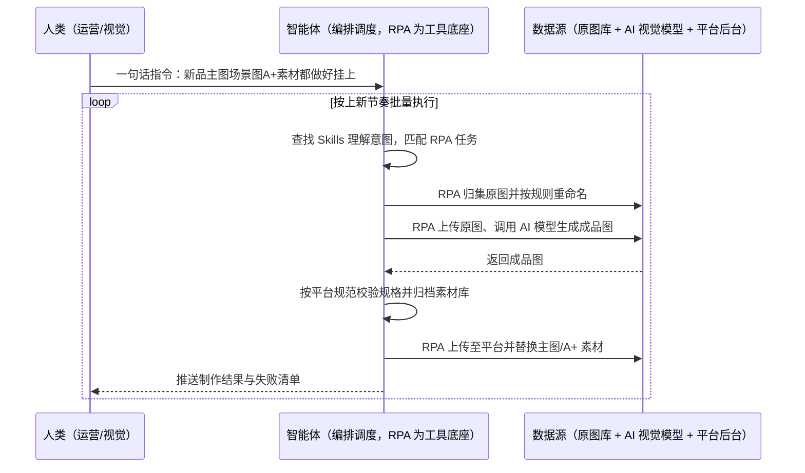

> 为亚马逊卖家打造的 AI 商品图文素材批量生成方案。Listing 图片质量直接影响转化，但传统拍摄成本高、周期长，面对海量 SKU 难以满足营销需求；主图、场景图、A+ 图文素材的制作与替换又高度重复。本方案由智能体调度多个工具执行原图批量归集 + AI 视觉模型批量生成主图/场景图/A+ 素材 + 成品自动归档并回传商品后台，输出标准化素材库与商品图台账。按上新节奏批量执行，全程自动化，异常才打扰；平台对图片规格与内容的要求在生成前校验，敏感类目素材保留人工确认。

> Agent 自动化需开通企业功能
> 点击申请1个月免费权限
> [点击申请 →](https://skieer.feishu.cn/share/base/form/shrcnFwMayykP5iaL38fnZKTbrg)

## 一、用户与需求

核心矛盾：

- 拍摄成本高：Listing 图片质量决定转化，但拍摄贵、周期长（案例口径）
- 海量 SKU 难覆盖：SKU 多时无法都为新品或换季款重拍
- 制作高度重复：主图替换、场景图生成、A+ 素材排版都是机械劳动
- 素材无沉淀：原图与成品图散落个人电脑，复用率低

适用客户：SKU 数量多、上新频繁的亚马逊卖家（运营/视觉岗）。已用设计工具的客户由本方案负责批量调度与回传；无工具的客户同样可由 AI 视觉模型 + RPA 组合落地；部署后业务人员不需要写代码，一句话下达指令即可执行。

### 1.1 不同模式卖家

| 类型 | 选择 | 建议 |
|-|-|-|
| 精品卖家 | 首选 | 强烈推荐（A+ 与场景图需求最强） |
| 精铺卖家 | 首选 | 强烈推荐（SKU 多，批量出图价值最大） |
| 铺货型 | 次选 | 一般推荐（只做重点 ASIN 的图） |

### 1.2 不同类目卖家

| 类目 | 最关注维度 | 核心逻辑 |
|-|-|-|
| 家居家具 | 场景图 | 需要多场景搭配图，实拍成本极高 |
| 3C 数码 | 规格一致性 | 主图规格与平台要求严格 |
| 服装鞋帽 | 多色多码 | 变体多，逐款拍摄不现实 |
| 小家电 | 功能卖点图 | 需要卖点示意图与细节图 |
| 户外运动 | 使用场景 | 场景图对转化影响大 |
| 汽配 | 适配示意 | 需要配件适配与安装示意 |

### 1.3 不同角色用户

| 用户 | 需求 | 问题 | 投入时间（估算） |
|-|-|-|-|
| 美工/视觉 | 批量出图 | 产能受限（案例口径：日约 10 张） | 全天满负荷 |
| 运营 | 上新与换图 | 图不齐上新卡住 | 每日催图 |
| Listing 运营 | A+ 素材 | 排版与素材准备耗时 | 每个 ASIN 1-2 小时 |

---

## 二、现在的方法与问题

### 2.1 流程步骤与问题总结

| 序号 | 步骤 | 现在的方法 | 问题缺陷 |
|-|-|-|-|
| 1 | 收原图 | 拍摄/供应商图收集到本地 | 命名乱，易丢 |
| 2 | 修图套版 | 美工逐张修图套模板 | 日产能约 10 张 |
| 3 | 生成场景图 | 布景实拍或外包 | 成本高、周期长 |
| 4 | 制作 A+ | 手工排版 | 重复劳动 |
| 5 | 上传后台 | 逐张上传替换 | 批量操作易漏 |
| 6 | 归档 | 手工命名归档 | 找图靠问人 |

### 2.2 问题分析

人工方式根因

| 序号 | 根因 | 具体表现 |
|-|-|-|
| 1 | 产能天花板 | 美工日产能约 10 张（案例口径） |
| 2 | 重复劳动多 | 套模板、替换图不需创意 |
| 3 | 素材无规范 | 命名归档靠个人习惯 |

SaaS 方式根因

| 序号 | 根因 | 具体表现 |
|-|-|-|
| 1 | 工具只管单张 | 批量调度仍靠人点 |
| 2 | 与后台脱节 | 出图后要人工上传 |
| 3 | 无台账 | 制作进度不可见 |

---

## 三、解决方案

### 3.1 功能概述

为亚马逊卖家打造的 AI 图文素材批量生成方案，一句话调度原图归集 + AI 生成 + 归档回传，输出标准化素材库与商品图台账。

一句话下达指令（如「这批新品的主图、场景图和 A+ 素材都做出来并挂上」），智能体通过查找 Skills 文档库理解意图、匹配 N 个 RPA 自动化任务（归集→生成→校验→归档→回传），经 MCP 调度八爪鱼 RPA 自动将原始图片上传、操作 AI 模型生成图片，将生成的图片自动保存到本地并上传到对应的电商平台中；同时按平台图片规范做规格校验，成品归档素材库并登记台账。全程自动化，运行状态实时反馈，跑完推送结果。

### 3.2 系统结合

| 要素 | 说明 |
|-|-|
| 客户现有工具盘点 | **未购 SaaS 客户**：拍摄图 + Excel + 平台后台。      
**已购 SaaS 客户**（主流）：AI 电商视觉模型 + 领星/卖家精灵等（素材与 listing 管理）+ 平台后台 + 企业微信/飞书 |
| 数据/能力来源 | 原始图片（拍摄图/供应商图/现有 listing 图）、平台图片规范（主图尺寸/白底/A+ 尺寸）、AI 视觉生成能力、listing 与 A+ 模板 |
| RPA 耦合动作 | 作为 Agent 的工具底座被调度执行：①解决批量上传与回传的机械动作；②被智能体调度执行原图归集、模型调用与规格校验；③把成品上传至平台并替换商品图/A+ 素材 |
| 耦合出的新价值 | 单系统给不了的端到端结论：原图进、成品出、平台自动挂上，**只推送生成失败与规格不符素材** |

### 3.3 智能体执行流程

一句话下达指令，智能体自动调度；入参（图片规格、目标站点、命名规则、审核人）部署时一次配置：

> Agent 自动化需开通企业功能
> 点击申请1个月免费权限
> [点击申请 →](https://skieer.feishu.cn/share/base/form/shrcnFwMayykP5iaL38fnZKTbrg)

### 3.4 为何这么设计

要同时回答三个问题：**为什么不能只用纯代码 Agent？为什么不能只用纯 RPA？为什么两者要结合？** 本场景的核心是"批量稳定跑、平台回传打通、规格能校验"。

#### 1）逐项对比

| 对比维度 | SaaS/API 堆叠（AI 视觉模型+平台后台） | 纯智能体（智能体写代码） | 智能体+自动化工具（RPA 工具底座） |
|-|-|-|-|
| 实现方式 | 模型能出图，批量与上传靠人 | 调模型 API 与上传接口 | 生成与回传动作平台级封装 |
| 多平台登录与取数 | 图片上传接口覆盖有限 | 接口不开放即走不通 | 后台可直接操作 |
| 风控与多账号隔离 | 接口无风控 | 接口受限 | 多店铺环境隔离 |
| 清洗与入库 | 需人工整理归档 | 可代码化但维护靠开发 | 智能体统一归档 + RPA 回传 |
| 使用成本（总拥有成本） | 模型费用 + 人力 | 开发维护人力，隐性成本高 | 一份平台订阅跑多流程，边际成本 ≈ 0 |
| 维护人要求 | 低（但批量靠人） | 规则调整都要开发介入 | 可视化流程，业务自己可改规格 |

技术栈速览：纯智能体路线需 Python 调用图像模型 API、处理批量重命名与平台上传；图片空间与 A+ 素材上传多无开放接口。

#### 2）优劣势说明

|  | SaaS/API 堆叠（AI 视觉模型+平台后台） | 纯智能体（智能体写代码） | 智能体+自动化工具（RPA 工具底座） |
|-|-|-|-|
| 优势 | 出图质量稳定；      
模型可定制 | 无订阅费；      
处理逻辑可定制 | 批量生成 + 规格校验 + 平台回传闭环 |
| 劣势 | 批量与回传靠人工；      
进度不可见 | 上传接口多不开放 | 本地电脑运行需保持开机；      
平台后台改版需更新流程 |

**特别提醒**：AI 生成图需符合平台图片政策（白底要求、不得含不实宣称、不得使用未授权素材与肖像）；**涉认证/医疗等敏感类目素材须人工确认后使用**。

#### 3）结论

| 论点 | 说明 |
|-|-|
| 确定性 vs 生成性 | 上传、归档、回传是确定性动作；生成环节用 AI 模型，各司其职 |
| 资产沉淀 | 命名规则、规格模板、素材库沉淀在平台是活的 |
| 一个底座跑多流程 | 客户购买 RPA 平台是跑多个流程（出图/上架/取数），本方案只是其中一个，订阅费被摊薄 |
| token 消耗可控 | 图片处理走模型与文件流水线，仅提示词与校验环节消耗少量 token |
| 产能 | 案例口径：日处理量从 10 张提升至 200+ 张，直接节省 3 个美工 |
| 时间 | 视觉要的是"图自动做完并挂上"，不是"每天手点上两百次上传" |

### 3.5 功能清单

| 功能 | 系统 | 功能说明（解决问题） |
|-|-|-|
| 会话/一句话指令 | 智能体 | 1. 理解自然语言意图，查找 Skills 文档库。      
2. 匹配对应 RPA 自动化任务、编排多任务。 |
| 原图批量归集 | RPA | 1. 解决原图散乱问题。      
2. 作为工具被调度执行，按批次归集并重命名。      
3. 覆盖拍摄图与供应商图来源。 |
| AI 素材生成 | RPA、AI 视觉模型 | 批量生成主图、场景图与 A+ 素材，解决拍摄成本高与产能不足问题。 |
| 规格校验 | 智能体 | 按平台图片规范校验尺寸/底色/内容，不符即拦并推送补图。 |
| 归档素材库 | 智能体、本地库 | 成品归档并登记台账，解决找图难问题。 |
| 平台回传 | RPA | 上传至平台并替换主图/A+ 素材，解决人工上传断点问题。 |
| 失败清单推送 | 智能体、企微 | 生成失败与规格不符清单推送责任人。 |
| 数据资产储存 | 本地电脑、云储存 | 1. Skills 资产：AI 图文素材技能。      
2. 数据储存：原图库与成品图库。      
3. 经验知识库：提示词与规格模板回填。 |

### 3.6 智能体执行落地过程

部署时一次性配置入参（图片规格、命名规则、目标站点、审核人），会话中一句话即可触发，无需重复输入。

**⚠️ 部署前提（不满足则方案无法跑起来）**：①RPA 需部署在**常开电脑/云机**上，并配置漏跑补跑机制；②AI 视觉模型需先跑一批样本，确认风格与平台合规；③平台后台**登录态**需维护，多店铺建议环境隔离；④图片规格与命名规则需与视觉主管确认一次（属实施成本）；⑤敏感类目素材保留人工确认；⑥首次配置（模型、规格、目录）需服务方/技术人员介入一次，属实施成本。

#### 1）配置（五步）

| 步骤 | 操作 | 说明 |
|-|-|-|
| 第一步 | 下载八爪鱼 RPA，导入跨境电商自动化模板 | 官网免费下载客户端；MCP 工具→添加应用 |
| 第二步 | 开启八爪鱼 RPA 的 MCP 服务端口 | 客户端→API-K→创建 API（名称自定义） |
| 第三步 | 在智能体中添加 MCP Server 连接 | 复制连接配置→智能体连接器→自定义连接器→配置 MCP→粘贴保存 |
| 第四步 | 验证工具列表 | 确认工具全部启用（即八爪鱼客户端内工具） |
| 第五步 | 测试运行效果 | 输入一句话指令，验证出图、校验与回传 |

| 类别 | 说明 |
|-|-|
| 智能体 | 主流智能体（支持 MCP 连接、Skills 加载、定时任务）。 |
| 智能体工具 | 1. **执行通道**：归集 + 生成 + 校验 + 归档 + 回传。      
2. 数据取数与自动化执行：八爪鱼 RPA（MCP 协议接入）。      
3. 图像能力：AI 视觉模型。      
4. IM：企业微信/飞书（MCP 或 webhook 配置）。 |
| 工作知识 | 1. 平台图片规范与尺寸。      
2. 命名规则与目录结构。      
3. 提示词模板。      
4. 类目合规红线与审核人。 |
| 本地数据库 | 1. 原图库地址。      
2. 成品图库地址。      
3. 制作台账存档地址。 |

#### 2）执行

| 任务 | 产出 | 产出物接收人 |
|-|-|-|
| 接收一句话指令，匹配 RPA 任务 | 任务启动记录 | —— |
| 调用已预设 Skills，编排任务流程 | 任务编排方案 | —— |
| 经 MCP 向八爪鱼 RPA 下发制作任务 | 自动化任务指令 | —— |
| 归集原图并重命名 | 规范原图批次 | —— |
| 调用 AI 模型批量生成 | 成品素材 | 运营/视觉 |
| 规格校验与归档 | 素材库与台账 | 视觉/运营 |
| 平台回传替换 | 平台上架素材 | 运营 |
| 推送结果与失败清单 | 群消息 | 视觉/运营 |

异常处理：

生成失败 → 重试 1 次，仍失败推送人工处理；

规格不符 → 不入库，列入失败清单并标注原因；

敏感类目素材 → 转人工确认后再回传；

登录失效 → 自动重试 2 次，仍失败告警推 IM。

#### 3）结果

| 结果 | 说明 |
|-|-|
| 数据资产 | 原图库 + 成品图库 + 制作台账，可复用可追溯。 |
| 分析报告 | 制作日报：完成量/失败量/回传状态。 |
| Skills | 智能体 Skills：AI 图文素材技能，提示词与规格模板按月迭代。 |

> Agent 自动化需开通企业功能
> 点击申请1个月免费权限
> [点击申请 →](https://skieer.feishu.cn/share/base/form/shrcnFwMayykP5iaL38fnZKTbrg)

---

## 四、使用前后预估

> 本方案价值 = **原图批量进 → AI 批量出图 → 平台自动挂上**。把美工从套模板、替换图中解放出来，产能不再受人力限制。

| 指标 | 人工 | SaaS/API（AI 模型+后台） | 智能体+自动化工具 |
|-|-|-|-|
| 日处理量 | 约 10 张（案例口径） | 模型能出图但批量靠人 | 案例口径：200+ 张 |
| 人力投入 | 3 名美工满负荷 | 模型费用 + 人力 | 案例口径：节省 3 个美工 |
| 平台回传 | 人工逐张上传 | 图片接口多不开放 | 自动上传替换 |
| 规格合规 | 人眼校对 | 需人工核 | 按规范校验，不符即拦 |
| 素材复用 | 散落个人电脑 | 工具内 | 素材库 + 台账 |
| 方法论 | 在美工手里 | 在工具配置里 | Skills 提示词与模板资产沉淀 |

**说明**：案例数字来自八爪鱼客户实践（案例口径：与 AI 电商视觉专家合作定制图像优化模型，RPA 自动上传原图、操作模型、成品保存本地并上传平台，日处理量从 10 张跃升至 200+ 张，直接节省 3 个美工）；本方案为按同口径复刻的实施路径，具体数值随 SKU 量与模型效果而异（估算）。

---

## 五、效果证明

> Agent 自动化需开通企业功能
> 点击申请1个月免费权限
> [点击申请 →](https://skieer.feishu.cn/share/base/form/shrcnFwMayykP5iaL38fnZKTbrg)

### 5.1 客户案例

可对接的 AI 生图工具/模型清单（按部署区域任选其一即可，方案不绑定具体模型）：

| 区域 | 可用 AI 生图工具 / 模型 |
|-|-|
| 国内 | 即梦 AI（Seedream 系列）、通义万相、可灵 AI、美图设计室、Picset AI 电商设计 |
| 海外 | Midjourney、Stable Diffusion（ComfyUI + LoRA 定制）、Google Gemini 图像生成（Nano Banana）、OpenAI GPT-Image-1 |
| 专属定制 | 与 AI 电商视觉专家合作、结合平台视觉规范微调的专属图像优化模型（沿用客户实证口径） |

**《RPA＋AI 爆款图批量自动生成》**

> 电商商品图片质量成为影响购买决策的关键因素，传统专业拍摄成本高、耗时长，面对海量 SKU 难以满足营销需求。RPA 自动上传原图、操作 AI 模型并回传平台。

| 效果 | 说明 |
|-|-|
| 提效 | 出图效率提升约 20 倍。原本日处理约 10 张（套模板 + 逐张替换），现在日处理 200+ 张，原图上传、模型调用与成品回传全自动。 |
| 降本 | 减少美工投入 3 人。原本需美工逐张处理与替换，现在由 RPA 自动调度 AI 模型完成；需求沟通成本降低 80%，节约人力用于视觉策划、品牌调性与大促素材规划等重点工作。 |
| 任务 | AI 自动识别商品主体轮廓，商品 100% 不变形（沿用客户实证口径）。 |
| 任务 | 自动生成办公室、户外、休闲等场景图，用于辅图与广告素材，提升转化。 |

案例详情：[生图|RPA＋AI爆款图批量自动生成](https://skieer.feishu.cn/wiki/IxeGwIQHuirgOFkkUNpcqWImnCf)

---

## 六、备注

### 6.1 Agent 支持

本方案不绑定具体智能体，主流 Agent 均可运行（需支持 MCP 连接、技能/Skills 加载与工具调用）：

| Agent/智能体 | 说明 |
|-|-|
| Workbuddy | 本方案运行平台，支持技能/Skills 上传加载、定时任务、MCP 工具调用与表格/报告处理 |
| 豆包（国内·字节） | 国内主流个人智能体，支持技能上传、定时任务与工具调用，上手成本低 |
| 通义千问（国内·阿里） | 支持 Agent 编排与插件生态，集成阿里电商数据能力，适合电商场景 |
| DeepSeek（国内） | 推理能力强、成本低，适合规则打分与归因分析类任务 |
| ChatGPT（国外·OpenAI） | 海外主流通用智能体，支持 GPTs/Agent 模式与工具调用 |
| Claude（国外·Anthropic） | 长文本与结构化分析能力，原生支持 MCP 连接外部工具 |

### 6.2 名词解释

| 术语 | 说明 |
|-|-|
| 主图 | 搜索列表展示的首图，平台对尺寸与底色有要求 |
| 场景图 | 展示商品使用场景的图片，影响转化 |
| A+ 素材 | 亚马逊详情页增强内容模块所用的图文素材 |
| 白底图 | 纯白背景商品图，多为平台硬性要求 |
| 变体 | 同一商品的不同规格组合（颜色/尺码等） |
| AI 视觉模型 | 用于生成、美化商品图的图像模型，如即梦 AI（Seedream）、通义万相、Midjourney、Stable Diffusion、Gemini 图像生成等 |
| 提示词 | 驱动 AI 生成图片的输入描述 |
| 规格校验 | 按平台要求核对尺寸、底色与内容合规 |
| 素材库 | 原图与成品图的结构化存储 |
| 失败清单 | 生成失败或规格不符的素材列表 |
| 敏感类目 | 医疗、保健等监管严格、素材要求特殊的类目 |
| 低频只读 | 控制访问频率、只读取不修改，降低平台风控风险 |
| MCP | Model Context Protocol，智能体连接外部工具的标准化通道 |
| Skills | 智能体可加载的预设技能资产，含流程与知识 |

> Agent 自动化需开通企业功能
> 点击申请1个月免费权限
> [点击申请 →](https://skieer.feishu.cn/share/base/form/shrcnFwMayykP5iaL38fnZKTbrg)

---

原文：[查看原文](https://skieer.feishu.cn/wiki/KvavwI8SxiPx7dkT35qcqNornWd)
