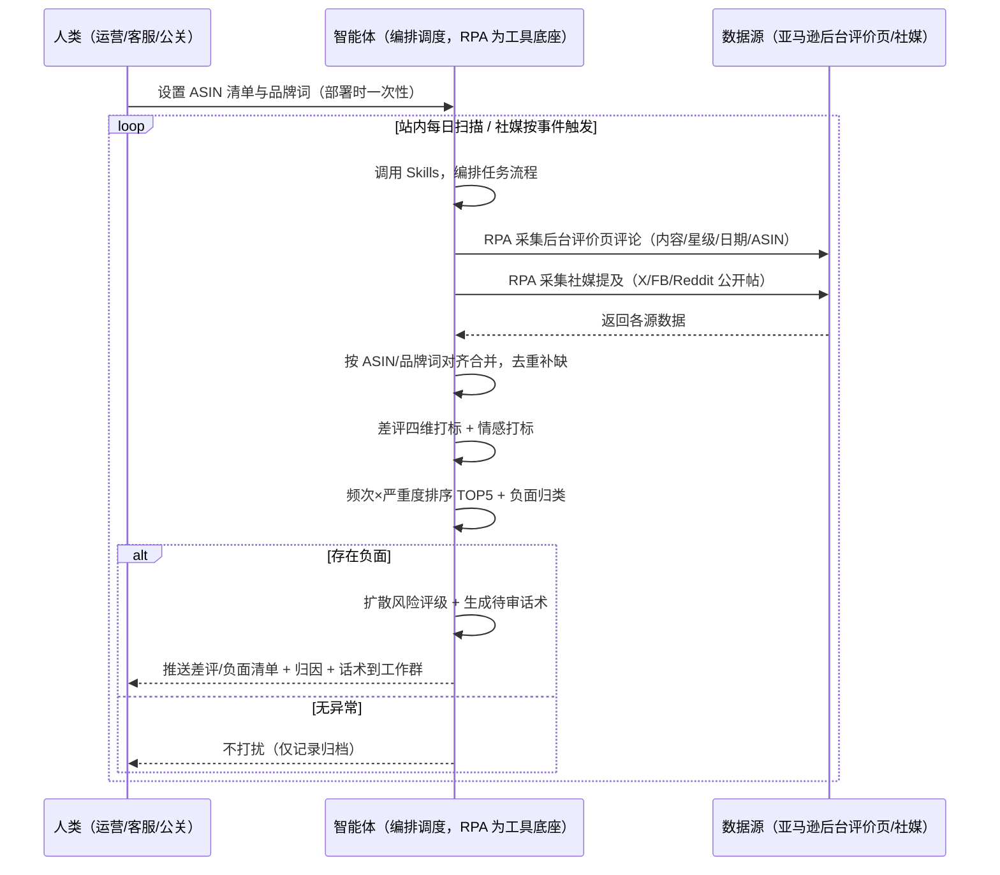
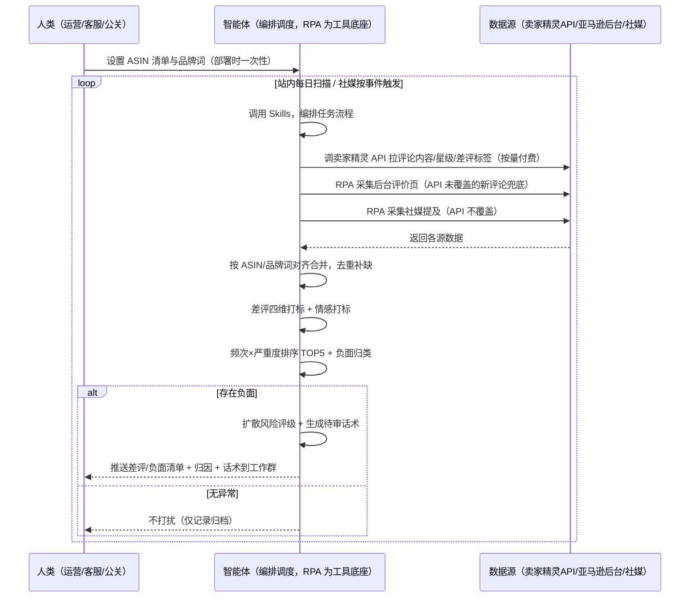

> 为亚马逊卖家团队打造的用户之声（VOC）与口碑监控方案。评论与舆情分散在站内与社媒多个平台，本方案由智能体调度多个工具统一取数、每天扫描站内评论、按事件触发扫描社媒，有负面才推送，无异常不打扰。

> Agent 自动化需开通企业功能
> 点击申请1个月免费权限
> [点击申请 →](https://skieer.feishu.cn/share/base/form/shrcnFwMayykP5iaL38fnZKTbrg)

## 一、用户与需求

核心矛盾：买家评论和社媒口碑分散在站内与多个平台，运营要在它们之间反复手动执行——翻完站内评论切社媒搜品牌词、逐条抄、凭感觉判断"问题出在物流还是质量"。等发现差评挂了好几天影响转化，或负面帖在社媒发酵成危机，介入已经晚了。

两类客户痛点同源，数据来源不同：

- 未购 SaaS 客户（新卖家/小团队）：人工登录后台翻评论、登录社媒搜品牌词，逐条抄录，全靠手；
- 已购 SaaS 客户（卖家精灵看评论分析、领星看运营数据）：工具各自为政，站内评论有单点提醒，但跨平台归因、回复话术仍要人做；社媒舆情没有工具覆盖。

适用客户：有品牌、核心 ASIN 评论量大、需要口碑管理的卖家。只做 1-2 个 ASIN 的小卖家价值有限（人工每周看一次即可，本方案不推荐）。

### 1.1 不同模式卖家

| 类型 | 选择 | 建议 |
|-|-|-|
| 品牌 | 首选 | 强烈推荐（核心 ASIN 评论 + 社媒口碑全量监控） |
| 精铺 | 次选 | 一般推荐，只做核心 ASIN 站内评论分析 |
| 铺货 | 任意 | 不推荐，最多只做站内评论分析、不上社媒 |

### 1.2 不同类目卖家

| 类目 | 最关注维度 | 核心逻辑 |
|-|-|-|
| 3C 数码 | 功能（参数表现） | 功能权重升 40%：差评提取参数值对比 Listing 声称值；社媒盯参数吐槽帖（续航/发热） |
| 美妆个护 | 质量（成分安全） | 质量权重升 40%："过敏""刺激""烂脸"站内社媒均即时推送不等日报 |
| 服装鞋帽 | 描述（尺码/色差） | 描述权重升 35%：尺码偏差关联尺码表校验；社媒盯退货吐槽聚合趋势 |
| 家居家具 | 描述 + 质量 | 安装难度差评关联说明书；大件物流破损舆情按承运商归因 |
| 母婴用品 | 质量（安全） | 质量权重升 45%："有毒""掉漆""小零件"即时推送；婴幼儿安全话题媒体跟进风险最高 |
| 户外运动 | 质量（耐用性） | 耐用性差评按使用场景统计失效占比；涉水/徒步场景失效帖在垂直论坛发酵快 |
| 食品饮料 | 物流 + 质量 | 保质期差评关联生产日期；变质/异物类帖子监管风险最高，即时推送 |
| 汽配 | 功能（兼容性） | 兼容性差评关联车型清单；同一车型集中出现易引发集体投诉，达阈值即升级 |

打标权重与子标签按类目预设 Skills 配置包；多类目店铺按 ASIN 维度挂载对应配置包（配置详见 3.6）。

### 1.3 不同角色用户

| 用户 | 需求 | 问题 | 投入时间（估算） |
|-|-|-|-|
| 老板 | 看结论、决定是否介入危机 | 月底才看到汇总，负面爆发了才知道 | 1 小时/周 |
| 选品 | 从评论/口碑反推产品改进点 | 评论散在各处，无法结构化归因 | 1-2 小时/周 |
| 运营 | 日常看评论、回差评、改 Listing | 差评处理滞后，凭感觉判断问题 | 2-4 小时/周 |
| 客服/公关 | 差评与负面帖及时回应、口径统一 | 靠人盯、口径因人而异，小帖拖成大事 | 1-2 小时/周 |

---

## 二、现在的方法与问题

### 2.1 流程步骤与问题总结

人工方式（未购 SaaS 客户）

| 序号 | 步骤 | 现在的方法 | 问题缺陷 |
|-|-|-|-|
| 1 | 搜集数据 | 运营手动登录后台翻评论，登录社媒搜品牌词 | 站内+社媒多平台分散，人工跑不过来 |
| 2 | 翻评论 | 逐条翻看评论、浏览帖子 | 一个 ASIN 几百条评论，翻不完漏看严重 |
| 3 | 判断问题 | 凭个人经验判断"差评多在物流" | 无分类维度、无频次统计、无严重度评分 |
| 4 | 判断轻重 | 凭感觉判断"这个帖子好像要火" | 无扩散度量（转发量、评论增量），轻重分不清 |
| 5 | 回应用户 | 手写回复，遇到差评紧急处理 | 话术不统一、无合规检查，容易写违规词 |
| 6 | 月底汇总 | 手工汇总月度报告 | 报告口径每次变，没有 TOP5 排序，结论说不清 |

SaaS 方式（已购卖家精灵/领星客户）

| 序号 | 步骤 | 现在的方法 | 问题缺陷 |
|-|-|-|-|
| 1 | 搜集数据 | 卖家精灵查评论分布、领星看运营指标 | 工具各管一段，社媒舆情无工具覆盖 |
| 2 | 翻评论 | 卖家精灵批量导出评论 | 导出后仍要人读，打标归因靠人工 |
| 3 | 判断问题 | 卖家精灵有差评标签（尺寸/质量等） | 标签粗，无跨平台（站内+社媒）统一归因 |
| 4 | 判断轻重 | 领星有差评告警（单点事件） | 只告警不归因，不解释"为什么集中出现" |
| 5 | 回应用户 | 手写回复 | 话术不统一、无合规检查 |
| 6 | 月底汇总 | 手工汇总 | 口径每次变，无 TOP 排序 |

### 2.2 问题分析

人工方式根因

| 序号 | 根因 | 具体表现 |
|-|-|-|
| 1 | 数据跨平台分散 | 站内评论 + 社媒 3+ 平台，人工跑不过来 |
| 2 | 搜集工作量大 | 每周 2-4 小时纯搬运，产出低 |
| 3 | 分析缺方法 | 无分类维度/频次统计/严重度评分，结论不可信 |
| 4 | 差评与负面发现滞后 | 事后发现 → 已影响转化率/已扩散 → 被动回应 |
| 5 | 应对口径无标准 | 什么该回应、怎么回应全凭个人经验，无法沉淀 |

SaaS 方式根因

| 序号 | 根因 | 具体表现 |
|-|-|-|
| 1 | 单系统各自为政 | 卖家精灵管评论、领星管运营，社媒无人管 |
| 2 | 单点告警不解释 | 领星告诉你"有差评了"，不说"为什么集中出现、该改什么" |
| 3 | 社媒覆盖空白 | 卖家精灵/领星都不覆盖 X/FB/Reddit 舆情 |
| 4 | 话术与应对无沉淀 | 回复口径靠个人，新人不会回、老手各回各的 |

---

## 三、解决方案

### 3.1 功能概述

为亚马逊卖家团队打造的智能体驱动用户之声与口碑监控方案，解决评论与口碑跨平台分散、人工反复手动执行、分析缺方法论的问题。

定时触发并调度多个工具，调起多个工具统一取数，按 ASIN/品牌词对齐合并，输出用户之声分析，涵盖「差评四维打标、买家最不满 TOP5、情感打标、负面归类、扩散风险评级、回复话术生成」。站内评论每日扫描、社媒按事件触发扫描，有负面才推送。

### 3.2 系统结合

| 要素 | 说明 |
|-|-|
| 客户现有工具盘点 | **未购 SaaS 客户**：无第三方工具，评论靠后台翻页、舆情靠手动搜社媒。   **已购 SaaS 客户**（主流组合）：卖家精灵（评论分布/差评标签/开放 API 查评论）、领星 ERP（运营/财务指标，网页端有评论更新提醒） |
| 数据/能力来源 | **未购 SaaS**：亚马逊后台评价页/前台评论页（RPA 采集，评论内容/星级/日期/ASIN）+ 社媒前台（X/Facebook/Reddit 公开帖，RPA 采集，需自备账号）。   **已购 SaaS**：卖家精灵开放 API（评论内容/星级/差评标签，查评论接口按量付费）+ RPA 前台补社媒（API 不覆盖）+ 后台评价页兜底 |
| RPA 耦合动作 | 作为 Agent 的工具底座，按计划调度多数据源取数（API 优先 + 前台/后台采集兜底），按 ASIN/品牌词对齐去重合并，统一流转给智能体分析；   任一数据源失败自动重试、异常告警 |
| 耦合出的新价值 | 单工具给不了的端到端结论：站内评论 + 社媒舆情一次取齐 → 四维打标 → 频次×严重度排序 TOP5 → 扩散风险评级 → 待审话术，**有负面自动推送工作群**，免去人工在多平台间反复切换 |

### 3.3 智能体执行流程

用户向智能体输入会话（入参：ASIN 清单 + 品牌词/ASIN 关键词列表）或智能体定时触发（站内每日扫描 + 社媒按事件触发）。支持两种数据通道，部署时按客户现有工具选择：

通道一：无 SaaS 方式（RPA 采集亚马逊后台/前台 + 社媒，适合未购卖家精灵的客户）

通道二：有 SaaS 方式（卖家精灵 API 拿评论核心，RPA 补社媒，适合已购客户）

> Agent 自动化需开通企业功能
> 点击申请1个月免费权限
> [点击申请 →](https://skieer.feishu.cn/share/base/form/shrcnFwMayykP5iaL38fnZKTbrg)

### 3.4 为何这么设计

要同时回答三个问题：为什么不能只用 SaaS/API？为什么不能纯靠智能体写代码？ 本场景的核心是"站内每日定时、跨站内+社媒取数、按 ASIN/品牌词对齐、出归因结论、有负面推送、挂了有人管"。

#### 1）逐项对比

| 对比维度 | SaaS/API 堆叠（卖家精灵/领星） | 纯智能体（智能体写代码） | 智能体+自动化工具（RPA 工具底座） |
|-|-|-|-|
| 实现方式 | 卖家精灵管评论、领星管运营，社媒无覆盖 | 能调 API 能抓前台，数据可自拼，但全要自己接 | 一个底座跑多个流程（VOC/异动/选品/趋势……），数据一处对齐 |
| 多源耦合 | 站内单点工具 + 社媒空白，无人组装 | 全自建：API 鉴权、社媒反爬、登录态、对齐逻辑 | 平台沉淀多源取数与对齐，可视化配置 |
| 归因与话术 | 卖家精灵有差评标签（粗）、领星有差评告警（不解释） | 归因逻辑自写，灵活但工程量大 | 判断交给智能体（四维打标+TOP5+扩散评级+话术），执行交给 RPA |
| 定时与推送 | 领星差评告警单点事件；社媒无监控 | 调度器/进程常驻/告警通道全自建 | 平台调度稳定触发，失败重试 + 异常告警，有负面才推送 |
| 使用成本（总拥有成本） | 一系统一订阅：卖家精灵查评论按接口付费 + 领星 500-1500/月……随流程数增长 | 代理 IP + 服务器 + 开发维护人力，隐性成本高 | 一份平台订阅跑所有流程，单方案边际成本 ≈ 0 |
| 维护人要求 | 低（工具已成熟） | 每次改版/接口变更/规则调整都要开发介入 | 可视化流程，运营自己可调 ASIN 范围、话术基调、推送群 |

#### 2）优劣势说明

|  | SaaS/API 堆叠（卖家精灵/领星） | 纯智能体（智能体写代码） | 智能体+自动化工具（RPA 工具底座） |
|-|-|-|-|
| 优势 | 评论数据权威、差评标签成熟；   领星有单点告警 | 无订阅费；   可深度定制打标与话术逻辑；   技术上完全可行 | 一个底座跑多流程、数据一处对齐；   站内+社媒全量覆盖；   打标规则/话术库可沉淀；   调度/重试/告警开箱即用 |
| 劣势 | 社媒覆盖空白；   差评告警不归因；话术靠人；   多系统订阅成本随流程数增长 | 社媒反爬全球最严一档，自建账号封禁风险自己扛；   评论深翻页与高频调度全自建；   AI 生成代码是生成性的，长跑不稳 | 本地电脑运行需保持开机（建议部署常开电脑/云机）；   订阅费；   社媒采集受平台政策影响，需合规使用公开数据 |

#### 3）结论

| 论点 | 说明 |
|-|-|
| 只用 SaaS/API 缺"社媒覆盖与归因" | 卖家精灵/领星解决站内评论与单点告警，但社媒舆情无覆盖、"为什么集中出现"不解释、话术不沉淀——这些是本方案的增量 |
| 纯智能体缺"工程底座" | 跨平台取数 70% 的工作在工程（社媒反爬/登录态/对齐/调度/重试），不在"写打标逻辑"；   RPA 作为工具底座把这 70% 已经造好 |
| 一个底座跑多流程 | 客户购买 RPA 平台是跑多个流程（VOC/竞品/选品/趋势/后台操作），本方案只是其中一个流程——平台订阅费被多流程摊薄，单方案边际成本接近 0 |
| 确定性 vs 生成性 | 评论与帖子采集是确定性任务——同样的 ASIN 与品牌词，要求"准点、不漏、口径一致"。RPA 流程行为可预期，AI 生成的代码能跑通 ≠ 能稳定跑一年 |
| 时间 | 卖家要的是"当天拿到分级报告和待审话术"，不是"每天修脚本"；   判断层交给智能体，执行层交给工具底座 |

### 3.5 功能清单

| 功能 | 系统 | 功能说明（解决问题） |
|-|-|-|
| 会话/定时 | 智能体 | 1. 理解人类语言，调用已预设好的 Skills。   2. 编排多任务、调度多工具。 |
| 多系统数据取数 | RPA、指纹浏览器 | 1. 解决评论与口碑跨平台分散、人工翻不完漏看问题。   2. 作为智能体工具底座被调度执行，登录失败自动重试并告警、社媒登录受限自动切换备用账号、超时跳过下轮补采。   3. **【无 SaaS 方式】** RPA 采集后台评价页评论（内容/星级/日期/ASIN）+ 社媒公开帖（X/FB/Reddit，转发/评论/链接）。**【有 SaaS 方式】** 调卖家精灵 API 拉评论内容/星级/差评标签（按量付费）+ RPA 补后台新评论与社媒。 |
| 数据清洗对齐 | 智能体 | 按 ASIN/品牌词对齐多源数据，去重合并、字段统一，解决手工表格乱、重复评论、跨平台无法统一查看问题。 |
| 差评打标与归因 | 智能体 | 差评四维打标（物流/质量/描述/功能，权重按类目预设配置包）；频次×严重度排序，输出买家最不满 TOP5；负面四类归类。 |
| 扩散风险评级 | 智能体 | 统计负面帖转发量、评论增量，输出高发话题 TOP10 与扩散风险评级；   负面帖转发 >100 或评论 >50 → 红色高扩散告警，50-100 → 黄色关注。 |
| 回复话术生成 | 智能体 | 引用买家原话 ≥3 条 → 匹配话术模板 → 自动过违规词检查（不含"退款""赔偿"等违规词）→ 输出待审话术。**话术需人工确认后执行**。 |
| IM通知 | 飞书、钉钉、企微等 | 解决差评与负面发现滞后问题。**有负面才推送**：差评明细、分级告警、危险词即时告警自动推送工作群，无异常不打扰。 |
| 数据资产储存 | 本地电脑、云储存 | 1. Skills 资产：打标规则、情感词库（300+ 词）、话术模板、合规词库、预警规则，被调度直接调用。   2. 数据储存：评论库/舆情库.xlsx 按日沉淀，可审计可追溯。3. 经验知识库：审核通过的优质话术持续沉淀。 |

### 3.6 智能体执行落地过程

部署时一次性配置入参（ASIN 清单、品牌词列表、打标权重、话术基调、推送群、数据通道），会话中无需重复输入。

⚠️ 部署前提（不满足则方案无法跑起来）：①RPA 需部署在常开电脑/云机上（社媒高频监控关机即停），并配置漏跑补跑机制；②社媒采集需自备账号（X/FB/Reddit 公开数据采集，遵守各平台条款，账号异常需人工介入），敏感品牌建议只做站内评论+1-2 个平台；③有 SaaS 方式需卖家精灵企业认证开通开放平台（个人版不支持，以官方政策为准），未开通自动降级为无 SaaS 通道；④首次配置（API 鉴权、对齐规则、打标权重）需服务方/技术人员介入一次，属实施成本。

#### 1）配置

| 类别 | 说明 |
|-|-|
| 智能体 | 主流智能体。 |
| 智能体工具 | 1. **数据通道（按客户现有工具二选一）**：【无 SaaS】亚马逊后台评价页 + 社媒公开页（RPA 采集）；【有 SaaS】卖家精灵开放 API（查评论按量付费）+ RPA 补后台新评论与社媒。   2. 数据取数与自动化执行：八爪鱼 RPA，MCP 配置完成。   3. 数据分析：智能体自带。   4. IM：企业办公 IM（飞书/钉钉/企微），MCP 或 webhook 配置。 |
| 工作知识 | 1. ASIN 清单（含品类/当前星级）与品牌词/关键词列表。   2. 话术基调与违规词黑名单。   3. 分类维度：差评四维打标，权重按类目预设配置包（如 3C：功能 40%/质量 25%/描述 20%/物流 15%）。   4. 严重度权重：1 星=5，2 星=3，3 星=1。   5. 情感词库：默认 300+ 词。   6. 扩散阈值：默认负面帖转发 >50 或评论 >20 为高扩散风险。   7. 监控平台范围：默认 X、Facebook、Reddit。 |
| 本地数据库 | 1. 评论库/舆情库地址。   2. 话术库地址。   3. 报告库地址。 |

#### 2）执行

| 任务 | 产出 | 产出物接收人 |
|-|-|-|
| 接收 ASIN 清单与品牌词列表，定时或会话 | 任务启动记录 | —— |
| 调用已预设 Skills，编排任务流程 | 任务编排方案 | —— |
| 经 MCP 向八爪鱼 RPA 下发取数任务 | 自动化任务指令 | —— |
| 多平台取数并按 ASIN/品牌词对齐（无 SaaS：后台+社媒采集；有 SaaS：卖家精灵 API + 后台/社媒兜底，智能体监控状态） | 对齐后评论与帖子 | —— |
| 差评四维打标 + 情感打标 | 差评/情感分类标签 | 选品 |
| 频次×严重度排序 + 负面归类 + 扩散评级 | 买家最不满 TOP5 + 高发话题 TOP10 | 选品/运营 |
| 生成待审话术（过合规检查） | 待审话术/应对建议 | 运营/客服/公关 |
| 推送分级报告到工作群（有负面才推送） | 分级告警消息 | 运营/客服/老板 |

异常处理：

采集登录失败 → 自动重试 2 次，仍失败告警推 IM；

社媒登录受限 → 自动切换备用账号；

采集超时 → 跳过并记录，下轮补采；

情感置信度 &lt;70% → 标注"待人工确认"；

词库命中 &lt;3 个词 → 降级"中性待确认"；

样本 &lt;10 条 → 标注"样本不足仅供参考"；

含"起诉/投诉/媒体曝光/过敏"等关键词 → 即时推送不等周期报告。

#### 3）结果

| 结果 | 说明 |
|-|-|
| 数据资产 | 全量评论与舆情结构化数据（内容/星级/日期/ASIN/平台/转发数/评论数/链接/标签/严重度），可按 ASIN/维度/平台/时间随时检索，可审计可追溯。 |
| 分析报告 | 1. 买家最不满 TOP5：按日更新，直接告诉团队"最该改什么"。   2. 负面舆情高发话题 TOP10：持续更新，直接告诉团队"口碑烧在哪"。   3. 分级告警：红色高扩散立即告警 / 黄色关注 / 危险关键词即时推送。   4. 口碑趋势报告：按日沉淀，可回看。 |
| 回复话术 | 已过合规检查的三段式差评回复 + 附原始链接与情感分析依据的舆情应对方案，人工审核后即可执行，新人也能按标准口径回复。 |
| Skills | 智能体 Skills：打标规则、情感词库、预警规则、话术模板、合规词库。 |

> Agent 自动化需开通企业功能
> 点击申请1个月免费权限
> [点击申请 →](https://skieer.feishu.cn/share/base/form/shrcnFwMayykP5iaL38fnZKTbrg)

---

## 四、使用前后预估

> 本方案价值 = **站内+社媒全量覆盖 + 四维归因 + 扩散评级 + 待审话术**。不承诺替代人工应对——话术需人工确认后执行、低置信度转人工复核。适合有品牌、评论量大、愿配环境、接受半自动的卖家。

| 指标 | 人工 | SaaS/API（卖家精灵/领星） | 智能体+自动化工具 |
|-|-|-|-|
| 搜集分析耗时 | 每周 2-4 小时（估算） | 每周 1 小时（估算，仍需人工读评论归因） | 取数全自动；人工转为审核话术（每周约 0.5 小时） |
| 差评发现时效 | 事后发现（3-7 天滞后） | 领星单点告警（有评论更新提醒） | 当天归因告警（含"为什么集中出现"） |
| 负面发现时效 | 数天后被动发现 | 社媒无覆盖 | 按事件触发，扩散风险即时评级 |
| 归因能力 | 凭感觉"差评多在物流" | 卖家精灵有粗标签，不跨平台 | 站内+社媒统一四维归因 + TOP5 |
| 应对口径 | 因人而异 | 无沉淀 | 统一三段式 + 合规检查 + 附证据链接 |
| 方法论 | 无，换人结论不同 | 工具内规则（不可跨平台复用） | 可复用的 Skills 与规则库 |

说明：社媒舆情数据为公开数据采集，受平台条款与反爬影响，不承诺社媒 100% 覆盖率（采集失败时以已采数据标注覆盖率）；情感判断为辅助参考，置信度 &lt;70% 转人工确认。评论数据以准确字段（星级/日期/ASIN/内容）为主，判断可信。

---

## 五、效果证明

> Agent 自动化需开通企业功能
> 点击申请1个月免费权限
> [点击申请 →](https://skieer.feishu.cn/share/base/form/shrcnFwMayykP5iaL38fnZKTbrg)

### 5.1 客户案例

**《大疆：十余平台 × 7 大类营销与客服数据自动采集》**

> 十余个国内外电商平台与社媒渠道，直播、评论、客服会话、搜索等非结构化数据原需大量人力处理。RPA 完成十余个系统、7 大类核心数据自动采集入库。

| 效果 | 说明 |
|-|-|
| 提效 | 跨平台营销与客服数据采集效率显著提升。原本十余个平台与社媒渠道、7 大类数据需每日 5-6 小时人工导表，现在全自动采集入库，数据时效提升至 T+1。 |
| 降本 | 免除专职导表的人力投入，节约人力用于数据建模、投放复盘与客服策略分析等重点工作。 |
| 任务 | 覆盖十余个国内外电商平台与社媒渠道，含直播、评论、客服会话、搜索等 7 大类非结构化数据。 |
| 任务 | 形成全渠道统一数据底座，跨平台口径一致，供分析团队直接取用。 |

案例详情：[客服：全球无人机巨头跨平台电商与客服数据自动化采集](https://skieer.feishu.cn/wiki/OmO7wGX3yiASCBkqRsfcWPUMnOe)

### 5.2 DEMO应用

Amazon-评论采集与自动分类：https://rpa.bazhuayu.com/appstore/app/nailong/id-66a999691bfc8263001f9b05

---

## 六、备注

### 6.1 Agent 支持

本方案不绑定具体智能体，主流 Agent 均可运行（需支持技能/Skills 加载与工具调用）：

| Agent/智能体 | 说明 |
|-|-|
| Workbuddy | 本方案运行平台，支持技能/Skills 上传加载、定时任务、MCP 工具调用与表格/报告处理 |
| 豆包（国内·字节） | 国内主流个人智能体，支持技能上传、定时任务与工具调用，上手成本低 |
| 通义千问（国内·阿里） | 支持 Agent 编排与插件生态，集成阿里电商数据能力，适合电商场景 |
| DeepSeek（国内） | 推理能力强、成本低，适合规则打分与归因分析类任务 |
| ChatGPT（国外·OpenAI） | 海外主流通用智能体，支持 GPTs/Agent 模式与工具调用 |
| Claude（国外·Anthropic） | 长文本与结构化分析能力强，原生支持 MCP 连接外部工具 |

### 6.2 名词解释

| 术语 | 说明 |
|-|-|
| VOC | Voice of Customer，客户之声，指买家评论/反馈的统称 |
| 四维打标 | 差评按物流/质量/描述/功能四个维度分类标记，权重按类目预设 |
| 情感词库 | 预设的正/负/中性情感判断词集合（默认 300+ 词，可扩展） |
| 扩散风险评级 | 按负面帖转发量、评论增量评估的传播风险等级 |
| 红色高扩散告警 | 负面帖转发 >100 或评论 >50，立即告警 |
| 黄色关注 | 负面帖转发 50-100，列入关注 |
| 置信度 | 智能体情感判断的可信度，&lt;70% 转人工复核 |
| 违规词黑名单 | 平台禁止的回复词（如"退款""赔偿"），话术生成后自动检查 |
| 备用账号 | 登录受限时自动切换的备用采集账号 |
| 三段式差评回复 | 回应问题 → 引用买家原话 ≥3 条 → 给出改进/补偿方向 |
| 混合数据源 | 官方导出/API 优先（更稳更合规）+ 前台/后台采集兜底（免费、覆盖无 SaaS 客户与 API 缺口） |
| 有 SaaS 方式 | 已购卖家精灵，开放 API 拿评论核心字段 + RPA 补后台新评论与社媒（API 按接口付费、需企业认证开通） |
| 无 SaaS 方式 | 不购买第三方数据工具，由 RPA 采集后台评价页 + 社媒公开数据 |
| ASIN | Amazon Standard Identification Number，亚马逊商品标识号 |
| MCP | Model Context Protocol，智能体连接外部工具的标准化通道 |

> Agent 自动化需开通企业功能
> 点击申请1个月免费权限
> [点击申请 →](https://skieer.feishu.cn/share/base/form/shrcnFwMayykP5iaL38fnZKTbrg)

---

原文：[查看原文](https://skieer.feishu.cn/wiki/DtTbwieRTiK3uJkCCRdcu20JnNc)
