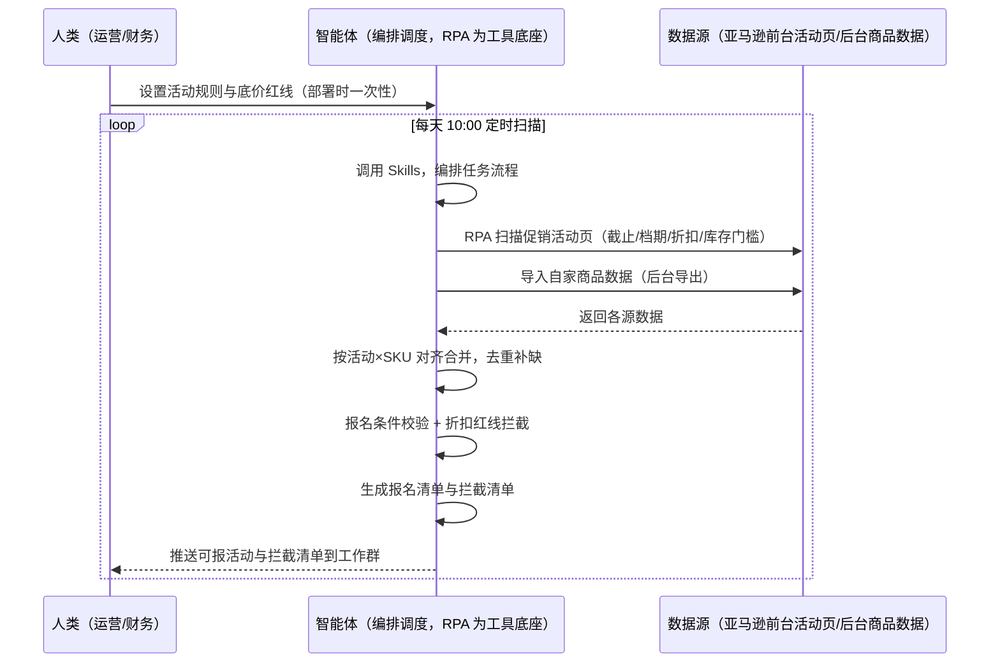
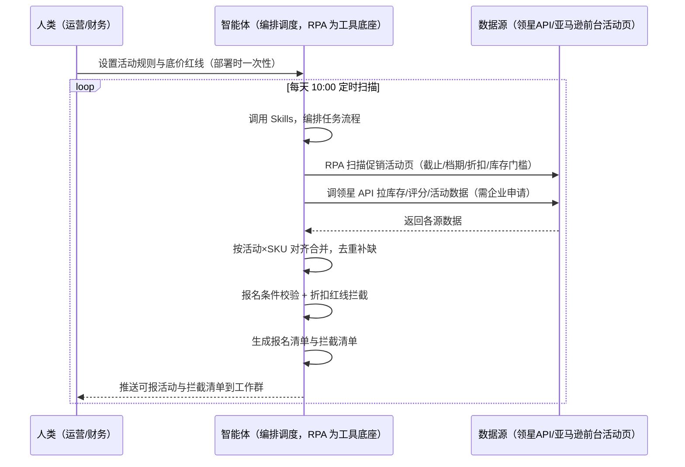

> 为亚马逊卖家团队打造的促销活动管理方案。平台促销活动多、报名截止时间分散，本方案由智能体调度多个工具统一取数，每天扫描活动日历，可报活动与拦截清单才推送，不错过档期、不乱报活动。

> Agent 自动化需开通企业功能
> 点击申请1个月免费权限
> [点击申请 →](https://skieer.feishu.cn/share/base/form/shrcnFwMayykP5iaL38fnZKTbrg)

## 一、用户与需求

核心矛盾：平台促销活动多、报名截止时间分散，运营要反复手动执行——盯着活动日历、逐条读规则、对照自家商品判断能不能报、手算折扣后价格。档期容易错过；报上去才发现库存不够、折扣低于底价，报了亏钱、不报没流量。

两类客户痛点同源，数据来源不同：

- 未购 SaaS 客户（新卖家/小团队）：人工盯活动日历、读规则、逐 SKU 校验报名条件，全靠手；
- 已购 SaaS 客户（领星 ERP 看库存/评分/活动）：领星有活动数据与库存数据，但多平台活动日历扫描、报名条件逐项校验、折扣红线拦截仍要人做。

适用客户：活动多、SKU 多、报名频次高的卖家。只做几个爆款、活动少的小卖家价值有限（人工每周看一次即可，本方案不推荐）。

### 1.1 不同模式卖家

| 类型 | 选择 | 建议 |
|-|-|-|
| 品牌 | 首选 | 强烈推荐（活动多、SKU 多，报名频次高） |
| 精铺 | 次选 | 一般推荐，聚焦主力 SKU 的促销档期 |
| 铺货 | 任意 | 不推荐，SKU 太多逐个校验不划算 |

### 1.2 不同类目卖家

| 类目 | 最关注维度 | 核心逻辑 |
|-|-|-|
| 3C 数码 | 折扣红线 | 数码件利润薄，折扣低于底价直接不报 |
| 家居家具 | 库存门槛 | 大件库存门槛高，库存不够报不了 |
| 美妆个护 | 评分要求 | 评分不达标活动报不上，先改善评分 |
| 服装鞋帽 | 档期频率 | 款式迭代快，蹭档期上新是关键 |
| 户外运动 | 折扣+库存 | 功能件看折扣空间与库存备货 |
| 母婴用品 | 合规+库存 | 安全类目，活动报备与库存门槛并重 |

### 1.3 不同角色用户

| 用户 | 需求 | 问题 | 投入时间（估算） |
|-|-|-|-|
| 老板 | 活动不亏钱、不漏档期 | 报了亏钱、不报没流量 | 0.5 小时/周 |
| 运营 | 活动报名清单+拦截清单 | 手动盯日历、逐项校验费时 | 1-3 小时/周 |
| 财务 | 折扣后利润可控 | 折扣低于底价无拦截 | 0.5 小时/周 |

---

## 二、现在的方法与问题

### 2.1 流程步骤与问题总结

人工方式（未购 SaaS 客户）

| 序号 | 步骤 | 现在的方法 | 问题缺陷 |
|-|-|-|-|
| 1 | 盯日历 | 手动关注活动报名时间 | 档期分散，容易错过截止 |
| 2 | 读规则 | 逐条看折扣/库存/评分要求 | 规则理解不一致，漏条件 |
| 3 | 对商品 | 对照自家商品判断能不能报 | 逐 SKU 校验费时，易漏 |
| 4 | 算折扣 | 手算折扣后价格 | 低于底价没拦截，报了亏钱 |
| 5 | 报名 | 手动提交报名 | 批量报名逐个操作费时 |

SaaS 方式（已购领星 ERP 客户）

| 序号 | 步骤 | 现在的方法 | 问题缺陷 |
|-|-|-|-|
| 1 | 盯日历 | 手动关注活动报名时间 | 领星有活动数据，多平台日历扫描仍靠人 |
| 2 | 读规则 | 逐条看规则 | 规则理解不一致，漏条件 |
| 3 | 对商品 | 领星查库存/评分 | 报名条件逐项校验靠人 |
| 4 | 算折扣 | 手算 | 折扣红线无自动拦截 |
| 5 | 报名 | 手动提交 | 批量操作费时 |

### 2.2 问题分析

人工方式根因

| 序号 | 根因 | 具体表现 |
|-|-|-|
| 1 | 档期分散 | 活动报名截止时间多处，靠人盯易漏 |
| 2 | 规则复杂 | 库存门槛/评分要求/折扣要求逐项核对费时 |
| 3 | 折扣无红线 | 折扣后价格低于底价无人拦截 |
| 4 | 报名无留痕 | 报名记录散乱，活动效果难追溯 |
| 5 | 经验不沉淀 | 活动选择规则在人脑里 |

SaaS 方式根因

| 序号 | 根因 | 具体表现 |
|-|-|-|
| 1 | 日历扫描空白 | 领星有活动数据，多平台报名日历扫描不覆盖 |
| 2 | 条件校验靠人 | 领星有库存/评分，逐项对照报名条件靠人 |
| 3 | 折扣无拦截 | 折扣红线校验无自动化 |
| 4 | 决策不沉淀 | 活动选择规则在个人经验里 |

---

## 三、解决方案

### 3.1 功能概述

为亚马逊卖家团队打造的智能体驱动促销活动管理方案，解决活动档期分散、人工反复手动执行、折扣无红线的问题。

定时触发并调度多个工具，调起八爪鱼 RPA（Agent 的工具底座，能耦合多系统、完成自动化任务执行）统一取数，按活动×SKU 对齐合并，输出活动管理分析，涵盖「活动日历扫描、报名条件校验、折扣红线拦截、报名清单与拦截清单、活动记录管理」。每天扫描，可报活动与拦截清单才推送。

### 3.2 系统结合

| 要素 | 说明 |
|-|-|
| 客户现有工具盘点 | 未购 SaaS 客户：无第三方工具，活动全靠前台盯日历。  
已购 SaaS 客户（主流组合）：领星 ERP（活动数据、库存/评分，开放 API 需企业申请） |
| 数据/能力来源 | 未购 SaaS：亚马逊前台促销活动页（报名截止时间/档期/折扣/库存门槛，RPA 采集）+ 自家商品数据（后台导出）。  
已购 SaaS：领星开放 API（库存/评分/活动数据，需企业申请权限）+ 前台活动页扫描（RPA，领星不覆盖多平台日历） |
| RPA 耦合动作 | 作为 Agent 的工具底座，按计划调度多数据源取数（API 优先 + 前台扫描兜底），按活动×SKU 对齐去重合并，统一流转给智能体校验；任一数据源失败自动重试、异常告警 |
| 耦合出的新价值 | 单工具给不了的端到端结论：活动日历一次取齐 → 报名条件逐项校验 → 折扣红线拦截 → 报名清单，每天自动推送可报与拦截清单，免去人工盯日历逐项校验 |

### 3.3 智能体执行流程

用户向智能体输入会话（入参：活动规则 + 自家商品清单）或智能体定时触发。支持两种数据通道，部署时按客户现有工具选择：

通道一：无 SaaS 方式（RPA 扫描前台活动页，适合未购领星的客户）

通道二：有 SaaS 方式（领星 API 拿商品数据，RPA 扫活动页，适合已购客户）

> Agent 自动化需开通企业功能
> 点击申请1个月免费权限
> [点击申请 →](https://skieer.feishu.cn/share/base/form/shrcnFwMayykP5iaL38fnZKTbrg)

### 3.4 为何这么设计

要同时回答三个问题：为什么不能只用 SaaS/API？为什么不能纯靠智能体写代码？ 本场景的核心是"每天扫日历、规则确定性校验、红线拦截、报名留痕、挂了有人管"。

#### 1）逐项对比

| 对比维度 | SaaS/API 堆叠（领星） | 纯智能体（智能体写代码） | 智能体+自动化工具（RPA 工具底座） |
|-|-|-|-|
| 实现方式 | 领星有活动/库存数据，多平台日历扫描不覆盖 | 能调 API 能抓前台，数据可自拼，但全要自己接 | 一个底座跑多个流程（促销/跟卖/异动/选品……），数据一处对齐 |
| 多源耦合 | 领星管商品数据，活动日历靠人盯 | 全自建：API 鉴权、前台反爬、对齐逻辑 | 平台沉淀多源取数与对齐，可视化配置 |
| 校验与判断 | 领星有数据不给结论 | 校验逻辑自写，灵活但工程量大 | 判断交给智能体（条件校验+折扣拦截），执行交给 RPA |
| 定时与推送 | 领星无活动日历提醒 | 调度器/进程常驻/告警通道全自建 | 平台调度稳定触发，失败重试 + 异常告警，每日推送清单 |
| 使用成本（总拥有成本） | 一系统一订阅：领星 500-1500/月……随流程数增长 | 代理 IP + 服务器 + 开发维护人力，隐性成本高 | 一份平台订阅跑所有流程，单方案边际成本 ≈ 0 |
| 维护人要求 | 低（工具已成熟） | 规则调整都要开发介入 | 可视化流程，运营自己可调底价红线、报名规则 |

#### 2）优劣势说明

|  | SaaS/API 堆叠（领星） | 纯智能体（智能体写代码） | 智能体+自动化工具（RPA 工具底座） |
|-|-|-|-|
| 优势 | 库存/评分数据权威 | 无订阅费；  
可深度定制报名策略；  
技术上完全可行 | 一个底座跑多流程、数据一处对齐；  
活动扫描/规则校验/报名留痕即开即用；  
非技术人员可维护 |
| 劣势 | 多平台日历扫描空白；  
校验靠人；  
无红线拦截 | 扫描、校验、报名留痕全自建；  
AI 生成代码是生成性的，误报名风险不可控 | 本地电脑运行需保持开机；  
订阅费；  
灵活性受平台模板边界限制 |

#### 3）结论

| 论点 | 说明 |
|-|-|
| 只用 SaaS/API 缺"日历扫描与红线拦截" | 领星解决商品数据，但多平台活动日历扫描、报名条件逐项校验、折扣红线拦截它不覆盖——这是本方案的增量 |
| 纯智能体缺"工程底座" | 活动扫描与校验 70% 的工作在工程（取数/对齐/调度/留痕），不在"写校验逻辑"；  
RPA 作为工具底座把这 70% 已经造好 |
| 一个底座跑多流程 | 客户购买 RPA 平台是跑多个流程（促销/跟卖/异动/选品/后台操作），本方案只是其中一个——平台订阅费被多流程摊薄，单方案边际成本接近 0 |
| 确定性 vs 生成性 | 报名校验与折扣拦截是确定性任务——同样的活动规则，要求"每次校验一致、红线拦截不误放"。RPA 流程行为可预期，AI 生成的代码能跑通 ≠ 报名策略长期不失误 |
| 时间 | 运营要的是"每天看到可报活动清单和拦截清单"，不是"每天手动盯日历"；  
判断层交给智能体，执行层交给工具底座 |

### 3.5 功能清单

| 功能 | 系统 | 功能说明（解决问题） |
|-|-|-|
| 会话/定时 | 智能体 | 1. 理解人类语言，调用已预设好的 Skills。  
2. 编排多任务、调度多工具。 |
| 多系统数据取数 | RPA、指纹浏览器 | 1. 解决活动档期分散、人工盯日历易漏问题。  
2. 作为智能体工具底座被调度执行，报名接口报错自动重试、无法判断的条目转人工评估。  
3. 【无 SaaS 方式】 RPA 扫描前台活动页（截止/档期/折扣/库存门槛）+ 后台商品数据。【有 SaaS 方式】 同上 + 调领星 API 拉库存/评分（需企业申请）。 |
| 数据清洗对齐 | 智能体 | 按活动×SKU 对齐去重，解决多活动数据混杂问题。 |
| 报名条件校验 | 智能体 | 库存门槛、评分要求、折扣要求逐项核对，输出校验结果。 |
| 折扣红线拦截 | 智能体 | 折扣后价格低于底价 → 自动拦截不报名，输出拦截清单。 |
| 报名执行 | RPA | 符合条件自动生成报名数据并提交（涉及价格调整、大促主推等活动保留人工确认）。报名动作需人工确认后提交。 |
| IM通知 | 飞书、钉钉、企微等 | 解决错过档期、误报名问题。可报活动、拦截清单、需人工确认活动自动推送。 |
| 数据资产储存 | 本地电脑、云储存 | 1. Skills 资产：活动选择与报名规则库。  
2. 数据储存：活动管理表统一写入本地，可追溯。  
3. 经验知识库：活动复盘结论持续沉淀。 |

### 3.6 智能体执行落地过程

部署时一次性配置入参（活动规则、底价红线、商品清单、推送群、数据通道），会话中无需重复输入。

⚠️ 部署前提（不满足则方案无法跑起来）：①RPA 需部署在常开电脑/云机上（每天定时扫描，关机即停），并配置漏跑补跑机制；②有 SaaS 方式需领星企业客户申请开放 API 权限（未开通自动降级为无 SaaS 通道，走后台导出）；③活动报名涉及价格，建议以"人工确认后提交"模式运行，稳定后逐步放开自动执行；④首次配置（API 鉴权、对齐规则、底价红线）需服务方/技术人员介入一次，属实施成本。

#### 1）配置

| 类别 | 说明 |
|-|-|
| 智能体 | 主流智能体。 |
| 智能体工具 | 1. 数据通道（按客户现有工具二选一）：【无 SaaS】亚马逊前台活动页（RPA 扫描）+ 后台商品数据导出；【有 SaaS】领星开放 API（需企业申请）+ RPA 扫活动页。  
2. 数据取数与自动化执行：八爪鱼 RPA，MCP 配置完成。  
3. 数据分析：智能体自带。  
4. IM：企业办公 IM（飞书/钉钉/企微），MCP 或 webhook 配置。 |
| 工作知识 | 1. 平台活动规则与报名截止时间来源。  
2. 自家商品清单（SKU/库存/评分/定价）。  
3. 底价红线：默认按 SKU 设置折扣后价格底线。  
4. 报名条件：库存门槛、评分要求、折扣要求默认按平台规则。  
5. 需人工确认类型：涉及价格调整、大促主推等活动。 |
| 本地数据库 | 1. 活动管理表地址。  
2. 报告库地址。  
3. 经验库地址。 |

#### 2）执行

| 任务 | 产出 | 产出物接收人 |
|-|-|-|
| 接收活动规则与商品清单，定时触发 | 任务启动记录 | —— |
| 调用已预设 Skills，编排任务流程 | 任务编排方案 | —— |
| 经 MCP 向八爪鱼 RPA 下发取数任务 | 自动化任务指令 | —— |
| 多源取数并按活动×SKU 对齐（无 SaaS：前台扫描+后台导出；有 SaaS：领星 API+前台扫描，智能体监控状态） | 对齐后活动数据 | —— |
| 报名条件校验（库存/评分/折扣） | 校验结果 | 运营 |
| 折扣红线拦截检查 | 拦截清单 | 运营/财务 |
| 符合条件自动生成报名数据 | 报名数据 | 运营 |
| 推送可报活动与拦截清单（人工确认后提交） | 清单消息 | 运营/老板 |

异常处理：

报名接口报错 → 自动重试；

折扣低于底价 → 自动拦截不报名；

无法判断影响的条目 → 转人工评估；

活动数据缺失 → 标注并沿用上日快照；

需人工确认的活动 → 推送提醒人工确认后提交；

置信度 &lt;70% → 转人工复核，不输出硬结论。

#### 3）结果

| 结果 | 说明 |
|-|-|
| 数据资产 | 全量活动结构化数据（活动名/档期/截止时间/参与 SKU/折扣/报名状态/拦截原因），可审计。 |
| 分析报告 | 1. 可报活动清单：符合条件的 SKU 直接报名。  
2. 拦截清单：折扣低于底价/库存不够的活动附原因。  
3. 配置检查报告：报名前配置逐项核对。  
4. 活动复盘：报名活动效果沉淀。 |
| Skills | 智能体 Skills：活动选择与报名规则库。 |

> Agent 自动化需开通企业功能
> 点击申请1个月免费权限
> [点击申请 →](https://skieer.feishu.cn/share/base/form/shrcnFwMayykP5iaL38fnZKTbrg)

---

## 四、使用前后预估

> 本方案价值 = 活动日历自动扫描 + 条件逐项校验 + 折扣红线拦截。不承诺替代人工决策——报名动作保留人工确认。适合活动多、SKU 多、愿配环境的卖家。

| 指标 | 人工 | SaaS/API（领星） | 智能体+自动化工具 |
|-|-|-|-|
| 报名耗时 | 每周 1-3 小时（估算） | 数据自动但校验靠人 | 全自动；人工转为审核清单（每周约 0.5 小时） |
| 档期遗漏 | 靠人盯，易错过 | 领星无日历扫描 | 每天自动扫描，不漏档期 |
| 误报名 | 折扣低于底价照报 | 无红线拦截 | 红线自动拦截，不亏钱 |
| 条件校验 | 逐 SKU 人工核对 | 领星有数据，校验靠人 | 自动逐项校验，不遗漏 |
| 报名留痕 | 记录散乱 | 领星记录单系统 | 活动管理表可追溯 |
| 方法论 | 无，换人结论不同 | 领星规则（单系统） | 可复用的 Skills 与规则库 |

说明：活动规则来自前台公开信息（采集时点值）；自家商品数据以领星 API 或后台导出为准；报名动作保留人工确认，避免误报。

---

## 五、效果证明

### 5.1 DEMO应用

亚马逊-创建促销-通用-飞跨浏览器：https://rpa.bazhuayu.com/appstore/app/dev_5odp8y/ya-ma-xun--chuang-jian-cu-xiao--tong-yong--fei-kua-liu-lan-qi　Amazon-即将开始的秒杀信息-支持紫鸟：https://rpa.bazhuayu.com/appstore/app/nailong/amazon--ji-jiang-kai-shi-de-miao-sha-xin-xi--zhi-chi-zi-niao

亚马逊-创建促销-通用-飞跨浏览器：https://rpa.bazhuayu.com/appstore/app/dev_5odp8y/ya-ma-xun--chuang-jian-cu-xiao--tong-yong--fei-kua-liu-lan-qi

Amazon-即将开始的秒杀信息-支持紫鸟：https://rpa.bazhuayu.com/appstore/app/nailong/amazon--ji-jiang-kai-shi-de-miao-sha-xin-xi--zhi-chi-zi-niao

---

## 六、备注

### 6.1 Agent 支持

本方案不绑定具体智能体，主流 Agent 均可运行（需支持技能/Skills 加载与工具调用）：

| Agent/智能体 | 说明 |
|-|-|
| Workbuddy | 本方案运行平台，支持技能/Skills 上传加载、定时任务、MCP 工具调用与表格/报告处理 |
| 豆包（国内·字节） | 国内主流个人智能体，支持技能上传、定时任务与工具调用，上手成本低 |
| 通义千问（国内·阿里） | 支持 Agent 编排与插件生态，集成阿里电商数据能力，适合电商场景 |
| DeepSeek（国内） | 推理能力强、成本低，适合规则打分与归因分析类任务 |
| ChatGPT（国外·OpenAI） | 海外主流通用智能体，支持 GPTs/Agent 模式与工具调用 |
| Claude（国外·Anthropic） | 长文本与结构化分析能力强，原生支持 MCP 连接外部工具 |

### 6.2 名词解释

| 术语 | 说明 |
|-|-|
| 促销活动 | 平台组织的限时折扣/秒杀等活动，报名制 |
| 报名截止时间 | 活动报名最后期限，错过无法补报 |
| 活动档期 | 活动开始与结束时间 |
| 折扣要求 | 活动对参与商品折扣幅度的要求 |
| 库存门槛 | 活动对参与商品库存量的最低要求 |
| 评分要求 | 活动对参与商品评分的门槛 |
| 底价红线 | 折扣后价格的最低底线，低于则拦截不报名 |
| 拦截清单 | 不符合条件或低于底价红线的活动/SKU 清单 |
| 报名数据 | 自动生成的符合条件活动的报名信息 |
| 秒杀 | 限时限量的促销形式，报名窗口短 |
| 混合数据源 | 官方导出/API 优先（更稳更合规）+ 前台扫描兜底（免费、覆盖无 SaaS 客户与 API 缺口） |
| 有 SaaS 方式 | 已购领星，开放 API 拿库存/评分 + RPA 扫活动页（需企业申请权限） |
| 无 SaaS 方式 | 不购买第三方工具，由 RPA 扫描前台活动页 + 后台导出 |
| MCP | Model Context Protocol，智能体连接外部工具的标准化通道 |
| 指纹浏览器 | 隔离 Cookie/浏览器指纹的工具，多店铺防关联 |

> Agent 自动化需开通企业功能
> 点击申请1个月免费权限
> [点击申请 →](https://skieer.feishu.cn/share/base/form/shrcnFwMayykP5iaL38fnZKTbrg)

---

原文：[查看原文](https://skieer.feishu.cn/wiki/PKEXwGiRCini5fkboqcc1mmDnBb)
