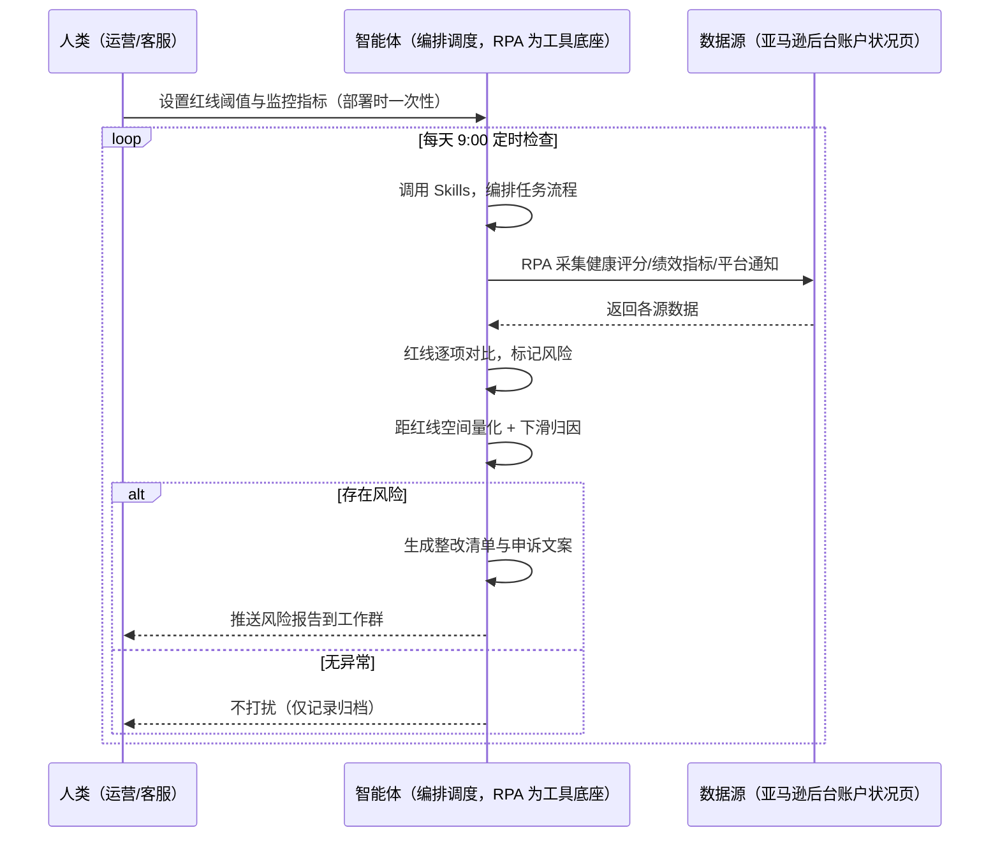
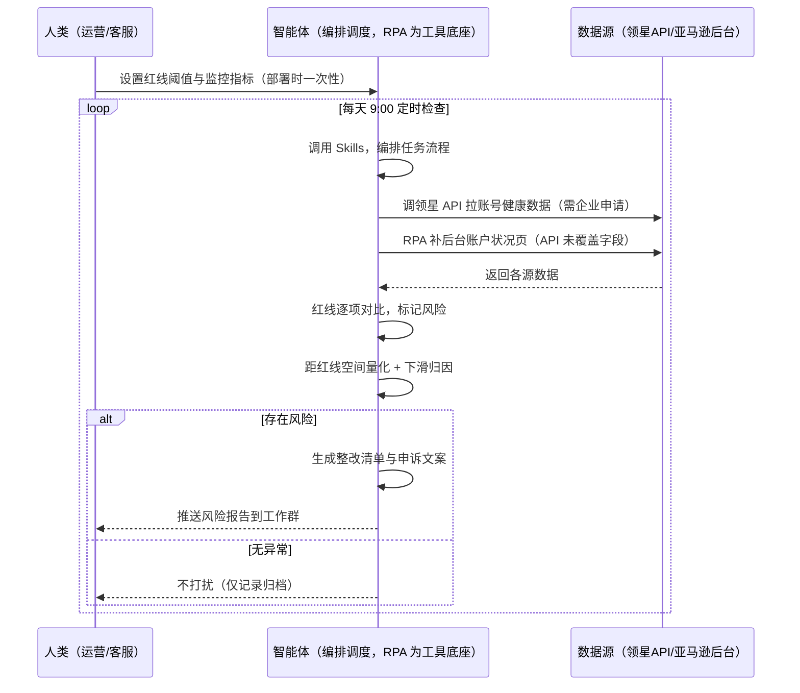

> 为亚马逊卖家团队打造的，由智能体调度多工具完成账号健康度检查任务的方案。健康评分要定期人工查看、平台通知靠盯，指标下滑了才后知后觉，本方案由智能体调度八爪鱼 RPA（Agent 的工具底座，能耦合多系统、完成自动化任务执行）统一取数。每天定时检查，有风险才推送，踩线前就预警。

> Agent 自动化需开通企业功能
> 点击申请1个月免费权限
> [点击申请 →](https://skieer.feishu.cn/share/base/form/shrcnFwMayykP5iaL38fnZKTbrg)

## 一、用户与需求

核心矛盾：健康评分要定期人工查看、平台通知靠盯，指标下滑了才后知后觉——ODR 超红线可能直接关店，等到发现已经来不及整改。

两类客户痛点同源，数据来源不同：

- 未购 SaaS 客户（新卖家/小团队）：人工定期登录账户状况页查健康评分，凭经验判断危不危险，全靠手；
- 已购 SaaS 客户（领星 ERP 有账号健康模块）：领星有账号健康数据与预警，但红线逐项对比、下滑归因、整改清单仍要人做。

适用客户：账号是核心资产、需每天盯健康度的卖家。店铺少的小卖家价值有限（人工每周查看即可，本方案不推荐）。

### 1.1 不同模式卖家

| 类型 | 选择 | 建议 |
|-|-|-|
| 品牌 | 首选 | 强烈推荐（账号是核心资产，健康度不容有失） |
| 精铺 | 次选 | 一般推荐，聚焦主力店铺健康度 |
| 铺货 | 任意 | 不推荐，店铺少人工查看即可 |

### 1.2 不同类目卖家

| 类目 | 最关注维度 | 核心逻辑 |
|-|-|-|
| 3C 数码 | ODR+差评 | 参数件客诉多，ODR 是红线 |
| 家居家具 | 迟发率 | 大件发货周期长，迟发率要盯 |
| 美妆个护 | 政策违规 | 敏感类目，政策违规风险高 |
| 服装鞋帽 | 取消率 | 退换高频，取消率要控 |
| 户外运动 | VTR | 功能件追踪率要求高 |
| 母婴用品 | 全面从严 | 安全类目，所有红线从严监控 |

### 1.3 不同角色用户

| 用户 | 需求 | 问题 | 投入时间（估算） |
|-|-|-|-|
| 老板 | 账号安全不关店 | 指标下滑后知后觉 | 0.5 小时/周 |
| 运营 | 健康度看板+整改 | 手动查指标费时 | 1-2 小时/天 |
| 客服 | 申诉/整改文案 | 指标超标不知怎么整改 | 0.5 小时/周 |

---

## 二、现在的方法与问题

### 2.1 流程步骤与问题总结

人工方式（未购 SaaS 客户）

| 序号 | 步骤 | 现在的方法 | 问题缺陷 |
|-|-|-|-|
| 1 | 看评分 | 定期手动查健康评分 | 频次低，下滑发现晚 |
| 2 | 盯通知 | 靠人盯平台通知 | 通知分散，易漏 |
| 3 | 对红线 | 凭经验判断危不危险 | 无红线对比口径 |
| 4 | 找原因 | 指标超标了猜原因 | 无归因方法 |
| 5 | 整改 | 手动写整改申诉 | 无模板，质量不一 |

SaaS 方式（已购领星 ERP 客户）

| 序号 | 步骤 | 现在的方法 | 问题缺陷 |
|-|-|-|-|
| 1 | 看评分 | 领星账号健康数据 | 数据权威，红线逐项对比靠人 |
| 2 | 盯通知 | 领星预警推送 | 单点事件告警，不归因 |
| 3 | 对红线 | 领星有健康评分 | 距红线空间说不清 |
| 4 | 找原因 | 猜 | 无归因方法 |
| 5 | 整改 | 手动写 | 无模板 |

### 2.2 问题分析

人工方式根因

| 序号 | 根因 | 具体表现 |
|-|-|-|
| 1 | 监控频次低 | 手动定期查看，下滑发现晚 |
| 2 | 无红线对比 | 距红线多少空间说不清 |
| 3 | 归因靠猜 | 指标超标不知道原因 |
| 4 | 整改无模板 | 申诉文案质量参差 |
| 5 | 经验不沉淀 | 整改规则在人脑里 |

SaaS 方式根因

| 序号 | 根因 | 具体表现 |
|-|-|-|
| 1 | 单点告警不归因 | 领星告诉你"ODR 超标了"，不说"为什么超、该改什么" |
| 2 | 红线空间不量化 | 距红线多少空间无自动计算 |
| 3 | 整改不沉淀 | 整改/申诉规则在个人经验里 |

---

## 三、解决方案

### 3.1 功能概述

为亚马逊卖家团队打造的智能体驱动账号健康度检查方案，解决健康度监控频次低、红线对比靠人、整改无依据的问题。

定时触发并调度多个工具，调起八爪鱼 RPA（Agent 的工具底座，能耦合多系统、完成自动化任务执行）统一取数，输出健康度分析，涵盖「红线逐项对比、风险标记、下滑根因分析、整改优先级、申诉/整改文案」。每天定时检查，有风险才推送，踩线前就预警。

### 3.2 系统结合

| 要素 | 说明 |
|-|-|
| 客户现有工具盘点 | 未购 SaaS 客户：无第三方工具，健康度全靠后台手动查。  
已购 SaaS 客户（主流组合）：领星 ERP（账号健康数据/预警，开放 API 需企业申请） |
| 数据/能力来源 | 未购 SaaS：亚马逊后台账户状况页（健康评分/绩效指标/平台通知，RPA 采集）。  
已购 SaaS：领星开放 API（账号健康数据，需企业申请权限）+ RPA 后台兜底（API 未覆盖字段） |
| RPA 耦合动作 | 作为 Agent 的工具底座，按计划调度多数据源取数（API 优先 + 后台采集兜底），按指标对齐去重合并，统一流转给智能体分析；任一数据源失败自动重试、异常告警 |
| 耦合出的新价值 | 单工具给不了的端到端结论：健康指标一次取齐 → 红线逐项对比 → 距红线空间量化 → 下滑归因 → 整改清单，有风险自动推送工作群，免去人工定期查指标 |

### 3.3 智能体执行流程

智能体定时触发。支持两种数据通道，部署时按客户现有工具选择：

通道一：无 SaaS 方式（RPA 采集账户状况页，适合未购领星的客户）

通道二：有 SaaS 方式（领星 API 拿健康核心，RPA 后台兜底，适合已购客户）

> Agent 自动化需开通企业功能
> 点击申请1个月免费权限
> [点击申请 →](https://skieer.feishu.cn/share/base/form/shrcnFwMayykP5iaL38fnZKTbrg)

### 3.4 为何这么设计

要同时回答三个问题：为什么不能只用 SaaS/API？为什么不能纯靠智能体写代码？ 本场景的核心是"每天定时、取数、红线对比、归因、整改建议、有风险推送、挂了有人管"。

#### 1）逐项对比

| 对比维度 | SaaS/API 堆叠（领星） | 纯智能体（智能体写代码） | 智能体+自动化工具（RPA 工具底座） |
|-|-|-|-|
| 实现方式 | 领星有健康数据与预警，红线对比靠人 | 能调 API 能抓后台，数据可自拼，但全要自己接 | 一个底座跑多个流程（健康/合规/售后/选品……），数据一处对齐 |
| 多系统耦合 | 领星单系统，无跨指标组装 | 全自建：API 鉴权、后台采集、对齐逻辑 | 平台沉淀多源取数与对齐，可视化配置 |
| 对比与归因 | 领星单点告警不解释 | 对比逻辑自写，灵活但工程量大 | 判断交给智能体（红线对比+归因+整改），执行交给 RPA |
| 定时与推送 | 领星预警推送（单点事件） | 调度器/进程常驻/告警通道全自建 | 平台调度稳定触发，失败重试 + 异常告警，有风险才推送 |
| 使用成本（总拥有成本） | 一系统一订阅：领星 500-1500/月……随流程数增长 | 代理 IP + 服务器 + 开发维护人力，隐性成本高 | 一份平台订阅跑所有流程，单方案边际成本 ≈ 0 |
| 维护人要求 | 低（工具已成熟） | 规则调整都要开发介入 | 可视化流程，运营自己可调红线阈值、推送群 |

#### 2）优劣势说明

|  | SaaS/API 堆叠（领星） | 纯智能体（智能体写代码） | 智能体+自动化工具（RPA 工具底座） |
|-|-|-|-|
| 优势 | 健康数据权威、预警成熟 | 无订阅费；  
可深度定制红线规则；  
技术上完全可行 | 一个底座跑多流程、数据一处对齐；  
红线对比/归因/整改即开即用；  
非技术人员可维护 |
| 劣势 | 单点告警不归因；  
红线空间不量化；整改靠人 | 采集、对比、归因全自建；  
AI 生成代码是生成性的，漏判风险不可控 | 本地电脑运行需保持开机；  
订阅费；  
灵活性受平台模板边界限制 |

#### 3）结论

| 论点 | 说明 |
|-|-|
| 只用 SaaS/API 缺"归因与整改" | 领星解决健康数据与单点预警，但"红线逐项对比 + 下滑归因 + 整改清单"它不覆盖——这是本方案的增量 |
| 纯智能体缺"工程底座" | 指标取数与对齐 70% 的工作在工程（采集/对齐/调度/重试），不在"写对比逻辑"；RPA 作为工具底座把这 70% 已经造好 |
| 一个底座跑多流程 | 客户购买 RPA 平台是跑多个流程（健康/合规/售后/选品/后台操作），本方案只是其中一个——平台订阅费被多流程摊薄，单方案边际成本接近 0 |
| 确定性 vs 生成性 | 红线对比与归因是确定性任务——同样的指标，要求"每次对比一致、距红线空间算得准"。RPA 流程行为可预期，AI 生成的代码能跑通 ≠ 长期不漏判 |
| 时间 | 运营要的是"每天 9:00 拿到健康度报告和整改清单"，不是"每天手动查指标"；判断层交给智能体，执行层交给工具底座 |

### 3.5 功能清单

| 功能 | 系统 | 功能说明（解决问题） |
|-|-|-|
| 会话/定时 | 智能体 | 1. 理解人类语言，调用已预设好的 Skills。  
2. 编排多任务、调度多工具。 |
| 多系统数据取数 | RPA、指纹浏览器 | 1. 解决健康度监控频次低、指标下滑发现晚问题。  
2. 作为智能体工具底座被调度执行，页面抓取失败自动重试、指标缺失标注待补。  
3. 【无 SaaS 方式】 RPA 采集账户状况页健康评分/绩效指标/平台通知。【有 SaaS 方式】 调领星 API 拉账号健康数据（需企业申请）+ RPA 后台兜底。 |
| 数据清洗对齐 | 智能体 | 按指标对齐去重，解决多来源数据口径不一致问题。 |
| 红线对比 | 智能体 | ODR/迟发率/取消率/VTR/政策违规逐项对比平台红线，标记风险并量化距红线空间。 |
| 下滑归因 | 智能体 | 指标超标关联同期事件（差评增多/物流延误/政策变动），按贡献度排序解释原因。 |
| 整改建议 | 智能体 | 生成整改清单（优先级排序）+ 申诉/整改文案模板。申诉提交由人工确认后执行。 |
| IM通知 | 飞书、钉钉、企微等 | 解决账号风险发现滞后问题。有风险才推送风险报告到工作群，无异常不打扰。 |
| 数据资产储存 | 本地电脑、云储存 | 1. Skills 资产：红线阈值与整改规则库。  
2. 数据储存：健康度记录按日沉淀，可审计。  
3. 经验知识库：审核通过的整改文案持续沉淀。 |

### 3.6 智能体执行落地过程

部署时一次性配置入参（红线阈值、监控指标、推送群、数据通道），会话中无需重复输入。

⚠️ 部署前提（不满足则方案无法跑起来）：①RPA 需部署在常开电脑/云机上（每天定时检查，关机即停），并配置漏跑补跑机制；②有 SaaS 方式需领星企业客户申请开放 API 权限（未开通自动降级为无 SaaS 通道，走后台采集）；③申诉提交涉及平台流程，由人工确认后执行；④首次配置（API 鉴权、红线阈值、归因规则）需服务方/技术人员介入一次，属实施成本。

#### 1）配置

| 类别 | 说明 |
|-|-|
| 智能体 | 主流智能体。 |
| 智能体工具 | 1. 数据通道（按客户现有工具二选一）：【无 SaaS】亚马逊后台账户状况页（RPA 采集）；【有 SaaS】领星开放 API（需企业申请）+ RPA 后台兜底。  
2. 数据取数与自动化执行：八爪鱼 RPA，MCP 配置完成。  
3. 数据分析：智能体自带。  
4. IM：企业办公 IM（飞书/钉钉/企微），MCP 或 webhook 配置。 |
| 工作知识 | 1. 红线阈值：ODR &lt;1%、迟发率 &lt;4%、取消率 &lt;2.5%、VTR ≥95% 等（按平台当前政策配置）。  
2. 监控指标清单。  
3. 归因维度：差评/物流/政策/价格。  
4. 整改模板：按指标类型预设。 |
| 本地数据库 | 1. 健康度记录地址。  
2. 整改清单地址。  
3. 经验库地址。 |

#### 2）执行

| 任务 | 产出 | 产出物接收人 |
|-|-|-|
| 接收监控配置，定时触发 | 任务启动记录 | —— |
| 调用已预设 Skills，编排任务流程 | 任务编排方案 | —— |
| 经 MCP 向八爪鱼 RPA 下发取数任务 | 自动化任务指令 | —— |
| 多源取数并按指标对齐（无 SaaS：后台采集；有 SaaS：领星 API+后台兜底，智能体监控状态） | 对齐后健康数据 | —— |
| 红线逐项对比，标记风险 | 风险标签 | 运营 |
| 距红线空间量化 + 下滑归因 | 归因结论 | 运营 |
| 生成整改清单与申诉文案（人工确认后提交） | 整改清单 | 运营/客服 |
| 推送风险报告（有风险才推送） | 群消息 | 运营/老板 |

异常处理：

页面抓取失败 → 自动重试；指标缺失 → 标注待补；

归因置信度低 → 转人工判断；

数据缺失 → 标注并沿用上次快照；

置信度 &lt;70% → 转人工复核，不输出硬结论。

#### 3）结果

| 结果 | 说明 |
|-|-|
| 数据资产 | 全量健康度结构化数据（评分/各指标/距红线空间/风险标签/归因/整改状态），可审计。 |
| 分析报告 | 1. 健康度报告：评分 + 各指标红线对比，一目了然。  
2. 风险清单：超标指标附距红线空间与归因。  
3. 整改清单：优先级排序 + 申诉/整改文案。 |
| Skills | 智能体 Skills：红线阈值与整改规则库。 |

> Agent 自动化需开通企业功能
> 点击申请1个月免费权限
> [点击申请 →](https://skieer.feishu.cn/share/base/form/shrcnFwMayykP5iaL38fnZKTbrg)

---

## 四、使用前后预估

> 本方案价值 = 健康度每日扫描 + 红线空间量化 + 下滑归因 + 整改清单。不承诺替代人工申诉——申诉由人工确认。适合账号为核心资产、需每天盯健康度的卖家。

| 指标 | 人工 | SaaS/API（领星） | 智能体+自动化工具 |
|-|-|-|-|
| 检查耗时 | 每天 1-2 小时（估算） | 领星数据自动，对比靠人 | 全自动；人工转为审核整改（每周约 0.5 小时） |
| 发现时效 | 下滑后知后觉 | 领星单点告警 | 每天扫描，踩线前预警 |
| 红线对比 | 凭经验 | 领星有评分，空间不量化 | 逐项对比 + 距红线空间量化 |
| 归因能力 | 猜 | 单点告警不解释 | 关联同期事件归因 |
| 整改质量 | 无模板 | 无 | 清单+文案模板就绪 |
| 方法论 | 无，换人结论不同 | 领星规则（单系统） | 可复用的 Skills 与规则库 |

说明：健康指标来自账户状况页或领星 API（准确字段）；红线阈值按平台当前政策配置（平台政策变化需人工更新）；归因为规则辅助，最终申诉由人工确认。

---

## 六、备注

### 6.1 Agent 支持

本方案不绑定具体智能体，主流 Agent 均可运行（需支持技能/Skills 加载与工具调用）：

| Agent/智能体 | 说明 |
|-|-|
| Workbuddy | 本方案运行平台，支持技能/Skills 上传加载、定时任务、MCP 工具调用与表格/报告处理 |
| 豆包（国内·字节） | 国内主流个人智能体，支持技能上传、定时任务与工具调用，上手成本低 |
| 通义千问（国内·阿里） | 支持 Agent 编排与插件生态，集成阿里电商数据能力，适合电商场景 |
| DeepSeek（国内） | 推理能力强、成本低，适合规则打分与归因分析类任务 |
| ChatGPT（国外·OpenAI） | 海外主流通用智能体，支持 GPTs/Agent 模式与工具调用 |
| Claude（国外·Anthropic） | 长文本与结构化分析能力强，原生支持 MCP 连接外部工具 |

### 6.2 名词解释

| 术语 | 说明 |
|-|-|
| ODR | Order Defect Rate，订单缺陷率，默认红线 &lt;1% |
| 迟发率 | Late Shipment Rate，默认红线 &lt;4% |
| 取消率 | 卖家主动取消率，默认红线 &lt;2.5% |
| VTR | Valid Tracking Rate，有效追踪率，默认 ≥95% |
| 距红线空间 | 当前指标与平台红线的差距量化 |
| 健康度 | 亚马逊账户状况页的健康评分（绿/黄/红） |
| 整改清单 | 按优先级排序的整改项与文案模板 |
| 混合数据源 | 官方导出/API 优先（更稳更合规）+ 后台采集兜底（免费、覆盖无 SaaS 客户与 API 缺口） |
| 有 SaaS 方式 | 已购领星，开放 API 拿健康数据 + RPA 后台兜底（需企业申请权限） |
| 无 SaaS 方式 | 不购买第三方工具，由 RPA 采集账户状况页 |
| MCP | Model Context Protocol，智能体连接外部工具的标准化通道 |
| 指纹浏览器 | 隔离 Cookie/浏览器指纹的工具，多店铺防关联 |

> Agent 自动化需开通企业功能
> 点击申请1个月免费权限
> [点击申请 →](https://skieer.feishu.cn/share/base/form/shrcnFwMayykP5iaL38fnZKTbrg)

---

原文：[查看原文](https://skieer.feishu.cn/wiki/Uz5UwCHXiikuPdkKsn7cZL7RnOg)
