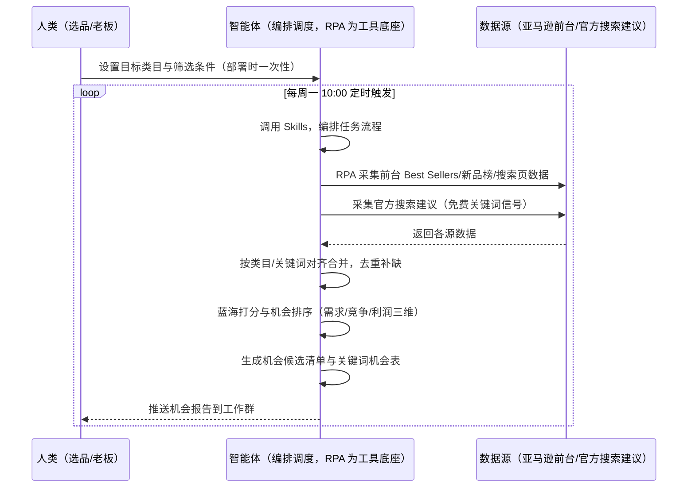
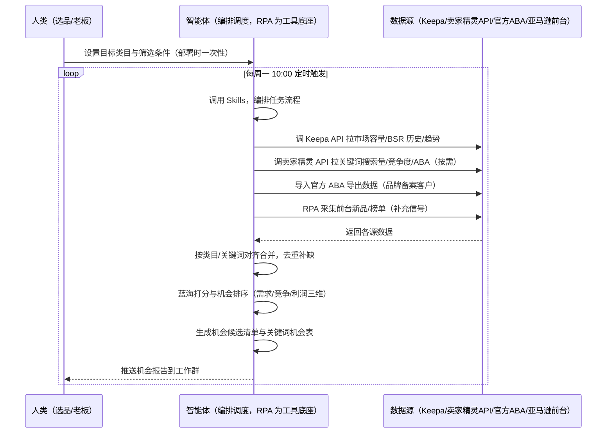

> 为亚马逊选品团队打造的市场机会发现方案。选品数据分散在 Keepa、卖家精灵、官方 ABA 与前台，本方案由智能体调度工具统一取数、输出机会报告，一次性给出蓝海方向、潜力关键词与捆绑组合的候选清单。

> Agent 自动化需开通企业功能
> 点击申请1个月免费权限
> [点击申请 →](https://skieer.feishu.cn/share/base/form/shrcnFwMayykP5iaL38fnZKTbrg)

## 一、用户与需求

核心矛盾：选品决策靠感觉——数据散在多个平台与工具，选品要在它们之间反复手动执行：开 Keepa 看趋势、切卖家精灵查关键词、翻前台看榜单、再导 ABA，手动贴表对比，凭经验拍板。等发现一个类目已经拥挤，往往晚了半年。

> 适用客户：有专职选品/运营团队、月 GMV 50 万以上、持续上新需求的卖家。只做一两个品类的小卖家价值有限（人工每周看一次榜单即可）。

两类客户痛点同源，数据来源不同：

- 未购 SaaS 客户（新卖家/小团队）：人工翻前台榜单、Best Sellers、新品榜，再搜关键词看竞争，全靠手抄；
- 已购 SaaS 客户（卖家精灵看关键词/市场、Keepa 看趋势）：工具各自为政，仍要人打开对照；ABA 数据要品牌备案客户才能导出。

### 1.1 不同模式卖家

| 类型 | 选择 | 建议 |
|-|-|-|
| 品牌 | 首选 | 强烈推荐（品类扩张、持续上新，需体系化机会评估） |
| 精铺 | 次选 | 推荐，聚焦核心类目的机会扫描 |
| 铺货 | 任意 | 不推荐，机会发现不是铺货核心动作 |

### 1.2 不同类目卖家

| 类目 | 最关注维度 | 核心逻辑 |
|-|-|-|
| 3C 数码 | 需求趋势 + 竞争集中度 | 迭代快，找需求上升、竞争分散的细分 |
| 家居家具 | 需求规模 + 评论缺口 | 大件决策周期长，看需求稳定与差评改进空间 |
| 美妆个护 | 卖点差异 + 评分空间 | 成分卖点差异化空间大，评分差距反映产品力 |
| 户外运动 | 季节性 + 评论缺口 | 功能性产品，看季节窗口与差评痛点 |

### 1.3 不同角色用户

| 用户 | 需求 | 问题 | 投入时间（估算） |
|-|-|-|-|
| 老板 | 决定投哪个方向 | 月底才看到选品汇总，且无数据支撑 | 1 小时/周 |
| 选品 | 蓝海方向 + 关键词机会清单 | 数据散在各工具，横向对比靠手工贴表，方向靠拍脑袋 | 4-8 小时/周 |

---

## 二、现在的方法与问题

### 2.1 流程步骤与问题总结

人工方式（未购 SaaS 客户）

| 序号 | 步骤 | 现在的方法 | 问题缺陷 |
|-|-|-|-|
| 1 | 找方向 | 翻前台 Best Sellers / 新品榜，凭感觉记类目 | 漏看、凭印象，覆盖面窄 |
| 2 | 查数据 | 逐个打开竞品页看价格/评论/BSR，手抄 | 反复切换、每天多次，易错漏 |
| 3 | 查关键词 | 手动搜词、猜搜索量 | 无关键词数据，靠猜 |
| 4 | 判断机会 | 凭经验"这个能做" | 无打分体系，换人结论不同 |
| 5 | 汇报 | 口头或表格给老板 | 无数据支撑，老板无法决策 |

SaaS 方式（已购卖家精灵/Keepa 客户）

| 序号 | 步骤 | 现在的方法 | 问题缺陷 |
|-|-|-|-|
| 1 | 找方向 | 卖家精灵选市场/选产品、Keepa 看趋势 | 工具各管一段，无跨源汇总 |
| 2 | 查数据 | 卖家精灵查关键词、Keepa 查 BSR 历史 | 两工具来回切，口径不一 |
| 3 | 查 ABA | 品牌备案客户导 ABA（有权限才能看） | 有权限门槛 |
| 4 | 判断机会 | 凭经验综合 | 无统一打分，结论不沉淀 |
| 5 | 汇报 | 各工具数据拼给老板 | 无体系化报告 |

### 2.2 问题分析

| 序号 | 根因 | 具体表现 |
|-|-|-|
| 1 | 多平台反复手动执行 | 前台/卖家精灵/Keepa/ABA 多处来回切，一周耗时 4-8 小时 |
| 2 | 无统一打分口径 | 需求/竞争/利润权重说不清，换人结论不同 |
| 3 | 数据有门槛 | ABA 需品牌备案、部分数据需付费接口 |
| 4 | 经验不沉淀 | 判断规则在人脑里，团队扩张难复制 |

---

## 三、解决方案

### 3.1 功能概述

为亚马逊选品团队打造的智能体驱动市场机会发现方案，解决选品数据跨多平台分散、人工反复手动执行、无统一打分口径的问题。

定时触发并调度多个工具，调起八爪鱼 RPA（Agent 的工具底座，能耦合多系统、完成自动化任务执行）统一取数，按关键词/类目对齐合并，输出市场机会报告，涵盖「蓝海打分、机会排序、关键词机会清单、捆绑组合建议」。每周定时出报告，不日频打扰。

### 3.2 系统结合

| 要素 | 说明 |
|-|-|
| 客户现有工具盘点 | **未购 SaaS 客户**：无第三方工具，数据全靠前台榜单 + 搜索页人工翻。  
**已购 SaaS 客户**（主流组合）：卖家精灵（关键词/市场/ABA 数据，开放 API 按接口付费）、Keepa（BSR/价格历史最全最稳，API €49/月起）、官方 ABA（需品牌备案） |
| 数据/能力来源 | **未购 SaaS**：亚马逊前台（Best Sellers / Movers & Shakers / 新品榜 / 搜索页，RPA 采集）+ 官方搜索建议（免费）。  
**已购 SaaS**：Keepa API（市场容量/BSR 历史/趋势）+ 卖家精灵开放 API（关键词搜索量/竞争度/ABA，按接口付费）+ 官方 ABA 导出（品牌备案客户）+ RPA 前台兜底（榜单/新品） |
| RPA 耦合动作 | 作为 Agent 的工具底座，按计划调度多数据源取数（官方导出/API 优先 + 前台采集兜底），按关键词/类目对齐去重合并，统一流转给智能体分析；任一数据源失败自动重试、异常告警 |
| 耦合出的新价值 | 单工具给不了的端到端结论：跨源数据一次取齐 → 蓝海打分 → 机会排序 → 关键词清单，每周自动产出机会报告推送工作群，免去人工在多工具间反复切换 |

### 3.3 智能体执行流程

用户向智能体输入会话（入参：目标类目/预算/利润底线）或智能体定时触发。支持两种数据通道，部署时按客户现有工具选择：

通道一：无 SaaS 方式（RPA 采集亚马逊前台，适合未购卖家精灵/Keepa 的客户）

通道二：有 SaaS 方式（Keepa/卖家精灵 API 拿核心，RPA 前台兜底，适合已购客户）

> Agent 自动化需开通企业功能
> 点击申请1个月免费权限
> [点击申请 →](https://skieer.feishu.cn/share/base/form/shrcnFwMayykP5iaL38fnZKTbrg)

### 3.4 为何这么设计

要同时回答三个问题：为什么不能只用 SaaS/API？为什么不能纯靠智能体写代码？ 本场景的核心是"每周定时、跨多个数据源取数、按统一口径打分、出机会报告、挂了有人管"。

#### 1）逐项对比

| 对比维度 | SaaS/API 堆叠（Keepa/卖家精灵） | 纯智能体（智能体写代码） | 智能体+自动化工具（RPA 工具底座） |
|-|-|-|-|
| 实现方式 | 每个数据源一个工具：关键词/趋势/ABA 各管一段，人工对照 | 能调 API 能抓前台，数据可自拼，但全要自己接 | 一个底座跑多个流程（机会发现/竞品分析/BSR 跟踪……），数据一处对齐 |
| 多源耦合 | Keepa 管趋势、卖家精灵管关键词、ABA 另导，无人组装 | 全自建：API 鉴权、前台反爬、登录态、对齐逻辑 | 平台沉淀多源取数与对齐，可视化配置 |
| 打分与判断 | 工具给数据不给结论（卖家精灵有选品分但不可定制） | 打分逻辑自写，灵活但工程量大 | 蓝海打分规则交给智能体（需求/竞争/利润权重可定制），执行交给 RPA |
| 定时与推送 | 各工具定时导出/单点提醒，无汇总报告 | 调度器/进程常驻/告警通道全自建 | 平台调度稳定触发，失败重试 + 异常告警，每周推送机会报告 |
| 使用成本（总拥有成本） | 一数据源一订阅：Keepa €49 + 卖家精灵 88 + ABA 权限……随数据源增长 | 代理 IP + 服务器 + 开发维护人力，隐性成本高 | 一份平台订阅跑所有流程，单方案边际成本 ≈ 0 |
| 维护人要求 | 低（工具已成熟） | 每次接口变更/规则调整都要开发介入 | 可视化流程，选品自己可调权重/类目/推送群 |

#### 2）优劣势说明

|  | SaaS/API 堆叠（Keepa/卖家精灵） | 纯智能体（智能体写代码） | 智能体+自动化工具（RPA 工具底座） |
|-|-|-|-|
| 优势 | 数据权威、功能成熟 | 无订阅费；  
可深度定制打分逻辑；  
技术上完全可行 | 一个底座跑多流程、数据一处对齐；  
蓝海打分规则可定制可沉淀；调度/重试/告警开箱即用 |
| 劣势 | 各数据源各自为政；  
无统一打分；  
ABA 有权限门槛；  
多工具订阅成本随数据源增长 | 多源取数、登录态、对齐、调度、告警全自建；  
AI 生成代码是生成性的，长跑不稳 | 本地电脑运行需保持开机（建议部署常开电脑/云机）；  
订阅费；灵活性受平台模板边界限制 |

#### 3）结论

| 论点 | 说明 |
|-|-|
| 只用 SaaS/API 缺"统一打分与报告" | Keepa/卖家精灵解决数据获取，但"需求/竞争/利润三维打分 + 汇总报告"是它们不给的——这是本方案的增量 |
| 纯智能体缺"工程底座" | 多源耦合 70% 的工作在工程（取数/登录态/对齐/调度/重试），不在"写打分逻辑"；RPA 作为工具底座把这 70% 已经造好 |
| 一个底座跑多流程 | 客户购买 RPA 平台是跑多个流程（机会发现/竞品分析/BSR/异动监控），本方案只是其中一个——平台订阅费被多流程摊薄，单方案边际成本接近 0 |
| 时间 | 选品要的是"每周一拿到机会报告"，不是"每周一修脚本"；判断层交给智能体，执行层交给工具底座 |

### 3.5 功能清单

| 功能 | 系统 | 功能说明（解决问题） |
|-|-|-|
| 会话/定时 | 智能体 | 1. 理解人类语言，调用已预设好的 Skills。  
2. 编排多任务、调度多工具。 |
| 多系统数据取数 | RPA、指纹浏览器 | 1. 解决选品数据分散在多平台、人工反复切换手动抄录问题。  
2. 作为智能体工具底座被调度执行，登录态自动维持、失败自动重试、异常告警。  
3. **【无 SaaS 方式】** RPA 采集前台 Best Sellers/新品榜/搜索页 + 官方搜索建议。  
**【有 SaaS 方式】** 调 Keepa API 拉市场容量/BSR 历史（€49/月起）、调卖家精灵 API 拉关键词/ABA（按需购买）、导入官方 ABA 导出；RPA 前台补榜单/新品。 |
| 数据清洗对齐 | 智能体 | 按类目/关键词对齐多源数据，去重合并、口径统一。 |
| 蓝海打分 | 智能体 | 机会分 = 需求分×0.4 + 竞争分×0.3 + 利润分×0.3（权重可定制），评分 >70 才进入候选清单。 |
| 机会排序与清单 | 智能体 | 输出机会候选清单（附数据支撑：搜索量/竞品数/评论缺口/价格带），TOP 机会标注理由。 |
| 关键词机会表 | 智能体 | 高搜索低竞争关键词清单（搜索量/竞争度/建议词），用于 Listing 与广告埋词。 |
| IM通知 | 飞书、钉钉、企微等 | 解决选品决策滞后问题。每周机会报告自动推送工作群。 |
| 数据资产储存 | 本地电脑、云储存 | 1. Skills 资产：打分权重与机会判断规则，被调度直接调用。  
2. 数据储存：机会库.xlsx 按周沉淀。  
3. 经验知识库：审核通过的机会方向持续沉淀。 |

### 3.6 智能体执行落地过程

部署时一次性配置入参（目标类目、预算、利润底线、打分权重、推送群、数据通道），会话中无需重复输入。

⚠️ 部署前提（不满足则方案无法跑起来）：

①RPA 需部署在常开电脑/云机上，并配置漏跑补跑机制；

②有 SaaS 方式需卖家精灵企业认证开通开放平台（个人版不支持，以官方政策为准）或 Keepa API 付费账号，未开通自动降级为无 SaaS 通道；

③ABA 数据需品牌备案客户权限（未备案则该数据源跳过，用前台搜索建议替代）；

④首次配置（API 鉴权、对齐规则、打分权重）需服务方/技术人员介入一次，属实施成本。

#### 1）配置

| 类别 | 说明 |
|-|-|
| 智能体 | 主流智能体。 |
| 智能体工具 | 1. **数据通道（按客户现有工具二选一）**：【无 SaaS】亚马逊前台（RPA 采集）+ 官方搜索建议；【有 SaaS】Keepa API（€49/月起）+ 卖家精灵开放 API（关键词/ABA 按需购买）+ 官方 ABA 导出（品牌备案）+ RPA 前台兜底。  
2. 数据取数与自动化执行：八爪鱼 RPA，MCP 配置完成。  
3. 数据分析：智能体自带。  
4. IM：企业办公 IM（飞书/钉钉/企微），MCP 或 webhook 配置。 |
| 工作知识 | 1. 目标类目与候选品类清单。  
2. 打分权重：需求 0.4 / 竞争 0.3 / 利润 0.3。3. 机会线：评分 >70 才推荐。  
4. 品类利润率基准：默认 25%。 |
| 本地数据库 | 1. 机会库地址。  
2. 报告库地址。  
3. 经验库地址。 |

#### 2）执行

| 任务 | 产出 | 产出物接收人 |
|-|-|-|
| 接收目标类目与条件，定时或会话 | 任务启动记录 | —— |
| 调用已预设 Skills，编排任务流程 | 任务编排方案 | —— |
| 经 MCP 向八爪鱼 RPA 下发取数任务 | 自动化任务指令 | —— |
| 多源取数并按类目/关键词对齐（无 SaaS：前台采集；有 SaaS：Keepa/卖家精灵/ABA + 前台兜底，智能体监控状态） | 对齐后选品数据 | —— |
| 蓝海打分与机会排序 | 机会评分标签 | 选品 |
| 生成机会候选清单与关键词机会表 | 机会报告 | 选品 |
| 推送机会报告到工作群 | 周度机会报告 | 选品/老板 |

异常处理：

前台采集遇反爬拦截 → 自动降频重试，仍失败转下轮补采；

API 限频 → 自动降频重试；

ABA 无权限 → 跳过该数据源并标注降级；

数据缺失 → 标注缺失并下轮补拉；

置信度 &lt;70% → 转人工复核，不输出硬结论。

#### 3）结果

| 结果 | 说明 |
|-|-|
| 数据资产 | 机会库.xlsx：类目/关键词机会数据（搜索量/竞品数/评论缺口/价格带/评分），按周沉淀可审计。 |
| 分析报告 | 1. 蓝海机会候选清单：每个方向附数据支撑（需求/竞争/利润三维）。  
2. 关键词机会表：高搜索低竞争词清单。  
3. 捆绑组合建议：互补品类组合。 |
| Skills | 智能体 Skills：蓝海打分权重与机会判断规则。 |

> Agent 自动化需开通企业功能
> 点击申请1个月免费权限
> [点击申请 →](https://skieer.feishu.cn/share/base/form/shrcnFwMayykP5iaL38fnZKTbrg)

---

## 四、使用前后预估

> 本方案价值 = **跨源数据一次取齐 + 统一打分 + 周度机会报告**。不承诺替代选品决策——报告是候选依据，最终立项由选品/老板判断（置信度 &lt;70% 转人工复核）。适合有团队、持续上新、愿配环境的卖家。

| 指标 | 人工 | SaaS/API（Keepa/卖家精灵） | 智能体+自动化工具 |
|-|-|-|-|
| 选品调研耗时 | 每周 4-8 小时（估算，多工具切换） | 每周 1-2 小时（估算，仍需跨工具对照） | 取数全自动；人工转为审核报告（每周约 0.5 小时） |
| 数据源切换 | 多处来回切 | 减少但仍需跨工具对照 | 一次取齐 |
| 打分口径 | 凭感觉，换人不同 | 工具内不可定制 | 三维打分权重可定制、可沉淀 |
| 报告产出 | 口头/手工表 | 各工具数据自行拼 | 每周自动机会报告推送 |
| 方法论沉淀 | 无 | 工具内规则不可跨源复用 | 可复用的 Skills 与规则库 |

说明：关键词搜索量、市场容量等数据为第三方估算值（卖家精灵/Keepa 均为估算），本方案用于相对排序（同口径比大小），不追求绝对精确；需要官方精确数据可叠加品牌备案 ABA。

---

## 五、效果证明

> Agent 自动化需开通企业功能
> 点击申请1个月免费权限
> [点击申请 →](https://skieer.feishu.cn/share/base/form/shrcnFwMayykP5iaL38fnZKTbrg)

### 5.1 实操课程教程

[查看原视频](https://skieer.feishu.cn/wiki/ItYBwSwvXiYFo9kHctLcOcBqnhf)

### 5.2 客户案例

**《家居龙头：20+ 海外平台商品数据自动化，日均 2.5 万条》**

> 20+ 海外平台的商品价格、运费、SKU、排名等多维度数据原靠人工抽样采集。RPA 实现全自动全量采集与入库，为跨境运营决策提供数据底座。

| 效果 | 说明 |
|-|-|
| 提效 | 多平台商品数据采集效率提升约 85%。原本 20+ 海外平台的商品数据靠人工抽样采集，现在全自动全量采集入库，日均 2.5 万条，运营上班即可看到最新数据。 |
| 降本 | 告别「导表格、拼数据」的重复劳动，运营团队从人工采集转为直接使用数据做选品与定价决策。 |
| 任务 | 覆盖 20+ 海外平台，价格/运费/SKU/EAN/首图/类目排名等 8+ 核心字段，支持变体信息全采集。 |
| 任务 | 采集稳定率 99%+，跨语言、跨页面结构、跨价格展示方式全部适配。 |

案例详情：[跨境取数：家居龙头的20+海外平台商品数据自动化实践](https://skieer.feishu.cn/wiki/Iko0wtqEfiOdzlkstYBc5DI3nUe)

**《竞品 AI 快报：多平台动态 7×24 监控与自动出报》**

> 某大型教培集团需盯多家竞品公众号、课程与活动动态，人工巡查信息零散难汇总。RPA 自动巡查多平台账号并生成竞品快报。

| 效果 | 说明 |
|-|-|
| 提效 | 竞品动态巡查由人工每日逐平台翻阅变为 7×24 自动监控。原本市场团队需人工登录多平台逐篇查看推文、课程与活动，现在自动抓取、自动分析、自动出报告。 |
| 降本 | 市场团队用于公众号巡查、内容摘抄与情报汇总的重复性工作量降低约 80%，投入转向课程优化、活动策划与市场竞争策略等重点工作。 |
| 任务 | 竞品课程、价格及营销动态识别准确率提升至 95% 以上，减少遗漏与误判。 |
| 任务 | 多平台账号自动巡查，情报按周期自动汇总成报。 |

案例详情：[快报|社媒监控：竞品AI快报生成自动化](https://skieer.feishu.cn/wiki/UNA7wUatCih1D2kXL5Fco3MpnGe)

---

## 六、备注

### 6.1 Agent 支持

本方案不绑定具体智能体，主流 Agent 均可运行（需支持技能/Skills 加载与工具调用）：

| Agent/智能体 | 说明 |
|-|-|
| Workbuddy | 本方案运行平台，支持技能/Skills 上传加载、定时任务、MCP 工具调用与表格/报告处理 |
| 豆包（国内·字节） | 国内主流个人智能体，支持技能上传、定时任务与工具调用，上手成本低 |
| 通义千问（国内·阿里） | 支持 Agent 编排与插件生态，集成阿里电商数据能力，适合电商场景 |
| DeepSeek（国内） | 推理能力强、成本低，适合规则打分与归因分析类任务 |
| ChatGPT（国外·OpenAI） | 海外主流通用智能体，支持 GPTs/Agent 模式与工具调用 |
| Claude（国外·Anthropic） | 长文本与结构化分析能力强，原生支持 MCP 连接外部工具 |

### 6.2 名词解释

| 术语 | 说明 |
|-|-|
| 蓝海打分 | 机会分 = 需求分×0.4 + 竞争分×0.3 + 利润分×0.3，>70 才进入候选清单 |
| 机会候选清单 | 附数据支撑（搜索量/竞品数/评论缺口/价格带）的方向清单，供选品立项 |
| 关键词机会表 | 高搜索低竞争关键词清单，用于 Listing 与广告埋词 |
| 混合数据源 | 官方导出/API 优先（更稳更合规）+ 前台采集兜底（免费、覆盖无 SaaS 客户与 API 缺口） |
| ABA | Amazon Brand Analytics，品牌分析数据，需品牌备案后导出 |
| 有 SaaS 方式 | 已购 Keepa/卖家精灵，开放 API 拿核心字段 + RPA 前台兜底（API 按接口付费、需企业认证开通） |
| 无 SaaS 方式 | 不购买第三方数据工具，由 RPA 采集亚马逊前台公开数据 + 官方搜索建议 |
| ASIN | Amazon Standard Identification Number，亚马逊商品标识号 |
| MCP | Model Context Protocol，智能体连接外部工具的标准化通道 |

> Agent 自动化需开通企业功能
> 点击申请1个月免费权限
> [点击申请 →](https://skieer.feishu.cn/share/base/form/shrcnFwMayykP5iaL38fnZKTbrg)

---

原文：[查看原文](https://skieer.feishu.cn/wiki/ItYBwSwvXiYFo9kHctLcOcBqnhf)
