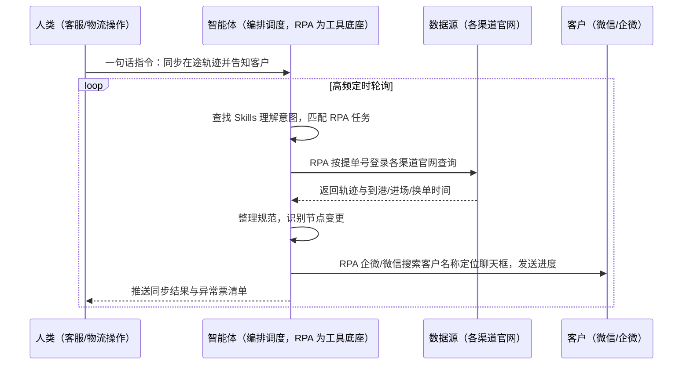
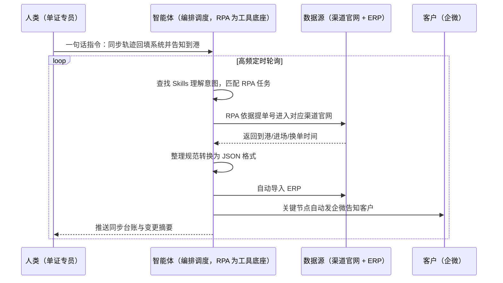

> 为货代/物流公司打造的物流轨迹同步与客户进度告知方案。货代的核心服务之一是解答客户问题，问得最多的是"货到哪里了"——客服日均需手动查询上百票货物状态，并通过企微/微信逐一通知客户，占用 70% 以上工作时间；单证与物流部还要按提单号在 20+ 船司、3 码头、4 船代逐个查询到港时间并回填系统。本方案由智能体调度多个工具执行物流轨迹自动查询（按提单号轮询各渠道官网）+ 到港/进场/换单时间整理回填 ERP + 企微/微信自动定位客户并发送进度，输出轨迹同步台账与关键节点主动告知。高频定时执行，全程自动化，节点变更才打扰。

> Agent 自动化需开通企业功能
> 点击申请1个月免费权限
> [点击申请 →](https://skieer.feishu.cn/share/base/form/shrcnFwMayykP5iaL38fnZKTbrg)

| 类型 | 选择 | 建议 |
|-|-|-|
| 海运货代 | 首选 | 强烈推荐（船司/码头/船代渠道多，查询工作量最大） |
| 空运货代 | 首选 | 强烈推荐（时效敏感，进度告知频次要求高） |
| 海外仓/尾程商 | 次选 | 一般推荐（重点盯到仓与派送节点告知） |

### 1.2 不同航线类型

| 航线 | 最关注维度 | 核心逻辑 |
|-|-|-|
| 美西/美东 | 到港与提柜节点 | 客户最关心到港后提柜安排 |
| 欧基港 | 换单时间 | 换单慢一拍提货就排队 |
| 东南亚 | 高频进度更新 | 航次短周期快，告知节奏要跟上 |
| 中东/红海 | 异常绕行提示 | 绕航/改港信息要第一时间到客户 |
| 拉美 | 全程节点追踪 | 链路长中转多，客户焦虑感最强 |
| 澳新 | 到港准确度 | 舱位与到港计划变更频繁 |

### 1.3 不同角色用户

| 用户 | 需求 | 问题 | 投入时间（估算） |
|-|-|-|-|
| 客服 | 进度告知 | 日均查询上百票并逐一通知 | 占 70% 以上工作时间（案例口径） |
| 单证专员 | 到港时间回填 | 20+ 船司逐个查询回填系统 | 每日 2-3 小时机械查询 |
| 物流操作 | 节点跟踪 | 进场/换单时间分散各官网 | 被动响应客户催问 |

---

## 二、现在的方法与问题

### 2.1 流程步骤与问题总结

人工方式（无系统辅助）

| 序号 | 步骤 | 现在的方法 | 问题缺陷 |
|-|-|-|-|
| 1 | 收集提单号 | 人工从台账收集在途票号 | 票多易漏 |
| 2 | 逐渠道查询 | 人工登录各船司/码头/船代官网 | 渠道多切换繁琐（案例口径） |
| 3 | 记录节点 | 人工抄录到港/进场/换单时间 | 口径不一整理费劲 |
| 4 | 回填台账 | 人工填回 Excel/系统 | 费时易错 |
| 5 | 客户告知 | 企微/微信逐个发客户 | 占客服大量时间 |
| 6 | 催问响应 | 客户催了才查才答 | 不及时就客诉（案例口径） |

系统方式（有 ERP/TMS 辅助）

| 序号 | 步骤 | 现在的方法 | 问题缺陷 |
|-|-|-|-|
| 1 | 系统查轨迹 | TMS/ERP 内查已有节点 | 覆盖不了全部外部渠道 |
| 2 | 官网补查 | 仍需人工登录外部渠道官网 | 逐票查询量大（案例口径） |
| 3 | 回填系统 | 人工把查询结果填回 ERP | 琐碎耗时 |
| 4 | 告知客户 | 人工企微/微信通知 | 客服时间被占满 |

### 2.2 问题分析

人工方式根因

| 序号 | 根因 | 具体表现 |
|-|-|-|
| 1 | 查询动作机械 | 逐票逐渠道查询是纯重复劳动 |
| 2 | 告知靠人力 | 上百票逐一通知占 70% 时间（案例口径） |
| 3 | 无主动机制 | 节点变更客户不知道，催问驱动一切 |

系统方式根因

| 序号 | 根因 | 具体表现 |
|-|-|-|
| 1 | 外部渠道不通 | TMS 拿不到船司/码头官网实时节点 |
| 2 | 回填靠人工 | 查询结果人工搬进系统 |
| 3 | 告知仍靠人 | 系统不触达客户的微信/企微 |

---

## 三、解决方案

### 3.1 功能概述

为货代/物流公司打造的物流轨迹同步与客户进度告知方案，一句话调度轨迹自动查询 + 节点整理回填 + 客户自动告知，输出轨迹同步台账与关键节点主动推送。

一句话下达指令（如「把在途票的轨迹都同步一遍，到港的自动告诉客户」），智能体通过查找 Skills 文档库理解意图、匹配 N 个 RPA 自动化任务（提单号解析→多渠道轮询→节点整理→回填系统→客户定位→消息发送），经 MCP 调度八爪鱼 RPA 自动登录物流查询平台，获取到最新的物流信息；自动进入微信/企微搜索客户名称定位聊天框，给客户发消息告知物流进度，给客户吃定心丸。同时依据提单号自动进入对应的物流渠道官网，持续查询货物的预计到港时间、进场时间、换单时间；获取的物流信息经整理规范后自动转换为 JSON 格式，自动导入 ERP。全程自动化，运行状态实时反馈，节点变更才推送。

### 3.2 系统结合

| 要素 | 说明 |
|-|-|
| 客户现有工具盘点 | **无系统客户**：各船司/码头/船代官网 + Excel 台账 + 微信/企微。       **有系统客户**（主流）：ERP/TMS（轨迹回填与订单关联）+ 各渠道官网（轨迹源）+ 企业微信/微信（客户触达通道） |
| 数据/能力来源 | 各物流渠道官网的轨迹与节点查询（按提单号）；物流查询平台聚合查询；ERP 订单与客户主数据 |
| RPA 耦合动作 | 作为 Agent 的工具底座被调度执行：自动登录查询平台与各渠道官网、按提单号轮询轨迹、整理规范为 JSON 导入 ERP、自动在企微/微信搜索客户名称定位聊天框并发送进度消息 |
| 耦合出的新价值 | 单系统给不了的端到端结论：多渠道轨迹自动拉平 + 节点自动回填 ERP + 客户自动触达，**只推送节点变更与关键到港提醒** |

### 3.3 智能体执行流程

一句话下达指令，智能体自动调度。支持**两种数据通道**，部署时按客户现有工具选择：

**通道一：无 ERP 方式（官网查询 + Excel 台账 + 微信告知）**

**通道二：有 ERP 方式（JSON 回填，适合已购系统客户）**

> Agent 自动化需开通企业功能
> 点击申请1个月免费权限
> [点击申请 →](https://skieer.feishu.cn/share/base/form/shrcnFwMayykP5iaL38fnZKTbrg)

### 3.4 为何这么设计

要同时回答三个问题：**为什么不能只用纯代码 Agent？为什么不能只用纯 RPA？为什么两者要结合？** 本场景的核心是"多渠道轮询稳定跑、节点口径统一整理、客户触达自动化"。

#### 1）逐项对比

| 对比维度 | SaaS/API 堆叠（ERP/TMS+企微） | 纯智能体（智能体写代码） | 智能体+自动化工具（RPA 工具底座） |
|-|-|-|-|
| 实现方式 | 系统查不到的外部渠道仍人工盯 | 能写脚本轮询，但多渠道适配全自建 | 多渠道查询动作平台级封装 |
| 轮询可靠性 | 无自动轮询 | 可自建但稳定性看代码质量 | 高频定时，断点续跑 |
| 客户触达 | 无自动发消息 | 可自建但风控易触发 | 企微/微信定位聊天框自动发送（案例口径） |
| 使用成本（总拥有成本） | 系统订阅 + 客服人力 | 开发维护人力，隐性成本高 | 一份平台订阅跑多流程，单方案边际成本 ≈ 0 |
| 查询规模 | 人工逐票有限 | 取决于代码质量 | 案例口径：20+ 船司/3 码头/4 船代自动轮询 |
| 维护人要求 | 低（但客服量没减） | 规则调整都要开发介入 | 可视化流程，业务自己可改口径 |

技术栈速览：纯智能体路线需 Python（Playwright/pandas/微信自动化库）等自行实现多渠道登录保活、轨迹页面解析、JSON 转换与 ERP 导入、企微/微信消息发送、定时轮询等工程底座，全部自建自维护。

#### 2）优劣势说明

|  | SaaS/API 堆叠（ERP/TMS+企微） | 纯智能体（智能体写代码） | 智能体+自动化工具（RPA 工具底座） |
|-|-|-|-|
| 优势 | 订单数据权威；       回填口径系统化 | 无订阅费；       查询逻辑可深度定制 | 多渠道自动轮询；       节点自动回填 ERP；       客户自动触达 |
| 劣势 | 外部渠道仍人工查；       告知靠客服人力 | 多渠道与微信自动化全自建；       AI 生成代码是生成性的 | 本地电脑运行需保持开机；       微信侧有风控边界；       渠道官网改版需更新流程 |

**特别提醒**：微信个人号自动化发送存在账号风控边界，建议优先走**企业微信**触达；个人微信通道需控制发送频率与话术模板，异常即停转人工。对外发送的话术模板需业务负责人确认一次，避免表达失当引发客诉。

#### 3）结论

| 论点 | 说明 |
|-|-|
| 确定性 vs 生成性 | 轮询查询与消息发送是确定性任务，RPA 行为可预期；生成性代码跑一天 ≠ 跑一年 |
| 资产沉淀 | 登录态、渠道解析、话术模板沉淀在平台是活的，换人接手成立 |
| 一个底座跑多流程 | 客户购买 RPA 平台是跑多个流程（轨迹同步/运价监测/对账），本方案只是其中一个，订阅费被摊薄 |
| token 消耗极低 | 查询回填发送是规则化流水线，不调用大模型；仅变更摘要文案消耗少量 token |
| 客户体验 | 节点变更主动到客户，从"催问驱动"变"告知驱动"，续约口碑直接受益 |
| 时间 | 客服要的是"进度自动发给客户"，不是"上百票逐个复制粘贴" |

### 3.5 功能清单

| 功能 | 系统 | 功能说明（解决问题） |
|-|-|-|
| 会话/一句话指令 | 智能体 | 1. 理解自然语言意图，查找 Skills 文档库。       2. 匹配对应 RPA 自动化任务、编排多任务。 |
| 多渠道轨迹查询 | RPA | 自动登录物流查询平台与各渠道官网，按提单号获取最新物流信息（案例口径），解决逐票人工查询问题。 |
| 到港节点查询 | RPA | 持续查询预计到港时间、进场时间、换单时间（案例口径），解决关键节点分散查询问题。 |
| 节点整理回填 | 智能体、ERP | 物流信息经整理规范后自动转换为 JSON 格式，自动导入 ERP（案例口径），解决人工回填费时易错问题。 |
| 客户进度告知 | RPA、企微/微信 | 自动在企业微信/微信搜索客户名称定位聊天框，给客户发消息告知物流进度（案例口径），解决逐一通知占满客服时间问题。 |
| 变更主动推送 | 智能体、企微 | 节点变更（到港/进场/换单/异常）主动推客户与操作员，解决不及时回复引发客诉问题。 |
| 轨迹同步台账 | 智能体 | 在途票节点状态结构化存储，支撑客服应答与异常复盘。 |
| 数据资产储存 | 本地电脑、云储存 | 1. Skills 资产：轨迹同步技能。       2. 数据储存：轨迹台账库。       3. 经验知识库：客诉与异常处置回填。 |

### 3.6 智能体执行落地过程

部署时一次性配置入参（在途票清单口径、渠道清单、话术模板、推送对象、频率），会话中一句话即可触发，无需重复输入。

**⚠️ 部署前提（不满足则方案无法跑起来）**：①RPA 需部署在**常开电脑/云机**上，并配置漏跑补跑机制；②各渠道官网**登录态**需维护，登录失效自动告警；③企微/微信客户端需登录并保持在线，个人微信通道需评估风控边界；④话术模板需业务负责人确认一次；⑤首次配置（账号、渠道、模板）需服务方/技术人员介入一次，属实施成本。

#### 1）配置（五步）

| 步骤 | 操作 | 说明 |
|-|-|-|
| 第一步 | 下载八爪鱼 RPA，导入物流货代自动化模板 | 官网免费下载客户端；MCP 工具→添加应用 |
| 第二步 | 开启八爪鱼 RPA 的 MCP 服务端口 | 客户端→API-K→创建 API（名称自定义） |
| 第三步 | 在智能体中添加 MCP Server 连接 | 复制连接配置→智能体连接器→自定义连接器→配置 MCP→粘贴保存 |
| 第四步 | 验证工具列表 | 确认工具全部启用（即八爪鱼客户端内工具） |
| 第五步 | 测试运行效果 | 输入一句话指令，验证轨迹查询与客户告知 |

| 类别 | 说明 |
|-|-|
| 智能体 | 主流智能体（支持 MCP 连接、Skills 加载、定时任务）。 |
| 智能体工具 | 1. **数据通道（按客户现有工具二选一）**：【无 ERP】官网查询 + Excel 台账；【有 ERP】JSON 整理回填 ERP。       2. 数据取数与自动化执行：八爪鱼 RPA（MCP 协议接入）。       3. 数据分析：智能体自带。       4. IM：企业微信/微信（客户端自动化方式触达）。 |
| 工作知识 | 1. 在途票清单与提单号口径。       2. 渠道清单（船司/码头/船代）。       3. 节点变更判定规则。       4. 告知话术模板。 |
| 本地数据库 | 1. 轨迹台账库地址。       2. JSON 中转目录。       3. 发送记录存档地址。 |

#### 2）执行

| 任务 | 产出 | 产出物接收人 |
|-|-|-|
| 接收一句话指令，匹配 RPA 任务 | 任务启动记录 | —— |
| 调用已预设 Skills，编排任务流程 | 任务编排方案 | —— |
| 经 MCP 向八爪鱼 RPA 下发查询任务 | 自动化任务指令 | —— |
| 轮询各渠道官网查询轨迹节点 | 轨迹原始数据 | —— |
| 整理规范转 JSON 导入 ERP（有 ERP） | ERP 轨迹数据 | 单证/物流部 |
| 节点变更识别 | 变更票清单 | —— |
| 企微/微信定位客户发送进度 | 客户告知消息 | 客户 |
| 推送同步结果与异常票清单 | 群消息 | 客服/操作 |

异常处理：

登录失效 → 自动重试 2 次，仍失败告警推 IM；

某渠道查询失败 → 跳过并记录，下一轮自动补查；

客户聊天框定位失败 → 该票转人工告知，不盲发；

微信发送异常 → 即时暂停个人微信通道转企微，风控恢复后再启用。

#### 3）结果

| 结果 | 说明 |
|-|-|
| 数据资产 | 轨迹台账（票号/节点/时间/状态/告知记录），可复盘可审计。 |
| 分析报告 | 轨迹同步摘要：变更节点/到港预告/异常票清单。 |
| Skills | 智能体 Skills：轨迹同步技能，按渠道结构迭代。 |

> Agent 自动化需开通企业功能
> 点击申请1个月免费权限
> [点击申请 →](https://skieer.feishu.cn/share/base/form/shrcnFwMayykP5iaL38fnZKTbrg)

---

## 四、使用前后预估

> 本方案价值 = **多渠道自动轮询 → 节点自动回填 → 客户自动告知**。把客服从上百票复制粘贴的机械活中解放出来，进度主动到客户、催问不再驱动工作。

| 指标 | 人工 | SaaS/API（ERP/TMS+企微） | 智能体+自动化工具 |
|-|-|-|-|
| 轨迹查询 | 逐票逐渠道人工查 | 外部渠道仍人工查 | 多渠道自动轮询（案例口径） |
| 节点回填 | 人工抄录回填 | 人工搬进系统 | JSON 自动导入 ERP（案例口径） |
| 客户告知 | 日均上百票逐一通知 | 无自动告知 | 定位聊天框自动发送（案例口径） |
| 客服时间占用 | 70% 以上（案例口径） | 客服量没减 | 案例口径：释放 90% 重复操作时间 |
| 告知质量 | 忙时漏发错发 | 无 | 案例口径：100% 标准化规避人工错误 |
| 查询规模 | 人工逐票有限 | 部分渠道 | 案例口径：20+ 船司/3 码头/4 船代 |
| 月度工时 | —— | —— | 案例口径：每月节省 210 工时、效率提升 3 倍 |
| 方法论 | 在个人手里 | 系统固定口径 | Skills 同步与话术资产沉淀 |

**说明**：案例数字来自八爪鱼客户实践（案例口径：自动登录物流查询平台获取最新物流信息，企微/微信搜索客户名称定位聊天框自动发送进度，释放 90% 客服重复操作时间、100% 标准化；某货代 20+ 船司/3 码头/4 船代按提单号自动查询、JSON 回填 ERP，每月节省 210 工时、效率提升 3 倍）；本方案为按同口径复刻的实施路径，具体数值随在途票量与渠道数量而异（估算）。

---

## 五、效果证明

> Agent 自动化需开通企业功能
> 点击申请1个月免费权限
> [点击申请 →](https://skieer.feishu.cn/share/base/form/shrcnFwMayykP5iaL38fnZKTbrg)

### 5.1 客户案例

**《云仓物流状态同步：微信 – 飞书 – 物流群全链路自动化》**

> 涉及多个客户群与数十个快递群，高峰期每分钟都有新消息弹出，客服需在微信、飞书、快递系统、OMS 间反复切换，单条消息处理耗时 2-3 分钟。

| 效果 | 说明 |
|-|-|
| 提效 | 物流信息处理由人工盯群变为自动流转。原本客服需同时盯数十个客户群与快递群，单条消息处理耗时 2-3 分钟，现在机器人 7×24 自动处理，覆盖拦截、查询、改地址等 7 大场景。 |
| 降本 | 日均节省 2-3 小时/人的无效盯群时间，人力投入转向异常件处理与客户关系维护等重点工作。 |
| 任务 | 打通微信 – 飞书 – 物流群全链路，微信群消息与飞书指令自动流转分发。 |
| 任务 | 降低手工复制单号导致的错漏，减少退款率与赔付损失。 |

案例详情：[云仓物流状态同步](https://skieer.feishu.cn/wiki/OKy0wkYLximV2rkRCqRcl7FcnUh)

---

## 六、备注

### 6.1 Agent 支持

本方案不绑定具体智能体，主流 Agent 均可运行（需支持 MCP 连接、技能/Skills 加载与工具调用）：

| Agent/智能体 | 说明 |
|-|-|
| Workbuddy | 本方案运行平台，支持技能/Skills 上传加载、定时任务、MCP 工具调用与表格/报告处理 |
| 豆包（国内·字节） | 国内主流个人智能体，支持技能上传、定时任务与工具调用，上手成本低 |
| 通义千问（国内·阿里） | 支持 Agent 编排与插件生态，集成阿里电商数据能力，适合电商场景 |
| DeepSeek（国内） | 推理能力强、成本低，适合规则打分与归因分析类任务 |
| ChatGPT（国外·OpenAI） | 海外主流通用智能体，支持 GPTs/Agent 模式与工具调用 |
| Claude（国外·Anthropic） | 长文本与结构化分析能力强，原生支持 MCP 连接外部工具 |

### 6.2 名词解释

| 术语 | 说明 |
|-|-|
| 轨迹 | 货物从订舱到交付各节点的物流状态记录 |
| 提单号 | 提单（B/L）编号，查询海运轨迹的主键 |
| 到港时间 | 船舶预计到达目的港的时间（ETA） |
| 进场时间 | 集装箱进入码头堆场的时间 |
| 换单时间 | 凭提单换取提货单（D/O）的处理时间 |
| 船代 | 船舶代理公司，代船司办理港航业务 |
| 码头官网 | 港口/码头运营方提供的集港与放行查询渠道 |
| JSON 回填 | 把整理规范的节点数据转 JSON 格式自动导入 ERP |
| 节点变更 | 轨迹状态发生更新（如开航/到港/换单/异常） |
| 告知驱动 | 节点变更主动推送客户，替代客户催问 |
| ERP/TMS | 企业资源计划/运输管理系统，货代订单与轨迹数据载体 |
| 风控边界 | 微信/企微对外自动化发送的账号安全限制 |
| MCP | Model Context Protocol，智能体连接外部工具的标准化通道 |
| 一句话指令 | 用自然语言描述任务，智能体自动翻译为自动化流程 |
| Skills | 智能体可加载的预设技能资产，含流程与知识 |

> Agent 自动化需开通企业功能
> 点击申请1个月免费权限
> [点击申请 →](https://skieer.feishu.cn/share/base/form/shrcnFwMayykP5iaL38fnZKTbrg)

---

原文：[查看原文](https://skieer.feishu.cn/wiki/LJ60wAxrPiLMGAkRAzJcJVMQnKe)
