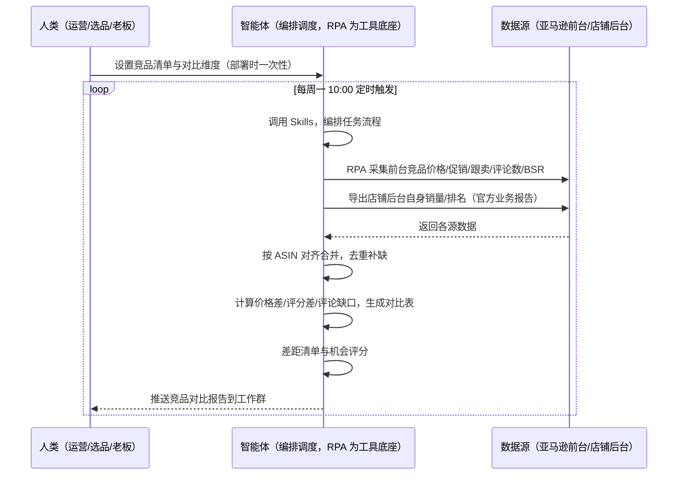
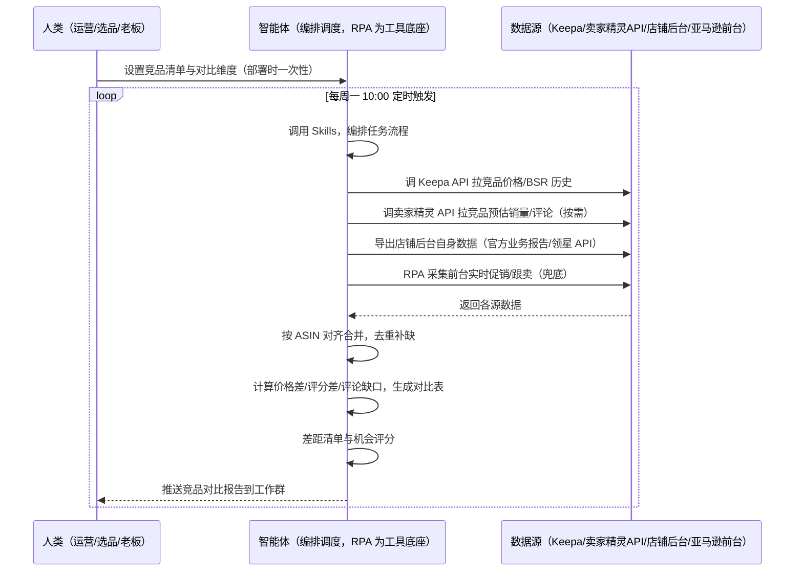

> 为亚马逊卖家团队打造的市场与竞品分析方案。竞品数据分散在多个平台与工具，本方案由智能体调度多个工具统一取数——未购 SaaS 走前台自动化采集，已购 SaaS 走"API 取核心 + 前台兜底"。周期性（每周/双周）输出竞品对比表与差距清单。

> Agent 自动化需开通企业功能
> 点击申请1个月免费权限
> [点击申请 →](https://skieer.feishu.cn/share/base/form/shrcnFwMayykP5iaL38fnZKTbrg)

## 一、用户与需求

核心矛盾：竞品数据分散在多个平台与工具，运营要做竞品横向对比时，要在它们之间反复手动执行——开前台看竞品价格评论、切卖家精灵看销量、切 Keepa 看趋势、再贴表对比，凭经验写差距。等做出一份能看的对比表，往往花掉大半天，且下次还要重来。两类客户痛点同源，数据来源不同：

- 未购 SaaS 客户（新卖家/小团队）：人工打开前台逐页翻竞品价格/评论/BSR，手抄进表；
- 已购 SaaS 客户（卖家精灵看销量、Keepa 看趋势）：工具各自为政，仍要人打开对照、手工拼表。

适用客户：竞品清单 ≥10 个、或多店铺需统一汇总、或定期要做选品立项对比的卖家。只盯 3-5 个竞品的小卖家价值有限（人工半天可完成）。

### 1.1 不同模式卖家

| 类型 | 选择 | 建议 |
|-|-|-|
| 品牌 | 首选 | 强烈推荐（核心竞品多、需定期立项对比） |
| 精铺 | 次选 | 推荐，聚焦对标 ASIN 的周期对比 |
| 铺货 | 任意 | 不推荐，铺货无立项对比需求 |

### 1.2 不同类目卖家

| 类目 | 最关注维度 | 核心逻辑 |
|-|-|-|
| 3C 数码 | 价格 + 功能参数 | 竞品迭代快，重点对比参数配置与降价冲击 |
| 家居家具 | 价格 + 评价增速 | 大件比价敏感，评价增速异常（刷评嫌疑）需关注 |
| 美妆个护 | 卖点 + 评分 | 成分卖点差异大，评分差距直接反映产品力 |
| 户外运动 | 价格 + 评论缺口 | 功能性产品，看竞品差评缺口找改进机会 |

### 1.3 不同角色用户

| 用户 | 需求 | 问题 | 投入时间（估算） |
|-|-|-|-|
| 老板 | 看市场格局、决定投哪个方向 | 月底才看到汇总，且无数据支撑 | 0.5-1 小时/周 |
| 选品 | 竞品差距清单 + 机会方向 | 数据散在各平台，横向对比靠手工贴表，方向靠拍脑袋 | 2-4 小时/周 |
| 运营 | 知道竞品定价/卖点/评价结构 | 对比表做一次废一次，无沉淀 | 1-2 小时/周 |

---

## 二、现在的方法与问题

### 2.1 流程步骤与问题总结

**人工方式（未购 SaaS 客户）**

| 序号 | 步骤 | 现在的方法 | 问题缺陷 |
|-|-|-|-|
| 1 | 找竞品 | 手动搜类目，记下竞品 ASIN | 漏记、错记，清单不全 |
| 2 | 查数据 | 前台逐页翻竞品价格/评论/BSR，手抄 | 反复切换、耗时，易错漏 |
| 3 | 贴表 | 手抄进 Excel | 字段乱、多期对不上 |
| 4 | 写差距 | 凭印象"我们贵/他们卖点强" | 无量化对比，结论靠感觉 |
| 5 | 汇报 | 口头或表格 | 无沉淀，下次重来 |

**SaaS 方式（已购卖家精灵/Keepa 客户）**

| 序号 | 步骤 | 现在的方法 | 问题缺陷 |
|-|-|-|-|
| 1 | 找竞品 | 手动记 ASIN | 漏记、错记 |
| 2 | 查数据 | 卖家精灵查销量、Keepa 查趋势，多工具来回切 | 各自为政，口径不一 |
| 3 | 贴表 | 工具导出后拼表 | 字段对不齐 |
| 4 | 写差距 | 凭经验综合 | 无量化对比体系 |
| 5 | 汇报 | 各工具数据拼给老板 | 无沉淀 |

### 2.2 问题分析

| 序号 | 根因 | 具体表现 |
|-|-|-|
| 1 | 多平台反复手动执行 | 前台/卖家精灵/Keepa 多处来回切，一次对比耗半天 |
| 2 | 无统一对比口径 | 各工具字段口径不一，多期对不上 |
| 3 | 差距判断凭感觉 | 无量化差距计算（价格差/评分差/评论缺口），结论不沉淀 |
| 4 | 经验不沉淀 | 判断规则在人脑里，换人结论不同 |

---

## 三、解决方案

### 3.1 功能概述

为亚马逊卖家团队打造的智能体驱动市场与竞品分析方案，解决竞品横向对比靠人工贴表、差距判断凭感觉的问题。

定时触发并调度多个工具，调起多个工具统一取数，按 ASIN 对齐合并，输出竞品对比报告，涵盖「竞品对比表、差距清单、机会评分、TOP 变化摘要」。周期性定时出报告，不日频打扰。

### 3.2 系统结合

| 要素 | 说明 |
|-|-|
| 客户现有工具盘点 | **未购 SaaS 客户**：无第三方工具，数据全靠前台翻页。   **已购 SaaS 客户**（主流组合）：卖家精灵（竞品预估销量/评论/价格历史，开放 API 按接口付费）、Keepa（BSR/价格历史最全最稳，API €49/月起） |
| 数据/能力来源 | **未购 SaaS**：亚马逊前台（竞品价格/促销/跟卖/评论数/BSR，RPA 采集）+ 官方业务报告导出（自身数据）。   **已购 SaaS**：Keepa API（价格/BSR 历史）+ 卖家精灵开放 API（预估销量/评论，按接口付费）+ RPA 前台兜底（实时促销/跟卖） |
| RPA 耦合动作 | 作为 Agent 的工具底座，按计划调度多数据源取数（官方导出/API 优先 + 前台采集兜底），按 ASIN 对齐去重合并，统一流转给智能体分析；任一数据源失败自动重试、异常告警 |
| 耦合出的新价值 | 单工具给不了的端到端结论：跨源数据一次取齐 → 竞品对比表 → 差距清单 → 机会评分，周期性自动产出报告推送工作群，免去人工在多工具间反复切换 |

### 3.3 智能体执行流程

用户向智能体输入会话（入参：竞品 ASIN 清单 + 自身 ASIN）或智能体定时触发。支持两种数据通道，部署时按客户现有工具选择：

通道一：无 SaaS 方式（RPA 采集亚马逊前台，适合未购卖家精灵/Keepa 的客户）

通道二：有 SaaS 方式（Keepa/卖家精灵 API 拿核心，RPA 前台兜底，适合已购客户）

> Agent 自动化需开通企业功能
> 点击申请1个月免费权限
> [点击申请 →](https://skieer.feishu.cn/share/base/form/shrcnFwMayykP5iaL38fnZKTbrg)

### 3.4 为何这么设计

要同时回答三个问题：为什么不能只用 SaaS/API？为什么不能纯靠智能体写代码？ 本场景的核心是"周期性定时、跨多个数据源取数、按统一口径出对比表、出差距结论、挂了有人管"。

#### 1）逐项对比

| 对比维度 | SaaS/API 堆叠（Keepa/卖家精灵） | 纯智能体（智能体写代码） | 智能体+自动化工具（RPA 工具底座） |
|-|-|-|-|
| 实现方式 | 每个数据源一个工具：销量/趋势/价格各管一段，人工拼表 | 能调 API 能抓前台，数据可自拼，但全要自己接 | 一个底座跑多个流程（竞品分析/异动监控/BSR……），数据一处对齐 |
| 多源耦合 | Keepa 管趋势、卖家精灵管销量，无人组装 | 全自建：API 鉴权、前台反爬、登录态、对齐逻辑 | 平台沉淀多源取数与对齐，可视化配置 |
| 对比与判断 | 工具给数据不给差距结论 | 对比逻辑自写，灵活但工程量大 | 对比表与差距清单交给智能体（价格差/评分差/评论缺口量化），执行交给 RPA |
| 定时与推送 | 各工具定时导出/单点提醒，无汇总报告 | 调度器/进程常驻/告警通道全自建 | 平台调度稳定触发，失败重试 + 异常告警，周期推送对比报告 |
| 使用成本（总拥有成本） | 一数据源一订阅，随数据源增长 | 代理 IP + 服务器 + 开发维护人力，隐性成本高 | 一份平台订阅跑所有流程，单方案边际成本 ≈ 0 |
| 维护人要求 | 低（工具已成熟） | 每次接口变更/规则调整都要开发介入 | 可视化流程，运营自己可调清单/对比维度/推送群 |

#### 2）优劣势说明

|  | SaaS/API 堆叠（Keepa/卖家精灵） | 纯智能体（智能体写代码） | 智能体+自动化工具（RPA 工具底座） |
|-|-|-|-|
| 优势 | 数据权威、功能成熟 | 无订阅费；   可深度定制对比逻辑；   技术上完全可行 | 一个底座跑多流程、数据一处对齐；   差距清单量化可沉淀；   调度/重试/告警开箱即用 |
| 劣势 | 各数据源各自为政；   无量化差距结论；   多工具订阅成本随数据源增长 | 多源取数、登录态、对齐、调度、告警全自建；   AI 生成代码是生成性的，长跑不稳 | 本地电脑运行需保持开机（建议部署常开电脑/云机）；   订阅费；   灵活性受平台模板边界限制 |

#### 3）结论

| 论点 | 说明 |
|-|-|
| 只用 SaaS/API 缺"量化差距结论" | Keepa/卖家精灵解决数据获取，但"价格差/评分差/评论缺口 + 差距清单"是它们不给的——这是本方案的增量 |
| 纯智能体缺"工程底座" | 多源耦合 70% 的工作在工程（取数/登录态/对齐/调度/重试），不在"写对比逻辑"；   RPA 作为工具底座把这 70% 已经造好 |
| 一个底座跑多流程 | 客户购买 RPA 平台是跑多个流程，本方案只是其中一个——平台订阅费被多流程摊薄，单方案边际成本接近 0 |
| 与异动监控互补 | 本方案（周度对比）回答"竞品现在什么样、我差在哪"，「竞品异动监控」（日频）回答"竞品今天动了没"——两套共享同一底座与数据源，不重复建设 |

### 3.5 功能清单

| 功能 | 系统 | 功能说明（解决问题） |
|-|-|-|
| 会话/定时 | 智能体 | 1. 理解人类语言，调用已预设好的 Skills。   2. 编排多任务、调度多工具。 |
| 多系统数据取数 | RPA、指纹浏览器 | 1. 解决竞品数据分散在多平台、人工反复切换拼表问题。   2. 作为智能体工具底座被调度执行，登录态自动维持、失败自动重试、异常告警。   3. **【无 SaaS 方式】** RPA 采集前台竞品价格/促销/跟卖/评论数/BSR；自身数据走官方业务报告导出。**【有 SaaS 方式】** 调 Keepa API 拉价格/BSR 历史（€49/月起）、调卖家精灵 API 拉预估销量/评论（按需购买）、自身数据走官方导出/领星 API；RPA 前台补实时促销/跟卖。 |
| 数据清洗对齐 | 智能体 | 按 ASIN 对齐多源数据，去重合并、口径统一，解决手工拼表对不齐问题。 |
| 对比表生成 | 智能体 | 竞品对比表：ASIN/标题/价格/预估销量/BSR/评论数/评分/卖点，多期可回溯。 |
| 差距清单 | 智能体 | 量化差距：价格差%、评分差、评论缺口、卖点差异，直接告诉团队"差在哪"。 |
| 机会评分 | 智能体 | 机会分 = 需求分×0.4 + 竞争分×0.3 + 利润分×0.3（权重可定制），>70 才推荐。 |
| IM通知 | 飞书、钉钉、企微等 | 解决对比结果滞后问题。竞品对比报告自动推送工作群。 |
| 数据资产储存 | 本地电脑、云储存 | 1. Skills 资产：对比维度与评分规则。   2. 数据储存：竞品库.xlsx 按周沉淀，多期可审计。   3. 经验知识库：审核通过的差距结论持续沉淀。 |

### 3.6 智能体执行落地过程

部署时一次性配置入参（竞品 ASIN 清单、自身 ASIN、对比维度、评分权重、推送群、数据通道），会话中无需重复输入。

⚠️ 部署前提（不满足则方案无法跑起来）：①RPA 需部署在常开电脑/云机上，并配置漏跑补跑机制；②有 SaaS 方式需卖家精灵企业认证开通开放平台或 Keepa API 付费账号，未开通自动降级为无 SaaS 通道；③自身数据若走领星 API 需企业申请权限，未开通则走官方业务报告导出；④首次配置（API 鉴权、对齐规则、评分权重）需服务方/技术人员介入一次，属实施成本。

#### 1）配置

| 类别 | 说明 |
|-|-|
| 智能体 | 主流智能体。 |
| 智能体工具 | 1. **数据通道（按客户现有工具二选一）**：【无 SaaS】亚马逊前台（RPA 采集）+ 官方业务报告导出；【有 SaaS】Keepa API（€49/月起）+ 卖家精灵开放 API（按需购买）+ 自身官方导出/领星 API + RPA 前台补促销/跟卖。   2. 数据取数与自动化执行：八爪鱼 RPA，MCP 配置完成。   3. 数据分析：智能体自带。   4. IM：企业办公 IM（飞书/钉钉/企微），MCP 或 webhook 配置。 |
| 工作知识 | 1. 竞品 ASIN 清单（含自身 ASIN）。   2. 对比维度：价格/预估销量/BSR/评论数/评分/卖点。   3. 机会评分权重：需求 0.4 / 竞争 0.3 / 利润 0.3。   4. 品类利润率基准：默认 25%。 |
| 本地数据库 | 1. 竞品库地址。   2. 报告库地址。   3. 经验库地址。 |

#### 2）执行

| 任务 | 产出 | 产出物接收人 |
|-|-|-|
| 接收竞品 ASIN 清单，定时或会话 | 任务启动记录 | —— |
| 调用已预设 Skills，编排任务流程 | 任务编排方案 | —— |
| 经 MCP 向八爪鱼 RPA 下发取数任务 | 自动化任务指令 | —— |
| 多源取数并按 ASIN 对齐（无 SaaS：前台采集+官方导出；有 SaaS：Keepa/卖家精灵 API + 前台兜底，智能体监控状态） | 对齐后竞品数据 | —— |
| 生成竞品对比表与差距清单 | 竞品对比表 + 差距清单 | 选品/运营 |
| 机会评分与排序 | 机会评分标签 | 选品 |
| 推送对比报告到工作群 | 竞品对比报告 | 选品/运营/老板 |

异常处理：前台采集遇反爬拦截 → 自动降频重试，仍失败转下轮补采；

API 限频 → 自动降频重试；

数据缺失 → 标注缺失并下轮补拉；对齐失败 → 降级说明本次覆盖率；

置信度 &lt;70% → 转人工复核，不输出硬结论。

#### 3）结果

| 结果 | 说明 |
|-|-|
| 数据资产 | 竞品库.xlsx：竞品全量结构化数据（价格/BSR/评论/环比/标签），多期可审计。 |
| 分析报告 | 1. 竞品对比表：谁在卖、卖多少、什么价、口碑如何。   2. 差距清单：价格差/评分差/评论缺口，直接告诉团队"差在哪"。   3. 机会评分：>70 才推荐。 |
| Skills | 智能体 Skills：对比维度与机会评分规则。 |

> Agent 自动化需开通企业功能
> 点击申请1个月免费权限
> [点击申请 →](https://skieer.feishu.cn/share/base/form/shrcnFwMayykP5iaL38fnZKTbrg)

---

## 四、使用前后预估

> 本方案价值 = **跨源数据一次取齐 + 量化差距清单 + 周期对比报告**。不承诺替代人工决策——差距清单是依据，最终判断由选品/运营复核（置信度 &lt;70% 转人工）。适合竞品 ≥10 个、愿配环境、接受半自动的卖家。

| 指标 | 人工 | SaaS/API（Keepa/卖家精灵） | 智能体+自动化工具 |
|-|-|-|-|
| 对比耗时 | 每周 2-4 小时（估算，多工具切换拼表） | 每周 0.5-1 小时（估算，仍需跨工具对照） | 取数全自动；人工转为审核报告（每周约 0.5 小时） |
| 数据源切换 | 多处来回切 | 减少但仍需跨工具对照 | 一次取齐 |
| 差距判断 | 凭感觉，换人不同 | 无量化差距结论 | 价格差/评分差/评论缺口量化，可沉淀 |
| 报告产出 | 手工拼表，做一次废一次 | 各工具数据自行拼 | 周期自动对比报告，多期可回溯 |
| 方法论沉淀 | 无 | 工具内规则不可跨源复用 | 可复用的 Skills 与规则库 |

说明：竞品销量为预估数据（SaaS API 估算值 / 无 SaaS 用 BSR 排名近似），本方案对比以价格、BSR、评论、评分等准确字段为核心，预估销量仅作参考。

---

## 五、效果证明

### 5.1 DEMO应用

DEMO应用：Amazon-批量实时查询竞品数据（卖家精灵）：https://rpa.bazhuayu.com/appstore/app/nailong/ya-ma-xun-pi-liang-shi-shi-cha-xun-jing-pin-shu-ju--mai-jia-jing-ling-

---

## 六、备注

### 6.1 Agent 支持

本方案不绑定具体智能体，主流 Agent 均可运行（需支持技能/Skills 加载与工具调用）：

| Agent/智能体 | 说明 |
|-|-|
| Workbuddy | 本方案运行平台，支持技能/Skills 上传加载、定时任务、MCP 工具调用与表格/报告处理 |
| 豆包（国内·字节） | 国内主流个人智能体，支持技能上传、定时任务与工具调用，上手成本低 |
| 通义千问（国内·阿里） | 支持 Agent 编排与插件生态，集成阿里电商数据能力，适合电商场景 |
| DeepSeek（国内） | 推理能力强、成本低，适合规则打分与归因分析类任务 |
| ChatGPT（国外·OpenAI） | 海外主流通用智能体，支持 GPTs/Agent 模式与工具调用 |
| Claude（国外·Anthropic） | 长文本与结构化分析能力强，原生支持 MCP 连接外部工具 |

### 6.2 名词解释

| 术语 | 说明 |
|-|-|
| 差距清单 | 价格差%、评分差、评论缺口、卖点差异的量化对比结果，直接告诉团队"差在哪" |
| 机会评分 | 机会分 = 需求分×0.4 + 竞争分×0.3 + 利润分×0.3，>70 才推荐 |
| 竞品对比表 | 竞品 ASIN/标题/价格/预估销量/BSR/评论数/评分/卖点的结构化对比 |
| 混合数据源 | 官方导出/API 优先（更稳更合规）+ 前台采集兜底（免费、覆盖无 SaaS 客户与 API 缺口） |
| 预估销量 | 竞品销量为估算值（SaaS API 估算 ±15% / 无 SaaS 用 BSR 近似），仅供趋势参考 |
| 有 SaaS 方式 | 已购 Keepa/卖家精灵，开放 API 拿核心字段 + RPA 前台兜底（API 按接口付费、需企业认证开通） |
| 无 SaaS 方式 | 不购买第三方数据工具，由 RPA 采集亚马逊前台公开数据 + 官方业务报告导出 |
| ASIN | Amazon Standard Identification Number，亚马逊商品标识号 |
| MCP | Model Context Protocol，智能体连接外部工具的标准化通道 |

> Agent 自动化需开通企业功能
> 点击申请1个月免费权限
> [点击申请 →](https://skieer.feishu.cn/share/base/form/shrcnFwMayykP5iaL38fnZKTbrg)

---

原文：[查看原文](https://skieer.feishu.cn/wiki/To2AwbxoBiLC5GkUbTcc3NbMnaf)
