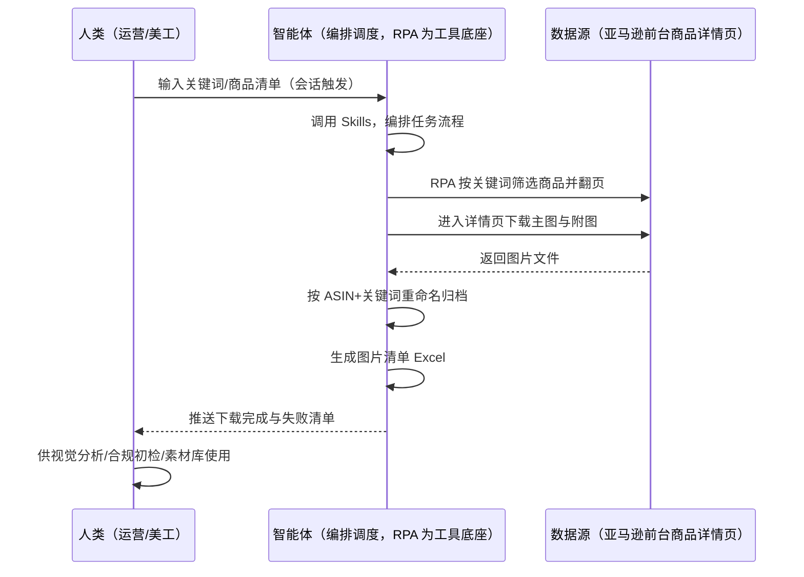

> 为亚马逊卖家团队打造的商品图片批量下载方案。竞品图片要一张张右键保存、命名混乱难管理，本方案由智能体调度多个工具统一执行自动化。按需触发，批量下载 + ASIN 自动命名归档 + 图片清单，供视觉分析与素材库使用。

> Agent 自动化需开通企业功能
> 点击申请1个月免费权限
> [点击申请 →](https://skieer.feishu.cn/share/base/form/shrcnFwMayykP5iaL38fnZKTbrg)

## 一、用户与需求

核心矛盾：竞品图片要一张张右键保存，命名混乱难管理，量大时手动下载费时——图片素材库建不起来，视觉分析与合规检查都无从谈起。两类客户痛点同源，数据来源相同（亚马逊前台公开图片）：

- 未购 SaaS 客户（新卖家/小团队）：人工按关键词翻页找商品，一张张右键另存为，再手动改名归档，全靠手；
- 已购 SaaS 客户（领星 ERP 等）：领星管运营数据，竞品图片下载不覆盖，仍要人手动保存。

适用客户：需建竞品素材库、做视觉对标与图片合规初检的卖家。偶尔下载几张图的小卖家价值有限（手动保存即可，本方案不推荐）。

### 1.1 不同模式卖家

| 类型 | 选择 | 建议 |
|-|-|-|
| 品牌 | 首选 | 强烈推荐（素材库是视觉分析与品牌建设基础） |
| 精铺 | 次选 | 一般推荐，聚焦主力竞品图片收集 |
| 铺货 | 任意 | 不推荐，按需下载即可 |

### 1.2 不同类目卖家

| 类目 | 最关注维度 | 核心逻辑 |
|-|-|-|
| 3C 数码 | 主图+参数图 | 参数件主图信息密度高，需批量收集 |
| 家居家具 | 场景图 | 大件看场景图与多角度展示 |
| 美妆个护 | 合规初检 | 图片含功效词需合规检查，先建素材库 |
| 服装鞋帽 | 上新图 | 款式迭代快，竞品上新图要及时收 |
| 户外运动 | 功能展示图 | 看动作演示图 |
| 母婴用品 | 合规+安全 | 安全类目，图片合规初检是重点 |

### 1.3 不同角色用户

| 用户 | 需求 | 问题 | 投入时间（估算） |
|-|-|-|-|
| 老板 | 视觉对标有素材 | 素材库没建起来 | 0.5 小时/周 |
| 运营 | 竞品图片素材库 | 一张张保存费时 | 1-2 小时/周 |
| 美工 | 命名规范的图 | 命名混乱难管理 | 1 小时/周 |

---

## 二、现在的方法与问题

### 2.1 流程步骤与问题总结

| 序号 | 步骤 | 现在的方法 | 问题缺陷 |
|-|-|-|-|
| 1 | 找商品 | 搜索关键词翻页 | 商品多，逐个找费时 |
| 2 | 存图片 | 右键另存为 | 一张张保存，量大费时 |
| 3 | 命名 | 手动改文件名 | 命名混乱，难管理 |
| 4 | 归档 | 放本地文件夹 | 无清单，找图靠记忆 |

### 2.2 问题分析

| 序号 | 根因 | 具体表现 |
|-|-|-|
| 1 | 下载靠手 | 逐张右键保存，量大多次重复 |
| 2 | 命名无序 | 文件名混乱，无法检索 |
| 3 | 无归档清单 | 图片与商品对不上，素材库建不起来 |
| 4 | 反爬限制 | 手动下载频繁易被限流 |

---

## 三、解决方案

### 3.1 功能概述

为亚马逊卖家团队打造的智能体驱动商品图片批量下载方案，解决图片一张张保存、命名混乱、素材库建不起来的问题。

按需触发并调度多个工具，，本方案由智能体调度多个工具统一执行自动化。「批量下载、ASIN 自动命名、归档整理、图片清单生成」，供视觉分析与素材库使用。

### 3.2 系统结合

| 要素 | 说明 |
|-|-|
| 客户现有工具盘点 | 未购 SaaS 客户：无第三方工具，图片全靠前台右键保存。  
已购 SaaS 客户（主流组合）：领星 ERP（管运营数据，不覆盖竞品图片下载） |
| 数据/能力来源 | 未购 SaaS：亚马逊前台商品详情页（主图/附图公开图片，RPA 采集）。  
已购 SaaS：数据源同为亚马逊前台（领星无图片接口），RPA 采集为主；图片清单可与领星 ASIN 数据关联做合规初检 |
| RPA 耦合动作 | 作为 Agent 的工具底座，按需调度前台采集（关键词筛选、详情页下载主图附图），按 ASIN+关键词命名归档，统一流转给智能体生成清单；  
下载失败自动重试、异常告警 |
| 耦合出的新价值 | 单工具给不了的端到端结果：批量下载 → 命名规范 → 归档结构 → 图片清单 Excel，一次到位，免去人工一张张保存与整理 |

### 3.3 智能体执行流程

用户按需触发（输入关键词）；智能体编排任务时调用已预设好的 Skills，再经 MCP 调度八爪鱼 RPA 等多个工具。

> Agent 自动化需开通企业功能
> 点击申请1个月免费权限
> [点击申请 →](https://skieer.feishu.cn/share/base/form/shrcnFwMayykP5iaL38fnZKTbrg)

### 3.4 为何这么设计

要同时回答两个问题：为什么不能只用 SaaS/API？为什么不能纯靠智能体写代码？ 本场景的核心是"按需触发、批量翻页、图片下载、命名归档、挂了有人管"。

#### 1）逐项对比

| 对比维度 | SaaS/API 堆叠（领星） | 纯智能体（智能体写代码） | 智能体+自动化工具（RPA 工具底座） |
|-|-|-|-|
| 实现方式 | 领星管运营数据，图片下载无接口 | 能抓前台，数据可自拼，但全要自己接 | 一个底座跑多个流程（图片/选品/竞品/VOC……），数据一处对齐 |
| 批量下载 | 无覆盖 | 翻页定位+下载需自写，图片链接变化即挂 | 平台按商品页模板稳定下载主图附图 |
| 反爬对抗 | 无 | 频繁下载易被限流，需自建降速/代理 | 平台级反爬基础设施内置，自动等待降速 |
| 命名归档 | 无 | 按 ASIN 重命名需自写文件处理逻辑 | 平台流程按 ASIN+关键词自动命名归档 |
| 清单生成 | 无 | 清单生成需自写 | 平台自动生成图片清单 Excel |
| 使用成本（总拥有成本） | 领星订阅不含此场景 | 代理 IP + 服务器 + 开发维护人力，隐性成本高 | 一份平台订阅跑所有流程，单方案边际成本 ≈ 0 |
| 维护人要求 | 低 | 页面改版需开发介入 | 可视化流程，运营自己可调关键词、命名规则 |

#### 2）优劣势说明

|  | SaaS/API 堆叠（领星） | 纯智能体（智能体写代码） | 智能体+自动化工具（RPA 工具底座） |
|-|-|-|-|
| 优势 | 自身数据权威（可关联合规初检） | 无订阅费；  
可深度定制下载逻辑；  
技术上完全可行 | 下载/命名/归档/清单即开即用；  
反爬降速内置；  
非技术人员可维护 |
| 劣势 | 图片下载无覆盖 | 下载与反爬逻辑全自建；  
AI 生成代码是生成性的，批量下载稳定性无保障 | 本地电脑运行需保持开机；  
订阅费；  
灵活性受平台模板边界限制 |

#### 3）结论

| 论点 | 说明 |
|-|-|
| 只用 SaaS/API 无此场景 | 领星管运营数据，竞品图片下载无接口覆盖——本方案填补空白 |
| 纯智能体缺"工程底座" | 批量翻页 + 图片下载 + 反爬降速 70% 的工作在工程，不在"写下载逻辑"；  
RPA 作为工具底座把这 70% 已经造好 |
| 一个底座跑多流程 | 客户购买 RPA 平台是跑多个流程（图片/选品/竞品/VOC），本方案只是其中一个——平台订阅费被多流程摊薄，单方案边际成本接近 0 |
| 确定性 vs 生成性 | 图片下载是确定性任务——同样的商品，要求"下载不重不漏、命名规则一致"。AI 生成的代码是生成性的，能跑通 ≠ 大批量稳定下载 |
| 场景定位 | 该场景偏工具型，单独价值有限，建议与其他监控/分析方案组合使用（本方案作为素材采集环节嵌入） |

### 3.5 功能清单

| 功能 | 系统 | 功能说明（解决问题） |
|-|-|-|
| 会话/定时 | 智能体 | 1. 理解人类语言，调用已预设好的 Skills。  
2. 编排多任务、调度多工具。 |
| 多系统数据取数 | RPA、指纹浏览器 | 1. 解决图片一张张保存、命名混乱问题。  
2. 作为智能体工具底座被调度执行，单图下载失败重试 2 次、反爬拦截等待降速。  
3. 【无 SaaS 方式】 RPA 采集前台商品详情页主图/附图。【有 SaaS 方式】 数据源同为前台（领星无图片接口），图片清单可与领星 ASIN 数据关联做合规初检。 |
| 数据清洗归档 | 智能体 | 按 ASIN+关键词重命名归档，解决图片与商品对不上问题。 |
| 图片清单生成 | 智能体 | 生成图片清单 Excel（ASIN/关键词/图片路径/下载状态），供竞品视觉分析、图片合规初检使用。 |
| IM通知 | 飞书、钉钉、企微等 | 解决下载完成通知问题。下载完成与失败清单自动推送。 |
| 数据资产储存 | 本地电脑、云储存 | 1. Skills 资产：图片命名与归档规则。  
2. 数据储存：图片素材库按 ASIN 归档，图片清单可检索。  
3. 经验知识库：素材应用经验持续沉淀。 |

### 3.6 智能体执行落地过程

会话启动只需输入关键词/商品清单；下表其余配置项（智能体工具、命名规则、归档目录）均为部署时一次性预设，会话中无需重复输入。

⚠️ 部署前提（不满足则方案无法跑起来）：①RPA 需部署在常开电脑/云机上（按需触发可接受任务时开机）；②亚马逊商品页有反爬风控，需自备账号并遵守平台条款，下载失败自动降速重试；③首次配置（登录态、命名规则、归档结构）需服务方/技术人员介入一次，属实施成本。

#### 1）配置

| 类别 | 说明 |
|-|-|
| 智能体 | 主流智能体。 |
| 智能体工具 | 1. 数据取数与自动化执行：八爪鱼 RPA，MCP 配置完成。  
2. 数据分析：智能体自带。  
3. 数据报告：智能体自带。  
4. 数据储存：Excel，智能体自带。  
5. IM：企业办公 IM（飞书/钉钉/企微），MCP 或 webhook 配置。 |
| 工作知识 | 1. 目标关键词/商品清单。  
2. 命名规则：默认 ASIN+关键词。  
3. 归档结构：按关键词/类目分目录。  
4. 下载范围：主图+附图默认全量。  
5. 重试规则：单图失败重试 2 次。 |
| 本地数据库 | 1. 图片素材库目录。  
2. 图片清单地址。 |

#### 2）执行

| 任务 | 产出 | 产出物接收人 |
|-|-|-|
| 接收关键词，会话启动 | 任务启动记录 | —— |
| 调用已预设 Skills，编排任务流程 | 任务编排方案 | —— |
| 经 MCP 向八爪鱼 RPA 下发取数任务 | 自动化任务指令 | —— |
| 按关键词筛选商品（智能体监控状态） | 商品列表 | —— |
| 进入详情页下载主图与附图 | 图片文件 | —— |
| 按 ASIN+关键词重命名归档 | 归档图片 | —— |
| 生成图片清单 Excel | 图片清单 | 运营/美工 |
| 推送下载完成与失败清单 | 完成通知 | 运营 |

异常处理：

单图下载失败 → 重试 2 次；

反爬拦截 → 等待降速后继续；

图片缺失 → 记录并标注；

页面改版无法解析 → 截图转人工。

#### 3）结果

| 结果 | 说明 |
|-|-|
| 数据资产 | 全量商品图片素材（按 ASIN 归档、命名规范、图片清单可检索）。 |
| 分析报告 | 1. 图片清单 Excel：ASIN/关键词/图片路径/下载状态。  
2. 素材库：供竞品视觉分析、图片合规初检使用。 |
| Skills | 智能体 Skills：图片命名与归档规则。 |

> Agent 自动化需开通企业功能
> 点击申请1个月免费权限
> [点击申请 →](https://skieer.feishu.cn/share/base/form/shrcnFwMayykP5iaL38fnZKTbrg)

---

## 四、使用前后预估

> 本方案价值 = 批量下载 + 命名规范 + 归档结构 + 清单可检索。偏工具型方案，建议与其他监控/分析方案组合使用。适合需建素材库、做视觉对标的卖家。

| 指标 | 人工 | SaaS/API（领星） | 智能体+自动化工具 |
|-|-|-|-|
| 下载耗时 | 每周 1-2 小时（估算） | 无覆盖 | 按需触发全自动；人工转为筛选使用（每周约 0.5 小时） |
| 命名规范 | 混乱难管理 | 无 | ASIN 自动命名 |
| 归档检索 | 找图靠记忆 | 无 | 清单可检索，快速定位 |
| 素材覆盖 | 收几张算几张 | 无 | 关键词全量下载 |
| 方法论 | 无 | 无 | 可复用的 Skills 与规则库 |

说明：图片来自亚马逊前台公开商品图；下载状态与失败项在清单中标注；本方案建议作为素材采集环节嵌入更大的监控/分析方案。

---

## 五、效果证明

> Agent 自动化需开通企业功能
> 点击申请1个月免费权限
> [点击申请 →](https://skieer.feishu.cn/share/base/form/shrcnFwMayykP5iaL38fnZKTbrg)

### 5.1 客户案例

**《家居龙头：20+ 海外平台商品数据自动化，日均 2.5 万条》**

> 20+ 海外平台的商品价格、运费、SKU、排名等多维度数据原靠人工抽样采集。RPA 实现全自动全量采集与入库，为跨境运营决策提供数据底座。

| 效果 | 说明 |
|-|-|
| 提效 | 多平台商品数据采集效率提升约 85%。原本 20+ 海外平台的商品数据靠人工抽样采集，现在全自动全量采集入库，日均 2.5 万条，运营上班即可看到最新数据。 |
| 降本 | 告别「导表格、拼数据」的重复劳动，运营团队从人工采集转为直接使用数据做选品与定价决策。 |
| 任务 | 覆盖 20+ 海外平台，价格/运费/SKU/EAN/首图/类目排名等 8+ 核心字段，支持变体信息全采集。 |
| 任务 | 采集稳定率 99%+，跨语言、跨页面结构、跨价格展示方式全部适配。 |

案例详情：[跨境取数：家居龙头的20+海外平台商品数据自动化实践](https://skieer.feishu.cn/wiki/Iko0wtqEfiOdzlkstYBc5DI3nUe)

### 5.2 DEMO应用

Amazon-下载产品图片-支持AdsPower指纹浏览器：https://rpa.bazhuayu.com/appstore/app/nailong/66d14a3f706e58c6bb369389

---

## 六、备注

### 6.1 Agent 支持

本方案不绑定具体智能体，主流 Agent 均可运行（需支持技能/Skills 加载与工具调用）：

| Agent/智能体 | 说明 |
|-|-|
| Workbuddy | 本方案运行平台，支持技能/Skills 上传加载、定时任务、MCP 工具调用与表格/报告处理 |
| 豆包（国内·字节） | 国内主流个人智能体，支持技能上传、定时任务与工具调用，上手成本低 |
| 通义千问（国内·阿里） | 支持 Agent 编排与插件生态，集成阿里电商数据能力，适合电商场景 |
| DeepSeek（国内） | 推理能力强、成本低，适合规则打分与归因分析类任务 |
| ChatGPT（国外·OpenAI） | 海外主流通用智能体，支持 GPTs/Agent 模式与工具调用 |
| Claude（国外·Anthropic） | 长文本与结构化分析能力强，原生支持 MCP 连接外部工具 |

### 6.2 名词解释

| 术语 | 说明 |
|-|-|
| 主图 | 商品详情页首张展示图，规格要求严格 |
| 附图 | 主图之外的展示图，含场景图、参数图等 |
| 素材库 | 按关键词/类目归档的图片集合，供分析复用 |
| 图片合规初检 | 检查图片是否含违禁词、夸大承诺等 |
| 视觉分析 | 竞品图片的构图、信息密度、卖点展示分析 |
| 命名规则 | 默认 ASIN+关键词 的图片命名方式 |
| AdsPower | 指纹浏览器品牌，支持多账号隔离 |
| 混合数据源 | 前台公开图片采集为主；图片清单可与领星 ASIN 数据关联做合规初检 |
| MCP | Model Context Protocol，智能体连接外部工具的标准化通道 |
| 指纹浏览器 | 隔离 Cookie/浏览器指纹的工具，多店铺防关联 |

> Agent 自动化需开通企业功能
> 点击申请1个月免费权限
> [点击申请 →](https://skieer.feishu.cn/share/base/form/shrcnFwMayykP5iaL38fnZKTbrg)

---

原文：[查看原文](https://skieer.feishu.cn/wiki/HTUvwSg5diU5Cmk1k93cesUlnhf)
