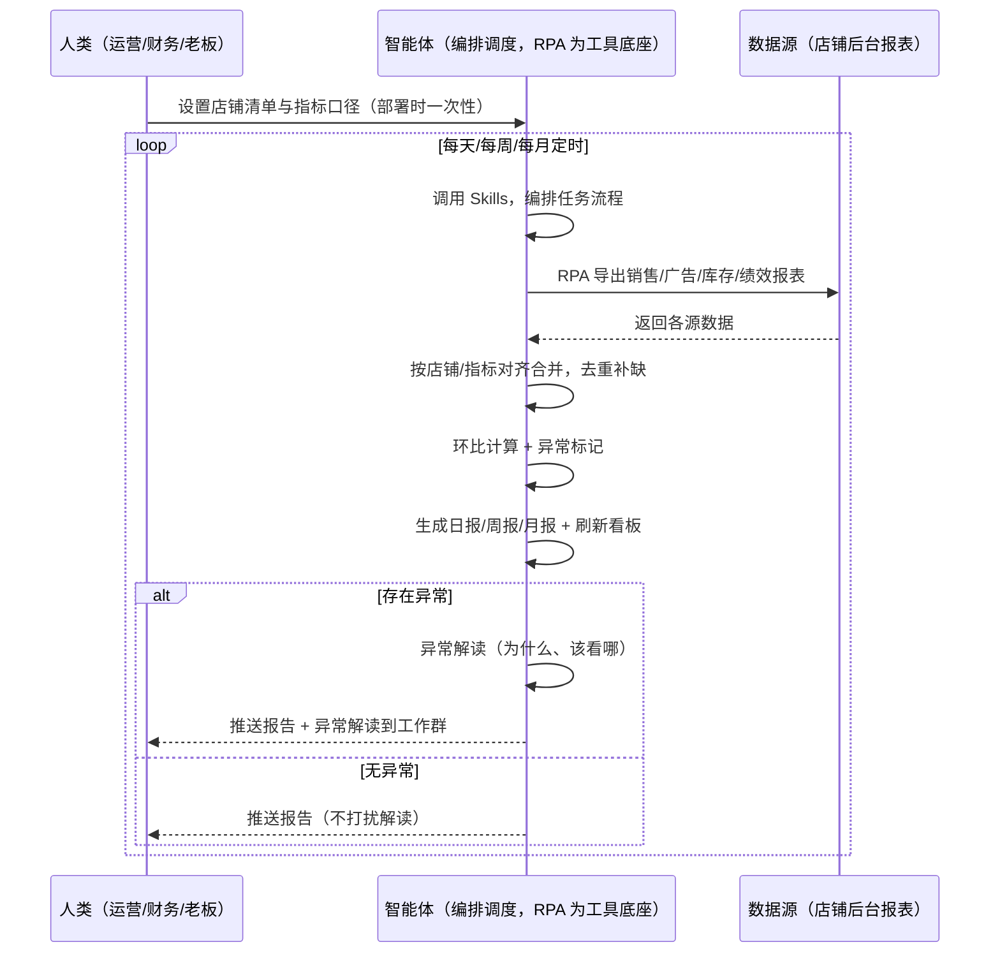
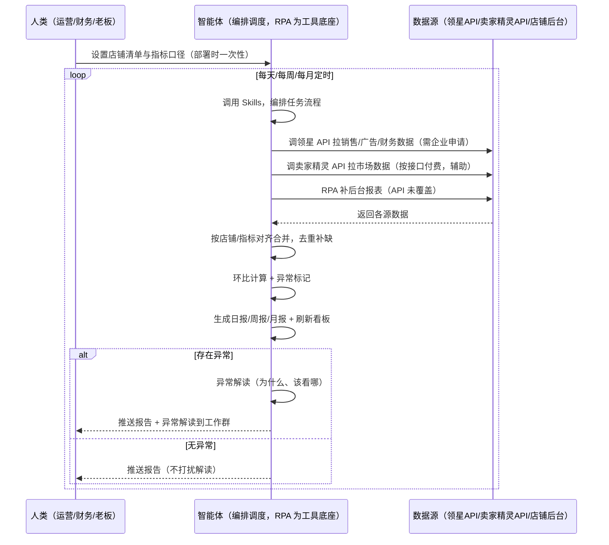

> 为亚马逊卖家团队打造的数据报表与经营看板方案。销售、广告、库存、绩效数据分散在多个后台，报表要逐个导出手工贴 Excel，本方案由智能体调度多个工具统一取数，每天/每周/每月定时汇总，自动出报表、刷看板，有异常才推送解读。

> Agent 自动化需开通企业功能
> 点击申请1个月免费权限
> [点击申请 →](https://skieer.feishu.cn/share/base/form/shrcnFwMayykP5iaL38fnZKTbrg)

## 一、用户与需求

核心矛盾：各后台数据要逐个导出、手工贴 Excel 做报表重复、做完手动发送费时；看板数据手动更新、逐项检查对不对也费时——报表和看板占据大量时间，还容易漏异常。

两类客户痛点同源，数据来源不同：

- 未购 SaaS 客户（新卖家/小团队）：人工从各后台分别导数据，手工贴进 Excel，算环比、标异常、手动发邮件，全靠手；
- 已购 SaaS 客户（领星 ERP 有报表/BI 驾驶舱）：领星有 BI 自定义驾驶舱与报表，但跨系统数据（销售+广告+库存+绩效）统一汇总、异常指标自动解读、日报周报月报自动生成仍要人做。

适用客户：多店铺多指标、报表与看板频次高的卖家。数据量少的小卖家价值有限（人工汇总即可，本方案不推荐）。

### 1.1 不同模式卖家

| 类型 | 选择 | 建议 |
|-|-|-|
| 品牌 | 首选 | 强烈推荐（多店铺多指标，报表与看板频次高） |
| 精铺 | 次选 | 一般推荐，聚焦主力店铺日报 |
| 铺货 | 任意 | 一般推荐，聚焦主力店铺日报 |

### 1.2 不同类目卖家

| 类目 | 最关注维度 | 核心逻辑 |
|-|-|-|
| 3C 数码 | 广告+利润 | 广告占比高，日报重点看 ACOS |
| 家居家具 | 库存周转 | 大件库存周转慢，看板重点监控 |
| 美妆个护 | 毛利+评价 | 毛利与评价活跃度并重 |
| 服装鞋帽 | 上新+销量 | 上新节奏快，日报看销量变化 |
| 户外运动 | 综合指标 | 功能件多维度综合看板 |
| 母婴用品 | 合规+绩效 | 安全类目，绩效与合规并重 |

### 1.3 不同角色用户

| 用户 | 需求 | 问题 | 投入时间（估算） |
|-|-|-|-|
| 老板 | 一表看清经营 | 数据分散，要等汇总 | 0.5 小时/天 |
| 运营 | 日报+异常解读 | 手动贴表费时 | 1-2 小时/天 |
| 财务 | 多店铺汇总 | 各店数据对不上 | 1 小时/周 |

---

## 二、现在的方法与问题

### 2.1 流程步骤与问题总结

人工方式（未购 SaaS 客户）

| 序号 | 步骤 | 现在的方法 | 问题缺陷 |
|-|-|-|-|
| 1 | 导数据 | 各后台分别导出 | 数据源多，导出费时 |
| 2 | 贴表 | 手工贴进 Excel | 重复劳动，易错 |
| 3 | 算环比 | 手动计算对比 | 无统一口径 |
| 4 | 标异常 | 凭经验看哪里不对 | 异常发现滞后 |
| 5 | 发报告 | 手动发邮件 | 发送费时，经常忘 |

SaaS 方式（已购领星 ERP 客户）

| 序号 | 步骤 | 现在的方法 | 问题缺陷 |
|-|-|-|-|
| 1 | 导数据 | 领星 BI 驾驶舱/报表 | 单系统数据，跨源汇总靠人 |
| 2 | 贴表 | 领星报表导出再拼 | 多源拼表费时 |
| 3 | 算环比 | 领星有环比 | 口径固定，特殊口径靠人 |
| 4 | 标异常 | 领星有预警 | 单点告警不解读 |
| 5 | 发报告 | 领星可推送 | 日报周报组装靠人 |

### 2.2 问题分析

人工方式根因

| 序号 | 根因 | 具体表现 |
|-|-|-|
| 1 | 数据源分散 | 销售/广告/库存/绩效多源，手动导出费时 |
| 2 | 口径不统一 | 多店铺多币种，合并去重靠手 |
| 3 | 无环比口径 | 涨跌判断凭感觉 |
| 4 | 异常后置 | 指标异常日报里发现不了 |
| 5 | 报告靠手 | 生成与发送重复劳动 |

SaaS 方式根因

| 序号 | 根因 | 具体表现 |
|-|-|-|
| 1 | 单系统口径 | 领星报表覆盖自身数据，跨源（广告/库存/绩效）汇总靠人 |
| 2 | 告警不解读 | 领星告诉你"指标异常了"，不说"为什么、该看哪" |
| 3 | 报告组装靠人 | 日报周报月报的组装与解读仍要人做 |

---

## 三、解决方案

### 3.1 功能概述

为亚马逊卖家团队打造的智能体驱动数据报表与经营看板方案，解决数据源分散、报表靠手、异常解读缺的问题。

每天/每周/每月定时触发并调度多个工具，调起八爪鱼 RPA（Agent 的工具底座，能耦合多系统、完成自动化任务执行）统一取数，按店铺/指标对齐合并，输出经营分析，涵盖「日报周报月报生成、多店铺汇总总表、经营看板刷新、异常指标解读推送」。有异常才推送解读，报告自动出。

### 3.2 系统结合

| 要素 | 说明 |
|-|-|
| 客户现有工具盘点 | 未购 SaaS 客户：无第三方工具，数据全靠各后台导出。   已购 SaaS 客户（主流组合）：领星 ERP（BI 驾驶舱/报表/财务，开放 API 需企业申请）、卖家精灵（市场/竞品数据，开放 API 按接口付费） |
| 数据/能力来源 | 未购 SaaS：店铺后台官方报表导出（销售/广告/库存/绩效，RPA 导出）。   已购 SaaS：领星开放 API（销售/广告/财务数据，需企业申请权限）+ 卖家精灵开放 API（市场数据辅助，按接口付费）+ RPA 后台导出兜底 |
| RPA 耦合动作 | 作为 Agent 的工具底座，按计划调度多数据源取数（API 优先 + 后台导出兜底），按店铺/指标对齐去重合并，统一流转给智能体分析；任一数据源失败自动重试、异常告警 |
| 耦合出的新价值 | 单工具给不了的端到端结论：跨源数据一次取齐 → 日报/周报/月报 → 多店铺汇总 → 看板刷新 → 异常解读，有异常自动推送解读，免去财务/运营手工贴表发报告 |

### 3.3 智能体执行流程

智能体定时触发（每天/每周/每月按节奏执行）。支持两种数据通道，部署时按客户现有工具选择：

通道一：无 SaaS 方式（RPA 导出后台报表，适合未购领星的客户）

通道二：有 SaaS 方式（领星/卖家精灵 API 拿核心，RPA 后台兜底，适合已购客户）

> Agent 自动化需开通企业功能
> 点击申请1个月免费权限
> [点击申请 →](https://skieer.feishu.cn/share/base/form/shrcnFwMayykP5iaL38fnZKTbrg)

### 3.4 为何这么设计

要同时回答三个问题：为什么不能只用 SaaS/API？为什么不能纯靠智能体写代码？ 本场景的核心是"定时汇总、跨源取数、按店铺对齐、报告生成、异常解读、挂了有人管"。

#### 1）逐项对比

| 对比维度 | SaaS/API 堆叠（领星/卖家精灵） | 纯智能体（智能体写代码） | 智能体+自动化工具（RPA 工具底座） |
|-|-|-|-|
| 实现方式 | 领星有 BI 驾驶舱，跨源汇总靠人 | 能调 API 能抓后台，但全要自己接 | 一个底座跑多个流程（报表/财务/售后/选品……），数据一处对齐 |
| 多源耦合 | 领星/卖家精灵各管一段，无人组装 | 全自建：API 鉴权、后台导出、对齐逻辑 | 平台沉淀多源取数与对齐，可视化配置 |
| 报告与解读 | 领星有报表，异常解读缺 | 报告逻辑自写，灵活但工程量大 | 判断交给智能体（环比+异常解读），执行交给 RPA |
| 定时与推送 | 领星报表自动，跨源推送缺 | 调度器/进程常驻/告警通道全自建 | 平台调度稳定触发，失败重试 + 异常告警，报告自动出 |
| 使用成本（总拥有成本） | 一系统一订阅：领星 500-1500/月 + 卖家精灵 88……随流程数增长 | 代理 IP + 服务器 + 开发维护人力，隐性成本高 | 一份平台订阅跑所有流程，单方案边际成本 ≈ 0 |
| 维护人要求 | 低（工具已成熟） | 指标口径/报告模板调整都要开发介入 | 可视化流程，运营自己可调指标、模板、推送群 |

#### 2）优劣势说明

|  | SaaS/API 堆叠（领星/卖家精灵） | 纯智能体（智能体写代码） | 智能体+自动化工具（RPA 工具底座） |
|-|-|-|-|
| 优势 | 财务/市场数据权威、BI 驾驶舱成熟 | 无订阅费；   可深度定制报告模板；   技术上完全可行 | 一个底座跑多流程、数据一处对齐；   日报周报月报自动出；   异常解读即开即用；   非技术人员可维护 |
| 劣势 | 跨源汇总靠人；   告警不解读；   报告组装靠人 | 导出、对齐、报告全自建；   AI 生成代码是生成性的，口径变更行为不完全可控 | 本地电脑运行需保持开机；   订阅费；   灵活性受平台模板边界限制 |

#### 3）结论

| 论点 | 说明 |
|-|-|
| 只用 SaaS/API 缺"跨源汇总与解读" | 领星解决单系统报表与 BI 看板，但"销售+广告+库存+绩效跨源汇总 + 异常解读"它不覆盖——这是本方案的增量 |
| 纯智能体缺"工程底座" | 跨源取数 70% 的工作在工程（导出/对齐/调度/重试），不在"写报告逻辑"；   RPA 作为工具底座把这 70% 已经造好 |
| 一个底座跑多流程 | 客户购买 RPA 平台是跑多个流程（报表/财务/售后/选品/后台操作），本方案只是其中一个——平台订阅费被多流程摊薄，单方案边际成本接近 0 |
| 确定性 vs 生成性 | 报表生成是确定性任务——同样的数据与口径，要求"每次报告口径一致、可审计"。RPA 流程行为可预期，AI 生成的代码能跑通 ≠ 口径长期一致 |
| 时间 | 运营要的是"报告自动出、异常自动解读"，不是"每天手动贴表发报告"；判断层交给智能体，执行层交给工具底座 |

### 3.5 功能清单

| 功能 | 系统 | 功能说明（解决问题） |
|-|-|-|
| 会话/定时 | 智能体 | 1. 理解人类语言，调用已预设好的 Skills。   2. 编排多任务、调度多工具。 |
| 多系统数据取数 | RPA、指纹浏览器 | 1. 解决数据源分散、手工贴表费时问题。   2. 作为智能体工具底座被调度执行，导出失败自动重试、数据缺失标注待补。   3. 【无 SaaS 方式】 RPA 导出销售/广告/库存/绩效报表。【有 SaaS 方式】 调领星 API 拉销售/广告/财务（需企业申请）+ 调卖家精灵 API 辅助（按接口付费）+ RPA 后台兜底。 |
| 数据清洗对齐 | 智能体 | 按店铺/指标对齐去重合并、多币种折算，解决多店铺口径不一致问题。 |
| 报表生成 | 智能体 | 日报（销量/ACOS/库存预警）、周报（趋势/竞品）、月报（利润/复盘）自动生成，模板可配置。 |
| 看板刷新 | 智能体 | 经营看板指标自动刷新（销量/广告/库存/利润/合规），一表看清。 |
| 异常解读 | 智能体 | 指标环比异常（销量骤降/ACOS 飙升/库存告急）自动解读原因并给建议，附数据支撑。 |
| IM通知 | 飞书、钉钉、企微等 | 解决报告交付滞后问题。报告自动推送工作群；有异常才推送解读，无异常只推报告不打扰。 |
| 数据资产储存 | 本地电脑、云储存 | 1. Skills 资产：报表模板与指标口径配置。   2. 数据储存：报表与看板数据统一写入本地，可审计。   3. 经验知识库：异常解读案例持续沉淀。 |

### 3.6 智能体执行落地过程

部署时一次性配置入参（店铺清单、指标口径、报表模板、推送群、数据通道），会话中无需重复输入。

⚠️ 部署前提（不满足则方案无法跑起来）：①RPA 需部署在常开电脑/云机上（每天定时汇总，关机即停），并配置漏跑补跑机制；②有 SaaS 方式需领星企业客户申请开放 API 权限或卖家精灵企业认证（未开通自动降级为无 SaaS 通道，走后台导出）；③指标口径（环比基准、异常阈值）需按店铺情况配置；④首次配置（API 鉴权、对齐规则、报表模板）需服务方/技术人员介入一次，属实施成本。

#### 1）配置

| 类别 | 说明 |
|-|-|
| 智能体 | 主流智能体。 |
| 智能体工具 | 1. 数据通道（按客户现有工具二选一）：【无 SaaS】店铺后台报表导出（RPA）；【有 SaaS】领星开放 API（需企业申请）+ 卖家精灵开放 API（按接口付费）+ RPA 后台兜底。   2. 数据取数与自动化执行：八爪鱼 RPA，MCP 配置完成。   3. 数据分析：智能体自带。   4. 数据报告：智能体自带。   5. IM：企业办公 IM（飞书/钉钉/企微），MCP 或 webhook 配置。 |
| 工作知识 | 1. 店铺清单与指标口径（销量/ACOS/库存/利润/合规）。   2. 环比基准：默认前 7 天均值。   3. 异常阈值：销量骤降 >30%、ACOS 飙升 >50%、库存可售天数 &lt;7。   4. 报表模板：日报/周报/月报预设。   5. 多币种折算：默认当日汇率。 |
| 本地数据库 | 1. 报表库地址。   2. 看板数据地址。   3. 经验库地址。 |

#### 2）执行

| 任务 | 产出 | 产出物接收人 |
|-|-|-|
| 接收店铺清单，定时触发 | 任务启动记录 | —— |
| 调用已预设 Skills，编排任务流程 | 任务编排方案 | —— |
| 经 MCP 向八爪鱼 RPA 下发取数任务 | 自动化任务指令 | —— |
| 多源取数并按店铺/指标对齐（无 SaaS：后台导出；有 SaaS：领星/卖家精灵 API+后台兜底，智能体监控状态） | 对齐后经营数据 | —— |
| 环比计算 + 异常标记 | 异常标签 | 运营 |
| 生成日报/周报/月报 + 刷新看板 | 报表/看板 | 运营/财务 |
| 异常解读（有异常才推送解读） | 解读报告 | 运营/老板 |
| 推送报告到工作群 | 群消息 | 运营/财务/老板 |

异常处理：

导出失败 → 自动重试；

数据缺失 → 标注待补；

口径不一致 → 标注并统一折算；

异常解读置信度低 → 转人工判断；

数据源接口维护 → 延后补采并标注；

置信度 &lt;70% → 转人工复核，不输出硬结论。

#### 3）结果

| 结果 | 说明 |
|-|-|
| 数据资产 | 全量经营结构化数据（店铺/指标/环比/异常标签/报表版本），可审计。 |
| 分析报告 | 1. 日报/周报/月报：按模板自动生成，口径统一。   2. 多店铺汇总总表：一表看清全部店铺。   3. 经营看板：指标自动刷新。   4. 异常解读：指标异动原因 + 数据支撑 + 建议。 |
| Skills | 智能体 Skills：报表模板与指标口径配置。 |

> Agent 自动化需开通企业功能
> 点击申请1个月免费权限
> [点击申请 →](https://skieer.feishu.cn/share/base/form/shrcnFwMayykP5iaL38fnZKTbrg)

---

## 四、使用前后预估

> 本方案价值 = 跨源数据一次取齐 + 报告自动生成 + 看板自动刷新 + 异常解读。不承诺替代经营决策——解读为辅助参考。适合多店铺多指标、报表频次高、愿配环境的卖家。

| 指标 | 人工 | SaaS/API（领星/卖家精灵） | 智能体+自动化工具 |
|-|-|-|-|
| 报表耗时 | 每天 1-2 小时（估算） | 领星报表自动，跨源汇总靠人 | 全自动；人工转为看解读（每天约 0.5 小时） |
| 数据覆盖 | 逐源导出 | 领星单系统 | 销售+广告+库存+绩效跨源一次取齐 |
| 口径统一 | 无统一口径 | 领星固定口径 | 多店铺多币种统一折算 |
| 异常发现 | 日报里发现不了 | 领星单点告警 | 环比异常自动标记 + 解读 |
| 报告交付 | 手动发邮件 | 领星可推送 | 日报周报月报自动推送 |
| 方法论 | 无，换人结论不同 | 领星规则（单系统） | 可复用的 Skills 与规则库 |

说明：经营数据来自后台报表或领星 API（准确字段）；销量/ACOS 等环比为规则计算；异常解读为辅助参考（置信度 &lt;70% 转人工），最终经营决策由人判断。

---

## 五、效果证明

> Agent 自动化需开通企业功能
> 点击申请1个月免费权限
> [点击申请 →](https://skieer.feishu.cn/share/base/form/shrcnFwMayykP5iaL38fnZKTbrg)

### 5.1 客户案例

**《小天鹅：7 平台 16 账号库存数据自动化，年省成本 50 万》**

> 美的集团旗下小天鹅事业部，7 个电商平台、16 个账号、每日 86 张报表原需专员逐个登录导出 7 小时/天。八爪鱼 RPA 替代全部人工采集，7 大系统、25 类报表自动采集入库。

| 效果 | 说明 |
|-|-|
| 提效 | 多平台报表采集效率提升约 85%。原本 7 个平台 16 个账号、86 张报表需逐个登录导出，每天耗 7 小时，现在全自动采集入库；数据时效由 T+2 提升至 T+1，部分平台已 T+0。 |
| 降本 | 减少数据专员 2 人（原文：2 名全职数据专员的「搬数据」工作被完全替代，年节省人力成本 50 万元）。原本需 2 人全职导表，现在 0 人；2 名专员转岗至数据分析岗，投入库存分析、周转率优化、滞销品预警等高价值工作。 |
| 任务 | 7 个电商平台 16 个账号、25 类报表自动采集入库；错误率降至 0.1%。 |
| 任务 | 天猫指纹浏览器、苏宁每 2 小时定时抓取、京东按事业部隔离账号，多平台差异化策略稳定运行。 |

案例详情：[小天鹅：百亿级洗衣机巨头的多平台库存数据自动化实践](https://skieer.feishu.cn/wiki/Q6Qjw2FtDiNFgWkOVHacEFJ0nlh)

**《大疆：十余平台 × 7 大类营销与客服数据自动采集》**

> 十余个国内外电商平台与社媒渠道，直播、评论、客服会话、搜索等非结构化数据原需大量人力处理。RPA 完成十余个系统、7 大类核心数据自动采集入库。

| 效果 | 说明 |
|-|-|
| 提效 | 跨平台营销与客服数据采集效率显著提升。原本十余个平台与社媒渠道、7 大类数据需每日 5-6 小时人工导表，现在全自动采集入库，数据时效提升至 T+1。 |
| 降本 | 免除专职导表的人力投入，节约人力用于数据建模、投放复盘与客服策略分析等重点工作。 |
| 任务 | 覆盖十余个国内外电商平台与社媒渠道，含直播、评论、客服会话、搜索等 7 大类非结构化数据。 |
| 任务 | 形成全渠道统一数据底座，跨平台口径一致，供分析团队直接取用。 |

案例详情：[客服：全球无人机巨头跨平台电商与客服数据自动化采集](https://skieer.feishu.cn/wiki/OmO7wGX3yiASCBkqRsfcWPUMnOe)

---

## 六、备注

### 6.1 Agent 支持

本方案不绑定具体智能体，主流 Agent 均可运行（需支持技能/Skills 加载与工具调用）：

| Agent/智能体 | 说明 |
|-|-|
| Workbuddy | 本方案运行平台，支持技能/Skills 上传加载、定时任务、MCP 工具调用与表格/报告处理 |
| 豆包（国内·字节） | 国内主流个人智能体，支持技能上传、定时任务与工具调用，上手成本低 |
| 通义千问（国内·阿里） | 支持 Agent 编排与插件生态，集成阿里电商数据能力，适合电商场景 |
| DeepSeek（国内） | 推理能力强、成本低，适合规则打分与归因分析类任务 |
| ChatGPT（国外·OpenAI） | 海外主流通用智能体，支持 GPTs/Agent 模式与工具调用 |
| Claude（国外·Anthropic） | 长文本与结构化分析能力强，原生支持 MCP 连接外部工具 |

### 6.2 名词解释

| 术语 | 说明 |
|-|-|
| 环比 | 本期与上一周期对比的变化率（如今日 vs 前 7 天均值） |
| 异常阈值 | 销量骤降 >30%、ACOS 飙升 >50%、库存可售天数 &lt;7 等 |
| 日报/周报/月报 | 按日/周/月节奏自动生成的经营报告 |
| 经营看板 | 多指标（销量/广告/库存/利润/合规）一表展示 |
| 异常解读 | 指标异动原因 + 数据支撑 + 建议 |
| 多币种折算 | 多站点多币种按当日汇率统一折算 |
| 混合数据源 | 官方导出/API 优先（更稳更合规）+ 后台采集兜底（免费、覆盖无 SaaS 客户与 API 缺口） |
| 有 SaaS 方式 | 已购领星/卖家精灵，开放 API 拿核心数据 + RPA 后台兜底 |
| 无 SaaS 方式 | 不购买第三方数据工具，由 RPA 导出后台报表 |
| MCP | Model Context Protocol，智能体连接外部工具的标准化通道 |
| 指纹浏览器 | 隔离 Cookie/浏览器指纹的工具，多店铺防关联 |

> Agent 自动化需开通企业功能
> 点击申请1个月免费权限
> [点击申请 →](https://skieer.feishu.cn/share/base/form/shrcnFwMayykP5iaL38fnZKTbrg)

---

原文：[查看原文](https://skieer.feishu.cn/wiki/NjR7w36gpiFUJxkPUTzchRSonAi)
