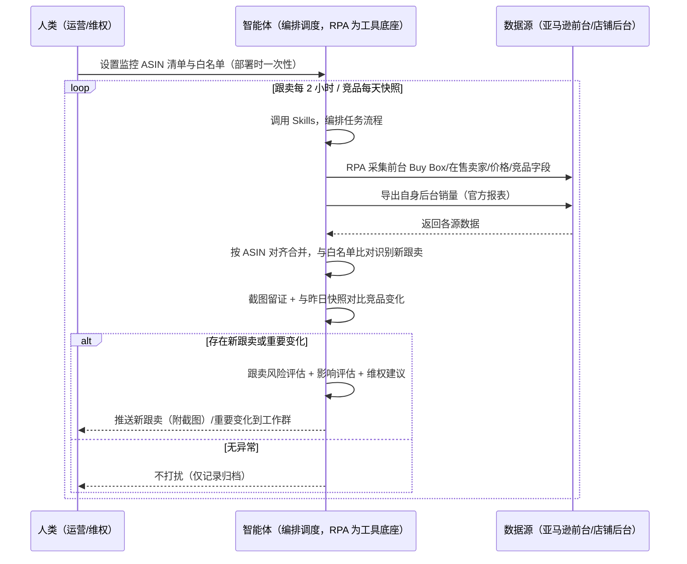
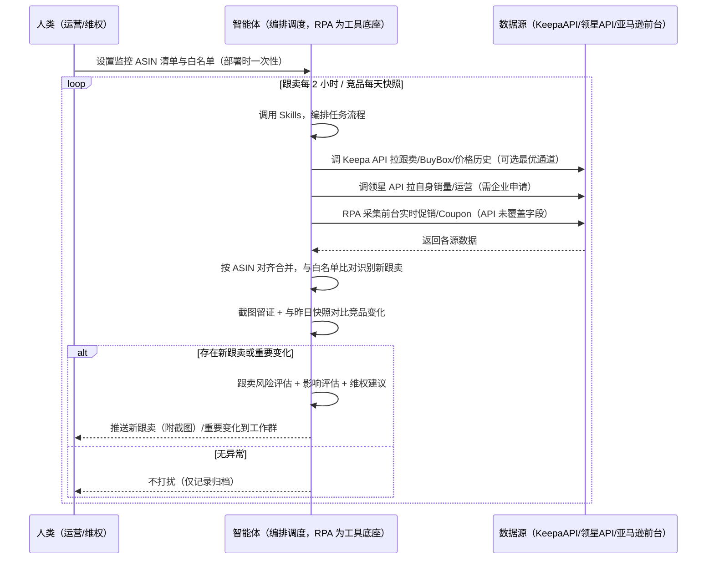

> 为亚马逊卖家团队打造的 ASIN 跟卖与竞品监控方案。跟卖和竞品变化以小时计，数据分散在前台与多个工具，本方案由智能体调度多个工具统一取数，新跟卖与重要变化才推送，无异常不打扰。

> Agent 自动化需开通企业功能
> 点击申请1个月免费权限
> [点击申请 →](https://skieer.feishu.cn/share/base/form/shrcnFwMayykP5iaL38fnZKTbrg)

## 一、用户与需求

核心矛盾：跟卖和竞品变化以小时计，运营要反复手动执行——逐个搜商品查在售卖家、手动截图登记、翻竞品页记价格评价。等发现时 Buy Box 已丢、销量已被抢走，跟卖证据也没留全。

适用客户：品牌备案、核心 ASIN 多的卖家（跟卖可投诉，监控是维权前提）。只做几个 ASIN、无品牌的小卖家价值有限（人工每周看一次即可，本方案不推荐）。

### 1.1 不同模式卖家

| 类型 | 选择 | 建议 |
|-|-|-|
| 品牌 | 首选 | 强烈推荐（品牌备案后跟卖可投诉，监控是维权前提） |
| 精铺 | 次选 | 一般推荐，聚焦主力 ASIN 的跟卖与竞品盯守 |
| 铺货 | 任意 | 不推荐，SKU 太多盯不过来，按需监控 |

### 1.2 不同类目卖家

| 类目 | 最关注维度 | 核心逻辑 |
|-|-|-|
| 3C 数码 | 跟卖+降价 | 数码件跟卖多、价格敏感，Buy Box 争夺激烈 |
| 家居家具 | 竞品断货 | 大件竞品断货是抢位窗口，要及时发现 |
| 美妆个护 | 跟卖+仿冒 | 品牌敏感，跟卖与仿冒需重点盯守 |
| 服装鞋帽 | 上新+降价 | 款式迭代快，竞品上新与降价要第一时间反应 |
| 户外运动 | 评价变化 | 竞品评价激增（刷评）需识别，避免被误导 |
| 母婴用品 | 跟卖+价格 | 安全类目，低价跟卖直接威胁转化 |

### 1.3 不同角色用户

| 用户 | 需求 | 问题 | 投入时间（估算） |
|-|-|-|-|
| 老板 | 知道 Buy Box 和跟卖情况 | 跟卖发现不及时，销量被抢 | 0.5 小时/周 |
| 运营 | 跟卖记录+竞品变化日报 | 手动翻页查，反应慢 | 1-3 小时/周 |
| 客服/维权 | 跟卖证据+投诉材料 | 截图没留全，投诉没材料 | 1 小时/周 |

---

## 二、现在的方法与问题

### 2.1 流程步骤与问题总结

人工方式（未购 SaaS 客户）

| 序号 | 步骤 | 现在的方法 | 问题缺陷 |
|-|-|-|-|
| 1 | 查跟卖 | 逐个搜索商品看在售卖家 | 需逐个打开，漏查 |
| 2 | 截图留证 | 手动截图存本地 | 截图没时间戳，证据不完整 |
| 3 | 看竞品 | 手动翻竞品页记录价格评价 | 变化记录靠印象，无昨日对比 |
| 4 | 判断变化 | 凭感觉判断"好像降了" | 无阈值口径，重要变化漏掉 |
| 5 | 汇报 | 口头/周会提一嘴 | 无日报，老板不知道情况 |

SaaS 方式（已购优麦云/Keepa/领星客户）

| 序号 | 步骤 | 现在的方法 | 问题缺陷 |
|-|-|-|-|
| 1 | 查跟卖 | 优麦云跟卖监控+微信报警 | 单点告警"被跟卖了"，不解释影响 |
| 2 | 截图留证 | 手动截图 | 优麦云告警不附完整证据链 |
| 3 | 看竞品 | Keepa 看价格历史、领星看运营 | 多工具来回切，无统一对比口径 |
| 4 | 判断变化 | 凭感觉 | 跟卖/促销因素进不了分析 |
| 5 | 汇报 | 口头/周会 | 无日报 |

### 2.2 问题分析

人工方式根因

| 序号 | 根因 | 具体表现 |
|-|-|-|
| 1 | 监控频率不够 | 跟卖以小时出现，人工以天看 |
| 2 | 无证据留痕 | 截图无时间戳水印，投诉没材料 |
| 3 | 无对比口径 | 竞品变化无昨日快照，看不出变化 |
| 4 | 反应滞后 | 发现时 Buy Box 已丢、销量已被抢 |
| 5 | 经验不沉淀 | 白名单、判断规则在人脑里 |

SaaS 方式根因

| 序号 | 根因 | 具体表现 |
|-|-|-|
| 1 | 单点告警不归因 | 优麦云告诉你"被跟卖了"，不说"这次销量下滑跟卖贡献多少" |
| 2 | 多工具割裂 | Keepa 管历史价、领星管运营、优麦云管跟卖，无人组装 |
| 3 | 证据链不全 | 告警不附时间戳截图，维权材料靠人补 |
| 4 | 判断不沉淀 | 阈值与白名单在个人经验里 |

---

## 三、解决方案

### 3.1 功能概述

为亚马逊卖家团队打造的智能体驱动 ASIN 跟卖与竞品监控方案，解决跟卖与竞品变化分散多平台、人工反复手动执行、反应滞后的问题。

定时触发并调度多个工具，调起八爪鱼 RPA（Agent 的工具底座，能耦合多系统、完成自动化任务执行）统一取数，按 ASIN 对齐合并，输出监控分析，涵盖「新跟卖识别与截图留证、跟卖风险评估、竞品变化标记、影响评估与应对建议」。定时扫描，新跟卖与重要变化才推送。

### 3.2 系统结合

| 要素 | 说明 |
|-|-|
| 客户现有工具盘点 | 未购 SaaS 客户：无第三方工具，数据全靠前台翻页手抄。已购 SaaS 客户（主流组合）：优麦云（卖家精灵旗下，跟卖监控 + 微信报警）、Keepa（价格历史/跟卖历史最全，API €49/月起）、领星 ERP（自身销量/运营，网页端有竞品监控） |
| 数据/能力来源 | 未购 SaaS：亚马逊前台商品页（Buy Box 卖家/在售卖家/价格/评价数/星级/BSR/Coupon，RPA 采集）+ 自身后台销量（官方报表导出）。  
已购 SaaS：Keepa API（跟卖/BuyBox/价格历史最全最稳，€49/月起，可选最优通道）+ 优麦云告警（可选，人看）+ 领星开放 API（自身销量，需企业申请）+ RPA 前台补实时促销/Coupon |
| RPA 耦合动作 | 作为 Agent 的工具底座，按计划调度多数据源取数（API 优先 + 前台采集兜底），按 ASIN 对齐去重合并，统一流转给智能体分析；任一数据源失败自动重试、异常告警 |
| 耦合出的新价值 | 单工具给不了的端到端结论：跟卖/竞品数据一次取齐 → 新跟卖识别（附时间戳截图）→ 风险评估 → 维权建议，新跟卖与重要变化自动推送工作群，免去人工在多平台间反复切换 |

### 3.3 智能体执行流程

用户向智能体输入会话（入参：监控 ASIN 清单 + 竞品 ASIN 清单）或智能体定时触发。支持两种数据通道，部署时按客户现有工具选择：

通道一：无 SaaS 方式（RPA 采集亚马逊前台，适合未购优麦云/Keepa 的客户）

通道二：有 SaaS 方式（Keepa API 拿跟卖/价格核心，RPA 前台兜底，适合已购客户）

> Agent 自动化需开通企业功能
> 点击申请1个月免费权限
> [点击申请 →](https://skieer.feishu.cn/share/base/form/shrcnFwMayykP5iaL38fnZKTbrg)

### 3.4 为何这么设计

要同时回答三个问题：为什么不能只用 SaaS/API？为什么不能纯靠智能体写代码？ 本场景的核心是"高频定时、跨多平台取数、按 ASIN 对齐、截图留证、出风险结论、有异动推送、挂了有人管"。

#### 1）逐项对比

| 对比维度 | SaaS/API 堆叠（优麦云/Keepa/领星） | 纯智能体（智能体写代码） | 智能体+自动化工具（RPA 工具底座） |
|-|-|-|-|
| 实现方式 | 优麦云管跟卖、Keepa 管历史、领星管运营，各管一段人工对照 | 能调 API 能抓前台，数据可自拼，但全要自己接 | 一个底座跑多个流程（跟卖/异动/选品/VOC……），数据一处对齐 |
| 多系统耦合 | 三工具各自为政，无人组装 | 全自建：API 鉴权、前台反爬、登录态、对齐逻辑 | 平台沉淀多源取数与对齐，可视化配置 |
| 判断与归因 | 优麦云单点告警不解释；Keepa 给数据不解释 | 判断逻辑自写，灵活但工程量大 | 判断交给智能体（风险评估+影响评估+维权建议），执行交给 RPA |
| 定时与推送 | 各工具单点告警，无跨系统结论推送 | 调度器/进程常驻/告警通道全自建 | 平台调度稳定触发，失败重试 + 异常告警，有异动才推送 |
| 使用成本（总拥有成本） | 一流程一订阅：Keepa €49 + 优麦云 + 领星 500-1500……随流程数增长 | 代理 IP + 服务器 + 开发维护人力，隐性成本高 | 一份平台订阅跑所有流程，单方案边际成本 ≈ 0 |
| 维护人要求 | 低（工具已成熟） | 每次改版/接口变更/规则调整都要开发介入 | 可视化流程，运营自己可调清单、白名单、阈值 |

#### 2）优劣势说明

|  | SaaS/API 堆叠（优麦云/Keepa/领星） | 纯智能体（智能体写代码） | 智能体+自动化工具（RPA 工具底座） |
|-|-|-|-|
| 优势 | 跟卖监控（优麦云）、价格历史（Keepa）权威；单点告警成熟 | 无订阅费；可深度定制监控逻辑；技术上完全可行 | 一个底座跑多流程、数据一处对齐；高频扫描/截图留证/快照对比即开即用；判断层比 SaaS Agent 深；非技术人员可维护 |
| 劣势 | 单点告警不归因；跟卖/促销部分字段只能人看；无跨系统结论推送；多工具订阅成本随流程数增长 | 高频调度、反爬、截图、快照对比全自建；AI 生成代码是生成性的，监控稳定性无保障 | 本地电脑运行需保持开机（建议部署常开电脑/云机）；订阅费；灵活性受平台模板边界限制 |

#### 3）结论

| 论点 | 说明 |
|-|-|
| 只用 SaaS/API 缺"归因与证据链" | 优麦云/Keepa 解决跟卖告警与价格历史，但"跟卖对销量影响多大、该不该投诉、附完整时间戳截图"它们给不了——这是本方案的增量 |
| 纯智能体缺"工程底座" | 高频扫描 + 截图留证 70% 的工作在工程（取数/登录态/调度/重试），不在"写判断逻辑"；RPA 作为工具底座把这 70% 已经造好 |
| 一个底座跑多流程 | 客户购买 RPA 平台是跑多个流程（跟卖/异动/选品/VOC/后台操作），本方案只是其中一个——平台订阅费被多流程摊薄，单方案边际成本接近 0 |
| 确定性 vs 生成性 | 跟卖识别与竞品变化比对是确定性任务——同样的 ASIN，要求"每次扫描不重不漏、变化判断一致"。RPA 流程行为可预期，AI 生成的代码能跑通 ≠ 高频扫描一年不中断 |
| 时间 | 运营要的是"新跟卖 2 小时内进群提醒、竞品变化当天出日报"，不是"每天手动翻页"；判断层交给智能体，执行层交给工具底座 |

### 3.5 功能清单

| 功能 | 系统 | 功能说明（解决问题） |
|-|-|-|
| 会话/定时 | 智能体 | 1. 理解人类语言，调用已预设好的 Skills。  
2. 编排多任务、调度多工具。 |
| 多系统数据取数 | RPA、指纹浏览器 | 1. 解决跟卖发现不及时、竞品变化无对比问题。  
2. 作为智能体工具底座被调度执行，页面验证码拦截时重试并告警、Buy Box 抓取失败跳过该 ASIN。  
3. 【无 SaaS 方式】 RPA 采集前台 Buy Box 卖家/在售卖家/价格/评价/星级/BSR/Coupon + 后台销量导出。【有 SaaS 方式】 调 Keepa API 拉跟卖/BuyBox/价格历史（€49/月起）+ 调领星 API 拉自身销量（需企业申请）+ RPA 前台补实时促销/Coupon。 |
| 数据清洗对齐 | 智能体 | 与白名单/昨日快照对齐去重，解决跟卖记录与竞品快照口径不一致问题。 |
| 新跟卖识别 | 智能体 | 新跟卖且价格低于自身售价 → 红色紧急立即告警；跟卖价格低于自身 10% → Buy Box 丢失风险高；跟卖数量 >3 → 黄色关注。 |
| 截图留证 | RPA | 自动截图带时间戳水印，作为投诉证据，解决维权没材料问题。 |
| 竞品变化标记 | 智能体 | 与昨日快照对比：竞品价格降幅 >5% 或评价激增 → 重要变化标记；竞品断货 → 抢位窗口提示。 |
| 维权建议 | 智能体 | 维权胜算评估：已品牌备案 + 有 Test Buy 凭证 → 推荐投诉，投诉邮件附卖家名/ASIN/截图/时间。投诉动作由人工发起。 |
| IM通知 | 飞书、钉钉、企微等 | 解决反应滞后问题。有异动才推送新跟卖（附截图）、重要竞品变化、周对比报告到工作群，无异常不打扰。 |
| 数据资产储存 | 本地电脑、云储存 | 1. Skills 资产：跟卖识别规则与维权话术库。  
2. 数据储存：跟卖登记表与竞品监控表按日沉淀，可追溯。  
3. 经验知识库：历史维权案例持续沉淀。 |

### 3.6 智能体执行落地过程

部署时一次性配置入参（监控 ASIN 清单、竞品 ASIN 清单、白名单、监控频率、阈值、推送群、数据通道），会话中无需重复输入。

⚠️ 部署前提（不满足则方案无法跑起来）：①RPA 需部署在常开电脑/云机上（高频扫描关机即停，漏一小时就是漏一小时），并配置漏跑补跑机制；②有 SaaS 方式需 Keepa API 付费账号（€49/月起）或卖家精灵企业认证，未开通自动降级为无 SaaS 通道；③领星 API 需企业客户申请权限，未开通则自身数据走官方业务报告导出；④首次配置（API 鉴权、对齐规则、白名单）需服务方/技术人员介入一次，属实施成本。

#### 1）配置

| 类别 | 说明 |
|-|-|
| 智能体 | 主流智能体。 |
| 智能体工具 | 1. 数据通道（按客户现有工具二选一）：【无 SaaS】亚马逊前台（RPA 采集）+ 官方业务报告导出；【有 SaaS】Keepa API（€49/月起）+ 领星开放 API（已购且申请权限客户）+ RPA 前台补实时促销/Coupon。  
2. 数据取数与自动化执行：八爪鱼 RPA，MCP 配置完成。  
3. 数据分析：智能体自带。  
4. IM：企业办公 IM（飞书/钉钉/企微），MCP 或 webhook 配置。 |
| 工作知识 | 1. 监控 ASIN 清单 + 竞品 ASIN 清单。  
2. 白名单卖家：默认自有店铺及授权卖家。  
3. 监控频率：默认每 2 小时，旺季每小时。  
4. 跟卖价格红线：默认低于自身售价 10%。  
5. 竞品变化阈值：默认价格降幅 >5% 或评价激增。  
6. 维权前提：是否品牌备案、是否有 Test Buy 凭证。 |
| 本地数据库 | 1. 跟卖登记表地址。  
2. 竞品监控表地址。  
3. 经验库地址。 |

#### 2）执行

| 任务 | 产出 | 产出物接收人 |
|-|-|-|
| 接收监控清单，定时触发 | 任务启动记录 | —— |
| 调用已预设 Skills，编排任务流程 | 任务编排方案 | —— |
| 经 MCP 向八爪鱼 RPA 下发取数任务 | 自动化任务指令 | —— |
| 多平台取数并按 ASIN 对齐（无 SaaS：前台采集+后台导出；有 SaaS：Keepa/领星 API + 前台兜底，智能体监控状态） | 对齐后监控数据 | —— |
| 与白名单比对识别新跟卖 + 截图留证 | 新跟卖记录 + 时间戳截图 | 运营 |
| 与昨日快照对比标记竞品变化 | 竞品变化标签 | 运营 |
| 跟卖风险评估（价格/数量/维权胜算） | 风险标签 + 维权建议 | 运营 |
| 推送新跟卖与重要变化（有异动才推送） | 群提醒/日报 | 运营/维权/老板 |

异常处理：

页面验证码拦截 → 重试并告警；

Buy Box 卖家抓取失败 → 跳过该 ASIN 记录；

竞品下架/404 → 记录状态，连续采集失败转人工；

截图失败 → 重试 2 次，仍失败标注待人工；数据缺失 → 标注并沿用上次快照；

置信度 &lt;70% → 转人工复核，不输出硬结论。

#### 3）结果

| 结果 | 说明 |
|-|-|
| 数据资产 | 全量监控结构化数据（ASIN/Buy Box 卖家/在售卖家/价格/跟卖时间/竞品价格/评价/BSR/断货状态/变化标签/截图），可审计。 |
| 分析报告 | 1. 跟卖记录：谁在跟卖、什么价格、何时出现，附时间戳截图。  
2. 竞品变化日报：哪个 ASIN 降价/评价激增/断货，附影响评估。  
3. 维权建议：投诉邮件引用卖家名、ASIN、截图、出现时间，附胜算评估。  
4. 周对比报告：监控趋势可回看。 |
| Skills | 智能体 Skills：跟卖识别规则与维权话术库。 |

> Agent 自动化需开通企业功能
> 点击申请1个月免费权限
> [点击申请 →](https://skieer.feishu.cn/share/base/form/shrcnFwMayykP5iaL38fnZKTbrg)

---

## 四、使用前后预估

> 本方案价值 = 跨平台跟卖/竞品一次取齐 + 归因 + 时间戳证据链 + 维权建议。不承诺替代人工维权——投诉动作由人工发起。适合品牌备案、核心 ASIN 多、愿配环境的卖家。

| 指标 | 人工 | SaaS/API（优麦云/Keepa/领星） | 智能体+自动化工具 |
|-|-|-|-|
| 监控耗时 | 每周 1-3 小时（估算） | 每周 0.5 小时（估算，优麦云自动告警，人看） | 取数全自动；人工转为审核告警（每周约 0.5 小时） |
| 发现时效 | 以天计，发现已晚 | 优麦云单点告警（微信） | 2 小时内告警 + 附截图 |
| 证据留证 | 截图不全无时间戳 | 告警不附完整证据链 | 自动截图带时间戳水印 |
| 归因能力 | 靠印象 | 单点告警不解释 | 风险评估 + 影响评估（含跟卖贡献） |
| 竞品感知 | 靠印象 | Keepa 历史价人看 | 快照对比数据驱动，变化不遗漏 |
| 方法论 | 无，换人结论不同 | 工具内规则（不可跨系统复用） | 可复用的 Skills 与规则库 |

说明：跟卖/价格/评价/BSR 为准确字段（前台/API 实时值）；自身销量以领星 API 或官方报表为准；维权建议为辅助参考，最终投诉由人工按平台流程发起。

---

## 五、效果证明

> Agent 自动化需开通企业功能
> 点击申请1个月免费权限
> [点击申请 →](https://skieer.feishu.cn/share/base/form/shrcnFwMayykP5iaL38fnZKTbrg)

### 5.1 客户案例

**《北美汽配冠军：500+ 核心 ASIN 7×24 价格与链接监控》**

> 北美汽配第一梯队品牌（占有率约 28.89%），需对所有核心 ASIN 实现 7×24 不间断监控，确保商品稳定在售、价格体系不被冲击；计划监控 500+ 链接，市面无 ERP 可满足。

| 效果 | 说明 |
|-|-|
| 提效 | 核心 ASIN 监控由人工随机抽查变为 7×24 全量巡检。原本仅能人工随机抽查少量 ASIN、无固定频次，现在 500+ 核心 ASIN 全天候自动巡检。 |
| 降本 | 省去人工盯链、盯价的重复投入，运营团队投入转向链接治理与价格体系维护等重点工作。 |
| 任务 | 全维度商品数据（销量、价格、评论、物流、排名等）批量沉淀为可参考的运营数据集。 |
| 任务 | 在售状态与价格体系风险即时告警，减少链接降权、订单流失等损失。 |

案例详情：[监控：北美汽配冠军，用RPA＋钉钉AI表格给200+ASIN上了24小时保险](https://skieer.feishu.cn/wiki/ZZsTwbsHsi5UJykMwX9c6zoLnmh)

---

## 六、备注

### 6.1 Agent 支持

本方案不绑定具体智能体，主流 Agent 均可运行（需支持技能/Skills 加载与工具调用）：

| Agent/智能体 | 说明 |
|-|-|
| Workbuddy | 本方案运行平台，支持技能/Skills 上传加载、定时任务、MCP 工具调用与表格/报告处理 |
| 豆包（国内·字节） | 国内主流个人智能体，支持技能上传、定时任务与工具调用，上手成本低 |
| 通义千问（国内·阿里） | 支持 Agent 编排与插件生态，集成阿里电商数据能力，适合电商场景 |
| DeepSeek（国内） | 推理能力强、成本低，适合规则打分与归因分析类任务 |
| ChatGPT（国外·OpenAI） | 海外主流通用智能体，支持 GPTs/Agent 模式与工具调用 |
| Claude（国外·Anthropic） | 长文本与结构化分析能力强，原生支持 MCP 连接外部工具 |

### 6.2 名词解释

| 术语 | 说明 |
|-|-|
| ASIN | Amazon Standard Identification Number，亚马逊商品标识号 |
| Buy Box | 购物车，买家直接购买的位置，谁拿 Buy Box 谁拿大部分订单 |
| 跟卖 | 其他卖家在同一 Listing 上销售同款商品 |
| 白名单卖家 | 自有店铺及授权卖家，不在名单内的在售卖家视为跟卖 |
| 变狗 | 商品 Listing 被删除或变为不可售的俗称 |
| 截图留证 | 带时间戳和水印的页面截图，作为投诉证据 |
| Test Buy | 测试购买，通过真实下单获取跟卖者信息的维权手段 |
| Coupon | 优惠券，竞品是否发券影响转化 |
| BSR | Best Sellers Rank，类目畅销排名 |
| 维权胜算 | 已品牌备案 + 有 Test Buy 凭证时投诉成功率更高 |
| 混合数据源 | 官方导出/API 优先（更稳更合规）+ 前台采集兜底（免费、覆盖无 SaaS 客户与 API 缺口） |
| 有 SaaS 方式 | 已购 Keepa/领星，开放 API 拿跟卖/价格/销量核心 + RPA 前台兜底 |
| 无 SaaS 方式 | 不购买第三方数据工具，由 RPA 采集前台 + 官方报表导出 |
| MCP | Model Context Protocol，智能体连接外部工具的标准化通道 |
| 指纹浏览器 | 隔离 Cookie/浏览器指纹的工具，多店铺防关联 |

> Agent 自动化需开通企业功能
> 点击申请1个月免费权限
> [点击申请 →](https://skieer.feishu.cn/share/base/form/shrcnFwMayykP5iaL38fnZKTbrg)

---

原文：[查看原文](https://skieer.feishu.cn/wiki/Yjh3wy8jzijNkpkNdR0cIO1QnXc)
