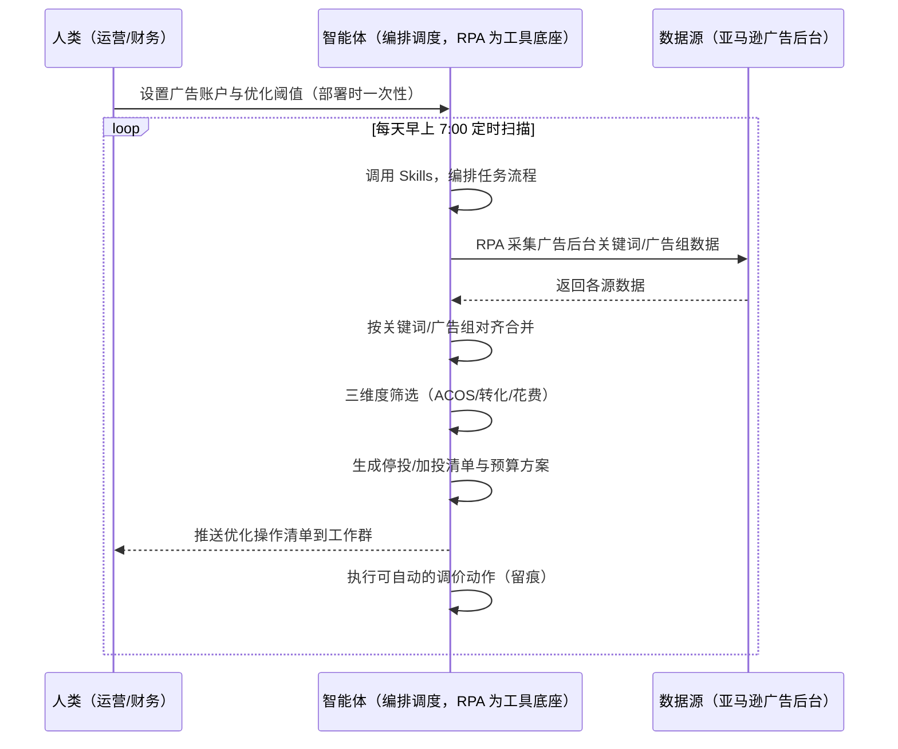
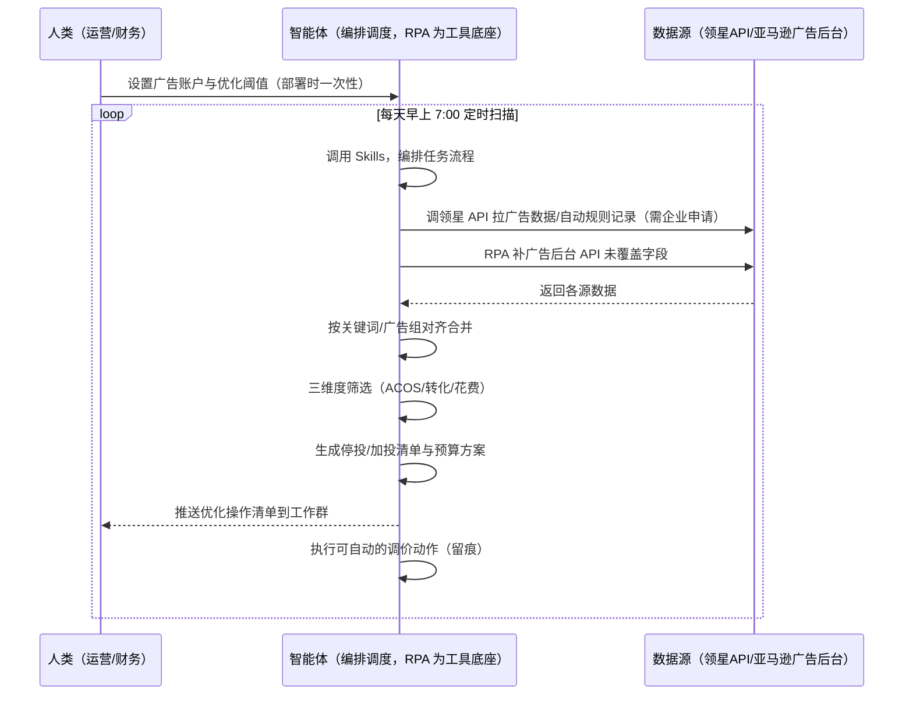

> 为亚马逊卖家团队打造的广告投放优化方案。广告数据量大、分散在广告后台与多个工具，本方案由智能体调度多个工具统一取数——未购 SaaS 走后台采集，已购 SaaS 走"领星广告数据 + 后台补缺口"。每天定时扫描，输出停投/加投清单与预算方案，动作留痕可回滚。

> Agent 自动化需开通企业功能
> 点击申请1个月免费权限
> [点击申请 →](https://skieer.feishu.cn/share/base/form/shrcnFwMayykP5iaL38fnZKTbrg)

## 一、用户与需求

核心矛盾：广告关键词数据量大，运营要反复手动执行——登录广告后台导出数据、逐条看 ACOS 和转化、手动暂停无效词、加价机会词、凭感觉分预算。高花费零转化词多烧一天就多亏一天，机会词不加价又错过放量窗口。

两类客户痛点同源，数据来源不同：

- 未购 SaaS 客户（新卖家/小团队）：人工登录广告后台导数据，逐条看效果手动调价，动作无留痕；
- 已购 SaaS 客户（领星 ERP 看广告数据、有超预算告警）：领星有广告自动规则（自动调整出价预算）与超预算告警，但多广告组统一优化、跨系统归因、操作留痕审计仍要人做。

适用客户：广告预算大、关键词多、需要系统化盯盘的卖家。广告投放少的小卖家价值有限（人工盯得过来，本方案不推荐）。

### 1.1 不同模式卖家

| 类型 | 选择 | 建议 |
|-|-|-|
| 品牌 | 首选 | 强烈推荐（广告预算大、关键词多，盯盘频次高） |
| 精铺 | 次选 | 一般推荐，聚焦主力 SKU 的广告组 |
| 铺货 | 任意 | 不推荐，广告投放少，人工盯得过来 |

### 1.2 不同类目卖家

| 类目 | 最关注维度 | 核心逻辑 |
|-|-|-|
| 3C 数码 | ACOS+转化 | 参数词竞争激烈，ACOS 控制是核心 |
| 家居家具 | 花费+转化 | 大件客单价高，高花费低转化词必须停 |
| 美妆个护 | 机会词挖掘 | 功效词转化差异大，机会词及时加价 |
| 服装鞋帽 | 上新放量 | 新款要抢曝光，预算向机会词倾斜 |
| 户外运动 | ACOS+转化 | 功能件转化链路长，看转化率而非只盯 ACOS |
| 母婴用品 | 谨慎调价 | 安全类目，广告词合规与转化并重 |

### 1.3 不同角色用户

| 用户 | 需求 | 问题 | 投入时间（估算） |
|-|-|-|-|
| 老板 | 广告费花得值 | 无效词多烧钱看不见 | 0.5 小时/周 |
| 运营 | 停投/加投清单 | 逐条看效果手动调价费时 | 1-3 小时/天 |
| 财务 | 广告花费可控 | ACOS 超阈值无预警 | 0.5 小时/周 |

---

## 二、现在的方法与问题

### 2.1 流程步骤与问题总结

**人工方式（未购 SaaS 客户）**

| 序号 | 步骤 | 现在的方法 | 问题缺陷 |
|-|-|-|-|
| 1 | 拉数据 | 登录广告后台导数据 | 关键词多，导出整理费时 |
| 2 | 看效果 | 逐条看 ACOS 和转化 | 一天看不完，看过的也记不住 |
| 3 | 筛词 | 凭经验判断停哪些加哪些 | 标准不统一，漏掉机会词 |
| 4 | 调价 | 手动暂停和调出价 | 动作无留痕，误操作难追溯 |
| 5 | 分预算 | 凭感觉分配预算 | 低效词占预算，机会词没预算 |

**SaaS 方式（已购领星 ERP 客户）**

| 序号 | 步骤 | 现在的方法 | 问题缺陷 |
|-|-|-|-|
| 1 | 拉数据 | 领星广告数据报表（自动） | 数据权威，但多广告组统一优化仍靠人 |
| 2 | 看效果 | 领星看 ACOS/转化 | 有告警（超预算），但不给停投/加投结论 |
| 3 | 筛词 | 领星自动规则（调整出价预算） | 规则单系统内，跨广告组统一口径缺 |
| 4 | 调价 | 领星定时任务自动调整 | 调价动作留痕与回滚靠人工核对 |
| 5 | 分预算 | 凭感觉分配 | 无统一预算重分配方案 |

### 2.2 问题分析

**人工方式根因**

| 序号 | 根因 | 具体表现 |
|-|-|-|
| 1 | 数据量大 | 广告组/关键词多，人工逐条看不完 |
| 2 | 判断无标准 | 停投/加价凭经验，标准不统一 |
| 3 | 反应滞后 | 高花费零转化词多烧一天亏一天 |
| 4 | 预算错配 | 低效词占预算，机会词没量 |
| 5 | 经验不沉淀 | 调价规则在人脑里，换人结论就不一样 |

**SaaS 方式根因**

| 序号 | 根因 | 具体表现 |
|-|-|-|
| 1 | 单系统规则 | 领星自动规则覆盖自身广告数据，多广告组统一口径缺 |
| 2 | 告警不归因 | 领星告诉你"超预算了"，不说"哪些词该停、哪些该加" |
| 3 | 留痕审计靠人 | 自动调价动作的回滚与审计需人工核对 |
| 4 | 规则不沉淀 | 阈值与分配规则在个人经验里，换人就不一样 |

---

## 三、解决方案

### 3.1 功能概述

为亚马逊卖家团队打造的智能体驱动广告投放优化方案，解决广告数据量大、人工反复手动执行、判断无标准的问题。

定时触发并调度多个工具，调起八爪鱼 RPA（Agent 的工具底座，能耦合多系统、完成自动化任务执行）统一取数，按关键词/广告组对齐合并，输出广告优化分析，涵盖「无效词自动停投、机会词自动加价、预算重分配方案、优化操作清单」。每天定时扫描，动作留痕可回滚。

### 3.2 系统结合

| 要素 | 说明 |
|-|-|
| 客户现有工具盘点 | 未购 SaaS 客户：无第三方工具，数据全靠广告后台导出。   已购 SaaS 客户（主流组合）：领星 ERP（广告数据报表、自动规则、超预算告警，开放 API 需企业申请）、优麦云（卖家精灵旗下，广告数据与预警） |
| 数据/能力来源 | 未购 SaaS：亚马逊广告后台（各广告组/关键词曝光/点击/花费/订单/ACOS/转化率，RPA 采集）。   已购 SaaS：领星开放 API（广告数据/自动规则记录，需企业申请权限）+ RPA 后台补缺口（API 未覆盖字段）+ 优麦云数据（可选，人看） |
| RPA 耦合动作 | 作为 Agent 的工具底座，按计划调度多数据源取数（API 优先 + 后台采集兜底），按关键词/广告组对齐去重合并，统一流转给智能体分析；任一数据源失败自动重试、异常告警 |
| 耦合出的新价值 | 单工具给不了的端到端结论：广告数据一次取齐 → 三维筛选 → 停投/加投清单 → 预算重分配 → 操作留痕，免去人工逐条看盘手动调价 |

### 3.3 智能体执行流程

用户向智能体输入会话（入参：广告账户 + 优化规则）或智能体定时触发。支持两种数据通道，部署时按客户现有工具选择：

通道一：无 SaaS 方式（RPA 采集广告后台，适合未购领星的客户）

通道二：有 SaaS 方式（领星 API 拿广告核心，RPA 后台兜底，适合已购客户）

> Agent 自动化需开通企业功能
> 点击申请1个月免费权限
> [点击申请 →](https://skieer.feishu.cn/share/base/form/shrcnFwMayykP5iaL38fnZKTbrg)

### 3.4 为何这么设计

要同时回答三个问题：为什么不能只用 SaaS/API？为什么不能纯靠智能体写代码？ 本场景的核心是"每天定时、取数、三维筛选、出停投/加投结论、动作留痕可回滚、挂了有人管"。

#### 1）逐项对比

| 对比维度 | SaaS/API 堆叠（领星/优麦云） | 纯智能体（智能体写代码） | 智能体+自动化工具（RPA 工具底座） |
|-|-|-|-|
| 实现方式 | 领星管广告数据+自动规则，单系统内 | 能调 API 能抓后台，数据可自拼，但全要自己接 | 一个底座跑多个流程（广告/跟卖/异动/选品……），数据一处对齐 |
| 多系统耦合 | 领星自动规则单系统，跨广告组统一口径缺 | 全自建：API 鉴权、后台采集、对齐逻辑 | 平台沉淀多源取数与对齐，可视化配置 |
| 判断与执行 | 领星有自动调价规则（单系统），告警不归因 | 筛选逻辑自写，灵活但工程量大 | 判断交给智能体（三维筛选+预算分配），执行交给 RPA（留痕可回滚） |
| 定时与推送 | 领星超预算告警（单点事件） | 调度器/进程常驻/告警通道全自建 | 平台调度稳定触发，失败重试 + 异常告警，每日清单推送 |
| 使用成本（总拥有成本） | 一系统一订阅：领星 500-1500/月……随流程数增长 | 代理 IP + 服务器 + 开发维护人力，隐性成本高 | 一份平台订阅跑所有流程，单方案边际成本 ≈ 0 |
| 维护人要求 | 低（工具已成熟） | 规则调整都要开发介入 | 可视化流程，运营自己可调阈值、停投规则 |

#### 2）优劣势说明

|  | SaaS/API 堆叠（领星/优麦云） | 纯智能体（智能体写代码） | 智能体+自动化工具（RPA 工具底座） |
|-|-|-|-|
| 优势 | 广告数据权威、自动规则与超预算告警成熟 | 无订阅费；可深度定制竞价算法；   技术上完全可行 | 一个底座跑多流程、数据一处对齐；   三维筛选+预算分配规则可定制可沉淀；   动作留痕可回滚；   非技术人员可维护 |
| 劣势 | 单系统规则，跨广告组统一口径缺；   告警不归因；   留痕审计靠人 | 调度、反爬、调价留痕全自建；   AI 生成代码是生成性的，自动调价行为不完全可控 | 本地电脑运行需保持开机；   订阅费；   灵活性受平台模板边界限制 |

#### 3）结论

| 论点 | 说明 |
|-|-|
| 只用 SaaS/API 缺"统一筛选与留痕审计" | 领星解决广告数据与单系统自动规则，但"跨广告组统一停投/加投结论 + 动作留痕可回滚"它给不了——这是本方案的增量 |
| 纯智能体缺"工程底座" | 取数与执行 70% 的工作在工程（采集/对齐/调度/留痕），不在"写筛选逻辑"；   RPA 作为工具底座把这 70% 已经造好 |
| 一个底座跑多流程 | 客户购买 RPA 平台是跑多个流程（广告/跟卖/异动/选品/后台操作），本方案只是其中一个——平台订阅费被多流程摊薄，单方案边际成本接近 0 |
| 确定性 vs 生成性 | 关键词筛选与调价是确定性任务——同样的数据，要求"每天筛得一样、动作留痕一致"。RPA 流程行为可预期，AI 生成的代码能跑通 ≠ 自动调价长期不误操作 |
| 时间 | 运营要的是"每天早上拿到停投/加投清单和预算方案"，不是"每天手动盯盘调价"；   判断层交给智能体，执行层交给工具底座 |

### 3.5 功能清单

| 功能 | 系统 | 功能说明（解决问题） |
|-|-|-|
| 会话/定时 | 智能体 | 1. 理解人类语言，调用已预设好的 Skills。   2. 编排多任务、调度多工具。 |
| 多系统数据取数 | RPA、指纹浏览器 | 1. 解决广告数据量大、人工逐条看不完问题。   2. 作为智能体工具底座被调度执行，后台接口超时自动重试、无法自动操作的关键词转人工清单。   3. 【无 SaaS 方式】 RPA 采集广告后台曝光/点击/花费/订单/ACOS/转化率。【有 SaaS 方式】 调领星 API 拉广告数据/自动规则记录（需企业申请）+ RPA 补后台缺口。 |
| 数据清洗对齐 | 智能体 | 按关键词/广告组对齐去重，解决多日数据口径不一致问题。 |
| 三维筛选 | 智能体 | ACOS 超阈值且无转化 → 暂停；高转化低花费 → 加价并归为机会词。 |
| 预算重分配 | 智能体 | 从低效词转移预算到机会词（默认转移 20%），输出预算分配方案。 |
| 动作执行与留痕 | RPA | 执行可自动的暂停/调价动作，操作记录可审计可回滚；超上限动作拦截转人工确认。涉及花钱的动作保留人工审核通道。 |
| IM通知 | 飞书、钉钉、企微等 | 解决高花费零转化发现滞后问题。停投/加投清单、预算方案、异常告警自动推送。 |
| 数据资产储存 | 本地电脑、云储存 | 1. Skills 资产：关键词筛选与预算分配规则。   2. 数据储存：广告优化记录表统一写入本地，动作可审计。   3. 经验知识库：审核通过的机会词持续沉淀。 |

### 3.6 智能体执行落地过程

部署时一次性配置入参（广告账户、优化阈值、停投规则、推送群、数据通道），会话中无需重复输入。

⚠️ 部署前提（不满足则方案无法跑起来）：①RPA 需部署在常开电脑/云机上（每天定时扫描，关机即停），并配置漏跑补跑机制；②有 SaaS 方式需领星企业客户申请开放 API 权限（未开通自动降级为无 SaaS 通道，走后台采集）；③自动调价涉及资金动作，建议首次部署以"人工确认后执行"模式运行，稳定后逐步放开自动执行；④首次配置（API 鉴权、对齐规则、阈值）需服务方/技术人员介入一次，属实施成本。

#### 1）配置

| 类别 | 说明 |
|-|-|
| 智能体 | 主流智能体。 |
| 智能体工具 | 1. 数据通道（按客户现有工具二选一）：【无 SaaS】亚马逊广告后台（RPA 采集）；【有 SaaS】领星开放 API（需企业申请）+ RPA 后台兜底。   2. 数据取数与自动化执行：八爪鱼 RPA，MCP 配置完成。   3. 数据分析：智能体自带。   4. IM：企业办公 IM（飞书/钉钉/企微），MCP 或 webhook 配置。 |
| 工作知识 | 1. 广告账户与广告组清单。   2. ACOS 阈值：默认按品类基准（如 30%）。   3. 停投规则：ACOS 超阈值且连续 N 天无转化。   4. 加价规则：高转化低花费机会词，默认加价 10%。   5. 预算重分配比例：默认从低效词转移 20% 预算。   6. 自动调价上限：默认单次出价调整 ≤20%。 |
| 本地数据库 | 1. 广告优化记录表地址。   2. 报告库地址。   3. 经验库地址。 |

#### 2）执行

| 任务 | 产出 | 产出物接收人 |
|-|-|-|
| 接收广告账户，定时触发 | 任务启动记录 | —— |
| 调用已预设 Skills，编排任务流程 | 任务编排方案 | —— |
| 经 MCP 向八爪鱼 RPA 下发取数任务 | 自动化任务指令 | —— |
| 多源取数并按关键词/广告组对齐（无 SaaS：后台采集；有 SaaS：领星 API+后台兜底，智能体监控状态） | 对齐后广告数据 | —— |
| 三维度筛选（ACOS/转化/花费） | 筛选结果 | 运营 |
| 自动暂停无效词 + 机会词加价（留痕可回滚） | 调价操作记录 | 运营 |
| 预算重分配计算 | 预算分配方案 | 运营 |
| 生成优化操作清单 | 停投/加投清单 | 运营/财务 |
| 推送清单与异常告警 | 群消息 | 运营/财务/老板 |

异常处理：

后台接口超时 → 自动重试；

无法自动操作的关键词 → 转人工处理清单；

调价超上限 → 拦截并转人工确认；数据缺失 → 用上日数据补齐并标注；

自动暂停误判 → 提供"恢复投放入口"，人工一键恢复；

置信度 &lt;70% → 转人工复核，不输出硬结论。

#### 3）结果

| 结果 | 说明 |
|-|-|
| 数据资产 | 全量广告结构化数据（关键词/曝光/点击/花费/订单/ACOS/转化率/操作记录），可审计。 |
| 分析报告 | 1. 停投清单：高花费零转化词附花费明细与转化数据。   2. 加投清单：机会词附预期 ACOS 与转化率。   3. 预算分配方案：从低效词向机会词的转移明细。   4. 优化操作记录：每次调价留痕可回滚。 |
| Skills | 智能体 Skills：关键词筛选与预算分配规则。 |

> Agent 自动化需开通企业功能
> 点击申请1个月免费权限
> [点击申请 →](https://skieer.feishu.cn/share/base/form/shrcnFwMayykP5iaL38fnZKTbrg)

---

## 四、使用前后预估

> 本方案价值 = 跨广告组统一筛选 + 预算重分配 + 动作留痕可回滚。不承诺替代人工决策——自动调价保留人工审核通道。适合广告预算大、关键词多、愿配环境的卖家。

| 指标 | 人工 | SaaS/API（领星/优麦云） | 智能体+自动化工具 |
|-|-|-|-|
| 盯盘耗时 | 每天 1-3 小时（估算） | 每天 0.5 小时（估算，领星报表自动，人看） | 取数全自动；人工转为审核清单（每天约 0.5 小时） |
| 无效词止损 | 多烧一天亏一天 | 领星自动规则（单系统） | 次日即停，跨广告组统一口径 |
| 机会词放量 | 漏掉不加价 | 领星自动规则（单系统） | 自动加价+预算倾斜 |
| 动作留痕 | 手动调无记录 | 领星规则记录，审计靠人 | 操作可审计可回滚 |
| 预算效率 | 凭感觉分配 | 领星报表参考 | 数据驱动重分配，花在刀刃 |
| 方法论 | 无，换人结论不同 | 领星规则（单系统） | 可复用的 Skills 与规则库 |

说明：

ACOS/转化率等指标来自广告后台或领星 API 实时数据（准确字段）；

自动调价涉及资金动作，默认以"人工确认后执行"模式运行；

机会词判断为辅助参考，最终由运营确认。

---

## 五、效果证明

### 5.1 DEMO应用

Amazon-广告数据一览-日期范围选择-紫鸟浏览器：https://rpa.bazhuayu.com/appstore/app/ffrpa/amazon--guang-gao-shu-ju-yi-lan--ri-qi-fan-wei-xuan-ze-zi-niao-liu-lan-qi

Amazon-广告数据一览-日期范围选择-紫鸟浏览器：https://rpa.bazhuayu.com/appstore/app/ffrpa/amazon--guang-gao-shu-ju-yi-lan--ri-qi-fan-wei-xuan-ze-zi-niao-liu-lan-qi

---

## 六、备注

### 6.1 Agent 支持

本方案不绑定具体智能体，主流 Agent 均可运行（需支持技能/Skills 加载与工具调用）：

| Agent/智能体 | 说明 |
|-|-|
| Workbuddy | 本方案运行平台，支持技能/Skills 上传加载、定时任务、MCP 工具调用与表格/报告处理 |
| 豆包（国内·字节） | 国内主流个人智能体，支持技能上传、定时任务与工具调用，上手成本低 |
| 通义千问（国内·阿里） | 支持 Agent 编排与插件生态，集成阿里电商数据能力，适合电商场景 |
| DeepSeek（国内） | 推理能力强、成本低，适合规则打分与归因分析类任务 |
| ChatGPT（国外·OpenAI） | 海外主流通用智能体，支持 GPTs/Agent 模式与工具调用 |
| Claude（国外·Anthropic） | 长文本与结构化分析能力强，原生支持 MCP 连接外部工具 |

### 6.2 名词解释

| 术语 | 说明 |
|-|-|
| ACOS | Advertising Cost of Sales，广告花费占销售额比例，越低越划算 |
| 转化率 | 点击后下单的比例 |
| 机会词 | 高转化低花费的关键词，值得加价放量 |
| 无效词 | ACOS 超阈值且无转化的关键词，应暂停 |
| 预算重分配 | 从低效词转移预算到机会词，提升整体投放效率 |
| 停投清单 | 需暂停的关键词列表，附花费与转化明细 |
| 加投清单 | 需加价的关键词列表，附预期 ACOS |
| 出价 | 关键词的单次点击出价 |
| 曝光 | 广告被展示的次数 |
| 混合数据源 | 官方导出/API 优先（更稳更合规）+ 后台采集兜底（免费、覆盖无 SaaS 客户与 API 缺口） |
| 有 SaaS 方式 | 已购领星，开放 API 拿广告数据核心 + RPA 后台兜底（需企业申请权限） |
| 无 SaaS 方式 | 不购买第三方工具，由 RPA 采集广告后台数据 |
| MCP | Model Context Protocol，智能体连接外部工具的标准化通道 |
| 指纹浏览器 | 隔离 Cookie/浏览器指纹的工具，多店铺防关联 |

> Agent 自动化需开通企业功能
> 点击申请1个月免费权限
> [点击申请 →](https://skieer.feishu.cn/share/base/form/shrcnFwMayykP5iaL38fnZKTbrg)

---

原文：[查看原文](https://skieer.feishu.cn/wiki/AUcJwlejLiYynJkscurcZrCRngf)
