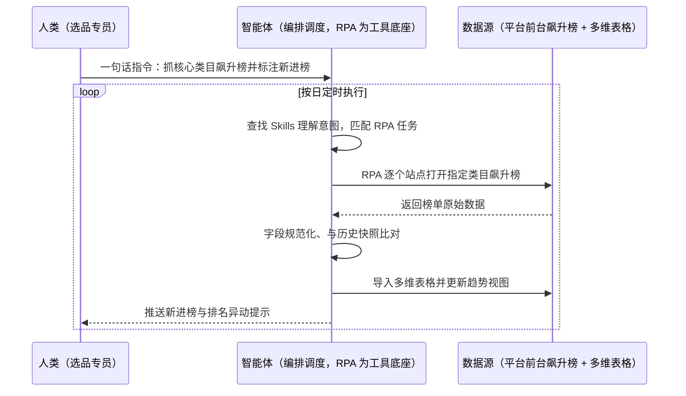
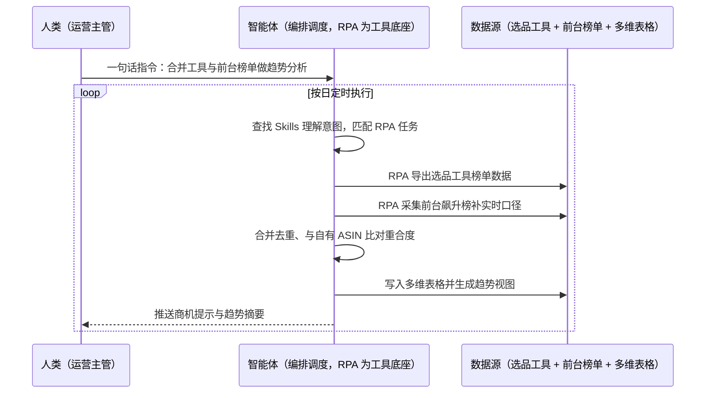

> 为亚马逊卖家打造的飙升榜采集方案。及时捕捉市场趋势与热门商品动态，是优化广告投放策略、提升曝光与转化的关键；飙升榜作为反映市场热度的重要指标，能帮卖家快速定位潜在商机。但人工逐个类目翻榜单、抄录数据既慢又容易错过窗口，数据还散在个人表格里无法做趋势对比。本方案由智能体调度多个工具执行多站点多类目飙升榜自动采集 +  结合历史数据趋势分析，输出飙升榜数据库与商机提示。按日定时执行，全程自动化，无异常不打扰。

> Agent 自动化需开通企业功能
> 点击申请1个月免费权限
> [点击申请 →](https://skieer.feishu.cn/share/base/form/shrcnFwMayykP5iaL38fnZKTbrg)

## 一、用户与需求

核心矛盾：

- 趋势窗口短：飙升榜反映市场热度变化，人工发现往往滞后，错过上架与投放窗口
- 采集靠人工：逐个类目、逐个站点翻榜单抄数据，工作量大且不完整
- 数据不留痕：抄到个人表格，历史数据拼不起来，无法做趋势对比
- 与决策脱节：榜单数据拿不到广告投放与选品会上，看完就忘

适用客户：亚马逊精品/精铺卖家（选品/广告运营岗）。已用选品工具（卖家精灵等）的客户由本方案补飙升榜的持续采集与多维表格沉淀；无工具的客户可直接起步；部署后业务人员不需要写代码，一句话下达指令即可执行。

### 1.1 不同模式卖家

| 类型 | 选择 | 建议 |
|-|-|-|
| 精铺卖家 | 首选 | 强烈推荐（靠快速跟进热点款吃量） |
| 精品卖家 | 首选 | 强烈推荐（趋势判断支撑产品迭代与投放） |
| 铺货型 | 次选 | 一般推荐（仅盯核心类目榜单） |

### 1.2 不同类目卖家

| 类目 | 最关注维度 | 核心逻辑 |
|-|-|-|
| 家居家具 | 季节性爆发 | 换季与节庆款爆发快，需提前备货 |
| 3C 数码 | 新品热度 | 新机型配件跟得快就有量 |
| 服装鞋帽 | 潮流款式 | 潮流变化快，榜单是最前哨 |
| 小家电 | 功能热点 | 新功能卖点扩散快，抓住红利期 |
| 户外运动 | 季节与赛事 | 赛季与天气驱动明显 |
| 宠物用品 | 爆款扩散 | 社媒带动爆款，榜单能提前反映 |

### 1.3 不同角色用户

| 用户 | 需求 | 问题 | 投入时间（估算） |
|-|-|-|-|
| 选品专员 | 趋势发现 | 人工翻榜单，覆盖类目有限 | 每日 1-2 小时 |
| 广告运营 | 投放方向 | 缺趋势数据支撑 | 每周复盘 1-2 小时 |
| 运营主管 | 决策依据 | 数据散、无历史对比 | 每月汇总 3-4 小时 |

---

## 二、现在的方法与问题

### 2.1 流程步骤与问题总结

**人工方式（无工具辅助）**

| 序号 | 步骤 | 现在的方法 | 问题缺陷 |
|-|-|-|-|
| 1 | 打开站点 | 人工切站点、进类目页 | 站点与类目多，耗时 |
| 2 | 翻飙升榜 | 人工逐页翻看榜单 | 覆盖有限，易漏类目 |
| 3 | 抄录数据 | 手工记录 ASIN/排名/价格 | 易错、不完整 |
| 4 | 汇总表格 | 手工拼到 Excel | 无统一口径 |
| 5 | 趋势对比 | 凭印象判断变化 | 无历史数据支撑 |
| 6 | 决策使用 | 会上口头沟通 | 结论无留痕 |

**SaaS/工具方式（已购选品工具）**

| 序号 | 步骤 | 现在的方法 | 问题缺陷 |
|-|-|-|-|
| 1 | 工具查榜 | 第三方工具查榜单 | 数据有滞后，额度受限 |
| 2 | 人工筛选 | 人工挑重点 ASIN | 主观性强 |
| 3 | 导出整理 | 手工导出与合并 | 口径重复，耗时 |
| 4 | 历史对比 | 工具内看变化 | 与自有数据未打通 |

### 2.2 问题分析

**人工方式根因**

| 序号 | 根因 | 具体表现 |
|-|-|-|
| 1 | 采集靠手抄 | 逐站逐类目翻榜，覆盖与频率都受限 |
| 2 | 无历史库 | 数据不留痕，趋势无从对比 |
| 3 | 与决策脱节 | 榜单看完没有结论输出 |

**SaaS 方式根因**

| 序号 | 根因 | 具体表现 |
|-|-|-|
| 1 | 数据有滞后 | 工具更新周期决定发现速度（案例口径） |
| 2 | 未结构化沉淀 | 工具内看一眼，不进自有库 |
| 3 | 缺少自动趋势分析 | 需人工对比历史 |

---

## 三、解决方案

### 3.1 功能概述

为亚马逊卖家打造的飙升榜采集方案，一句话调度多站点多类目采集 + 多维表格沉淀 + 趋势分析，输出飙升榜数据库与商机提示。

一句话下达指令（如「把核心类目的飙升榜都抓一遍，标注新进榜的」），智能体通过查找 Skills 文档库理解意图、匹配 N 个 RPA 自动化任务（站点遍历→榜单采集→落库→趋势比对→提示输出），经 MCP 调度八爪鱼 RPA 自动打开对应站点，收集指定类目的飙升榜数据，确保数据的实时性和完整性；将收集到的飙升榜数据导入飞书多维表格中，结合历史数据进行趋势分析，精准定位商机。全程自动化，运行状态实时反馈，跑完推送结果。

### 3.2 系统结合

| 要素 | 说明 |
|-|-|
| 客户现有工具盘点 | **未购 SaaS 客户**：平台前台榜单页 + Excel。       **已购 SaaS 客户**（主流）：卖家精灵等选品工具（开放 API 需企业客户申请权限）+ 多维表格（飞书/其他）+ 历史采集库 |
| 数据/能力来源 | 平台前台飙升榜（公开页面低频只读，含 ASIN/排名/价格/评分）、历史榜单快照、自有在售 ASIN 清单（做重合度比对） |
| RPA 耦合动作 | 作为 Agent 的工具底座被调度执行：①解决逐站逐类目翻榜抄录的机械动作；②被智能体调度执行榜单采集与字段规范；③把数据写入多维表格并对齐历史快照 |
| 耦合出的新价值 | 单系统给不了的端到端结论：多站点榜单统一入库 + 历史趋势对比 + 与自有 ASIN 关联，**只推送新进榜与排名异动项** |

### 3.3 智能体执行流程

一句话下达指令，智能体自动调度。支持**两种数据通道**，部署时按客户现有工具选择：

**通道一：无 SaaS 方式（前台榜单采集 + 多维表格）**

**通道二：有 SaaS 方式（工具数据 + 前台采集合并）**

> Agent 自动化需开通企业功能
> 点击申请1个月免费权限
> [点击申请 →](https://skieer.feishu.cn/share/base/form/shrcnFwMayykP5iaL38fnZKTbrg)

### 3.4 为何这么设计

要同时回答三个问题：**为什么不能只用纯代码 Agent？为什么不能只用纯 RPA？为什么两者要结合？** 本场景的核心是"多站点采集稳定、数据能沉淀成趋势、结论能到决策场景"。

#### 1）逐项对比

| 对比维度 | SaaS/API 堆叠（选品工具+表格） | 纯智能体（智能体写代码） | 智能体+自动化工具（RPA 工具底座） |
|-|-|-|-|
| 实现方式 | 工具给数据，人工整理 | 写脚本抓榜单页 | 采集动作平台级封装 |
| 多站点登录与取数 | 工具覆盖站点有限 | 多站点适配全自建 | 前台访问，站点可扩 |
| 风控与多账号隔离 | 工具代抓无风控 | 高频抓取易被拦 | 低频只读，频率可控 |
| 清洗与入库 | 导出后人工整理 | 可代码化但维护靠开发 | 智能体清洗 + RPA 落库 |
| 使用成本（总拥有成本） | 工具订阅 + 人工整理 | 开发维护人力，隐性成本高 | 一份平台订阅跑多流程，边际成本 ≈ 0 |
| 维护人要求 | 低（但整理靠人） | 站点改版即返工 | 可视化流程，运营可改类目清单 |

#### 2）优劣势说明

|  | SaaS/API 堆叠（选品工具+表格） | 纯智能体（智能体写代码） | 智能体+自动化工具（RPA 工具底座） |
|-|-|-|-|
| 优势 | 数据规范；       指标丰富 | 无订阅费；       清洗与比对逻辑可定制 | 多站点实时采集；       自动落库成趋势 |
| 劣势 | 数据有滞后、额度受限 | 反爬与站点改版维护自担；       AI 生成代码是生成性的 | 本地电脑运行需保持开机；       需控制频率避免触发风控 |

**特别提醒**：榜单数据来自**公开页面低频只读采集**，请遵守平台使用规则与相关法律；榜单反映热度不等于可直接跟卖，**侵权与专利风险需选品/法务复核**，本方案只提供数据与提示，不替代合规判断。

#### 3）结论

| 论点 | 说明 |
|-|-|
| 确定性 vs 生成性 | 采集与落库是确定性动作，RPA 行为可预期；趋势判定规则可配置 |
| 资产沉淀 | 类目清单、历史快照、趋势视图沉淀在平台是活的，越攒越有价值 |
| 一个底座跑多流程 | 客户购买 RPA 平台是跑多个流程（榜单/长尾词/广告），本方案只是其中一个，订阅费被摊薄 |
| token 消耗可控 | 采集去重是规则化流水线，不调用大模型；仅趋势摘要消耗少量 token |
| 时效与完整 | 数据按日自动采集入库，实时性与完整性由平台级调度保障 |
| 时间 | 选品要的是"趋势每天自己进表"，不是"每天手工翻一轮榜单" |

### 3.5 功能清单

| 功能 | 系统 | 功能说明（解决问题） |
|-|-|-|
| 会话/一句话指令 | 智能体 | 1. 理解自然语言意图，查找 Skills 文档库。       2. 匹配对应 RPA 自动化任务、编排多任务。 |
| 多站点榜单采集 | RPA | 1. 解决逐站逐类目人工翻榜问题。       2. 作为工具被调度执行，自动打开对应站点收集指定类目飙升榜数据。       3. 保障采集的实时性与完整性。 |
| 字段规范化 | 智能体 | ASIN/标题/排名/价格/评分等字段统一口径，解决数据不统一问题。 |
| 多维表格入库 | 智能体、多维表格 | 数据自动导入多维表格并更新视图，解决数据不留痕问题。 |
| 历史趋势分析 | 智能体 | 结合历史数据做趋势分析，识别新进榜与排名异动，解决无历史对比问题。 |
| 自有 ASIN 比对 | 智能体 | 与在售 ASIN 比对重合度，提示可联动投放或跟进的品，解决数据与决策脱节问题。 |
| 商机提示推送 | 智能体、企微 | 商机与新进榜提示推送责任人，解决发现滞后问题。 |
| 数据资产储存 | 本地电脑、云储存 | 1. Skills 资产：飙升榜采集技能。       2. 数据储存：榜单历史库与趋势视图。       3. 经验知识库：上榜跟进结果回填。 |

### 3.6 智能体执行落地过程

部署时一次性配置入参（站点、类目清单、采集频率、比对口径、推送人），会话中一句话即可触发，无需重复输入。

**⚠️ 部署前提（不满足则方案无法跑起来）**：①RPA 需部署在**常开电脑/云机**上，并配置漏跑补跑机制；②采集频率需控制为低频只读，避免触发平台风控；③站点与类目清单需与选品负责人确认一次；④多维表格结构与权限需先建好；⑤历史快照需积累一段时间后趋势分析才有效；⑥首次配置（站点、类目、表结构）需服务方/技术人员介入一次，属实施成本。

#### 1）配置（五步）

| 步骤 | 操作 | 说明 |
|-|-|-|
| 第一步 | 下载八爪鱼 RPA，导入跨境电商自动化模板 | 官网免费下载客户端；MCP 工具→添加应用 |
| 第二步 | 开启八爪鱼 RPA 的 MCP 服务端口 | 客户端→API-K→创建 API（名称自定义） |
| 第三步 | 在智能体中添加 MCP Server 连接 | 复制连接配置→智能体连接器→自定义连接器→配置 MCP→粘贴保存 |
| 第四步 | 验证工具列表 | 确认工具全部启用（即八爪鱼客户端内工具） |
| 第五步 | 测试运行效果 | 输入一句话指令，验证采集、落库与趋势提示 |

| 类别 | 说明 |
|-|-|
| 智能体 | 主流智能体（支持 MCP 连接、Skills 加载、定时任务）。 |
| 智能体工具 | 1. **数据通道（按客户现有工具二选一）**：【无 SaaS】前台榜单采集 + 多维表格；【有 SaaS】工具数据 + 前台采集合并。       2. 数据取数与自动化执行：八爪鱼 RPA（MCP 协议接入）。       3. 数据分析：智能体自带。       4. IM：企业微信/飞书（MCP 或 webhook 配置）。 |
| 工作知识 | 1. 站点与类目清单。       2. 采集频率与字段口径。       3. 新进榜与异动判定规则。       4. 推送对象。 |
| 本地数据库 | 1. 榜单历史库地址。       2. 多维表格链接与权限。       3. 趋势报告存档地址。 |

#### 2）执行

| 任务 | 产出 | 产出物接收人 |
|-|-|-|
| 接收一句话指令，匹配 RPA 任务 | 任务启动记录 | —— |
| 调用已预设 Skills，编排任务流程 | 任务编排方案 | —— |
| 经 MCP 向八爪鱼 RPA 下发采集任务 | 自动化任务指令 | —— |
| 采集多站点类目榜单 | 榜单原始数据 | —— |
| 字段规范化与去重 | 标准榜单数据 | —— |
| 导入多维表格并更新视图 | 榜单数据库 | 选品/广告运营 |
| 趋势比对与商机提示 | 商机提示清单 | 选品/运营主管 |
| 推送摘要 | 群消息 | 选品团队 |

异常处理：

某站点采集失败 → 跳过并记录，下轮补采；

榜单页结构变化 → 该项标注"采集异常"，等待更新流程；

价格/排名字段缺失 → 该条标注"字段不全"，不进入趋势结论；

登录或访问被拦 → 降频重试，连续失败暂停并告警。

#### 3）结果

| 结果 | 说明 |
|-|-|
| 数据资产 | 榜单历史库（站点/类目/ASIN/排名/价格/时间），可复盘可追溯。 |
| 分析报告 | 飙升榜日报/周报：新进榜/排名异动/与自有 ASIN 重合情况。 |
| Skills | 智能体 Skills：飙升榜采集技能，类目清单按月迭代。 |

> Agent 自动化需开通企业功能
> 点击申请1个月免费权限
> [点击申请 →](https://skieer.feishu.cn/share/base/form/shrcnFwMayykP5iaL38fnZKTbrg)

---

## 四、使用前后预估

> 本方案价值 = **多站点榜单自动进库 → 历史趋势自动比对 → 商机自动提示**。把选品从每天翻榜单中解放出来，趋势发现从"看到时已晚"变成"当天就知道"。

| 指标 | 人工 | SaaS/API（选品工具+表格） | 智能体+自动化工具 |
|-|-|-|-|
| 采集覆盖 | 人工翻有限类目 | 工具覆盖站点有限 | 多站点多类目自动采集 |
| 数据时效 | 滞后、易漏 | 工具更新周期决定（案例口径） | 按日自动采集落库 |
| 历史趋势 | 凭印象判断 | 工具内查看，未与自有库打通 | 历史快照自动比对 |
| 数据沉淀 | 个人表格 | 工具账号内 | 多维表格 + 历史库 |
| 与决策联动 | 会上口头说 | 需人工转述 | 与自有 ASIN 比对并推送 |
| 结论输出 | 无留痕 | 无 | 商机提示清单 |

**说明**：案例数字来自八爪鱼客户实践（案例口径：RPA 自动打开对应站点收集指定类目的飙升榜数据，确保数据的实时性和完整性；将数据导入多维表格并结合历史数据进行趋势分析以精准定位商机）；本方案为按同口径复刻的实施路径，具体数值随站点与类目数量而异（估算）。

---

## 五、效果证明

> Agent 自动化需开通企业功能
> 点击申请1个月免费权限
> [点击申请 →](https://skieer.feishu.cn/share/base/form/shrcnFwMayykP5iaL38fnZKTbrg)

### 5.1 客户案例

**《家居龙头：20+ 海外平台商品数据自动化，日均 2.5 万条》**

> 20+ 海外平台的商品价格、运费、SKU、排名等多维度数据原靠人工抽样采集。RPA 实现全自动全量采集与入库，为跨境运营决策提供数据底座。

| 效果 | 说明 |
|-|-|
| 提效 | 多平台商品数据采集效率提升约 85%。原本 20+ 海外平台的商品数据靠人工抽样采集，现在全自动全量采集入库，日均 2.5 万条，运营上班即可看到最新数据。 |
| 降本 | 告别「导表格、拼数据」的重复劳动，运营团队从人工采集转为直接使用数据做选品与定价决策。 |
| 任务 | 覆盖 20+ 海外平台，价格/运费/SKU/EAN/首图/类目排名等 8+ 核心字段，支持变体信息全采集。 |
| 任务 | 采集稳定率 99%+，跨语言、跨页面结构、跨价格展示方式全部适配。 |

案例详情：[跨境取数：家居龙头的20+海外平台商品数据自动化实践](https://skieer.feishu.cn/wiki/Iko0wtqEfiOdzlkstYBc5DI3nUe)

---

## 六、备注

### 6.1 Agent 支持

本方案不绑定具体智能体，主流 Agent 均可运行（需支持 MCP 连接、技能/Skills 加载与工具调用）：

| Agent/智能体 | 说明 |
|-|-|
| Workbuddy | 本方案运行平台，支持技能/Skills 上传加载、定时任务、MCP 工具调用与表格/报告处理 |
| 豆包（国内·字节） | 国内主流个人智能体，支持技能上传、定时任务与工具调用，上手成本低 |
| 通义千问（国内·阿里） | 支持 Agent 编排与插件生态，集成阿里电商数据能力，适合电商场景 |
| DeepSeek（国内） | 推理能力强、成本低，适合规则打分与归因分析类任务 |
| ChatGPT（国外·OpenAI） | 海外主流通用智能体，支持 GPTs/Agent 模式与工具调用 |
| Claude（国外·Anthropic） | 长文本与结构化分析能力，原生支持 MCP 连接外部工具 |

### 6.2 名词解释

| 术语 | 说明 |
|-|-|
| 飙升榜 | 平台按销量增速排名的榜单，反映市场热度与趋势 |
| BSR | 亚马逊畅销排名，反映类目销售表现 |
| ASIN | 亚马逊标准识别号，商品唯一标识 |
| 站点 | 亚马逊不同国家/地区站点，榜单各自独立 |
| 新进榜 | 本次采集中新登上榜单的 ASIN |
| 排名异动 | ASIN 在榜单中的排名发生明显变化 |
| 历史快照 | 每次采集留存的榜单数据，用于趋势比对 |
| 多维表格 | 支持多维字段与视图的在线表格，适合趋势与看板场景 |
| 趋势分析 | 基于历史数据判断热度走向的方法 |
| 重合度 | 榜单 ASIN 与自有在售 ASIN 的匹配比例 |
| 商机提示 | 由数据比对生成的跟进建议（上架/投放/备货） |
| 低频只读 | 控制访问频率、只读取不修改，降低平台风控风险 |
| MCP | Model Context Protocol，智能体连接外部工具的标准化通道 |
| Skills | 智能体可加载的预设技能资产，含流程与知识 |

> Agent 自动化需开通企业功能
> 点击申请1个月免费权限
> [点击申请 →](https://skieer.feishu.cn/share/base/form/shrcnFwMayykP5iaL38fnZKTbrg)

---

原文：[查看原文](https://skieer.feishu.cn/wiki/NrcTwAz9Didk0GkGmCsc2bc6nwf)
