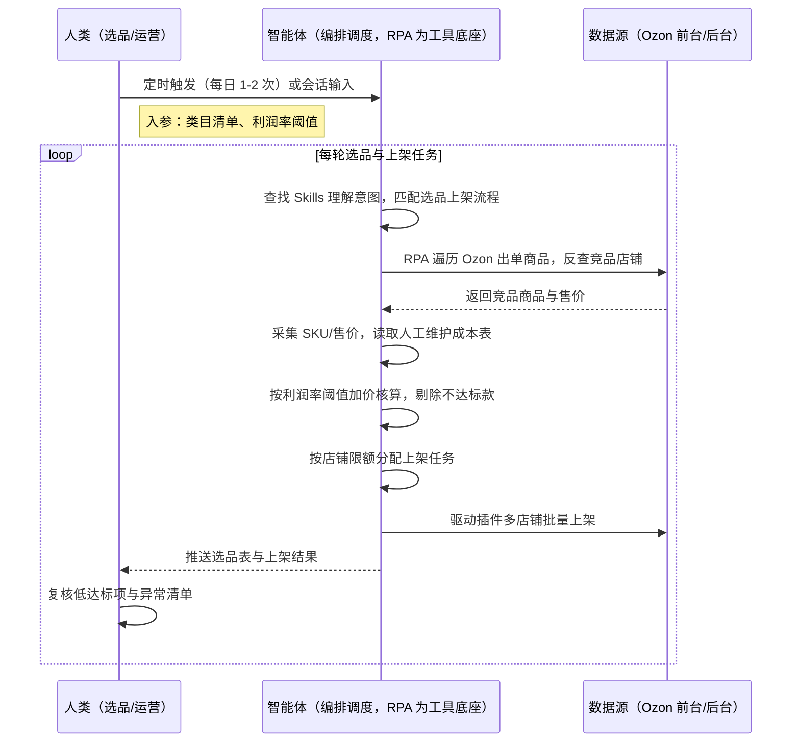
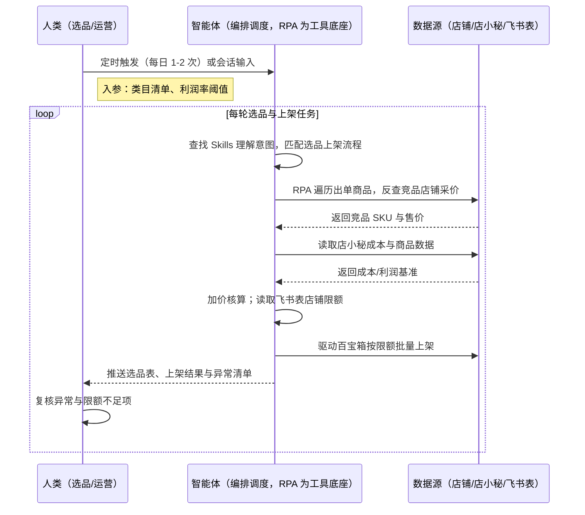

> Ozon 铺货/代运营卖家每天要从平台出单商品里反查竞品、逐店翻页采集同款 SKU 与售价，再手工在 Excel 里核算加价空间，最后逐个登录店铺后台手动上架——一轮下来 4-6 小时，且人工上架不按店铺限额与币种分层，极易触发平台风控限流。
> 本方案由智能体调度多个工具执行出单商品遍历 + 竞品店铺反查 + SKU/售价批量采集 + 利润核算 + 按店铺限额智能分配 + 多店批量上架，输出结构化选品表与上架结果，选品重复劳动减少约 90%，前期铺货人力成本下降约 90%，从"当天发现爆款"到"当天铺到多店"跑成一条自动链路。定时自动执行，全程自动化，无异常不打扰。

> Agent 自动化需开通企业功能
> 点击申请1个月免费权限
> [点击申请 →](https://skieer.feishu.cn/share/base/form/shrcnFwMayykP5iaL38fnZKTbrg)

---

## 一、用户与需求

核心矛盾：

- 找爆款要在 Ozon 前台逐类目人工翻看，覆盖面窄、更新慢，竞品出新款往往几天后才知道
- 反查竞品店铺要逐个点进、逐页翻找，店铺商品动辄上百，人工采集 SKU 与售价耗时且易漏
- 加价核算靠 Excel 手工算，公式维护复杂，售价低于成本线的商品常被漏筛
- 多店铺上架逐个登录后台手工填写，未按店铺限额、币种、价格分层分配，触发平台风控导致店铺限流

适用客户：有跟卖铺货需求的 Ozon 卖家与代运营团队——多店铺矩阵的铺货型卖家（多店铺限额分配是核心收益点，强烈推荐）、跟卖+精品并行的精铺卖家（跟卖用于快速测款，一般推荐）。已购店小秘/Ozon 百宝箱的客户可直接接入成本与上架能力，未购工具的客户走前台公开数据 + 人工维护成本表同样可跑。方案部署后业务人员不需要写代码，看选品表与上架结果即可。

### 1.1 不同模式卖家

| 类型 | 选择 | 建议 |
|-|-|-|
| 铺货（多店铺矩阵） | 首选 | 强烈推荐。多店铺限额、币种、价格分层是人工最难做匀的环节，也是本方案收益最直接的地方 |
| 精铺（跟卖+精品并行） | 次选 | 一般推荐。跟卖适合快速测款，测出后再转精品化运营 |
| 品牌 | 任意 | 不推荐。品牌以自有 Listing 与供应链为主，不适用跟卖模式 |

### 1.2 不同类目卖家

| 类目 | 最关注维度 | 核心逻辑 |
|-|-|-|
| 家居百货 | 出单爆款挖掘 | 以平台已验证出单商品为锚点反查竞品店铺，采集同款 SKU 与售价，选款风险最低 |
| 3C 配件 | 加价空间核算 | 按目标利润率反算售价，售价低于成本线（含运费佣金）即剔除 |
| 服饰箱包 | 款式迭代速度 | 爆款生命周期短，采集与上架需当天完成，否则窗口期已过 |
| 汽配/工具 | 型号匹配准确度 | 型号错配直接导致退货，需按属性字段严格比对而非仅看主图 |
| 母婴玩具 | 类目准入合规 | 上架前需核对 Ozon 类目准入与认证要求，避免上架后被下架 |

### 1.3 不同角色用户

| 用户 | 需求 | 问题 | 投入时间（估算） |
|-|-|-|-|
| 选品专员 | 快速找到可跟卖的出单款 | 人工查单复制、手动翻店比价，效率低易遗漏 | 4-6 小时/天 |
| 运营主管 | 多店铺批量上架不触发风控 | 手动上架未按限额/币种分层，易触风控限流 | 3-5 小时/天 |
| 老板 | 跟卖规模可复制、成本可控 | 人力堆不出规模化，铺货节奏慢于竞品 | 看数据决策，无需等表 |

---

## 二、现在的方法与问题

### 2.1 流程步骤与问题总结

| 序号 | 步骤 | 现在的方法 | 问题缺陷 |
|-|-|-|-|
| 1 | 找出单商品 | 在 Ozon 前台逐类目翻看热销商品 | 靠人工浏览，覆盖面窄、更新慢 |
| 2 | 反查竞品店铺 | 点进出单商品后手动翻店铺商品列表 | 店铺商品多，逐个翻页耗时，易漏款 |
| 3 | 采集 SKU 与售价 | 手工复制商品信息到 Excel | 复制粘贴易错，字段不统一 |
| 4 | 销量筛选与加价核算 | Excel 手工核算筛选 | 公式维护复杂，人工核对易漏 |
| 5 | 多店铺上架 | 逐个登录各店铺后台填写上架 | 未按店铺限额与币种分层，触发平台风控限流 |
| 6 | 上架结果核对 | 人工抽查上架结果 | 无系统化留痕，漏上架难发现 |

### 2.2 问题分析

人工方式根因

| 序号 | 根因 | 具体表现 |
|-|-|-|
| 1 | 选品靠人眼 | 逐类目翻前台找爆款，覆盖窄、更新慢 |
| 2 | 采集靠手工 | 逐店翻页复制 SKU 与售价，一轮数小时且易漏 |
| 3 | 核算靠 Excel | 加价公式手工维护，漏筛破价款 |
| 4 | 上架靠手填 | 逐店登录填写，无限额分层，风控风险高 |

SaaS 方式根因（已购店小秘 / Ozon 百宝箱）

| 序号 | 根因 | 具体表现 |
|-|-|-|
| 1 | 工具各管一段 | 店小秘管商品与成本、百宝箱管上架，中间靠人工搬运 |
| 2 | 上架未量化分配 | 插件需人工触发，未按店铺限额与币种均匀分配 |
| 3 | 数据不回流 | 上架结果与失败原因不沉淀，问题重复出现 |

---

## 三、解决方案

### 3.1 功能概述

为 Ozon 铺货/代运营卖家打造的跟卖选品与批量上架方案，一句话调度出单商品反查 + SKU/售价采集 + 利润核算 + 多店铺批量上架，输出结构化选品表与上架结果。

一句话下达指令（如「按目标类目跑一轮跟卖选品，利润率不低于 20%，按店铺限额铺到所有店铺」），智能体通过查找 Skills 文档库理解意图、匹配 4 个 RPA 自动化任务（出单商品遍历→竞品店铺反查→SKU/售价采集→利润核算与分配上架），经 MCP 调度八爪鱼 RPA 登录 Ozon 后台与店小秘执行采集，自动清洗规整为标准数据表、按利润率阈值筛选，再依店铺限额把商品分配到各店铺、驱动插件批量上架，最后输出结构化选品表与上架结果日报。全程自动化，运行状态实时反馈，跑完推送结果。

### 3.2 系统结合

| 要素 | 说明 |
|-|-|
| 客户现有工具盘点 | **未购 SaaS 客户**：仅 Ozon 官方后台 + Excel，成本数据人工维护。  
**已购 SaaS 客户**（主流组合）：店小秘（ERP，商品/成本/仓库配对）+ Ozon 百宝箱（上架插件），部分客户使用飞书多维表格管理多店铺限额与账号配置 |
| 数据/能力来源 | **无 SaaS**：Ozon 前台公开数据（竞品店铺商品页、价格展示）+ 官方后台导出；成本由人工维护表提供。  
**有 SaaS**：店小秘提供成本与商品数据；飞书多维表格提供店铺限额与币种配置；Ozon 后台导出提供出单商品数据。所有采集均为低频只读，按平台规则控制频率 |
| RPA 耦合动作 | 作为 Agent 的工具底座被调度执行：遍历 Ozon 后台出单商品 → 反查竞品店铺并采集 SKU/售价 → 按预设利润率完成加价核算 → 依飞书多维表格店铺限额把商品分配到各店铺 → 驱动 Ozon 百宝箱批量上架，失败项自动重试并告警 |
| 耦合出的新价值 | 单系统给不了的端到端结论：Ozon 后台只给平台数据、店小秘只管商品与成本、插件只能手动上架，本方案串成「采集→筛选→核算→分配→上架」一条自动链路，**只推送结构化选品表与上架结果**——运营直接看达标选品清单与失败原因，不用再逐个系统搬运 |

### 3.3 智能体执行流程

一句话下达指令，智能体自动调度。支持**两种数据通道**，部署时按客户现有工具选择：

**通道一：无 SaaS 方式（前台公开数据 + 人工成本表，适合未购工具的客户）**

**通道二：有 SaaS 方式（店小秘 + 百宝箱，适合已购工具的客户）**

> Agent 自动化需开通企业功能
> 点击申请1个月免费权限
> [点击申请 →](https://skieer.feishu.cn/share/base/form/shrcnFwMayykP5iaL38fnZKTbrg)

### 3.4 为何这么设计

要同时回答三个问题：**为什么不能只用纯代码 Agent？为什么不能只用纯 RPA？为什么两者要结合？** 本场景的核心是"多店铺跟卖上架要长期稳定跑，且不能把卖家账号跑进风控里"。

#### 1）逐项对比

| 对比维度 | SaaS/API 堆叠（店小秘+百宝箱） | 纯智能体（智能体写代码） | 智能体+自动化工具（RPA 工具底座） |
|-|-|-|-|
| 实现方式 | 店小秘管商品成本、百宝箱管上架，跨系统靠人工搬运 | AI 写代码生成采集与上架脚本，登录态与风控自行处理 | 智能体理解需求编排任务 + RPA 执行采集与多店铺上架 |
| 多平台登录与取数 | 各工具各自登录，数据不互通，出单商品需人工导出 | Ozon 登录态、页面结构、店铺限额逻辑全自研，页面改版即失效 | 平台级采集模板沉淀，店铺限额与币种按配置表执行 |
| 风控与多账号隔离 | 插件手动触发无分层，多店铺易触发限流 | 风控策略自己摸索试错，试错成本可能触发封号 | 按店铺限额与币种分层分配、频率受控，降低风控触发概率 |
| 利润核算与分配 | 需人工在 Excel 算完再导入插件 | pandas 能算，但口径一变就改代码，无沉淀 | RPA 执行确定性核算与分配，智能体负责规则校验与报告 |
| 使用成本（总拥有成本） | 一流程一工具，多套订阅与学习成本，数据不通 | 工程底座（登录态/反爬/调度/通知）全自建长期维护 | 一个底座跑多个流程（跟卖/采集/上架/订单），单流程边际成本低；采集执行不消耗 AI token |
| 维护人要求 | 业务人员可上手，但跨系统需人工兜底 | 需懂代码、专人专职维护 | 业务人员看选品表与上架结果，异常告警有人管 |

#### 2）优劣势说明

|  | SaaS/API 堆叠 | 纯智能体（写代码） | 智能体+自动化工具（RPA） |
|-|-|-|-|
| 优势 | 各点能力成熟，开箱可用；  
业务人员上手快 | 代码能力出色，逻辑可深度定制；  
无订阅费 | 智能体懂调度与质量校验；  
RPA 稳定执行登录取数与多店铺上架；  
模板组件化自由组合，异常有人管 |
| 劣势 | 工具间数据割裂，跨系统仍需人工搬运；  
一流程一订阅，成本随流程增加 | 多店铺登录态与风控自建成本高；  
页面改版即失效；  
维护成本与 token 成本高 | 需先配置 MCP 连接；  
本地电脑需保持开机（或云机） |

**特别提醒**：

本方案 RPA 需运行在常开电脑/云机上承载每日选品与上架任务

多店铺的自动化行为都在 Ozon 风控之下，按店铺限额、币种、价格分层分配是降低风险的关键，采集与上架频率必须在平台规则内设置，不存在"用代码就比 RPA 更安全"的捷径。

#### 3）结论

| 论点 | 说明 |
|-|-|
| 补齐 Agent 短板 | 登录多店铺、翻店采价、批量上架等执行动作，纯代码/纯 Agent 都难长期稳定，需 RPA 补位结合 |
| 确定性 vs 生成性 | 跟卖采集与多店铺上架是确定性任务；AI 生成的脚本能跑通一次 ≠ 能长期稳定跑、能覆盖全部店铺与类目分支而不出错 |
| 资产沉淀 | 竞品店铺模板、字段映射、店铺限额规则沉淀在 RPA 平台是"活的"，换人接手、新增店铺都成立 |
| 账号安全是硬约束 | 所有自动化在 Ozon 风控面前无豁免，按限额分层与合规频率操作才是关键，不存在"用代码更安全"的捷径 |
| 不消耗 AI token | 遍历商品、采集售价、批量上架等重复任务由 RPA 本地执行不占 token（实锤），仅数据校验与报告环节需 AI |
| 时间 | 卖家要的是当天发现爆款、当天铺到多店，而不是每周修一轮采集与上架脚本 |

### 3.5 功能清单

| 功能 | 系统 | 功能说明（解决问题） |
|-|-|-|
| 会话/定时触发 | 智能体 | 1. 理解自然语言意图，查找 Skills 文档库。  
2. 匹配选品上架流程、编排多任务（每日 1-2 次定时或会话触发）。 |
| 出单商品遍历 | RPA | 1. 解决人工翻前台找爆款覆盖窄的问题。  
2. 作为智能体工具底座被调度执行（含失败重试/补采机制）。  
3. 登录 Ozon 后台，按类目遍历出单商品列表并输出商品清单。 |
| 竞品店铺反查与采集 | RPA | 1. 解决逐店翻页复制 SKU/售价耗时易漏的问题。  
2. 按出单商品反向定位竞品店铺，采集 SKU、售价、销量标签等字段（前台公开数据，低频只读）。 |
| 成本取数与加价核算 | 智能体、RPA | 1. 解决 Excel 手工核算漏筛破价款的问题。  
2. 从店小秘读取成本与利润基准【有 SaaS 方式】；无 SaaS 时读取人工维护成本表。  
3. 按目标利润率阈值自动加价核算，低于阈值剔除并记录原因。 |
| 多店铺批量上架 | RPA、飞书多维表格 | 1. 解决逐个登店手工上架、易触风控的问题。  
2. 读取店铺限额与币种配置，按限额均匀分配上架任务。  
3. 驱动 Ozon 百宝箱批量上架，失败项记录原因并降频重试。 |
| 结果校验与留痕 | 智能体 | 1. 上架结果比对与完整性校验，漏上架自动检出。  
2. 全流程记录可追溯，异常转人工。 |
| IM通知 | 飞书、钉钉、企微等 | 解决上架失败、限额不足无人知的问题。上架结果与异常清单自动推送。 |
| 数据资产储存 | 本地电脑、云储存 | 1. Skills 资产：Ozon 跟卖选品与多店铺上架技能。  
2. 数据储存：选品表、竞品店铺库、上架记录统一入库。  
3. 经验知识库：利润率规则与店铺限额配置回填迭代。 |

### 3.6 智能体执行落地过程

部署时一次性配置入参（类目清单、利润率阈值、店铺限额与币种表、上架字段映射），日常按频率自动触发即可，无需重复输入；目标类目或店铺范围变化时，更新配置后即生效。

**⚠️ 部署前提（不满足则方案无法跑起来）**：①RPA 需部署在**常开电脑/云机**上，并配置漏跑补跑机制；②**平台账号登录态**（登录失效自动告警），多店铺建议准备独立指纹浏览器环境；③各平台采集与上架频率须在平台规则内设置，禁止超频；④首次配置（店铺限额表、利润率阈值、字段映射）需服务方/技术人员介入一次，属实施成本；⑤【有 SaaS 方式】需已开通店小秘与 Ozon 百宝箱，未开通则自动降级为无 SaaS 通道。

#### 1）配置（四步）

| 步骤 | 操作 | 说明 |
|-|-|-|
| 第一步 | 八爪鱼 RPA 创建 API-Key | 打开客户端→开放能力→API-Key→创建→复制保存（关闭后无法再次查看完整内容） |
| 第二步 | 配置 RPA 应用 | MCP 工具→可被搜索的应用→添加 Ozon 采集与上架相关应用→AI 一键生成名称描述→确定，配置给机器人 |
| 第三步 | 智能体配置 MCP 连接 | 八爪鱼 RPA 接入指引→选择「其他」→方式二（JSON 配置通用格式）→复制→智能体自定义连接器→配置 MCP→粘贴→填 API-Key→保存→信任 MCP 服务→工具启用 |
| 第四步 | 配置口径并封装 Skill | 与业务核对利润率阈值、店铺限额与币种规则 → 配置字段映射 → 调试完成后封装为固定 Skill（到点自动触发，异常自动告警） |

| 类别 | 说明 |
|-|-|
| 智能体 | 主流智能体（支持 MCP 连接、Skills 加载）。 |
| 智能体工具 | 1. 采集执行与自动化：八爪鱼 RPA（MCP 协议接入），MCP 配置完成。  
2. 数据分析与核算：智能体自带。  
3. 数据储存：飞书多维表格/本地表格。  
4. IM：企业办公 IM（飞书/钉钉/企微），MCP 或 webhook 配置。 |
| 工作知识 | 1. 目标类目清单与筛选条件。  
2. 利润率阈值与加价规则。  
3. 店铺限额与币种配置。  
4. 上架字段映射规范。 |
| 本地数据库 | 1. 选品库路径。  
2. 竞品店铺库路径。  
3. 上架记录库路径。 |

#### 2）执行

| 任务 | 产出 | 产出物接收人 |
|-|-|-|
| 接收定时/会话任务 | 任务启动记录 | —— |
| 确认类目清单与利润率阈值 | 参数确认 | 选品 |
| 经 MCP 向八爪鱼 RPA 下发采集任务 | 自动化任务指令 | —— |
| 遍历出单商品并反查竞品店铺 | 竞品店铺清单 | —— |
| 采集 SKU/售价并筛选 | 原始选品数据 | —— |
| 成本取数与加价核算 | 达标选品表 | —— |
| 按限额分配并批量上架 | 上架结果 | —— |
| 推送选品表与上架结果 | 选品日报/异常清单 | 选品、运营主管 |

异常处理：

- 采集登录失败/验证码 → 自动重试 2 次，仍失败切换备用环境并告警人工介入；
- 采集任务超时 → 记录断点，下一轮自动补采；
- 成本数据缺失 → 标记"待补成本"，不进入上架队列；
- 店铺限额不足 → 顺延到下一店铺，全部不足则告警；
- 上架失败（风控/字段） → 记录失败原因，降频重试 1 次，仍失败转人工。

#### 3）结果

| 结果 | 说明 |
|-|-|
| 数据资产 | 选品表（SKU/售价/成本/利润率）、竞品店铺库、上架记录，口径统一、可追溯 |
| 分析报告 | 1. 每日达标选品清单。  
2. 上架成功率与失败原因分布。  
3. 限额不足与异常清单。 |
| Skills | 智能体 Skills：Ozon 跟卖选品与多店铺上架技能（阈值与限额配置可维护，二次运行无需重复配置） |

> Agent 自动化需开通企业功能
> 点击申请1个月免费权限
> [点击申请 →](https://skieer.feishu.cn/share/base/form/shrcnFwMayykP5iaL38fnZKTbrg)

---

## 四、使用前后预估

> 本方案价值 = **出单商品自动遍历 → 竞品店铺自动采价 → 利润自动核算 → 按限额自动分配 → 多店批量上架**。把选品与运营从"翻店搬数据"中解放出来，跟卖从"人工 4-6 小时/天、多店上架易触风控"变成"自动跑批、按限额分配、异常可复核"。

| 指标 | 人工 | 纯代码 Agent | 智能体+自动化工具 |
|-|-|-|-|
| 选品耗时 | 4-6 小时/天（查单翻店） | 脚本能跑但维护不稳 | 自动跑批，人工复核约 0.5 小时/天 |
| 选品人力 | 3 名选品专员 | 需专职维护脚本 | 人力转复核与策略（案例口径：解放 3 名专员） |
| 上架方式 | 逐店手工填写 | 需自建多店调度 | 按店铺限额/币种自动分配并批量上架 |
| 风控风险 | 未分层易触限流 | 自己试错易触发封号 | 按限额分层 + 频率受控，风险显著降低 |
| 人力成本 | 手动逐店上架 | 维护成本高 | 约降 90%（案例口径） |
| 数据沉淀 | Excel 手工表 | 无沉淀 | 选品库/竞品库/上架记录沉淀，可追溯 |

**说明**：表中效果取自八爪鱼 Ozon 应用案例口径（减少约 90% 重复劳动、解放 3 名选品专员、人力成本约降 90%），实际效果随店铺数量、类目与平台规则变化；风控相关表述为降低触发概率，不承诺零风控。

---

## 五、效果证明

> Agent 自动化需开通企业功能
> 点击申请1个月免费权限
> [点击申请 →](https://skieer.feishu.cn/share/base/form/shrcnFwMayykP5iaL38fnZKTbrg)

### 5.1 客户案例

**《家居龙头：20+ 海外平台商品数据自动化，日均 2.5 万条》**

> 20+ 海外平台的商品价格、运费、SKU、排名等多维度数据原靠人工抽样采集。RPA 实现全自动全量采集与入库，为跨境运营决策提供数据底座。

| 效果 | 说明 |
|-|-|
| 提效 | 多平台商品数据采集效率提升约 85%。原本 20+ 海外平台的商品数据靠人工抽样采集，现在全自动全量采集入库，日均 2.5 万条，运营上班即可看到最新数据。 |
| 降本 | 告别「导表格、拼数据」的重复劳动，运营团队从人工采集转为直接使用数据做选品与定价决策。 |
| 任务 | 覆盖 20+ 海外平台，价格/运费/SKU/EAN/首图/类目排名等 8+ 核心字段，支持变体信息全采集。 |
| 任务 | 采集稳定率 99%+，跨语言、跨页面结构、跨价格展示方式全部适配。 |

案例详情：[跨境取数：家居龙头的20+海外平台商品数据自动化实践](https://skieer.feishu.cn/wiki/Iko0wtqEfiOdzlkstYBc5DI3nUe)

---

## 六、备注

### 6.1 Agent 支持

本方案不绑定具体智能体，主流 Agent 均可运行（需支持 MCP 连接、技能/Skills 加载与工具调用）：

| Agent/智能体 | 说明 |
|-|-|
| Workbuddy | 本方案运行平台，支持技能/Skills 上传加载、定时任务、MCP 工具调用与表格/报告处理 |
| 豆包（国内·字节） | 国内主流个人智能体，支持技能上传、定时任务与工具调用，上手成本低 |
| 通义千问（国内·阿里） | 支持 Agent 编排与插件生态，集成阿里电商数据能力，适合电商场景 |
| DeepSeek（国内） | 推理能力强、成本低，适合规则打分与归因分析类任务 |
| ChatGPT（国外·OpenAI） | 海外主流通用智能体，支持 GPTs/Agent 模式与工具调用 |
| Claude（国外·Anthropic） | 长文本与结构化分析能力，原生支持 MCP 连接外部工具 |

### 6.2 名词解释

| 术语 | 说明 |
|-|-|
| 跟卖 | 在其他卖家已有 Listing 上以更低价格销售同款商品，Ozon 支持该模式 |
| 出单商品 | 已产生实际订单的商品，是跟卖选品最可靠的锚点 |
| 反查竞品店铺 | 由出单商品反向定位其所属/相似竞品店铺，批量获取同款货源 |
| 店小秘 | 主流跨境电商 ERP，管理商品、订单、成本与仓库配对【有 SaaS 方式】 |
| Ozon 百宝箱 | Ozon 常用的上架/运营插件工具【有 SaaS 方式】 |
| 店铺限额 | 每个 Ozon 店铺可上架商品数量上限，多店铺上架需按限额均匀分配 |
| 加价核算 | 按"成本 + 运费 + 佣金 + 目标利润率"反算售价，低于阈值即剔除 |
| 指纹浏览器 | 为每个店铺账号模拟独立浏览器指纹，用于多账号隔离、降低关联风控风险 |
| 风控 | 平台对异常操作（频繁登录、自动化特征等）的检测与限制，可能触发验证码、限流甚至封禁 |
| MCP | Model Context Protocol，智能体连接外部工具的标准化通道 |
| API-Key | 八爪鱼 RPA 身份凭证，智能体进入 RPA 身份验证的专属钥匙 |
| Skill 文档 | 把调试好的流程封装成智能体可识别的固定技能文档 |

> Agent 自动化需开通企业功能
> 点击申请1个月免费权限
> [点击申请 →](https://skieer.feishu.cn/share/base/form/shrcnFwMayykP5iaL38fnZKTbrg)

---

原文：[查看原文](https://skieer.feishu.cn/wiki/GNqEwuqdFi8OdPkpTjicTNQZnfc)
