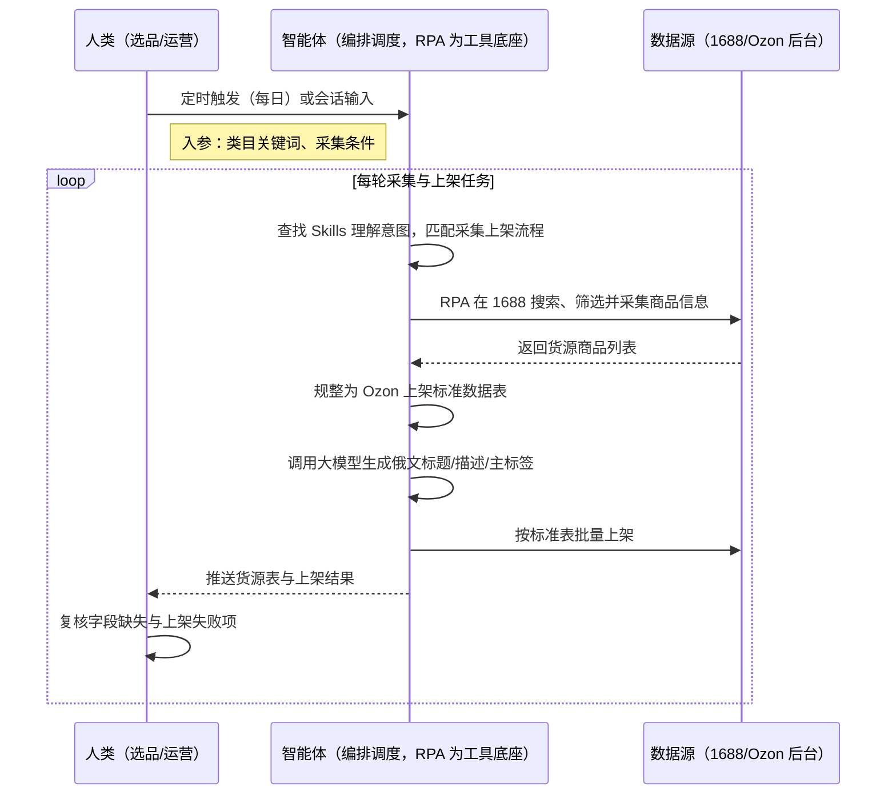
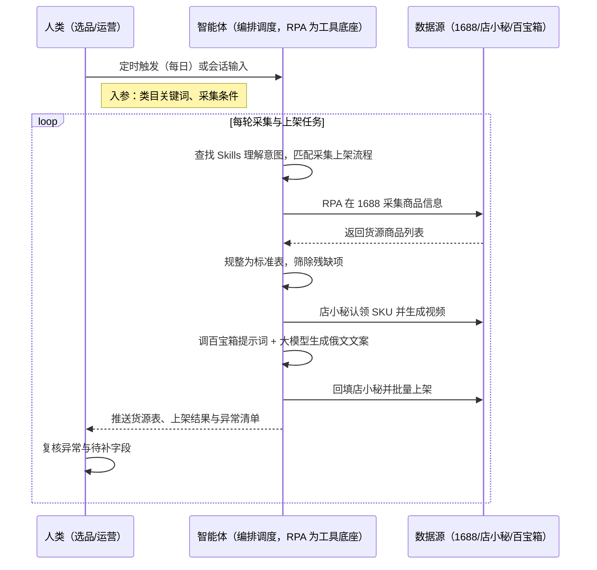

> Ozon 精铺卖家每天要在 1688 上搜关键词、逐页翻找潜力款，手工复制商品信息、逐条整理成上架格式，再在店小秘里逐条认领、做视频、写俄文标题描述、填资料，最后逐条上架——单日 SKU 采集量上不去、人工校对量巨大，每天能上架的链接数被人力死死卡住。本方案由智能体调度多个工具执行 1688 关键词采集 + 商品信息批量抓取 + 标准表规整 + 店小秘认领与视频 + AI 俄文文案生成回填 + 批量上架，输出结构化货源表与上架结果，单日 SKU 采集量提升约 5 倍、人工校对量减少约 85%、上架耗时节省约 60%，每天可上架 1000+ 条链接。定时自动执行，全程自动化，无异常不打扰。

> Agent 自动化需开通企业功能
> 点击申请1个月免费权限
> [点击申请 →](https://skieer.feishu.cn/share/base/form/shrcnFwMayykP5iaL38fnZKTbrg)

## 一、用户与需求

核心矛盾：

- 手动搜索类目关键词、逐页翻看商品再复制粘贴，效率极低，一个人一天能采集的 SKU 数量非常有限
- 采集回来的字段残缺、格式不统一，需人工逐条整理校对成上架格式，校对占掉大半工时
- 商品要在店小秘里逐条认领、拍/做视频、AI 翻译俄语、判断类目、完善资料，人效比极低
- 逐条手工填写标题、描述、主标签后上架，单日上架量被人工卡死，上新窗口期错过

适用客户：有精品化铺货需求的 Ozon 精铺卖家——以精品包装提升转化、区别于快速跟卖粗放模式的团队（强烈推荐，本方案即按该模式设计）；兼做跟卖与精铺的卖家（铺货部分可用本方案，跟卖部分见跟卖方案）。已购店小秘/Ozon 百宝箱的客户可直接接入认领、生成与上架能力；未购工具的客户走前台采集 + 人工上架兜底。方案部署后业务人员不需要写代码，看货源表与上架结果即可。

### 1.1 不同模式卖家

| 类型 | 选择 | 建议 |
|-|-|-|
| 精铺（精品化铺货） | 首选 | 强烈推荐。商品经视频、俄文文案、类目判断等精细化包装，转化率显著高于粗放铺货 |
| 铺货（以量取胜） | 次选 | 一般推荐。极致追求上架速度的场景，可先用跟卖方案快速测款 |
| 品牌 | 任意 | 不推荐。品牌为自主研发与自有供应链，不依赖 1688 搬运 |

### 1.2 不同类目卖家

| 类目 | 最关注维度 | 核心逻辑 |
|-|-|-|
| 家居日用 | 货源丰富度与价格带 | 按类目关键词采集 1688 潜力款，按价格带分层选品 |
| 3C 配件 | 参数翻译准确性 | 俄文描述需准确翻译参数（功率/接口/兼容性），错译直接引发退货 |
| 服饰 | 图文质量与款式 | 图文决定转化，需视频与主图优化后上架 |
| 户外运动 | 类目准入与认证 | 俄罗斯市场对部分类目有认证要求，上架前需核对 |
| 汽配 | 型号适配 | 以车型/型号为筛选维度采集，避免错配 |

### 1.3 不同角色用户

| 用户 | 需求 | 问题 | 投入时间（估算） |
|-|-|-|-|
| 选品/采购 | 快速找到可铺的潜力新品 | 手动翻页复制，一天采集 SKU 有限 | 5-6 小时/天 |
| 运营 | 商品信息精细化包装后上架 | 手工翻译、做图、填字段，人效极低 | 6-8 小时/天 |
| 老板 | 铺货上架规模可放大 | 人力卡住上架量，错过上新窗口 | 看数据决策，无需等表 |

---

## 二、现在的方法与问题

### 2.1 流程步骤与问题总结

| 序号 | 步骤 | 现在的方法 | 问题缺陷 |
|-|-|-|-|
| 1 | 1688 找货源 | 手动搜关键词、逐页翻看商品 | 效率极低，单人日产 SKU 有限 |
| 2 | 商品信息采集 | 逐个复制商品信息到 Excel | 字段残缺、格式不统一 |
| 3 | 规整为标准表 | 手工整理校对成上架格式 | 校对量大，易错漏 |
| 4 | 认领与视频 | 在店小秘内逐个认领、制作视频 | 重复操作多，耗时 |
| 5 | 俄文信息改写 | 人工翻译或逐条改写俄文标题描述 | 人效低、语言质量不稳定 |
| 6 | 生成并上架 | 手工填写标题/描述/主标签后上架 | 单日上架量受限，无法规模化 |

### 2.2 问题分析

人工方式根因

| 序号 | 根因 | 具体表现 |
|-|-|-|
| 1 | 采集靠手工 | 逐页翻找复制，日产 SKU 少 |
| 2 | 校对靠人工 | 字段格式不统一，逐条整理耗时 |
| 3 | 包装靠手工 | 视频、翻译、类目判断逐项手工做 |
| 4 | 上架靠手填 | 标题描述手写，单日上架量受限 |

SaaS 方式根因（已购店小秘 / Ozon 百宝箱）

| 序号 | 根因 | 具体表现 |
|-|-|-|
| 1 | 采集与 ERP 割裂 | 1688 采集工具与店小秘之间靠人工导入导出 |
| 2 | 生成能力未串联 | 百宝箱提示词需人工逐条点击触发，AI 改写未批量 |
| 3 | 无标准表沉淀 | 采集结果格式不一，每次都要重新整理 |

---

## 三、解决方案

### 3.1 功能概述

为 Ozon 精铺卖家打造的 1688 货源采集与铺货上架方案，一句话调度货源采集 + 标准表规整 + 认领与视频 + AI 俄文文案 + 批量上架，输出结构化货源表与上架结果。

一句话下达指令（如「按家居类目从 1688 采 200 个潜力款，AI 生成俄文标题描述后铺到主店铺」），智能体通过查找 Skills 文档库理解意图、匹配 4 个 RPA 自动化任务（1688 关键词采集→商品信息规整→店小秘认领与视频→AI 文案生成与上架），经 MCP 调度八爪鱼 RPA 在 1688 按关键词与条件筛选并批量采集商品信息，自动规整为 Ozon 上架标准数据表，随后在店小秘完成认领、视频与资料完善，调用 Ozon 百宝箱生成提示词、经大模型产出俄文标题描述并回填，最后批量上架。全程自动化，运行状态实时反馈，跑完推送结果。

### 3.2 系统结合

| 要素 | 说明 |
|-|-|
| 客户现有工具盘点 | **未购 SaaS 客户**：仅 Excel 管理货源与商品表，人工完成翻译与上架。   **已购 SaaS 客户**（主流组合）：店小秘（ERP，商品认领与上架）+ Ozon 百宝箱（标题/描述/主标签提示词生成），部分客户使用大模型 API（如 DeepSeek）完成俄文改写 |
| 数据/能力来源 | **无 SaaS**：1688 公开商品页（前台采集，无需登录）+ Ozon 后台导出；文案由大模型 API 生成或人工兜底。   **有 SaaS**：店小秘提供商品与认领数据；Ozon 百宝箱提供提示词生成；大模型 API 完成俄文描述 |
| RPA 耦合动作 | 作为 Agent 的工具底座被调度执行：按关键词在 1688 搜索、条件筛选并批量采集商品信息 → 规整为 Ozon 标准表 → 在店小秘认领 SKU、生成视频、完善资料 → 调用百宝箱生成提示词并经大模型产出俄文文案回填 → 批量上架，失败项自动重试并告警 |
| 耦合出的新价值 | 单系统给不了的端到端结论：1688 只提供货源、店小秘只管商品与认领、插件只提供生成能力，本方案串成「采集→规整→认领→文案→上架」一条流水线，**只推送货源标准表与上架结果**——运营直接看每日上架量与失败原因，不用再逐系统搬运 |

### 3.3 智能体执行流程

一句话下达指令，智能体自动调度。支持**两种数据通道**，部署时按客户现有工具选择：

**通道一：无 SaaS 方式（1688 前台采集 + 人工/大模型文案，适合未购工具的客户）**

**通道二：有 SaaS 方式（店小秘 + 百宝箱 + 大模型，适合已购工具的客户）**

> Agent 自动化需开通企业功能
> 点击申请1个月免费权限
> [点击申请 →](https://skieer.feishu.cn/share/base/form/shrcnFwMayykP5iaL38fnZKTbrg)

### 3.4 为何这么设计

要同时回答三个问题：**为什么不能只用纯代码 Agent？为什么不能只用纯 RPA？为什么两者要结合？** 本场景的核心是"从货源采集到上架是一条跨三系统的连续流水线，任何一环中断，当天上架量就落空"。

#### 1）逐项对比

| 对比维度 | SaaS/API 堆叠（店小秘+百宝箱） | 纯智能体（智能体写代码） | 智能体+自动化工具（RPA 工具底座） |
|-|-|-|-|
| 实现方式 | 1688 采集工具、店小秘、百宝箱各管一段，人工搬运 | AI 写代码生成采集/翻译/回填脚本，跨系统登录态自处理 | 智能体理解需求编排任务 + RPA 执行跨三系统流水线 |
| 多平台登录与取数 | 各工具独立登录，采集结果需人工导入店小秘 | 1688/店小秘/百宝箱登录态、字段映射全自研，改版即失效 | 平台级操作模板沉淀，认领、视频、回填按配置执行 |
| 风控与账号隔离 | 各工具各自应对，批量操作仍靠人工触发 | 风控策略自己摸索试错，试错成本可能触发封号 | 按平台频率控制批量节奏，降低风控触发概率 |
| 文案生成与回填 | 百宝箱需人工逐条点击，AI 改写难批量 | 可接大模型，但回填链路与失败兜底全自建 | RPA 调用百宝箱提示词 + 大模型批量生成并回填店小秘 |
| 使用成本（总拥有成本） | 一流程一工具，多套订阅与学习成本，数据不通 | 工程底座（登录态/调度/回填/通知）全自建长期维护 | 一个底座跑多个流程（采集/上架/跟卖/订单），单流程边际成本低；采集执行不消耗 AI token |
| 维护人要求 | 业务人员可上手，跨系统需人工兜底 | 需懂代码、专人专职维护 | 业务人员看货源表与上架结果，异常告警有人管 |

#### 2）优劣势说明

|  | SaaS/API 堆叠 | 纯智能体（写代码） | 智能体+自动化工具（RPA） |
|-|-|-|-|
| 优势 | 各点能力成熟（采集/ERP/生成），开箱可用；   业务人员上手快 | 代码能力出色，可自接大模型；   无订阅费 | 智能体懂调度与大模型编排；   RPA 稳定执行跨三系统操作；   模板组件化自由组合，异常有人管 |
| 劣势 | 工具间数据割裂，跨系统仍需人工搬运；   一流程一订阅，成本随流程增加 | 跨系统登录态自建成本高；   页面改版即失效；   维护成本与 token 成本高 | 需先配置 MCP 连接；   本地电脑需保持开机（或云机） |

特别提醒：

本方案 RPA 需运行在常开电脑/云机上承载每日采集与上架任务

1688 与 Ozon 均对自动化访问有限制，采集与上架频率必须在平台规则内设置；AI 生成的俄文文案建议保留人工抽检环节，避免参数错译引发退货。

#### 3）结论

| 论点 | 说明 |
|-|-|
| 补齐 Agent 短板 | 登录 1688、认领 SKU、回填店小秘、批量上架等执行动作，纯代码/纯 Agent 都难长期稳定，需 RPA 补位结合 |
| 确定性 vs 生成性 | 采集、认领、回填、上架是确定性操作；AI 生成的脚本能跑通一次 ≠ 能每天稳定跑完上千条链接 |
| 资产沉淀 | 采集规则、字段映射、文案提示词、上架路径沉淀在 RPA 平台是"活的"，换人接手、新增类目都成立 |
| 风险无豁免 | 1688 与 Ozon 的风控对所有自动化一视同仁，合规频率与人工抽检是质量底线，不存在"用代码更安全"的捷径 |
| 不消耗 AI token | 采集、认领、回填、上架等重复任务由 RPA 本地执行不占 token（实锤），仅文案生成与校验需 AI |
| 时间 | 卖家要的是每天稳定的上架量，而不是每周维护一轮采集与回填脚本 |

### 3.5 功能清单

| 功能 | 系统 | 功能说明（解决问题） |
|-|-|-|
| 会话/定时触发 | 智能体 | 1. 理解自然语言意图，查找 Skills 文档库。   2. 匹配采集上架流程、编排多任务（每日定时或会话触发）。 |
| 1688 货源采集 | RPA | 1. 解决手动搜索翻页复制、日产 SKU 少的问题。   2. 作为智能体工具底座被调度执行（含失败重试/补采机制）。   3. 按关键词在 1688 搜索、条件筛选并批量采集商品信息（前台公开数据）。 |
| 数据规整 | 智能体、RPA | 1. 解决字段残缺、格式不统一、人工校对量大的问题。   2. 统一为 Ozon 上架标准数据表，残缺项标记待补，直接汇入上架准备池。 |
| 认领与视频 | RPA | 1. 解决逐条认领、做视频耗时的重复劳动。   2. 在店小秘按采集结果认领 SKU 并生成视频【有 SaaS 方式】。 |
| AI 俄文文案 | 智能体、RPA | 1. 解决人工翻译人效低、语言质量不稳定的问题。   2. 调用 Ozon 百宝箱生成提示词，经大模型产出俄文标题/描述/主标签并回填。 |
| 批量上架 | RPA | 1. 解决逐条手工填写导致单日上架量受限的问题。   2. 按店铺与规则批量上架，失败项记录原因并重试。 |
| IM通知 | 飞书、钉钉、企微等 | 解决采集与上架异常无人知的问题。日报含采集量、上架量与失败原因。 |
| 数据资产储存 | 本地电脑、云储存 | 1. Skills 资产：1688 采集与 Ozon 铺货上架技能。   2. 数据储存：货源库、商品标准表、上架记录统一入库。   3. 经验知识库：字段映射与文案提示词回填迭代。 |

### 3.6 智能体执行落地过程

部署时一次性配置入参（类目关键词与采集条件、上架字段映射、文案提示词模板、店铺与限额），日常定时触发即可；类目或店铺范围变化时更新配置后即生效。

**⚠️ 部署前提（不满足则方案无法跑起来）**：①RPA 需部署在**常开电脑/云机**上，并配置漏跑补跑机制；②**账号登录态**（1688 采集、店小秘与百宝箱登录失效自动告警）；③采集与上架频率须在平台规则内设置，禁止超频；④【有 SaaS 方式】需已开通店小秘与 Ozon 百宝箱，并具备大模型 API 额度，未开通则自动降级为无 SaaS 通道（文案改人工/半自动）；⑤首次配置（字段映射、文案提示词、类目规则）需服务方/技术人员介入一次，属实施成本。

#### 1）配置（四步）

| 步骤 | 操作 | 说明 |
|-|-|-|
| 第一步 | 八爪鱼 RPA 创建 API-Key | 打开客户端→开放能力→API-Key→创建→复制保存（关闭后无法再次查看完整内容） |
| 第二步 | 配置 RPA 应用 | MCP 工具→可被搜索的应用→添加 1688 采集与店小秘上架相关应用→AI 一键生成名称描述→确定，配置给机器人 |
| 第三步 | 智能体配置 MCP 连接 | 八爪鱼 RPA 接入指引→选择「其他」→方式二（JSON 配置通用格式）→复制→智能体自定义连接器→配置 MCP→粘贴→填 API-Key→保存→信任 MCP 服务→工具启用 |
| 第四步 | 配置口径并封装 Skill | 与业务核对类目关键词、字段映射与文案提示词 → 配置店铺与上架规则 → 调试验证后封装为固定 Skill（到点自动触发，异常自动告警） |

| 类别 | 说明 |
|-|-|
| 智能体 | 主流智能体（支持 MCP 连接、Skills 加载）。 |
| 智能体工具 | 1. 采集执行与自动化：八爪鱼 RPA（MCP 协议接入），MCP 配置完成。   2. 文案生成：大模型 API。   3. 数据储存：店小秘/飞书多维表格。   4. IM：企业办公 IM（飞书/钉钉/企微），MCP 或 webhook 配置。 |
| 工作知识 | 1. 类目关键词与筛选条件。   2. 上架字段映射规范。   3. 俄文文案提示词模板。   4. 上架店铺与限额。 |
| 本地数据库 | 1. 货源库路径。   2. 商品标准表路径。   3. 上架记录库路径。 |

#### 2）执行

| 任务 | 产出 | 产出物接收人 |
|-|-|-|
| 接收定时/会话任务 | 任务启动记录 | —— |
| 确认类目关键词与采集条件 | 参数确认 | 选品 |
| 经 MCP 向八爪鱼 RPA 下发采集任务 | 自动化任务指令 | —— |
| 1688 搜索筛选并采集 | 货源商品清单 | —— |
| 规整为标准数据表 | Ozon 标准数据表 | —— |
| 店小秘认领与视频 | 认领记录/视频 | —— |
| 生成俄文文案并回填 | 俄文标题/描述/主标签 | —— |
| 批量上架 | 上架结果 | —— |
| 推送结果 | 采集量/上架量/异常 | 运营主管 |

异常处理：

- 采集失败/超时 → 重试 2 次，仍失败跳过并下轮补采；
- 字段缺失（价格/规格） → 标记待补，不进入上架队列；
- 文案生成失败 → 重试 1 次，仍失败转人工编辑；
- 上架失败 → 记录原因并降频重试，仍失败告警；
- 登录态失效 → 告警并暂停该批任务，等待重新登录。

#### 3）结果

| 结果 | 说明 |
|-|-|
| 数据资产 | 货源库、商品标准表（含俄文文案）、上架记录，口径统一、可追溯 |
| 分析报告 | 1. 每日采集量。   2. 上架量与成功率。   3. 异常与待补字段清单。 |
| Skills | 智能体 Skills：1688 采集与 Ozon 铺货上架技能（关键词与提示词可维护，二次运行无需重复配置） |

> Agent 自动化需开通企业功能
> 点击申请1个月免费权限
> [点击申请 →](https://skieer.feishu.cn/share/base/form/shrcnFwMayykP5iaL38fnZKTbrg)

---

## 四、使用前后预估

> 本方案价值 = **1688 自动采集 → 标准表自动规整 → 店小秘自动认领 → AI 俄文文案自动生成回填 → 批量自动上架**。把选品与运营从"翻页复制、手工翻译、逐条填写"中解放出来，上架从"人力卡住产能"变成"每天稳定成批上架"。

| 指标 | 人工 | 纯代码 Agent | 智能体+自动化工具 |
|-|-|-|-|
| 单日 SKU 采集量 | 人工逐页翻找 | 脚本能跑但维护不稳 | 自动批量采集，提升约 5 倍（案例口径） |
| 人工校对量 | 逐条核对字段 | 需专职维护脚本 | 标准表自动规整，减少约 85%（案例口径） |
| 上架耗时 | 手工翻译+填写+上架 | 需自建回填链路 | 自动生成文案并回填上架，节省约 60%（案例口径） |
| 日上架量 | 受人工限制 | 维护成本高 | 可达 1000+ 条/天（案例口径） |
| 文案质量 | 人工翻译不稳定 | 生成质量难校验 | 提示词模板 + 大模型，保留人工抽检 |
| 数据沉淀 | Excel 手工表 | 无沉淀 | 货源库/标准表/上架记录沉淀，可追溯 |

**说明**：表中效果取自八爪鱼 Ozon 应用案例口径（SKU 采集量提升约 5 倍、校对量减少约 85%、上架耗时节省约 60%、日上架 1000+ 条），实际效果随类目、店铺数量与平台规则变化；AI 文案建议保留人工抽检环节。

---

## 六、备注

### 6.1 Agent 支持

本方案不绑定具体智能体，主流 Agent 均可运行（需支持 MCP 连接、技能/Skills 加载与工具调用）：

| Agent/智能体 | 说明 |
|-|-|
| Workbuddy | 本方案运行平台，支持技能/Skills 上传加载、定时任务、MCP 工具调用与表格/报告处理 |
| 豆包（国内·字节） | 国内主流个人智能体，支持技能上传、定时任务与工具调用，上手成本低 |
| 通义千问（国内·阿里） | 支持 Agent 编排与插件生态，集成阿里电商数据能力，适合电商场景 |
| DeepSeek（国内） | 推理能力强、成本低，适合规则打分与归因分析类任务 |
| ChatGPT（国外·OpenAI） | 海外主流通用智能体，支持 GPTs/Agent 模式与工具调用 |
| Claude（国外·Anthropic） | 长文本与结构化分析能力，原生支持 MCP 连接外部工具 |

### 6.2 名词解释

| 术语 | 说明 |
|-|-|
| 精铺 | 介于铺货与精品之间的模式，商品经一定优化（视频/文案/类目）后批量上架 |
| 认领 | ERP 中把采集到的货源商品绑定为可编辑上架的商品记录 |
| 店小秘 | 主流跨境电商 ERP，支持商品认领、编辑、视频与上架【有 SaaS 方式】 |
| Ozon 百宝箱 | Ozon 常用插件，可生成商品标题/描述/主标签提示词【有 SaaS 方式】 |
| 标准数据表 | 按 Ozon 上架字段规范统一后的货源数据表，可直接对接上架工具 |
| 提示词模板 | 给大模型的固定指令模板，用于批量生成合规的俄文商品文案 |
| 指纹浏览器 | 为每个店铺账号模拟独立浏览器指纹，用于多账号隔离、降低关联风控风险 |
| 风控 | 平台对异常操作（频繁登录、自动化特征等）的检测与限制，可能触发验证码、限流甚至封禁 |
| MCP | Model Context Protocol，智能体连接外部工具的标准化通道 |
| API-Key | 八爪鱼 RPA 身份凭证，智能体进入 RPA 身份验证的专属钥匙 |
| Skill 文档 | 把调试好的流程封装成智能体可识别的固定技能文档 |

> Agent 自动化需开通企业功能
> 点击申请1个月免费权限
> [点击申请 →](https://skieer.feishu.cn/share/base/form/shrcnFwMayykP5iaL38fnZKTbrg)

---

原文：[查看原文](https://skieer.feishu.cn/wiki/GAZCwWqmZiFx49kBCt0cu3TYnQg)
