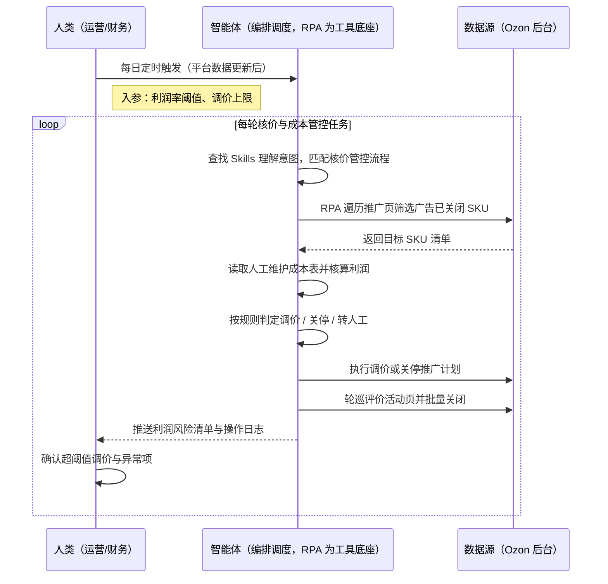
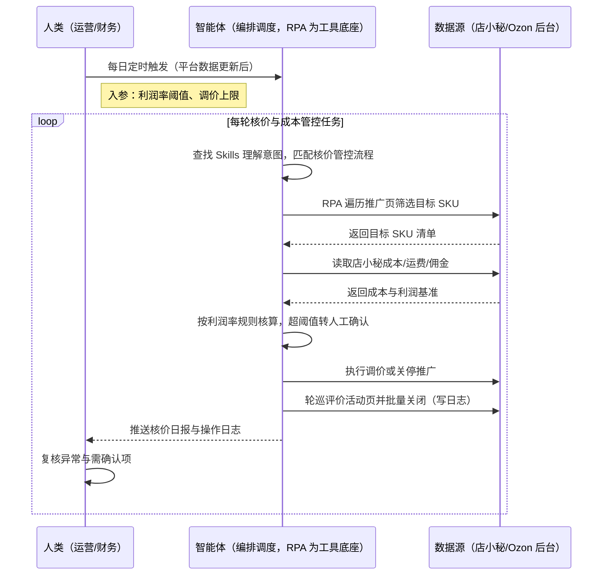

> Ozon 铺货卖家每天要盯着推广页里广告已关闭的商品逐个核算利润，判断是否需要按实际运费与佣金重新调价、或直接关停推广；同时还要逐店登录后台，把不需要的"快速收集评价"活动一个个手工关掉——商品与店铺数量一多，人工根本核不过来，破价损失与非必要支出持续侵蚀利润。本方案由智能体调度多个工具执行推广页巡检 + 成本取数与利润核算 + 自动调价/关停 + 评价活动批量关闭，输出利润风险清单与操作日志，核价改价转为自动执行（超阈值转人工确认）、破价损失减少约 20%、评价活动清理每天省约 2 小时。定时自动执行，全程自动化，无异常不打扰。

> Agent 自动化需开通企业功能
> 点击申请1个月免费权限
> [点击申请 →](https://skieer.feishu.cn/share/base/form/shrcnFwMayykP5iaL38fnZKTbrg)

## 一、用户与需求

核心矛盾：

- 推广页中广告已关闭的商品需重点关注利润率，但商品数量一多人工逐条核价根本核不过来
- 利润率低于阈值需按实际运费与佣金重新核算调价，手工算不准真实利润（口径不一）
- 关键成本数据缺失时无法判断真实利润，人工往往遗漏，导致持续亏损推广
- 铺货商品默认开启"快速收集评价"，活动条目多、逐店手工关闭耗时，产生非必要支出

适用客户：以铺货为主、SKU 与店铺数量较多的 Ozon 卖家——海量 SKU 铺货型卖家（评价活动与非必要支出影响最明显，强烈推荐）、SKU 较多的精铺卖家（核价同样需要常态化，一般推荐）。已购店小秘的客户可直接接入成本数据；未购工具的客户用人工维护成本表同样可跑。方案部署后业务人员不需要写代码，看利润风险清单与操作日志即可。

### 1.1 不同模式卖家

| 类型 | 选择 | 建议 |
|-|-|-|
| 铺货（海量 SKU） | 首选 | 强烈推荐。商品多、评价活动多，破价与非必要支出对利润影响最直接 |
| 精铺 | 次选 | 一般推荐。SKU 较少，核价仍需常态化但收益规模较小 |
| 品牌 | 任意 | 不推荐。SKU 少、价格体系人工可控 |

### 1.2 不同类目卖家

| 类目 | 最关注维度 | 核心逻辑 |
|-|-|-|
| 家居日用 | 运费占比 | 大件运费占比高，需按实际运费重算毛利后再定价 |
| 3C 配件 | 佣金与平台费 | 类目佣金差异大，按平台费口径核算真实利润 |
| 服饰 | 促销期价格波动 | 促销价随活动变化，需按日核价、及时调回 |
| 汽配/工具 | 客单价与退货成本 | 退货成本应计入毛利，避免"看着赚实际亏" |
| 母婴玩具 | 评价激励成本 | 评价活动支出对净利影响明显，需及时关闭不必要活动 |

### 1.3 不同角色用户

| 用户 | 需求 | 问题 | 投入时间（估算） |
|-|-|-|-|
| 运营 | 出单商品不亏损 | 逐个核价改价，人工算不准真实利润 | 2-3 小时/天 |
| 财务 | 成本口径统一、利润可信 | 运费/佣金口径不一，利润失真 | 定期复核 |
| 老板 | 利润与成本可控 | 破价损失与非必要支出侵蚀利润 | 看报表决策，无需等表 |

---

## 二、现在的方法与问题

### 2.1 流程步骤与问题总结

| 序号 | 步骤 | 现在的方法 | 问题缺陷 |
|-|-|-|-|
| 1 | 找需核价商品 | 人工翻推广页找广告已关闭商品 | 商品多、漏看严重 |
| 2 | 查成本数据 | 逐个到店小秘查成本 | 跨系统来回切换，耗时 |
| 3 | 利润核算 | Excel 手工核算利润 | 运费佣金口径不一，算不准 |
| 4 | 调价 / 关停 | 手工改价或关停推广 | 响应慢，破价损失扩大 |
| 5 | 关评价活动 | 逐店手工关闭快速收集评价 | 店铺多、活动条目多，耗时易漏 |
| 6 | 操作留痕 | 无统一记录 | 无法追溯，责任不清 |

### 2.2 问题分析

**人工方式根因**

| 序号 | 根因 | 具体表现 |
|-|-|-|
| 1 | 核价靠人工 | 逐条核算利润，算不过来 |
| 2 | 口径不统一 | 运费佣金靠估算，利润失真 |
| 3 | 响应滞后 | 破价发现晚，损失扩大 |
| 4 | 关活动靠手工 | 逐店逐条关闭，耗时易漏 |

SaaS 方式根因（已购店小秘）

| 序号 | 根因 | 具体表现 |
|-|-|-|
| 1 | 成本与售价分离 | 店小秘看成本、Ozon 后台改价，人工对照 |
| 2 | 无自动化规则 | 阈值判断与调价需人工逐条执行 |
| 3 | 无留痕 | 调价与关活动结果不沉淀，无法审计 |

---

## 三、解决方案

### 3.1 功能概述

为 Ozon 铺货/精铺卖家打造的利润核价与评价活动管控方案，一句话调度推广页巡检 + 成本取数与利润核算 + 自动调价/关停 + 评价活动批量关闭，输出利润风险清单与操作日志。

一句话下达指令（如「跑一轮利润核价，低于成本线的自动调价或关停推广，同时清理各店不需要的快速收集评价活动」），智能体通过查找 Skills 文档库理解意图、匹配 4 个 RPA 自动化任务（推广页巡检→成本取数与核算→调价关停→评价活动清理），经 MCP 调度八爪鱼 RPA 遍历 Ozon 推广页筛选广告已关闭的出单商品，跳转店小秘读取成本并按预设利润率规则核算，执行调价或在成本缺失时关停推广；随后轮巡各店铺后台快速收集评价页面，批量关闭不需要的活动并留存操作日志。全程自动化，运行状态实时反馈，跑完推送结果。

### 3.2 系统结合

| 要素 | 说明 |
|-|-|
| 客户现有工具盘点 | **未购 SaaS 客户**：成本数据维护在 Excel，调价与关活动全手工。   **已购 SaaS 客户**（主流组合）：店小秘（商品与成本数据）+ Ozon 后台（推广页与评价活动页） |
| 数据/能力来源 | **无 SaaS**：Ozon 后台推广与评价活动页面 + 人工维护成本表。**有 SaaS**：店小秘提供成本/运费/佣金数据；汇率按交易日口径换算；阈值与规则由业务配置 |
| RPA 耦合动作 | 作为 Agent 的工具底座被调度执行：遍历推广页筛选目标 SKU → 读取店小秘成本 → 按利润率规则核算 → 执行调价或关停推广 → 轮巡评价活动页批量关闭并写操作日志，失败项自动重试并告警 |
| 耦合出的新价值 | 单系统给不了的端到端结论：Ozon 后台只给平台数据、店小秘只管成本，二者割裂时人工无法每日完成海量 SKU 核价，本方案串成「巡检→取数→核算→执行→留痕」自动链路，**只推送利润风险清单与操作日志**——运营直接看哪些 SKU 亏损、哪些活动已关，超阈值项转人工确认 |

### 3.3 智能体执行流程

一句话下达指令，智能体自动调度。支持**两种数据通道**，部署时按客户现有工具选择：

**通道一：无 SaaS 方式（后台页面 + 人工成本表，适合未购工具的客户）**

**通道二：有 SaaS 方式（店小秘取数 + 后台执行，适合已购工具的客户）**

> Agent 自动化需开通企业功能
> 点击申请1个月免费权限
> [点击申请 →](https://skieer.feishu.cn/share/base/form/shrcnFwMayykP5iaL38fnZKTbrg)

### 3.4 为何这么设计

要同时回答三个问题：**为什么不能只用纯代码 Agent？为什么不能只用纯 RPA？为什么两者要结合？** 本场景的核心是"改价与关停直接影响收入，必须确定性执行、可追溯，并保留人工确认的关口"。

#### 1）逐项对比

| 对比维度 | SaaS/API 堆叠（店小秘+后台） | 纯智能体（智能体写代码） | 智能体+自动化工具（RPA 工具底座） |
|-|-|-|-|
| 实现方式 | 店小秘看成本、后台改价，人工对照执行 | AI 写代码生成取数与改价脚本，登录态与容错自处理 | 智能体理解需求编排任务 + RPA 执行取数与调价关停 |
| 多平台登录与取数 | 两系统独立，成本与售价需人工对照 | 店小秘与 Ozon 登录态、页面结构全自研，改版即失效 | 平台级操作模板沉淀，取数与执行按配置完成 |
| 风控与操作合规 | 人工触发无频率控制，批量操作易触发限制 | 风控策略自己摸索试错，试错成本可能触发封号 | 按平台频率控制操作节奏，降低风控触发概率 |
| 资金操作安全性 | 人工逐条确认，效率低 | 缺少审计与复核机制，误改价风险高 | 超阈值改价转人工确认 + 全程留痕，风险可控 |
| 使用成本（总拥有成本） | 一流程一工具，多套订阅与学习成本，数据不通 | 工程底座（登录态/调度/审计/通知）全自建长期维护 | 一个底座跑多个流程（核价/采集/上架/订单），单流程边际成本低；多数执行不消耗 AI token |
| 维护人要求 | 业务人员可上手，跨系统需人工兜底 | 需懂代码、专人专职维护 | 业务人员看风险清单与日志，异常告警有人管 |

#### 2）优劣势说明

|  | SaaS/API 堆叠 | 纯智能体（写代码） | 智能体+自动化工具（RPA） |
|-|-|-|-|
| 优势 | 成本与平台数据各有归属，业务熟悉；   上手快 | 规则可深度定制，能自建复杂核算逻辑；   无订阅费 | 智能体懂规则判断与质量校验；   RPA 稳定执行改价与活动关闭；   超阈值转人工 + 全程留痕 |
| 劣势 | 成本与售价分离，人工对照效率低；   一流程一订阅，成本随流程增加 | 资金相关操作缺审计与复核；   页面改版即失效 | 需先配置 MCP 连接；   本地电脑需保持开机（或云机） |

**特别提醒**：

本方案 RPA 需运行在常开电脑/云机上承载每日核价与活动管控任务

改价与关停推广直接影响收入与投放，方案默认设置**调价幅度上限，超限转人工确认**，并对成本缺失的 SKU 采取"关停推广 + 标记异常"的保守策略，不做无依据的自动改价。

#### 3）结论

| 论点 | 说明 |
|-|-|
| 补齐 Agent 短板 | 跨系统取数、按规则改价、批量关活动等执行动作，纯代码/纯 Agent 都难长期稳定，需 RPA 补位结合 |
| 确定性 vs 生成性 | 改价与关停是确定性且影响资金的操作；AI 生成的脚本能跑通一次 ≠ 每条 SKU 都算对、每次改价都不出错 |
| 资产沉淀 | 利润率规则、调价策略、活动关闭规则沉淀在 RPA 平台是"活的"，换人接手、新增店铺都成立 |
| 风险与责任 | 价格调整牵动收入，本方案保留人工确认阈值与操作留痕，不追求全自动免审；账号合规责任由使用方承担 |
| 不消耗 AI token | 巡检、取数、改价、关活动等重复任务由 RPA 本地执行不占 token（实锤），仅规则判断与报告环节需 AI |
| 时间 | 运营要的是每天拿到"哪些 SKU 亏损、哪些活动该关"，而不是每周修一轮核价脚本 |

### 3.5 功能清单

| 功能 | 系统 | 功能说明（解决问题） |
|-|-|-|
| 会话/定时触发 | 智能体 | 1. 理解自然语言意图，查找 Skills 文档库。   2. 匹配核价管控流程、编排多任务（每日定时或会话触发）。 |
| 推广页巡检 | RPA | 1. 解决人工翻页漏看、核价不过来的问题。   2. 作为智能体工具底座被调度执行（含失败重试机制）。   3. 遍历 Ozon 推广页，筛选广告已关闭的出单商品并输出清单。 |
| 成本取数与核算 | 智能体、RPA | 1. 解决运费佣金口径不一、利润算不准的问题。   2. 从店小秘读取成本/运费/佣金【有 SaaS 方式】，无 SaaS 时读取人工成本表。   3. 统一口径核算毛利，低于阈值判定调价或关停。 |
| 调价与关停 | RPA | 1. 解决破价响应慢、损失扩大的问题。   2. 按规则执行改价（超上限转人工确认）；成本缺失则关停推广并标记异常。 |
| 评价活动管控 | RPA | 1. 解决逐店手工关闭活动耗时易漏的问题。   2. 轮巡各店铺"快速收集评价"页面，批量关闭不需要的已激活活动。   3. 留存完整操作日志，可追溯。 |
| 风险清单与留痕 | 智能体 | 1. 输出亏损 SKU 清单与调价记录。   2. 操作日志与异常项汇总，超阈值项转人工。 |
| IM通知 | 飞书、钉钉、企微等 | 解决破价与异常无人知的问题。核价日报与成本管控结果自动推送。 |
| 数据资产储存 | 本地电脑、云储存 | 1. Skills 资产：利润核价与成本管控技能。   2. 数据储存：核价记录、成本基准、操作日志统一入库。   3. 经验知识库：阈值与调价规则回填迭代。 |

### 3.6 智能体执行落地过程

部署时一次性配置入参（利润率阈值、调价幅度上限、成本核算口径、评价活动关闭规则），日常定时触发即可；阈值或口径变化时更新配置后即生效。

**⚠️ 部署前提（不满足则方案无法跑起来）**：①RPA 需部署在**常开电脑/云机**上，并配置漏跑补跑机制；②**账号登录态**（Ozon 后台、店小秘登录失效自动告警）；③【有 SaaS 方式】需已开通店小秘以获取成本数据，未开通则降级为人工成本表（口径需与财务一致）；④后台操作频率须在平台规则内设置，禁止超频；⑤首次配置（成本口径、阈值、调价上限）需服务方与财务共同确认一次，属实施成本。

#### 1）配置（四步）

| 步骤 | 操作 | 说明 |
|-|-|-|
| 第一步 | 八爪鱼 RPA 创建 API-Key | 打开客户端→开放能力→API-Key→创建→复制保存（关闭后无法再次查看完整内容） |
| 第二步 | 配置 RPA 应用 | MCP 工具→可被搜索的应用→添加推广巡检、成本取数与活动管理相关应用→AI 一键生成名称描述→确定，配置给机器人 |
| 第三步 | 智能体配置 MCP 连接 | 八爪鱼 RPA 接入指引→选择「其他」→方式二（JSON 配置通用格式）→复制→智能体自定义连接器→配置 MCP→粘贴→填 API-Key→保存→信任 MCP 服务→工具启用 |
| 第四步 | 配置口径并封装 Skill | 与财务核对成本核算口径与调价上限 → 配置利润率阈值与活动关闭规则 → 调试验证后封装为固定 Skill（到点自动触发，异常自动告警） |

| 类别 | 说明 |
|-|-|
| 智能体 | 主流智能体（支持 MCP 连接、Skills 加载）。 |
| 智能体工具 | 1. 采集执行与自动化：八爪鱼 RPA（MCP 协议接入），MCP 配置完成。   2. 数据分析与核算：智能体自带。   3. 数据储存：店小秘/飞书多维表格。   4. IM：企业办公 IM（飞书/钉钉/企微），MCP 或 webhook 配置。 |
| 工作知识 | 1. 利润率阈值与调价幅度上限。   2. 成本核算口径（含运费/佣金/退货）。   3. 评价活动关闭规则。   4. 人工确认阈值。 |
| 本地数据库 | 1. 核价记录库路径。   2. 成本基准表路径。   3. 操作日志库路径。 |

#### 2）执行

| 任务 | 产出 | 产出物接收人 |
|-|-|-|
| 接收定时/会话任务 | 任务启动记录 | —— |
| 确认阈值与调价上限 | 参数确认 | 运营 |
| 遍历推广页筛选目标 SKU | 目标 SKU 清单 | —— |
| 读取成本并核算利润 | 利润核算表 | —— |
| 执行调价 / 关停推广 | 调价记录 | —— |
| 轮巡评价活动页并关闭 | 活动关闭日志 | —— |
| 推送日报 | 核价与成本管控日报 | 运营、财务 |

异常处理：

- 成本数据缺失 → 标记异常 SKU，关停推广并告警；
- 调价幅度超上限 → 转人工确认，不自动执行；
- 页面结构变更 → 跳过该店铺并告警，等待模板更新；
- 操作失败 → 重试 2 次，仍失败记录并告警；
- 汇率数据不可用 → 使用上一交易日汇率并标注。

#### 3）结果

| 结果 | 说明 |
|-|-|
| 数据资产 | 核价记录（SKU/成本/售价/利润率）、活动操作日志，口径统一、可追溯 |
| 分析报告 | 1. 亏损 SKU 清单。   2. 调价记录与人工确认清单。   3. 非必要支出节省统计。 |
| Skills | 智能体 Skills：利润核价与成本管控技能（阈值与口径可维护，二次运行无需重复配置） |

> Agent 自动化需开通企业功能
> 点击申请1个月免费权限
> [点击申请 →](https://skieer.feishu.cn/share/base/form/shrcnFwMayykP5iaL38fnZKTbrg)

---

## 四、使用前后预估

> 本方案价值 = **推广页自动巡检 → 成本自动取数 → 利润自动核算 → 自动调价/关停 → 评价活动批量关闭**。把运营从"逐条核价、逐店关活动"中解放出来，利润管控从"人工算不准、响应慢"变成"每日全量核价、异常有清单、操作有留痕"。

| 指标 | 人工 | 纯代码 Agent | 智能体+自动化工具 |
|-|-|-|-|
| 核价方式 | 人工逐条核算 | 脚本能跑但审计缺失 | 每日自动全量巡检，超阈值转人工确认 |
| 破价损失 | 响应慢、损失扩大 | 误改价风险高 | 减少约 20% 破价损失（案例口径） |
| 评价活动清理 | 逐店手工操作 | 需自建多店调度 | 批量关闭并留痕，每天省约 2 小时（案例口径） |
| 单次处理量 | 受人工精力限制 | 维护成本高 | 单次可处理 100+ 条（案例口径） |
| 成本口径 | 估算、口径不一 | 需自建规则 | 统一口径核算，口径可配置 |
| 数据沉淀 | 无记录 | 无沉淀 | 核价记录与操作日志沉淀，可审计 |

**说明**：表中效果取自八爪鱼 Ozon 应用案例口径（破价损失减少约 20%、每天节省约 2 小时、单次处理 100+ 条），实际效果随 SKU 与店铺数量、类目与平台规则变化；价格与投放调整涉及收入，请按自身风控要求设置人工确认阈值。

---

## 六、备注

### 6.1 Agent 支持

本方案不绑定具体智能体，主流 Agent 均可运行（需支持 MCP 连接、技能/Skills 加载与工具调用）：

| Agent/智能体 | 说明 |
|-|-|
| Workbuddy | 本方案运行平台，支持技能/Skills 上传加载、定时任务、MCP 工具调用与表格/报告处理 |
| 豆包（国内·字节） | 国内主流个人智能体，支持技能上传、定时任务与工具调用，上手成本低 |
| 通义千问（国内·阿里） | 支持 Agent 编排与插件生态，集成阿里电商数据能力，适合电商场景 |
| DeepSeek（国内） | 推理能力强、成本低，适合规则打分与归因分析类任务 |
| ChatGPT（国外·OpenAI） | 海外主流通用智能体，支持 GPTs/Agent 模式与工具调用 |
| Claude（国外·Anthropic） | 长文本与结构化分析能力，原生支持 MCP 连接外部工具 |

### 6.2 名词解释

| 术语 | 说明 |
|-|-|
| 推广页 | Ozon 后台管理商品广告推广的页面，可查看与调整推广状态 |
| 广告已关闭 | 商品推广计划处于关闭状态，通常意味着需重点核查其利润率 |
| 快速收集评价 | Ozon 的评价激励工具，商品上架默认开启，会产生一定支出 |
| 破价损失 | 售价低于成本或低于预期利润线造成的利润损失 |
| 成本核算口径 | 计算毛利时包含的成本项与规则（商品成本 + 运费 + 佣金 + 退货等） |
| 调价幅度上限 | 单次自动改价允许的最大幅度，超过则转人工确认 |
| 店小秘 | 主流跨境电商 ERP，管理商品与成本数据【有 SaaS 方式】 |
| 风控 | 平台对异常操作（频繁登录、自动化特征等）的检测与限制，可能触发验证码、限流甚至封禁 |
| MCP | Model Context Protocol，智能体连接外部工具的标准化通道 |
| API-Key | 八爪鱼 RPA 身份凭证，智能体进入 RPA 身份验证的专属钥匙 |
| Skill 文档 | 把调试好的流程封装成智能体可识别的固定技能文档 |

> Agent 自动化需开通企业功能
> 点击申请1个月免费权限
> [点击申请 →](https://skieer.feishu.cn/share/base/form/shrcnFwMayykP5iaL38fnZKTbrg)

---

原文：[查看原文](https://skieer.feishu.cn/wiki/Eal6wXa42izKblk90EFcmX7ynNb)
