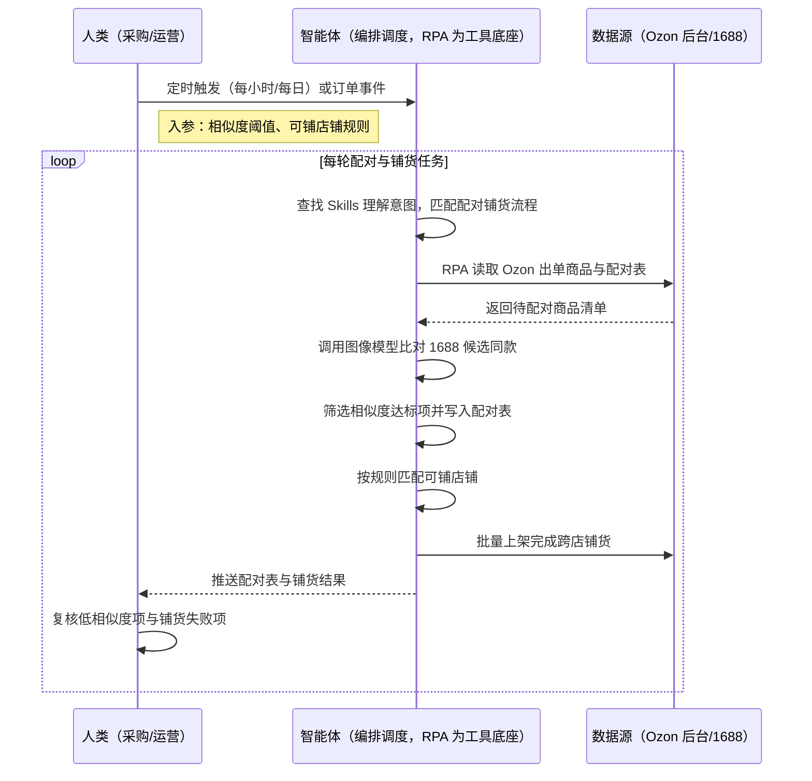
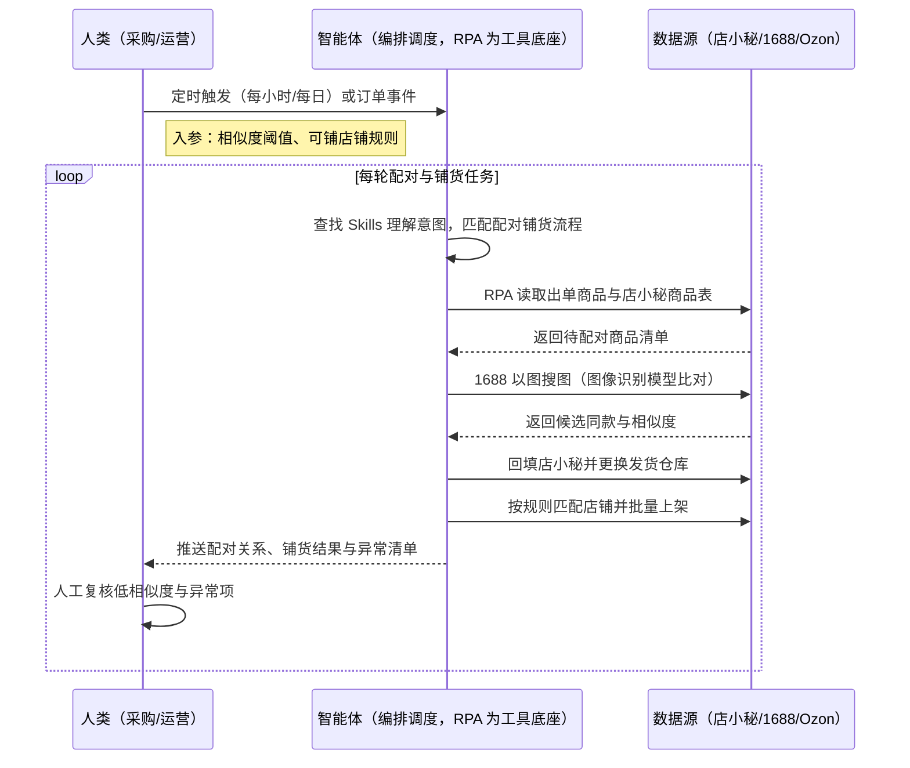

> Ozon 铺货卖家商品出单后，要逐个到 1688 以图搜图找同款、肉眼比对相似度、再手工把货源信息录回店小秘并更换发货仓库；当一个 SKU 出单后，还要逐个登录其他店铺手工复制上架，实现"一品多店"——人工搜款相似度标准不统一、跨店重复操作量巨大，爆款窗口期常被拖过。本方案由智能体调度多个工具执行出单商品定位 + 1688 以图搜图配对 + 货源信息回填换仓 + 按规则跨店铺货，输出配对关系与铺货结果，货源匹配成功率 >85%、跨店铺货每天节省约 2 小时重复核对、整体曝光量提升约 15 倍。定时自动执行，全程自动化，无异常不打扰。

> Agent 自动化需开通企业功能
> 点击申请1个月免费权限
> [点击申请 →](https://skieer.feishu.cn/share/base/form/shrcnFwMayykP5iaL38fnZKTbrg)

## 一、用户与需求

核心矛盾：

- 商品出单后需逐个到 1688 以图搜图找同款，人工逐个搜索极耗时间，且相似度判断标准不统一
- 找到同款后要手工把货源信息录回店小秘、更换发货仓库配对，复制粘贴易错，配对关系易断
- 出单 SKU 要逐个登录其他店铺后台手工填写上架，跨店、跨币种的分配逻辑复杂，重复量巨大
- 铺货节奏慢于竞品，已验证的爆款无法快速铺开，错过流量与出单窗口

适用客户：以"一品多店"模式运营的 Ozon 铺货卖家——多店铺矩阵、出单后需快速扩店复制的团队（强烈推荐，跨店铺货收益最直接）；兼做精铺的卖家（出单款的配对采购同样适用，一般推荐）。已购店小秘的客户可直接接入商品与仓库配对数据；未购工具的客户可用前台采集 + Excel 配对表跑通。方案部署后业务人员不需要写代码，看配对结果与铺货清单即可。

### 1.1 不同模式卖家

| 类型 | 选择 | 建议 |
|-|-|-|
| 铺货（一品多店） | 首选 | 强烈推荐。出单款跨店铺货是扩大曝光的核心手段，也是人工最难规模化的环节 |
| 精铺（出单款配对采购） | 次选 | 一般推荐。出单后配对采购与换仓同样受益，店铺数量较少 |
| 品牌 | 任意 | 不推荐。品牌走自有供应链与采购体系，不做 1688 配对 |

### 1.2 不同类目卖家

| 类目 | 最关注维度 | 核心逻辑 |
|-|-|-|
| 家居日用 | 同款识别准确率 | 以图搜图找同款，相似度阈值（如 >70%）决定采购准确度 |
| 3C 配件 | 型号一致性 | 型号错配直接导致退货，需按参数比对而非仅看主图 |
| 服饰 | 颜色/尺码一致 | 同款不同色需按属性精确配对，避免错色错码 |
| 五金工具 | 规格参数 | 规格差异大，需校验关键参数后再回填配对 |
| 宠物用品 | 包装规格 | 规格不同影响客单价与运费核算，需按包装单位比对 |

### 1.3 不同角色用户

| 用户 | 需求 | 问题 | 投入时间（估算） |
|-|-|-|-|
| 采购 | 出单后快速找到货源并下单 | 逐个手工搜同款，相似度判断靠肉眼 | 3-5 小时/天 |
| 运营 | 出单款快速铺到其他店 | 逐个登录店铺手工上架，重复量大 | 3-4 小时/天 |
| 老板 | 爆款曝光最大化 | 铺货节奏慢，爆款窗口期抓不住 | 看数据决策，无需等表 |

---

## 二、现在的方法与问题

### 2.1 流程步骤与问题总结

| 序号 | 步骤 | 现在的方法 | 问题缺陷 |
|-|-|-|-|
| 1 | 找出待配对商品 | 人工翻订单找已出单未配对商品 | 易漏单，效率低 |
| 2 | 1688 找同款 | 手工以图搜图、逐个比对相似度 | 人工标准不统一，相似度判断主观 |
| 3 | 回填货源信息 | 手工把货源信息录回店小秘 | 复制粘贴易错，配对关系易断 |
| 4 | 更换发货仓库 | 人工调整发货仓库配对 | 仓库配对错→发货延误 |
| 5 | 跨店铺货 | 逐个登录其他店铺手工填写上架 | 重复操作巨大，跨币种易出错 |
| 6 | 铺货结果核对 | 人工抽查 | 无留痕，漏铺难发现 |

### 2.2 问题分析

人工方式根因

| 序号 | 根因 | 具体表现 |
|-|-|-|
| 1 | 找款靠肉眼 | 逐个搜索比对相似度，标准不统一 |
| 2 | 回填靠复制 | 手工录入货源信息，易错易断 |
| 3 | 换仓靠人工 | 仓库配对调整依赖人工判断 |
| 4 | 铺货靠手填 | 逐店登录填写上架，重复量巨大 |

SaaS 方式根因（已购店小秘）

| 序号 | 根因 | 具体表现 |
|-|-|-|
| 1 | 配对仍靠人工 | 店小秘提供配对能力，但搜款与判断需人工完成 |
| 2 | 多店铺无规则分配 | 跨店铺货需逐店操作，跨币种分配靠人工拆解 |
| 3 | 结果不回流 | 配对与铺货结果不沉淀，异常无法追溯 |

---

## 三、解决方案

### 3.1 功能概述

为 Ozon 铺货卖家打造的出单配对采购与跨店铺货方案，一句话调度出单商品定位 + 1688 以图搜图配对 + 货源回填换仓 + 跨店铺货，输出配对关系与铺货结果。

一句话下达指令（如「跑一轮出单商品配对，相似度 70% 以上自动回填，配对成功的铺到所有可铺店铺」），智能体通过查找 Skills 文档库理解意图、匹配 4 个 RPA 自动化任务（待配对商品定位→1688 以图搜图→货源回填与换仓→跨店铺货），经 MCP 调度八爪鱼 RPA 读取 Ozon 出单商品与店小秘商品表、在 1688 以图搜图并调用图像识别模型筛选达标同款、回填店小秘完成配对与仓库更换，再按预设规则把出单商品复制到其他店铺完成上架。全程自动化，运行状态实时反馈，跑完推送结果。

### 3.2 系统结合

| 要素 | 说明 |
|-|-|
| 客户现有工具盘点 | **未购 SaaS 客户**：用 Excel 维护配对关系与店铺清单，货源信息人工回填。  
**已购 SaaS 客户**（主流组合）：店小秘（商品、认领、仓库配对）+ Ozon 后台/插件（上架），部分客户使用图像相似度服务做同款比对 |
| 数据/能力来源 | **无 SaaS**：Ozon 后台导出（出单商品）+ 1688 公开商品页（前台采集，无需登录）+ 图像模型本地比对。  
**有 SaaS**：店小秘提供商品与仓库配对数据；店铺规则与限额取自飞书多维表格；图像比对调用开源模型或第三方相似度服务 |
| RPA 耦合动作 | 作为 Agent 的工具底座被调度执行：读取出单商品定位待配对项 → 在 1688 以图搜图并调用图像识别模型筛选相似度达标同款 → 回填店小秘完成配对与发货仓库更换 → 按预设规则匹配可铺店铺并批量上架，失败项自动重试并告警 |
| 耦合出的新价值 | 单系统给不了的端到端结论：店小秘只管商品与配对、1688 只管货源、Ozon 只管上架，本方案串成「出单→找货源→换仓→多店铺货」闭环，**只推送配对关系表与铺货结果**——采购与运营直接看配对成功率与铺货量，异常项转人工复核 |

### 3.3 智能体执行流程

一句话下达指令，智能体自动调度。支持**两种数据通道**，部署时按客户现有工具选择：

**通道一：无 SaaS 方式（后台导出 + 前台采集 + 本地图像比对，适合未购工具的客户）**

**通道二：有 SaaS 方式（店小秘配对 + 图像识别模型，适合已购工具的客户）**

> Agent 自动化需开通企业功能
> 点击申请1个月免费权限
> [点击申请 →](https://skieer.feishu.cn/share/base/form/shrcnFwMayykP5iaL38fnZKTbrg)

### 3.4 为何这么设计

要同时回答三个问题：**为什么不能只用纯代码 Agent？为什么不能只用纯 RPA？为什么两者要结合？** 本场景的核心是"配对关系直接决定采购与发货，错一次就是错发退款，必须确定性执行且全程可追溯"。

#### 1）逐项对比

| 对比维度 | SaaS/API 堆叠（店小秘+图像服务） | 纯智能体（智能体写代码） | 智能体+自动化工具（RPA 工具底座） |
|-|-|-|-|
| 实现方式 | 店小秘做配对、图像服务做比对，搜款与回填靠人工 | AI 写代码生成搜图/回填/上架脚本，跨系统登录态自处理 | 智能体理解需求编排任务 + RPA 执行搜款、回填与铺货 |
| 多平台登录与取数 | 各工具独立，出单商品与货源信息需人工中转 | Ozon/1688/店小秘登录态与页面结构全自研，改版即失效 | 平台级操作模板沉淀，配对与换仓按配置执行 |
| 风控与账号隔离 | 人工触发无频率控制，批量搜款易触发限制 | 风控策略自己摸索试错，试错成本可能触发封号 | 按平台频率控制搜款与上架节奏，降低风控触发概率 |
| 配对准确性与留痕 | 相似度判断靠人工，结果不回流 | 模型可自接，但回填与错误兜底链路全自建 | 相似度阈值 + 低置信转人工，全程留痕可追溯 |
| 使用成本（总拥有成本） | 一流程一工具，多套订阅与学习成本，数据不通 | 工程底座（登录态/模型/调度/通知）全自建长期维护 | 一个底座跑多个流程（配对/铺货/跟卖/订单），单流程边际成本低；采集执行不消耗 AI token |
| 维护人要求 | 业务人员可上手，跨系统需人工兜底 | 需懂代码与模型部署、专人专职维护 | 业务人员看配对结果与铺货量，异常告警有人管 |

#### 2）优劣势说明

|  | SaaS/API 堆叠 | 纯智能体（写代码） | 智能体+自动化工具（RPA） |
|-|-|-|-|
| 优势 | 配对与图像比对能力成熟；  
业务人员上手快 | 可自定义相似度模型与阈值；  
无订阅费 | 智能体懂调度与阈值校验；  
RPA 稳定执行搜款、回填与跨店铺货；  
模板组件化自由组合，异常有人管 |
| 劣势 | 搜款与回填仍靠人工搬运；  
一流程一订阅，成本随流程增加 | 模型部署与跨系统登录态自建成本高；  
页面改版即失效 | 需先配置 MCP 连接；  
本地电脑需保持开机（或云机） |

**特别提醒**：

本方案 RPA 需运行在常开电脑/云机上承载定时配对与铺货任务

配对错误直接影响采购与发货，方案默认对**低相似度项转人工复核**、不自动配对；1688 与 Ozon 的采集与上架频率须在平台规则内设置。

#### 3）结论

| 论点 | 说明 |
|-|-|
| 补齐 Agent 短板 | 搜款、回填、换仓、跨店上架等执行动作，纯代码/纯 Agent 都难长期稳定，需 RPA 补位结合 |
| 确定性 vs 生成性 | 配对与回填是确定性任务且错误成本高；AI 生成的脚本能跑通一次 ≠ 能持续稳定跑且不出错配 |
| 资产沉淀 | 搜款规则、相似度阈值、仓库映射、铺货规则沉淀在 RPA 平台是"活的"，换人接手、新增店铺都成立 |
| 风险与责任 | 配对错误牵动采购与退款，本方案保留人工复核环节，不追求全自动免审；账号合规责任由使用方承担 |
| 不消耗 AI token | 搜款、比对、回填、铺货等重复任务由 RPA 本地执行不占 token（实锤），仅数据校验与报告环节需 AI |
| 时间 | 采购与运营要的是"出单当天配对完、铺到多店"，而不是每周维护一轮搜图与回填脚本 |

### 3.5 功能清单

| 功能 | 系统 | 功能说明（解决问题） |
|-|-|-|
| 会话/定时触发 | 智能体 | 1. 理解自然语言意图，查找 Skills 文档库。  
2. 匹配配对铺货流程、编排多任务（每小时/每日定时或订单事件触发）。 |
| 待配对商品定位 | RPA | 1. 解决人工翻订单漏单的问题。  
2. 作为智能体工具底座被调度执行（含失败重试/补采机制）。  
3. 读取 Ozon 出单商品与店小秘商品表，定位已出单未配对项。 |
| 1688 以图搜图 | RPA、图像模型 | 1. 解决手工搜同款效率低、标准不统一的问题。  
2. 复制商品图在 1688 以图搜图，调用图像识别模型比对相似度。  
3. 输出候选同款与相似度，达标项进入配对队列。 |
| 货源回填与换仓 | RPA | 1. 解决手工录入易错、配对关系易断的问题。  
2. 达标同款信息回填店小秘，自动更换发货仓库配对。  
3. 低相似度项标记转人工复核。 |
| 跨店铺货 | RPA | 1. 解决逐店登录手工上架、跨币种分配复杂的问题。  
2. 按预设规则匹配可铺店铺，跨店跨币种逻辑自动执行，批量上架完成一品多店。 |
| 留痕与校验 | 智能体 | 1. 配对与铺货全流程记录可追溯。  
2. 铺货结果校验，漏铺自动检出。 |
| IM通知 | 飞书、钉钉、企微等 | 解决配对失败、铺货异常无人知的问题。配对成功率与铺货结果自动推送。 |
| 数据资产储存 | 本地电脑、云储存 | 1. Skills 资产：出单配对采购与跨店铺货技能。  
2. 数据储存：配对关系库、铺货记录统一入库。  
3. 经验知识库：相似度阈值与店铺规则回填迭代。 |

### 3.6 智能体执行落地过程

部署时一次性配置入参（相似度阈值、可铺店铺规则、发货仓库映射），日常定时触发即可；阈值或店铺范围变化时更新配置后即生效。

**⚠️ 部署前提（不满足则方案无法跑起来）**：①RPA 需部署在**常开电脑/云机**上，并配置漏跑补跑机制；②**账号登录态**（Ozon 后台、店小秘登录失效自动告警），多店铺建议准备独立指纹浏览器环境；③1688 搜款与 Ozon 上架频率须在平台规则内设置，禁止超频；④【有 SaaS 方式】需已开通店小秘，图像比对可调用开源模型自建或使用第三方相似度服务；⑤首次配置（相似度阈值、仓库映射、店铺规则）需服务方/技术人员介入一次，属实施成本。

#### 1）配置（四步）

| 步骤 | 操作 | 说明 |
|-|-|-|
| 第一步 | 八爪鱼 RPA 创建 API-Key | 打开客户端→开放能力→API-Key→创建→复制保存（关闭后无法再次查看完整内容） |
| 第二步 | 配置 RPA 应用 | MCP 工具→可被搜索的应用→添加 Ozon 取数、1688 搜款与店小秘回填相关应用→AI 一键生成名称描述→确定，配置给机器人 |
| 第三步 | 智能体配置 MCP 连接 | 八爪鱼 RPA 接入指引→选择「其他」→方式二（JSON 配置通用格式）→复制→智能体自定义连接器→配置 MCP→粘贴→填 API-Key→保存→信任 MCP 服务→工具启用 |
| 第四步 | 配置口径并封装 Skill | 与业务核对相似度阈值、仓库映射与可铺店铺规则 → 配置图像比对参数 → 调试验证后封装为固定 Skill（到点自动触发，异常自动告警） |

| 类别 | 说明 |
|-|-|
| 智能体 | 主流智能体（支持 MCP 连接、Skills 加载）。 |
| 智能体工具 | 1. 采集执行与自动化：八爪鱼 RPA（MCP 协议接入），MCP 配置完成。  
2. 图像比对：本地图像模型或第三方相似度服务。  
3. 数据储存：店小秘/飞书多维表格。  
4. IM：企业办公 IM（飞书/钉钉/企微），MCP 或 webhook 配置。 |
| 工作知识 | 1. 相似度阈值（如 >70%）。  
2. 可铺店铺与限额规则。  
3. 发货仓库映射表。  
4. 人工复核规则。 |
| 本地数据库 | 1. 配对关系库路径。  
2. 铺货记录库路径。  
3. 异常清单库路径。 |

#### 2）执行

| 任务 | 产出 | 产出物接收人 |
|-|-|-|
| 接收定时/订单事件任务 | 任务启动记录 | —— |
| 确认阈值与可铺店铺规则 | 参数确认 | 采购 |
| 读取数据定位待配对商品 | 待配对清单 | —— |
| 1688 以图搜图比对 | 同款候选与相似度 | —— |
| 达标同款回填店小秘 | 配对记录 | —— |
| 更换发货仓库配对 | 仓库配对更新 | —— |
| 匹配可铺店铺并上架 | 铺货结果 | —— |
| 推送配对与铺货结果 | 配对日报/异常清单 | 采购、运营 |

异常处理：

- 相似度低于阈值 → 标记人工复核，不自动配对；
- 1688 访问异常/验证码 → 重试 2 次，错峰重试，仍失败告警；
- 回填失败 → 保留候选记录，下轮自动重试；
- 店铺上架失败 → 记录原因并顺延其他店铺，仍失败告警；
- 成本/规格缺失 → 不进入配对队列，标记待补。

#### 3）结果

| 结果 | 说明 |
|-|-|
| 数据资产 | 配对关系库（商品-货源-仓库）、铺货记录，口径统一、可追溯 |
| 分析报告 | 1. 配对成功率。  
2. 铺货店铺数与上架量。  
3. 人工复核与异常清单。 |
| Skills | 智能体 Skills：出单配对采购与跨店铺货技能（阈值与店铺规则可维护，二次运行无需重复配置） |

> Agent 自动化需开通企业功能
> 点击申请1个月免费权限
> [点击申请 →](https://skieer.feishu.cn/share/base/form/shrcnFwMayykP5iaL38fnZKTbrg)

---

## 四、使用前后预估

> 本方案价值 = **出单商品自动定位 → 1688 自动搜同款 → 货源自动回填换仓 → 按规则自动跨店铺货**。把采购与运营从"逐个搜款、手工回填、逐店上架"中解放出来，铺货从"人工拖慢节奏"变成"出单即配对、出单即扩店"。

| 指标 | 人工 | 纯代码 Agent | 智能体+自动化工具 |
|-|-|-|-|
| 货源匹配 | 人工逐个搜同款 | 脚本能跑但维护不稳 | 自动以图搜图匹配，成功率 >85%（案例口径） |
| 前期找货源 | 人工全程参与 | 需自建模型与链路 | 自动执行，人工仅复核低相似度项 |
| 跨店铺货耗时 | 逐个登录手工上架 | 需自建多店调度 | 规则匹配批量铺货，每天省约 2 小时核对（案例口径） |
| 爆款曝光 | 单店铺货 | 维护成本高 | 一品多店矩阵，曝光提升约 15 倍（案例口径） |
| 配对准确性 | 肉眼判断不统一 | 需自建校验 | 阈值 + 低置信转人工，全程留痕 |
| 数据沉淀 | 手工配对表 | 无沉淀 | 配对关系库与铺货记录沉淀，可追溯 |

**说明**：表中效果取自八爪鱼 Ozon 应用案例口径（匹配成功率 >85%、每天节省约 2 小时、曝光提升约 15 倍），实际效果随店铺规模、类目与平台规则变化；配对错误成本较高，方案保留人工复核环节。

---

## 六、备注

### 6.1 Agent 支持

本方案不绑定具体智能体，主流 Agent 均可运行（需支持 MCP 连接、技能/Skills 加载与工具调用）：

| Agent/智能体 | 说明 |
|-|-|
| Workbuddy | 本方案运行平台，支持技能/Skills 上传加载、定时任务、MCP 工具调用与表格/报告处理 |
| 豆包（国内·字节） | 国内主流个人智能体，支持技能上传、定时任务与工具调用，上手成本低 |
| 通义千问（国内·阿里） | 支持 Agent 编排与插件生态，集成阿里电商数据能力，适合电商场景 |
| DeepSeek（国内） | 推理能力强、成本低，适合规则打分与归因分析类任务 |
| ChatGPT（国外·OpenAI） | 海外主流通用智能体，支持 GPTs/Agent 模式与工具调用 |
| Claude（国外·Anthropic） | 长文本与结构化分析能力，原生支持 MCP 连接外部工具 |

### 6.2 名词解释

| 术语 | 说明 |
|-|-|
| 货源配对 | 把 Ozon 出单商品与 1688 具体货源建立对应关系，供采购与发货使用 |
| 以图搜图 | 用商品图片在 1688 检索同款，配合图像相似度模型筛选 |
| 相似度阈值 | 判定"是否为同款"的图像相似度下限（如 >70%），低于阈值转人工 |
| 一品多店 | 同一商品铺到多个店铺，扩大曝光与出单概率 |
| 跨店铺货 | 把出单商品按规则复制到其他店铺上架的过程 |
| 店小秘 | 主流跨境电商 ERP，管理商品、认领、仓库配对与订单【有 SaaS 方式】 |
| 发货仓库配对 | 商品与具体发货仓库的绑定关系，配对错误会导致发货延误 |
| 指纹浏览器 | 为每个店铺账号模拟独立浏览器指纹，用于多账号隔离、降低关联风控风险 |
| 风控 | 平台对异常操作（频繁登录、自动化特征等）的检测与限制，可能触发验证码、限流甚至封禁 |
| MCP | Model Context Protocol，智能体连接外部工具的标准化通道 |
| API-Key | 八爪鱼 RPA 身份凭证，智能体进入 RPA 身份验证的专属钥匙 |
| Skill 文档 | 把调试好的流程封装成智能体可识别的固定技能文档 |

> Agent 自动化需开通企业功能
> 点击申请1个月免费权限
> [点击申请 →](https://skieer.feishu.cn/share/base/form/shrcnFwMayykP5iaL38fnZKTbrg)

---

原文：[查看原文](https://skieer.feishu.cn/wiki/X92ywQ5odiffmbkaOQocffhxn8c)
