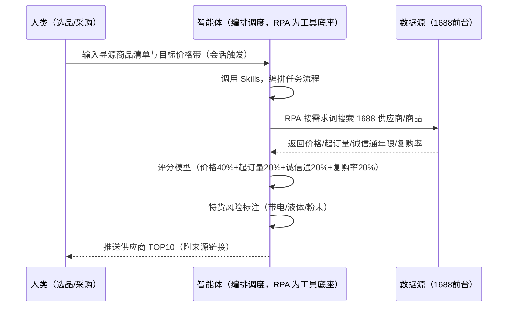
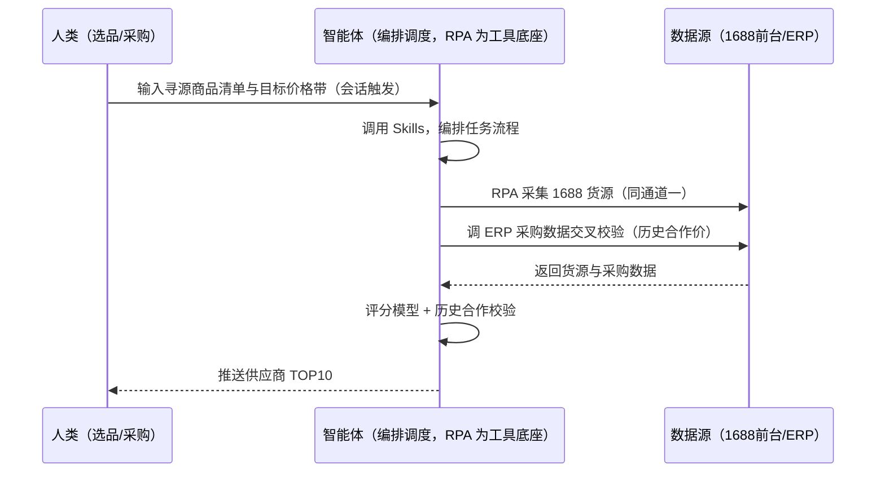

> 为虾皮（Shopee）卖家团队打造的供应链寻源方案（1688 找货比价，跨境供货）。手动刷 1688 逐条比价费时、供应商可靠性判断凭感觉、带电/液体特货影响 SLS 渠道。本方案由智能体调度多个工具执行按需求词在 1688 搜索供应商/商品，智能体按评分模型评估可靠性。选品需求触发，输出供应商 TOP10 清单，供你联系洽谈。

> Agent 自动化需开通企业功能
> 点击申请1个月免费权限
> [点击申请 →](https://skieer.feishu.cn/share/base/form/shrcnFwMayykP5iaL38fnZKTbrg)

## 一、用户与需求

核心矛盾：手动刷 1688 逐条比价费时、供应商可靠性（价格/起订量/诚信通年限/复购率）判断凭感觉；带电/液体/粉末特货影响 SLS 渠道与运费。

两类客户痛点同源，数据来源不同：

- 未购 SaaS 客户（新卖家/小团队）：人工打开 1688 逐条搜货比价、复制粘贴到表格，全靠手；
- 已购 SaaS 客户（店小秘/妙手 ERP 等）：ERP 管订单/上架，1688 找货源比价不覆盖，仍要人跨平台核对。

适用客户：需要找货比价的虾皮卖家。1688 前台公开可采，八爪鱼现成应用直挂（找供应商搜索关键词采集商家信息等）。

### 1.1 不同模式卖家

| 类型 | 选择 | 建议 |
|-|-|-|
| 跨境卖家 | 首选 | 强烈推荐（跨境供货，寻源比价必须） |
| 本土卖家 | 次选 | 一般推荐（本土采购另说） |
| 铺货型 | 任意 | 按需 |

### 1.2 不同类目卖家

| 类目 | 最关注维度 | 核心逻辑 |
|-|-|-|
| 3C 数码 | 特货风险 | 带电类影响 SLS 渠道 |
| 家居家具 | 起订量 | 大件起订量与价格平衡 |
| 美妆个护 | 资质合规 | 需检测报告 |
| 服装鞋帽 | 复购率 | 面料供应商复购关键 |
| 户外运动 | 特货判断 | 液体/粉末特货风险 |
| 母婴用品 | 安全认证 | 认证门槛 |

### 1.3 不同角色用户

| 用户 | 需求 | 问题 | 投入时间（估算） |
|-|-|-|-|
| 老板 | 货源成本与可靠度 | 供应商判断凭感觉 | 1 小时/周 |
| 选品/采购 | 供应商 TOP10 | 1688 逐条比价费时 | 2-3 小时/周 |
| 运营 | 特货风险 | 带电/液体影响渠道 | 0.5 小时/周 |

---

## 二、现在的方法与问题

### 2.1 流程步骤与问题总结

人工方式（未购 SaaS 客户）

| 序号 | 步骤 | 现在的方法 | 问题缺陷 |
|-|-|-|-|
| 1 | 搜货源 | 手动刷 1688 关键词 | 逐条比价费时 |
| 2 | 比价 | 逐条对比 | 凭感觉 |
| 3 | 查资质 | 逐个看诚信通年限 | 可靠性判断难 |
| 4 | 判特货 | 凭经验 | 带电/液体忽略 |
| 5 | 洽谈 | 凭感觉选 | 选错供应商 |

SaaS 方式（已购 ERP 客户）

| 序号 | 步骤 | 现在的方法 | 问题缺陷 |
|-|-|-|-|
| 1 | 搜货源 | ERP 不覆盖 | 无自动化 |
| 2 | 比价 | 手动 | 无评分 |
| 3 | 查资质 | 手动 | 无模型 |
| 4 | 判特货 | 凭经验 | 易忽略 |
| 5 | 洽谈 | 凭感觉 | 无清单 |

### 2.2 问题分析

人工方式根因

| 序号 | 根因 | 具体表现 |
|-|-|-|
| 1 | 比价费时 | 逐条手动，效率低 |
| 2 | 可靠度无模型 | 诚信通年限/复购率不综合 |
| 3 | 特货风险忽略 | 带电/液体影响渠道运费 |

SaaS 方式根因

| 序号 | 根因 | 具体表现 |
|-|-|-|
| 1 | ERP 不覆盖 | 1688 比价无工具 |
| 2 | 无闭环 | 合作价不回填迭代 |

---

## 三、解决方案

### 3.1 功能概述

为虾皮卖家团队打造的供应链寻源方案，按需求词在 1688 搜索供应商/商品，智能体按评分模型评估可靠性，输出供应商 TOP10。

选品需求触发并调度多个工具，调起八爪鱼 RPA（Agent 的工具底座，能耦合多系统、完成自动化任务执行）按需求词在 1688 搜索供应商/商品（价格/起订量/供货能力/店铺资质），智能体按「价格 + 起订量 + 诚信通年限 + 复购率 + 特货风险」评分。选品需求触发，输出供应商 TOP10 清单，供你联系洽谈。

### 3.2 系统结合

| 要素 | 说明 |
|-|-|
| 客户现有工具盘点 | **未购 SaaS 客户**：无第三方工具，找货源全靠手动刷 1688。     **已购 SaaS 客户**（主流组合）：店小秘/妙手 ERP（管订单/上架，不覆盖 1688 找货） |
| 数据/能力来源 | **无 SaaS**：1688 前台搜索（价格/起订量/诚信通年限/复购率/店铺资质，公开可采，现成应用直挂）。     **有 SaaS**：数据源同为 1688 前台（ERP 无货源接口），RPA 采集为主；成本模型与 ERP 采购数据可交叉校验 |
| RPA 耦合动作 | 作为 Agent 的工具底座，按需搜索 1688（关键词去重、请求频控失败重试），按货源对齐去重，统一流转给智能体评分；特货风险标记 |
| 耦合出的新价值 | 单工具给不了的端到端结论：1688 货源一次取齐 → 评分模型（价格/起订量/诚信通/复购率/特货）→ 供应商 TOP10 → 合作价回填迭代，**只推送 TOP10 清单** |

### 3.3 智能体执行流程

用户向智能体输入会话（入参：寻源商品清单、目标价格带、起订量上限、物流渠道限制）。支持**两种数据通道**，部署时按客户现有工具选择：

**通道一：无 SaaS 方式（RPA 采集 1688 前台，适合未购 ERP 的客户）**

**通道二：有 SaaS 方式（成本模型与 ERP 采购数据交叉校验，适合已购客户）**

> Agent 自动化需开通企业功能
> 点击申请1个月免费权限
> [点击申请 →](https://skieer.feishu.cn/share/base/form/shrcnFwMayykP5iaL38fnZKTbrg)

### 3.4 为何这么设计

要同时回答三个问题：**为什么不能只用 SaaS/API？为什么不能纯靠智能体写代码？为什么 RPA 是执行底座？** 本场景的核心是"批量搜索、评分模型、特货标注、挂了有人管"。

#### 1）逐项对比

| 对比维度 | SaaS/API 堆叠（ERP） | 纯智能体（智能体写代码） | 智能体+自动化工具（RPA 工具底座） |
|-|-|-|-|
| 实现方式 | ERP 管订单/上架，货源不覆盖 | 能抓 1688，数据可自拼，但全要自己接 | 1688 现成应用直挂（免登录公开采集） |
| 多系统耦合 | 单系统，无货源数据 | 全自建：搜索、翻页、去重逻辑 | 平台沉淀多源取数与对齐，可视化配置 |
| 评分模型 | 无模型 | 需自写评分逻辑 | 评分公式可视化配置（权重可调） |
| 使用成本（总拥有成本） | ERP 订阅费（主体另算） | 代理 IP + 服务器 + 开发维护人力，隐性成本高 | 一份平台订阅跑多流程，单方案边际成本 ≈ 0 |
| 维护人要求 | 低（工具现成） | 规则调整都要开发介入 | 可视化流程，采购自己可调权重 |

#### 2）优劣势说明

|  | SaaS/API 堆叠（ERP） | 纯智能体（智能体写代码） | 智能体+自动化工具（RPA 工具底座） |
|-|-|-|-|
| 优势 | 采购数据权威（可交叉校验） | 无订阅费；     可深度定制评分模型 | 1688 现成应用直挂（免登录）；     评分模型即开即用；     非技术人员可维护 |
| 劣势 | 货源采集无覆盖 | 反爬对抗全自建；     AI 生成代码是生成性的 | 本地电脑运行需保持开机；     订阅费；     跨境特货判断需人工规则辅助 |

#### 3）结论

| 论点 | 说明 |
|-|-|
| 评分=可靠度 | 供应商分 = 价格 40% + 起订量 20% + 诚信通年限 20% + 复购率 20%，总分 >75 推荐（实锤） |
| 特货风险前置 | 带电/液体/粉末类自动标记「特货风险」（影响 SLS 渠道与运费）——价格超目标带 20% 直接剔除（实锤） |
| 现成应用直挂 | 1688 前台公开可采，八爪鱼商店已有「阿里巴巴1688-店铺信息自动采集」「找供应商搜索关键词采集商家信息」等现成应用直接挂接（实锤） |
| 一个底座跑多流程 | 客户购买 RPA 平台是跑多个流程（寻源/选品/竞品），本方案只是其中一个——平台订阅费被多流程摊薄 |
| 时间 | 采购要的是"一张可洽谈的供应商 TOP10"，不是"反复刷 1688" |

### 3.5 功能清单

| 功能 | 系统 | 功能说明（解决问题） |
|-|-|-|
| 会话/定时 | 智能体 | 1. 理解人类语言，调用已预设好的 Skills。     2. 编排多任务、调度多工具。 |
| 多系统数据取数 | RPA、指纹浏览器 | 1. 解决 1688 逐条比价费时、可靠度判断难问题。     2. 作为智能体工具底座被调度执行，多关键词去重、请求频控失败重试。     3. **【无 SaaS 方式】** RPA 采集 1688 前台货源。**【有 SaaS 方式】** 数据源同为 1688 前台 + ERP 采购数据交叉校验。 |
| 评分模型 | 智能体 | 价格 40% + 起订量 20% + 诚信通年限 20% + 复购率 20%，总分 >75 推荐。 |
| 特货风险标注 | 智能体 | 带电/液体/粉末类自动标记（影响 SLS 渠道与运费）。 |
| 价格过滤 | 智能体 | 价格超目标带 20% 直接剔除。 |
| 供应商 TOP10 | 智能体 | 按评分输出 TOP10（附来源链接），供洽谈。 |
| IM通知 | 飞书、钉钉、企微等 | 解决货源清单交付滞后问题。供应商 TOP10 自动推送。 |
| 数据资产储存 | 本地电脑、云储存 | 1. Skills 资产：Shopee 寻源技能。     2. 数据储存：货源库统一写入本地。     3. 经验知识库：合作价回填迭代比价基线。 |

### 3.6 智能体执行落地过程

会话启动只需输入寻源商品清单与目标价格带；下表其余配置项（评分权重、排除名单、物流渠道限制）均为部署时一次性预设。

**⚠️ 部署前提（不满足则方案无法跑起来）**：①RPA 需部署在**常开电脑/云机**上（按需触发可接受任务时开机）；②1688 有登录墙与反爬，免登录采集为默认通道（现成应用直挂），采集失败自动降级重试；③**跨境特货判断需人工规则辅助**（带电/液体/粉末影响 SLS 渠道）；④首次配置（评分权重、排除名单、成本口径）需服务方/技术人员介入一次，属实施成本。

#### 1）配置

| 类别 | 说明 |
|-|-|
| 智能体 | 主流智能体。 |
| 智能体工具 | 1. **数据通道（按客户现有工具二选一）**：【无 SaaS】1688 前台（RPA 采集）；【有 SaaS】1688 前台 + ERP 采购数据交叉校验。     2. 数据取数与自动化执行：八爪鱼 RPA，MCP 配置完成。     3. 数据分析：智能体自带。     4. IM：企业办公 IM（飞书/钉钉/企微），MCP 或 webhook 配置。 |
| 工作知识 | 1. 寻源商品清单。     2. 目标价格带。     3. 起订量上限。     4. 排除供应商名单。     5. 物流渠道限制（普货/特货）。 |
| 本地数据库 | 1. 货源库地址。     2. 评分模型库地址。     3. 经验库地址。 |

#### 2）执行

| 任务 | 产出 | 产出物接收人 |
|-|-|-|
| 接收寻源清单，会话触发 | 任务启动记录 | —— |
| 调用已预设 Skills，编排任务流程 | 任务编排方案 | —— |
| 经 MCP 向八爪鱼 RPA 下发取数任务 | 自动化任务指令 | —— |
| 多源取数并按货源对齐（无 SaaS：1688；有 SaaS：1688+ERP，智能体监控状态） | 对齐后货源数据 | —— |
| 评分模型计算 | 评分结果 | 采购 |
| 特货风险标注 + 价格过滤 | 过滤后清单 | 采购 |
| 供应商 TOP10 输出 | TOP10 清单 | 选品/采购 |
| 推送供应商 TOP10 | 群消息 | 选品/采购/老板 |

异常处理：

1688 登录墙/反爬 → 降级免登录采集；

搜索无结果 → 换关键词重试 2 次；

数据缺失 → 标注待补；

特货无法判断 → 转人工规则辅助；

置信度 &lt;70% → 转人工复核，不输出硬结论。

#### 3）结果

| 结果 | 说明 |
|-|-|
| 数据资产 | 货源库结构化数据（货源/价格/起订量/诚信通/复购率/来源链接），可审计可追溯。 |
| 分析报告 | 1. 供应商 TOP10：评分排序。     2. 特货风险标注。     3. 合作价回填记录。 |
| Skills | 智能体 Skills：Shopee 寻源技能，按合作价迭代比价基线。 |

> Agent 自动化需开通企业功能
> 点击申请1个月免费权限
> [点击申请 →](https://skieer.feishu.cn/share/base/form/shrcnFwMayykP5iaL38fnZKTbrg)

---

## 四、使用前后预估

> 本方案价值 = **1688 批量寻源 → 评分模型（价格/起订量/诚信通/复购率/特货）→ 供应商 TOP10**。1688 前台公开可采（现成应用直挂），无需额外 SaaS。

| 指标 | 人工 | SaaS/API（ERP） | 智能体+自动化工具 |
|-|-|-|-|
| 找货源 | 手动刷 1688 | 不覆盖 | 批量搜索，一次取齐 |
| 比价 | 逐条对比 | 无 | 自动对齐、评分排序 |
| 可靠度判断 | 凭感觉 | 无模型 | 评分模型（权重透明） |
| 特货风险 | 易忽略 | 无 | 自动标注（SLS 渠道） |
| 供应商清单 | 无 | 无 | TOP10 输出 |
| 方法论 | 无 | 无 | 可复用的评分模型（合作价回填迭代） |

**说明**：供应商分 = 价格 40% + 起订量 20% + 诚信通年限 20% + 复购率 20%，总分 >75 推荐；带电/液体/粉末类自动标记「特货风险」（影响 SLS 渠道与运费）；价格超目标带 20% 直接剔除；1688 前台公开可采，八爪鱼商店已有现成应用直接挂接。

---

## 五、效果证明

### 5.1 DEMO应用

阿里巴巴 1688-店铺信息自动采集：https://rpa.bazhuayu.com/appstore/app/dev\_-7jygx/taobao1688-01-rootadmin

找供应商搜索关键词采集商家信息：https://rpa.bazhuayu.com/appstore/app/ffrpa/1688

---

## 六、备注

### 6.1 Agent 支持

本方案不绑定具体智能体，主流 Agent 均可运行（需支持技能/Skills 加载与工具调用）：

| Agent/智能体 | 说明 |
|-|-|
| Workbuddy | 本方案运行平台，支持技能/Skills 上传加载、定时任务、MCP 工具调用与表格/报告处理 |
| 豆包（国内·字节） | 国内主流个人智能体，支持技能上传、定时任务与工具调用，上手成本低 |
| 通义千问（国内·阿里） | 支持 Agent 编排与插件生态，集成阿里电商数据能力，适合电商场景 |
| DeepSeek（国内） | 推理能力强、成本低，适合规则打分与归因分析类任务 |
| ChatGPT（国外·OpenAI） | 海外主流通用智能体，支持 GPTs/Agent 模式与工具调用 |
| Claude（国外·Anthropic） | 长文本与结构化分析能力强，原生支持 MCP 连接外部工具 |

### 6.2 名词解释

| 术语 | 说明 |
|-|-|
| 评分模型 | 价格 40% + 起订量 20% + 诚信通年限 20% + 复购率 20% |
| 诚信通年限 | 1688 供应商年限（可靠性指标） |
| 特货风险 | 带电/液体/粉末（影响 SLS 渠道与运费） |
| SLS | Shopee Logistics Service 官方物流 |
| 复购率 | 供应商复购比例（质量与稳定指标） |
| 混合数据源 | 1688 前台公开采集（免登录应用直挂）+ ERP 采购数据交叉校验（有 SaaS 客户） |
| 有 SaaS 方式 | 已购店小秘/妙手 ERP，1688 采集 + 采购数据交叉校验 |
| 无 SaaS 方式 | 不购买第三方工具，RPA 采集 1688 前台 |
| 跨境卖家 | 中国卖家中心统一管理多站点 |
| 本土卖家 | 单站点运营 |
| MCP | Model Context Protocol，智能体连接外部工具的标准化通道 |

> Agent 自动化需开通企业功能
> 点击申请1个月免费权限
> [点击申请 →](https://skieer.feishu.cn/share/base/form/shrcnFwMayykP5iaL38fnZKTbrg)

---

原文：[查看原文](https://skieer.feishu.cn/wiki/ItLawNNo1i96IPkRVOOcucjSnvb)
