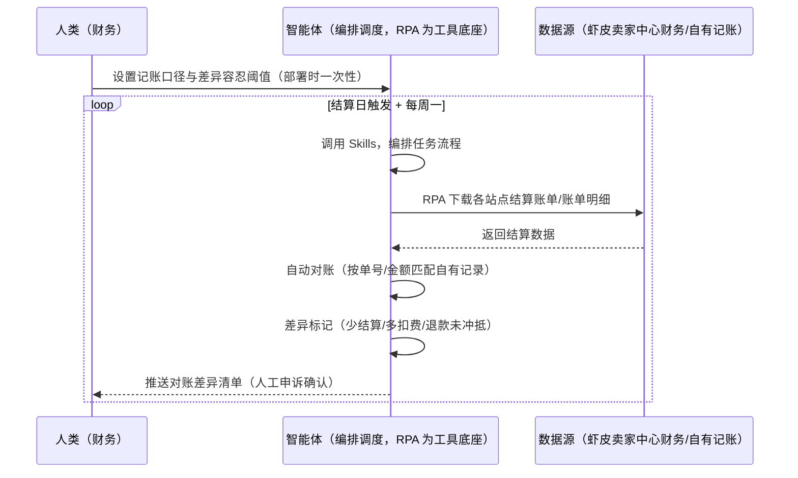
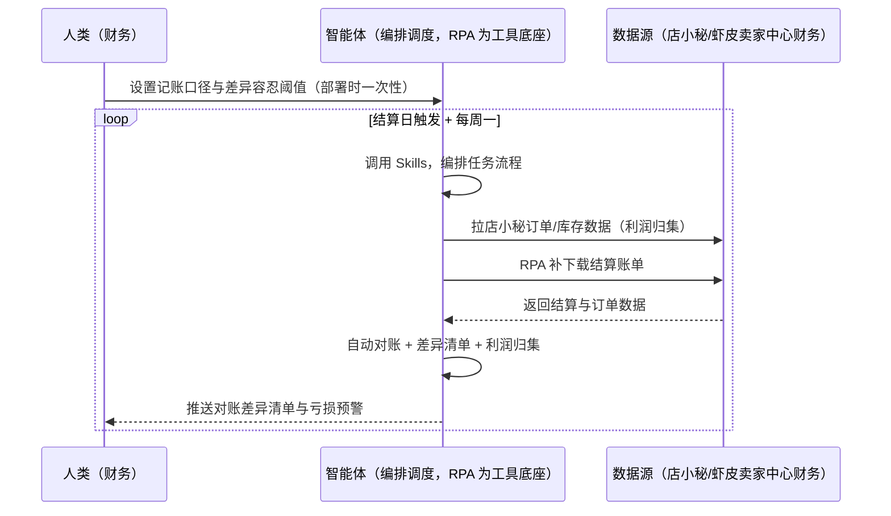

> 为虾皮（Shopee）卖家团队打造的结算对账与利润核算方案。多站点多币种结算对账耗时易错、佣金/手续费/物流费拆分对不清、单品利润算不出亏在哪。本方案由智能体调度多个工具执行下载各站点结算账单并按单号自动对账、按商品归集计算利润。结算日+每周定时，只推送对账差异清单与亏损预警，差异申诉由人工确认。

> Agent 自动化需开通企业功能
> 点击申请1个月免费权限
> [点击申请 →](https://skieer.feishu.cn/share/base/form/shrcnFwMayykP5iaL38fnZKTbrg)

## 一、用户与需求

核心矛盾：虾皮多站点多币种结算对账耗时易错、佣金/手续费/物流费/退款/罚款拆分对不清、单品利润算不出亏在哪（防「卖得越多亏越多」）。

两类客户痛点同源，数据来源不同：

- 未购 SaaS 客户（新卖家/小团队）：人工下载结算账单、逐笔核对，全靠手；
- 已购 SaaS 客户（店小秘 ERP 等）：店小秘管订单库存，结算对账与利润核算不覆盖，仍要人手动做。

适用客户：多站点多币种卖家。账单下载可自动化（后台财务模块结构稳定）；多站点+多币种对账规则需人工初始配置（汇率口径）；差异申诉需人工举证；收款渠道账单需另接入。

### 1.1 不同模式卖家

| 类型 | 选择 | 建议 |
|-|-|-|
| 跨境卖家（多站点） | 首选 | 强烈推荐（多站点多币种对账） |
| 本土卖家 | 次选 | 一般推荐（单站点） |
| 铺货型 | 任意 | 按需 |

### 1.2 不同站点卖家

| 站点 | 最关注维度 | 核心逻辑 |
|-|-|-|
| 台湾 | 台币结算 | 汇率口径 |
| 泰国 | 泰铢结算 | 当地币折算 |
| 印尼 | 印尼盾 | 大额面值 |
| 新加坡 | 新币结算 | 高客单 |
| 马来/菲律宾 | 多币种 | 按站点费率 |

### 1.3 不同角色用户

| 用户 | 需求 | 问题 | 投入时间（估算） |
|-|-|-|-|
| 老板 | 资金安全 | 差异默认认了 | 0.5 小时/周 |
| 财务 | 对账差异清单 | 逐笔核对费时 | 1-3 小时/周 |
| 运营 | 亏损预警 | 单品利润算不出 | 1 小时/周 |

---

## 二、现在的方法与问题

### 2.1 流程步骤与问题总结

**人工方式（未购 SaaS 客户）**

| 序号 | 步骤 | 现在的方法 | 问题缺陷 |
|-|-|-|-|
| 1 | 下账单 | 手动下载各站点账单 | 多站点费时 |
| 2 | 核对 | 逐笔核对 | 佣金/服务费拆分不清 |
| 3 | 找差异 | 凭经验找 | 差异默认认了 |
| 4 | 算利润 | 手动归集 | 单品利润算不出 |
| 5 | 预测 | 凭记忆 | 放款无预警 |

**SaaS 方式（已购店小秘 ERP 客户）**

| 序号 | 步骤 | 现在的方法 | 问题缺陷 |
|-|-|-|-|
| 1 | 下账单 | 店小秘不覆盖 | 靠人下 |
| 2 | 核对 | 手动 | 无规则 |
| 3 | 找差异 | 凭经验 | 漏差异 |
| 4 | 算利润 | 无 | 无口径 |
| 5 | 预测 | 无 | 不迭代 |

### 2.2 问题分析

**人工方式根因**

| 序号 | 根因 | 具体表现 |
|-|-|-|
| 1 | 逐笔核对费时 | 多站点多币种 |
| 2 | 差异默认认了 | 无系统比对 |
| 3 | 单品利润算不出 | 亏在哪不知道 |

**SaaS 方式根因**

| 序号 | 根因 | 具体表现 |
|-|-|-|
| 1 | 店小秘不覆盖 | 对账与利润无工具 |
| 2 | 无闭环 | 差异不申诉回填 |

---

## 三、解决方案

### 3.1 功能概述

为虾皮卖家团队打造的结算对账与利润核算方案，下载各站点结算账单并按单号自动对账、按商品归集计算利润。

结算日+每周定时触发并调度多个工具，调起八爪鱼 RPA（Agent 的工具底座，能耦合多系统、完成自动化任务执行）定时下载各站点结算账单/账单明细（货款/佣金/交易手续费/物流费/退款/罚款），智能体按订单号/金额匹配自有记录自动对账、按「实收-成本-费用」计算单品利润（当地币折算）。结算日+每周定时，只推送对账差异清单与亏损预警，差异申诉由人工确认。

### 3.2 系统结合

| 要素 | 说明 |
|-|-|
| 客户现有工具盘点 | **未购 SaaS 客户**：无第三方工具，对账全靠人工。     **已购 SaaS 客户**（主流组合）：店小秘 ERP（管订单库存，对账与利润不覆盖） |
| 数据/能力来源 | **无 SaaS**：虾皮卖家中心-财务各站点结算单/账单/退款明细（登录下载）+ 自有记账（本地维护）。     **有 SaaS**：店小秘订单/库存数据（辅助利润归集）+ RPA 补账单下载；收款渠道账单（Payoneer/PingPong/连连）需另接入 |
| RPA 耦合动作 | 作为 Agent 的工具底座，按计划下载各站点账单（账单下载完整性校验=金额合计比对、快照留档、下载失败重试），统一流转给智能体；差异自动归类 |
| 耦合出的新价值 | 单工具给不了的端到端结论：账单一次取齐 → 自动对账（平台结算 vs 自有记账）→ 差异清单（少结算/多扣费/退款未冲抵）→ 单品利润归集 → 亏损预警，**只推送对账差异清单与亏损预警** |

### 3.3 智能体执行流程

智能体定时触发。支持**两种数据通道**，部署时按客户现有工具选择：

**通道一：无 SaaS 方式（RPA 下载账单+对账，适合未购 ERP 的客户）**

**通道二：有 SaaS 方式（店小秘订单辅助归集 + RPA 补账单，适合已购客户）**

> Agent 自动化需开通企业功能
> 点击申请1个月免费权限
> [点击申请 →](https://skieer.feishu.cn/share/base/form/shrcnFwMayykP5iaL38fnZKTbrg)

### 3.4 为何这么设计

要同时回答三个问题：**为什么不能只用 SaaS/API？为什么不能纯靠智能体写代码？为什么 RPA 是执行底座？** 本场景的核心是"定时下载、规则对账、利润归集、挂了有人管"。

#### 1）逐项对比

| 对比维度 | SaaS/API 堆叠（店小秘） | 纯智能体（智能体写代码） | 智能体+自动化工具（RPA 工具底座） |
|-|-|-|-|
| 实现方式 | 店小秘管订单，对账不覆盖 | 能抓数据能算，但全要自己接 | 账单下载 + 规则对账 |
| 定时下载 | 不覆盖 | 智能体无法常驻轮询 | RPA 结算日定时下载 |
| 利润归集 | 无 | 需自建归集逻辑 | 单品利润规则可视化配置 |
| 使用成本（总拥有成本） | 店小秘订阅费（主体另算） | 代理 IP + 服务器 + 开发维护人力，隐性成本高 | 一份平台订阅跑多流程，单方案边际成本 ≈ 0 |
| 维护人要求 | 低（工具现成） | 规则调整都要开发介入 | 可视化流程，财务自己可调口径 |

#### 2）优劣势说明

|  | SaaS/API 堆叠（店小秘） | 纯智能体（智能体写代码） | 智能体+自动化工具（RPA 工具底座） |
|-|-|-|-|
| 优势 | 订单数据权威（利润归集） | 无订阅费；     可深度定制对账模型 | 账单下载+规则对账+利润归集；     非技术人员可维护 |
| 劣势 | 对账与利润不覆盖 | 下载与解析全自建；     AI 生成代码是生成性的 | 本地电脑运行需保持开机；     订阅费；     差异申诉需人工举证 |

#### 3）结论

| 论点 | 说明 |
|-|-|
| 对账=资金安全 | 对账覆盖率 100%；差异率 = 差异金额/结算金额 &lt;0.5% 达标；差异单自动归类（佣金/运费/罚款/退款/汇率）（实锤） |
| 利润公式实锤 | 单品毛利率 =（实收-成本-费用）/实收，&lt;0 标记亏损；利润 TOP20% 商品为爆款观察池；各站点亏损商品单独预警（防「卖得越多亏越多」） |
| 多币种折算 | 当地币折算（汇率口径需人工初始配置）；收款渠道账单（Payoneer/PingPong/连连）需另接入 |
| 差异申诉人工 | 差异申诉需人工举证（涉及资金） |
| 一个底座跑多流程 | 客户购买 RPA 平台是跑多个流程（对账/利润/日报），本方案只是其中一个——平台订阅费被多流程摊薄 |
| 时间 | 财务要的是"差异清单 + 亏损预警"，不是"逐笔翻账单" |

### 3.5 功能清单

| 功能 | 系统 | 功能说明（解决问题） |
|-|-|-|
| 会话/定时 | 智能体 | 1. 理解人类语言，调用已预设好的 Skills。     2. 编排多任务、调度多工具。 |
| 多系统数据取数 | RPA、指纹浏览器 | 1. 解决逐笔核对费时、单品利润算不出问题。     2. 作为智能体工具底座被调度执行，账单下载完整性校验（金额合计比对）、快照留档、下载失败重试。     3. **【无 SaaS 方式】** RPA 下载各站点账单。**【有 SaaS 方式】** 店小秘订单辅助归集 + RPA 补账单。 |
| 自动对账 | 智能体 | 平台结算 vs 自有记账（按单号/金额匹配），差异自动归类。 |
| 差异清单 | 智能体 | 少结算/多扣费/退款未冲抵标记；差异率 &lt;0.5% 达标。 |
| 利润核算 | 智能体 | 单品毛利率 =（实收-成本-费用）/实收；当地币折算。 |
| 亏损预警 | 智能体 | 毛利率 &lt;0 标记亏损；各站点亏损商品单独预警。 |
| IM通知 | 飞书、钉钉、企微等 | 解决对账滞后问题。对账差异与亏损预警自动推送。 |
| 数据资产储存 | 本地电脑、云储存 | 1. Skills 资产：Shopee 对账与利润技能。     2. 数据储存：结算底表统一写入本地。     3. 经验知识库：申诉结果回填迭代。 |

### 3.6 智能体执行落地过程

部署时一次性配置入参（自有记账口径、差异容忍阈值、收款渠道账单对接、采购成本表、费用项映射、币种折算规则、数据通道），会话中无需重复输入。

**⚠️ 部署前提（不满足则方案无法跑起来）**：①RPA 需部署在**常开电脑/云机**上（结算日+每周定时需开机），并配置漏跑补跑机制；②**多站点+多币种对账规则需人工初始配置（汇率口径）**；③**差异申诉需人工举证**（涉及资金）；④**收款渠道账单需另接入**（Payoneer/PingPong/连连）；⑤**有 SaaS 方式需店小秘账号**（利润归集辅助，可选增强，无则走后台通道）；⑥首次配置（登录态、对账规则、费率映射）需服务方/技术人员介入一次，属实施成本。

#### 1）配置

| 类别 | 说明 |
|-|-|
| 智能体 | 主流智能体。 |
| 智能体工具 | 1. **数据通道（按客户现有工具二选一）**：【无 SaaS】虾皮卖家中心财务（RPA 下载账单）；【有 SaaS】店小秘订单数据 + RPA 补账单。     2. 数据取数与自动化执行：八爪鱼 RPA，MCP 配置完成。     3. 数据分析：智能体自带。     4. 数据报告：智能体自带。     5. IM：企业办公 IM（飞书/钉钉/企微），MCP 或 webhook 配置。 |
| 工作知识 | 1. 自有记账口径。     2. 差异容忍阈值（如单笔 >5 元）。     3. 收款渠道账单对接确认。     4. 采购成本表（含汇率口径）。     5. 费用项映射（各站点费率）。     6. 币种折算规则。 |
| 本地数据库 | 1. 结算底表库地址。     2. 对账台账库地址。     3. 经验库地址。 |

#### 2）执行

| 任务 | 产出 | 产出物接收人 |
|-|-|-|
| 接收记账口径，结算日触发 | 任务启动记录 | —— |
| 调用已预设 Skills，编排任务流程 | 任务编排方案 | —— |
| 经 MCP 向八爪鱼 RPA 下发取数任务 | 自动化任务指令 | —— |
| 多源取数并按单号对齐（无 SaaS：账单下载；有 SaaS：店小秘+账单，智能体监控状态） | 对齐后结算数据 | —— |
| 自动对账（平台 vs 自有记账） | 差异清单 | 财务 |
| 差异归类（佣金/运费/罚款/退款/汇率） | 差异分类 | 财务 |
| 单品利润核算（当地币折算） | 利润报表 | 财务 |
| 亏损预警（毛利率 &lt;0/站点独立预警） | 亏损清单 | 运营/老板 |
| 推送对账差异与亏损预警（申诉人工确认） | 群消息 | 财务/运营/老板 |

异常处理：

下载失败 → 自动重试并告警；

账单缺失 → 金额合计比对标注；

差异无法归因 → 转人工核对；

汇率源不可用 → 用上次汇率并标注；

置信度 &lt;70% → 转人工复核，不输出硬结论。

#### 3）结果

| 结果 | 说明 |
|-|-|
| 数据资产 | 结算底表结构化数据（店铺/站点/币种/明细/差异/利润），可审计可追溯。 |
| 分析报告 | 1. 对账差异清单与归类。     2. 利润报表（单品/站点）。     3. 亏损预警清单。 |
| Skills | 智能体 Skills：Shopee 对账与利润技能，按申诉结果迭代规则。 |

> Agent 自动化需开通企业功能
> 点击申请1个月免费权限
> [点击申请 →](https://skieer.feishu.cn/share/base/form/shrcnFwMayykP5iaL38fnZKTbrg)

---

## 四、使用前后预估

> 本方案价值 = **结算账单自动下载 → 自动对账 → 差异清单与归类 → 单品利润核算 → 亏损预警**。账单下载可自动化，多站点+多币种对账规则需人工初始配置，差异申诉需人工举证。

| 指标 | 人工 | SaaS/API（店小秘） | 智能体+自动化工具 |
|-|-|-|-|
| 账单下载 | 多站点手动 | 不覆盖 | 自动循环下载 |
| 对账核对 | 逐笔手动 | 无 | 按单号规则核对 |
| 差异归类 | 无 | 无 | 佣金/运费/罚款/退款/汇率自动归类 |
| 单品利润 | 算不出 | 无 | 自动归集+当地币折算 |
| 亏损预警 | 无 | 无 | 毛利率 &lt;0 自动预警 |
| 方法论 | 无 | 单工具 | 可复用的 Skills 与对账规则 |

**说明**：对账覆盖率 100%；差异率 = 差异金额/结算金额 &lt;0.5% 达标；差异单自动归类（佣金/运费/罚款/退款/汇率）；单品毛利率 =（实收-成本-费用）/实收，&lt;0 标记亏损；利润 TOP20% 商品为爆款观察池；各站点亏损商品单独预警（防「卖得越多亏越多」）；收款渠道账单（Payoneer/PingPong/连连）需另接入。

---

## 五、效果证明

> Agent 自动化需开通企业功能
> 点击申请1个月免费权限
> [点击申请 →](https://skieer.feishu.cn/share/base/form/shrcnFwMayykP5iaL38fnZKTbrg)

### 5.1 客户案例

**《旺店通慧经营：10+ 平台 50+ 类账单自动采集直传 ERP》**

> 10+ 电商平台普遍缺乏开放 API，账单数据需人工逐个登录导出，财务每天花数小时"搬数据"。RPA 打包为"慧采集 RPA"嵌入产品，账单自动采集并 API 直传 ERP。

| 效果 | 说明 |
|-|-|
| 提效 | 财务取数效率提升 57%。原本 10+ 电商平台账单需人工逐个登录导出，财务每天花数小时「搬数据」，现在 50+ 类账单自动采集并直传 ERP。 |
| 降本 | 年节约人力成本 24 万元（约合 2 人·年，按 12 万元/人年折算）。原本需专人逐平台导表并手动上传 ERP，现在全自动完成，人力转向经营分析与资金管理等高价值工作。 |
| 任务 | 10+ 平台、50+ 类账单自动采集，数据直接 API 传入 ERP，支撑 T+1 经营分析。 |
| 任务 | 指纹浏览器环境、Cookie 登录、集中预登录三重升级，保障采集稳定运行。 |

案例详情：[取数：ERP厂商的多平台账单自动化采集实践](https://skieer.feishu.cn/wiki/CQydwouU9i0yCPkgCpgc13Bxnhg)

**《财务跨系统对账机器人：5 分钟完成 10 天对账工作》**

> 财务需将自行统计的应收账单（邮件汇总 + SaaS 导出）与代理商统计的应付账单（云盘人工汇总）人工二次核对，涉及 VAT 与 EPR 两个场景且代理商众多。

| 效果 | 说明 |
|-|-|
| 提效 | 跨系统对账由 10 天压缩至 5 分钟。原本代理商账单分散在邮件与线下表格，财务需人工提取核验、反复对数，现在自动汇总、比对并输出差异清单。 |
| 降本 | 免除人工提取邮件与重复对数的投入，财务团队投入转向差异复核与资金管理等重点环节。 |
| 任务 | 打通线上系统与线下台账双重对账机制，标准化账单可自动生成。 |
| 任务 | 对账不平与异常账单自动标记进入人工复核清单，不自动放行资金动作。 |

案例详情：[对账|财务跨系统对账机器人，5min完成10天对账工作八爪鱼RPA](https://skieer.feishu.cn/wiki/S364wc0Xsisz71k81xKc1pfJnah)

---

## 六、备注

### 6.1 Agent 支持

本方案不绑定具体智能体，主流 Agent 均可运行（需支持技能/Skills 加载与工具调用）：

| Agent/智能体 | 说明 |
|-|-|
| Workbuddy | 本方案运行平台，支持技能/Skills 上传加载、定时任务、MCP 工具调用与表格/报告处理 |
| 豆包（国内·字节） | 国内主流个人智能体，支持技能上传、定时任务与工具调用，上手成本低 |
| 通义千问（国内·阿里） | 支持 Agent 编排与插件生态，集成阿里电商数据能力，适合电商场景 |
| DeepSeek（国内） | 推理能力强、成本低，适合规则打分与归因分析类任务 |
| ChatGPT（国外·OpenAI） | 海外主流通用智能体，支持 GPTs/Agent 模式与工具调用 |
| Claude（国外·Anthropic） | 长文本与结构化分析能力强，原生支持 MCP 连接外部工具 |

### 6.2 名词解释

| 术语 | 说明 |
|-|-|
| 对账覆盖率 | 结算数据全部纳入对账（100%） |
| 差异率 | 差异金额/结算金额（&lt;0.5% 达标） |
| 单品毛利率 | （实收-成本-费用）/实收 |
| 爆款观察池 | 利润 TOP20% 商品 |
| 汇率口径 | 当地币折算规则（需人工初始配置） |
| 混合数据源 | 虾皮卖家中心财务（RPA 下载）+ 店小秘订单数据（有 SaaS 客户归集）+ 收款渠道账单（另接入） |
| 有 SaaS 方式 | 已购店小秘 ERP，订单辅助归集 + RPA 补账单 |
| 无 SaaS 方式 | 不购买第三方工具，RPA 下载各站点账单 |
| 跨境卖家 | 中国卖家中心统一管理多站点 |
| 本土卖家 | 单站点运营 |
| MCP | Model Context Protocol，智能体连接外部工具的标准化通道 |

> Agent 自动化需开通企业功能
> 点击申请1个月免费权限
> [点击申请 →](https://skieer.feishu.cn/share/base/form/shrcnFwMayykP5iaL38fnZKTbrg)

---

原文：[查看原文](https://skieer.feishu.cn/wiki/Oz2HwpGa2iHCcwkWztkck8bYnmh)
