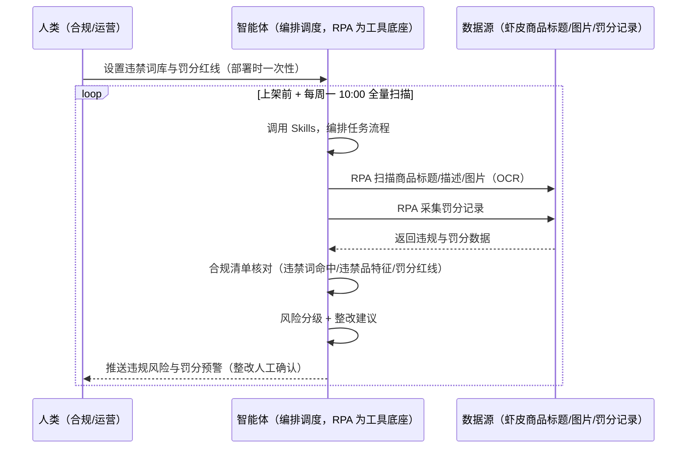
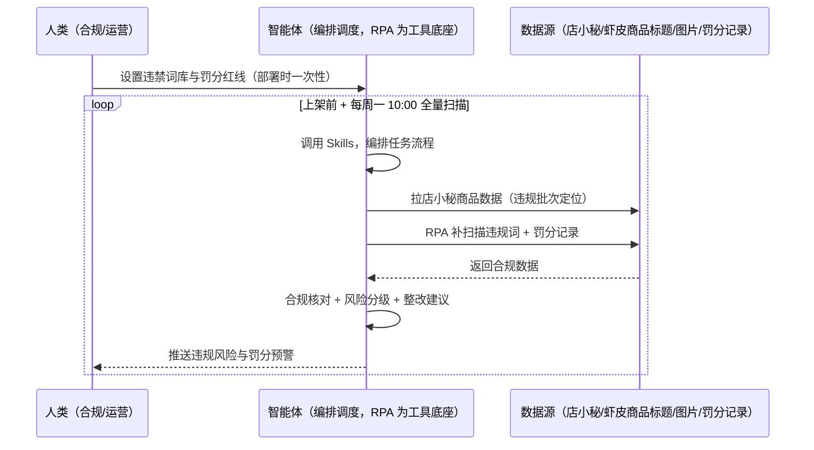

> 为虾皮（Shopee）卖家团队打造的罚分与违禁拦截方案。违禁品/违禁词查不全被罚分、罚分影响店铺权重与流量、被侵权投诉响应慢。本方案由智能体调度多个工具执行定时扫描违规风险点（违禁词/违禁品/罚分记录），智能体按合规清单核对并输出整改建议。每周定时巡检，只推送违规风险与罚分预警，整改由人工确认。

> Agent 自动化需开通企业功能
> 点击申请1个月免费权限
> [点击申请 →](https://skieer.feishu.cn/share/base/form/shrcnFwMayykP5iaL38fnZKTbrg)

## 一、用户与需求

核心矛盾：虾皮违禁品/违禁词查不全被罚分、罚分影响店铺权重与流量（3 分警告/6 分冻结/15 分关店）、被侵权投诉响应慢（72h 判责）。

两类客户痛点同源，数据来源不同：

- 未购 SaaS 客户（新卖家/小团队）：人工查违禁词、手动看罚分，全靠手；
- 已购 SaaS 客户（店小秘 ERP 等）：店小秘管订单/上架，违禁拦截与罚分监控不覆盖，仍要人盯。

适用客户：违禁敏感类目与品牌卖家。巡检与红线触发是「定时扫描+红线触发」的守门任务，漏一次就可能是罚款。

### 1.1 不同模式卖家

| 类型 | 选择 | 建议 |
|-|-|-|
| 跨境卖家 | 首选 | 强烈推荐（多站点合规扫描） |
| 本土卖家 | 次选 | 一般推荐（单站点） |
| 铺货型 | 任意 | 按需 |

### 1.2 不同站点卖家

| 站点 | 最关注维度 | 核心逻辑 |
|-|-|-|
| 台湾 | 违禁词库 | 繁体违禁词 |
| 泰国 | 泰语违禁词 | 泰语词库 |
| 印尼 | 印尼语违禁词 | 印尼语词库 |
| 新加坡 | 仿牌识别 | 侵权高发 |
| 马来/菲律宾 | 本地化 | 按站点词库 |

### 1.3 不同角色用户

| 用户 | 需求 | 问题 | 投入时间（估算） |
|-|-|-|-|
| 老板 | 不被罚分封店 | 罚分影响权重 | 0.5 小时/周 |
| 合规 | 违规风险清单 | 违禁词查不全 | 1-2 小时/周 |
| 运营 | 整改建议 | 侵权投诉响应慢 | 1 小时/周 |

---

## 二、现在的方法与问题

### 2.1 流程步骤与问题总结

人工方式（未购 SaaS 客户）

| 序号 | 步骤 | 现在的方法 | 问题缺陷 |
|-|-|-|-|
| 1 | 查违禁 | 手动查词 | 查不全 |
| 2 | 盯罚分 | 手动看 | 罚分影响权重 |
| 3 | 响应投诉 | 被动 | 72h 判责 |
| 4 | 整改 | 罚后补救 | 防不了 |
| 5 | 沉淀 | 无 | 词库不沉淀 |

SaaS 方式（已购店小秘 ERP 客户）

| 序号 | 步骤 | 现在的方法 | 问题缺陷 |
|-|-|-|-|
| 1 | 查违禁 | 店小秘不覆盖 | 靠人查 |
| 2 | 盯罚分 | 不覆盖 | 无看板 |
| 3 | 响应投诉 | 手动 | 无提醒 |
| 4 | 整改 | 罚后 | 无建议 |
| 5 | 沉淀 | 无 | 不迭代 |

### 2.2 问题分析

人工方式根因

| 序号 | 根因 | 具体表现 |
|-|-|-|
| 1 | 违禁词查不全 | 罚分/下架 |
| 2 | 罚分无看板 | 权重下滑无感知 |
| 3 | 投诉响应慢 | 72h 超时判责 |

SaaS 方式根因

| 序号 | 根因 | 具体表现 |
|-|-|-|
| 1 | 店小秘不覆盖 | 违禁拦截与罚分无工具 |
| 2 | 无闭环 | 违规案例不沉淀 |

---

## 三、解决方案

### 3.1 功能概述

为虾皮卖家团队打造的罚分与违禁拦截方案，定时扫描违规风险点（违禁词/违禁品/罚分记录），智能体按合规清单核对并输出整改建议。

每周定时触发并调度多个工具，调起八爪鱼 RPA（Agent 的工具底座，能耦合多系统、完成自动化任务执行）在上架前+每周全量扫描商品标题/描述/图片（OCR），匹配违禁品列表与违禁词库，采集罚分记录，智能体按合规清单核对（违禁词命中/违禁品特征/罚分红线）并输出整改建议。每周定时巡检，只推送违规风险与罚分预警，整改由人工确认。

### 3.2 系统结合

| 要素 | 说明 |
|-|-|
| 客户现有工具盘点 | **未购 SaaS 客户**：无第三方工具，合规全靠人工。     **已购 SaaS 客户**（主流组合）：店小秘 ERP（管订单/上架，违禁拦截与罚分不覆盖） |
| 数据/能力来源 | **无 SaaS**：虾皮商品标题/描述/图片（OCR，RPA 扫描）+ 违禁词库（按站点语言，本地维护）+ 罚分记录（后台采集）。     **有 SaaS**：店小秘商品数据（辅助定位违规批次）+ RPA 补扫描与罚分采集 |
| RPA 耦合动作 | 作为 Agent 的工具底座，按计划扫描违规风险点（词库扫描、OCR 主图文字、证据快照）、采集罚分记录，统一流转给智能体；红线触发秒级告警 |
| 耦合出的新价值 | 单工具给不了的端到端结论：违规风险一次扫齐 → 合规清单核对（违禁词/违禁品/罚分）→ 风险分级 → 整改建议，**只推送违规风险与罚分预警** |

### 3.3 智能体执行流程

智能体定时触发。支持**两种数据通道**，部署时按客户现有工具选择：

**通道一：无 SaaS 方式（RPA 扫描违规风险，适合未购 ERP 的客户）**

**通道二：有 SaaS 方式（店小秘商品数据辅助定位 + RPA 补扫描，适合已购客户）**

> Agent 自动化需开通企业功能
> 点击申请1个月免费权限
> [点击申请 →](https://skieer.feishu.cn/share/base/form/shrcnFwMayykP5iaL38fnZKTbrg)

### 3.4 为何这么设计

要同时回答三个问题：**为什么不能只用 SaaS/API？为什么不能纯靠智能体写代码？为什么 RPA 是执行底座？** 本场景的核心是"定时扫描、红线触发、整改闭环、挂了有人管"。

#### 1）逐项对比

| 对比维度 | SaaS/API 堆叠（店小秘） | 纯智能体（智能体写代码） | 智能体+自动化工具（RPA 工具底座） |
|-|-|-|-|
| 实现方式 | 店小秘管商品，合规扫描不覆盖 | 能抓数据能核对，但全要自己接 | 扫描应用直挂 + 清单核对 |
| 词库扫描 | 不覆盖 | 需自建词库与扫描 | 词库可视化配置、OCR 快照 |
| 红线触发 | 无 | 需自建秒级告警 | 红线触发秒级告警 |
| 使用成本（总拥有成本） | 店小秘订阅费（主体另算） | 代理 IP + 服务器 + 开发维护人力，隐性成本高 | 一份平台订阅跑多流程，单方案边际成本 ≈ 0 |
| 维护人要求 | 低（工具现成） | 规则调整都要开发介入 | 可视化流程，合规自己可调词库 |

#### 2）优劣势说明

|  | SaaS/API 堆叠（店小秘） | 纯智能体（智能体写代码） | 智能体+自动化工具（RPA 工具底座） |
|-|-|-|-|
| 优势 | 商品数据权威（批次定位） | 无订阅费；     可深度定制合规模型 | 扫描+核对+红线告警即开即用；     非技术人员可维护 |
| 劣势 | 合规扫描不覆盖 | 词库与扫描全自建；     AI 生成代码是生成性的 | 本地电脑运行需保持开机；     订阅费；     整改需人工确认 |

#### 3）结论

| 论点 | 说明 |
|-|-|
| 罚分=权重杀手 | 虾皮罚分制度（3 分警告/6 分冻结/15 分关店等红线）直接影响店铺权重与流量——红线触发需秒级告警 |
| 违禁扫描实锤 | 覆盖率 100%；违禁词命中 = 文案含词库词条即标记；违禁品特征命中 = 标题/描述含仿牌词/危险品词即拦截；复检通过率 = 修改后无命中 |
| OCR 覆盖 | OCR 识别主图文字 + 文案全文扫描、快照留存（实锤）；图片 OCR 对复杂背景识别率有限 |
| 整改人工确认 | 整改（改文案）人工确认后复检（实锤） |
| 一个底座跑多流程 | 客户购买 RPA 平台是跑多个流程（合规/上架/侵权），本方案只是其中一个——平台订阅费被多流程摊薄 |
| 时间 | 合规要的是"违规风险清单 + 罚分预警"，不是"手动查词" |

### 3.5 功能清单

| 功能 | 系统 | 功能说明（解决问题） |
|-|-|-|
| 会话/定时 | 智能体 | 1. 理解人类语言，调用已预设好的 Skills。     2. 编排多任务、调度多工具。 |
| 多系统数据取数 | RPA、指纹浏览器 | 1. 解决违禁词查不全、罚分无看板问题。     2. 作为智能体工具底座被调度执行，词库扫描、OCR 主图文字、证据快照、红线触发秒级告警。     3. **【无 SaaS 方式】** RPA 扫描违规风险 + 采集罚分记录。**【有 SaaS 方式】** 店小秘商品数据辅助定位 + RPA 补扫描。 |
| 违禁词核对 | 智能体 | 违禁词命中 = 文案含词库词条即标记（按站点语言词库）。 |
| 违禁品识别 | 智能体 | 仿牌词/危险品词特征命中即拦截（覆盖率 100%）。 |
| 罚分监控 | 智能体 | 罚分记录采集 + 红线预警（3/6/15 分）。 |
| 整改建议 | 智能体 | 违规项整改建议（改文案/换图），整改人工确认后复检。 |
| IM通知 | 飞书、钉钉、企微等 | 解决合规滞后问题。违规风险与罚分预警自动推送。 |
| 数据资产储存 | 本地电脑、云储存 | 1. Skills 资产：Shopee 合规技能。     2. 数据储存：合规台账统一写入本地。     3. 经验知识库：违规案例回填迭代词库。 |

### 3.6 智能体执行落地过程

部署时一次性配置入参（违禁词库、检查范围、图片 OCR 范围、修改人工确认、数据通道），会话中无需重复输入。

**⚠️ 部署前提（不满足则方案无法跑起来）**：①RPA 需部署在**常开电脑/云机**上（每周扫描可接受任务时开机），并配置漏跑补跑机制；②**词库维护与多语言覆盖需持续投入**；③图片 OCR 对复杂背景识别率有限（实锤）；④**整改由人工确认**（改文案后复检）；⑤**有 SaaS 方式需店小秘账号**（批次定位，可选增强，无则走后台通道）；⑥首次配置（登录态、词库、OCR 参数）需服务方/技术人员介入一次，属实施成本。

#### 1）配置

| 类别 | 说明 |
|-|-|
| 智能体 | 主流智能体。 |
| 智能体工具 | 1. **数据通道（按客户现有工具二选一）**：【无 SaaS】虾皮商品标题/图片 + 罚分记录（RPA 扫描）；【有 SaaS】店小秘商品数据 + RPA 补扫描。     2. 数据取数与自动化执行：八爪鱼 RPA，MCP 配置完成。     3. 数据分析：智能体自带。     4. 数据报告：智能体自带。     5. IM：企业办公 IM（飞书/钉钉/企微），MCP 或 webhook 配置。 |
| 工作知识 | 1. 违禁词库（含各站点语言）。     2. 检查范围（在售/待上架）。     3. 图片 OCR 范围。     4. 修改人工确认。     5. 罚分红线（3/6/15 分）。 |
| 本地数据库 | 1. 合规台账库地址。     2. 违禁词库地址。     3. 经验库地址。 |

#### 2）执行

| 任务 | 产出 | 产出物接收人 |
|-|-|-|
| 接收违禁词库，扫描触发 | 任务启动记录 | —— |
| 调用已预设 Skills，编排任务流程 | 任务编排方案 | —— |
| 经 MCP 向八爪鱼 RPA 下发扫描任务 | 自动化任务指令 | —— |
| 多源取数并按 SKU 对齐（无 SaaS：扫描+罚分；有 SaaS：店小秘+扫描，智能体监控状态） | 对齐后合规数据 | —— |
| 违禁词/违禁品核对 | 违规清单 | 合规 |
| 罚分监控（红线预警） | 罚分预警 | 合规/老板 |
| 整改建议（改文案/换图） | 整改清单 | 运营 |
| 推送违规风险与罚分预警（整改人工确认） | 群消息 | 合规/运营/老板 |

异常处理：

扫描失败 → 自动重试并告警；

OCR 识别率低 → 标注转人工；

红线触发 → 秒级告警；

词库命中高 → 风险升级；

置信度 &lt;70% → 转人工复核，不输出硬结论。

#### 3）结果

| 结果 | 说明 |
|-|-|
| 数据资产 | 合规台账结构化数据（SKU/风险类型/罚分/整改状态），可审计可追溯。 |
| 分析报告 | 1. 违规风险清单：按类型。     2. 罚分监控看板。     3. 整改建议与复检结果。 |
| Skills | 智能体 Skills：Shopee 合规技能，按处罚案例迭代词库。 |

> Agent 自动化需开通企业功能
> 点击申请1个月免费权限
> [点击申请 →](https://skieer.feishu.cn/share/base/form/shrcnFwMayykP5iaL38fnZKTbrg)

---

## 四、使用前后预估

> 本方案价值 = **违规风险自动扫描 → 违禁词/违禁品核对 → 罚分监控 → 整改建议**。巡检与红线触发可自动化（OCR+词库），整改由人工确认。

| 指标 | 人工 | SaaS/API（店小秘） | 智能体+自动化工具 |
|-|-|-|-|
| 违禁扫描 | 查不全 | 不覆盖 | 词库+OCR 自动扫描 |
| 违禁品识别 | 凭经验 | 无 | 特征命中自动拦截 |
| 罚分监控 | 无看板 | 无 | 红线自动预警 |
| 整改建议 | 罚后补救 | 无 | 按风险类型建议 |
| 覆盖范围 | 抽查 | 无 | 覆盖率 100% |
| 方法论 | 无 | 单工具 | 可复用的 Skills 与词库 |

**说明**：覆盖率 100%；违禁词命中 = 文案含词库词条即标记；违禁品特征命中 = 标题/描述含仿牌词/危险品词即拦截；复检通过率 = 修改后无命中；OCR 识别主图文字 + 文案全文扫描、快照留存；词库维护与多语言覆盖需持续投入；整改人工确认后复检；罚分制度（3 分警告/6 分冻结/15 分关店等红线）直接影响店铺权重与流量。

---

## 五、效果证明

> Agent 自动化需开通企业功能
> 点击申请1个月免费权限
> [点击申请 →](https://skieer.feishu.cn/share/base/form/shrcnFwMayykP5iaL38fnZKTbrg)

### 5.1 客户案例

**《社媒违禁词监控：日均处理 300+ 违规帖》**

> 面向多账号多平台的价格体系与舆情治理，自动巡检违规帖与违禁词内容，锁定低价倾销与负面信息并留证。

| 效果 | 说明 |
|-|-|
| 提效 | 违规内容处理由人工逐页排查变为日均 300+ 条自动处理。原本需监控上百个电商链接与全网社媒内容、逐条人工审阅，现在 7×24 自动采集与识别。 |
| 降本 | 免除市场与法务人工逐条筛查的重复投入，投入转向维权处置与渠道治理等重点工作。 |
| 任务 | 覆盖电商链接价格合规、社媒违规内容与新闻舆情三类风险场景，全渠道统一监控。 |
| 任务 | 违规内容自动留证，为维权与渠道沟通提供证据链。 |

案例详情：[维权|违禁词监控：八爪鱼RPA日均处理300+违规帖，守牢价格体系，扼杀负面舆情](https://skieer.feishu.cn/wiki/VBfdwmbNbiSVHhkMt1tc528Tn0d)

---

## 六、备注

### 6.1 Agent 支持

本方案不绑定具体智能体，主流 Agent 均可运行（需支持技能/Skills 加载与工具调用）：

| Agent/智能体 | 说明 |
|-|-|
| Workbuddy | 本方案运行平台，支持技能/Skills 上传加载、定时任务、MCP 工具调用与表格/报告处理 |
| 豆包（国内·字节） | 国内主流个人智能体，支持技能上传、定时任务与工具调用，上手成本低 |
| 通义千问（国内·阿里） | 支持 Agent 编排与插件生态，集成阿里电商数据能力，适合电商场景 |
| DeepSeek（国内） | 推理能力强、成本低，适合规则打分与归因分析类任务 |
| ChatGPT（国外·OpenAI） | 海外主流通用智能体，支持 GPTs/Agent 模式与工具调用 |
| Claude（国外·Anthropic） | 长文本与结构化分析能力强，原生支持 MCP 连接外部工具 |

### 6.2 名词解释

| 术语 | 说明 |
|-|-|
| 罚分制度 | 3 分警告/6 分冻结/15 分关店等红线 |
| 违禁词库 | 按站点语言维护的词条库 |
| 违禁品特征 | 仿牌词/危险品词 |
| OCR | 主图文字识别 |
| 复检通过率 | 修改后无命中比例 |
| 混合数据源 | 虾皮商品标题/图片（RPA 扫描）+ 罚分记录（后台）+ 店小秘商品数据（有 SaaS 客户） |
| 有 SaaS 方式 | 已购店小秘 ERP，商品数据辅助定位 + RPA 补扫描 |
| 无 SaaS 方式 | 不购买第三方工具，RPA 扫描违规风险 |
| 跨境卖家 | 中国卖家中心统一管理多站点 |
| 本土卖家 | 单站点运营 |
| MCP | Model Context Protocol，智能体连接外部工具的标准化通道 |

> Agent 自动化需开通企业功能
> 点击申请1个月免费权限
> [点击申请 →](https://skieer.feishu.cn/share/base/form/shrcnFwMayykP5iaL38fnZKTbrg)

---

原文：[查看原文](https://skieer.feishu.cn/wiki/JQ6vwkF0ZiAhUAkMUmjcshu7ndf)
