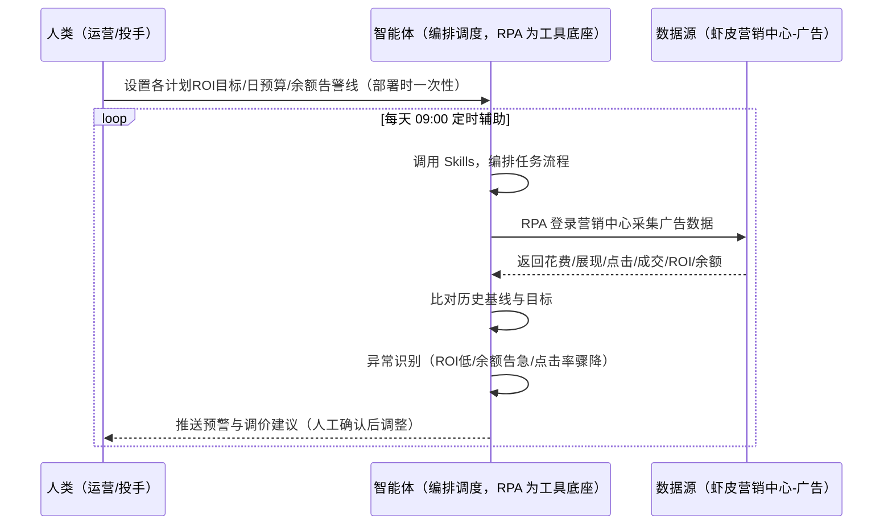
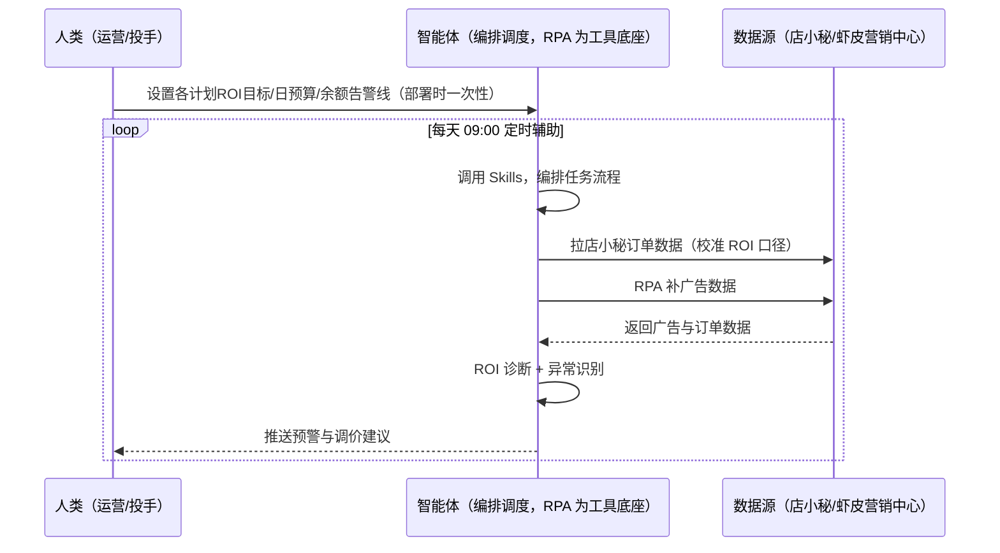

> 为虾皮（Shopee）卖家团队打造的广告投放监控与费用预警方案。关键词/关联/店铺广告盯盘费时、ROI 跌破阈值才知道、预算花完/余额告急无预警。本方案由智能体调度多个工具执行定时登录营销中心-广告采集各计划数据，智能体诊断投放异常并输出优化建议。每天定时辅助，只推送预警与调价建议，调价由人工确认（默认仅预警不自动改）。

> Agent 自动化需开通企业功能
> 点击申请1个月免费权限
> [点击申请 →](https://skieer.feishu.cn/share/base/form/shrcnFwMayykP5iaL38fnZKTbrg)

## 一、用户与需求

核心矛盾：虾皮广告三类型（关键词/关联/店铺）盯盘费时、ROI 跌破阈值才知道、预算花完/余额告急无预警、多站点账户切换复杂。

两类客户痛点同源，数据来源不同：

- 未购 SaaS 客户（新卖家/小团队）：人工登录后台盯花费/ROI、手动调出价，全靠手；
- 已购 SaaS 客户（店小秘 ERP 等）：店小秘管订单/上架，广告数据不覆盖，仍要人盯后台。

适用客户：投放规模中等以上的卖家。广告报表页面可采集但需登录且验证码/风控偶发；调价/暂停等操作类动作建议人工确认。

### 1.1 不同模式卖家

| 类型 | 选择 | 建议 |
|-|-|-|
| 跨境卖家 | 首选 | 强烈推荐（多站点投放监控） |
| 本土卖家 | 次选 | 一般推荐（单站点） |
| 铺货型 | 任意 | 按需 |

### 1.2 不同广告类型

| 类型 | 最关注维度 | 核心逻辑 |
|-|-|-|
| 关键词广告 | ROI | 搜索广告，点击付费 |
| 关联广告 | 关联曝光 | 商品关联推荐位 |
| 店铺广告 | 进店转化 | 店铺引流 |

### 1.3 不同角色用户

| 用户 | 需求 | 问题 | 投入时间（估算） |
|-|-|-|-|
| 老板 | 广告 ROI | 烧钱无产出 | 0.5 小时/周 |
| 运营 | ROI 诊断+调价建议 | 盯盘费时 | 1-2 小时/周 |
| 投手 | 余额预警 | 预算花完才知道 | 1 小时/周 |

---

## 二、现在的方法与问题

### 2.1 流程步骤与问题总结

人工方式（未购 SaaS 客户）

| 序号 | 步骤 | 现在的方法 | 问题缺陷 |
|-|-|-|-|
| 1 | 看花费 | 手动登录后台看 | 每天盯费时 |
| 2 | 看 ROI | 手动算 | 跌破阈值才知道 |
| 3 | 调出价 | 凭感觉调 | 误配风险 |
| 4 | 盯余额 | 手动看 | 预算花完无预警 |
| 5 | 复盘 | 凭记忆 | 无沉淀 |

SaaS 方式（已购店小秘 ERP 客户）

| 序号 | 步骤 | 现在的方法 | 问题缺陷 |
|-|-|-|-|
| 1 | 看花费 | 店小秘不覆盖 | 靠人盯 |
| 2 | 看 ROI | 靠人算 | 无诊断 |
| 3 | 调出价 | 凭感觉 | 无建议 |
| 4 | 盯余额 | 靠人 | 无预警 |
| 5 | 复盘 | 无 | 不迭代 |

### 2.2 问题分析

人工方式根因

| 序号 | 根因 | 具体表现 |
|-|-|-|
| 1 | 每天盯数据 | 花费/ROI 靠人盯 |
| 2 | 出价凭感觉 | 一次错误出价=预算损失 |
| 3 | 余额无预警 | 预算花完烧钱 |

**SaaS 方式根因**

| 序号 | 根因 | 具体表现 |
|-|-|-|
| 1 | 店小秘不覆盖 | 广告数据无工具 |
| 2 | 无闭环 | ROI 结果不回填迭代 |

---

## 三、解决方案

### 3.1 功能概述

为虾皮卖家团队打造的广告投放监控与费用预警方案，定时登录营销中心-广告采集各计划数据，智能体诊断投放异常并输出优化建议。

每天定时触发并调度多个工具，调起八爪鱼 RPA（Agent 的工具底座，能耦合多系统、完成自动化任务执行）定时登录卖家中心「营销中心-广告」采集各计划数据（花费/展现/点击/成交/ROI/余额/出价），智能体诊断投放异常（ROI 下滑/预算花完/点击率骤降）并输出优化建议。每天定时辅助，只推送预警与调价建议，调价由人工确认（默认仅预警不自动改）。

### 3.2 系统结合

| 要素 | 说明 |
|-|-|
| 客户现有工具盘点 | **未购 SaaS 客户**：无第三方工具，广告全靠人工盯后台。    
**已购 SaaS 客户**（主流组合）：店小秘 ERP（管订单/上架，广告数据不覆盖） |
| 数据/能力来源 | **无 SaaS**：虾皮营销中心-广告（花费/展现/点击/成交/ROI/余额/出价，登录采集，验证码/风控偶发）。    
**有 SaaS**：店小秘订单数据（辅助 ROI 口径）+ RPA 补广告数据 |
| RPA 耦合动作 | 作为 Agent 的工具底座，按计划采集广告数据（每日同时间采集防跨天错配、报表快照留存、登录失效告警），统一流转给智能体；多站点账户切换 |
| 耦合出的新价值 | 单工具给不了的端到端结论：广告数据一次取齐 → 比对历史基线与目标 → 异常识别（ROI 低/余额告急/点击率骤降）→ 优化建议，**只推送预警与调价建议** |

### 3.3 智能体执行流程

智能体定时触发。支持**两种数据通道**，部署时按客户现有工具选择：

**通道一：无 SaaS 方式（RPA 采集广告后台，适合未购 ERP 的客户）**

**通道二：有 SaaS 方式（店小秘订单校准 ROI + RPA 补广告数据，适合已购客户）**

> Agent 自动化需开通企业功能
> 点击申请1个月免费权限
> [点击申请 →](https://skieer.feishu.cn/share/base/form/shrcnFwMayykP5iaL38fnZKTbrg)

### 3.4 为何这么设计

要同时回答三个问题：**为什么不能只用 SaaS/API？为什么不能纯靠智能体写代码？为什么 RPA 是执行底座？** 本场景的核心是"定时盯盘、ROI 诊断、敏感操作人工确认、挂了有人管"。

#### 1）逐项对比

| 对比维度 | SaaS/API 堆叠（店小秘） | 纯智能体（智能体写代码） | 智能体+自动化工具（RPA 工具底座） |
|-|-|-|-|
| 实现方式 | 店小秘管订单，广告数据不覆盖 | 能抓后台能算，但全要自己接 | 广告采集 + ROI 诊断 |
| 定时盯盘 | 不覆盖 | 智能体无法常驻轮询 | RPA 定时采集防漏 |
| 调价建议 | 无 | 需自写出价模型 | 目标 ROI 规则可视化配置 |
| 使用成本（总拥有成本） | 店小秘订阅费（主体另算） | 代理 IP + 服务器 + 开发维护人力，隐性成本高 | 一份平台订阅跑多流程，单方案边际成本 ≈ 0 |
| 维护人要求 | 低（工具现成） | 规则调整都要开发介入 | 可视化流程，运营自己可调 ROI 目标 |

#### 2）优劣势说明

|  | SaaS/API 堆叠（店小秘） | 纯智能体（智能体写代码） | 智能体+自动化工具（RPA 工具底座） |
|-|-|-|-|
| 优势 | 订单数据权威（校准 ROI） | 无订阅费；    
可深度定制投放模型 | 广告采集+ROI 诊断即开即用；    
非技术人员可维护 |
| 劣势 | 广告数据不覆盖 | 登录与验证码全自建；    
AI 生成代码是生成性的 | 本地电脑运行需保持开机；    
订阅费；    
调价需人工确认 |

#### 3）结论

| 论点 | 说明 |
|-|-|
| 推广=真金白银 | 广告后台需登录实盘账户操作，智能体直接操作有误配风险（一次错误出价 = 预算损失，实锤） |
| 默认仅预警 | 调价/暂停等敏感操作默认仅预警不自动改，人工确认后执行（实锤） |
| 异常判定实锤 | ROI = 成交金额/花费，低于目标值 20% 预警；账户余额 &lt;3 日花费预警；计划点击率较 7 日均值降 30% 预警；花费突增但成交未增（ROI 跳水）紧急预警 |
| 每日同时间采集 | 每日同时间采集防跨天错配、报表快照留存、登录失效告警（实锤） |
| 一个底座跑多流程 | 客户购买 RPA 平台是跑多个流程（广告/订单/日报），本方案只是其中一个——平台订阅费被多流程摊薄 |
| 时间 | 投手要的是"异动自动报警 + 调价建议"，不是"每天盯后台" |

### 3.5 功能清单

| 功能 | 系统 | 功能说明（解决问题） |
|-|-|-|
| 会话/定时 | 智能体 | 1. 理解人类语言，调用已预设好的 Skills。    
2. 编排多任务、调度多工具。 |
| 多系统数据取数 | RPA、指纹浏览器 | 1. 解决盯盘费时、预算花完无预警问题。    
2. 作为智能体工具底座被调度执行，每日同时间采集防跨天错配、报表快照留存、登录失效告警。    
3. **【无 SaaS 方式】** RPA 采集广告后台。**【有 SaaS 方式】** 店小秘订单校准 ROI + RPA 补广告数据。 |
| ROI 诊断 | 智能体 | ROI 低于目标值 20% 预警；花费突增成交未增（ROI 跳水）紧急预警。 |
| 余额预警 | 智能体 | 账户余额 &lt;3 日花费预警。 |
| 点击率监控 | 智能体 | 计划点击率较 7 日均值降 30% 预警。 |
| 优化建议 | 智能体 | 调价/暂停/加词建议（默认仅预警不自动改）。 |
| IM通知 | 飞书、钉钉、企微等 | 解决投放异动滞后问题。预警与调价建议自动推送。 |
| 数据资产储存 | 本地电脑、云储存 | 1. Skills 资产：Shopee 广告技能。    
2. 数据储存：广告台账统一写入本地。    
3. 经验知识库：按实际 ROI 回填迭代。 |

### 3.6 智能体执行落地过程

部署时一次性配置入参（各计划 ROI 目标、日预算上限、余额告警线、站点范围、授权调整范围、数据通道），会话中无需重复输入。

**⚠️ 部署前提（不满足则方案无法跑起来）**：①RPA 需部署在**常开电脑/云机**上，并配置漏跑补跑机制；②**调价/暂停等操作默认仅预警不自动改，人工确认后执行**；③广告报表页面需登录且验证码/风控偶发，登录失效自动告警；④**有 SaaS 方式需店小秘账号**（ROI 口径校准，可选增强，无则走后台通道）；⑤首次配置（登录态、ROI 目标、预算规则）需服务方/技术人员介入一次，属实施成本。

#### 1）配置

| 类别 | 说明 |
|-|-|
| 智能体 | 主流智能体。 |
| 智能体工具 | 1. **数据通道（按客户现有工具二选一）**：【无 SaaS】虾皮营销中心-广告（RPA 采集）；【有 SaaS】店小秘订单数据 + RPA 补广告数据。    
2. 数据取数与自动化执行：八爪鱼 RPA，MCP 配置完成。    
3. 数据分析：智能体自带。    
4. IM：企业办公 IM（飞书/钉钉/企微），MCP 或 webhook 配置。 |
| 工作知识 | 1. 各计划 ROI 目标。    
2. 日预算上限。    
3. 余额告警线（&lt;3 日花费）。    
4. 站点范围。    
5. 授权调整范围（默认仅预警）。 |
| 本地数据库 | 1. 广告台账库地址。    
2. 投放基线库地址。    
3. 经验库地址。 |

#### 2）执行

| 任务 | 产出 | 产出物接收人 |
|-|-|-|
| 接收 ROI 目标，定时触发 | 任务启动记录 | —— |
| 调用已预设 Skills，编排任务流程 | 任务编排方案 | —— |
| 经 MCP 向八爪鱼 RPA 下发取数任务 | 自动化任务指令 | —— |
| 多源取数并按计划对齐（无 SaaS：广告后台；有 SaaS：店小秘+广告，智能体监控状态） | 对齐后广告数据 | —— |
| 比对历史基线与目标 | 诊断结果 | 投手 |
| 异常识别（ROI/余额/点击率） | 预警清单 | 投手/运营 |
| 优化建议（调价/暂停/加词） | 建议清单 | 投手 |
| 推送预警与调价建议（人工确认后调整） | 群消息 | 投手/运营/老板 |

异常处理：

登录失效 → 告警人工介入后断点续跑；

验证码/风控 → 自动重试；

数据缺失 → 用历史数据补并标注；

ROI 跳水 → 紧急预警；

置信度 &lt;70% → 转人工复核，不输出硬结论。

#### 3）结果

| 结果 | 说明 |
|-|-|
| 数据资产 | 广告台账结构化数据（计划/花费/ROI/出价/余额/状态），可审计可追溯。 |
| 分析报告 | 1. 广告监控日报：花费/ROI/余额。    
2. 异常预警清单。    
3. 优化建议。 |
| Skills | 智能体 Skills：Shopee 广告技能，按实际 ROI 回填迭代。 |

> Agent 自动化需开通企业功能
> 点击申请1个月免费权限
> [点击申请 →](https://skieer.feishu.cn/share/base/form/shrcnFwMayykP5iaL38fnZKTbrg)

---

## 四、使用前后预估

> 本方案价值 = **广告数据自动采集 → ROI 诊断 → 异常识别（ROI/余额/点击率）→ 优化建议**。广告报表页面可采集但需登录且验证码/风控偶发；调价等操作类动作建议人工确认。

| 指标 | 人工 | SaaS/API（店小秘） | 智能体+自动化工具 |
|-|-|-|-|
| 投放盯盘 | 每天盯后台 | 不覆盖 | 定时自动采集 |
| ROI 诊断 | 跌破才知 | 无 | 自动诊断+预警 |
| 余额预警 | 花完才知 | 无 | &lt;3 日花费自动预警 |
| 点击率监控 | 无 | 无 | 7 日均值降 30% 预警 |
| 调价执行 | 凭感觉 | 无建议 | 建议输出（人工确认） |
| 方法论 | 无 | 单工具 | 可复用的 Skills 与投放模型 |

**说明**：ROI = 成交金额/花费，低于目标值 20% 预警；账户余额 &lt;3 日花费预警；计划点击率较 7 日均值降 30% 预警；花费突增但成交未增（ROI 跳水）紧急预警；每日同时间采集防跨天错配、报表快照留存；调价/暂停等敏感操作默认仅预警不自动改。

---

## 六、备注

### 6.1 Agent 支持

本方案不绑定具体智能体，主流 Agent 均可运行（需支持技能/Skills 加载与工具调用）：

| Agent/智能体 | 说明 |
|-|-|
| Workbuddy | 本方案运行平台，支持技能/Skills 上传加载、定时任务、MCP 工具调用与表格/报告处理 |
| 豆包（国内·字节） | 国内主流个人智能体，支持技能上传、定时任务与工具调用，上手成本低 |
| 通义千问（国内·阿里） | 支持 Agent 编排与插件生态，集成阿里电商数据能力，适合电商场景 |
| DeepSeek（国内） | 推理能力强、成本低，适合规则打分与归因分析类任务 |
| ChatGPT（国外·OpenAI） | 海外主流通用智能体，支持 GPTs/Agent 模式与工具调用 |
| Claude（国外·Anthropic） | 长文本与结构化分析能力强，原生支持 MCP 连接外部工具 |

### 6.2 名词解释

| 术语 | 说明 |
|-|-|
| 关键词广告 | 搜索广告（点击付费） |
| 关联广告 | 商品关联推荐位广告 |
| 店铺广告 | 店铺引流广告 |
| ROI 跳水 | 花费突增但成交未增（紧急预警） |
| 余额告警线 | 账户余额 &lt;3 日花费预警 |
| 混合数据源 | 虾皮营销中心-广告（RPA 采集）+ 店小秘订单数据（有 SaaS 客户校准 ROI） |
| 有 SaaS 方式 | 已购店小秘 ERP，订单校准 ROI + RPA 补广告数据 |
| 无 SaaS 方式 | 不购买第三方工具，RPA 采集广告后台 |
| 跨境卖家 | 中国卖家中心统一管理多站点 |
| 本土卖家 | 单站点运营 |
| MCP | Model Context Protocol，智能体连接外部工具的标准化通道 |

> Agent 自动化需开通企业功能
> 点击申请1个月免费权限
> [点击申请 →](https://skieer.feishu.cn/share/base/form/shrcnFwMayykP5iaL38fnZKTbrg)

---

原文：[查看原文](https://skieer.feishu.cn/wiki/PjfnwxjqjijnDtkVyPicuH3CnFg)
