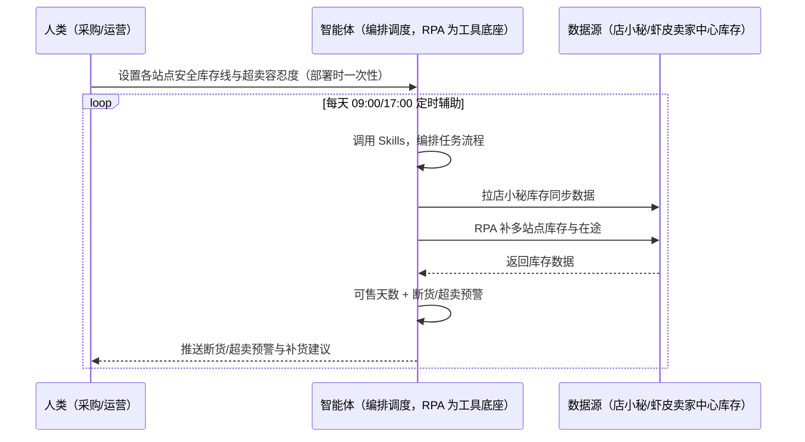

> 为虾皮（Shopee）卖家团队打造的库存管理与预警方案。多站点库存（可用/预留/在途）分散难汇总、断货/超卖风险无预警、全球商品共享库存口径难。本方案由智能体调度多个工具执行定时拉取各站点库存数据，智能体按「可用库存+在途+日均销量」预测断货日。每天定时辅助，只推送断货/超卖预警与补货建议，补货执行人工确认。

> Agent 自动化需开通企业功能
> 点击申请1个月免费权限
> [点击申请 →](https://skieer.feishu.cn/share/base/form/shrcnFwMayykP5iaL38fnZKTbrg)

## 一、用户与需求

核心矛盾：虾皮多站点库存（可用/预留/在途）分散难汇总、断货预警 = 可售天数 &lt;7 天且无在途补货、超卖风险（多站点同库存共卖）无预警、全球商品共享库存口径难。

两类客户痛点同源，数据来源不同：

- 未购 SaaS 客户（新卖家/小团队）：人工登录后台查各站点库存、手动算可售天数，全靠手；
- 已购 SaaS 客户（店小秘 ERP 等）：店小秘 ERP 库存同步可评估挂接（需定制），但断货/超卖预警与多站点口径仍要人盯。

适用客户：多站点多 SKU 卖家。库存拉取/可售天数计算/预警可自动化（后台结构稳定）；预测需日均销量数据（可从订单/经营数据采集场景取数）；补货执行人工确认。

### 1.1 不同模式卖家

| 类型 | 选择 | 建议 |
|-|-|-|
| 跨境卖家（多站点） | 首选 | 强烈推荐（全球商品共享库存口径） |
| 本土卖家 | 次选 | 一般推荐（单站点独立库存） |
| 铺货型 | 任意 | 按需 |

### 1.2 不同站点卖家

| 站点 | 最关注维度 | 核心逻辑 |
|-|-|-|
| 台湾 | 断货预警 | 可售天数 &lt;7 天 |
| 泰国 | 超卖风险 | 共享库存共卖 |
| 印尼 | 在途跟踪 | 采购在途补货 |
| 新加坡 | 安全库存 | 高客单库存 |
| 马来/菲律宾 | 多站点汇总 | 全球商品共享口径 |

### 1.3 不同角色用户

| 用户 | 需求 | 问题 | 投入时间（估算） |
|-|-|-|-|
| 老板 | 不断货不积压 | 断货/超卖无感知 | 0.5 小时/周 |
| 采购/运营 | 补货建议 | 多站点分散难汇总 | 2-3 小时/周 |
| 仓储 | 安全库存线 | 可售天数无感知 | 1 小时/周 |

---

## 二、现在的方法与问题

### 2.1 流程步骤与问题总结

人工方式（未购 SaaS 客户）

| 序号 | 步骤 | 现在的方法 | 问题缺陷 |
|-|-|-|-|
| 1 | 看库存 | 手动查各站点 | 分散难汇总 |
| 2 | 算可售 | 手动算 | 口径不一 |
| 3 | 盯断货 | 靠记忆 | 断货了才知道 |
| 4 | 盯超卖 | 无感知 | 多站点共卖超卖 |
| 5 | 补货 | 凭经验 | 无建议 |

SaaS 方式（已购店小秘 ERP 客户）

| 序号 | 步骤 | 现在的方法 | 问题缺陷 |
|-|-|-|-|
| 1 | 看库存 | 店小秘库存同步（可评估） | 需定制 |
| 2 | 算可售 | 部分覆盖 | 口径需校准 |
| 3 | 盯断货 | 靠人 | 无预警 |
| 4 | 盯超卖 | 无 | 无识别 |
| 5 | 补货 | 凭经验 | 无建议 |

### 2.2 问题分析

人工方式根因

| 序号 | 根因 | 具体表现 |
|-|-|-|
| 1 | 多站点分散 | 全球商品共享库存口径难 |
| 2 | 断货后知后觉 | 可售天数无感知 |
| 3 | 超卖无识别 | 多站点同库存共卖 |

SaaS 方式根因

| 序号 | 根因 | 具体表现 |
|-|-|-|
| 1 | 覆盖不完整 | 店小秘同步需定制，断货/超卖预警不覆盖 |
| 2 | 无闭环 | 补货后不回填迭代 |

---

## 三、解决方案

### 3.1 功能概述

为虾皮卖家团队打造的库存管理与预警方案，定时拉取各站点库存数据，智能体按「可用库存+在途+日均销量」预测断货日。

每天定时触发并调度多个工具，调起八爪鱼 RPA（Agent 的工具底座，能耦合多系统、完成自动化任务执行）定时拉取各站点库存数据（可用/预留/在途，含全球商品/本地商品体系），并采集在途采购/补货进度，智能体按「可用库存+在途+日均销量」预测断货日、识别超卖风险（多站点同库存共卖）。每天定时辅助，只推送断货/超卖预警与补货建议，补货执行人工确认。

### 3.2 系统结合

| 要素 | 说明 |
|-|-|
| 客户现有工具盘点 | **未购 SaaS 客户**：无第三方工具，库存全靠人工查后台。    <br />**已购 SaaS 客户**（主流组合）：店小秘 ERP（库存同步可评估挂接，需定制） |
| 数据/能力来源 | **无 SaaS**：虾皮卖家中心各站点库存页（可用/预留/在途，登录采集）+ 采购在途（本地维护）。    <br />**有 SaaS**：店小秘库存同步（可评估挂接）+ RPA 补断货/超卖预警 |
| RPA 耦合动作 | 作为 Agent 的工具底座，按计划拉取多站点库存（库存快照留存、与卖家中心数字比对、失败重试），统一流转给智能体；每日快照 |
| 耦合出的新价值 | 单工具给不了的端到端结论：多站点库存一次取齐 → 可售天数计算（可用库存/日均销量）→ 断货/超卖预警 → 补货建议 → 回填迭代预测基线，**只推送断货/超卖预警与补货建议** |

### 3.3 智能体执行流程

智能体定时触发。支持**两种数据通道**，部署时按客户现有工具选择：

**通道一：无 SaaS 方式（RPA 拉取多站点库存，适合未购 ERP 的客户）**

```mermaid
sequenceDiagram
    participant H as 人类（采购/运营）
    participant A as 智能体（编排调度，RPA 为工具底座）
    participant D as 数据源（虾皮卖家中心库存）
    H->>A: 设置各站点安全库存线与超卖容忍度（部署时一次性）
    loop 每天 09:00/17:00 定时辅助
        A->>A: 调用 Skills，编排任务流程
        A->>D: RPA 拉取各站点库存（可用/预留/在途）
        D-->>A: 返回库存数据
        A->>A: 可售天数计算（可用库存/日均销量）
        A->>A: 断货预警（&lt;7天无在途）+ 超卖识别（多站点共卖）
        A-->>H: 推送断货/超卖预警与补货建议（人工确认后补货）
    end
```

**通道二：有 SaaS 方式（店小秘库存同步 + RPA 补预警，适合已购客户）**



> Agent 自动化需开通企业功能
> 点击申请1个月免费权限
> [点击申请 →](https://skieer.feishu.cn/share/base/form/shrcnFwMayykP5iaL38fnZKTbrg)

### 3.4 为何这么设计

要同时回答三个问题：**为什么不能只用 SaaS/API？为什么不能纯靠智能体写代码？为什么 RPA 是执行底座？** 本场景的核心是"定时拉取、可售计算、断货/超卖预警、挂了有人管"。

#### 1）逐项对比

| 对比维度 | SaaS/API 堆叠（店小秘） | 纯智能体（智能体写代码） | 智能体+自动化工具（RPA 工具底座） |
|-|-|-|-|
| 实现方式 | 店小秘库存同步（部分覆盖） | 能拉后台能算，但全要自己接 | 多站点库存拉取 + 可售计算 |
| 定时拉取 | 需定制 | 智能体无法常驻轮询 | RPA 每日两次快照 |
| 断货/超卖预警 | 不覆盖 | 需自建预警逻辑 | 预警规则可视化配置 |
| 使用成本（总拥有成本） | 店小秘订阅费（需定制） | 代理 IP + 服务器 + 开发维护人力，隐性成本高 | 一份平台订阅跑多流程，单方案边际成本 ≈ 0 |
| 维护人要求 | 低（工具现成） | 规则调整都要开发介入 | 可视化流程，采购自己可调安全线 |

#### 2）优劣势说明

|  | SaaS/API 堆叠（店小秘） | 纯智能体（智能体写代码） | 智能体+自动化工具（RPA 工具底座） |
|-|-|-|-|
| 优势 | 库存同步现成（可评估） | 无订阅费；    <br />可深度定制预测模型 | 多站点拉取+可售计算+预警即开即用；    <br />非技术人员可维护 |
| 劣势 | 断货/超卖不覆盖 | 拉取与预警全自建；    <br />AI 生成代码是生成性的 | 本地电脑运行需保持开机；    <br />订阅费；    <br />补货执行人工确认 |

#### 3）结论

| 论点 | 说明 |
|-|-|
| 断货=流量损失 | 断货预警 = 可售天数 &lt;7 天且无在途补货（实锤）；超卖风险 = 订单量 > 可用库存时标记 |
| 多站点口径实锤 | 全球商品共享库存（合计计算）与站点独立库存（分别计算）（实锤） |
| 店小秘需定制 | 店小秘 ERP 库存同步可评估挂接（需定制）（实锤） |
| 补货人工确认 | 补货执行人工确认（资金约束下决策） |
| 一个底座跑多流程 | 客户购买 RPA 平台是跑多个流程（库存/订单/物流），本方案只是其中一个——平台订阅费被多流程摊薄 |
| 时间 | 采购要的是"断货/超卖预警 + 补货建议"，不是"翻后台" |

### 3.5 功能清单

| 功能 | 系统 | 功能说明（解决问题） |
|-|-|-|
| 会话/定时 | 智能体 | 1. 理解人类语言，调用已预设好的 Skills。    <br />2. 编排多任务、调度多工具。 |
| 多系统数据取数 | RPA、指纹浏览器 | 1. 解决多站点分散、断货后知后觉问题。    <br />2. 作为智能体工具底座被调度执行，库存快照留存、与卖家中心数字比对、失败重试。    <br />3. **【无 SaaS 方式】** RPA 拉取多站点库存。**【有 SaaS 方式】** 店小秘库存同步 + RPA 补预警。 |
| 可售天数计算 | 智能体 | 可售天数 = 可用库存/日均销量（日均窗口可调，大促前自动调整）。 |
| 断货预警 | 智能体 | 可售天数 &lt;7 天且无在途补货。 |
| 超卖识别 | 智能体 | 订单量 > 可用库存时标记（多站点同库存共卖）。 |
| 补货建议 | 智能体 | 按安全库存线+采购在途输出补货建议（单次补货量/频次）。 |
| IM通知 | 飞书、钉钉、企微等 | 解决断货/超卖滞后问题。预警与补货建议自动推送。 |
| 数据资产储存 | 本地电脑、云储存 | 1. Skills 资产：Shopee 库存管理技能。    <br />2. 数据储存：库存快照统一写入本地。    <br />3. 经验知识库：补货结果回填迭代。 |

### 3.6 智能体执行落地过程

部署时一次性配置入参（各站点安全库存线、采购在途数据、超卖容忍度、补货规则、数据通道），会话中无需重复输入。

**⚠️ 部署前提（不满足则方案无法跑起来）**：①RPA 需部署在**常开电脑/云机**上（每日两次快照需常开），并配置漏跑补跑机制；②**预测需日均销量数据**（可从订单/经营数据采集场景取数）；③**补货执行人工确认**；④**有 SaaS 方式需店小秘账号**（库存同步挂接，需定制，可选增强，无则走后台通道）；⑤首次配置（登录态、安全库存线、预测参数）需服务方/技术人员介入一次，属实施成本。

#### 1）配置

| 类别 | 说明 |
|-|-|
| 智能体 | 主流智能体。 |
| 智能体工具 | 1. **数据通道（按客户现有工具二选一）**：【无 SaaS】虾皮卖家中心库存（RPA 拉取）；【有 SaaS】店小秘库存同步 + RPA 补预警。    <br />2. 数据取数与自动化执行：八爪鱼 RPA，MCP 配置完成。    <br />3. 数据分析：智能体自带。    <br />4. IM：企业办公 IM（飞书/钉钉/企微），MCP 或 webhook 配置。 |
| 工作知识 | 1. 各站点安全库存线。    <br />2. 采购在途数据（或 ERP 对接）。    <br />3. 超卖容忍度。    <br />4. 补货规则（单次补货量/频次）。    <br />5. 多站点口径（全球商品共享/站点独立）。 |
| 本地数据库 | 1. 库存快照库地址。    <br />2. 补货台账库地址。    <br />3. 经验库地址。 |

#### 2）执行

| 任务 | 产出 | 产出物接收人 |
|-|-|-|
| 接收安全库存线，定时触发 | 任务启动记录 | —— |
| 调用已预设 Skills，编排任务流程 | 任务编排方案 | —— |
| 经 MCP 向八爪鱼 RPA 下发取数任务 | 自动化任务指令 | —— |
| 多源取数并按 SKU 对齐（无 SaaS：后台拉取；有 SaaS：店小秘+后台，智能体监控状态） | 对齐后库存数据 | —— |
| 可售天数计算 | 可售天数表 | 采购 |
| 断货预警（&lt;7天无在途）+ 超卖识别 | 预警清单 | 采购/仓储 |
| 补货建议（安全线+在途） | 补货建议 | 采购 |
| 推送断货/超卖预警与补货建议 | 群消息 | 采购/仓储/老板 |

异常处理：

拉取失败 → 自动重试并告警；

数据缺失 → 用历史数据补并标注；

日均销量波动大 → 大促前自动调整窗口；

超卖临界 → 告警提醒；

置信度 &lt;70% → 转人工复核，不输出硬结论。

#### 3）结果

| 结果 | 说明 |
|-|-|
| 数据资产 | 库存快照结构化数据（SKU/站点/可用/预留/在途/可售天数），可审计可追溯。 |
| 分析报告 | 1. 断货/超卖预警清单。    <br />2. 可售天数表。    <br />3. 补货建议。 |
| Skills | 智能体 Skills：Shopee 库存管理技能，按补货结果迭代预测基线。 |

> Agent 自动化需开通企业功能
> 点击申请1个月免费权限
> [点击申请 →](https://skieer.feishu.cn/share/base/form/shrcnFwMayykP5iaL38fnZKTbrg)

---

## 四、使用前后预估

> 本方案价值 = **多站点库存自动拉取 → 可售天数计算 → 断货/超卖预警 → 补货建议**。库存拉取/可售天数计算/预警可自动化，预测需日均销量数据，补货执行人工确认。

| 指标 | 人工 | SaaS/API（店小秘） | 智能体+自动化工具 |
|-|-|-|-|
| 库存汇总 | 手动分散查 | 同步需定制 | 多站点自动拉取 |
| 可售天数 | 手动算 | 部分覆盖 | 自动计算 |
| 断货预警 | 断货才知 | 不覆盖 | &lt;7 天自动预警 |
| 超卖识别 | 无感知 | 无 | 多站点共卖自动标记 |
| 补货建议 | 凭经验 | 无 | 安全线+在途建议 |
| 方法论 | 无 | 单工具 | 可复用的 Skills 与预测模型 |

**说明**：断货预警 = 可售天数 &lt;7 天且无在途补货；超卖风险 = 订单量 > 可用库存时标记；多站点口径 = 全球商品共享库存（合计计算）与站点独立库存（分别计算）；店小秘 ERP 库存同步可评估挂接（需定制）；补货执行人工确认。

---

## 五、效果证明

> Agent 自动化需开通企业功能
> 点击申请1个月免费权限
> [点击申请 →](https://skieer.feishu.cn/share/base/form/shrcnFwMayykP5iaL38fnZKTbrg)

### 5.1 客户案例

**《小天鹅：7 平台 16 账号库存数据自动化，年省成本 50 万》**

> 美的集团旗下小天鹅事业部，7 个电商平台、16 个账号、每日 86 张报表原需专员逐个登录导出 7 小时/天。八爪鱼 RPA 替代全部人工采集，7 大系统、25 类报表自动采集入库。

| 效果 | 说明 |
|-|-|
| 提效 | 多平台报表采集效率提升约 85%。原本 7 个平台 16 个账号、86 张报表需逐个登录导出，每天耗 7 小时，现在全自动采集入库；数据时效由 T+2 提升至 T+1，部分平台已 T+0。 |
| 降本 | 减少数据专员 2 人（原文：2 名全职数据专员的「搬数据」工作被完全替代，年节省人力成本 50 万元）。原本需 2 人全职导表，现在 0 人；2 名专员转岗至数据分析岗，投入库存分析、周转率优化、滞销品预警等高价值工作。 |
| 任务 | 7 个电商平台 16 个账号、25 类报表自动采集入库；错误率降至 0.1%。 |
| 任务 | 天猫指纹浏览器、苏宁每 2 小时定时抓取、京东按事业部隔离账号，多平台差异化策略稳定运行。 |

案例详情：[小天鹅：百亿级洗衣机巨头的多平台库存数据自动化实践](https://skieer.feishu.cn/wiki/Q6Qjw2FtDiNFgWkOVHacEFJ0nlh)

**《唯世美：家具大件补货全流程自动化》**

> 首款内置 RGB 灯光展示柜上架两个月即拿下 Amazon 美加英德四站与 Walmart、Temu 美站 Best Seller。为应对数据源分散、人工操作耗时与 SKU 管理混乱，实现补货判断全流程自动化。

| 效果 | 说明 |
|-|-|
| 提效 | 补货整理重复工作量下降 80%。原本需人工从领星 ERP 与各海外仓平台逐项导出库存、库龄数据再手工清洗匹配 SKU，现在自动抓取、自动清洗，输出补货建议。 |
| 降本 | 免除人工导表与拼表的重复投入，供应链团队投入转向库存结构优化与周转率提升等重点工作。 |
| 任务 | 库存数据抓取与处理准确率达 99% 以上，分散数据源实时同步。 |
| 任务 | 自有 Excel 模板逻辑零改动保留，补货计算口径与原有习惯一致。 |

案例详情：[家具大件补货：补货全流程自动化，整理数据重复工作量下降 80%](https://skieer.feishu.cn/wiki/Gca3w8j1KixDXjkz0oScFwHAngf)

---

## 六、备注

### 6.1 Agent 支持

本方案不绑定具体智能体，主流 Agent 均可运行（需支持技能/Skills 加载与工具调用）：

| Agent/智能体 | 说明 |
|-|-|
| Workbuddy | 本方案运行平台，支持技能/Skills 上传加载、定时任务、MCP 工具调用与表格/报告处理 |
| 豆包（国内·字节） | 国内主流个人智能体，支持技能上传、定时任务与工具调用，上手成本低 |
| 通义千问（国内·阿里） | 支持 Agent 编排与插件生态，集成阿里电商数据能力，适合电商场景 |
| DeepSeek（国内） | 推理能力强、成本低，适合规则打分与归因分析类任务 |
| ChatGPT（国外·OpenAI） | 海外主流通用智能体，支持 GPTs/Agent 模式与工具调用 |
| Claude（国外·Anthropic） | 长文本与结构化分析能力强，原生支持 MCP 连接外部工具 |

### 6.2 名词解释

| 术语 | 说明 |
|-|-|
| 可售天数 | 可用库存/日均销量 |
| 断货预警 | 可售天数 &lt;7 天且无在途补货 |
| 超卖风险 | 订单量 > 可用库存（多站点同库存共卖） |
| 全球商品 | 多站点共享库存（合计计算） |
| 安全库存线 | 各站点补货触发线 |
| 混合数据源 | 虾皮卖家中心库存（RPA 拉取）+ 店小秘库存同步（有 SaaS 客户挂接） |
| 有 SaaS 方式 | 已购店小秘 ERP，库存同步 + RPA 补预警 |
| 无 SaaS 方式 | 不购买第三方工具，RPA 拉取多站点库存 |
| 跨境卖家 | 中国卖家中心统一管理多站点 |
| 本土卖家 | 单站点运营 |
| MCP | Model Context Protocol，智能体连接外部工具的标准化通道 |

> Agent 自动化需开通企业功能
> 点击申请1个月免费权限
> [点击申请 →](https://skieer.feishu.cn/share/base/form/shrcnFwMayykP5iaL38fnZKTbrg)

---

原文：[查看原文](https://skieer.feishu.cn/wiki/Vg2SwpbxritRmrkOq6AcjapWnrg)
