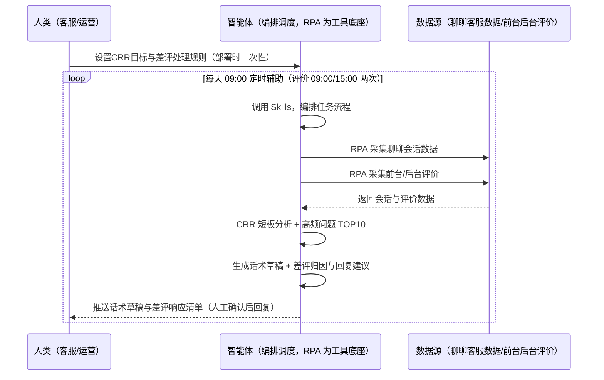
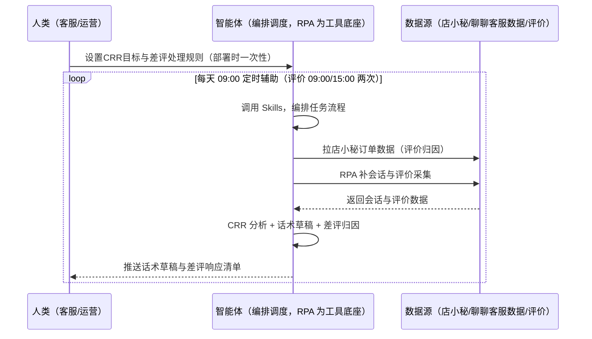

> 为虾皮（Shopee）卖家团队打造的客服与口碑管理方案。聊聊客服 12h 回复率（CRR）不达标前台露「回复慢」标签、差评 24h 响应率不达标、多语言话术维护难。本方案由智能体调度多个工具执行采集聊聊会话数据与前台/后台评价，智能体分析应答短板时段并生成回复话术草稿。每天定时辅助，自动回复仅辅助不代发（CRR 只计人工回复），回评人工确认。

> Agent 自动化需开通企业功能
> 点击申请1个月免费权限
> [点击申请 →](https://skieer.feishu.cn/share/base/form/shrcnFwMayykP5iaL38fnZKTbrg)

## 一、用户与需求

核心矛盾：虾皮客服考核严（CRR = 近 30 天 12h 内人工回复率，商城卖家 ≥85%，&lt;75% 前台露「回复慢」标签）；差评 24h 响应率不达标；多语言话术（繁中/泰语/印尼语）维护难。

两类客户痛点同源，数据来源不同：

- 未购 SaaS 客户（新卖家/小团队）：人工盯会话、手动回评，全靠手；
- 已购 SaaS 客户（店小秘 ERP 等）：店小秘管订单/上架，客服数据与评价监控不覆盖，仍要人盯。

适用客户：客服量大、口碑敏感的卖家。数据采集可行（后台客服数据页）；自动回复/广播不计 CRR，智能体仅出草稿不代发；会话记录采集受聊聊平台限制，标注降级路径。

### 1.1 不同模式卖家

| 类型 | 选择 | 建议 |
|-|-|-|
| 跨境卖家 | 首选 | 强烈推荐（多站点客服与口碑） |
| 本土卖家 | 次选 | 一般推荐（单站点） |
| 铺货型 | 任意 | 按需 |

### 1.2 不同站点卖家

| 站点 | 最关注维度 | 核心逻辑 |
|-|-|-|
| 台湾 | CRR | 12h 人工回复率 |
| 泰国 | 多语言话术 | 泰语回复 |
| 印尼 | 差评响应 | 24h 响应率 |
| 新加坡 | 好评率 | 店铺评分 |
| 马来/菲律宾 | 多语言 | 按站点语言 |

### 1.3 不同角色用户

| 用户 | 需求 | 问题 | 投入时间（估算） |
|-|-|-|-|
| 老板 | 服务分健康 | CRR 不达标露标签 | 0.5 小时/周 |
| 客服 | 话术草稿 | 多语言回复难 | 1-2 小时/周 |
| 运营 | 差评响应 | 24h 响应不达标 | 1 小时/周 |

---

## 二、现在的方法与问题

### 2.1 流程步骤与问题总结

人工方式（未购 SaaS 客户）

| 序号 | 步骤 | 现在的方法 | 问题缺陷 |
|-|-|-|-|
| 1 | 盯 CRR | 手动看后台 | 不达标露标签 |
| 2 | 回会话 | 手动回复 | 无话术沉淀 |
| 3 | 盯差评 | 手动刷新 | 24h 响应不达标 |
| 4 | 回评 | 手动写 | 多语言难 |
| 5 | 复盘 | 无 | 不迭代 |

SaaS 方式（已购店小秘 ERP 客户）

| 序号 | 步骤 | 现在的方法 | 问题缺陷 |
|-|-|-|-|
| 1 | 盯 CRR | 店小秘不覆盖 | 靠人看 |
| 2 | 回会话 | 手动 | 无草稿 |
| 3 | 盯差评 | 手动 | 无提醒 |
| 4 | 回评 | 手动 | 话术无库 |
| 5 | 复盘 | 无 | 不迭代 |

### 2.2 问题分析

人工方式根因

| 序号 | 根因 | 具体表现 |
|-|-|-|
| 1 | CRR 无监控 | &lt;75% 露「回复慢」标签 |
| 2 | 话术无沉淀 | 高频问题反复答 |
| 3 | 差评响应慢 | 24h 不达标影响评分 |

SaaS 方式根因

| 序号 | 根因 | 具体表现 |
|-|-|-|
| 1 | 店小秘不覆盖 | 客服/评价无工具 |
| 2 | 无闭环 | 改评效果不回采 |

---

## 三、解决方案

### 3.1 功能概述

为虾皮卖家团队打造的客服与口碑管理方案，采集聊聊会话数据与前台/后台评价，智能体分析应答短板时段并生成回复话术草稿。

每天定时触发并调度多个工具，调起八爪鱼 RPA（Agent 的工具底座，能耦合多系统、完成自动化任务执行）采集聊聊会话数据（12h 回复率/响应时长/未回复会话/客服工作量）+ 前台/后台新评价（星级/内容/图片/订单关联），智能体分析应答短板时段与高频问题、生成回复话术草稿（多语言）。每天定时辅助，自动回复仅辅助不代发（CRR 只计人工回复），回评人工确认。

### 3.2 系统结合

| 要素 | 说明 |
|-|-|
| 客户现有工具盘点 | **未购 SaaS 客户**：无第三方工具，客服全靠人工。    
**已购 SaaS 客户**（主流组合）：店小秘 ERP（管订单/上架，客服与评价不覆盖） |
| 数据/能力来源 | **无 SaaS**：虾皮聊聊客服数据页（12h 回复率/响应时长/未回复会话，登录采集）+ 前台评价（公开采集，需处理反爬）+ 后台我的评价（登录采集）。    
**有 SaaS**：店小秘订单数据（辅助评价归因）+ RPA 补会话与评价采集 |
| RPA 耦合动作 | 作为 Agent 的工具底座，按计划采集会话与评价（会话数据采集频率控制、数据脱敏；前台评价抓取频率控制防风控、快照留存），统一流转给智能体；差评 24h 响应提醒 |
| 耦合出的新价值 | 单工具给不了的端到端结论：会话+评价一次取齐 → CRR 短板分析 → 高频问题 TOP10 → 话术草稿（多语言）→ 差评归因与回复建议，**只推送话术草稿与差评响应清单** |

### 3.3 智能体执行流程

智能体定时触发。支持**两种数据通道**，部署时按客户现有工具选择：

**通道一：无 SaaS 方式（RPA 采集会话+评价，适合未购 ERP 的客户）**

**通道二：有 SaaS 方式（店小秘订单辅助归因 + RPA 补采集，适合已购客户）**

> Agent 自动化需开通企业功能
> 点击申请1个月免费权限
> [点击申请 →](https://skieer.feishu.cn/share/base/form/shrcnFwMayykP5iaL38fnZKTbrg)

### 3.4 为何这么设计

要同时回答三个问题：**为什么不能只用 SaaS/API？为什么不能纯靠智能体写代码？为什么 RPA 是执行底座？** 本场景的核心是"数据采集、短板分析、话术生成、挂了有人管"。

#### 1）逐项对比

| 对比维度 | SaaS/API 堆叠（店小秘） | 纯智能体（智能体写代码） | 智能体+自动化工具（RPA 工具底座） |
|-|-|-|-|
| 实现方式 | 店小秘管订单，客服不覆盖 | 能抓数据能生成，但全要自己接 | 会话/评价采集 + 话术生成 |
| 定时采集 | 不覆盖 | 智能体无法常驻轮询 | RPA 定时采集 |
| 话术生成 | 无 | 需自建话术库 | 多语言话术库可视化配置 |
| 使用成本（总拥有成本） | 店小秘订阅费（主体另算） | 代理 IP + 服务器 + 开发维护人力，隐性成本高 | 一份平台订阅跑多流程，单方案边际成本 ≈ 0 |
| 维护人要求 | 低（工具现成） | 规则调整都要开发介入 | 可视化流程，客服自己可调话术 |

#### 2）优劣势说明

|  | SaaS/API 堆叠（店小秘） | 纯智能体（智能体写代码） | 智能体+自动化工具（RPA 工具底座） |
|-|-|-|-|
| 优势 | 订单数据权威（评价归因） | 无订阅费；    
可深度定制话术模型 | 会话/评价采集+话术生成即开即用；    
非技术人员可维护 |
| 劣势 | 客服与评价不覆盖 | 采集与话术全自建；    
AI 生成代码是生成性的 | 本地电脑运行需保持开机；    
订阅费；    
自动回复不代发 |

#### 3）结论

| 论点 | 说明 |
|-|-|
| CRR 红线实锤 | CRR = 近 30 天 12h 内人工回复率，&lt;85% 预警（商城卖家红线）；&lt;75% 前台露「回复慢」标签紧急处理 |
| 自动回复不计 CRR | 自动回复/广播不计 CRR，智能体仅出草稿不代发（实锤）——CRR 只计人工回复 |
| 差评响应实锤 | 差评 24h 内响应率 >90%；回复合规率 100%（禁承诺/禁诱导） |
| 会话采集受限 | 会话记录采集受聊聊平台限制，标注降级路径（实锤） |
| 一个底座跑多流程 | 客户购买 RPA 平台是跑多个流程（客服/口碑/VOC），本方案只是其中一个——平台订阅费被多流程摊薄 |
| 时间 | 客服要的是"话术草稿 + 差评响应清单"，不是"翻会话" |

### 3.5 功能清单

| 功能 | 系统 | 功能说明（解决问题） |
|-|-|-|
| 会话/定时 | 智能体 | 1. 理解人类语言，调用已预设好的 Skills。    
2. 编排多任务、调度多工具。 |
| 多系统数据取数 | RPA、指纹浏览器 | 1. 解决 CRR 无监控、差评响应慢问题。    
2. 作为智能体工具底座被调度执行，会话数据采集频率控制、数据脱敏；评价抓取防风控、快照留存。    
3. **【无 SaaS 方式】** RPA 采集聊聊会话 + 前台/后台评价。**【有 SaaS 方式】** 店小秘订单辅助归因 + RPA 补采集。 |
| CRR 分析 | 智能体 | 应答短板时段 + 高频问题 TOP10 自动沉淀知识库。 |
| 话术草稿 | 智能体 | 多语言回复话术草稿（繁中/泰语/印尼语），合规过滤、不自动发送。 |
| 差评归因 | 智能体 | 差评归因（质量/物流/描述/服务）+ 回复建议。 |
| 改评回采 | 智能体 | 回评后效果（改评率）回采，迭代话术库。 |
| IM通知 | 飞书、钉钉、企微等 | 解决客服滞后问题。话术草稿与差评响应清单自动推送。 |
| 数据资产储存 | 本地电脑、云储存 | 1. Skills 资产：Shopee 客服提效技能。    
2. 数据储存：会话/评价台账统一写入本地。    
3. 经验知识库：话术库持续沉淀。 |

### 3.6 智能体执行落地过程

部署时一次性配置入参（CRR 目标、话术合规规则、排班约束、多语言话术库、数据通道），会话中无需重复输入。

**⚠️ 部署前提（不满足则方案无法跑起来）**：①RPA 需部署在**常开电脑/云机**上（每日采集需常开），并配置漏跑补跑机制；②**自动回复/广播不计 CRR，智能体仅出草稿不代发**；③**回评操作默认人工确认**（回复内容影响买家观感与改评）；④**有 SaaS 方式需店小秘账号**（评价归因，可选增强，无则走后台通道）；⑤首次配置（登录态、话术库、合规规则）需服务方/技术人员介入一次，属实施成本。

#### 1）配置

| 类别 | 说明 |
|-|-|
| 智能体 | 主流智能体。 |
| 智能体工具 | 1. **数据通道（按客户现有工具二选一）**：【无 SaaS】聊聊客服数据 + 前台/后台评价（RPA 采集）；【有 SaaS】店小秘订单数据 + RPA 补采集。    
2. 数据取数与自动化执行：八爪鱼 RPA，MCP 配置完成。    
3. 数据分析：智能体自带。    
4. IM：企业办公 IM（飞书/钉钉/企微），MCP 或 webhook 配置。 |
| 工作知识 | 1. CRR 目标（商城卖家 ≥85%）。    
2. 话术合规规则（禁承诺/禁诱导）。    
3. 排班约束。    
4. 多语言话术库（繁中/泰语/印尼语）。    
5. 差评优先处理规则。 |
| 本地数据库 | 1. 会话台账库地址。    
2. 话术库地址。    
3. 经验库地址。 |

#### 2）执行

| 任务 | 产出 | 产出物接收人 |
|-|-|-|
| 接收 CRR 目标，定时触发 | 任务启动记录 | —— |
| 调用已预设 Skills，编排任务流程 | 任务编排方案 | —— |
| 经 MCP 向八爪鱼 RPA 下发取数任务 | 自动化任务指令 | —— |
| 多源取数（无 SaaS：会话+评价；有 SaaS：店小秘+会话评价，智能体监控状态） | 对齐后客服数据 | —— |
| CRR 短板分析 + 高频问题 TOP10 | 分析报告 | 客服 |
| 话术草稿（多语言） | 话术草稿 | 客服 |
| 差评归因 + 回复建议 | 差评响应清单 | 客服/运营 |
| 推送话术草稿与差评响应清单（人工确认后回复） | 群消息 | 客服/运营/老板 |

异常处理：

采集失败 → 自动重试并告警；

会话受限 → 降级路径标注；

话术合规过滤 → 违禁词拦截；

差评 24h 临界 → 告警提醒；

置信度 &lt;70% → 转人工复核，不输出硬结论。

#### 3）结果

| 结果 | 说明 |
|-|-|
| 数据资产 | 会话/评价台账结构化数据（会话/评价/回复/状态），可审计。 |
| 分析报告 | 1. CRR 分析报告（短板时段+高频问题）。    
2. 话术草稿。    
3. 差评响应清单与改评回采。 |
| Skills | 智能体 Skills：Shopee 客服提效技能，按改评效果迭代话术库。 |

> Agent 自动化需开通企业功能
> 点击申请1个月免费权限
> [点击申请 →](https://skieer.feishu.cn/share/base/form/shrcnFwMayykP5iaL38fnZKTbrg)

---

## 四、使用前后预估

> 本方案价值 = **会话/评价自动采集 → CRR 短板分析 → 话术草稿（多语言）→ 差评归因与回复建议 → 改评回采**。数据采集可行，自动回复仅辅助不代发，回评人工确认。

| 指标 | 人工 | SaaS/API（店小秘） | 智能体+自动化工具 |
|-|-|-|-|
| CRR 监控 | 手动看 | 不覆盖 | 自动采集分析 |
| 话术回复 | 手动写 | 无 | 多语言草稿 |
| 差评响应 | 24h 不达标 | 无 | 自动归因+24h 提醒 |
| 高频问题 | 反复答 | 无 | TOP10 知识库沉淀 |
| 改评回采 | 无 | 无 | 改评率自动回采 |
| 方法论 | 无 | 单工具 | 可复用的 Skills 与话术库 |

**说明**：CRR = 近 30 天 12h 内人工回复率，&lt;85% 预警（商城卖家红线）；&lt;75% 前台露「回复慢」标签紧急处理；自动回复/广播不计 CRR，智能体仅出草稿不代发；差评 24h 内响应率 >90%；回复合规率 100%（禁承诺/禁诱导）；会话记录采集受聊聊平台限制，标注降级路径；多语言话术库需持续维护。

---

## 五、效果证明

> Agent 自动化需开通企业功能
> 点击申请1个月免费权限
> [点击申请 →](https://skieer.feishu.cn/share/base/form/shrcnFwMayykP5iaL38fnZKTbrg)

### 5.1 客户案例

**《AI 智能回评：多平台多店铺评论自动回复》**

> 某纸巾品牌在 3 个平台拥有 22 家店铺，每天后台收到上千条评论，部分平台要求中差评 24 小时内回复，人工逐一回复压力大。RPA 自动打开后台、AI 识别好差评并生成话术逐一回复。

| 效果 | 说明 |
|-|-|
| 提效 | 多平台多店铺评论回复由人工逐条处理变为 24×7 自动响应。原本需人工切换店铺后台逐条查看并回复，现在自动获取评价内容并按话术库自动回复。 |
| 降本 | 免除客服逐条回评的重复投入，投入转向复杂评价处理与客户关系维护等重点工作。 |
| 任务 | 支持多店铺后台自动切换登录，批量获取评价内容并统一回复口径。 |
| 任务 | 回复话术按店铺与场景配置，提升店铺 DSR 与客户满意度。 |

案例详情：[回评|AI智能回评自动化应用方案|八爪鱼RPA](https://skieer.feishu.cn/wiki/Xrg6wWsNYiUDNrk7Gs5cTYLpnof)

**《大疆：十余平台 × 7 大类营销与客服数据自动采集》**

> 十余个国内外电商平台与社媒渠道，直播、评论、客服会话、搜索等非结构化数据原需大量人力处理。RPA 完成十余个系统、7 大类核心数据自动采集入库。

| 效果 | 说明 |
|-|-|
| 提效 | 跨平台营销与客服数据采集效率显著提升。原本十余个平台与社媒渠道、7 大类数据需每日 5-6 小时人工导表，现在全自动采集入库，数据时效提升至 T+1。 |
| 降本 | 免除专职导表的人力投入，节约人力用于数据建模、投放复盘与客服策略分析等重点工作。 |
| 任务 | 覆盖十余个国内外电商平台与社媒渠道，含直播、评论、客服会话、搜索等 7 大类非结构化数据。 |
| 任务 | 形成全渠道统一数据底座，跨平台口径一致，供分析团队直接取用。 |

案例详情：[客服：全球无人机巨头跨平台电商与客服数据自动化采集](https://skieer.feishu.cn/wiki/OmO7wGX3yiASCBkqRsfcWPUMnOe)

---

## 六、备注

### 6.1 Agent 支持

本方案不绑定具体智能体，主流 Agent 均可运行（需支持技能/Skills 加载与工具调用）：

| Agent/智能体 | 说明 |
|-|-|
| Workbuddy | 本方案运行平台，支持技能/Skills 上传加载、定时任务、MCP 工具调用与表格/报告处理 |
| 豆包（国内·字节） | 国内主流个人智能体，支持技能上传、定时任务与工具调用，上手成本低 |
| 通义千问（国内·阿里） | 支持 Agent 编排与插件生态，集成阿里电商数据能力，适合电商场景 |
| DeepSeek（国内） | 推理能力强、成本低，适合规则打分与归因分析类任务 |
| ChatGPT（国外·OpenAI） | 海外主流通用智能体，支持 GPTs/Agent 模式与工具调用 |
| Claude（国外·Anthropic） | 长文本与结构化分析能力强，原生支持 MCP 连接外部工具 |

### 6.2 名词解释

| 术语 | 说明 |
|-|-|
| CRR | 客服回复率（近 30 天 12h 内人工回复率） |
| 商城卖家红线 | CRR ≥85%（&lt;75% 露「回复慢」标签） |
| 话术草稿 | 智能体生成、人工确认后发送（不代发） |
| 高频问题 TOP10 | 自动沉淀知识库 |
| 改评率 | 回评后评价修改比例 |
| 混合数据源 | 聊聊客服数据（RPA 采集）+ 前台/后台评价 + 店小秘订单数据（有 SaaS 客户归因） |
| 有 SaaS 方式 | 已购店小秘 ERP，订单辅助归因 + RPA 补采集 |
| 无 SaaS 方式 | 不购买第三方工具，RPA 采集会话与评价 |
| 跨境卖家 | 中国卖家中心统一管理多站点 |
| 本土卖家 | 单站点运营 |
| MCP | Model Context Protocol，智能体连接外部工具的标准化通道 |

> Agent 自动化需开通企业功能
> 点击申请1个月免费权限
> [点击申请 →](https://skieer.feishu.cn/share/base/form/shrcnFwMayykP5iaL38fnZKTbrg)

---

原文：[查看原文](https://skieer.feishu.cn/wiki/VC8Uw0shhi9kmjkTD02cORflnEc)
