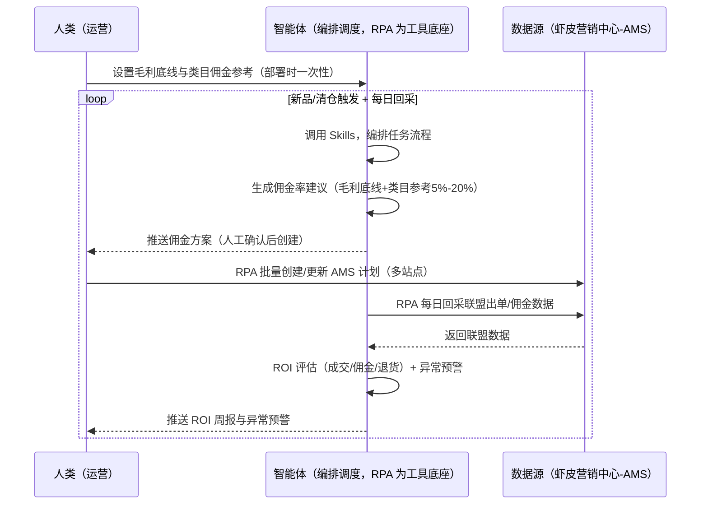
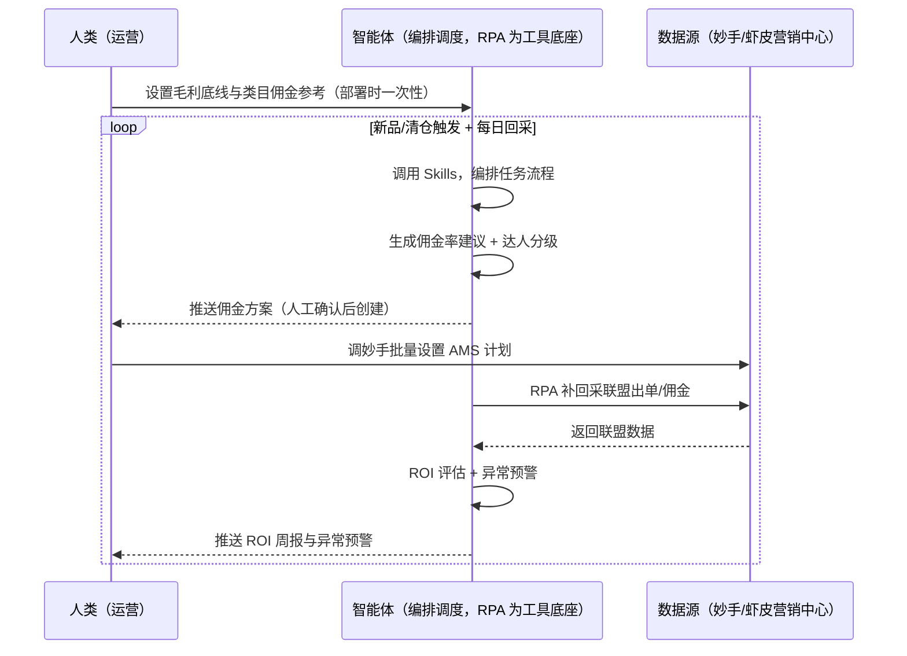

> 为虾皮（Shopee）卖家团队打造的联盟营销管理方案（AMS 达人推广，CPS 佣金）。佣金率设多少没依据、达人分级管理难、虚高佣金后私自下调被扣分、疑似刷单无预警。本方案由智能体调度多个工具执行按模板创建/更新 AMS 推广计划并回采联盟出单/佣金数据，智能体按毛利底线生成佣金率建议。新品上架/清仓触发，计划创建默认人工确认后执行。

> Agent 自动化需开通企业功能
> 点击申请1个月免费权限
> [点击申请 →](https://skieer.feishu.cn/share/base/form/shrcnFwMayykP5iaL38fnZKTbrg)

## 一、用户与需求

核心矛盾：虾皮联盟营销（AMS）是 CPS 按成交计费，佣金率设多少没依据（类目参考 5%-20%）、达人分级管理难；平台红线严（虚高佣金后私自下调 = 扣 6 分/次、累计 15 分冻结）。

两类客户痛点同源，数据来源不同：

- 未购 SaaS 客户（新卖家/小团队）：人工设佣、手动管理达人，全靠手；
- 已购 SaaS 客户（妙手 ERP 等）：妙手 ERP 批量设置可评估挂接（需定制），但佣金率设计与达人合作仍要人做。

适用客户：达人推广规模大的卖家。计划创建/数据回采可自动化（后台结构稳定）；佣金率设计与达人合作需智能体+人工。

### 1.1 不同模式卖家

| 类型 | 选择 | 建议 |
|-|-|-|
| 跨境卖家 | 首选 | 强烈推荐（多站点 AMS 计划） |
| 本土卖家 | 次选 | 一般推荐（单站点） |
| 铺货型 | 任意 | 按需 |

### 1.2 不同类目卖家

| 类目 | 最关注维度 | 核心逻辑 |
|-|-|-|
| 3C 数码 | 佣金上限 | 高客单，佣金率参考 |
| 家居家具 | 毛利底线 | 大件佣金空间 |
| 美妆个护 | 达人匹配 | 美妆达人转化高 |
| 服装鞋帽 | 季节性 | 换季清仓达人 |
| 户外运动 | 旺季投放 | 旺季前建计划 |
| 母婴用品 | 合规达人 | 达人内容合规 |

### 1.3 不同角色用户

| 用户 | 需求 | 问题 | 投入时间（估算） |
|-|-|-|-|
| 老板 | 联盟 ROI | 佣金成本失控 | 0.5 小时/周 |
| 运营 | 佣金率建议 | 设多少没依据 | 1-2 小时/周 |
| 达人管理 | 达人分级 | 管理难 | 1 小时/周 |

---

## 二、现在的方法与问题

### 2.1 流程步骤与问题总结

**人工方式（未购 SaaS 客户）**

| 序号 | 步骤 | 现在的方法 | 问题缺陷 |
|-|-|-|-|
| 1 | 设佣 | 凭经验 | 无依据 |
| 2 | 建计划 | 逐条手动 | 多站点费时 |
| 3 | 管达人 | 手动分级 | 难管理 |
| 4 | 盯佣金 | 手动看 | 异常无预警 |
| 5 | 复盘 | 无 | 不迭代 |

**SaaS 方式（已购妙手 ERP 客户）**

| 序号 | 步骤 | 现在的方法 | 问题缺陷 |
|-|-|-|-|
| 1 | 设佣 | 妙手批量设置（可评估） | 佣金率设计靠人 |
| 2 | 建计划 | 半自动 | 达人分级靠人 |
| 3 | 管达人 | 手动 | 无白名单 |
| 4 | 盯佣金 | 靠人 | 异常无预警 |
| 5 | 复盘 | 无 | 不迭代 |

### 2.2 问题分析

**人工方式根因**

| 序号 | 根因 | 具体表现 |
|-|-|-|
| 1 | 佣金凭经验 | 高于毛利底线亏钱 |
| 2 | 平台红线 | 虚高佣金后私自下调被扣分 |
| 3 | 刷单无预警 | 异常流量亏损 |

**SaaS 方式根因**

| 序号 | 根因 | 具体表现 |
|-|-|-|
| 1 | 覆盖不完整 | 妙手管批量设置，佣金率设计与达人分级不覆盖 |
| 2 | 无闭环 | ROI 不回填迭代 |

---

## 三、解决方案

### 3.1 功能概述

为虾皮卖家团队打造的联盟营销管理方案，按模板创建/更新 AMS 推广计划并回采联盟出单/佣金数据，智能体按毛利底线生成佣金率建议。

新品上架/清仓触发并调度多个工具，调起八爪鱼 RPA（Agent 的工具底座，能耦合多系统、完成自动化任务执行）在卖家中心「营销中心-联盟营销（AMS）」按模板创建/更新推广计划（商品范围+佣金率+有效期），并回采联盟出单/佣金数据，智能体按毛利底线生成佣金率建议（类目参考 5%-20%）、达人分级管理。新品上架/清仓触发，计划创建默认人工确认后执行。

### 3.2 系统结合

| 要素 | 说明 |
|-|-|
| 客户现有工具盘点 | **未购 SaaS 客户**：无第三方工具，联盟全靠人工。     **已购 SaaS 客户**（主流组合）：妙手 ERP（批量设置可评估挂接，需定制） |
| 数据/能力来源 | **无 SaaS**：虾皮营销中心-联盟营销 AMS（计划列表+联盟出单/佣金数据，登录采集）。     **有 SaaS**：妙手 ERP 批量设置（可评估挂接）+ 智能体补佣金率设计与达人分级 |
| RPA 耦合动作 | 作为 Agent 的工具底座，按模板创建/更新 AMS 计划（多站点、回执校验、失败重试），回采联盟出单/佣金数据，统一流转给智能体；异常佣金预警 |
| 耦合出的新价值 | 单工具给不了的端到端结论：佣金方案（毛利底线）→ 批量创建/更新计划 → 每日回采出单/佣金 → ROI 评估与迭代 → 异常预警，**只推送佣金方案与异常预警** |

### 3.3 智能体执行流程

用户向智能体输入会话（入参：新品/清仓触发）或定时回采。支持**两种数据通道**，部署时按客户现有工具选择：

**通道一：无 SaaS 方式（RPA 创建 AMS 计划，适合未购 ERP 的客户）**

**通道二：有 SaaS 方式（妙手批量设置 + 智能体补设计，适合已购客户）**

> Agent 自动化需开通企业功能
> 点击申请1个月免费权限
> [点击申请 →](https://skieer.feishu.cn/share/base/form/shrcnFwMayykP5iaL38fnZKTbrg)

### 3.4 为何这么设计

要同时回答三个问题：**为什么不能只用 SaaS/API？为什么不能纯靠智能体写代码？为什么 RPA 是执行底座？** 本场景的核心是"佣金测算、批量创建、异常监控、挂了有人管"。

#### 1）逐项对比

| 对比维度 | SaaS/API 堆叠（妙手） | 纯智能体（智能体写代码） | 智能体+自动化工具（RPA 工具底座） |
|-|-|-|-|
| 实现方式 | 妙手批量设置（部分覆盖） | 能建计划能算，但全要自己接 | AMS 模板创建 + 佣金测算 |
| 批量创建 | 可评估挂接 | 需自建创建逻辑 | 多站点批量创建回执校验 |
| 佣金测算 | 无 | 需自写测算模型 | 毛利底线规则可视化配置 |
| 使用成本（总拥有成本） | 妙手订阅费（需定制） | 代理 IP + 服务器 + 开发维护人力，隐性成本高 | 一份平台订阅跑多流程，单方案边际成本 ≈ 0 |
| 维护人要求 | 低（工具现成） | 规则调整都要开发介入 | 可视化流程，运营自己可调底线 |

#### 2）优劣势说明

|  | SaaS/API 堆叠（妙手） | 纯智能体（智能体写代码） | 智能体+自动化工具（RPA 工具底座） |
|-|-|-|-|
| 优势 | 批量设置现成（需定制） | 无订阅费；     可深度定制佣金模型 | AMS 创建+佣金测算+异常监控；     非技术人员可维护 |
| 劣势 | 佣金率设计不覆盖 | 创建与回采全自建；     AI 生成代码是生成性的 | 本地电脑运行需保持开机；     订阅费；     计划创建需人工确认 |

#### 3）结论

| 论点 | 说明 |
|-|-|
| 佣金红线=扣分 | 平台红线（实锤）：虚高佣金后私自下调 = 扣 6 分/次、累计 15 分冻结 → 调整佣金前先降级提醒 |
| 佣金公式 | 联盟 ROI = 联盟成交 GMV/佣金支出；佣金率高于毛利底线自动拦截（实锤）；类目参考 5%-20% |
| 刷单预警 | 疑似刷单 = 异常流量集中来源暂停计划并申诉（实锤） |
| 计划创建人工确认 | 创建授权范围默认方案人工确认后创建（涉及真金白银） |
| 一个底座跑多流程 | 客户购买 RPA 平台是跑多个流程（联盟/广告/活动），本方案只是其中一个——平台订阅费被多流程摊薄 |
| 时间 | 运营要的是"佣金方案 + ROI 周报 + 异常预警"，不是"逐条建计划" |

### 3.5 功能清单

| 功能 | 系统 | 功能说明（解决问题） |
|-|-|-|
| 会话/定时 | 智能体 | 1. 理解人类语言，调用已预设好的 Skills。     2. 编排多任务、调度多工具。 |
| 多系统数据取数 | RPA、指纹浏览器 | 1. 解决佣金没依据、达人难管理问题。     2. 作为智能体工具底座被调度执行，多站点批量创建、回执校验、失败重试。     3. **【无 SaaS 方式】** RPA 创建/更新 AMS 计划 + 回采联盟数据。**【有 SaaS 方式】** 妙手批量设置 + RPA 补回采。 |
| 佣金率建议 | 智能体 | 毛利底线 + 类目参考（5%-20%）生成佣金率；高于毛利底线自动拦截。 |
| 达人分级 | 智能体 | 自动匹配/手动邀请达人分级管理（白名单）。 |
| ROI 评估 | 智能体 | 联盟 ROI = 联盟成交 GMV/佣金支出（含退货）。 |
| 异常预警 | 智能体 | 佣金突增/疑似刷单（异常流量集中来源）预警。 |
| IM通知 | 飞书、钉钉、企微等 | 解决联盟异常滞后问题。佣金方案与异常预警自动推送。 |
| 数据资产储存 | 本地电脑、云储存 | 1. Skills 资产：Shopee 联盟营销技能。     2. 数据储存：联盟台账统一写入本地。     3. 经验知识库：ROI 结果回填迭代佣金率。 |

### 3.6 智能体执行落地过程

部署时一次性配置入参（各 SKU 毛利底线、类目佣金参考区间、达人白名单、创建授权范围、数据通道），会话中无需重复输入。

**⚠️ 部署前提（不满足则方案无法跑起来）**：①RPA 需部署在**常开电脑/云机**上（每日回采需常开），并配置漏跑补跑机制；②**计划创建默认人工确认后创建**（涉及真金白银）；③**平台佣金规则（类目上限/补贴政策）需持续同步**；④**有 SaaS 方式需妙手账号**（批量设置挂接，需定制，可选增强，无则走后台通道）；⑤首次配置（登录态、毛利底线、达人规则）需服务方/技术人员介入一次，属实施成本。

#### 1）配置

| 类别 | 说明 |
|-|-|
| 智能体 | 主流智能体。 |
| 智能体工具 | 1. **数据通道（按客户现有工具二选一）**：【无 SaaS】虾皮营销中心-AMS（RPA 采集）；【有 SaaS】妙手批量设置 + RPA 补回采。     2. 数据取数与自动化执行：八爪鱼 RPA，MCP 配置完成。     3. 数据分析：智能体自带。     4. IM：企业办公 IM（飞书/钉钉/企微），MCP 或 webhook 配置。 |
| 工作知识 | 1. 各 SKU 毛利底线。     2. 类目佣金参考区间：5%-20%。     3. 达人白名单。     4. 创建授权范围（默认人工确认后创建）。     5. 平台佣金规则（类目上限/补贴政策）。 |
| 本地数据库 | 1. 联盟台账库地址。     2. 佣金模型库地址。     3. 经验库地址。 |

#### 2）执行

| 任务 | 产出 | 产出物接收人 |
|-|-|-|
| 接收毛利底线，触发 | 任务启动记录 | —— |
| 调用已预设 Skills，编排任务流程 | 任务编排方案 | —— |
| 生成佣金率建议（毛利底线+类目参考） | 佣金方案 | 运营 |
| 达人分级建议 | 达人清单 | 运营 |
| 推送佣金方案（人工确认后创建） | 群消息 | 运营 |
| 批量创建/更新 AMS 计划（多站点） | 创建回执 | —— |
| 每日回采联盟出单/佣金 | 回采数据 | —— |
| ROI 评估 + 异常预警（佣金突增/刷单） | ROI 周报 | 运营/老板 |
| 推送 ROI 周报与异常预警 | 群消息 | 运营/老板 |

异常处理：

创建失败 → 重试并告警；

佣金突增 → 异常预警；

疑似刷单 → 暂停计划并申诉；

佣金率高于底线 → 自动拦截；

置信度 &lt;70% → 转人工复核，不输出硬结论。

#### 3）结果

| 结果 | 说明 |
|-|-|
| 数据资产 | 联盟台账结构化数据（计划/佣金率/出单/佣金/ROI/状态），可审计可追溯。 |
| 分析报告 | 1. 佣金方案：毛利底线测算。     2. ROI 周报：成交/佣金/退货。     3. 异常预警：佣金突增/刷单。 |
| Skills | 智能体 Skills：Shopee 联盟营销技能，按 ROI 结果迭代佣金率。 |

> Agent 自动化需开通企业功能
> 点击申请1个月免费权限
> [点击申请 →](https://skieer.feishu.cn/share/base/form/shrcnFwMayykP5iaL38fnZKTbrg)

---

## 四、使用前后预估

> 本方案价值 = **佣金方案（毛利底线）→ 批量创建 AMS 计划 → 每日回采出单/佣金 → ROI 评估与迭代 → 异常预警**。计划创建/数据回采可自动化，佣金率设计与达人合作需智能体+人工。

| 指标 | 人工 | SaaS/API（妙手） | 智能体+自动化工具 |
|-|-|-|-|
| 佣金率 | 凭经验 | 批量设置（需定制） | 毛利底线自动测算 |
| 计划创建 | 逐条手动 | 半自动 | 多站点批量创建 |
| 达人分级 | 手动 | 无 | 自动匹配/白名单 |
| 异常监控 | 无预警 | 无 | 佣金突增/刷单预警 |
| ROI 复盘 | 无 | 无 | 周报自动生成 |
| 方法论 | 无 | 单工具 | 可复用的 Skills 与佣金模型 |

**说明**：联盟营销 = CPS 按成交计费（免费加入、成交才扣佣）；佣金率高于毛利底线自动拦截；类目参考 5%-20%；联盟 ROI = 联盟成交 GMV/佣金支出；平台红线（实锤）：虚高佣金后私自下调 = 扣 6 分/次、累计 15 分冻结 → 调整佣金前先降级提醒；疑似刷单 = 异常流量集中来源暂停计划并申诉；妙手 ERP 批量设置可评估挂接（需定制）。

---

## 六、备注

### 6.1 Agent 支持

本方案不绑定具体智能体，主流 Agent 均可运行（需支持技能/Skills 加载与工具调用）：

| Agent/智能体 | 说明 |
|-|-|
| Workbuddy | 本方案运行平台，支持技能/Skills 上传加载、定时任务、MCP 工具调用与表格/报告处理 |
| 豆包（国内·字节） | 国内主流个人智能体，支持技能上传、定时任务与工具调用，上手成本低 |
| 通义千问（国内·阿里） | 支持 Agent 编排与插件生态，集成阿里电商数据能力，适合电商场景 |
| DeepSeek（国内） | 推理能力强、成本低，适合规则打分与归因分析类任务 |
| ChatGPT（国外·OpenAI） | 海外主流通用智能体，支持 GPTs/Agent 模式与工具调用 |
| Claude（国外·Anthropic） | 长文本与结构化分析能力强，原生支持 MCP 连接外部工具 |

### 6.2 名词解释

| 术语 | 说明 |
|-|-|
| AMS | 虾皮联盟营销（Affiliate Marketing Solution） |
| CPS | 按成交计费（Cost Per Sale） |
| 佣金红线 | 虚高佣金后私自下调扣 6 分/次、累计 15 分冻结 |
| 联盟 ROI | 联盟成交 GMV/佣金支出 |
| 达人分级 | 自动匹配/手动邀请（白名单） |
| 混合数据源 | 虾皮营销中心-AMS（RPA 采集）+ 妙手批量设置（有 SaaS 客户挂接） |
| 有 SaaS 方式 | 已购妙手 ERP，批量设置 + RPA 补回采 |
| 无 SaaS 方式 | 不购买第三方工具，RPA 创建/更新 AMS 计划 |
| 跨境卖家 | 中国卖家中心统一管理多站点 |
| 本土卖家 | 单站点运营 |
| MCP | Model Context Protocol，智能体连接外部工具的标准化通道 |

> Agent 自动化需开通企业功能
> 点击申请1个月免费权限
> [点击申请 →](https://skieer.feishu.cn/share/base/form/shrcnFwMayykP5iaL38fnZKTbrg)

---

原文：[查看原文](https://skieer.feishu.cn/wiki/Pp82wpJCPiC8G9kXyHXcepVUnCc)
