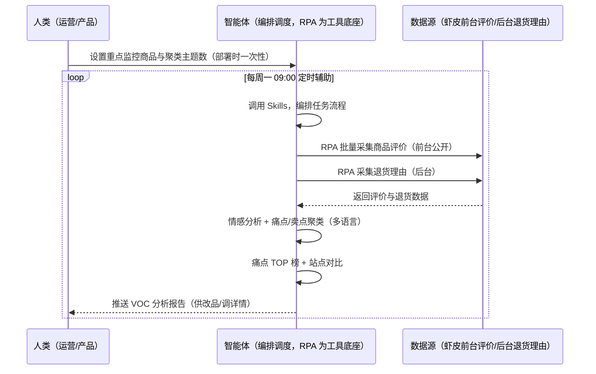
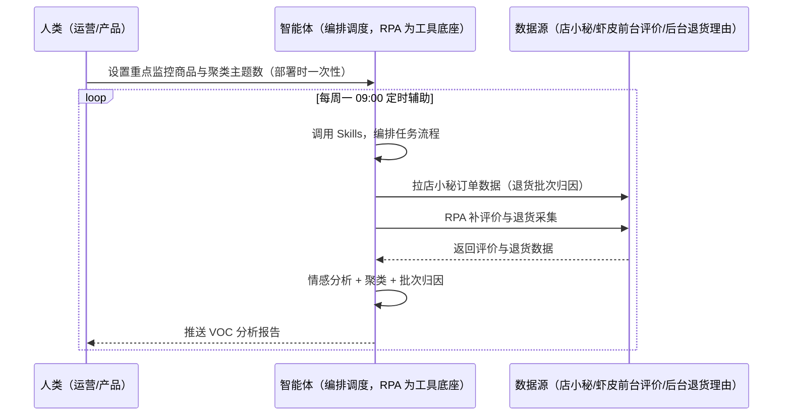

> 为虾皮（Shopee）卖家团队打造的 VOC（Voice of Customer）分析方案。评价+退货理由人工逐条看费时、多语言（繁中/泰语/印尼语）痛点聚类难、改品效果无法验证。本方案由智能体调度多个工具执行批量采集商品评价与退货理由，智能体做情感分析与痛点/卖点聚类。每周定时辅助，输出痛点 TOP 榜与站点对比，供你改品/调详情。

> Agent 自动化需开通企业功能
> 点击申请1个月免费权限
> [点击申请 →](https://skieer.feishu.cn/share/base/form/shrcnFwMayykP5iaL38fnZKTbrg)

## 一、用户与需求

核心矛盾：虾皮评价+退货理由人工逐条看费时、多语言（繁中/泰语/印尼语）痛点聚类难、改品效果无法验证。

两类客户痛点同源，数据来源不同：

- 未购 SaaS 客户（新卖家/小团队）：人工逐条看评价、手动统计痛点，全靠手；
- 已购 SaaS 客户（店小秘 ERP 等）：店小秘管订单/上架，VOC 分析与痛点聚类不覆盖，仍要人做。

适用客户：重视产品改进与口碑的卖家。评价前台公开可采（八爪鱼通用网页采集器可搭，国内平台 VOC 成熟方案直接平移）；退货理由部分受后台限制标注降级；多语言聚类需词库投入。

### 1.1 不同模式卖家

| 类型 | 选择 | 建议 |
|-|-|-|
| 跨境卖家 | 首选 | 强烈推荐（多站点对比） |
| 本土卖家 | 次选 | 一般推荐（单站点） |
| 铺货型 | 任意 | 按需 |

### 1.2 不同站点卖家

| 站点 | 最关注维度 | 核心逻辑 |
|-|-|-|
| 台湾 | 繁体痛点 | 评价词频 |
| 泰国 | 泰语聚类 | 泰语词库 |
| 印尼 | 印尼语聚类 | 印尼语词库 |
| 新加坡 | 中英混合 | 双语聚类 |
| 马来/菲律宾 | 本地化 | 按站点词库 |

### 1.3 不同角色用户

| 用户 | 需求 | 问题 | 投入时间（估算） |
|-|-|-|-|
| 老板 | 产品改进方向 | 痛点不知道 | 0.5 小时/周 |
| 运营 | 痛点 TOP 榜 | 逐条看费时 | 1-2 小时/周 |
| 产品 | 改品依据 | 改品效果无验证 | 1 小时/周 |

---

## 二、现在的方法与问题

### 2.1 流程步骤与问题总结

**人工方式（未购 SaaS 客户）**

| 序号 | 步骤 | 现在的方法 | 问题缺陷 |
|-|-|-|-|
| 1 | 看评价 | 逐条手动看 | 费时 |
| 2 | 记痛点 | 手动统计 | 词频不准 |
| 3 | 聚类 | 凭感觉 | 多语言难 |
| 4 | 对比 | 无 | 站点不对比 |
| 5 | 验证 | 无 | 改品不验证 |

**SaaS 方式（已购店小秘 ERP 客户）**

| 序号 | 步骤 | 现在的方法 | 问题缺陷 |
|-|-|-|-|
| 1 | 看评价 | 店小秘不覆盖 | 靠人看 |
| 2 | 记痛点 | 手动 | 不准 |
| 3 | 聚类 | 无 | 多语言难 |
| 4 | 对比 | 无 | 不对比 |
| 5 | 验证 | 无 | 不验证 |

### 2.2 问题分析

**人工方式根因**

| 序号 | 根因 | 具体表现 |
|-|-|-|
| 1 | 逐条看费时 | 评价量大 |
| 2 | 多语言聚类难 | 泰语/印尼语词库缺失 |
| 3 | 改品不验证 | 痛点词频无对比 |

**SaaS 方式根因**

| 序号 | 根因 | 具体表现 |
|-|-|-|
| 1 | 店小秘不覆盖 | VOC 无工具 |
| 2 | 无闭环 | 改品效果不回采 |

---

## 三、解决方案

### 3.1 功能概述

为虾皮卖家团队打造的 VOC 分析方案，批量采集商品评价与退货理由，智能体做情感分析与痛点/卖点聚类。

每周定时触发并调度多个工具，调起八爪鱼 RPA（Agent 的工具底座，能耦合多系统、完成自动化任务执行）批量采集商品评价（前台公开）+ 退货理由（后台），智能体做情感分析、痛点/卖点聚类（多语言：繁中/泰语/印尼语），输出产品改进与话术建议。每周定时辅助，输出痛点 TOP 榜与站点对比，供你改品/调详情。

### 3.2 系统结合

| 要素 | 说明 |
|-|-|
| 客户现有工具盘点 | **未购 SaaS 客户**：无第三方工具，VOC 全靠人工。     **已购 SaaS 客户**（主流组合）：店小秘 ERP（管订单/上架，VOC 分析不覆盖） |
| 数据/能力来源 | **无 SaaS**：虾皮前台商品评价（星级/内容/追评，公开采集）+ 后台退货理由（登录采集）。     **有 SaaS**：店小秘订单数据（辅助归因退货批次）+ RPA 补评价与退货采集 |
| RPA 耦合动作 | 作为 Agent 的工具底座，按计划采集评价与退货理由（评价字段完整性校验、去重、快照留存），统一流转给智能体；后台受限标注降级 |
| 耦合出的新价值 | 单工具给不了的端到端结论：评价+退货一次取齐 → 情感分析 → 痛点/卖点聚类（多语言）→ 痛点 TOP 榜 + 站点对比 → 改品效果验证，**只推送痛点 TOP 榜与站点对比** |

### 3.3 智能体执行流程

智能体定时触发。支持**两种数据通道**，部署时按客户现有工具选择：

**通道一：无 SaaS 方式（RPA 采集评价+退货理由，适合未购 ERP 的客户）**

**通道二：有 SaaS 方式（店小秘订单辅助归因 + RPA 补采集，适合已购客户）**

> Agent 自动化需开通企业功能
> 点击申请1个月免费权限
> [点击申请 →](https://skieer.feishu.cn/share/base/form/shrcnFwMayykP5iaL38fnZKTbrg)

### 3.4 为何这么设计

要同时回答三个问题：**为什么不能只用 SaaS/API？为什么不能纯靠智能体写代码？为什么 RPA 是执行底座？** 本场景的核心是"批量采集、情感分析、多语言聚类、挂了有人管"。

#### 1）逐项对比

| 对比维度 | SaaS/API 堆叠（店小秘） | 纯智能体（智能体写代码） | 智能体+自动化工具（RPA 工具底座） |
|-|-|-|-|
| 实现方式 | 店小秘管订单，VOC 不覆盖 | 能抓评价能分析，但全要自己接 | 评价/退货采集 + 情感聚类 |
| 批量采集 | 不覆盖 | 需自建采集与反爬 | 通用采集器可搭（成熟方案平移） |
| 多语言聚类 | 无 | 需自建词库 | 多语言词库可视化配置 |
| 使用成本（总拥有成本） | 店小秘订阅费（主体另算） | 代理 IP + 服务器 + 开发维护人力，隐性成本高 | 一份平台订阅跑多流程，单方案边际成本 ≈ 0 |
| 维护人要求 | 低（工具现成） | 规则调整都要开发介入 | 可视化流程，运营自己可调主题数 |

#### 2）优劣势说明

|  | SaaS/API 堆叠（店小秘） | 纯智能体（智能体写代码） | 智能体+自动化工具（RPA 工具底座） |
|-|-|-|-|
| 优势 | 订单数据权威（批次归因） | 无订阅费；     可深度定制 VOC 模型 | 评价采集+多语言聚类即开即用；     非技术人员可维护 |
| 劣势 | VOC 不覆盖 | 采集与词库全自建；     AI 生成代码是生成性的 | 本地电脑运行需保持开机；     订阅费；     多语言词库需投入 |

#### 3）结论

| 论点 | 说明 |
|-|-|
| 评价公开可采 | 评价前台公开可采，八爪鱼通用网页采集器可搭，国内平台 VOC 成熟方案直接平移（实锤） |
| 退货理由受限 | 退货理由部分受后台限制标注降级（实锤） |
| 痛点判定实锤 | 痛点词频 = 该词出现数/评价总数；痛点头条 = 频次前 3 且环比增速 >20%；改品后痛点词频下降验证效果；退货理由与评价痛点交叉印证 |
| 小语种降级 | 小语种样本 &lt;50 条时降级、低置信度转人工复核（实锤） |
| 一个底座跑多流程 | 客户购买 RPA 平台是跑多个流程（VOC/客服/竞品），本方案只是其中一个——平台订阅费被多流程摊薄 |
| 时间 | 产品要的是"痛点 TOP 榜 + 站点对比"，不是"逐条看评价" |

### 3.5 功能清单

| 功能 | 系统 | 功能说明（解决问题） |
|-|-|-|
| 会话/定时 | 智能体 | 1. 理解人类语言，调用已预设好的 Skills。     2. 编排多任务、调度多工具。 |
| 多系统数据取数 | RPA、指纹浏览器 | 1. 解决逐条看费时、多语言聚类难问题。     2. 作为智能体工具底座被调度执行，评价字段完整性校验、去重、快照留存。     3. **【无 SaaS 方式】** RPA 采集评价 + 退货理由。**【有 SaaS 方式】** 店小秘订单辅助归因 + RPA 补采集。 |
| 情感分析 | 智能体 | 情感模型置信度标注（小语种样本 &lt;50 条降级）。 |
| 痛点/卖点聚类 | 智能体 | 质量/物流/价格/体验/描述不符五类聚类（多语言词库）。 |
| 痛点 TOP 榜 | 智能体 | 痛点词频 = 该词出现数/评价总数；痛点头条 = 频次前 3 且环比增速 >20%。 |
| 站点对比 | 智能体 | 各站点痛点对比（繁中/泰语/印尼语）。 |
| 改品验证 | 智能体 | 4 周后回采痛点词频变化，验证改品效果。 |
| IM通知 | 飞书、钉钉、企微等 | 解决 VOC 报告交付滞后问题。痛点 TOP 榜自动推送。 |
| 数据资产储存 | 本地电脑、云储存 | 1. Skills 资产：Shopee VOC 分析技能。     2. 数据储存：评价/退货库统一写入本地。     3. 经验知识库：改品结果回填迭代词库。 |

### 3.6 智能体执行落地过程

部署时一次性配置入参（重点监控商品清单、聚类主题数、站点对比范围、多语言词库、数据通道），会话中无需重复输入。

**⚠️ 部署前提（不满足则方案无法跑起来）**：①RPA 需部署在**常开电脑/云机**上（每周回采可接受任务时开机），并配置漏跑补跑机制；②**退货理由受后台限制，标注降级路径**；③**多语言聚类需词库投入**（繁中/泰语/印尼语）；④**有 SaaS 方式需店小秘账号**（批次归因，可选增强，无则走前台/后台通道）；⑤首次配置（登录态、词库、聚类参数）需服务方/技术人员介入一次，属实施成本。

#### 1）配置

| 类别 | 说明 |
|-|-|
| 智能体 | 主流智能体。 |
| 智能体工具 | 1. **数据通道（按客户现有工具二选一）**：【无 SaaS】虾皮前台评价 + 后台退货理由（RPA 采集）；【有 SaaS】店小秘订单数据 + RPA 补采集。     2. 数据取数与自动化执行：八爪鱼 RPA，MCP 配置完成。     3. 数据分析：智能体自带。     4. 数据报告：智能体自带。     5. IM：企业办公 IM（飞书/钉钉/企微），MCP 或 webhook 配置。 |
| 工作知识 | 1. 重点监控商品清单。     2. 聚类主题数。     3. 站点对比范围。     4. 多语言词库（繁中/泰语/印尼语）。     5. 痛点判定阈值（频次前 3 且增速 >20%）。 |
| 本地数据库 | 1. 评价/退货库地址。     2. 词库地址。     3. 经验库地址。 |

#### 2）执行

| 任务 | 产出 | 产出物接收人 |
|-|-|-|
| 接收监控商品，定时触发 | 任务启动记录 | —— |
| 调用已预设 Skills，编排任务流程 | 任务编排方案 | —— |
| 经 MCP 向八爪鱼 RPA 下发取数任务 | 自动化任务指令 | —— |
| 多源取数（无 SaaS：评价+退货；有 SaaS：店小秘+评价退货，智能体监控状态） | 对齐后 VOC 数据 | —— |
| 情感分析 + 痛点/卖点聚类 | 聚类结果 | 运营 |
| 痛点 TOP 榜 + 站点对比 | VOC 报告 | 产品/运营 |
| 改品验证（4 周回采痛点词频） | 验证报告 | 产品 |
| 推送 VOC 分析报告 | 群消息 | 产品/运营/老板 |

异常处理：

采集失败 → 自动重试并告警；

退货理由受限 → 降级标注；

小语种样本 &lt;50 条 → 降级；

痛点词频波动大 → 标注；

置信度 &lt;70% → 转人工复核，不输出硬结论。

#### 3）结果

| 结果 | 说明 |
|-|-|
| 数据资产 | 评价/退货库结构化数据（商品/评价/情感/痛点标签/站点），可审计可追溯。 |
| 分析报告 | 1. VOC 分析报告：痛点 TOP 榜。     2. 站点对比：各站点痛点。     3. 改品验证：痛点词频变化。 |
| Skills | 智能体 Skills：Shopee VOC 分析技能，按改品结果回填迭代词库。 |

> Agent 自动化需开通企业功能
> 点击申请1个月免费权限
> [点击申请 →](https://skieer.feishu.cn/share/base/form/shrcnFwMayykP5iaL38fnZKTbrg)

---

## 四、使用前后预估

> 本方案价值 = **评价+退货自动采集 → 情感分析 → 痛点/卖点聚类（多语言）→ 痛点 TOP 榜 + 站点对比 → 改品验证**。评价前台公开可采（成熟方案平移），退货理由部分受后台限制标注降级。

| 指标 | 人工 | SaaS/API（店小秘） | 智能体+自动化工具 |
|-|-|-|-|
| 评价采集 | 逐条手动 | 不覆盖 | 批量自动采集 |
| 情感分析 | 凭感觉 | 无 | 模型自动标注 |
| 多语言聚类 | 词库缺失 | 无 | 繁中/泰语/印尼语聚类 |
| 痛点 TOP 榜 | 手动统计 | 无 | 词频+增速自动计算 |
| 站点对比 | 无 | 无 | 多站点自动对比 |
| 方法论 | 无 | 单工具 | 可复用的 Skills 与词库 |

**说明**：评价前台公开可采，八爪鱼通用网页采集器可搭，国内平台 VOC 成熟方案直接平移；退货理由部分受后台限制标注降级；痛点词频 = 该词出现数/评价总数；痛点头条 = 频次前 3 且环比增速 >20%；改品后痛点词频下降验证效果；退货理由与评价痛点交叉印证；多语言聚类需词库投入。

---

## 五、效果证明

> Agent 自动化需开通企业功能
> 点击申请1个月免费权限
> [点击申请 →](https://skieer.feishu.cn/share/base/form/shrcnFwMayykP5iaL38fnZKTbrg)

### 5.1 客户案例

**《大疆：十余平台 × 7 大类营销与客服数据自动采集》**

> 十余个国内外电商平台与社媒渠道，直播、评论、客服会话、搜索等非结构化数据原需大量人力处理。RPA 完成十余个系统、7 大类核心数据自动采集入库。

| 效果 | 说明 |
|-|-|
| 提效 | 跨平台营销与客服数据采集效率显著提升。原本十余个平台与社媒渠道、7 大类数据需每日 5-6 小时人工导表，现在全自动采集入库，数据时效提升至 T+1。 |
| 降本 | 免除专职导表的人力投入，节约人力用于数据建模、投放复盘与客服策略分析等重点工作。 |
| 任务 | 覆盖十余个国内外电商平台与社媒渠道，含直播、评论、客服会话、搜索等 7 大类非结构化数据。 |
| 任务 | 形成全渠道统一数据底座，跨平台口径一致，供分析团队直接取用。 |

案例详情：[客服：全球无人机巨头跨平台电商与客服数据自动化采集](https://skieer.feishu.cn/wiki/OmO7wGX3yiASCBkqRsfcWPUMnOe)

---

## 六、备注

### 6.1 Agent 支持

本方案不绑定具体智能体，主流 Agent 均可运行（需支持技能/Skills 加载与工具调用）：

| Agent/智能体 | 说明 |
|-|-|
| Workbuddy | 本方案运行平台，支持技能/Skills 上传加载、定时任务、MCP 工具调用与表格/报告处理 |
| 豆包（国内·字节） | 国内主流个人智能体，支持技能上传、定时任务与工具调用，上手成本低 |
| 通义千问（国内·阿里） | 支持 Agent 编排与插件生态，集成阿里电商数据能力，适合电商场景 |
| DeepSeek（国内） | 推理能力强、成本低，适合规则打分与归因分析类任务 |
| ChatGPT（国外·OpenAI） | 海外主流通用智能体，支持 GPTs/Agent 模式与工具调用 |
| Claude（国外·Anthropic） | 长文本与结构化分析能力强，原生支持 MCP 连接外部工具 |

### 6.2 名词解释

| 术语 | 说明 |
|-|-|
| VOC | Voice of Customer 客户之声 |
| 痛点词频 | 该词出现数/评价总数 |
| 痛点头条 | 频次前 3 且环比增速 >20% |
| 情感分析 | 评价情感模型（置信度标注） |
| 多语言聚类 | 繁中/泰语/印尼语词库聚类 |
| 混合数据源 | 虾皮前台评价（公开采集）+ 后台退货理由（登录）+ 店小秘订单数据（有 SaaS 客户归因） |
| 有 SaaS 方式 | 已购店小秘 ERP，订单辅助归因 + RPA 补采集 |
| 无 SaaS 方式 | 不购买第三方工具，RPA 采集评价与退货理由 |
| 跨境卖家 | 中国卖家中心统一管理多站点 |
| 本土卖家 | 单站点运营 |
| MCP | Model Context Protocol，智能体连接外部工具的标准化通道 |

> Agent 自动化需开通企业功能
> 点击申请1个月免费权限
> [点击申请 →](https://skieer.feishu.cn/share/base/form/shrcnFwMayykP5iaL38fnZKTbrg)

---

原文：[查看原文](https://skieer.feishu.cn/wiki/M2sEwBia1iIcAskSpuXcPvaBnQc)
