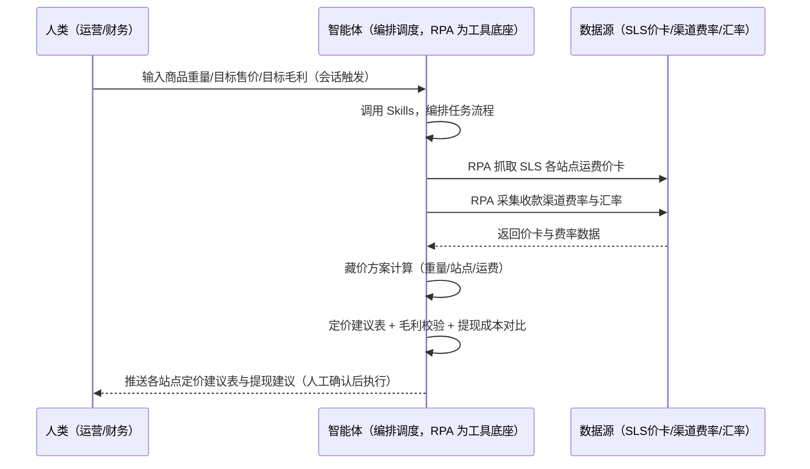
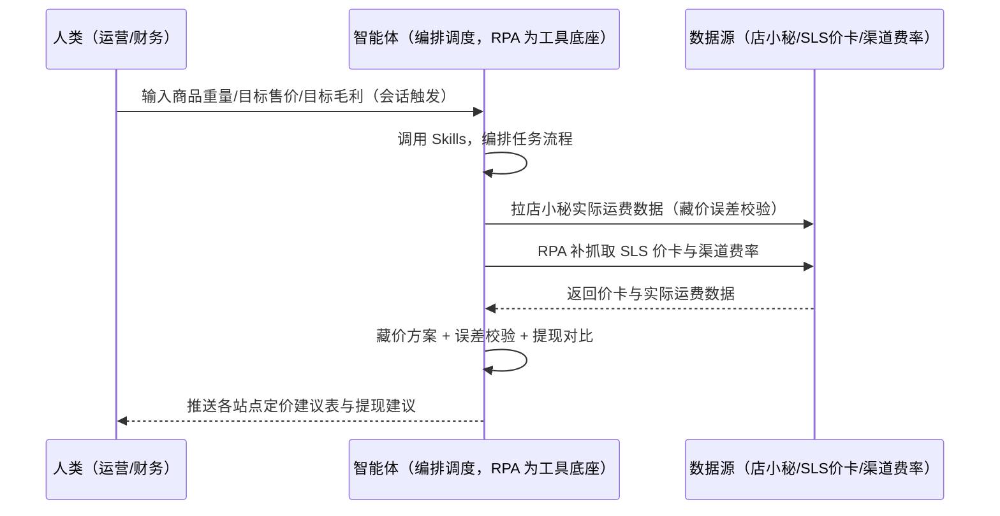

> 为虾皮（Shopee）卖家团队打造的定价与资金管理方案。SLS 各站点运费价卡（按重量区间）藏价算不清、价卡更新运费上调未调价利润被吃、提现渠道成本对比难。本方案由智能体调度多个工具执行定时抓取 SLS 运费价卡并归档版本，智能体按「商品重量+目标售价+各站点运费」反推藏价方案。新品定价/价卡更新触发，只推送各站点定价建议表与提现建议，定价决策人工确认。

> Agent 自动化需开通企业功能
> 点击申请1个月免费权限
> [点击申请 →](https://skieer.feishu.cn/share/base/form/shrcnFwMayykP5iaL38fnZKTbrg)

## 一、用户与需求

核心矛盾：虾皮 SLS 各站点运费价卡（按重量区间）藏价算不清、价卡更新 48h 内需同步（运费上调未调价 = 利润被吃）、提现渠道（Payoneer/PingPong/连连）成本对比难。

两类客户痛点同源，数据来源不同：

- 未购 SaaS 客户（新卖家/小团队）：人工查价卡、凭经验藏价，全靠手；
- 已购 SaaS 客户（店小秘 ERP 等）：店小秘管订单/上架，藏价计算与价卡跟踪不覆盖，仍要人做。

适用客户：多站点多币种卖家。价卡公开页可自动采集（结构稳定）；藏价/定价计算逻辑可脚本化（需按站点维护费率表）；定价决策人工确认。

### 1.1 不同模式卖家

| 类型 | 选择 | 建议 |
|-|-|-|
| 跨境卖家（多站点） | 首选 | 强烈推荐（SLS 多站点藏价） |
| 本土卖家 | 次选 | 一般推荐（单站点） |
| 铺货型 | 任意 | 按需 |

### 1.2 不同站点卖家

| 站点 | 最关注维度 | 核心逻辑 |
|-|-|-|
| 台湾 | 重量区间费率 | 台币藏价 |
| 泰国 | 泰铢费率 | 泰铢藏价 |
| 印尼 | 印尼盾费率 | 大额面值 |
| 新加坡 | 新币费率 | 高客单 |
| 马来/菲律宾 | 多币种 | 按站点费率 |

### 1.3 不同角色用户

| 用户 | 需求 | 问题 | 投入时间（估算） |
|-|-|-|-|
| 老板 | 毛利不穿底 | 藏价算不清利润被吃 | 0.5 小时/周 |
| 运营 | 定价建议表 | 逐站手算费时 | 1-2 小时/周 |
| 财务 | 提现建议 | 渠道成本对比难 | 0.5 小时/周 |

---

## 二、现在的方法与问题

### 2.1 流程步骤与问题总结

**人工方式（未购 SaaS 客户）**

| 序号 | 步骤 | 现在的方法 | 问题缺陷 |
|-|-|-|-|
| 1 | 查价卡 | 手动翻官方公告/物流手册 | 费时 |
| 2 | 藏价 | 凭经验 | 运费漏算 |
| 3 | 定价 | 凭感觉 | 毛利穿底 |
| 4 | 盯更新 | 靠记忆 | 运费上调未调价 |
| 5 | 提现 | 凭经验选渠道 | 成本对比难 |

**SaaS 方式（已购店小秘 ERP 客户）**

| 序号 | 步骤 | 现在的方法 | 问题缺陷 |
|-|-|-|-|
| 1 | 查价卡 | 店小秘不覆盖 | 靠人查 |
| 2 | 藏价 | 手动 | 无计算 |
| 3 | 定价 | 凭感觉 | 无校验 |
| 4 | 盯更新 | 靠人 | 无提醒 |
| 5 | 提现 | 凭经验 | 无对比 |

### 2.2 问题分析

**人工方式根因**

| 序号 | 根因 | 具体表现 |
|-|-|-|
| 1 | 藏价算不清 | 运费漏算毛利虚高 |
| 2 | 价卡更新不知 | 运费上调未调价利润被吃 |
| 3 | 提现无对比 | 渠道成本多花 |

**SaaS 方式根因**

| 序号 | 根因 | 具体表现 |
|-|-|-|
| 1 | 店小秘不覆盖 | 藏价与价卡无工具 |
| 2 | 无闭环 | 实际运费不回填校验 |

---

## 三、解决方案

### 3.1 功能概述

为虾皮卖家团队打造的定价与资金管理方案，定时抓取 SLS 各站点运费价卡并归档版本，智能体按「商品重量+目标售价+各站点运费」反推藏价方案。

新品定价/价卡更新触发并调度多个工具，调起八爪鱼 RPA（Agent 的工具底座，能耦合多系统、完成自动化任务执行）定时抓取 SLS 各站点运费价卡（按重量区间的跨境运费，官方公告/卖家中心物流手册）并归档版本，智能体按「商品重量+目标售价+各站点运费」反推藏价方案（把运费计入售价），并采集各收款渠道费率对比提现成本。新品定价/价卡更新触发，只推送各站点定价建议表与提现建议，定价决策人工确认。

### 3.2 系统结合

| 要素 | 说明 |
|-|-|
| 客户现有工具盘点 | **未购 SaaS 客户**：无第三方工具，定价全靠人工。     **已购 SaaS 客户**（主流组合）：店小秘 ERP（管订单/上架，藏价与价卡不覆盖） |
| 数据/能力来源 | **无 SaaS**：SLS 各站点运费价卡（官方公告/卖家中心物流手册，公开页采集）+ 收款渠道费率（Payoneer/PingPong/连连官网公开）+ 汇率（公开源）。     **有 SaaS**：店小秘订单/定价数据（辅助实际运费回采校验）+ RPA 补价卡与费率采集 |
| RPA 耦合动作 | 作为 Agent 的工具底座，按计划抓取价卡（价卡版本快照、更新检测、重量区间匹配校验），统一流转给智能体；价卡更新 48h 内同步提醒 |
| 耦合出的新价值 | 单工具给不了的端到端结论：价卡一次取齐 → 藏价方案（重量/站点/运费）→ 各站点定价建议表 + 毛利校验 → 提现成本对比建议，**只推送定价建议表与提现建议** |

### 3.3 智能体执行流程

用户向智能体输入会话（入参：商品重量、目标售价、目标毛利）或价卡更新触发。支持**两种数据通道**，部署时按客户现有工具选择：

**通道一：无 SaaS 方式（RPA 抓取价卡+费率，适合未购 ERP 的客户）**

**通道二：有 SaaS 方式（店小秘实际运费回采校验 + RPA 补价卡，适合已购客户）**

> Agent 自动化需开通企业功能
> 点击申请1个月免费权限
> [点击申请 →](https://skieer.feishu.cn/share/base/form/shrcnFwMayykP5iaL38fnZKTbrg)

### 3.4 为何这么设计

要同时回答三个问题：**为什么不能只用 SaaS/API？为什么不能纯靠智能体写代码？为什么 RPA 是执行底座？** 本场景的核心是"价卡采集、藏价计算、更新提醒、挂了有人管"。

#### 1）逐项对比

| 对比维度 | SaaS/API 堆叠（店小秘） | 纯智能体（智能体写代码） | 智能体+自动化工具（RPA 工具底座） |
|-|-|-|-|
| 实现方式 | 店小秘管订单，藏价不覆盖 | 能抓价卡能算，但全要自己接 | 价卡抓取 + 藏价计算 |
| 价卡采集 | 不覆盖 | 需自建采集与版本管理 | 价卡版本快照、更新检测 |
| 藏价计算 | 无 | 需自建计算逻辑 | 藏价公式可视化配置 |
| 使用成本（总拥有成本） | 店小秘订阅费（主体另算） | 代理 IP + 服务器 + 开发维护人力，隐性成本高 | 一份平台订阅跑多流程，单方案边际成本 ≈ 0 |
| 维护人要求 | 低（工具现成） | 规则调整都要开发介入 | 可视化流程，运营自己可调费率表 |

#### 2）优劣势说明

|  | SaaS/API 堆叠（店小秘） | 纯智能体（智能体写代码） | 智能体+自动化工具（RPA 工具底座） |
|-|-|-|-|
| 优势 | 实际运费数据权威（误差校验） | 无订阅费；     可深度定制定价模型 | 价卡采集+藏价计算+更新提醒；     非技术人员可维护 |
| 劣势 | 藏价与价卡不覆盖 | 采集与计算全自建；     AI 生成代码是生成性的 | 本地电脑运行需保持开机；     订阅费；     定价决策人工确认 |

#### 3）结论

| 论点 | 说明 |
|-|-|
| 藏价=利润防线 | 藏价覆盖率 = 运费全额计入售价（不漏算）；毛利校验 = 售价-成本-运费-佣金-手续费 > 目标毛利（实锤） |
| 价卡更新红线 | 价卡更新 48h 内同步提醒（运费上调未调价 = 利润被吃，实锤） |
| 提现规则实锤 | 提现动作人工执行；对比提现成本（Payoneer/PingPong/连连费率）测算最优时机与渠道（不构成投资建议） |
| 一个底座跑多流程 | 客户购买 RPA 平台是跑多个流程（定价/对账/利润），本方案只是其中一个——平台订阅费被多流程摊薄 |
| 时间 | 运营要的是"各站点定价建议表 + 价卡更新提醒"，不是"逐站手算" |

### 3.5 功能清单

| 功能 | 系统 | 功能说明（解决问题） |
|-|-|-|
| 会话/定时 | 智能体 | 1. 理解人类语言，调用已预设好的 Skills。     2. 编排多任务、调度多工具。 |
| 多系统数据取数 | RPA、指纹浏览器 | 1. 解决藏价算不清、价卡更新不知问题。     2. 作为智能体工具底座被调度执行，价卡版本快照、更新检测、重量区间匹配校验。     3. **【无 SaaS 方式】** RPA 抓取 SLS 价卡 + 渠道费率。**【有 SaaS 方式】** 店小秘实际运费回采校验 + RPA 补价卡。 |
| 藏价方案 | 智能体 | 售价 = 成本 + 藏价 + 毛利（重量/站点/运费计算，不漏算）。 |
| 定价建议表 | 智能体 | 各站点定价建议（目标毛利校验 = 售价-成本-运费-佣金-手续费）。 |
| 价卡更新提醒 | 智能体 | 价卡更新 48h 内同步提醒（运费上调未调价预警）。 |
| 提现成本对比 | 智能体 | Payoneer/PingPong/连连费率对比，测算最优时机与渠道。 |
| IM通知 | 飞书、钉钉、企微等 | 解决定价滞后问题。定价建议表与价卡更新提醒自动推送。 |
| 数据资产储存 | 本地电脑、云储存 | 1. Skills 资产：Shopee 定价技能。     2. 数据储存：价卡版本库统一写入本地。     3. 经验知识库：实际运费回填校验。 |

### 3.6 智能体执行落地过程

部署时一次性配置入参（商品重量含包装、成本、目标毛利、站点范围、价卡来源、数据通道），会话中无需重复输入。

**⚠️ 部署前提（不满足则方案无法跑起来）**：①RPA 需部署在**常开电脑/云机**上（价卡更新检测需开机），并配置漏跑补跑机制；②**藏价/定价计算逻辑需按站点维护费率表**；③**定价决策人工确认**；④**提现动作人工执行**（不构成投资建议）；⑤**有 SaaS 方式需店小秘账号**（实际运费回采校验，可选增强，无则走公开源通道）；⑥首次配置（价卡来源、费率表、藏价公式）需服务方/技术人员介入一次，属实施成本。

#### 1）配置

| 类别 | 说明 |
|-|-|
| 智能体 | 主流智能体。 |
| 智能体工具 | 1. **数据通道（按客户现有工具二选一）**：【无 SaaS】SLS 价卡 + 渠道费率（RPA 采集）；【有 SaaS】店小秘实际运费 + RPA 补价卡。     2. 数据取数与自动化执行：八爪鱼 RPA，MCP 配置完成。     3. 数据分析：智能体自带。     4. IM：企业办公 IM（飞书/钉钉/企微），MCP 或 webhook 配置。 |
| 工作知识 | 1. 商品重量（含包装）。     2. 成本。     3. 目标毛利。     4. 站点范围。     5. 价卡来源（官方公告/卖家中心-物流手册）。     6. 收款渠道费率。 |
| 本地数据库 | 1. 价卡版本库地址。     2. 定价台账库地址。     3. 经验库地址。 |

#### 2）执行

| 任务 | 产出 | 产出物接收人 |
|-|-|-|
| 接收商品参数，触发 | 任务启动记录 | —— |
| 调用已预设 Skills，编排任务流程 | 任务编排方案 | —— |
| 经 MCP 向八爪鱼 RPA 下发取数任务 | 自动化任务指令 | —— |
| 多源取数（无 SaaS：价卡+费率；有 SaaS：店小秘+价卡，智能体监控状态） | 对齐后定价数据 | —— |
| 藏价方案计算（重量/站点/运费） | 藏价结果 | 运营 |
| 各站点定价建议表 + 毛利校验 | 定价建议表 | 运营 |
| 价卡更新检测（48h 内同步提醒） | 更新提醒 | 运营/财务 |
| 提现成本对比建议 | 提现建议 | 财务 |
| 推送定价建议表与提现建议（人工确认后执行） | 群消息 | 运营/财务/老板 |

异常处理：

价卡源不可用 → 用上次快照并标注；

重量区间匹配失败 → 转人工；

汇率缺失 → 用上次汇率并标注；

毛利 &lt; 目标 → 预警；

置信度 &lt;70% → 转人工复核，不输出硬结论。

#### 3）结果

| 结果 | 说明 |
|-|-|
| 数据资产 | 价卡版本库结构化数据（站点/重量区间/费率/版本/时间），可审计可追溯。 |
| 分析报告 | 1. 各站点定价建议表与毛利校验。     2. 价卡更新提醒。     3. 提现成本对比建议。 |
| Skills | 智能体 Skills：Shopee 定价技能，按实际运费回填校验藏价误差。 |

> Agent 自动化需开通企业功能
> 点击申请1个月免费权限
> [点击申请 →](https://skieer.feishu.cn/share/base/form/shrcnFwMayykP5iaL38fnZKTbrg)

---

## 四、使用前后预估

> 本方案价值 = **SLS 价卡自动抓取 → 藏价方案计算 → 各站点定价建议表 → 价卡更新提醒 → 提现成本对比**。价卡公开页可自动采集，藏价/定价计算逻辑可脚本化，定价决策人工确认。

| 指标 | 人工 | SaaS/API（店小秘） | 智能体+自动化工具 |
|-|-|-|-|
| 价卡查询 | 手动翻公告 | 不覆盖 | 自动抓取归档 |
| 藏价计算 | 凭经验 | 无 | 重量/站点/运费公式 |
| 定价校验 | 毛利穿底才知 | 无 | 目标毛利自动校验 |
| 价卡更新 | 不知情 | 无 | 48h 内自动提醒 |
| 提现对比 | 凭经验 | 无 | 渠道费率自动对比 |
| 方法论 | 无 | 单工具 | 可复用的 Skills 与费率表 |

**说明**：藏价覆盖率 = 运费全额计入售价（不漏算）；毛利校验 = 售价-成本-运费-佣金-手续费 > 目标毛利；价卡更新 48h 内同步提醒（运费上调未调价 = 利润被吃）；提现动作人工执行，对比提现成本（Payoneer/PingPong/连连费率）测算最优时机与渠道（不构成投资建议）。

---

## 六、备注

### 6.1 Agent 支持

本方案不绑定具体智能体，主流 Agent 均可运行（需支持技能/Skills 加载与工具调用）：

| Agent/智能体 | 说明 |
|-|-|
| Workbuddy | 本方案运行平台，支持技能/Skills 上传加载、定时任务、MCP 工具调用与表格/报告处理 |
| 豆包（国内·字节） | 国内主流个人智能体，支持技能上传、定时任务与工具调用，上手成本低 |
| 通义千问（国内·阿里） | 支持 Agent 编排与插件生态，集成阿里电商数据能力，适合电商场景 |
| DeepSeek（国内） | 推理能力强、成本低，适合规则打分与归因分析类任务 |
| ChatGPT（国外·OpenAI） | 海外主流通用智能体，支持 GPTs/Agent 模式与工具调用 |
| Claude（国外·Anthropic） | 长文本与结构化分析能力强，原生支持 MCP 连接外部工具 |

### 6.2 名词解释

| 术语 | 说明 |
|-|-|
| SLS | Shopee Logistics Service 官方物流 |
| 藏价 | 把运费计入售价（藏价覆盖率 = 运费全额计入） |
| 价卡 | 按重量区间的跨境运费表 |
| 毛利校验 | 售价-成本-运费-佣金-手续费 > 目标毛利 |
| 价卡更新提醒 | 更新 48h 内同步（运费上调未调价预警） |
| 混合数据源 | SLS 价卡（公开采集）+ 收款渠道费率（公开）+ 店小秘实际运费（有 SaaS 客户校验） |
| 有 SaaS 方式 | 已购店小秘 ERP，实际运费回采校验 + RPA 补价卡 |
| 无 SaaS 方式 | 不购买第三方工具，RPA 抓取价卡与费率 |
| 跨境卖家 | 中国卖家中心统一管理多站点 |
| 本土卖家 | 单站点运营 |
| MCP | Model Context Protocol，智能体连接外部工具的标准化通道 |

> Agent 自动化需开通企业功能
> 点击申请1个月免费权限
> [点击申请 →](https://skieer.feishu.cn/share/base/form/shrcnFwMayykP5iaL38fnZKTbrg)

---

原文：[查看原文](https://skieer.feishu.cn/wiki/D05Ew4kfLiGD97kEKRocshpanMe)
