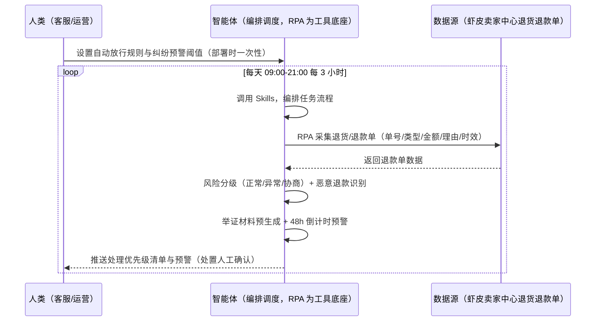
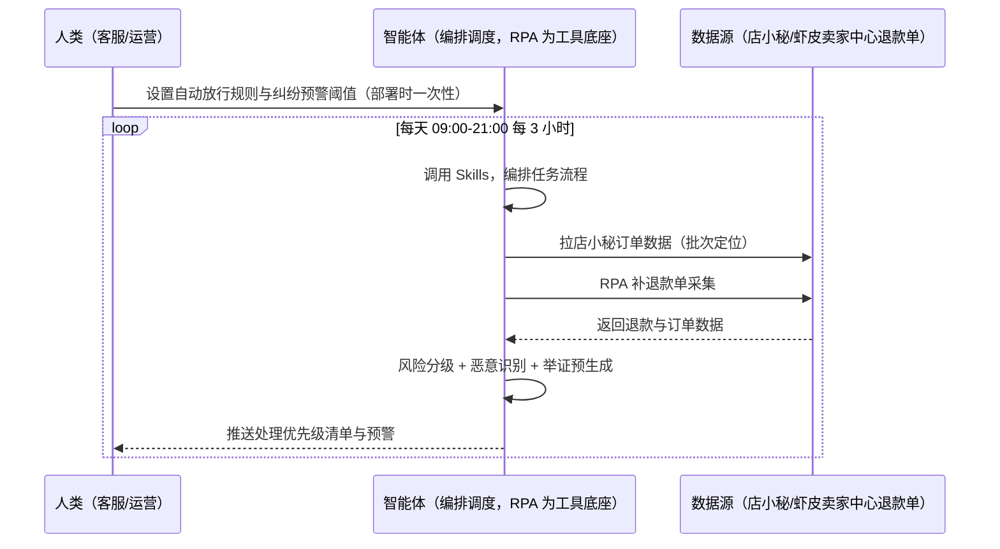

> 为虾皮（Shopee）卖家团队打造的退货退款处理与响应监控方案。退货/退款单逐单处理费时、48h 响应超时系统自动判买家胜诉、恶意退款识别难、举证材料准备慢。本方案由智能体调度多个工具执行定时采集退货/退款单，智能体按规则风险分级并预生成举证材料。每天 09:00-21:00 每 3 小时执行，只推送处理优先级清单与预警，处置动作由人工确认。

> Agent 自动化需开通企业功能
> 点击申请1个月免费权限
> [点击申请 →](https://skieer.feishu.cn/share/base/form/shrcnFwMayykP5iaL38fnZKTbrg)

## 一、用户与需求

核心矛盾：虾皮退货/退款单逐单处理费时、48h 响应超时系统自动判买家胜诉、恶意退款识别难、举证材料（物流签收/沟通记录）准备慢。

两类客户痛点同源，数据来源不同：

- 未购 SaaS 客户（新卖家/小团队）：人工逐单处理、手动找证据，全靠手；
- 已购 SaaS 客户（店小秘 ERP 等）：店小秘管订单库存，退货退款风险分级与证据归集不覆盖，仍要人盯。

适用客户：售后量大、纠纷敏感的卖家。采集/时效预警/证据预生成可自动化；处置动作（协商/驳回）需人工确认（售后考核敏感）。

### 1.1 不同模式卖家

| 类型 | 选择 | 建议 |
|-|-|-|
| 跨境卖家 | 首选 | 强烈推荐（多站点售后监控） |
| 本土卖家 | 次选 | 一般推荐（单站点） |
| 铺货型 | 任意 | 按需 |

### 1.2 不同站点卖家

| 站点 | 最关注维度 | 核心逻辑 |
|-|-|-|
| 台湾 | 48h 响应 | 超时判买家胜诉 |
| 泰国 | 恶意退款 | 高发站点识别 |
| 印尼 | 举证时效 | 证据 1 天内上传 |
| 新加坡 | 退货率 | 类目均值对比 |
| 马来/菲律宾 | 退款类型 | 仅退款/退货退款 |

### 1.3 不同角色用户

| 用户 | 需求 | 问题 | 投入时间（估算） |
|-|-|-|-|
| 老板 | 退款损失可控 | 超时判买家胜诉 | 0.5 小时/周 |
| 客服 | 处理优先级 | 逐单处理费时 | 1-2 小时/周 |
| 运营 | 恶意退款识别 | 识别难 | 1 小时/周 |

---

## 二、现在的方法与问题

### 2.1 流程步骤与问题总结

人工方式（未购 SaaS 客户）

| 序号 | 步骤 | 现在的方法 | 问题缺陷 |
|-|-|-|-|
| 1 | 拉退款单 | 手动翻后台 | 逐单看费时 |
| 2 | 分级 | 凭经验 | 高风险漏判 |
| 3 | 举证 | 手动找 | 准备慢 |
| 4 | 处理 | 手动 | 48h 超时 |
| 5 | 统计 | 手动 | 退货率无感知 |

SaaS 方式（已购店小秘 ERP 客户）

| 序号 | 步骤 | 现在的方法 | 问题缺陷 |
|-|-|-|-|
| 1 | 拉退款单 | 店小秘部分覆盖 | 状态快照靠人 |
| 2 | 分级 | 靠人 | 无风险模型 |
| 3 | 举证 | 手动 | 慢 |
| 4 | 处理 | 手动 | 时限靠人 |
| 5 | 统计 | 手动 | 无预警 |

### 2.2 问题分析

人工方式根因

| 序号 | 根因 | 具体表现 |
|-|-|-|
| 1 | 风险分级靠人 | 高风险单漏判 |
| 2 | 48h 超时 | 系统自动判买家胜诉 |
| 3 | 恶意退款难识别 | 亏损无声 |

SaaS 方式根因

| 序号 | 根因 | 具体表现 |
|-|-|-|
| 1 | 覆盖不完整 | 风险分级与证据归集无工具 |
| 2 | 无闭环 | 申诉结果不回填迭代 |

---

## 三、解决方案

### 3.1 功能概述

为虾皮卖家团队打造的退货退款处理与响应监控方案，定时采集退货/退款单，智能体按规则风险分级并预生成举证材料。

每天定时触发并调度多个工具，调起八爪鱼 RPA（Agent 的工具底座，能耦合多系统、完成自动化任务执行）定时采集退货/退款单（单号/类型/金额/理由/剩余时效），智能体按规则风险分级（正常放行/异常标记/需人工协商）、恶意退款特征识别、举证材料预生成。每天执行，只推送处理优先级清单与预警，处置动作由人工确认。

### 3.2 系统结合

| 要素 | 说明 |
|-|-|
| 客户现有工具盘点 | **未购 SaaS 客户**：无第三方工具，售后全靠人工处理。    
**已购 SaaS 客户**（主流组合）：店小秘 ERP（管订单库存，售后风控不覆盖） |
| 数据/能力来源 | **无 SaaS**：虾皮卖家中心退货/退款单（单号/类型/金额/理由/剩余时效，登录采集）。    
**有 SaaS**：店小秘订单数据（辅助定位问题批次）+ RPA 补退款单采集 |
| RPA 耦合动作 | 作为 Agent 的工具底座，按计划采集退货/退款单（拉单幂等、时效倒计时字段校验、快照留档），统一流转给智能体；48h 响应倒计时 |
| 耦合出的新价值 | 单工具给不了的端到端结论：退款单一次取齐 → 风险分级（正常/异常/协商）→ 恶意退款识别 → 举证材料预生成 → 48h 倒计时预警，**只推送处理优先级清单与预警** |

### 3.3 智能体执行流程

智能体定时触发。支持**两种数据通道**，部署时按客户现有工具选择：

**通道一：无 SaaS 方式（RPA 采集退款单，适合未购 ERP 的客户）**

**通道二：有 SaaS 方式（店小秘订单辅助定位 + RPA 补退款单，适合已购客户）**

> Agent 自动化需开通企业功能
> 点击申请1个月免费权限
> [点击申请 →](https://skieer.feishu.cn/share/base/form/shrcnFwMayykP5iaL38fnZKTbrg)

### 3.4 为何这么设计

要同时回答三个问题：**为什么不能只用 SaaS/API？为什么不能纯靠智能体写代码？为什么 RPA 是执行底座？** 本场景的核心是"定时拉单、风险分级、48h 预警、挂了有人管"。

#### 1）逐项对比

| 对比维度 | SaaS/API 堆叠（店小秘） | 纯智能体（智能体写代码） | 智能体+自动化工具（RPA 工具底座） |
|-|-|-|-|
| 实现方式 | 店小秘管订单，售后风控不覆盖 | 能抓后台能分析，但全要自己接 | 后台退款单采集 + 风险分级 |
| 定时拉单 | 不覆盖 | 智能体无法常驻轮询 | RPA 每 3 小时拉单幂等 |
| 举证预生成 | 无 | 需自建举证逻辑 | 证据材料模板化 |
| 使用成本（总拥有成本） | 店小秘订阅费（主体另算） | 代理 IP + 服务器 + 开发维护人力，隐性成本高 | 一份平台订阅跑多流程，单方案边际成本 ≈ 0 |
| 维护人要求 | 低（工具现成） | 规则调整都要开发介入 | 可视化流程，客服自己可调规则 |

#### 2）优劣势说明

|  | SaaS/API 堆叠（店小秘） | 纯智能体（智能体写代码） | 智能体+自动化工具（RPA 工具底座） |
|-|-|-|-|
| 优势 | 订单数据权威（批次定位） | 无订阅费；    
可深度定制风控模型 | 退款拉单+风险分级+举证预生成；    
非技术人员可维护 |
| 劣势 | 售后风控不覆盖 | 拉单与分级全自建；    
AI 生成代码是生成性的 | 本地电脑运行需保持开机；    
订阅费；    
处置需人工确认 |

#### 3）结论

| 论点 | 说明 |
|-|-|
| 48h 响应=红线 | 48h 响应及时率 100%（超时系统自动判买家胜诉，实锤） |
| 退款类型实锤 | 仅退款/退货退款判定按规则执行；自动放行规则（金额/理由/频次） |
| 恶意退款识别 | 恶意退款识别准确率 >85%（实锤）；证据单 1 天内上传率 100% |
| 处置人工确认 | 处置动作（协商/驳回）需人工确认（售后考核敏感，实锤） |
| 一个底座跑多流程 | 客户购买 RPA 平台是跑多个流程（售后/纠纷/日报），本方案只是其中一个——平台订阅费被多流程摊薄 |
| 时间 | 客服要的是"处理优先级清单 + 48h 预警"，不是"逐单翻后台" |

### 3.5 功能清单

| 功能 | 系统 | 功能说明（解决问题） |
|-|-|-|
| 会话/定时 | 智能体 | 1. 理解人类语言，调用已预设好的 Skills。    
2. 编排多任务、调度多工具。 |
| 多系统数据取数 | RPA、指纹浏览器 | 1. 解决逐单处理费时、48h 超时问题。    
2. 作为智能体工具底座被调度执行，拉单幂等、时效倒计时字段校验、快照留档。    
3. **【无 SaaS 方式】** RPA 采集退货/退款单。**【有 SaaS 方式】** 店小秘订单辅助定位 + RPA 补退款单。 |
| 风险分级 | 智能体 | 正常放行/异常标记/需人工协商三级（自动放行规则可配）。 |
| 恶意退款识别 | 智能体 | 恶意退款特征识别（频次/理由/账号），准确率 >85%。 |
| 举证预生成 | 智能体 | 举证材料模板化（物流签收/沟通记录按时间线归档）。 |
| 48h 倒计时 | 智能体 | 响应时限倒计时预警（超时系统自动判买家胜诉）。 |
| 退货率监控 | 智能体 | 退货率 > 类目均值预警。 |
| IM通知 | 飞书、钉钉、企微等 | 解决售后滞后问题。处理优先级清单与预警自动推送。 |
| 数据资产储存 | 本地电脑、云储存 | 1. Skills 资产：Shopee 售后风控技能。    
2. 数据储存：售后台账统一写入本地。    
3. 经验知识库：申诉结果回填迭代。 |

### 3.6 智能体执行落地过程

部署时一次性配置入参（自动放行规则、举证材料模板、纠纷预警阈值、各站点退货期配置、数据通道），会话中无需重复输入。

**⚠️ 部署前提（不满足则方案无法跑起来）**：①RPA 需部署在**常开电脑/云机**上（每 3 小时执行需常开），并配置漏跑补跑机制；②**处置动作（协商/驳回）由人工确认**（售后考核敏感）；③**有 SaaS 方式需店小秘账号**（批次定位，可选增强，无则走后台通道）；④首次配置（登录态、分级规则、举证模板）需服务方/技术人员介入一次，属实施成本。

#### 1）配置

| 类别 | 说明 |
|-|-|
| 智能体 | 主流智能体。 |
| 智能体工具 | 1. **数据通道（按客户现有工具二选一）**：【无 SaaS】虾皮卖家中心退款单（RPA 采集）；【有 SaaS】店小秘订单数据 + RPA 补退款单。    
2. 数据取数与自动化执行：八爪鱼 RPA，MCP 配置完成。    
3. 数据分析：智能体自带。    
4. IM：企业办公 IM（飞书/钉钉/企微），MCP 或 webhook 配置。 |
| 工作知识 | 1. 自动放行规则（金额/理由/频次）。    
2. 举证材料模板。    
3. 纠纷预警阈值。    
4. 各站点退货期配置。 |
| 本地数据库 | 1. 售后台账库地址。    
2. 举证材料库地址。    
3. 经验库地址。 |

#### 2）执行

| 任务 | 产出 | 产出物接收人 |
|-|-|-|
| 接收放行规则，定时触发 | 任务启动记录 | —— |
| 调用已预设 Skills，编排任务流程 | 任务编排方案 | —— |
| 经 MCP 向八爪鱼 RPA 下发取数任务 | 自动化任务指令 | —— |
| 多源取数并按订单号对齐（无 SaaS：后台采集；有 SaaS：店小秘+后台，智能体监控状态） | 对齐后退款数据 | —— |
| 风险分级（正常/异常/协商） | 处理优先级清单 | 客服 |
| 恶意退款识别 | 恶意清单 | 客服/运营 |
| 举证材料预生成 | 举证包 | 客服 |
| 48h 倒计时 + 退货率预警 | 预警消息 | 客服/运营 |
| 推送处理优先级清单与预警（处置人工确认） | 群消息 | 客服/运营/老板 |

异常处理：

拉单失败 → 自动重试并告警；

争议单临界 48h → 告警提醒；

恶意退款无法判断 → 转人工；

退货率超类目均值 → 预警；

置信度 &lt;70% → 转人工复核，不输出硬结论。

#### 3）结果

| 结果 | 说明 |
|-|-|
| 数据资产 | 售后台账结构化数据（订单/退款类型/金额/分级/时效），可审计。 |
| 分析报告 | 1. 处理优先级清单。    
2. 恶意退款清单。    
3. 举证包与 48h 预警。 |
| Skills | 智能体 Skills：Shopee 售后风控技能，按申诉结果回填迭代。 |

> Agent 自动化需开通企业功能
> 点击申请1个月免费权限
> [点击申请 →](https://skieer.feishu.cn/share/base/form/shrcnFwMayykP5iaL38fnZKTbrg)

---

## 四、使用前后预估

> 本方案价值 = **退货/退款单自动采集 → 风险分级 → 恶意退款识别 → 举证材料预生成 → 48h 倒计时预警**。采集/时效预警/证据预生成可自动化，处置动作需人工确认。

| 指标 | 人工 | SaaS/API（店小秘） | 智能体+自动化工具 |
|-|-|-|-|
| 退款拉单 | 手动翻后台 | 部分覆盖 | 自动拉单幂等 |
| 风险分级 | 凭经验 | 无 | 规则自动分级 |
| 恶意识别 | 难识别 | 无 | 特征自动识别 |
| 举证准备 | 手动找 | 无 | 模板化预生成 |
| 48h 响应 | 易超时 | 无提醒 | 倒计时自动预警 |
| 方法论 | 无 | 单工具 | 可复用的 Skills 与风控模型 |

**说明**：48h 响应及时率 100%（超时系统自动判买家胜诉）；退货率 > 类目均值预警；恶意退款识别准确率 >85%；证据单 1 天内上传率 100%；处置动作（协商/驳回）需人工确认（售后考核敏感）；自动审核流程下 RPA 主要做监控与预警。

---

## 五、效果证明

> Agent 自动化需开通企业功能
> 点击申请1个月免费权限
> [点击申请 →](https://skieer.feishu.cn/share/base/form/shrcnFwMayykP5iaL38fnZKTbrg)

### 5.1 客户案例

**《三只松鼠：29 家店铺退款工单 AI+RPA 全流程自动化》**

> 天猫、淘宝等平台近 30 家店铺，日均退款工单量大，客服需逐单阅读聊天记录、判断退款原因、从 50+ 三级标签中选择、核对金额。AI+RPA 实现退款工单全流程自动化。

| 效果 | 说明 |
|-|-|
| 提效 | 退款工单处理效率翻倍。原本客服需逐单核对聊天记录、判断退款原因、人工匹配标签并校验金额，现在由「大模型解析 + RPA 执行」完成 18 步全流程自动化。 |
| 降本 | 客服从重复的标签匹配与金额核对中解放，投入真正需要人工判断的复杂场景与客户沟通等重点工作。 |
| 任务 | 覆盖天猫/淘宝 29 家店铺，50+ 三级退款标签体系智能匹配，日均退款工单全量处理。 |
| 任务 | 退款金额按 1 元阈值精准校验，减少人工误判造成的资损风险。 |

案例详情：[退款：国民休闲零食品牌电商退款工单AI自动化实践](https://skieer.feishu.cn/wiki/S0XuwLL0aiwLfbkEqAqc2BEXnzx)

**《米足电商：得物多账号批量签收与退款自动化》**

> 潮流鞋服退货率高，多店铺运营下每日售后订单量庞大，人工逐个签收退款易漏单错单。RPA 打通得物商家后台与聚水潭 ERP，自动比对筛选后批量签收退款。

| 效果 | 说明 |
|-|-|
| 提效 | 多账号签收退款效率提升 80% 以上。原本人工逐个账号签收再退款需 2-3 小时/天，现在批量自动执行，压缩到几十分钟，账号自动切换。 |
| 降本 | 免除逐单重复操作的人力投入，售后团队投入转向异常订单处理与客户沟通等重点工作。 |
| 任务 | 打通得物商家后台与聚水潭 ERP，自动比对应退与实退数量，操作准确率 100%。 |
| 任务 | 多账号一键切换，5 个或 20 个账号均可稳定跑完，退货退款全流程标准化执行。 |

案例详情：[售后：得物多账号自动签收退款实践](https://skieer.feishu.cn/wiki/F6LewVFMuiAFkRkBP8QcZuHPngc)

---

## 六、备注

### 6.1 Agent 支持

本方案不绑定具体智能体，主流 Agent 均可运行（需支持技能/Skills 加载与工具调用）：

| Agent/智能体 | 说明 |
|-|-|
| Workbuddy | 本方案运行平台，支持技能/Skills 上传加载、定时任务、MCP 工具调用与表格/报告处理 |
| 豆包（国内·字节） | 国内主流个人智能体，支持技能上传、定时任务与工具调用，上手成本低 |
| 通义千问（国内·阿里） | 支持 Agent 编排与插件生态，集成阿里电商数据能力，适合电商场景 |
| DeepSeek（国内） | 推理能力强、成本低，适合规则打分与归因分析类任务 |
| ChatGPT（国外·OpenAI） | 海外主流通用智能体，支持 GPTs/Agent 模式与工具调用 |
| Claude（国外·Anthropic） | 长文本与结构化分析能力强，原生支持 MCP 连接外部工具 |

### 6.2 名词解释

| 术语 | 说明 |
|-|-|
| 48h 响应 | 退货/退款单响应时限（超时判买家胜诉） |
| 仅退款 | 无需退货直接退款 |
| 退货退款 | 需退货后退款 |
| 恶意退款 | 频次/理由/账号异常识别（准确率 >85%） |
| 举证材料 | 物流签收/沟通记录按时间线归档 |
| 混合数据源 | 虾皮卖家中心退款单（RPA 采集）+ 店小秘订单数据（有 SaaS 客户定位） |
| 有 SaaS 方式 | 已购店小秘 ERP，订单辅助定位 + RPA 补退款单 |
| 无 SaaS 方式 | 不购买第三方工具，RPA 采集后台退款单 |
| 跨境卖家 | 中国卖家中心统一管理多站点 |
| 本土卖家 | 单站点运营 |
| MCP | Model Context Protocol，智能体连接外部工具的标准化通道 |

> Agent 自动化需开通企业功能
> 点击申请1个月免费权限
> [点击申请 →](https://skieer.feishu.cn/share/base/form/shrcnFwMayykP5iaL38fnZKTbrg)

---

原文：[查看原文](https://skieer.feishu.cn/wiki/ETDSwrXssijiSbk4Mw3c0DoSnRh)
