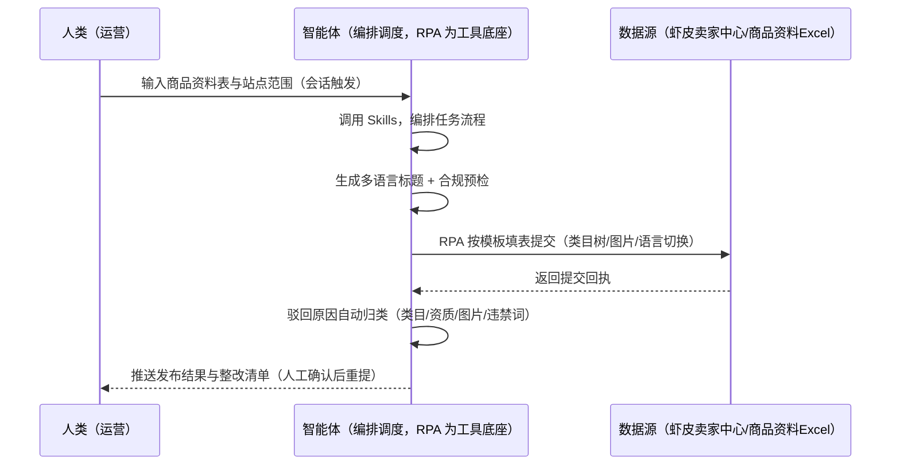
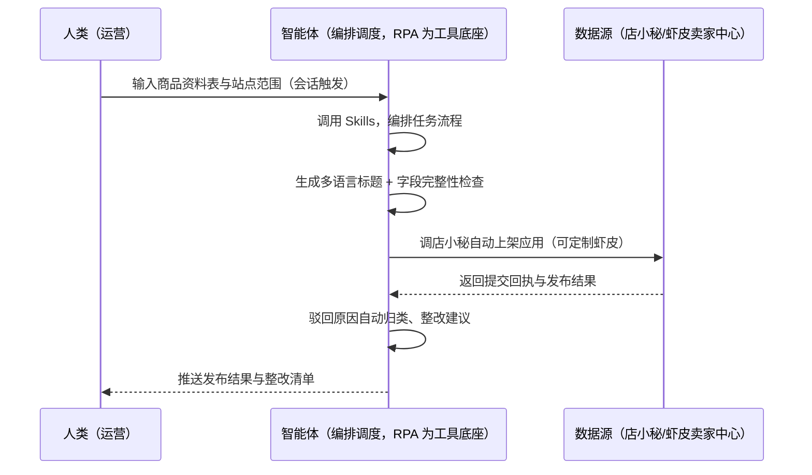

> 为虾皮（Shopee）卖家团队打造的商品发布与合规预检方案。逐条手工上品慢、类目属性填错被驳回、违禁词/违禁品查不全、多站点本地化字段难。本方案由智能体调度多个工具执行按模板批量发布商品（店小秘-自动上架可定制虾皮），智能体生成多语言标题并做合规预检。新品资料触发，发布结果与驳回原因自动回采。

> Agent 自动化需开通企业功能
> 点击申请1个月免费权限
> [点击申请 →](https://skieer.feishu.cn/share/base/form/shrcnFwMayykP5iaL38fnZKTbrg)

## 一、用户与需求

核心矛盾：逐条手工上品慢、类目属性填错被驳回（一次填错即触发驳回或处罚）、违禁词/违禁品查不全（仿牌/危险品）、多站点本地化字段（台 60/泰新 80/印尼 100 字数）难。

两类客户痛点同源，数据来源不同：

- 未购 SaaS 客户（新卖家/小团队）：人工逐条填写上架表单、手动翻译，全靠手；
- 已购 SaaS 客户（店小秘 ERP 等）：店小秘-自动上架（可定制虾皮）与电商多平台自动上架现成应用可评估挂接，但多语言文案、合规预检仍要人做。

适用客户：多站点多 SKU 铺货型卖家。表单路径需处理类目树/图片上传/多站点语言切换等复杂交互，API 路径需企业资质申请。

### 1.1 不同模式卖家

| 类型 | 选择 | 建议 |
|-|-|-|
| 跨境卖家 | 首选 | 强烈推荐（多站点发布，本地化字段关键） |
| 本土卖家 | 次选 | 一般推荐（单站点） |
| 铺货型 | 任意 | 按需 |

### 1.2 不同站点卖家

| 站点 | 最关注维度 | 核心逻辑 |
|-|-|-|
| 台湾 | 繁体标题 | 标题字数 ≤60 |
| 泰国 | 泰语本地化 | 标题字数 ≤80，泰语翻译需复核 |
| 印尼 | 印尼语本地化 | 标题字数 ≤100 |
| 新加坡 | 中英混合 | 双语标题 |
| 马来/菲律宾 | 本地化 | 按站点语言 |

### 1.3 不同角色用户

| 用户 | 需求 | 问题 | 投入时间（估算） |
|-|-|-|-|
| 老板 | 上架效率与通过率 | 逐条上品慢 | 0.5 小时/周 |
| 运营 | 批量上架+驳回整改 | 属性填错被驳回 | 2-4 小时/周 |
| 合规 | 合规预检 | 违禁词查不全 | 1 小时/周 |

---

## 二、现在的方法与问题

### 2.1 流程步骤与问题总结

**人工方式（未购 SaaS 客户）**

| 序号 | 步骤 | 现在的方法 | 问题缺陷 |
|-|-|-|-|
| 1 | 填资料 | 逐条填标题/类目/属性 | 多 SKU 上架慢 |
| 2 | 写文案 | 手动翻译 | 本地化难 |
| 3 | 上架 | 逐条提交 | 属性填错被驳回 |
| 4 | 查结果 | 手动看回执 | 驳回原因不清 |
| 5 | 整改 | 凭感觉改 | 违禁词查不全 |

**SaaS 方式（已购店小秘 ERP 客户）**

| 序号 | 步骤 | 现在的方法 | 问题缺陷 |
|-|-|-|-|
| 1 | 填资料 | 店小秘批量上品 | 文案生成靠人 |
| 2 | 写文案 | 手动 | 本地化难 |
| 3 | 上架 | 店小秘自动上架（可定制） | 已覆盖主体 |
| 4 | 查结果 | 半自动 | 驳回分类靠人 |
| 5 | 整改 | 手动 | 违禁词风险 |

### 2.2 问题分析

**人工方式根因**

| 序号 | 根因 | 具体表现 |
|-|-|-|
| 1 | 逐条填表 | 多 SKU 上架效率低 |
| 2 | 本地化难 | 多站点语言翻译质量差 |
| 3 | 违禁词漏检 | 仿牌/危险品被罚 |

**SaaS 方式根因**

| 序号 | 根因 | 具体表现 |
|-|-|-|
| 1 | 文案生成靠人 | 店小秘管上架执行，文案与预检不覆盖 |
| 2 | 驳回不闭环 | 驳回原因不自动分类回填 |

---

## 三、解决方案

### 3.1 功能概述

为虾皮卖家团队打造的商品发布与合规预检方案，按模板批量发布商品，智能体生成多语言标题并做合规预检。

新品资料触发并调度多个工具，调起八爪鱼 RPA（Agent 的工具底座，能耦合多系统、完成自动化任务执行）在卖家中心按模板填写商品信息（标题/类目/属性/SKU/价格/库存/主图/物流参数）或调用 Shopee Open API 批量发布，智能体生成本地化标题卖点、检查字段完整性（字数/图片规范/禁机翻）、归类驳回原因。新品资料触发，发布结果与驳回原因自动回采。

### 3.2 系统结合

| 要素 | 说明 |
|-|-|
| 客户现有工具盘点 | **未购 SaaS 客户**：无第三方工具，上架全靠逐条手填。     **已购 SaaS 客户**（主流组合）：店小秘-自动上架（可定制虾皮）与电商多平台自动上架现成应用可评估挂接 |
| 数据/能力来源 | **无 SaaS**：虾皮卖家中心表单（登录操作，RPA 自建流程，处理类目树/图片上传/多站点语言切换）+ 商品资料 Excel（本地维护）。     **有 SaaS**：店小秘自动上架（可定制虾皮）+ 智能体补多语言文案生成与合规预检；API 路径需企业资质申请 |
| RPA 耦合动作 | 作为 Agent 的工具底座，按模板批量发布（填表前字段完整性校验、提交回执校验、失败重试），统一流转给智能体；驳回自动归类回退修改 |
| 耦合出的新价值 | 单工具给不了的端到端结论：多语言文案一次生成 → 合规预检 → 批量上架 → 驳回原因自动归类 → 整改闭环，上架通过率可追踪 |

### 3.3 智能体执行流程

用户向智能体输入会话（入参：商品资料 Excel、站点发布范围、发布授权范围）。支持**两种数据通道**，部署时按客户现有工具选择：

**通道一：无 SaaS 方式（RPA 自建表单发布，适合未购 ERP 的客户）**

**通道二：有 SaaS 方式（店小秘自动上架直挂 + 智能体补文案，适合已购客户）**

> Agent 自动化需开通企业功能
> 点击申请1个月免费权限
> [点击申请 →](https://skieer.feishu.cn/share/base/form/shrcnFwMayykP5iaL38fnZKTbrg)

### 3.4 为何这么设计

要同时回答三个问题：**为什么不能只用 SaaS/API？为什么不能纯靠智能体写代码？为什么 RPA 是执行底座？** 本场景的核心是"模板化发布、多语言文案、合规预检、驳回闭环、挂了有人管"。

#### 1）逐项对比

| 对比维度 | SaaS/API 堆叠（店小秘） | 纯智能体（智能体写代码） | 智能体+自动化工具（RPA 工具底座） |
|-|-|-|-|
| 实现方式 | 店小秘自动上架（主体） | 能调后台能生成文案，但发布动作不可留痕 | 店小秘直挂 + 智能体补文案预检 |
| 发布确定性 | 模板化执行可靠 | 生成式输出可能产生非法值/格式错乱 | RPA 按固定模板执行，可留痕可重跑 |
| 本地化文案 | 不覆盖 | 需自建文案生成 | 文案模板化、按站点语言生成 |
| 使用成本（总拥有成本） | 店小秘订阅费（主体） | 代理 IP + 服务器 + 开发维护人力，隐性成本高 | 一份平台订阅跑多流程，单方案边际成本 ≈ 0 |
| 维护人要求 | 低（工具现成） | 规则调整都要开发介入 | 可视化流程，运营自己可调模板 |

#### 2）优劣势说明

|  | SaaS/API 堆叠（店小秘） | 纯智能体（智能体写代码） | 智能体+自动化工具（RPA 工具底座） |
|-|-|-|-|
| 优势 | 自动上架链路现成（可定制虾皮） | 无订阅费；     可深度定制文案模型 | 店小秘直挂+文案生成+合规预检，驳回闭环；     非技术人员可维护 |
| 劣势 | 多语言文案与预检不覆盖 | AI 生成代码是生成性的，发布动作不可控 | 本地电脑运行需保持开机；     订阅费；     表单路径交互复杂 |

#### 3）结论

| 论点 | 说明 |
|-|-|
| 发布动作必须确定性 | 后台表单需按模板逐字段校验映射，一次类目属性填错即触发驳回或处罚——脚本按固定模板执行最可靠（实锤） |
| 本地化字数合规 | 标题字数合规：台 60/泰新 80/印尼 100（实锤）；小语种翻译标注复核 |
| 驳回自动归类 | 驳回原因自动归类（类目/资质/图片/违禁词）输出整改清单——闭环关键 |
| 双路径可选 | 表单路径（店小秘可定制虾皮）或 API 路径（需企业资质申请）（实锤） |
| 一个底座跑多流程 | 客户购买 RPA 平台是跑多个流程（上架/标题/合规），本方案只是其中一个——平台订阅费被多流程摊薄 |
| 时间 | 运营要的是"批量上架 + 驳回整改闭环"，不是"逐条手填" |

### 3.5 功能清单

| 功能 | 系统 | 功能说明（解决问题） |
|-|-|-|
| 会话/定时 | 智能体 | 1. 理解人类语言，调用已预设好的 Skills。     2. 编排多任务、调度多工具。 |
| 多系统数据取数 | RPA、指纹浏览器 | 1. 解决逐条上品慢、属性填错被驳回问题。     2. 作为智能体工具底座被调度执行，填表前字段完整性校验、提交回执校验、失败重试。     3. **【无 SaaS 方式】** RPA 自建表单发布（类目树/图片/语言切换）。**【有 SaaS 方式】** 店小秘自动上架（可定制虾皮）或 Shopee Open API。 |
| 多语言文案生成 | 智能体 | 按站点语言生成标题卖点（台 60/泰新 80/印尼 100 字数合规、禁机翻）。 |
| 合规预检 | 智能体 | 字段完整性/图片规范/违禁词检查（覆盖率 100%）。 |
| 驳回原因归类 | 智能体 | 驳回原因自动归类（类目/资质/图片/违禁词），整改清单输出。 |
| IM通知 | 飞书、钉钉、企微等 | 解决发布结果交付滞后问题。发布结果与整改清单自动推送。 |
| 数据资产储存 | 本地电脑、云储存 | 1. Skills 资产：Shopee 上架技能与文案模板。     2. 数据储存：上架台账统一写入本地。     3. 经验知识库：驳回案例持续沉淀。 |

### 3.6 智能体执行落地过程

会话启动只需输入商品资料表与站点范围；下表其余配置项（多语言模板、合规词库、数据通道）均为部署时一次性预设。

**⚠️ 部署前提（不满足则方案无法跑起来）**：①RPA 需部署在**常开电脑/云机上（批量上架需任务时开机）；②表单路径需处理类目树/图片上传/多站点语言切换等复杂交互；API 路径需企业资质申请**；③**有 SaaS 方式需店小秘账号**（自动上架应用直挂）；④首次配置（表单映射、多语言模板、合规词库）需服务方/技术人员介入一次，属实施成本。

#### 1）配置

| 类别 | 说明 |
|-|-|
| 智能体 | 主流智能体。 |
| 智能体工具 | 1. **数据通道（按客户现有工具二选一）**：【无 SaaS】虾皮卖家中心表单（RPA 自建批量发布）；【有 SaaS】店小秘自动上架（可定制虾皮）或 Shopee Open API。     2. 数据取数与自动化执行：八爪鱼 RPA，MCP 配置完成。     3. 数据分析：智能体自带。     4. IM：企业办公 IM（飞书/钉钉/企微），MCP 或 webhook 配置。 |
| 工作知识 | 1. 商品资料表（名称/类目/成本/库存/图片/普特货属性）。     2. 站点发布范围。     3. 发布授权范围（默认仅表单填写不自动定价）。     4. 字数合规：台 60/泰新 80/印尼 100。     5. 违禁词库（按站点语言）。 |
| 本地数据库 | 1. 商品库地址。     2. 上架台账地址。     3. 合规清单地址。 |

#### 2）执行

| 任务 | 产出 | 产出物接收人 |
|-|-|-|
| 接收商品资料表，会话触发 | 任务启动记录 | —— |
| 调用已预设 Skills，编排任务流程 | 任务编排方案 | —— |
| 生成多语言标题 + 合规预检 | 文案包/放行清单 | 合规/运营 |
| 经 MCP 向八爪鱼 RPA 下发发布任务 | 自动化任务指令 | —— |
| 批量发布（店小秘直挂/表单/API） | 提交回执 | —— |
| 发布结果回采、驳回原因归类 | 整改清单 | 运营 |
| 推送发布结果与整改清单 | 群消息 | 运营/老板 |

异常处理：

提交失败 → 重试并告警；

驳回项按原因分类 → 整改后重提；

小语种翻译 → 标注需人工复核；

类目树变更 → 告警并自适应；

置信度 &lt;70% → 转人工复核，不输出硬结论。

#### 3）结果

| 结果 | 说明 |
|-|-|
| 数据资产 | 上架台账结构化数据（SKU/站点/属性/审核状态/驳回原因），可审计可追溯。 |
| 分析报告 | 1. 发布结果：通过/驳回统计（成功率 >95% 达标）。     2. 整改清单：驳回原因归类。     3. 合规预检报告。 |
| Skills | 智能体 Skills：Shopee 上架技能，按驳回原因迭代文案模板。 |

> Agent 自动化需开通企业功能
> 点击申请1个月免费权限
> [点击申请 →](https://skieer.feishu.cn/share/base/form/shrcnFwMayykP5iaL38fnZKTbrg)

---

## 四、使用前后预估

> 本方案价值 = **多语言文案自动生成 → 合规预检 → 批量上架 → 驳回原因自动归类 → 整改闭环**。店小秘-自动上架（可定制虾皮）现成应用可评估挂接。

| 指标 | 人工 | SaaS/API（店小秘） | 智能体+自动化工具 |
|-|-|-|-|
| 上架效率 | 逐条手填 | 自动上架 | 批量上架+文案生成 |
| 多语言文案 | 翻译质量差 | 不覆盖 | 本地化自动生成 |
| 合规预检 | 违禁词查不全 | 不覆盖 | 字段/图片/违禁词自动检查 |
| 驳回整改 | 不知道改哪里 | 无分类 | 驳回原因自动归类回填 |
| 标题字数 | 易超限 | 无校验 | 台 60/泰新 80/印尼 100 自动校验 |
| 方法论 | 无 | 单工具链路 | 可复用的 Skills 与模板库 |

**说明**：发布成功率 = 成功上架数/提交数 >95% 达标；驳回原因自动归类（类目/资质/图片/违禁词）输出整改清单；标题字数合规率 100%（台 60/泰新 80/印尼 100）；店小秘-自动上架（可定制虾皮）与电商多平台自动上架两个现成应用可评估挂接；API 路径需企业资质申请。

---

## 五、效果证明

> Agent 自动化需开通企业功能
> 点击申请1个月免费权限
> [点击申请 →](https://skieer.feishu.cn/share/base/form/shrcnFwMayykP5iaL38fnZKTbrg)

### 5.1 客户案例

**《RPA＋AI 爆款图批量自动生成》**

> 电商商品图片质量成为影响购买决策的关键因素，传统专业拍摄成本高、耗时长，面对海量 SKU 难以满足营销需求。RPA 自动上传原图、操作 AI 模型并回传平台。

| 效果 | 说明 |
|-|-|
| 提效 | 出图效率提升约 20 倍。原本日处理约 10 张（套模板 + 逐张替换），现在日处理 200+ 张，原图上传、模型调用与成品回传全自动。 |
| 降本 | 减少美工投入 3 人。原本需美工逐张处理与替换，现在由 RPA 自动调度 AI 模型完成；需求沟通成本降低 80%，节约人力用于视觉策划、品牌调性与大促素材规划等重点工作。 |
| 任务 | AI 自动识别商品主体轮廓，商品 100% 不变形（沿用客户实证口径）。 |
| 任务 | 自动生成办公室、户外、休闲等场景图，用于辅图与广告素材，提升转化。 |

案例详情：[生图|RPA＋AI爆款图批量自动生成](https://skieer.feishu.cn/wiki/IxeGwIQHuirgOFkkUNpcqWImnCf)

---

## 六、备注

### 6.1 Agent 支持

本方案不绑定具体智能体，主流 Agent 均可运行（需支持技能/Skills 加载与工具调用）：

| Agent/智能体 | 说明 |
|-|-|
| Workbuddy | 本方案运行平台，支持技能/Skills 上传加载、定时任务、MCP 工具调用与表格/报告处理 |
| 豆包（国内·字节） | 国内主流个人智能体，支持技能上传、定时任务与工具调用，上手成本低 |
| 通义千问（国内·阿里） | 支持 Agent 编排与插件生态，集成阿里电商数据能力，适合电商场景 |
| DeepSeek（国内） | 推理能力强、成本低，适合规则打分与归因分析类任务 |
| ChatGPT（国外·OpenAI） | 海外主流通用智能体，支持 GPTs/Agent 模式与工具调用 |
| Claude（国外·Anthropic） | 长文本与结构化分析能力强，原生支持 MCP 连接外部工具 |

### 6.2 名词解释

| 术语 | 说明 |
|-|-|
| 五要素 | 标题/类目/属性/SKU/价格/库存/主图/物流参数 |
| 本地化字段 | 按站点语言的标题/卖点（字数合规） |
| 驳回归类 | 类目/资质/图片/违禁词四类自动归类 |
| 普特货 | 普通货物 vs 带电/液体/粉末特殊货物 |
| Shopee Open API | 官方开放接口（需企业资质申请） |
| 混合数据源 | 虾皮卖家中心表单（RPA 自建/店小秘直挂）+ 商品资料 Excel（本地）+ 合规词库 |
| 有 SaaS 方式 | 已购店小秘 ERP，自动上架应用直挂或 Shopee Open API |
| 无 SaaS 方式 | 不购买第三方工具，RPA 自建表单发布流程 |
| 跨境卖家 | 中国卖家中心统一管理多站点 |
| 本土卖家 | 单站点运营 |
| MCP | Model Context Protocol，智能体连接外部工具的标准化通道 |

> Agent 自动化需开通企业功能
> 点击申请1个月免费权限
> [点击申请 →](https://skieer.feishu.cn/share/base/form/shrcnFwMayykP5iaL38fnZKTbrg)

---

原文：[查看原文](https://skieer.feishu.cn/wiki/XFtMwm7uKiNu93kGiq5crkhknve)
