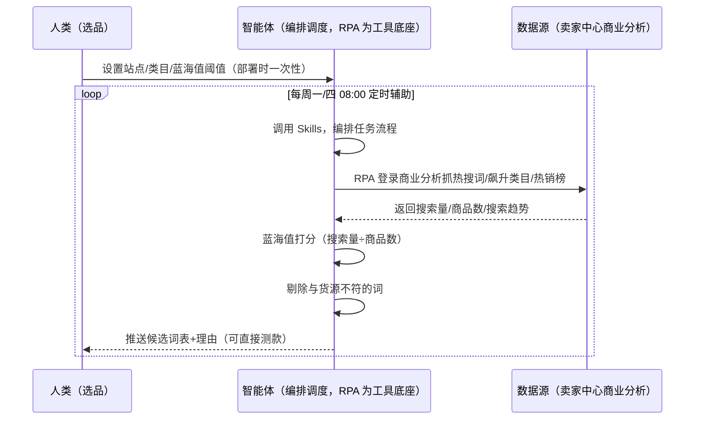
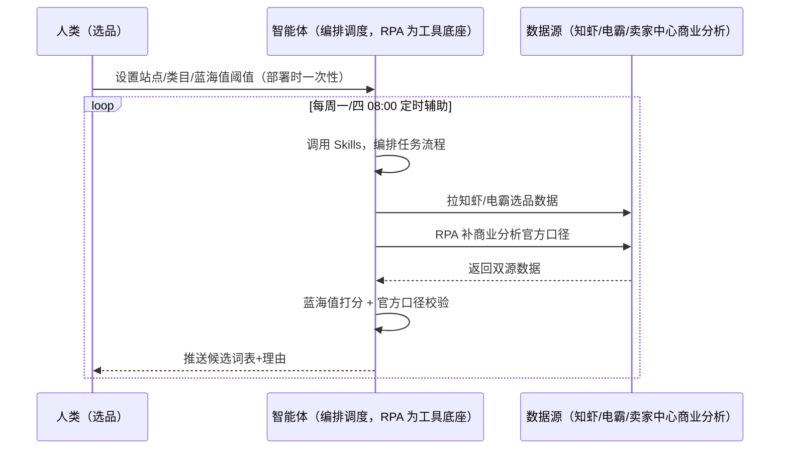

> 为虾皮（Shopee）卖家团队打造的市场机会发现方案。选品靠刷榜截图信息散乱、热搜词/飙升类目靠手动翻商业分析、各站点词池独立难统一。本方案由智能体调度多个工具执行定时采集热搜词/飙升类目/热销榜三件套，按蓝海值公式打分筛词。每周定时辅助，输出可直接测款的候选词表，供你按词上架测款。

> Agent 自动化需开通企业功能
> 点击申请1个月免费权限
> [点击申请 →](https://skieer.feishu.cn/share/base/form/shrcnFwMayykP5iaL38fnZKTbrg)

## 一、用户与需求

核心矛盾：虾皮站点多（台湾/泰国/印尼/新加坡等）、语言杂（繁体中文 vs 泰语/印尼语），热搜词/飙升类目靠手动翻商业分析费时；蓝海判断凭感觉，跟风时红利已过。

两类客户痛点同源，数据来源不同：

- 未购 SaaS 客户（新卖家/小团队）：人工翻卖家中心商业分析、逐条记词，全靠手；
- 已购 SaaS 客户（知虾/电霸等）：第三方工具有选品数据（付费），但商业分析官方口径、蓝海打分、站点词池统一仍要人做。

适用客户：多站点运营的选品型卖家。数据源为商家后台（商业分析）需登录采集，无现成应用需自建；降级路径（前台联想词）可靠但深度有限。

### 1.1 不同模式卖家

| 类型 | 选择 | 建议 |
|-|-|-|
| 跨境卖家（中国卖家中心） | 首选 | 强烈推荐（多站点词池统一，选品信号集中） |
| 本土卖家 | 次选 | 一般推荐（单站点，价值略低） |
| 铺货型 | 任意 | 按需（SKU 太多，聚焦爆款类目） |

### 1.2 不同站点卖家

| 站点 | 最关注维度 | 核心逻辑 |
|-|-|-|
| 台湾 | 繁体词池 | 繁体中文词池独立，热搜词直接可用 |
| 泰国 | 泰语词池 | 泰语词池独立，需本地化翻译 |
| 印尼 | 印尼语词池 | 印尼语词池独立，小语种需复核 |
| 新加坡 | 中英混合 | 中英词池并存 |
| 马来/菲律宾 | 本地化 | 按站点语言分别打分 |

### 1.3 不同角色用户

| 用户 | 需求 | 问题 | 投入时间（估算） |
|-|-|-|-|
| 老板 | 选品方向 | 选品靠感觉，试错成本高 | 1 小时/周 |
| 选品 | 候选词表+理由 | 手动翻商业分析费时 | 2-3 小时/周 |
| 运营 | 榜单机会信号 | 榜单截图散乱 | 1 小时/周 |

---

## 二、现在的方法与问题

### 2.1 流程步骤与问题总结

**人工方式（未购 SaaS 客户）**

| 序号 | 步骤 | 现在的方法 | 问题缺陷 |
|-|-|-|-|
| 1 | 翻词 | 手动翻商业分析-市场分析 | 费时、易漏 |
| 2 | 看榜 | 手动刷热销榜/飙升榜截图 | 信息散乱 |
| 3 | 判断 | 凭感觉 | 蓝海判断不准 |
| 4 | 统一 | 各站点分开记 | 词池不统一 |
| 5 | 验证 | 上架后才知道 | 试错成本高 |

**SaaS 方式（已购知虾/电霸客户）**

| 序号 | 步骤 | 现在的方法 | 问题缺陷 |
|-|-|-|-|
| 1 | 翻词 | 第三方工具看词 | 口径与官方有差异 |
| 2 | 看榜 | 工具内看榜 | 需付费账号 |
| 3 | 判断 | 凭感觉 | 无蓝海公式 |
| 4 | 统一 | 手动 | 站点词池难统一 |
| 5 | 验证 | 无回采 | 不迭代 |

### 2.2 问题分析

**人工方式根因**

| 序号 | 根因 | 具体表现 |
|-|-|-|
| 1 | 手动翻词 | 商业分析数据多但不会用 |
| 2 | 蓝海凭感觉 | 跟风时红利已过 |
| 3 | 词池不统一 | 多站点语言难统一 |

**SaaS 方式根因**

| 序号 | 根因 | 具体表现 |
|-|-|-|
| 1 | 第三方口径差异 | 数据完整但需付费、口径需验证 |
| 2 | 无闭环 | 测款表现不回采迭代 |

---

## 三、解决方案

### 3.1 功能概述

为虾皮卖家团队打造的市场机会发现方案，登录商业分析按站点抓热搜词/飙升类目/热销榜三件套，按蓝海值公式打分筛词。

每周定时触发并调度多个工具，调起八爪鱼 RPA（Agent 的工具底座，能耦合多系统、完成自动化任务执行）登录卖家中心「商业分析-市场分析」按站点+近 30 天窗口抓热搜词/飙升类目/热销榜（搜索量、商品数、搜索趋势），智能体按蓝海值公式打分筛词、剔除与货源不符的词。每周定时辅助，输出可直接测款的候选词表，供你按词上架测款。

### 3.2 系统结合

| 要素 | 说明 |
|-|-|
| 客户现有工具盘点 | **未购 SaaS 客户**：无第三方工具，选品全靠手动翻后台。     **已购 SaaS 客户**（主流组合）：知虾/电霸（第三方选品数据，付费账号） |
| 数据/能力来源 | **无 SaaS**：卖家中心商业分析-市场分析（热搜词/飙升类目/热销榜，需登录，RPA 自建采集）+ 前台联想词（降级路径）。     **有 SaaS**：知虾/电霸数据（完整但需付费）+ 商业分析官方口径交叉验证 |
| RPA 耦合动作 | 作为 Agent 的工具底座，按计划登录采集（每周至少抓 2 次、避开大促前后 3 天失真窗口、搜索量与商品数同天同次抓取防错配），统一流转给智能体；字段完整性校验 |
| 耦合出的新价值 | 单工具给不了的端到端结论：热搜/飙升/榜单一次取齐 → 蓝海值打分 → 候选词表+理由 → 测款表现回采迭代，**只推送候选词表** |

### 3.3 智能体执行流程

智能体定时触发。支持**两种数据通道**，部署时按客户现有工具选择：

**通道一：无 SaaS 方式（RPA 登录商业分析，适合未购第三方工具的客户）**

**通道二：有 SaaS 方式（知虾/电霸数据 + 商业分析交叉验证，适合已购客户）**

> Agent 自动化需开通企业功能
> 点击申请1个月免费权限
> [点击申请 →](https://skieer.feishu.cn/share/base/form/shrcnFwMayykP5iaL38fnZKTbrg)

### 3.4 为何这么设计

要同时回答三个问题：**为什么不能只用 SaaS/API？为什么不能纯靠智能体写代码？为什么 RPA 是执行底座？** 本场景的核心是"定时抓词、蓝海打分、站点统一、挂了有人管"。

#### 1）逐项对比

| 对比维度 | SaaS/API 堆叠（知虾/电霸） | 纯智能体（智能体写代码） | 智能体+自动化工具（RPA 工具底座） |
|-|-|-|-|
| 实现方式 | 第三方工具给选品数据 | 能抓后台能算，但全要自己接 | 商业分析登录采集 + 蓝海打分 |
| 官方口径 | 第三方口径有差异 | 需自建登录采集 | 官方数据最准（商业分析） |
| 定时抓词 | 工具内数据 | 智能体无法常驻轮询 | RPA 定时抓取防错配 |
| 使用成本（总拥有成本） | 知虾/电霸付费账号 | 代理 IP + 服务器 + 开发维护人力，隐性成本高 | 一份平台订阅跑多流程，单方案边际成本 ≈ 0 |
| 维护人要求 | 低（工具现成） | 规则调整都要开发介入 | 可视化流程，选品自己可调阈值 |

#### 2）优劣势说明

|  | SaaS/API 堆叠（第三方工具） | 纯智能体（智能体写代码） | 智能体+自动化工具（RPA 工具底座） |
|-|-|-|-|
| 优势 | 数据完整、免开发 | 无订阅费；     可深度定制选品模型 | 官方口径+蓝海打分即开即用；     非技术人员可维护 |
| 劣势 | 需付费；     口径需验证 | 登录保活与打分全自建；     AI 生成代码是生成性的 | 本地电脑运行需保持开机；     订阅费；     后台采集受登录态影响 |

#### 3）结论

| 论点 | 说明 |
|-|-|
| 蓝海值=选品公式 | 蓝海值 = 搜索量 ÷ 商品数，≤0.4 可跟、≤0.2 真蓝海（实锤）；热度高但商品数超阈值自动降权 |
| 站点词池独立 | 各站点词池独立（繁体中文 vs 泰语/印尼语），分别打分（实锤） |
| 官方口径最准 | 商业分析是官方数据（搜索量/商品数/趋势），比第三方口径更准——优先官方 |
| 一个底座跑多流程 | 客户购买 RPA 平台是跑多个流程（选品/竞品/榜单），本方案只是其中一个——平台订阅费被多流程摊薄 |
| 时间 | 选品要的是"每周一张可测款的候选词表"，不是"翻一上午后台" |

### 3.5 功能清单

| 功能 | 系统 | 功能说明（解决问题） |
|-|-|-|
| 会话/定时 | 智能体 | 1. 理解人类语言，调用已预设好的 Skills。     2. 编排多任务、调度多工具。 |
| 多系统数据取数 | RPA、指纹浏览器 | 1. 解决手动翻词费时、榜单散乱问题。     2. 作为智能体工具底座被调度执行，每周至少抓 2 次、避开大促前后 3 天失真窗口、搜索量与商品数同天同次抓取防错配。     3. **【无 SaaS 方式】** RPA 登录商业分析抓三件套。**【有 SaaS 方式】** 知虾/电霸数据 + 商业分析交叉验证。 |
| 蓝海打分 | 智能体 | 蓝海值 = 搜索量 ÷ 商品数；≤0.4 可跟、≤0.2 真蓝海；热度高但商品数超阈值自动降权。 |
| 词池统一 | 智能体 | 各站点词池独立（繁中/泰语/印尼语），分别打分。 |
| 候选词表 | 智能体 | 输出候选词表 + 理由（剔除与货源不符的词），可直接测款。 |
| 回采迭代 | 智能体 | 2 周后回采测款词的实际搜索表现，迭代评分权重。 |
| IM通知 | 飞书、钉钉、企微等 | 解决选品报告交付滞后问题。候选词表自动推送。 |
| 数据资产储存 | 本地电脑、云储存 | 1. Skills 资产：Shopee 选品技能。     2. 数据储存：词库与榜单快照统一写入本地。     3. 经验知识库：测款结果持续沉淀。 |

### 3.6 智能体执行落地过程

部署时一次性配置入参（站点、类目范围、排除词、蓝海值阈值、测款预算上限、数据通道），会话中无需重复输入。

**⚠️ 部署前提（不满足则方案无法跑起来）**：①RPA 需部署在**常开电脑/云机**上，并配置漏跑补跑机制；②**商业分析需登录卖家后台**，登录失效自动告警、人工介入后断点续跑（无账号可降级为前台联想词，深度有限）；③**有 SaaS 方式需知虾/电霸付费账号**（可选增强，无则走商业分析通道）；④首次配置（登录态、词池规则、蓝海阈值）需服务方/技术人员介入一次，属实施成本。

#### 1）配置

| 类别 | 说明 |
|-|-|
| 智能体 | 主流智能体。 |
| 智能体工具 | 1. **数据通道（按客户现有工具二选一）**：【无 SaaS】卖家中心商业分析（RPA 登录采集）；【有 SaaS】知虾/电霸 + 商业分析交叉验证。     2. 数据取数与自动化执行：八爪鱼 RPA，MCP 配置完成。     3. 数据分析：智能体自带。     4. IM：企业办公 IM（飞书/钉钉/企微），MCP 或 webhook 配置。 |
| 工作知识 | 1. 站点：台湾/泰国/印尼/新加坡等。     2. 类目范围。     3. 想排除的无效词。     4. 蓝海值阈值：≤0.4 可跟。     5. 测款预算上限。 |
| 本地数据库 | 1. 词库地址。     2. 榜单快照库地址。     3. 经验库地址。 |

#### 2）执行

| 任务 | 产出 | 产出物接收人 |
|-|-|-|
| 接收站点/类目，定时触发 | 任务启动记录 | —— |
| 调用已预设 Skills，编排任务流程 | 任务编排方案 | —— |
| 经 MCP 向八爪鱼 RPA 下发取数任务 | 自动化任务指令 | —— |
| 多源取数（无 SaaS：商业分析；有 SaaS：知虾/电霸+商业分析，智能体监控状态） | 对齐后词数据 | —— |
| 蓝海值打分（搜索量÷商品数） | 打分结果 | 选品 |
| 剔除与货源不符的词 | 候选词表 | 选品 |
| 2 周后回采测款表现 | 回采报告 | 选品 |
| 推送候选词表+理由 | 群消息 | 选品/老板 |

异常处理：

登录失效 → 告警人工介入后断点续跑；

数据缺失 → 用历史数据补并标注；

大促前后 3 天 → 自动避开失真窗口；

低置信度词 → 转人工；

置信度 &lt;70% → 转人工复核，不输出硬结论。

#### 3）结果

| 结果 | 说明 |
|-|-|
| 数据资产 | 词库与榜单快照结构化数据（词/搜索量/商品数/蓝海值/来源），可审计可追溯。 |
| 分析报告 | 1. 候选词表+理由：按蓝海值排序。     2. 站点对比：各站点词池。     3. 测款回采报告。 |
| Skills | 智能体 Skills：Shopee 选品技能，按测款结果迭代评分权重。 |

> Agent 自动化需开通企业功能
> 点击申请1个月免费权限
> [点击申请 →](https://skieer.feishu.cn/share/base/form/shrcnFwMayykP5iaL38fnZKTbrg)

---

## 四、使用前后预估

> 本方案价值 = **商业分析三件套自动抓取 → 蓝海值打分 → 候选词表+理由 → 测款回采迭代**。数据源为商家后台需登录采集（无现成应用需自建），第三方工具为可选增强。

| 指标 | 人工 | SaaS/API（知虾/电霸） | 智能体+自动化工具 |
|-|-|-|-|
| 抓词效率 | 手动翻后台 | 工具内数据 | 定时自动抓取 |
| 蓝海判断 | 凭感觉 | 数据+人工解读 | 蓝海值公式自动打分 |
| 站点词池 | 分开记 | 部分统一 | 各站点独立打分 |
| 榜单监控 | 截图散乱 | 工具内看榜 | 自动采集+去重 |
| 测款回采 | 无 | 无 | 2 周自动回采迭代 |
| 方法论 | 无 | 单工具数据 | 可复用的 Skills 与词库 |

**说明**：蓝海值 = 搜索量 ÷ 商品数，≤0.4 可跟、≤0.2 真蓝海；热度高但商品数超阈值自动降权；各站点词池独立（繁体中文 vs 泰语/印尼语），分别打分；商业分析是官方数据（最准），知虾/电霸数据完整但需付费账号；每周至少抓 2 次、避开大促前后 3 天失真窗口。

---

## 五、效果证明

> Agent 自动化需开通企业功能
> 点击申请1个月免费权限
> [点击申请 →](https://skieer.feishu.cn/share/base/form/shrcnFwMayykP5iaL38fnZKTbrg)

### 5.1 客户案例

**《家居龙头：20+ 海外平台商品数据自动化，日均 2.5 万条》**

> 20+ 海外平台的商品价格、运费、SKU、排名等多维度数据原靠人工抽样采集。RPA 实现全自动全量采集与入库，为跨境运营决策提供数据底座。

| 效果 | 说明 |
|-|-|
| 提效 | 多平台商品数据采集效率提升约 85%。原本 20+ 海外平台的商品数据靠人工抽样采集，现在全自动全量采集入库，日均 2.5 万条，运营上班即可看到最新数据。 |
| 降本 | 告别「导表格、拼数据」的重复劳动，运营团队从人工采集转为直接使用数据做选品与定价决策。 |
| 任务 | 覆盖 20+ 海外平台，价格/运费/SKU/EAN/首图/类目排名等 8+ 核心字段，支持变体信息全采集。 |
| 任务 | 采集稳定率 99%+，跨语言、跨页面结构、跨价格展示方式全部适配。 |

案例详情：[跨境取数：家居龙头的20+海外平台商品数据自动化实践](https://skieer.feishu.cn/wiki/Iko0wtqEfiOdzlkstYBc5DI3nUe)

**《竞品 AI 快报：多平台动态 7×24 监控与自动出报》**

> 某大型教培集团需盯多家竞品公众号、课程与活动动态，人工巡查信息零散难汇总。RPA 自动巡查多平台账号并生成竞品快报。

| 效果 | 说明 |
|-|-|
| 提效 | 竞品动态巡查由人工每日逐平台翻阅变为 7×24 自动监控。原本市场团队需人工登录多平台逐篇查看推文、课程与活动，现在自动抓取、自动分析、自动出报告。 |
| 降本 | 市场团队用于公众号巡查、内容摘抄与情报汇总的重复性工作量降低约 80%，投入转向课程优化、活动策划与市场竞争策略等重点工作。 |
| 任务 | 竞品课程、价格及营销动态识别准确率提升至 95% 以上，减少遗漏与误判。 |
| 任务 | 多平台账号自动巡查，情报按周期自动汇总成报。 |

案例详情：[快报|社媒监控：竞品AI快报生成自动化](https://skieer.feishu.cn/wiki/UNA7wUatCih1D2kXL5Fco3MpnGe)

---

## 六、备注

### 6.1 Agent 支持

本方案不绑定具体智能体，主流 Agent 均可运行（需支持技能/Skills 加载与工具调用）：

| Agent/智能体 | 说明 |
|-|-|
| Workbuddy | 本方案运行平台，支持技能/Skills 上传加载、定时任务、MCP 工具调用与表格/报告处理 |
| 豆包（国内·字节） | 国内主流个人智能体，支持技能上传、定时任务与工具调用，上手成本低 |
| 通义千问（国内·阿里） | 支持 Agent 编排与插件生态，集成阿里电商数据能力，适合电商场景 |
| DeepSeek（国内） | 推理能力强、成本低，适合规则打分与归因分析类任务 |
| ChatGPT（国外·OpenAI） | 海外主流通用智能体，支持 GPTs/Agent 模式与工具调用 |
| Claude（国外·Anthropic） | 长文本与结构化分析能力强，原生支持 MCP 连接外部工具 |

### 6.2 名词解释

| 术语 | 说明 |
|-|-|
| 蓝海值 | 搜索量 ÷ 商品数（≤0.4 可跟、≤0.2 真蓝海） |
| 商业分析 | 卖家中心官方数据（市场分析-热搜词/飙升类目/热销榜） |
| 词池独立 | 各站点语言词池分开（繁中/泰语/印尼语） |
| 失真窗口 | 大促前后 3 天数据失真，需避开 |
| 测款 | 按候选词上架测试款，2 周后回采验证 |
| 混合数据源 | 卖家中心商业分析（登录采集）+ 知虾/电霸（有 SaaS 客户交叉验证）+ 前台联想词（降级） |
| 有 SaaS 方式 | 已购知虾/电霸，第三方数据 + 商业分析交叉验证 |
| 无 SaaS 方式 | 不购买第三方工具，RPA 登录商业分析采集 |
| 跨境卖家 | 中国卖家中心统一管理多站点 |
| 本土卖家 | 单站点运营 |
| MCP | Model Context Protocol，智能体连接外部工具的标准化通道 |

> Agent 自动化需开通企业功能
> 点击申请1个月免费权限
> [点击申请 →](https://skieer.feishu.cn/share/base/form/shrcnFwMayykP5iaL38fnZKTbrg)

---

原文：[查看原文](https://skieer.feishu.cn/wiki/Ainvw3CvNibARgk3R7ycKYIGnoc)
