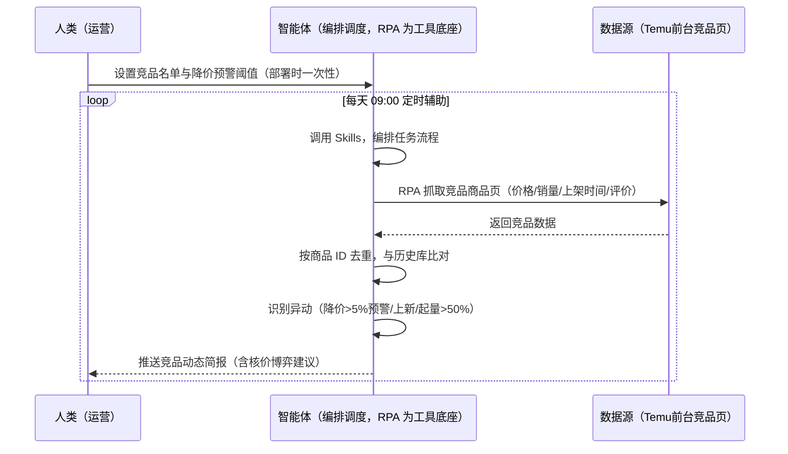
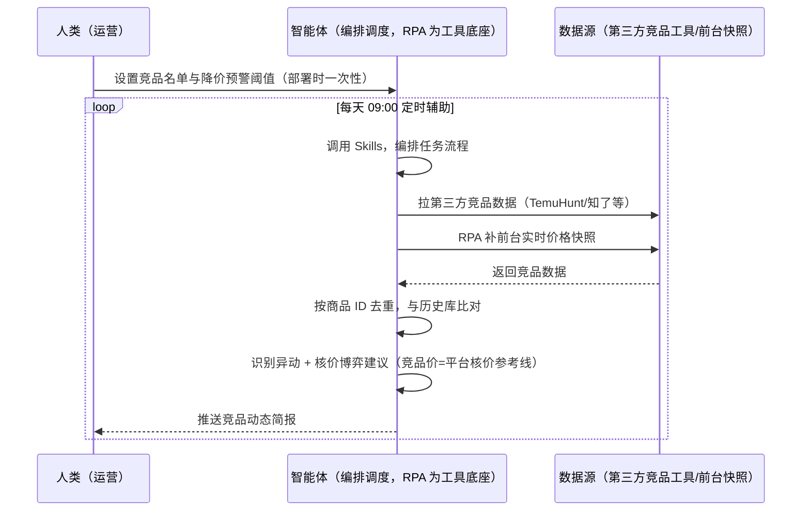

> 为 Temu 卖家团队打造的竞品监控方案。竞品降价/上新全靠手动翻、平台核价压价时不知道竞品什么价、多站点盯不过来。本方案由智能体调度多个工具执行定时抓取竞品商品/店铺数据，识别降价、上新、起量信号。每天定时辅助，只推送异动，无异常不打扰。

> Agent 自动化需开通企业功能
> 点击申请1个月免费权限
> [点击申请 →](https://skieer.feishu.cn/share/base/form/shrcnFwMayykP5iaL38fnZKTbrg)

## 一、用户与需求

核心矛盾：竞品降价/上新全靠手动翻页，平台核价压价时不知道竞品参考价，多站点盯不过来；竞品价 = 平台核价参考线，不监控等于被动挨打。两类客户痛点同源，数据来源不同：

- 未购 SaaS 客户（新卖家/小团队）：人工逐页翻竞品商品页，记录价格/销量/上架时间，全靠手；
- 已购 SaaS 客户（TemuHunt/知了数据等）：第三方工具有竞品数据，但异动识别（降价/上新/起量）、基线比对、核价博弈建议仍要人做。

适用客户：核心 ASIN 多、与竞品正面竞争的卖家。前台公开可采（无 SaaS 通道即可跑），第三方工具为可选增强。

### 1.1 不同模式卖家

| 类型 | 选择 | 建议 |
|-|-|-|
| 全托管 | 首选 | 强烈推荐（核价博弈情报：竞品价=平台核价参考线） |
| 半托管 | 次选 | 一般推荐（美区半托管自定价，竞品监控直接指导调价） |
| 平台模式 | 任意 | 试点中，监控逻辑同全托管 |

### 1.2 不同类目卖家

| 类目 | 最关注维度 | 核心逻辑 |
|-|-|-|
| 3C 数码 | 价格异动 | 迭代快，竞品降价即跟进 |
| 家居家具 | 上新监控 | 大件上新少但权重高 |
| 美妆个护 | 竞品评价 | 评价数变化反映竞争态势 |
| 服装鞋帽 | 季节上新 | 按站点季节盯竞品上新节奏 |
| 户外运动 | 旺季价格 | 旺季前竞品提价/降价信号 |
| 母婴用品 | 安全合规 | 竞品被下架=品类风险信号 |

### 1.3 不同角色用户

| 用户 | 需求 | 问题 | 投入时间（估算） |
|-|-|-|-|
| 老板 | 竞争态势与定价策略 | 不知道竞品在干什么 | 0.5 小时/周 |
| 运营 | 竞品异动清单 | 手动翻页盯不过来 | 1-2 小时/周 |
| 选品 | 上新机会 | 竞品上新错过 | 1 小时/周 |

---

## 二、现在的方法与问题

### 2.1 流程步骤与问题总结

**人工方式（未购 SaaS 客户）**

| 序号 | 步骤 | 现在的方法 | 问题缺陷 |
|-|-|-|-|
| 1 | 找竞品 | 手动搜关键词找竞品 | 名单不全，漏盯 |
| 2 | 看价格 | 逐页翻竞品商品页 | 降价不知道，被压价才反应 |
| 3 | 看上新 | 手动刷新看新品 | 上新错过 |
| 4 | 对比 | 凭记忆对比价格 | 无历史基线，判断不准 |
| 5 | 应对 | 凭经验调整报价 | 核价博弈被动 |

**SaaS 方式（已购第三方工具客户）**

| 序号 | 步骤 | 现在的方法 | 问题缺陷 |
|-|-|-|-|
| 1 | 找竞品 | 工具内看竞品 | 需人工维护名单 |
| 2 | 看价格 | 第三方价格数据 | 异动不自动识别 |
| 3 | 看上新 | 工具内看上新 | 无自动提醒 |
| 4 | 对比 | 人工比对基线 | 基线不沉淀 |
| 5 | 应对 | 凭经验调整 | 无博弈建议 |

### 2.2 问题分析

**人工方式根因**

| 序号 | 根因 | 具体表现 |
|-|-|-|
| 1 | 手动翻页 | 多站点多竞品盯不过来 |
| 2 | 无历史基线 | 降价/起量无对比基准 |
| 3 | 核价被动 | 不知道竞品参考价，压价无应对 |

**SaaS 方式根因**

| 序号 | 根因 | 具体表现 |
|-|-|-|
| 1 | 数据有但缺异动识别 | 需人工比对基线识别降价/上新/起量 |
| 2 | 无闭环 | 调价/上新后不回采验证 |

---

## 三、解决方案

### 3.1 功能概述

为 Temu 卖家团队打造的竞品监控方案，定时抓取竞品商品/店铺数据，识别异动信号，输出竞品动态简报与核价博弈建议。

每天定时触发并调度多个工具，调起八爪鱼 RPA（Agent 的工具底座，能耦合多系统、完成自动化任务执行）抓取竞品商品页价格/销量/上架时间/评价数，与历史库比对识别异动（降价/上新/起量），输出竞品简报。每天定时辅助，只推送异动，无异常不打扰。

### 3.2 系统结合

| 要素 | 说明 |
|-|-|
| 客户现有工具盘点 | **未购 SaaS 客户**：无第三方工具，竞品全靠手动翻页。     **已购 SaaS 客户**（主流组合）：TemuHunt/知了数据（竞品数据，付费版更细） |
| 数据/能力来源 | **无 SaaS**：Temu 前台竞品商品页（价格/销量/上架时间/评价数，公开可采，RPA 采集）。     **有 SaaS**：第三方竞品数据 + RPA 补前台实时快照（第三方更新频率有限） |
| RPA 耦合动作 | 作为 Agent 的工具底座，按计划调度竞品页面采集（按商品 ID 去重、与历史库比对、标记异动），统一流转给智能体分析；频控触发降频重试，连续失败告警 |
| 耦合出的新价值 | 单工具给不了的端到端结论：竞品数据一次取齐 → 比对历史基线 → 识别降价/上新/起量 → 输出核价博弈建议，**只推送异动，无异常不打扰** |

### 3.3 智能体执行流程

智能体定时触发。支持**两种数据通道**，部署时按客户现有工具选择：

**通道一：无 SaaS 方式（RPA 采集前台竞品页，适合未购第三方工具的客户）**

**通道二：有 SaaS 方式（第三方竞品数据 + RPA 实时快照，适合已购客户）**

> Agent 自动化需开通企业功能
> 点击申请1个月免费权限
> [点击申请 →](https://skieer.feishu.cn/share/base/form/shrcnFwMayykP5iaL38fnZKTbrg)

### 3.4 为何这么设计

要同时回答三个问题：**为什么不能只用 SaaS/API？为什么不能纯靠智能体写代码？为什么 RPA 是执行底座？** 本场景的核心是"定时采集、基线比对、异动识别、挂了有人管"。

#### 1）逐项对比

| 对比维度 | SaaS/API 堆叠（第三方工具） | 纯智能体（智能体写代码） | 智能体+自动化工具（RPA 工具底座） |
|-|-|-|-|
| 实现方式 | 工具内看竞品数据 | 能抓前台，数据可自拼，但全要自己接 | 前台采集 + 第三方交叉，一处对齐 |
| 多系统耦合 | 单工具数据 | 全自建：反爬、去重、基线逻辑 | 平台沉淀多源取数与对齐，可视化配置 |
| 异动识别 | 靠人工比对 | 需自写基线比对逻辑 | 基线库自动比对、规则可配 |
| 使用成本（总拥有成本） | 第三方付费 | 代理 IP + 服务器 + 开发维护人力，隐性成本高 | 一份平台订阅跑多流程，单方案边际成本 ≈ 0 |
| 维护人要求 | 低（工具现成） | 规则调整都要开发介入 | 可视化流程，运营自己可调阈值 |

#### 2）优劣势说明

|  | SaaS/API 堆叠（第三方工具） | 纯智能体（智能体写代码） | 智能体+自动化工具（RPA 工具底座） |
|-|-|-|-|
| 优势 | 数据现成、免开发 | 无订阅费；     可深度定制异动规则 | 前台+第三方双源；     异动识别即开即用；     非技术人员可维护 |
| 劣势 | 更新频率有限；     需人工比对 | 反爬对抗全自建；     AI 生成代码是生成性的 | 本地电脑运行需保持开机；     订阅费；     频控需控制节奏 |

#### 3）结论

| 论点 | 说明 |
|-|-|
| 竞品价=核价参考线 | Temu 核价会联动压价，竞品价是平台核价参考线——监控竞品是定价博弈情报，不是可选项 |
| 纯智能体缺"工程底座" | 反爬、去重、基线比对 70% 的工作在工程；RPA 作为工具底座把这 70% 已经造好 |
| 一个底座跑多流程 | 客户购买 RPA 平台是跑多个流程（竞品/选品/VOC），本方案只是其中一个——平台订阅费被多流程摊薄 |
| 确定性 vs 生成性 | 竞品监控是确定性任务——同样的商品，要求"每天同一时间抓到同一份数据"。AI 生成的代码是生成性的，能跑通 ≠ 能稳定盯一年 |
| 时间 | 运营要的是"异动自动报警 + 博弈建议"，不是"每天修一次爬虫" |

### 3.5 功能清单

| 功能 | 系统 | 功能说明（解决问题） |
|-|-|-|
| 会话/定时 | 智能体 | 1. 理解人类语言，调用已预设好的 Skills。     2. 编排多任务、调度多工具。 |
| 多系统数据取数 | RPA、指纹浏览器 | 1. 解决竞品手动翻页、多站点盯不过来问题。     2. 作为智能体工具底座被调度执行，频控触发降频重试、连续失败告警。     3. **【无 SaaS 方式】** RPA 采集前台竞品商品页（价格/销量/上架时间/评价数）。**【有 SaaS 方式】** 第三方竞品数据 + RPA 补实时快照。 |
| 数据清洗对齐 | 智能体 | 按商品 ID 去重、与历史库比对，解决无基线问题。 |
| 异动识别 | 智能体 | 竞品降价 >5% 预警（核价联动压价参考线）；新品上架 = 商品 ID 未入历史库；起量 = 销量增速 >50% 标记。 |
| 核价博弈建议 | 智能体 | 竞品价 = 平台核价参考线，输出报价策略建议（跟价/差异化/申诉）。 |
| IM通知 | 飞书、钉钉、企微等 | 解决异动通知滞后问题。降价/上新/起量异动自动推送。 |
| 数据资产储存 | 本地电脑、云储存 | 1. Skills 资产：Temu 竞品监测技能与异动规则。     2. 数据储存：竞品监控库统一写入本地。     3. 经验知识库：调价/上新结果持续沉淀。 |

### 3.6 智能体执行落地过程

部署时一次性配置入参（竞品名单、关注站点、降价预警阈值、数据通道），会话中无需重复输入。

**⚠️ 部署前提（不满足则方案无法跑起来）**：①RPA 需部署在**常开电脑/云机**上，并配置漏跑补跑机制；②前台商品页有反爬风控，需自备账号并遵守平台条款，频控触发自动降频重试；③**有 SaaS 方式需第三方工具账号**（可选增强，无则走前台通道）；④首次配置（竞品名单、基线库、异动阈值）需服务方/技术人员介入一次，属实施成本。

#### 1）配置

| 类别 | 说明 |
|-|-|
| 智能体 | 主流智能体。 |
| 智能体工具 | 1. **数据通道（按客户现有工具二选一）**：【无 SaaS】Temu 前台竞品页（RPA 采集）；【有 SaaS】第三方竞品工具 + RPA 实时快照。     2. 数据取数与自动化执行：八爪鱼 RPA，MCP 配置完成。     3. 数据分析：智能体自带。     4. IM：企业办公 IM（飞书/钉钉/企微），MCP 或 webhook 配置。 |
| 工作知识 | 1. 竞品店铺/关键词名单。     2. 关注站点。     3. 降价预警阈值：默认 5%。     4. 起量阈值：默认销量增速 >50%。 |
| 本地数据库 | 1. 竞品监控库地址。     2. 报告库地址。     3. 经验库地址。 |

#### 2）执行

| 任务 | 产出 | 产出物接收人 |
|-|-|-|
| 接收竞品名单，定时触发 | 任务启动记录 | —— |
| 调用已预设 Skills，编排任务流程 | 任务编排方案 | —— |
| 经 MCP 向八爪鱼 RPA 下发取数任务 | 自动化任务指令 | —— |
| 多源取数并按商品 ID 对齐（无 SaaS：前台采集；有 SaaS：第三方+快照，智能体监控状态） | 对齐后竞品数据 | —— |
| 与历史库比对，识别异动 | 异动清单 | 运营 |
| 核价博弈建议输出 | 报价策略建议 | 运营/老板 |
| 推送竞品动态简报 | 群消息 | 运营/老板 |

异常处理：

频控触发 → 降频重试；

采集连续失败 → 告警人工介入；

数据缺失 → 用历史数据补并标注；

置信度 &lt;70% → 转人工复核，不输出硬结论。

#### 3）结果

| 结果 | 说明 |
|-|-|
| 数据资产 | 竞品监控库结构化数据（商品/价格/销量/上架时间/来源页面），可审计可追溯。 |
| 分析报告 | 1. 竞品动态简报：降价/上新/起量异动。     2. 核价博弈建议：跟价/差异化/申诉。 |
| Skills | 智能体 Skills：Temu 竞品监测技能，按周回填竞品库迭代异动规则。 |

> Agent 自动化需开通企业功能
> 点击申请1个月免费权限
> [点击申请 →](https://skieer.feishu.cn/share/base/form/shrcnFwMayykP5iaL38fnZKTbrg)

---

## 四、使用前后预估

> 本方案价值 = **竞品数据自动采集 → 基线比对 → 异动识别（降价/上新/起量）→ 核价博弈建议**。前台公开可采（无 SaaS 即可跑），第三方工具为可选增强。

| 指标 | 人工 | SaaS/API（第三方工具） | 智能体+自动化工具 |
|-|-|-|-|
| 竞品价格监控 | 手动翻页 | 工具内看数据 | 定时自动采集、异动自动报警 |
| 上新监控 | 手动刷新 | 无自动提醒 | 商品 ID 比对自动识别 |
| 起量识别 | 凭感觉 | 靠人工比对 | 销量增速阈值自动标记 |
| 核价博弈 | 被动挨打 | 无建议 | 竞品参考价自动提示、跟价建议 |
| 方法论 | 无 | 单工具数据 | 可复用的 Skills 与竞品库 |

**说明**：竞品价 = 平台核价参考线（Temu 核价会联动压价），本方案把"被动挨打"变成"主动博弈"；降价 >5% 预警、起量 >50% 标记为默认阈值，可按类目调整；样本不足时标注仅供参考。

---

## 五、效果证明

> Agent 自动化需开通企业功能
> 点击申请1个月免费权限
> [点击申请 →](https://skieer.feishu.cn/share/base/form/shrcnFwMayykP5iaL38fnZKTbrg)

### 5.1 客户案例

**《万和：idealo 欧洲 5 国竞品比价数据自动化》**

> 一键覆盖 idealo 德法意英西 5 大站点，列表页 + 详情页双层深度采集，从基础信息到价格分布再到产品参数全维度抓取，清洗后结构化入 MySQL。

| 效果 | 说明 |
|-|-|
| 提效 | 海外竞品比价由人工一周缩短至几小时。原本 idealo 德法意英西 5 国站点需逐个采集、规则各异，现在 55 个核心品类关键词 × 每词前 50 页全自动采集。 |
| 降本 | 竞品价格情报从人工零散收集升级为自动化全景洞察，市场人员投入转向定价与产品策略等重点工作。 |
| 任务 | 列表页 + 详情页双层采集，10+ 全维度字段，采集稳定率 99%+（人工误差约 90% → 全自动 99%+）。 |
| 任务 | 多维度筛选条件自动配置，数据自动清洗去重后结构化入 MySQL，可直接分析。 |

案例详情：[竞品洞察：厨卫龙头的欧洲5国比价数据自动化实践](https://skieer.feishu.cn/wiki/MEhqwM1pWi2Lv3kCBqJcJQvAnwe)

**《竞品 AI 快报：多平台动态 7×24 监控与自动出报》**

> 某大型教培集团需盯多家竞品公众号、课程与活动动态，人工巡查信息零散难汇总。RPA 自动巡查多平台账号并生成竞品快报。

| 效果 | 说明 |
|-|-|
| 提效 | 竞品动态巡查由人工每日逐平台翻阅变为 7×24 自动监控。原本市场团队需人工登录多平台逐篇查看推文、课程与活动，现在自动抓取、自动分析、自动出报告。 |
| 降本 | 市场团队用于公众号巡查、内容摘抄与情报汇总的重复性工作量降低约 80%，投入转向课程优化、活动策划与市场竞争策略等重点工作。 |
| 任务 | 竞品课程、价格及营销动态识别准确率提升至 95% 以上，减少遗漏与误判。 |
| 任务 | 多平台账号自动巡查，情报按周期自动汇总成报。 |

案例详情：[快报|社媒监控：竞品AI快报生成自动化](https://skieer.feishu.cn/wiki/UNA7wUatCih1D2kXL5Fco3MpnGe)

---

## 六、备注

### 6.1 Agent 支持

本方案不绑定具体智能体，主流 Agent 均可运行（需支持技能/Skills 加载与工具调用）：

| Agent/智能体 | 说明 |
|-|-|
| Workbuddy | 本方案运行平台，支持技能/Skills 上传加载、定时任务、MCP 工具调用与表格/报告处理 |
| 豆包（国内·字节） | 国内主流个人智能体，支持技能上传、定时任务与工具调用，上手成本低 |
| 通义千问（国内·阿里） | 支持 Agent 编排与插件生态，集成阿里电商数据能力，适合电商场景 |
| DeepSeek（国内） | 推理能力强、成本低，适合规则打分与归因分析类任务 |
| ChatGPT（国外·OpenAI） | 海外主流通用智能体，支持 GPTs/Agent 模式与工具调用 |
| Claude（国外·Anthropic） | 长文本与结构化分析能力强，原生支持 MCP 连接外部工具 |

### 6.2 名词解释

| 术语 | 说明 |
|-|-|
| 异动识别 | 降价 >5% 预警 / 新品上架 / 销量增速 >50% 标记（阈值可配） |
| 核价博弈 | 竞品价 = 平台核价参考线，监控竞品是定价博弈情报 |
| 混合数据源 | 前台公开竞品页（免费、覆盖无 SaaS 客户）+ 第三方竞品工具（可选增强，交叉验证） |
| 有 SaaS 方式 | 已购 TemuHunt/知了等，第三方竞品数据 + RPA 实时快照 |
| 无 SaaS 方式 | 不购买第三方工具，由 RPA 采集前台竞品页 |
| 全托管 | 供货商模式，卖家只供货、平台定价销售（美区仅半托管） |
| 半托管 | 卖家自主运营与履约（美区主流模式） |
| MCP | Model Context Protocol，智能体连接外部工具的标准化通道 |

> Agent 自动化需开通企业功能
> 点击申请1个月免费权限
> [点击申请 →](https://skieer.feishu.cn/share/base/form/shrcnFwMayykP5iaL38fnZKTbrg)

---

原文：[查看原文](https://skieer.feishu.cn/wiki/CBUNwRtxFiSzawkWaRGcDUmxn3B)
