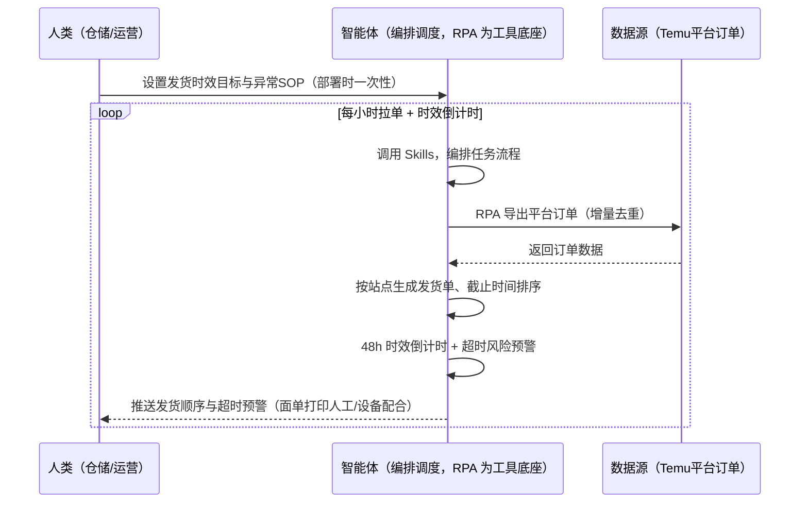
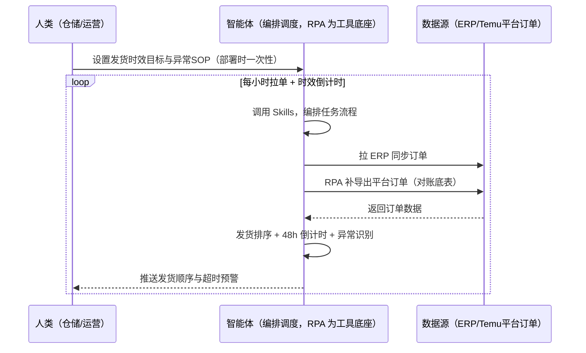

> 为 Temu 半托管卖家打造的订单处理与面单打印方案。全托管订单平台自动履约（备货入仓制），半托管订单需卖家自行履约（48h 发货+5 工作日送达）。本方案由智能体调度多个工具执行定时导出平台订单、拉取半托管待发货订单并跟踪 48h 发货时效。定时触发，发货顺序优化与超时风险预警，面单打印由人工/设备配合。

> Agent 自动化需开通企业功能
> 点击申请1个月免费权限
> [点击申请 →](https://skieer.feishu.cn/share/base/form/shrcnFwMayykP5iaL38fnZKTbrg)

## 一、用户与需求

核心矛盾：全托管订单由平台自动履约（无打单场景），半托管订单需卖家自行履约（48h 发货+5 工作日送达）；订单数据是结算对账/利润核算的基础底表；手动导出订单、逐单排发货顺序费时且易超时。

两类客户痛点同源，数据来源不同：

- 未购 SaaS 客户（半托管新卖家）：人工导出订单、逐单排发货顺序、手动盯 48h 时效，全靠手；
- 已购 SaaS 客户（店小秘/妙手 ERP 等）：ERP 有订单同步功能（可挂接），但 48h 发货时效倒计时、超时风险预警仍要人盯。

适用客户：半托管卖家（全托管无打单场景，但订单导出用于对账同样建议保留）。订单导出现成应用直挂，面单打印无专属应用需自建。

### 1.1 不同模式卖家

| 类型 | 选择 | 建议 |
|-|-|-|
| 全托管 | 次选 | 一般推荐（无打单场景，订单导出用于结算对账与经营分析） |
| 半托管 | 首选 | 强烈推荐（48h 发货时效红线，超时罚款） |
| 平台模式 | 任意 | 试点中，履约机制待确认 |

### 1.2 不同类目卖家

| 类目 | 最关注维度 | 核心逻辑 |
|-|-|-|
| 3C 数码 | 发货时效 | 客单价高，缺货罚款影响大 |
| 家居家具 | 大件物流 | 大件面单与物流成本高 |
| 美妆个护 | 时效合规 | 超时罚款影响资金 |
| 服装鞋帽 | 多尺码拆单 | 一单多件，拆单发货 |
| 户外运动 | 旺季发货 | 旺季单量暴增，时效风险高 |
| 母婴用品 | 时效红线 | 缺货美站罚款明确 |

### 1.3 不同角色用户

| 用户 | 需求 | 问题 | 投入时间（估算） |
|-|-|-|-|
| 老板 | 不超时不被罚 | 缺货/超时罚款 | 0.5 小时/周 |
| 仓储 | 发货顺序+时效预警 | 逐单排发货费时 | 2-3 小时/周 |
| 运营 | 订单健康日报 | 异常单识别靠人 | 1 小时/周 |

---

## 二、现在的方法与问题

### 2.1 流程步骤与问题总结

人工方式（未购 SaaS 客户）

| 序号 | 步骤 | 现在的方法 | 问题缺陷 |
|-|-|-|-|
| 1 | 导订单 | 手动导出平台订单 | 费时、易漏 |
| 2 | 排发货 | 逐单看截止时间排序 | 无系统排序，易超时 |
| 3 | 打单 | 手动生成面单 | 打印设备配合 |
| 4 | 揽收 | 手动回填 | 无系统跟踪 |
| 5 | 盯时效 | 凭记忆盯 48h | 超时被罚 |

SaaS 方式（已购 ERP 客户）

| 序号 | 步骤 | 现在的方法 | 问题缺陷 |
|-|-|-|-|
| 1 | 导订单 | ERP 同步（可挂接） | 部分覆盖 |
| 2 | 排发货 | 靠人 | 无排序逻辑 |
| 3 | 打单 | 半自动 | 设备配合 |
| 4 | 揽收 | 部分覆盖 | 回填校验靠人 |
| 5 | 盯时效 | 靠人 | 无倒计时 |

### 2.2 问题分析

人工方式根因

| 序号 | 根因 | 具体表现 |
|-|-|-|
| 1 | 发货排序靠人 | 无系统排序，易超时 |
| 2 | 时效靠记忆 | 48h 超时被罚 |
| 3 | 异常单识别慢 | 缺货/地址异常后知后觉 |

SaaS 方式根因

| 序号 | 根因 | 具体表现 |
|-|-|-|
| 1 | 时效监控缺失 | ERP 同步订单，48h 倒计时不覆盖 |
| 2 | 无预警 | 超时风险单无提醒 |

---

## 三、解决方案

### 3.1 功能概述

为 Temu 半托管卖家打造的订单处理与面单打印方案，定时导出平台订单（全托管/半托管订单明细）、拉取半托管待发货订单并跟踪 48h 发货时效倒计时。

定时触发并调度多个工具，调起八爪鱼 RPA（Agent 的工具底座，能耦合多系统、完成自动化任务执行）导出平台订单、按站点生成发货单、跟踪 48h 发货时效倒计时，智能体按截止时间排序发货顺序、标记超时风险单与异常单。定时触发，发货顺序优化与超时风险预警，面单打印由人工/设备配合。

### 3.2 系统结合

| 要素 | 说明 |
|-|-|
| 客户现有工具盘点 | **未购 SaaS 客户**：无第三方工具，订单全靠手动导出。     **已购 SaaS 客户**（主流组合）：店小秘/妙手 ERP（订单同步功能，可挂接） |
| 数据/能力来源 | **无 SaaS**：Temu 平台订单导出（现成应用直挂，免登录/登录均可）。     **有 SaaS**：ERP 订单同步（可挂接）+ RPA 补 48h 时效监控与发货排序 |
| RPA 耦合动作 | 作为 Agent 的工具底座，按计划导出订单（增量导出防漏单、幂等去重）、按站点生成发货单、跟踪时效倒计时，统一流转给智能体；拉单失败自动重试 |
| 耦合出的新价值 | 单工具给不了的端到端结论：订单一次取齐 → 按截止时间排发货顺序 → 超时风险预警 → 异常单标记，**只推送超时风险与异常单** |

### 3.3 智能体执行流程

智能体定时触发。支持**两种数据通道**，部署时按客户现有工具选择：

**通道一：无 SaaS 方式（RPA 导出订单，适合未购 ERP 的客户）**

**通道二：有 SaaS 方式（ERP 订单同步 + RPA 补时效，适合已购客户）**

> Agent 自动化需开通企业功能
> 点击申请1个月免费权限
> [点击申请 →](https://skieer.feishu.cn/share/base/form/shrcnFwMayykP5iaL38fnZKTbrg)

### 3.4 为何这么设计

要同时回答三个问题：**为什么不能只用 SaaS/API？为什么不能纯靠智能体写代码？为什么 RPA 是执行底座？** 本场景的核心是"定时拉单、时效倒计时、发货排序、挂了有人管"。

#### 1）逐项对比

| 对比维度 | SaaS/API 堆叠（ERP） | 纯智能体（智能体写代码） | 智能体+自动化工具（RPA 工具底座） |
|-|-|-|-|
| 实现方式 | ERP 订单同步（主体部分） | 能调后台能排序，但全要自己接 | 订单导出应用直挂 + 时效监控 |
| 时效倒计时 | 不覆盖 | 智能体无法常驻轮询 | RPA 定时轮询、倒计时预警 |
| 发货排序 | 无 | 需自写排序逻辑 | 排序规则可视化配置 |
| 使用成本（总拥有成本） | ERP 订阅费（主体另算） | 代理 IP + 服务器 + 开发维护人力，隐性成本高 | 一份平台订阅跑多流程，单方案边际成本 ≈ 0 |
| 维护人要求 | 低（工具现成） | 规则调整都要开发介入 | 可视化流程，仓储自己可调时效目标 |

#### 2）优劣势说明

|  | SaaS/API 堆叠（ERP） | 纯智能体（智能体写代码） | 智能体+自动化工具（RPA 工具底座） |
|-|-|-|-|
| 优势 | 订单同步现成（主体已解决） | 无订阅费；     可深度定制排序模型 | 订单导出应用直挂；     时效倒计时即开即用；     非技术人员可维护 |
| 劣势 | 48h 时效监控不覆盖 | 轮询与导出全自建；     AI 生成代码是生成性的 | 本地电脑运行需保持开机；     订阅费；     面单打印需人工/设备配合 |

#### 3）结论

| 论点 | 说明 |
|-|-|
| 48h 红线=罚款 | 半托管 48h 未发货 = 每单 5 美元或 40 元人民币罚款（取高，实锤）；虚假发货 = 40 元/票或货值 25%（取高） |
| ERP 覆盖不完整 | 店小秘/妙手有订单同步，但 48h 倒计时与超时预警不覆盖——本方案补时效监控 |
| 全托管也要导单 | 全托管订单平台自动履约（无打单），但订单导出是结算对账/利润核算的基础底表——全托管卖家也建议保留 |
| 一个底座跑多流程 | 客户购买 RPA 平台是跑多个流程（订单/物流/对账），本方案只是其中一个——平台订阅费被多流程摊薄 |
| 时间 | 仓储要的是"发货顺序 + 超时预警"，不是"逐单盯后台" |

### 3.5 功能清单

| 功能 | 系统 | 功能说明（解决问题） |
|-|-|-|
| 会话/定时 | 智能体 | 1. 理解人类语言，调用已预设好的 Skills。     2. 编排多任务、调度多工具。 |
| 多系统数据取数 | RPA、指纹浏览器 | 1. 解决手动导单、逐单排发货问题。     2. 作为智能体工具底座被调度执行，增量导出防漏单、幂等去重。     3. **【无 SaaS 方式】** RPA 导出平台订单。**【有 SaaS 方式】** ERP 订单同步 + RPA 补导出（对账底表）。 |
| 发货顺序优化 | 智能体 | 按截止时间排序发货顺序（先到先发、临界优先）。 |
| 时效倒计时 | 智能体 | 48h 发货倒计时（Y1 海外仓 2 工作日内 / Y2 跨境直发备货 9 天+配送 5 工作日）。 |
| 异常识别 | 智能体 | 缺货风险 / 重复订单 / 地址异常标记。 |
| IM通知 | 飞书、钉钉、企微等 | 解决超时风险滞后问题。超时风险单自动推送。 |
| 数据资产储存 | 本地电脑、云储存 | 1. Skills 资产：Temu 订单同步技能。     2. 数据储存：订单底表统一写入本地。     3. 经验知识库：对账差异回填修正。 |

### 3.6 智能体执行落地过程

部署时一次性配置入参（发货时效目标、导出范围、异常判定规则、数据通道），会话中无需重复输入。

**⚠️ 部署前提（不满足则方案无法跑起来）**：①RPA 需部署在**常开电脑/云机**上（每小时拉单需常开），并配置漏跑补跑机制；②**面单打印与物理发货由人工/设备配合**（拉单/排序/预警可自动化，打单无专属应用需自建）；③**有 SaaS 方式需 ERP 账号**（订单同步挂接，可选增强，无则走平台导出通道）；④首次配置（登录态、时效口径、排序规则）需服务方/技术人员介入一次，属实施成本。

#### 1）配置

| 类别 | 说明 |
|-|-|
| 智能体 | 主流智能体。 |
| 智能体工具 | 1. **数据通道（按客户现有工具二选一）**：【无 SaaS】Temu 平台订单导出（现成应用直挂）；【有 SaaS】ERP 订单同步 + RPA 补导出。     2. 数据取数与自动化执行：八爪鱼 RPA，MCP 配置完成。     3. 数据分析：智能体自带。     4. IM：企业办公 IM（飞书/钉钉/企微），MCP 或 webhook 配置。 |
| 工作知识 | 1. 发货时效目标：Y1 海外仓 2 个工作日内 / Y2 跨境直发备货 9 天+配送 5 个工作日。     2. 导出范围：站点/时间窗/订单状态。     3. 异常判定规则。     4. 打印设备配置。 |
| 本地数据库 | 1. 订单底表库地址。     2. 发货台账库地址。     3. 经验库地址。 |

#### 2）执行

| 任务 | 产出 | 产出物接收人 |
|-|-|-|
| 接收导出范围，定时触发 | 任务启动记录 | —— |
| 调用已预设 Skills，编排任务流程 | 任务编排方案 | —— |
| 经 MCP 向八爪鱼 RPA 下发取数任务 | 自动化任务指令 | —— |
| 多源取数并按订单号对齐（无 SaaS：平台导出；有 SaaS：ERP+导出，智能体监控状态） | 对齐后订单数据 | —— |
| 按截止时间排序发货顺序 | 发货顺序清单 | 仓储 |
| 48h 时效倒计时 + 超时风险预警 | 风险预警 | 仓储/运营 |
| 异常识别（缺货/重复/地址异常） | 异常单清单 | 运营 |
| 推送订单健康日报 | 群消息 | 仓储/运营/老板 |

异常处理：

拉单失败 → 自动重试并告警；

重复订单 → 幂等去重；

时效临界 → 告警提醒；

缺货订单 → 标注风险；

置信度 &lt;70% → 转人工复核，不输出硬结论。

#### 3）结果

| 结果 | 说明 |
|-|-|
| 数据资产 | 订单底表结构化数据（订单号/站点/状态/时效节点），对账/核算复用，可审计。 |
| 分析报告 | 1. 发货顺序清单：按截止时间排序。     2. 超时风险预警：48h 倒计时。     3. 订单健康日报：异常单标记。 |
| Skills | 智能体 Skills：Temu 订单同步技能，按对账差异回填修正。 |

> Agent 自动化需开通企业功能
> 点击申请1个月免费权限
> [点击申请 →](https://skieer.feishu.cn/share/base/form/shrcnFwMayykP5iaL38fnZKTbrg)

---

## 四、使用前后预估

> 本方案价值 = **订单自动导出 → 发货顺序优化 → 48h 时效倒计时 → 超时风险与异常单预警**。订单导出现成应用直挂（免登录/登录均可），面单打印由人工/设备配合。

| 指标 | 人工 | SaaS/API（ERP） | 智能体+自动化工具 |
|-|-|-|-|
| 订单导出 | 手动导出 | ERP 同步 | 自动导出+幂等去重 |
| 发货排序 | 逐单看 | 无 | 按截止时间自动排序 |
| 48h 时效 | 凭记忆 | 不覆盖 | 自动倒计时预警 |
| 异常识别 | 后知后觉 | 无 | 缺货/重复/地址异常自动标记 |
| 订单底表 | 无/散乱 | 部分 | 对账/核算复用底表 |
| 方法论 | 无 | 单工具 | 可复用的 Skills 与排序规则 |

**说明**：全托管订单由平台自动履约（备货入仓制，无打单场景），订单导出主要用于结算对账与经营分析；半托管订单需卖家自行履约（48h 发货+5 工作日送达）；订单数据是结算对账/利润核算的基础底表，口径须与结算单一致；ERP 同步（妙手/店小秘）可挂接。

---

## 五、效果证明

> Agent 自动化需开通企业功能
> 点击申请1个月免费权限
> [点击申请 →](https://skieer.feishu.cn/share/base/form/shrcnFwMayykP5iaL38fnZKTbrg)

### 5.1 客户案例

**《无货源跨境多平台分销自动发货》**

> 一人身兼老板、运营、客服、履约，夜晚处理店小秘与万邑链订单，单条订单处理需 3-5 分钟，订单高峰熬夜也赶不上进度。

| 效果 | 说明 |
|-|-|
| 提效 | 跨境分销履约从「熬夜手工操作」变为自动批量执行。原本需在店小秘与万邑链、Excel 间反复切换，完成订单导出、地址解密、SKU 筛选、模板清洗、渠道比价与导入发货，现在全流程自动跑完。 |
| 降本 | 一人即可承担原先老板、运营、客服、履约多岗的重复操作，人力投入转向货源洽谈与店铺运营等重点工作。 |
| 任务 | Temu 待审核订单自动导出、解密与筛选，发货模板自动适配。 |
| 任务 | 自动查询仓库/渠道并对比运费选最优方案，保障合规发货。 |

案例详情：[无货源|跨境多平台分销自动发货，低成本创业新可能](https://skieer.feishu.cn/wiki/W8dUwc8pni0R6jkpH10cRMavnId)

**《智能清洁巨头：20+ 平台订单自动导出清洗并导入 Salesforce》**

> 海外平台拓展快，系统自动发货与各平台对接机制未完善，20+ 平台订单交付依赖客服线下表格导入导出。RPA 实现自动导出、清洗并导入 Salesforce。

| 效果 | 说明 |
|-|-|
| 提效 | 20+ 平台订单交付由人工导表变为自动同步。原本需人工从 Overstock、Sams、Walmart 等平台导出订单表格并清洗后导入 Salesforce，现在自动取数、清洗、导入并回读结果。 |
| 降本 | 客服/运营从逐平台导表与返工重导中解放，投入转向异常订单处理与客户服务等重点工作。 |
| 任务 | 覆盖 20+ 海外电商平台，订单数据字段自动对齐 Salesforce 导入要求。 |
| 任务 | 导入失败订单自动识别并按规则修正重试，减少人工二次处理。 |

案例详情：[订单同步：自动发货：20+平台订单"秒处理"，助智能清洁巨头打赢大促发货攻坚战](https://skieer.feishu.cn/wiki/Pvzmw4JRxikc74kukEbcrNhenjg)

### 5.2 DEMO应用

Temu 平台订单导出：https://rpa.bazhuayu.com/appstore/app/wawawa/temu--ping-tai-ding-dan-dao-chu

---

## 六、备注

### 6.1 Agent 支持

本方案不绑定具体智能体，主流 Agent 均可运行（需支持技能/Skills 加载与工具调用）：

| Agent/智能体 | 说明 |
|-|-|
| Workbuddy | 本方案运行平台，支持技能/Skills 上传加载、定时任务、MCP 工具调用与表格/报告处理 |
| 豆包（国内·字节） | 国内主流个人智能体，支持技能上传、定时任务与工具调用，上手成本低 |
| 通义千问（国内·阿里） | 支持 Agent 编排与插件生态，集成阿里电商数据能力，适合电商场景 |
| DeepSeek（国内） | 推理能力强、成本低，适合规则打分与归因分析类任务 |
| ChatGPT（国外·OpenAI） | 海外主流通用智能体，支持 GPTs/Agent 模式与工具调用 |
| Claude（国外·Anthropic） | 长文本与结构化分析能力强，原生支持 MCP 连接外部工具 |

### 6.2 名词解释

| 术语 | 说明 |
|-|-|
| 48h 发货 | 半托管订单 48h 内发货 + 5 工作日送达（超时罚款） |
| 虚假发货 | 标记已发未实际履约 = 40 元/票或货值 25%（取高） |
| Y1/Y2 | Y1 海外仓（2 工作日内发货）/ Y2 跨境直发（备货 9 天+配送 5 工作日） |
| 幂等去重 | 重复拉单不重复入账（增量导出防漏单） |
| 订单底表 | 结算对账/利润核算的基础数据表 |
| 混合数据源 | Temu 平台订单导出（现成应用直挂）+ ERP 订单同步（有 SaaS 客户可挂接） |
| 有 SaaS 方式 | 已购店小秘/妙手 ERP，订单同步 + RPA 补导出 |
| 无 SaaS 方式 | 不购买第三方工具，RPA 导出平台订单 |
| 全托管 | 供货商模式，卖家只供货、平台定价销售（美区仅半托管） |
| 半托管 | 卖家自主运营与履约（美区主流模式） |
| MCP | Model Context Protocol，智能体连接外部工具的标准化通道 |

> Agent 自动化需开通企业功能
> 点击申请1个月免费权限
> [点击申请 →](https://skieer.feishu.cn/share/base/form/shrcnFwMayykP5iaL38fnZKTbrg)

---

原文：[查看原文](https://skieer.feishu.cn/wiki/FiFqwhu8BihFi9kf4q2cWcVBnrc)
