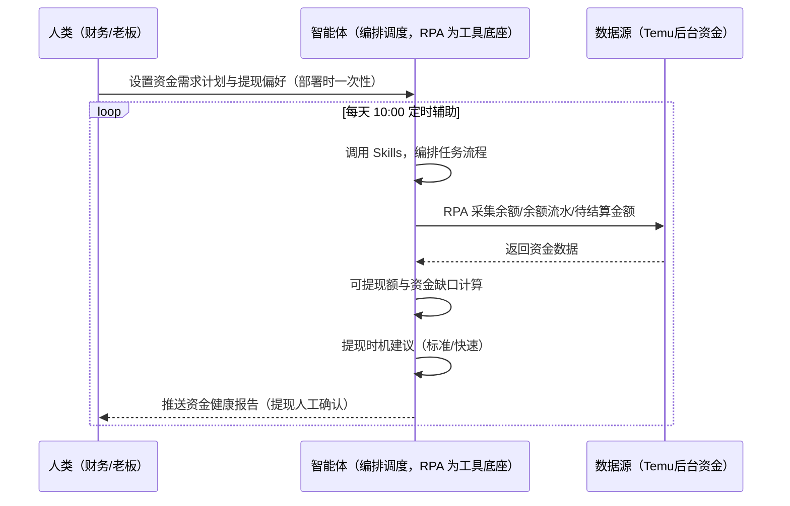
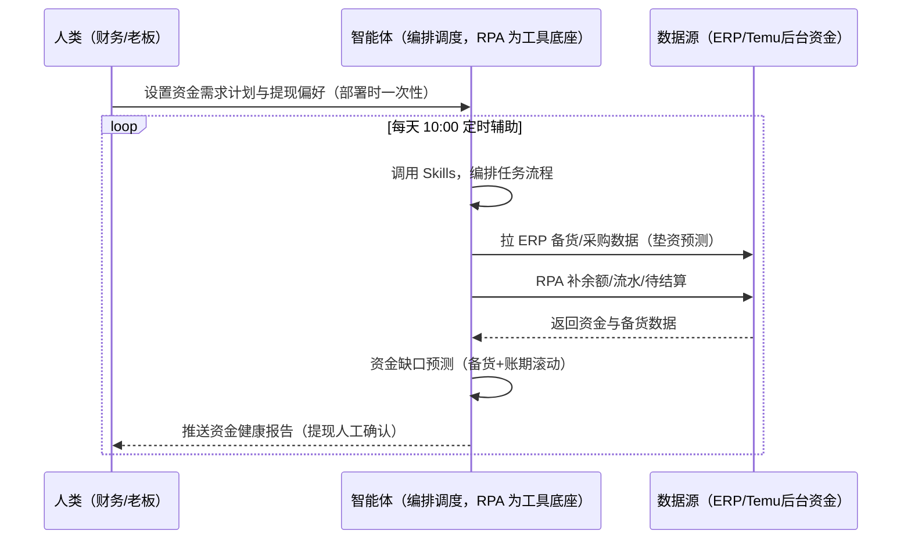

> 为 Temu 卖家团队打造的资金与费用管理方案。提现门槛与到账周期不熟（最低 50 美元、标准结算 T+14 审核 21-28 天到账、快速提现 T+3 收 0.5% 服务费）；备货垫资 + 长结算账期 = 现金流双压。本方案由智能体调度多个工具执行采集店铺余额/流水/待结算金额，生成提现日历与资金健康报告。每天定时辅助，提现动作由人工确认。

> Agent 自动化需开通企业功能
> 点击申请1个月免费权限
> [点击申请 →](https://skieer.feishu.cn/share/base/form/shrcnFwMayykP5iaL38fnZKTbrg)

## 一、用户与需求

核心矛盾：备货垫资（采购+头程）+ 长结算账期（跨境 30-45 天）= 现金流双压，资金缺口预测是老板视角生死线；提现规则不熟（最低 50 美元、快速提现 0.5% 服务费），资金安排被动。

两类客户痛点同源，数据来源不同：

- 未购 SaaS 客户（新卖家/小团队）：人工查余额、凭记忆安排提现，全靠手；
- 已购 SaaS 客户（店小秘 ERP 等）：ERP 管订单库存，余额/待结算/提现日历不覆盖，仍要人盯后台。

适用客户：多店铺、备货垫资压力大的卖家。现成应用直挂（余额流水下载/余额截图/待结算数据截图）。

### 1.1 不同模式卖家

| 类型 | 选择 | 建议 |
|-|-|-|
| 全托管 | 首选 | 强烈推荐（备货垫资+长账期，现金流规划必须） |
| 半托管 | 次选 | 一般推荐（半托管入驻需缴保证金 1 万起，资金占用需规划） |
| 平台模式 | 任意 | 试点中，资金机制待确认 |

### 1.2 不同类目卖家

| 类目 | 最关注维度 | 核心逻辑 |
|-|-|-|
| 3C 数码 | 备货垫资 | 备货量大，垫资压力高 |
| 家居家具 | 大件资金 | 大件采购资金占用高 |
| 美妆个护 | 提现周期 | 账期长，资金回笼慢 |
| 服装鞋帽 | 季节性投入 | 换季备货资金集中 |
| 户外运动 | 旺季垫资 | 旺季前集中备货，垫资峰值 |
| 母婴用品 | 现金流安全 | 安全库存高，资金占用大 |

### 1.3 不同角色用户

| 用户 | 需求 | 问题 | 投入时间（估算） |
|-|-|-|-|
| 老板 | 资金缺口预测 | 现金流双压无感知 | 0.5 小时/周 |
| 财务 | 提现日历+建议 | 提现规则不熟 | 0.5-1 小时/周 |
| 运营 | 资金健康报告 | 备货与提现无联动 | 0.5 小时/周 |

---

## 二、现在的方法与问题

### 2.1 流程步骤与问题总结

人工方式（未购 SaaS 客户）

| 序号 | 步骤 | 现在的方法 | 问题缺陷 |
|-|-|-|-|
| 1 | 看余额 | 手动登录后台查 | 多店铺逐个查费时 |
| 2 | 看待结算 | 手动查 | 无日历规划 |
| 3 | 定提现 | 凭感觉 | 快速提现费用不知 |
| 4 | 预测缺口 | 凭记忆 | 备货垫资+账期双压无感知 |
| 5 | 提现 | 手动 | 资金敏感操作 |

SaaS 方式（已购 ERP 客户）

| 序号 | 步骤 | 现在的方法 | 问题缺陷 |
|-|-|-|-|
| 1 | 看余额 | ERP 不覆盖 | 靠人查 |
| 2 | 看待结算 | 不覆盖 | 无日历 |
| 3 | 定提现 | 凭感觉 | 无建议 |
| 4 | 预测缺口 | 无 | 无资金模型 |
| 5 | 提现 | 手动 | 需人工确认 |

### 2.2 问题分析

人工方式根因

| 序号 | 根因 | 具体表现 |
|-|-|-|
| 1 | 余额分散 | 多店铺逐个查费时 |
| 2 | 提现凭感觉 | 快速提现费用/到账周期不清 |
| 3 | 无资金模型 | 现金流双压无感知 |

SaaS 方式根因

| 序号 | 根因 | 具体表现 |
|-|-|-|
| 1 | ERP 不覆盖 | 余额/待结算/提现日历无工具 |
| 2 | 无联动 | 备货计划与待结算口径不滚动 |

---

## 三、解决方案

### 3.1 功能概述

为 Temu 卖家团队打造的资金与费用管理方案，采集店铺余额/余额流水/待结算金额，生成提现日历，智能体按资金需求与提现成本给出提现时机建议。

每天定时触发并调度多个工具，调起八爪鱼 RPA（Agent 的工具底座，能耦合多系统、完成自动化任务执行）采集店铺余额/余额流水/待结算金额，生成提现日历，智能体按资金需求与提现成本（标准结算免手续费 vs 快速提现 T+3 收 0.5%）给出提现时机建议。每天定时辅助，提现动作由人工确认。

### 3.2 系统结合

| 要素 | 说明 |
|-|-|
| 客户现有工具盘点 | **未购 SaaS 客户**：无第三方工具，余额全靠人工查后台。     **已购 SaaS 客户**（主流组合）：店小秘 ERP（管订单库存，余额/提现不覆盖） |
| 数据/能力来源 | **无 SaaS**：Temu 后台余额/流水/待结算（现成应用直挂：余额流水下载/余额截图/待结算数据截图）。     **有 SaaS**：ERP 备货/采购数据（辅助资金缺口预测）+ RPA 补余额采集 |
| RPA 耦合动作 | 作为 Agent 的工具底座，按计划采集余额/流水/待结算（每日快照），生成提现日历，统一流转给智能体；采集失败自动重试、异常告警 |
| 耦合出的新价值 | 单工具给不了的端到端结论：余额/待结算一次取齐 → 可提现额与资金缺口计算 → 提现时机建议（标准 vs 快速）→ 资金健康报告，**只推送资金缺口与提现建议** |

### 3.3 智能体执行流程

智能体定时触发。支持**两种数据通道**，部署时按客户现有工具选择：

**通道一：无 SaaS 方式（RPA 采集余额，适合未购 ERP 的客户）**

**通道二：有 SaaS 方式（ERP 备货数据辅助预测 + RPA 补余额，适合已购客户）**

> Agent 自动化需开通企业功能
> 点击申请1个月免费权限
> [点击申请 →](https://skieer.feishu.cn/share/base/form/shrcnFwMayykP5iaL38fnZKTbrg)

### 3.4 为何这么设计

要同时回答三个问题：**为什么不能只用 SaaS/API？为什么不能纯靠智能体写代码？为什么 RPA 是执行底座？** 本场景的核心是"定时采集、缺口预测、提现建议、挂了有人管"。

#### 1）逐项对比

| 对比维度 | SaaS/API 堆叠（ERP） | 纯智能体（智能体写代码） | 智能体+自动化工具（RPA 工具底座） |
|-|-|-|-|
| 实现方式 | ERP 管订单，资金不覆盖 | 能抓后台能算，但全要自己接 | 余额采集应用直挂 + 缺口预测 |
| 定时采集 | 不覆盖 | 智能体无法常驻轮询 | RPA 每日快照 |
| 资金模型 | 无 | 需自写缺口预测模型 | 预测规则可视化配置 |
| 使用成本（总拥有成本） | ERP 订阅费（主体另算） | 代理 IP + 服务器 + 开发维护人力，隐性成本高 | 一份平台订阅跑多流程，单方案边际成本 ≈ 0 |
| 维护人要求 | 低（工具现成） | 规则调整都要开发介入 | 可视化流程，财务自己可调参数 |

#### 2）优劣势说明

|  | SaaS/API 堆叠（ERP） | 纯智能体（智能体写代码） | 智能体+自动化工具（RPA 工具底座） |
|-|-|-|-|
| 优势 | 备货数据权威（垫资预测） | 无订阅费；     可深度定制资金模型 | 余额采集应用直挂；     缺口预测即开即用；     非技术人员可维护 |
| 劣势 | 资金数据不覆盖 | 采集与预测全自建；     AI 生成代码是生成性的 | 本地电脑运行需保持开机；     订阅费；     提现需人工确认 |

#### 3）结论

| 论点 | 说明 |
|-|-|
| 现金流双压=生死线 | 备货垫资（采购+头程）+ 长结算账期（跨境 30-45 天）= 现金流双压，资金缺口预测须按「备货计划+待结算口径」滚动（实锤） |
| 提现规则实锤 | 最低提现 50 美元、平台免手续费（第三方渠道可能收费）、快速提现 T+3 收 0.5% 服务费（单笔最低 30 元）、标准结算 T+14 审核 21-28 天到账 |
| 资金敏感操作人工确认 | 提现涉及资金安全，默认人工确认——RPA 只做监控与建议 |
| 一个底座跑多流程 | 客户购买 RPA 平台是跑多个流程（资金/对账/利润），本方案只是其中一个——平台订阅费被多流程摊薄 |
| 时间 | 老板要的是"资金缺口预测 + 提现建议"，不是"逐店铺查余额" |

### 3.5 功能清单

| 功能 | 系统 | 功能说明（解决问题） |
|-|-|-|
| 会话/定时 | 智能体 | 1. 理解人类语言，调用已预设好的 Skills。     2. 编排多任务、调度多工具。 |
| 多系统数据取数 | RPA、指纹浏览器 | 1. 解决余额分散、提现凭感觉问题。     2. 作为智能体工具底座被调度执行，每日快照、采集失败自动重试。     3. **【无 SaaS 方式】** RPA 采集余额/流水/待结算。**【有 SaaS 方式】** ERP 备货数据辅助预测 + RPA 补余额。 |
| 提现日历 | 智能体 | 生成提现日历（标准/快速到账周期标注）。 |
| 缺口预测 | 智能体 | 可提现额与资金缺口计算（备货计划+待结算口径滚动）。 |
| 提现建议 | 智能体 | 标准结算免手续费 vs 快速提现 T+3 收 0.5%（单笔最低 30 元）——按资金需求建议。 |
| 资金健康报告 | 智能体 | 多店铺资金汇总 + 缺口预警（同一企业主体最多绑定 3 个店铺）。 |
| IM通知 | 飞书、钉钉、企微等 | 解决资金缺口滞后问题。缺口预警与提现建议自动推送。 |
| 数据资产储存 | 本地电脑、云储存 | 1. Skills 资产：Temu 资金管理技能。     2. 数据储存：资金流水统一写入本地。     3. 经验知识库：提现决策持续沉淀。 |

### 3.6 智能体执行落地过程

部署时一次性配置入参（资金需求计划、提现偏好、单笔提现阈值、数据通道），会话中无需重复输入。

**⚠️ 部署前提（不满足则方案无法跑起来）**：①RPA 需部署在**常开电脑/云机**上，并配置漏跑补跑机制；②**提现动作由人工确认**，本方案只做监控与建议（资金安全）；③**有 SaaS 方式需 ERP 账号**（垫资预测，可选增强，无则走后台通道）；④首次配置（登录态、资金模型、提现偏好）需服务方/技术人员介入一次，属实施成本。

#### 1）配置

| 类别 | 说明 |
|-|-|
| 智能体 | 主流智能体。 |
| 智能体工具 | 1. **数据通道（按客户现有工具二选一）**：【无 SaaS】Temu 后台资金（现成应用直挂）；【有 SaaS】ERP 备货数据 + RPA 补余额。     2. 数据取数与自动化执行：八爪鱼 RPA，MCP 配置完成。     3. 数据分析：智能体自带。     4. 数据报告：智能体自带。     5. IM：企业办公 IM（飞书/钉钉/企微），MCP 或 webhook 配置。 |
| 工作知识 | 1. 资金需求计划。     2. 提现偏好：标准/快速。     3. 单笔提现阈值。     4. 提现规则：最低 50 美元、快速 0.5%（单笔最低 30 元）。 |
| 本地数据库 | 1. 资金流水库地址。     2. 提现日历库地址。     3. 经验库地址。 |

#### 2）执行

| 任务 | 产出 | 产出物接收人 |
|-|-|-|
| 接收资金需求，定时触发 | 任务启动记录 | —— |
| 调用已预设 Skills，编排任务流程 | 任务编排方案 | —— |
| 经 MCP 向八爪鱼 RPA 下发取数任务 | 自动化任务指令 | —— |
| 多源取数并按店铺对齐（无 SaaS：后台采集；有 SaaS：ERP+后台，智能体监控状态） | 对齐后资金数据 | —— |
| 可提现额与资金缺口计算 | 缺口报告 | 财务/老板 |
| 提现时机建议（标准/快速） | 提现建议 | 财务 |
| 提现日历生成 | 提现日历 | 财务 |
| 推送资金健康报告（提现人工确认） | 群消息 | 财务/老板 |

异常处理：

采集失败 → 自动重试并告警；

余额数据缺失 → 用历史数据补并标注；

缺口临界 → 告警提醒；

提现建议低置信度 → 转人工；

置信度 &lt;70% → 转人工复核，不输出硬结论。

#### 3）结果

| 结果 | 说明 |
|-|-|
| 数据资产 | 资金流水结构化数据（店铺/余额/待结算/提现记录），可审计可追溯。 |
| 分析报告 | 1. 资金健康报告：多店铺资金汇总。     2. 提现日历与建议。     3. 缺口预警：备货+账期滚动预测。 |
| Skills | 智能体 Skills：Temu 资金管理技能，按提现决策迭代资金模型。 |

> Agent 自动化需开通企业功能
> 点击申请1个月免费权限
> [点击申请 →](https://skieer.feishu.cn/share/base/form/shrcnFwMayykP5iaL38fnZKTbrg)

---

## 四、使用前后预估

> 本方案价值 = **余额/待结算自动采集 → 可提现额与资金缺口计算 → 提现时机建议 → 资金健康报告**。现成应用直挂（余额流水下载/余额截图/待结算数据截图）。

| 指标 | 人工 | SaaS/API（ERP） | 智能体+自动化工具 |
|-|-|-|-|
| 余额查询 | 逐店铺查 | 不覆盖 | 自动采集每日快照 |
| 提现日历 | 无 | 无 | 自动生成（到账周期标注） |
| 缺口预测 | 凭记忆 | 无 | 备货+账期滚动预测 |
| 提现建议 | 凭感觉 | 无 | 标准/快速成本对比建议 |
| 资金健康 | 无感知 | 无 | 多店铺汇总+缺口预警 |
| 方法论 | 无 | 单工具 | 可复用的 Skills 与资金模型 |

**说明**：提现机制（实锤）：最低提现 50 美元、平台免手续费（第三方渠道可能收费）、快速提现 T+3 收 0.5% 服务费（单笔最低 30 元）；货款结算「满足条件后 90 天内」入账（官方协议），入账后提现主动权在卖家；同主体最多绑 3 店铺（超量触发风控审查）；半托管入驻需缴保证金（1 万起、按类目差异）；提现为资金敏感操作默认人工确认，RPA 只做监控与建议。

---

## 五、效果证明

### 5.1 DEMO应用

- Temu 余额流水下载(本土店)：https://rpa.bazhuayu.com/appstore/app/wawawa/temu--yu-e-liu-shui-xia-zai--ben-tu-dian-
- Temu 余额截图(本土店)：https://rpa.bazhuayu.com/appstore/app/wawawa/temu--yu-e-jie-tu--ben-tu-dian-
- TEMU 待结算数据截图：https://rpa.bazhuayu.com/appstore/app/wawawa/temu-dai-jie-suan-shu-ju-jie-tu

---

## 六、备注

### 6.1 Agent 支持

本方案不绑定具体智能体，主流 Agent 均可运行（需支持技能/Skills 加载与工具调用）：

| Agent/智能体 | 说明 |
|-|-|
| Workbuddy | 本方案运行平台，支持技能/Skills 上传加载、定时任务、MCP 工具调用与表格/报告处理 |
| 豆包（国内·字节） | 国内主流个人智能体，支持技能上传、定时任务与工具调用，上手成本低 |
| 通义千问（国内·阿里） | 支持 Agent 编排与插件生态，集成阿里电商数据能力，适合电商场景 |
| DeepSeek（国内） | 推理能力强、成本低，适合规则打分与归因分析类任务 |
| ChatGPT（国外·OpenAI） | 海外主流通用智能体，支持 GPTs/Agent 模式与工具调用 |
| Claude（国外·Anthropic） | 长文本与结构化分析能力强，原生支持 MCP 连接外部工具 |

### 6.2 名词解释

| 术语 | 说明 |
|-|-|
| 待结算金额 | 满足结算条件但未入账的货款 |
| 快速提现 | T+3 到账，收 0.5% 服务费（单笔最低 30 元） |
| 标准结算 | T+14 审核、21-28 天到账，免手续费 |
| 资金缺口 | 备货垫资 + 待结算账期下的现金流缺口 |
| 保证金 | 半托管入驻保证金（1 万起、按类目差异） |
| 提现日历 | 各店铺提现窗口与到账周期规划 |
| 混合数据源 | Temu 后台资金（现成应用直挂）+ ERP 备货数据（有 SaaS 客户垫资预测） |
| 有 SaaS 方式 | 已购店小秘 ERP，备货数据辅助预测 + RPA 补余额 |
| 无 SaaS 方式 | 不购买第三方工具，RPA 采集后台资金 |
| 全托管 | 供货商模式，卖家只供货、平台定价销售（美区仅半托管） |
| 半托管 | 卖家自主运营与履约（美区主流模式） |
| MCP | Model Context Protocol，智能体连接外部工具的标准化通道 |

> Agent 自动化需开通企业功能
> 点击申请1个月免费权限
> [点击申请 →](https://skieer.feishu.cn/share/base/form/shrcnFwMayykP5iaL38fnZKTbrg)

---

原文：[查看原文](https://skieer.feishu.cn/wiki/RyIVwfU3FiSODYkXkUFcpXb4npf)
