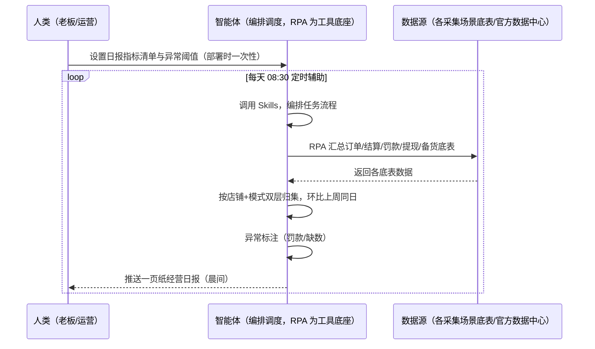
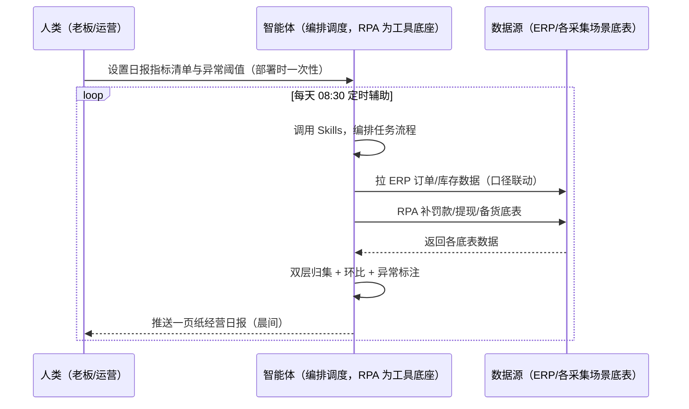

> 为 Temu 卖家团队打造的经营日报方案（老板驾驶舱，多店铺汇总）。老板每天早上问数据、手工汇总 1 小时；罚款/备货在途看不到；多店铺口径不统一。本方案由智能体调度多个工具执行汇总各采集场景底表（供货额/订单/罚款/提现/备货在途，半托管加广告花费），生成「一页纸」经营日报。每天 08:30 定时执行，晨间推送老板。

> Agent 自动化需开通企业功能
> 点击申请1个月免费权限
> [点击申请 →](https://skieer.feishu.cn/share/base/form/shrcnFwMayykP5iaL38fnZKTbrg)

## 一、用户与需求

核心矛盾：老板每天早上问数据、手工汇总 1 小时；罚款/备货在途看不到；多店铺口径不统一（按店铺+模式双层归集）。

两类客户痛点同源，数据来源不同：

- 未购 SaaS 客户（新卖家/小团队）：人工从各后台导数据、手工贴表格汇总，全靠手；
- 已购 SaaS 客户（店小秘 ERP 等）：ERP 管订单库存，经营日报汇总层（罚款/备货在途/提现）不覆盖，仍要人手工汇总。

适用客户：多店铺（店群）卖家。本场景为「汇总层」：数据源 = 各采集场景底表（订单导出/结算对账/罚款预警/余额提现/备货监控）+ 官方数据中心。

### 1.1 不同模式卖家

| 类型 | 选择 | 建议 |
|-|-|-|
| 全托管 | 首选 | 强烈推荐（核心指标=供货额/备货在途/罚款，无广告无客服，与国内平台日报差异大） |
| 半托管 | 次选 | 一般推荐（增加广告花费与 ROI） |
| 平台模式 | 任意 | 试点中，指标口径待确认 |

### 1.2 不同类目卖家

| 类目 | 最关注维度 | 核心逻辑 |
|-|-|-|
| 3C 数码 | 供货额波动 | 迭代快，日报跟踪紧密 |
| 家居家具 | 备货在途 | 大件备货周期长 |
| 美妆个护 | 罚款金额 | 品质罚款看板 |
| 服装鞋帽 | 季节趋势 | 换季日报环比 |
| 户外运动 | 旺季峰值 | 旺季日报密集 |
| 母婴用品 | 健康分 | 官方健康分看板 |

### 1.3 不同角色用户

| 用户 | 需求 | 问题 | 投入时间（估算） |
|-|-|-|-|
| 老板 | 一页纸晨报 | 手工汇总 1 小时 | 0.5-1 小时/周 |
| 运营 | 指标环比 | 多店铺口径不一 | 1 小时/周 |
| 财务 | 罚款/提现看板 | 看不到罚款与在途 | 0.5 小时/周 |

---

## 二、现在的方法与问题

### 2.1 流程步骤与问题总结

人工方式（未购 SaaS 客户）

| 序号 | 步骤 | 现在的方法 | 问题缺陷 |
|-|-|-|-|
| 1 | 拉数据 | 各后台手动导出 | 费时、易漏 |
| 2 | 汇总 | 手工贴表格 | 口径不一 |
| 3 | 算环比 | 手动算 | 无统一口径 |
| 4 | 标异常 | 凭经验 | 罚款/在途看不到 |
| 5 | 发晨报 | 手动整理发群 | 老板等数据 |

SaaS 方式（已购 ERP 客户）

| 序号 | 步骤 | 现在的方法 | 问题缺陷 |
|-|-|-|-|
| 1 | 拉数据 | ERP 部分覆盖 | 罚款/提现不覆盖 |
| 2 | 汇总 | 半自动 | 汇总层不完整 |
| 3 | 算环比 | 靠人 | 口径不一 |
| 4 | 标异常 | 靠人 | 无异常标注 |
| 5 | 发晨报 | 手动 | 无自动推送 |

### 2.2 问题分析

人工方式根因

| 序号 | 根因 | 具体表现 |
|-|-|-|
| 1 | 手工汇总 1 小时 | 各后台导数据费时 |
| 2 | 罚款/在途看不到 | 日报指标不全 |
| 3 | 多店铺口径不一 | 按店铺+模式双层归集缺失 |

**SaaS 方式根因**

| 序号 | 根因 | 具体表现 |
|-|-|-|
| 1 | 汇总层不覆盖 | ERP 管订单，罚款/备货/提现不汇总 |
| 2 | 无自动推送 | 晨报靠人发 |

---

## 三、解决方案

### 3.1 功能概述

为 Temu 卖家团队打造的经营日报方案（老板驾驶舱，多店铺汇总），汇总各采集场景底表，生成「一页纸」经营日报。

每天 定时触发并调度多个工具，调起八爪鱼 RPA（Agent 的工具底座，能耦合多系统、完成自动化任务执行）汇总各店铺昨日供货额/订单/罚款/提现/备货在途（半托管加广告花费）数据，智能体生成「一页纸」经营日报（按店铺+模式双层归集、环比上周同日、异常标注）。每天 08:30 定时执行，晨间推送老板。

### 3.2 系统结合

| 要素 | 说明 |
|-|-|
| 客户现有工具盘点 | **未购 SaaS 客户**：无第三方工具，日报全靠手工汇总。     **已购 SaaS 客户**（主流组合）：店小秘 ERP（管订单库存，汇总层不覆盖） |
| 数据/能力来源 | **无 SaaS**：各采集场景底表（订单导出/结算对账/罚款预警/余额提现/备货监控）+ 官方数据中心（健康分/售罄率/动销）。     **有 SaaS**：ERP 订单/库存数据 + 各场景底表（汇总口径联动） |
| RPA 耦合动作 | 作为 Agent 的工具底座，每天 08:30 汇总各场景底表（各底表口径校验、缺数标注），统一流转给智能体；任一数据源失败自动重试、缺数告警 |
| 耦合出的新价值 | 单工具给不了的端到端结论：各场景底表一次取齐 → 双层归集 → 环比计算 → 异常标注 → 一页纸晨报，**晨间自动推送老板** |

### 3.3 智能体执行流程

智能体定时触发。支持**两种数据通道**，部署时按客户现有工具选择：

**通道一：无 SaaS 方式（RPA 汇总各场景底表，适合未购 ERP 的客户）**

**通道二：有 SaaS 方式（ERP 数据联动 + RPA 补底表，适合已购客户）**

> Agent 自动化需开通企业功能
> 点击申请1个月免费权限
> [点击申请 →](https://skieer.feishu.cn/share/base/form/shrcnFwMayykP5iaL38fnZKTbrg)

### 3.4 为何这么设计

要同时回答三个问题：**为什么不能只用 SaaS/API？为什么不能纯靠智能体写代码？为什么 RPA 是执行底座？** 本场景的核心是"每日汇总、双层归集、环比异常、挂了有人管"。

#### 1）逐项对比

| 对比维度 | SaaS/API 堆叠（ERP） | 纯智能体（智能体写代码） | 智能体+自动化工具（RPA 工具底座） |
|-|-|-|-|
| 实现方式 | ERP 管订单，汇总层不覆盖 | 能抓数据能算，但全要自己接 | 各场景底表汇总 + 双层归集 |
| 每日定时 | 不覆盖 | 智能体无法常驻轮询 | RPA 每天 08:30 定时执行 |
| 汇总口径 | 无 | 需自建汇总逻辑 | 归集规则可视化配置 |
| 使用成本（总拥有成本） | ERP 订阅费（主体另算） | 代理 IP + 服务器 + 开发维护人力，隐性成本高 | 一份平台订阅跑多流程，单方案边际成本 ≈ 0 |
| 维护人要求 | 低（工具现成） | 规则调整都要开发介入 | 可视化流程，运营自己可调指标 |

#### 2）优劣势说明

|  | SaaS/API 堆叠（ERP） | 纯智能体（智能体写代码） | 智能体+自动化工具（RPA 工具底座） |
|-|-|-|-|
| 优势 | 订单/库存数据权威 | 无订阅费；     可深度定制日报模型 | 底表汇总+双层归集；     环比异常即开即用；     非技术人员可维护 |
| 劣势 | 汇总层不覆盖 | 归集与计算全自建；     AI 生成代码是生成性的 | 本地电脑运行需保持开机；     订阅费；     依赖各采集场景数据就绪 |

#### 3）结论

| 论点 | 说明 |
|-|-|
| 汇总层定位 | 本场景是「汇总层」：数据源 = 各采集场景底表 + 官方数据中心，依赖各场景数据就绪后价值最大化 |
| 全托管指标差异大 | 全托管核心指标 = 供货额/备货在途/罚款（无广告、无客服指标，与国内平台日报差异大）；半托管增加广告花费与 ROI |
| 分阶段实施 | 一期先搭官方报表拉取基础版，二期各采集场景就绪后升级完整版 |
| 一个底座跑多流程 | 客户购买 RPA 平台是跑多个流程（日报/对账/罚款），本方案只是其中一个——平台订阅费被多流程摊薄 |
| 时间 | 老板要的是"晨间一页纸"，不是"等运营手工汇总 1 小时" |

### 3.5 功能清单

| 功能 | 系统 | 功能说明（解决问题） |
|-|-|-|
| 会话/定时 | 智能体 | 1. 理解人类语言，调用已预设好的 Skills。     2. 编排多任务、调度多工具。 |
| 多系统数据取数 | RPA、指纹浏览器 | 1. 解决手工汇总 1 小时、口径不一问题。     2. 作为智能体工具底座被调度执行，各底表口径校验、缺数标注。     3. **【无 SaaS 方式】** RPA 汇总各采集场景底表。**【有 SaaS 方式】** ERP 数据联动 + RPA 补罚款/提现/备货底表。 |
| 双层归集 | 智能体 | 按店铺+模式（全托/半托）双层归集。 |
| 环比计算 | 智能体 | 环比上周同日，异常阈值标注。 |
| 指标清单 | 智能体 | 供货额/订单数/罚款金额/提现/在途备货（+广告花费与 ROI，半托管）。 |
| 异常标注 | 智能体 | 罚款突增/缺数标注，可追溯。 |
| IM通知 | 飞书、钉钉、企微等 | 解决晨报交付滞后问题。一页纸日报晨间自动推送。 |
| 数据资产储存 | 本地电脑、云储存 | 1. Skills 资产：Temu 经营日报技能。     2. 数据储存：日报底表统一写入本地。     3. 经验知识库：口径迭代持续沉淀。 |

### 3.6 智能体执行落地过程

部署时一次性配置入参（日报指标清单、环比口径、异常阈值、推送群、数据通道），会话中无需重复输入。

**⚠️ 部署前提（不满足则方案无法跑起来）**：①RPA 需部署在**常开电脑/云机**上（每天 08:30 定时需常开），并配置漏跑补跑机制；②**依赖各采集场景底表就绪**（订单/结算/罚款/提现/备货）——建议与对应场景方案联动部署；③**有 SaaS 方式需 ERP 账号**（口径联动，可选增强，无则走底表归集通道）；④首次配置（指标清单、底表映射、环比口径）需服务方/技术人员介入一次，属实施成本。

#### 1）配置

| 类别 | 说明 |
|-|-|
| 智能体 | 主流智能体。 |
| 智能体工具 | 1. **数据通道（按客户现有工具二选一）**：【无 SaaS】各采集场景底表（RPA 归集）；【有 SaaS】ERP 数据联动 + RPA 补底表。     2. 数据取数与自动化执行：八爪鱼 RPA，MCP 配置完成。     3. 数据分析：智能体自带。     4. 数据报告：智能体自带。     5. IM：企业办公 IM（飞书/钉钉/企微），MCP 或 webhook 配置。 |
| 工作知识 | 1. 日报指标清单：供货额/订单数/罚款/提现/在途备货（+广告 ROI，半托管）。     2. 环比口径：上周同日。     3. 异常阈值。     4. 底表映射：订单/结算/罚款/提现/备货。 |
| 本地数据库 | 1. 日报底表库地址。     2. 指标口径库地址。     3. 经验库地址。 |

#### 2）执行

| 任务 | 产出 | 产出物接收人 |
|-|-|-|
| 接收指标清单，定时触发 | 任务启动记录 | —— |
| 调用已预设 Skills，编排任务流程 | 任务编排方案 | —— |
| 经 MCP 向八爪鱼 RPA 下发取数任务 | 自动化任务指令 | —— |
| 多源取数并按店铺对齐（无 SaaS：底表归集；有 SaaS：ERP+底表，智能体监控状态） | 对齐后日报数据 | —— |
| 双层归集（店铺+模式） | 归集结果 | —— |
| 环比计算 + 异常标注 | 日报草稿 | —— |
| 一页纸日报生成 | 经营日报 | 老板 |
| 晨间推送经营日报 | 群消息 | 老板/运营/财务 |

异常处理：

底表缺失 → 标注缺数并降级（一期基础版只拉官方报表）；

数据不一致 → 转人工核对；

环比异常 → 标注原因；

推送失败 → 重试并告警；

置信度 &lt;70% → 转人工复核，不输出硬结论。

#### 3）结果

| 结果 | 说明 |
|-|-|
| 数据资产 | 日报底表结构化数据（店铺/指标/环比/异常标注），可审计可追溯。 |
| 分析报告 | 1. 一页纸经营日报：供货额/订单/罚款/提现/在途。     2. 环比与异常标注。 |
| Skills | 智能体 Skills：Temu 经营日报技能，按口径迭代汇总逻辑。 |

> Agent 自动化需开通企业功能
> 点击申请1个月免费权限
> [点击申请 →](https://skieer.feishu.cn/share/base/form/shrcnFwMayykP5iaL38fnZKTbrg)

---

## 四、使用前后预估

> 本方案价值 = **各场景底表自动汇总 → 按店铺+模式双层归集 → 环比计算 → 异常标注 → 一页纸晨报**。本场景为「汇总层」，依赖各采集场景数据就绪后价值最大化。

| 指标 | 人工 | SaaS/API（ERP） | 智能体+自动化工具 |
|-|-|-|-|
| 晨报汇总 | 手工 1 小时 | 部分覆盖 | 自动汇总 08:30 推送 |
| 双层归集 | 口径不一 | 无 | 店铺+模式自动归集 |
| 环比计算 | 手动算 | 无 | 自动环比上周同日 |
| 异常标注 | 凭经验 | 无 | 罚款/缺数自动标注 |
| 指标完整性 | 罚款/在途看不到 | 不覆盖 | 供货额/罚款/提现/在途全量 |
| 方法论 | 无 | 单工具 | 可复用的 Skills 与口径库 |

**说明**：Temu 经营日报为「汇总层」场景：数据源 = 各采集场景底表（订单导出/结算对账/罚款预警/余额提现/备货监控）+ 官方数据中心（健康分/售罄率/动销），大促期可挂接 TEMU 活动数据导出应用补充活动销售数据；全托管卖家核心指标 = 供货额/备货在途/罚款（无广告、无客服指标，与国内平台日报差异大）；半托管增加广告花费与 ROI；无专属应用需自建（汇总逻辑复用各场景底表）；一期先搭官方报表拉取基础版，二期各采集场景就绪后升级完整版。

---

## 五、效果证明

> Agent 自动化需开通企业功能
> 点击申请1个月免费权限
> [点击申请 →](https://skieer.feishu.cn/share/base/form/shrcnFwMayykP5iaL38fnZKTbrg)

### 5.1 客户案例

**《小天鹅：7 平台 16 账号库存数据自动化，年省成本 50 万》**

> 美的集团旗下小天鹅事业部，7 个电商平台、16 个账号、每日 86 张报表原需专员逐个登录导出 7 小时/天。八爪鱼 RPA 替代全部人工采集，7 大系统、25 类报表自动采集入库。

| 效果 | 说明 |
|-|-|
| 提效 | 多平台报表采集效率提升约 85%。原本 7 个平台 16 个账号、86 张报表需逐个登录导出，每天耗 7 小时，现在全自动采集入库；数据时效由 T+2 提升至 T+1，部分平台已 T+0。 |
| 降本 | 减少数据专员 2 人（原文：2 名全职数据专员的「搬数据」工作被完全替代，年节省人力成本 50 万元）。原本需 2 人全职导表，现在 0 人；2 名专员转岗至数据分析岗，投入库存分析、周转率优化、滞销品预警等高价值工作。 |
| 任务 | 7 个电商平台 16 个账号、25 类报表自动采集入库；错误率降至 0.1%。 |
| 任务 | 天猫指纹浏览器、苏宁每 2 小时定时抓取、京东按事业部隔离账号，多平台差异化策略稳定运行。 |

案例详情：[小天鹅：百亿级洗衣机巨头的多平台库存数据自动化实践](https://skieer.feishu.cn/wiki/Q6Qjw2FtDiNFgWkOVHacEFJ0nlh)

**《大疆：十余平台 × 7 大类营销与客服数据自动采集》**

> 十余个国内外电商平台与社媒渠道，直播、评论、客服会话、搜索等非结构化数据原需大量人力处理。RPA 完成十余个系统、7 大类核心数据自动采集入库。

| 效果 | 说明 |
|-|-|
| 提效 | 跨平台营销与客服数据采集效率显著提升。原本十余个平台与社媒渠道、7 大类数据需每日 5-6 小时人工导表，现在全自动采集入库，数据时效提升至 T+1。 |
| 降本 | 免除专职导表的人力投入，节约人力用于数据建模、投放复盘与客服策略分析等重点工作。 |
| 任务 | 覆盖十余个国内外电商平台与社媒渠道，含直播、评论、客服会话、搜索等 7 大类非结构化数据。 |
| 任务 | 形成全渠道统一数据底座，跨平台口径一致，供分析团队直接取用。 |

案例详情：[客服：全球无人机巨头跨平台电商与客服数据自动化采集](https://skieer.feishu.cn/wiki/OmO7wGX3yiASCBkqRsfcWPUMnOe)

---

## 六、备注

### 6.1 Agent 支持

本方案不绑定具体智能体，主流 Agent 均可运行（需支持技能/Skills 加载与工具调用）：

| Agent/智能体 | 说明 |
|-|-|
| Workbuddy | 本方案运行平台，支持技能/Skills 上传加载、定时任务、MCP 工具调用与表格/报告处理 |
| 豆包（国内·字节） | 国内主流个人智能体，支持技能上传、定时任务与工具调用，上手成本低 |
| 通义千问（国内·阿里） | 支持 Agent 编排与插件生态，集成阿里电商数据能力，适合电商场景 |
| DeepSeek（国内） | 推理能力强、成本低，适合规则打分与归因分析类任务 |
| ChatGPT（国外·OpenAI） | 海外主流通用智能体，支持 GPTs/Agent 模式与工具调用 |
| Claude（国外·Anthropic） | 长文本与结构化分析能力强，原生支持 MCP 连接外部工具 |

### 6.2 名词解释

| 术语 | 说明 |
|-|-|
| 汇总层 | 依赖各采集场景底表就绪的日报汇总段 |
| 双层归集 | 按店铺+模式（全托/半托）归集 |
| 一页纸日报 | 核心指标单页呈现，晨间推送老板 |
| 环比口径 | 上周同日对比 |
| 官方数据中心 | 健康分/售罄率/动销等官方指标（后台） |
| 混合数据源 | 各采集场景底表（RPA 归集）+ 官方数据中心 + ERP 数据（有 SaaS 客户联动） |
| 有 SaaS 方式 | 已购店小秘 ERP，数据联动 + RPA 补罚款/提现/备货底表 |
| 无 SaaS 方式 | 不购买第三方工具，RPA 汇总各场景底表 |
| 全托管 | 供货商模式，卖家只供货、平台定价销售（美区仅半托管） |
| 半托管 | 卖家自主运营与履约（美区主流模式） |
| MCP | Model Context Protocol，智能体连接外部工具的标准化通道 |

> Agent 自动化需开通企业功能
> 点击申请1个月免费权限
> [点击申请 →](https://skieer.feishu.cn/share/base/form/shrcnFwMayykP5iaL38fnZKTbrg)

---

原文：[查看原文](https://skieer.feishu.cn/wiki/X0A9w2zZfiGDlskOUXTc1cRgn0f)
