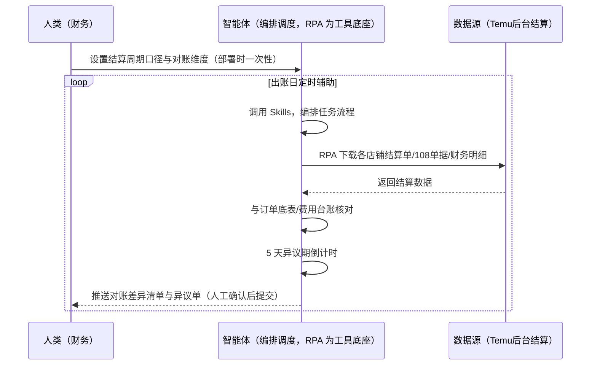
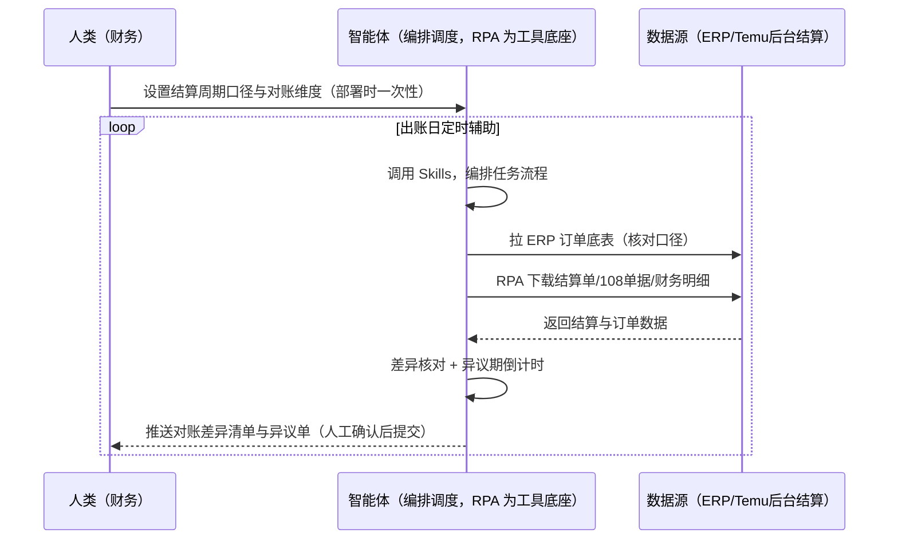

> 为 Temu 卖家团队打造的结算对账方案。结算数据公布后 5 个日历日内可提异议（逾期视为确认无误）；结算单据、多店铺财务明细逐笔核对费时。本方案由智能体调度多个工具执行下载各店铺结算单/108 单据/财务明细，按倒计时核对。出账日触发，只推送对账差异清单与异议单，提交异议由人工确认。

> Agent 自动化需开通企业功能
> 点击申请1个月免费权限
> [点击申请 →](https://skieer.feishu.cn/share/base/form/shrcnFwMayykP5iaL38fnZKTbrg)

[查看原视频](https://skieer.feishu.cn/wiki/N4cIwhLLviWFmHkXCcWcdN73nse)

## 一、用户与需求

核心矛盾：结算数据公布后 5 个日历日内可提异议（逾期视为确认无误，对账效率 = 资金安全）；108 结算单据、多店铺财务明细逐笔核对费时；结算规则复杂（官方 90 天内/实操本土 7-14 天、跨境 30-45 天）。

两类客户痛点同源，数据来源不同：

- 未购 SaaS 客户（新卖家/小团队）：人工下载结算单、逐笔核对订单明细/费用/罚款，全靠手；
- 已购 SaaS 客户（店小秘 ERP 等）：ERP 管订单库存，结算单下载与对账核对不覆盖，仍要人手动下载。

适用客户：多店铺/多站点卖家。现成应用直挂（Temu 结算单下载/多店铺财务明细/结算报告下载）。

### 1.1 不同模式卖家

| 类型 | 选择 | 建议 |
|-|-|-|
| 全托管 | 首选 | 强烈推荐（供货制结算明细多，对账必须） |
| 半托管 | 次选 | 一般推荐（自营履约，结算含广告费等） |
| 平台模式 | 任意 | 试点中，结算机制待确认 |

### 1.2 不同类目卖家

| 类目 | 最关注维度 | 核心逻辑 |
|-|-|-|
| 3C 数码 | 结算频次 | 订单量大，结算笔数多 |
| 家居家具 | 大额结算 | 单笔金额大，差异影响大 |
| 美妆个护 | 罚款扣项 | 罚款多，需逐项核对 |
| 服装鞋帽 | 多尺码 SKU | SKU 多，明细核对量大 |
| 户外运动 | 旺季结算 | 旺季单量暴增，结算密集 |
| 母婴用品 | 异议时效 | 5 天异议期，逾期视为无误 |

### 1.3 不同角色用户

| 用户 | 需求 | 问题 | 投入时间（估算） |
|-|-|-|-|
| 老板 | 资金安全 | 对账慢，差异默认认了 | 0.5 小时/周 |
| 财务 | 对账差异清单 | 逐笔核对费时 | 1-3 小时/周 |
| 运营 | 异议提交 | 5 天窗口易错过 | 0.5 小时/周 |

---

## 二、现在的方法与问题

### 2.1 流程步骤与问题总结

人工方式（未购 SaaS 客户）

| 序号 | 步骤 | 现在的方法 | 问题缺陷 |
|-|-|-|-|
| 1 | 下结算单 | 手动下载结算单/108 单据 | 多店铺逐个下，费时 |
| 2 | 核对 | 逐笔核对订单明细/费用/罚款 | 笔数多，易漏 |
| 3 | 找差异 | 凭经验找 | 差异默认认了 |
| 4 | 提异议 | 手动整理证据 | 5 天窗口错过 |
| 5 | 沉淀 | 无 | 对账规则不沉淀 |

SaaS 方式（已购 ERP 客户）

| 序号 | 步骤 | 现在的方法 | 问题缺陷 |
|-|-|-|-|
| 1 | 下结算单 | ERP 不覆盖 | 靠人下 |
| 2 | 核对 | 手动 | 无规则 |
| 3 | 找差异 | 凭经验 | 漏差异 |
| 4 | 提异议 | 手动 | 窗口错过 |
| 5 | 沉淀 | 无 | 不迭代 |

### 2.2 问题分析

人工方式根因

| 序号 | 根因 | 具体表现 |
|-|-|-|
| 1 | 逐笔核对费时 | 结算笔数多，易漏差异 |
| 2 | 5 天窗口错过 | 逾期视为确认无误 |
| 3 | 差异默认认了 | 无系统比对，亏损无声 |

**SaaS 方式根因**

| 序号 | 根因 | 具体表现 |
|-|-|-|
| 1 | ERP 不覆盖 | 结算单下载与对账无工具 |
| 2 | 无闭环 | 对账差异不申诉回填 |

---

## 三、解决方案

### 3.1 功能概述

为 Temu 卖家团队打造的结算对账方案，下载各店铺结算单/108 单据/财务明细，按「5 天异议期」倒计时核对结算数据。

出账日触发并调度多个工具，调起八爪鱼 RPA（Agent 的工具底座，能耦合多系统、完成自动化任务执行）下载各店铺结算单/108 单据/财务明细，智能体与订单底表/费用台账核对（订单明细/费用/罚款），输出对账差异清单与异议单。出账日触发，只推送对账差异清单与异议单，提交异议由人工确认。

### 3.2 系统结合

| 要素 | 说明 |
|-|-|
| 客户现有工具盘点 | **未购 SaaS 客户**：无第三方工具，结算全靠人工下载核对。    
**已购 SaaS 客户**（主流组合）：店小秘 ERP（管订单库存，结算对账不覆盖） |
| 数据/能力来源 | **无 SaaS**：Temu 后台结算单/108 单据/财务明细（现成应用直挂：Temu 结算单下载/多店铺财务明细/结算报告下载）。    
**有 SaaS**：ERP 订单底表（辅助核对口径）+ RPA 补结算单下载 |
| RPA 耦合动作 | 作为 Agent 的工具底座，出账日下载各店铺结算单（增量下载去重、幂等），统一流转给智能体；下载失败自动重试、异常告警 |
| 耦合出的新价值 | 单工具给不了的端到端结论：结算单一次取齐 → 与订单底表/费用台账核对 → 差异清单 → 异议单（附证据包），**只推送对账差异与异议单** |

### 3.3 智能体执行流程

智能体定时触发。支持**两种数据通道**，部署时按客户现有工具选择：

**通道一：无 SaaS 方式（RPA 下载结算单，适合未购 ERP 的客户）**

**通道二：有 SaaS 方式（ERP 订单底表辅助核对 + RPA 补结算单，适合已购客户）**

> Agent 自动化需开通企业功能
> 点击申请1个月免费权限
> [点击申请 →](https://skieer.feishu.cn/share/base/form/shrcnFwMayykP5iaL38fnZKTbrg)

### 3.4 为何这么设计

要同时回答三个问题：**为什么不能只用 SaaS/API？为什么不能纯靠智能体写代码？为什么 RPA 是执行底座？** 本场景的核心是"定时下载、规则核对、窗口提醒、挂了有人管"。

#### 1）逐项对比

| 对比维度 | SaaS/API 堆叠（ERP） | 纯智能体（智能体写代码） | 智能体+自动化工具（RPA 工具底座） |
|-|-|-|-|
| 实现方式 | ERP 管订单，结算对账不覆盖 | 能抓后台能算，但全要自己接 | 结算下载应用直挂 + 规则核对 |
| 定时下载 | 不覆盖 | 智能体无法常驻轮询 | RPA 出账日定时下载 |
| 差异核对 | 无 | 需自写对账规则 | 对账规则可视化配置 |
| 使用成本（总拥有成本） | ERP 订阅费（主体另算） | 代理 IP + 服务器 + 开发维护人力，隐性成本高 | 一份平台订阅跑多流程，单方案边际成本 ≈ 0 |
| 维护人要求 | 低（工具现成） | 规则调整都要开发介入 | 可视化流程，财务自己可调口径 |

#### 2）优劣势说明

|  | SaaS/API 堆叠（ERP） | 纯智能体（智能体写代码） | 智能体+自动化工具（RPA 工具底座） |
|-|-|-|-|
| 优势 | 订单底表权威（核对口径） | 无订阅费；    
可深度定制对账模型 | 结算下载应用直挂；    
规则核对即开即用；    
非技术人员可维护 |
| 劣势 | 结算对账不覆盖 | 下载与解析全自建；    
AI 生成代码是生成性的 | 本地电脑运行需保持开机；    
订阅费；    
异议提交需人工确认 |

#### 3）结论

| 论点 | 说明 |
|-|-|
| 5 天异议期=资金安全 | 结算数据公布后 5 个日历日内可提异议（逾期视为确认无误）——对账效率 = 资金安全（实锤） |
| 结算规则复杂 | 官方协议「满足条件后 90 天内」入账；实操本土店 7-14 天、跨境店/全托管 30-45 天；108 单据按批次管理、新店默认半月结（1 日/16 日出账） |
| ERP 覆盖不完整 | ERP 管订单，结算单下载与对账核对不覆盖——本方案补下载与规则核对 |
| 提交异议人工确认 | 涉及资金，提交异议由人工确认，本方案只出清单与证据包 |
| 一个底座跑多流程 | 客户购买 RPA 平台是跑多个流程（对账/利润/日报），本方案只是其中一个——平台订阅费被多流程摊薄 |
| 时间 | 财务要的是"差异清单 + 异议期倒计时"，不是"逐笔翻结算单" |

### 3.5 功能清单

| 功能 | 系统 | 功能说明（解决问题） |
|-|-|-|
| 会话/定时 | 智能体 | 1. 理解人类语言，调用已预设好的 Skills。    
2. 编排多任务、调度多工具。 |
| 多系统数据取数 | RPA、指纹浏览器 | 1. 解决逐笔核对费时、差异默认认了问题。    
2. 作为智能体工具底座被调度执行，增量下载去重、失败自动重试。    
3. **【无 SaaS 方式】** RPA 下载结算单/108 单据/财务明细。**【有 SaaS 方式】** ERP 订单底表辅助核对 + RPA 补结算单。 |
| 差异核对 | 智能体 | 结算单 vs 订单底表/费用台账核对（订单明细/费用/罚款），按单号匹配标记差异。 |
| 异议期倒计时 | 智能体 | 5 个日历日异议期倒计时，逾期视为确认无误。 |
| 异议单生成 | 智能体 | 差异清单 + 证据包自动归档（提交异议由人工确认）。 |
| IM通知 | 飞书、钉钉、企微等 | 解决对账滞后问题。对账差异与异议期提醒自动推送。 |
| 数据资产储存 | 本地电脑、云储存 | 1. Skills 资产：Temu 对账技能。    
2. 数据储存：结算底表统一写入本地。    
3. 经验知识库：对账规则持续沉淀。 |

### 3.6 智能体执行落地过程

部署时一次性配置入参（结算周期口径、对账维度、异议 SOP、数据通道），会话中无需重复输入。

**⚠️ 部署前提（不满足则方案无法跑起来）**：①RPA 需部署在**常开电脑/云机**上（出账日定时需开机），并配置漏跑补跑机制；②后台需登录下载，登录失效自动告警；③**提交异议由人工确认**，本方案只出清单与证据包（涉及资金）；④**有 SaaS 方式需 ERP 账号**（订单底表辅助，可选增强，无则走后台通道）；⑤首次配置（登录态、对账规则、周期口径）需服务方/技术人员介入一次，属实施成本。

#### 1）配置

| 类别 | 说明 |
|-|-|
| 智能体 | 主流智能体。 |
| 智能体工具 | 1. **数据通道（按客户现有工具二选一）**：【无 SaaS】Temu 后台结算（现成应用直挂）；【有 SaaS】ERP 订单底表 + RPA 补结算单。    
2. 数据取数与自动化执行：八爪鱼 RPA，MCP 配置完成。    
3. 数据分析：智能体自带。    
4. 数据报告：智能体自带。    
5. IM：企业办公 IM（飞书/钉钉/企微），MCP 或 webhook 配置。 |
| 工作知识 | 1. 结算周期口径：官方 90 天内 / 实操本土 7-14 天、跨境 30-45 天。    
2. 对账维度：商品/站点。    
3. 异议 SOP。    
4. 108 单据批次管理。 |
| 本地数据库 | 1. 结算底表库地址。    
2. 对账台账库地址。    
3. 经验库地址。 |

#### 2）执行

| 任务 | 产出 | 产出物接收人 |
|-|-|-|
| 接收结算口径，出账日触发 | 任务启动记录 | —— |
| 调用已预设 Skills，编排任务流程 | 任务编排方案 | —— |
| 经 MCP 向八爪鱼 RPA 下发取数任务 | 自动化任务指令 | —— |
| 多源取数并按单号对齐（无 SaaS：结算下载；有 SaaS：ERP+结算，智能体监控状态） | 对齐后结算数据 | —— |
| 差异核对（结算单 vs 订单/费用台账） | 差异清单 | 财务 |
| 异议期倒计时（5 个日历日） | 异议期提醒 | 财务 |
| 异议单生成（含证据包） | 异议单 | 财务 |
| 推送对账差异与异议单（人工确认后提交） | 群消息 | 财务/老板 |

异常处理：

下载失败 → 自动重试并告警；

结算数据缺失 → 标注待补；

差异无法归因 → 转人工核对；

异议期临界 → 告警提醒；

置信度 &lt;70% → 转人工复核，不输出硬结论。

#### 3）结果

| 结果 | 说明 |
|-|-|
| 数据资产 | 结算底表结构化数据（店铺/批次/明细/差异/状态），可审计可追溯。 |
| 分析报告 | 1. 对账差异清单：按单号标记差异。    
2. 异议单：差异 + 证据包。    
3. 异议期倒计时提醒。 |
| Skills | 智能体 Skills：Temu 对账技能，按异议结果迭代对账规则。 |

> Agent 自动化需开通企业功能
> 点击申请1个月免费权限
> [点击申请 →](https://skieer.feishu.cn/share/base/form/shrcnFwMayykP5iaL38fnZKTbrg)

---

## 四、使用前后预估

> 本方案价值 = **结算单自动下载 → 与订单/费用台账规则核对 → 差异清单 → 异议单（附证据包）→ 5 天异议期倒计时**。现成应用直挂（结算单下载/多店铺财务明细/结算报告下载）。

| 指标 | 人工 | SaaS/API（ERP） | 智能体+自动化工具 |
|-|-|-|-|
| 结算下载 | 多店铺逐个下 | 不覆盖 | 出账日自动下载去重 |
| 差异核对 | 逐笔手动 | 无 | 按单号规则核对 |
| 异议期 | 易错过 | 无提醒 | 5 天倒计时自动提醒 |
| 异议单 | 手动整理 | 无 | 差异+证据包自动归档 |
| 结算底表 | 无 | 无 | 对账/利润复用底表 |
| 方法论 | 无 | 单工具 | 可复用的 Skills 与对账规则 |

**说明**：结算机制（实锤）：官方协议「满足条件后 90 天内」入账、实操本土店 7-14 天/跨境全托管 30-45 天；5 个日历日异议期（逾期视为确认无误）；108 单据按批次管理、新店默认半月结（1 日/16 日出账）、最低提现门槛 50 美元；虚假发货冻结货款最长 90 天。

---

## 五、效果证明

> Agent 自动化需开通企业功能
> 点击申请1个月免费权限
> [点击申请 →](https://skieer.feishu.cn/share/base/form/shrcnFwMayykP5iaL38fnZKTbrg)

### 5.1 实操课程教程

[查看原视频](https://player.bilibili.com/player.html?bvid=1Q5Nw6uEwZ&share_source=copy_web&vd_source=f5433d20027ea8bdf7caa6bc4bc28220)

### 5.2 客户案例

Codex + RPA：以Teum 店铺自动对账 Codex 为例实操

**《旺店通慧经营：10+ 平台 50+ 类账单自动采集直传 ERP》**

> 10+ 电商平台普遍缺乏开放 API，账单数据需人工逐个登录导出，财务每天花数小时"搬数据"。RPA 打包为"慧采集 RPA"嵌入产品，账单自动采集并 API 直传 ERP。

| 效果 | 说明 |
|-|-|
| 提效 | 财务取数效率提升 57%。原本 10+ 电商平台账单需人工逐个登录导出，财务每天花数小时「搬数据」，现在 50+ 类账单自动采集并直传 ERP。 |
| 降本 | 年节约人力成本 24 万元（约合 2 人·年，按 12 万元/人年折算）。原本需专人逐平台导表并手动上传 ERP，现在全自动完成，人力转向经营分析与资金管理等高价值工作。 |
| 任务 | 10+ 平台、50+ 类账单自动采集，数据直接 API 传入 ERP，支撑 T+1 经营分析。 |
| 任务 | 指纹浏览器环境、Cookie 登录、集中预登录三重升级，保障采集稳定运行。 |

案例详情：[取数：ERP厂商的多平台账单自动化采集实践](https://skieer.feishu.cn/wiki/CQydwouU9i0yCPkgCpgc13Bxnhg)

**《财务跨系统对账机器人：5 分钟完成 10 天对账工作》**

> 财务需将自行统计的应收账单（邮件汇总 + SaaS 导出）与代理商统计的应付账单（云盘人工汇总）人工二次核对，涉及 VAT 与 EPR 两个场景且代理商众多。

| 效果 | 说明 |
|-|-|
| 提效 | 跨系统对账由 10 天压缩至 5 分钟。原本代理商账单分散在邮件与线下表格，财务需人工提取核验、反复对数，现在自动汇总、比对并输出差异清单。 |
| 降本 | 免除人工提取邮件与重复对数的投入，财务团队投入转向差异复核与资金管理等重点环节。 |
| 任务 | 打通线上系统与线下台账双重对账机制，标准化账单可自动生成。 |
| 任务 | 对账不平与异常账单自动标记进入人工复核清单，不自动放行资金动作。 |

案例详情：[对账|财务跨系统对账机器人，5min完成10天对账工作八爪鱼RPA](https://skieer.feishu.cn/wiki/S364wc0Xsisz71k81xKc1pfJnah)

---

## 六、备注

### 6.1 Agent 支持

本方案不绑定具体智能体，主流 Agent 均可运行（需支持技能/Skills 加载与工具调用）：

| Agent/智能体 | 说明 |
|-|-|
| Workbuddy | 本方案运行平台，支持技能/Skills 上传加载、定时任务、MCP 工具调用与表格/报告处理 |
| 豆包（国内·字节） | 国内主流个人智能体，支持技能上传、定时任务与工具调用，上手成本低 |
| 通义千问（国内·阿里） | 支持 Agent 编排与插件生态，集成阿里电商数据能力，适合电商场景 |
| DeepSeek（国内） | 推理能力强、成本低，适合规则打分与归因分析类任务 |
| ChatGPT（国外·OpenAI） | 海外主流通用智能体，支持 GPTs/Agent 模式与工具调用 |
| Claude（国外·Anthropic） | 长文本与结构化分析能力强，原生支持 MCP 连接外部工具 |

### 6.2 名词解释

| 术语 | 说明 |
|-|-|
| 108 单据 | Temu 结算单据体系，按批次管理 |
| 异议期 | 结算数据公布后 5 个日历日，逾期视为确认无误 |
| 半月结 | 新店默认半月结算（每月 1 日/16 日出账） |
| 金牌卖家 | 可申请周结（提前 15 天拿款） |
| 结算底表 | 结算单下载结构化入库，对账/利润复用 |
| 混合数据源 | Temu 后台结算（现成应用直挂）+ ERP 订单底表（有 SaaS 客户核对口径） |
| 有 SaaS 方式 | 已购店小秘 ERP，订单底表辅助核对 + RPA 补结算单 |
| 无 SaaS 方式 | 不购买第三方工具，RPA 下载结算单 |
| 全托管 | 供货商模式，卖家只供货、平台定价销售（美区仅半托管） |
| 半托管 | 卖家自主运营与履约（美区主流模式） |
| MCP | Model Context Protocol，智能体连接外部工具的标准化通道 |

> Agent 自动化需开通企业功能
> 点击申请1个月免费权限
> [点击申请 →](https://skieer.feishu.cn/share/base/form/shrcnFwMayykP5iaL38fnZKTbrg)

---

原文：[查看原文](https://skieer.feishu.cn/wiki/N4cIwhLLviWFmHkXCcWcdN73nse)
